# Weekly bank import with a Ctrl+Enter category walk

> **Research query:** Improve bank-transaction tracking after the closed
> `bob-cli-kd` epic. Ctrl+Enter on a bank row should jump to the next
> unticked row. The daily bank task in `gtd_daily.md` should carry a good
> Wells Fargo URL. That task should recur weekly, because downloading a QFX
> is too much toil for a daily chore. Support a user-configured category
> list and prompt for a category with a single keypress when Ctrl+Enter
> closes a row. Derive personal categories from yesterday's Mac
> `bob bank import` without exposing private detail. Lead the design so it
> is intuitive, reliable, and beautiful. Critique the plan, call out
> justified requirement adjustments, and end with a recommended solution.

## Bottom line

**Keep the Monday `Bank import` chore as the home of QFX download, the
category walk, and the surprise line. Retire daily `Acknowledge bank` as a
PRE duty. Put the official Wells Fargo download URL on `Bank import` with
`#browser`. Make Ctrl+Enter a forward ritual: category key-card, tick, jump
to the next waiting row.**

That is already most of what shipped in `bob-cli-kd`. Categories, rules,
learned naming, `[cat::]`, the daily chip, Enter-to-continue typing, and a
weekly import chore all exist. The missing piece is the *close ritual*:
Ctrl+Enter today only flips the checkbox byte, so the first import's seven
rows were ticked with no `[cat::]` and the walk is still a hunt.

**This is a good idea once the two chores are untangled.** The request
reads as one daily bank task that should become weekly and grow a URL plus
a category picker. The vault already has two chores. QFX download is a
browser job on Monday. Daily app-typing is the part the trial already
rejected as toil. Wiring those together as one weekly import walk matches
the evidence.

## Recommended solution

1. **Monday PRE chore, already weekly.** Keep
   `gtd_daily.md` **Bank import** (`every week on Monday when done`). Add
   `#browser` and the official download URL, using the same inline-link
   pattern as `Check [weather](...)`.
2. **Retire daily Acknowledge bank** as a repeating PRE duty. Completing
   it with nothing new is still true; it is no longer worth a morning slot.
   The daily chip on today's note stays the optional glance.
3. **Ctrl+Enter becomes the forward walk.** On a waiting bank row it
   assigns a category (or skips), ticks, and jumps to the next waiting row
   in the month note. It never unticks. It never talks to the `]s` review
   walk.
4. **A magenta key-card, one unique letter per category.** Reuse
   `.bob-key-card` from the decay and copy cards. Eighteen configured keys
   already cover the first import; seed unique `hotkey` letters rather than
   first letters, which collide.
5. **Plugin-local `[cat::]` write.** The editor already holds the line.
   `bob bank ack` only ticks. Do not spawn the CLI per row.
6. **Additive JSON `hotkey`, schema 1 unchanged.** Clients render the
   letter bob reports.

Proposed **Bank import** line:

```markdown
- [?] #task #gtd #pre #browser **Bank import**: download the last 14 days as [Quicken (QFX)](https://connect.secure.wellsfargo.com/auth/login/present?origin=cob&loginMode=jukePassword&serviceType=accountActivityDownload&LOB=CONS) from Wells Fargo · run `bob bank import ~/Downloads/*.qfx` · walk waiting rows with Ctrl+Enter · write one line in last week's note: what surprised me?  [repeat:: every week on Monday when done]
```

## Is this a good idea

**Yes.** Acknowledgment is still the product. The trial after `bob-cli-kd`
showed where the shipped ritual is thin, and this change set repairs that
thinness instead of inventing a second finance app.

What the request gets right:

- **Jump-next is the difference between a walk and a hunt.** A Monday
  import of a 14-day window is on the order of 40 waiting rows once the
  habit is live (the old `@BANK` log averaged about six lines on a spending
  day). Flipping a box and arrowing by hand will lose the room.
- **A URL on the chore is how PRE `#browser` already works.** Weather is
  `Check [weather](https://google.com/search?q=weather)`. Bank import
  should open the download page the same way.
- **Weekly QFX is the proven completeness loop.** `docs/bank.md` and the
  acknowledge guide already say Monday import proves "every." Daily QFX is
  the toil the request is trying to escape.
- **Single-keypress categories can succeed where optional typing failed.**
  The first import ticked seven ID-bearing outflows and wrote zero
  `[cat::]` fields. Learned naming only teaches from acknowledged
  ID-bearing rows that already carry a category. Without a close prompt,
  the flywheel never starts.

Where the request overfits:

- It treats `gtd_daily.md` as having one bank task. There are two: daily
  **Acknowledge bank** (open the app, type rows) and weekly **Bank import**
  (QFX, `bob bank import`, tick, surprise line). The URL and the weekly
  cadence belong on import. Making Acknowledge weekly would create a
  second Monday PRE that still says "open the Wells Fargo app."
- It asks to "start supporting" categories. `bank.md` already declares
  fourteen spending keys plus four builtins; JSON already returns them;
  import already applies rules and learned names; the plugin already
  suggests `[cat::` keys. The gap is the close gesture, plus unique
  letters so one keypress is unambiguous.
- Seven imported rows are too small a sample to invent new keys. A
  generic-token pass against the existing list assigned three rows to one
  configured spending key and left four unmatched. Zero rows needed a
  fifteenth key.

Would I take a different approach? **I would still do this, with the
adjustments below, and I would not wait for SimpleFIN/Teller.** The QFX
download is annoying. It is also official, posted-only, and already
implemented. An aggregator can replace the download later without changing
the walk.

## Critique of the plan as stated

The plan as stated is four features on one daily task. They split cleanly
across two existing objects, and one of those objects should go.

**Two chores, one job.** Daily Acknowledge says "open the Wells Fargo
app" and type ticked rows. Weekly Bank import says download QFX, run
`bob bank import ~/Downloads/*.qfx`, tick what it wrote, write a surprise
line. QFX download is documented by Wells Fargo as a Wells Fargo Online
browser flow (`Download Account Activity` under the Accounts tab), default
window 90 days, selectable From/To. The mobile app is the wrong surface.
Putting a download URL on the daily app-typing chore sends the Monday job
to the wrong place every other morning.

**Categories are configured and unused.** After the Mac import on
2026-11-13, `bob bank report -f json` shows `schema_version` 1, eighteen
categories, `waiting.all = 0`, `unclassified_out_cents = 24977`, and
account status `gap` with hint `QFX coverage gap 2026-11-11–2026-11-11`.
All seven rows are `[x]`, all seven have `^bank-<hex>`, none have
`[cat::]`. Optional categorizing lost to a silent checkbox flip.

**Ctrl+Enter is the wrong primitive today.** In
`task-status-cycler` `140-plugin-vim.js`, `<C-CR>` / `<C-Enter>` map to
`taskStatusCyclerToggleTaskOpenDone`. `192-bank-row-guard.js`
`cyclerBankLocalFlip` then writes a single status byte (` ` ↔ `x`) and
returns before `claimReviewWalkCtrlEnter`. No category, no jump, and a
second press unticks. That last part fights a walk: mash-through would
undo.

**Jump-next must stay bank-local.** Review-walk auto-advance is a task
machine (`]s` PRE → NEW → …). Bank rows carry no `#task` (glossary: Bank
Row). `bob-ledger-tools` already jumps with `bankOpenMonthPathAtLine`.
Reuse that. Do not capture a review origin.

**First letters are not unique.** Fourteen user keys plus `income`,
`refund`, `transfer`, `cash` share `c` (coffee, car, cash), `d` (dining,
dog), `h` (home, health), `s` (shopping, subscriptions), `f` (fun, fees),
and `t` (transit, transfer). A first-letter picker cannot be one keypress
without a second disambiguation card.

**Bulk ack must stay category-free.** `bank-ack-day` has no default
hotkey and calls `bob bank ack` with IDs. Catch-up after a lapse is "tick
the day." Requiring a category per row on that path would recreate the
skip spiral the original bank research warned about.



*Figure 1. Monday Bank import owns the browser download, the Ctrl+Enter
category walk, and the surprise line. The daily chip stays an optional
glance with no PRE duty. Rendered with `@mermaid-js/mermaid-cli@12.0.0`,
552×564 px, fit 100%.*

## Facts that decide the design

Counted 2026-11-13 from the live vault, `bob bank list/report -f json`,
`bank.md`, `gtd_daily.md`, Wells Fargo's Account Activity FAQ, and the
`bob-cli-kd` implementation in bob-cli plus bob-plugins.

| Fact | Evidence | Why it matters |
| --- | --- | --- |
| Two PRE chores already exist | `gtd_daily.md:13` Acknowledge bank, `every day when done`, "open the Wells Fargo app". `gtd_daily.md:22` Bank import, `every week on Monday when done`, QFX + `bob bank import`. | The URL and weekly cadence have a home. Acknowledge is the toil. |
| `#browser` is a PRE stage | `freshness.pre_stages: [terminal, periods, browser]`. Weather, email, and calendar already use `#browser`. Weather inlines a markdown URL. | Bank import should join that stage and carry a link. |
| QFX is a signed-in browser download | [Wells Fargo Account Activity FAQ](https://www.wellsfargo.com/help/online-banking/activity-faqs/), "How can I download my account history?": sign on and open [download your account activity](https://connect.secure.wellsfargo.com/auth/login/present?origin=cob&loginMode=jukePassword&serviceType=accountActivityDownload&LOB=CONS). Default 90 days; choose From/To. Format includes Quicken Web Connect. | Official URL. Last-14-days is a date choice on that page. The app cannot replace it. |
| Categories already configured | `bank.md` `bank.categories` has 14 spending keys. Builtins `income`, `refund`, `transfer`, `cash` always exist. JSON `categories[]` is `{key,emoji,label,builtin}`. | "Start supporting categories" is a ritual problem. |
| One transfer rule | `bank.rules`: `match: VENMO`, `cat: transfer`. | Rules already fire at import. The card is for the unmatched rest. |
| Learned naming is tier 2 | `src/native/bank/naming.rs`: rule, then last acknowledged ID-bearing row with the same journal merchant (payee, category, links), then WF builtins, then cleaned description. | Categorizing on close teaches next week's import. Silent ticks teach nothing. |
| First import is uncategorized | 7 rows, all `[x]`, all `^bank-<hex>`, 0 `[cat::]`, 0 flags, 0 wikilinks, 0 notes. 6 unique payees, 1 repeat. All outflows, 24,977 cents. Amount buckets: 4 in $5–15, 1 in $15–40, 1 in $40–100, 1 ≥$100. Generic-token match onto existing keys: 3 assigned, 4 unmatched, 0 new keys. | Keep the 14+4 list. The close prompt is how those 7 (and the next 40) get labeled. |
| Account is `gap` | `start: 2026-11-11`, `last_import: 2026-11-13`, `balance_asof: 2026-11-12`, hint a one-day hole on 2026-11-11. `delta_cents: 0`. | Next Monday's 14-day QFX should cover it. Not a new feature. |
| Ctrl+Enter flips a byte | `cyclerBankLocalFlip` in `192-bank-row-guard.js`; vim map in `140-plugin-vim.js`; command path in `160-plugin-completion.js`. Comment: "flip space/x as plain bytes." | Split the forward ritual off this flip. |
| Jump helper exists | `bankOpenMonthPathAtLine` in `241k-plugin-bank-actions.js` / `241m-plugin-bank-cards.js`. Month card already has "Jump to first waiting." | Bank-local walk has a primitive. |
| Enter is typing, not close | Month-note Enter continues with `- [x] $`. `[cat::` editor suggest inserts the key. | Keep Enter. Ctrl+Enter is the other hand. |
| Bulk ack ignores categories | `bob bank ack` ticks IDs or `-D DAY`. Plugin command `bank-ack-day` has no default hotkey. Ack JSON has no category field. | Catch-up stays a tick. |
| JSON schema is 1 | Rust `SCHEMA_VERSION` in `ack.rs` / `list.rs` / `report.rs` / `check.rs` / `ensure.rs`; plugin `BANK_SCHEMA_VERSION = 1`. `category_json` has no `hotkey`. | Additive `hotkey` does not bump the schema. |
| Key-card CSS exists | `.bob-key-card-*` in `bob-navigation-hotkeys/styles.css`, used by the decay card and Cmd+Y copy card. Opening-chord swallow, Esc, Enter, letter keys. | The category picker can look like a Bob card on day one. |
| Bank hue is magenta | `bankCardRootHue("bank.md")` in ledger-tools. | The new card should wear the same owner hue. |

Privacy note on the import sample: payee strings, merchants, and any
household detail stay out of this report. Counts, cents totals, and
generic-token assignment onto *already configured* keys are the only
signals used.

## Requirement adjustments (called out)

| # | You asked for | Adjusted to | Why |
| --- | --- | --- | --- |
| **ADJ-A** | A good Wells Fargo URL on the daily bank task | Put the official `accountActivityDownload` URL on **Bank import**, with `#browser` | QFX is a signed-in browser download. Daily Acknowledge says "open the app." The weather chore already shows how a `#browser` PRE row carries a markdown link. |
| **ADJ-B** | Change "this task" so it recurs weekly | Keep Bank import weekly. **Retire Acknowledge bank** as a repeating PRE duty. Keep the daily chip. | Bank import is already `every week on Monday when done`. Making Acknowledge weekly would duplicate Monday PRE and keep the wrong surface (the app). |
| **ADJ-C** | Prompt for a category on every Ctrl+Enter close | Prompt when the waiting row has no `[cat::]`. **Space on the card skips** (tick, no category, still jump). Esc cancels with no write. | Required categorizing is how the original bank research said the ritual dies. Skip keeps Monday recoverable. |
| **ADJ-D** | Mine yesterday's import for personal categories | **Keep the existing 14+4 keys.** Seed unique hotkeys. Do not add a fifteenth key from seven rows. | Three rows already sit on one configured spending key; four need a human look; none need a new name. |
| **ADJ-E** | Ctrl+Enter closes and jumps | **Ctrl+Enter is forward-only:** card if needed, tick, jump. **Silent checkbox flip** (click, and the current byte-flip path) remains the undo. | Today's Ctrl+Enter *is* the flip, so a second press unticks. A walk cannot share a key with undo. |
| **ADJ-F** | Jump to the next unticked bank row | Bank-local walk in the current month note via `bankOpenMonthPathAtLine`. After the current line, wrap to the first remaining waiting row. Isolated from `]s`. | Bank rows are not tasks. Review-walk auto-advance would steal Ctrl+Enter. |
| **ADJ-G** | User-configured categories | They are already configured. Add an optional unique **`hotkey`** on each category. JSON grows an additive `hotkey` field. **Do not bump `schema_version`.** | First letters collide. Clients should render the letter bob reports. |
| **ADJ-H** | (implicit) replace QFX toil later | Leave SimpleFIN/Teller-style live sync snoozed. | The walk and the URL make weekly QFX tolerable. An aggregator can replace the download without changing close or categories. |
| **ADJ-I** | (implicit) CLI `bob bank ack --cat` | **Plugin-local editor write** of the checkbox and `[cat:: key]`. | Ack has no category flag, spawning races the buffer, and the cycler already writes bytes. |
| **ADJ-J** | Single keypress | Unique `[a-z]` hotkeys, including builtins. Config error on duplicates or on letters outside `a-z`. | 18 keys fit in 26 letters. Disambiguation cards would break the one-press promise. |
| **ADJ-K** | (implicit) recategorize the first seven | Ctrl+Enter on an **already-acked row with no `[cat::]`** opens the card, stays ticked, then jumps. Acked rows that already have a category jump with no write. | Otherwise the cold-start rows stay unclassified forever, and learned naming never sees them. |

## Design

### 1. Cadence and the Wells Fargo URL

Monday is the ritual. The daily chip (`241n-plugin-bank-daily-chip.js`)
already paints `🏦 out $… · in +$…` on today's note and jumps to that day
on click. That is enough of a glance for a coffee-line check without a PRE
slot.

**Bank import** keeps `every week on Monday when done` and gains:

- `#browser`, so it sorts into the browser PRE stage
- the official download URL as an inline markdown link
- "walk waiting rows with Ctrl+Enter" in place of "tick what it wrote
  (bob bank)"
- the surprise line, unchanged

The 14-day window stays. Wells Fargo defaults to 90 days; the From/To
picker on that page is how "last 14 days" happens. Overlap with last
Monday is free: import matches seen IDs and no-ops a second file.

**Acknowledge bank:** complete or cancel the open occurrence and drop
`[repeat::]` so it stops spawning. Typed rows still work: Enter continues
with `- [x] $`, and a typed row is born acknowledged. People who want to
type a coffee on the day it posts still can. Morning review no longer
demands it.



*Figure 2. Ctrl+Enter is a forward ritual. Waiting rows with a category
tick and jump; waiting rows without one open the key-card. Already-acked
rows jump without writing or unticking. Space on the card skips the
category. Esc writes nothing. Rendered with
`@mermaid-js/mermaid-cli@12.0.0`, 604×826 px, fit 100%.*

### 2. Ctrl+Enter close ritual

**Waiting + `[cat::]` already present** (rule or learned from last week):
tick, jump. No card. This is the steady state after a few Mondays.

**Waiting + no category:** open the key-card. A letter writes `[cat::
key]` in the tail (before `^bank-<hex>`), ticks, jumps. Enter accepts the
highlighted row (learned/rule preselect when one exists, otherwise the
first spending key). Space ticks with no category and jumps. Esc leaves
the line untouched.

**Already acknowledged + no category:** open the same card, keep `[x]`,
then jump to the next waiting row, or if none remain, the next
acked-without-`[cat::]` in the month. This is how the seven cold-start
rows get labeled without being undone.

**Already acknowledged + has category:** jump to the next waiting row, no
write.

**Undo** is the silent checkbox flip `cyclerBankLocalFlip` already owns.
Clicking the box, and any Space mapping that still hits that helper, stay
byte-only: no card, no jump. Ctrl+Enter never unticks.

**Jump rules:**

- Same month note, document order, bank rows only (amount checkbox under
  a day heading). Skip stubs and non-rows.
- Search forward from the line just written; if none, wrap to the first
  remaining waiting row.
- If the queue is empty, stay and notice `Bank · nothing waiting`.
- Park the cursor on the destination line via `bankOpenMonthPathAtLine`.
- Do not call `claimReviewWalkCtrlEnter` or `walk.capture`.

**Write rules:**

- One editor transaction: optional `[cat:: key]` insert plus status `x`.
- Unknown keys are impossible if the card only offers JSON categories.
- Do not spawn `bob bank ack`.
- Do not touch the private `.bob/bank/<host>.jsonl` journal; import owns
  that.
- `bank-ack-day` and `bob bank ack -D` stay ticks-only.

**Opening-chord swallow.** Ctrl+Enter opens the modal. The decay card
already ignores the still-held Control/Enter until keyup
(`openingChordKeys` in `060-decay-card-modal.js`). Copy that, or the
opening Enter would accept the first row immediately.

### 3. Category list and unique hotkeys

Keep the fourteen spending keys in `bank.md` and the four builtins. Seed
unique letters as an explicit `hotkey` so the plugin never guesses:

| Key | Hotkey | Mnemonic |
| --- | --- | --- |
| groceries | g | first letter |
| dining | d | first letter |
| coffee | c | first letter |
| transit | n | traiN |
| car | a | automobile |
| home | h | first letter |
| utilities | u | first letter |
| dog | o | dOg |
| kids | k | first letter |
| health | p | pills |
| shopping | s | first letter |
| subscriptions | b | bills |
| fun | f | first letter |
| fees | e | fEes |
| income | i | first letter |
| refund | r | first letter |
| transfer | t | first letter |
| cash | m | ATM |

String labels stay valid:

```yaml
categories:
  groceries: 🛒 Groceries
```

A mapping form pins a letter:

```yaml
categories:
  transit:
    label: 🚆 Transit
    hotkey: n
```

When `hotkey` is omitted, bob assigns the first unused letter of the key,
then the rest of `a-z`. Explicit duplicates, non-`[a-z]` values, and
collisions with an assigned builtin are `bank_hotkey_duplicate` /
`bank_hotkey_invalid` findings at `check` time, with a line and key path.
`BANK_KEYS` in `config.rs` stays `accounts`, `categories`, `rules`,
`stale_after`.

JSON (schema 1, additive):

```json
{
  "key": "transit",
  "emoji": "🚆",
  "label": "Transit",
  "builtin": false,
  "hotkey": "n"
}
```

The plugin renders `hotkey` from JSON and never re-derives. Mac capture
does not close bank rows, so it can ignore the field.

### 4. The card, so it is beautiful

The decay card and Cmd+Y copy card already taught the room: compact modal,
keycap, one row per choice, quiet footer, magenta would clash on those
cards because they are not bank-owned. This one is. Use `.bob-key-card`
tokens and the bank owner hue from `bankCardRootHue`.

Layout:

- Title: payee and amount of the current row, one line, no extra
  metadata.
- If a learned or rule category exists, that row is preselected and the
  title line can read `Enter · ☕ Coffee`.
- Two columns: spending keys in declared order on the left (the fourteen),
  builtins on the right (income, refund, transfer, cash). Eighteen rows in
  one column would be taller than a Highlights text box; two columns keep
  the card inside the 650×700 px comfort zone.
- Each row: keycap (`.bob-key-card-key`), emoji, label.
- Footer: `letter` assign · `Enter` accept · `Space` skip · `Esc` cancel.

Motion stays inside the existing 0.12s hover transition. No new animation
language. Focus ring on the selected row matches `.bob-key-card-row:focus`.

Muscle memory is the long-term beauty. After two Mondays, the letters are
the UI and the card is a cheat sheet. Learned naming then hides the card
for repeat merchants, which is the best version of beautiful: most rows
are Ctrl+Enter, tick, jump, no modal.

### 5. Reliability

- **Idempotent import** already matches seen IDs. The walk can be
  interrupted and resumed: jump-next searches waiting rows, so a
  half-finished Monday continues where the boxes are still `[ ]`.
- **Esc is the only no-op.** A held Ctrl+Enter cannot accept.
- **Wrap, do not wander.** Staying inside the month note avoids a
  surprise jump into next month near a boundary. The month card's "first
  waiting" remains the cross-day entry point. A 14-day window that
  crosses months is two walks, which is honest.
- **Coverage gap** on 2026-11-11 is an import window issue. The next
  Monday 14-day file should close it. Do not invent a backfill command.
- **`bob bank check`** already errors on unknown `[cat::]`. The card
  cannot introduce that finding if it only offers JSON keys.
- **Tests:** cycler fixtures for "Ctrl+Enter on waiting / acked /
  stub"; config parse for string vs mapping vs duplicate hotkey; JSON
  snapshot with `hotkey` present and `schema_version` still 1; plugin
  jump wrap; opening-chord swallow.

## Implementation sketch

One small epic, plugin-first with a CLI companion so every client agrees
on letters.

| Slice | Where | What |
| --- | --- | --- |
| Vault copy | `gtd_daily.md`, `bank.md` | Bank import URL + `#browser`. Retire Acknowledge repeat. Pin hotkeys on the fourteen keys plus builtins that need a non-first letter. |
| JSON hotkey | `src/native/bank/{config,check,list,report,import_run}.rs` | Dual-form parse, unique `[a-z]`, additive `hotkey` on `category_json`. Schema stays 1. |
| Ctrl+Enter ritual | `task-status-cycler` `140` / `160` / `192` | Waiting path opens the card instead of `cyclerBankLocalFlip`. Acked-with-cat jumps. Silent flip remains on the old helper. Return before review-walk capture. |
| Key-card | `bob-ledger-tools` + `bob-navigation-hotkeys` styles | New modal, `.bob-key-card`, bank magenta, two columns, opening-chord swallow. |
| Write + jump | `241k-plugin-bank-actions.js` | Insert `[cat:: key]`, set `x`, `bankOpenMonthPathAtLine` to next waiting. |
| Docs | `docs/bank.md`, `docs/guides/acknowledge-bank-transactions.md`, plugin reference | Monday walk, URL, hotkeys, skip, bulk ack still ticks-only. |

Read `sase/memory/cli_rules.md` and `sase/memory/docs.md` before the CLI
and docs slices. No new `bob bank` subcommand. No `--cat` flag in v1.

Out of this epic: subscriptions album (`bob-cli-kt` territory), live bank
sync, budgets, split transactions, recategorize-all command, crossing
month notes in the walk.

## Alternatives considered

| Alternative | Verdict |
| --- | --- |
| Convert Acknowledge bank to weekly and keep both Monday chores | Duplicate PRE. Import already is the weekly duty. |
| Convert Acknowledge to weekly and delete Bank import | Loses the import command, the 14-day window, and the surprise line. |
| First-letter keys plus a collision card | Breaks one-press. Six collisions in the current list. |
| Number keys 1–9 then a–i | Not mnemonic. Letters are the Bob card language. |
| Require a category on `bank-ack-day` | Punishes catch-up. The original research's skip spiral. |
| Spawn `bob bank ack --cat` per row | Ack has no category flag today; spawn races the editor; cycler already writes bytes. |
| Feed bank rows into `]s` auto-advance | Bank rows are not tasks. PRE would mix chores with a 40-row ledger. |
| Wait for SimpleFIN/Teller | Weekly QFX plus a URL is enough to restart the habit now. |
| Invent new categories from seven rows | Underpowered. The 14+4 list already covers the sample. |
| Bump `BANK_SCHEMA_VERSION` | Additive field. Clients ignore unknown keys today; keep 1. |

## Open questions for the implementer

These do not block the design. They are edge calls to pin in the plan:

1. **Wrap vs stop at the last waiting row.** This report wraps to the
   first remaining waiting row so a walk that started mid-note still
   drains the month. Stopping is simpler and slightly easier to test.
2. **Month boundary.** A 14-day file near the 1st writes two month
   notes. v1 walks one note. The month card already jumps to first
   waiting if you need the other file.
3. **Builtin hotkeys in `bank.md`.** Builtins can stay implicit if the
   assigner always gives them `i r t m`. Pinning them in the mapping form
   makes the cheat sheet visible in the hub.

## Sources

- Vault: `gtd_daily.md` (Acknowledge bank, Bank import, `#browser` weather
  link), `bank.md` (`bank.categories`, `bank.rules`), `bank/2026-11.md`
  (seven imported rows).
- Live CLI: `bob bank list -f json`, `bob bank report -f json`
  (`schema_version` 1, 18 categories, `unclassified_out_cents` 24977,
  account `gap`).
- bob-cli: `docs/bank.md`, `docs/guides/acknowledge-bank-transactions.md`,
  `docs/reference/cli/bank.md`, `src/native/bank/{config,naming,ack,cli,check,list,report,import_run}.rs`.
- bob-plugins: `task-status-cycler/src/{140-plugin-vim,160-plugin-completion,192-bank-row-guard}.js`,
  `bob-ledger-tools/src/{241k-plugin-bank-actions,241m-plugin-bank-cards,241n-plugin-bank-daily-chip}.js`,
  `bob-navigation-hotkeys/src/060-decay-card-modal.js`,
  `bob-navigation-hotkeys/styles.css` (`.bob-key-card-*`).
- Glossary: Bank Row, Bank Month Note.
- Wells Fargo: [Account Activity Questions](https://www.wellsfargo.com/help/online-banking/activity-faqs/)
  and the `serviceType=accountActivityDownload` sign-on URL linked from
  "How can I download my account history?"
- Prior research: `research:202611/bank_daily_acknowledgment/bank_daily_acknowledgment.md`
  (daily chance to look, weekly import proves every, categories optional).
  This report is the trial-after course correction: weekly import stays,
  daily PRE typing goes, categories become one keypress so they actually
  happen.
