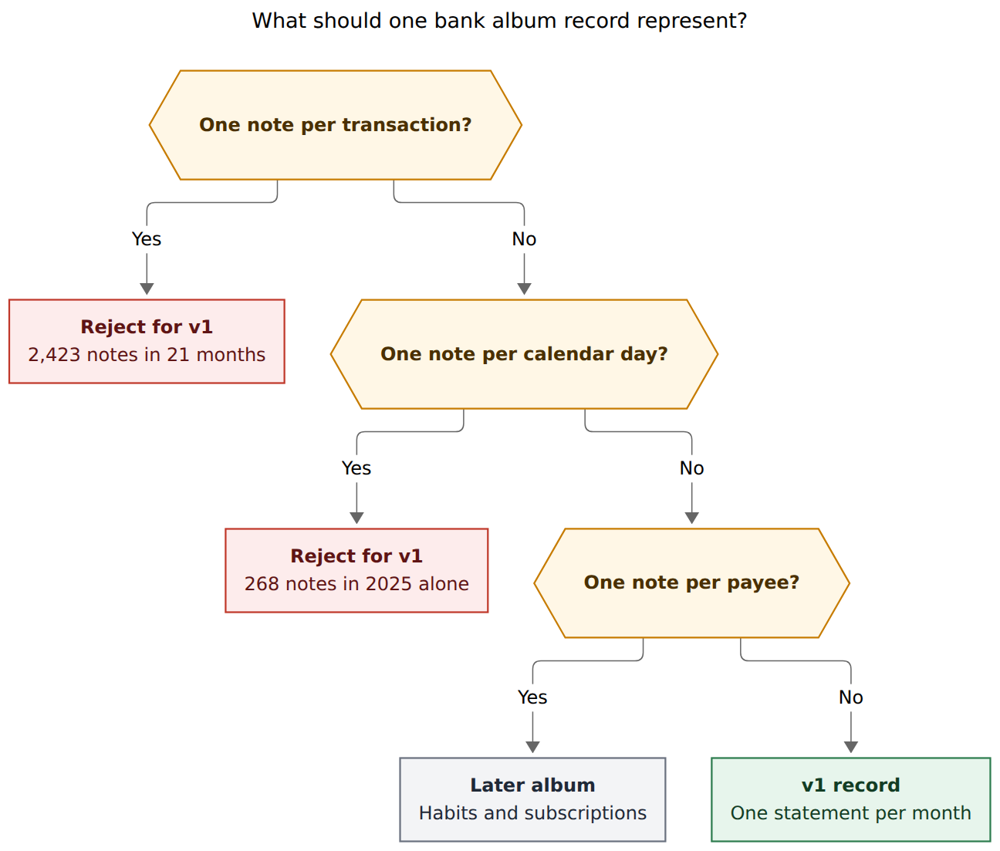
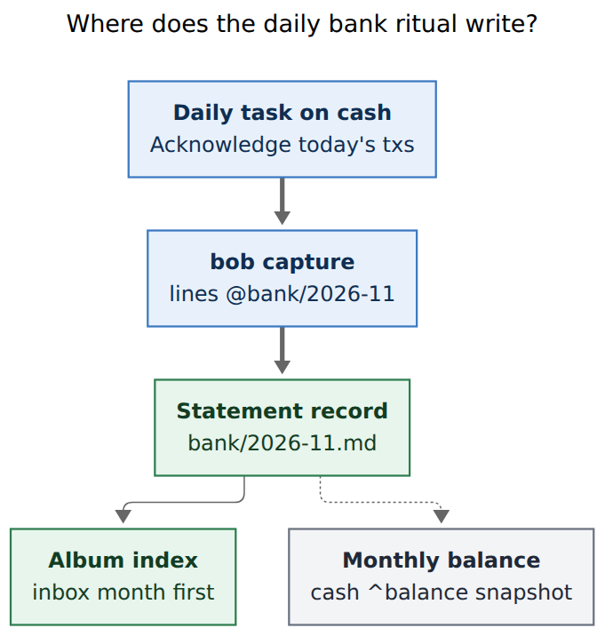

# A bank album for daily transaction tracking

> **Research query:** Bryan wants to start tracking bank transactions daily again
> and thinks a new `bank` album is the right home. The work must wait for the
> in-progress `bob-cli-k3` album epic. The origin is `bob.md` `^bank-records`
> ("Use records to start tracking bank transactions again!") and
> `cash.md` `^daily-bank-records-again` ("Go through bank records every day
> again!"). The motivations are to acknowledge every transaction and deposit, to
> stay aware of spending habits, and to get a structured album view. Lead the
> design so it is intuitive, reliable, and beautiful. Critique the plan, justify
> requirement adjustments, and recommend a solution.



*Figure 1. A bank record is a month's statement. Per-transaction and per-day notes explode the generated `[!records]` index; a payee album can wait until the daily ritual is alive again. Rendered 864×736 px, fit 75.6%.*

## Bottom line

**Create a `bank` album after `bob-cli-k3` cutover, with one record per calendar
month.** Each month's `## Notes` is the transaction journal. The daily
acknowledgment ritual is a repeating task on `cash.md`. The album index is the
structured view: this month sits in 📥 Inbox until you close it.

That pairing matches the system you already ran for 21 months
(`## @BANK` on daily `_habit.md` notes, April 2024–December 2025) and the
album contract now shipping in `bob-cli-k3`. It also matches how YNAB describes
the job: a short daily look at every line, with the friction of looking as the
point.

**A naive "one record per transaction" album would fight the album model.**
Records are schema-backed durable things (restaurants, podcasts, shows, movies).
Your own album research already said event series such as spending need their
own model. The journal belongs in the note body; the album indexes months.

Wait for album capture, the generated index, `bob albums create`, plugin cards,
and vault cutover (`k3.4`–`k3.7` and `k3.9`). Do not add a `records:` block to
chezmoi `config.yml` while that reader is being deleted.

## Is this a good idea

**Yes, with the record unit changed from "transaction" to "month".** The
motivations are sound and they are already proven in this vault.

1. **Acknowledgment is the product.** YNAB calls reviewing every transaction
   "good friction": the look is what builds awareness, and a minute with morning
   coffee is enough. You wrote the same idea into `^bank-records` and
   `^daily-bank-records-again`. From 2024-04-10 through 2025-12-27 you logged
   **494 bank days** and **2,423 labeled lines**, including **153 days whose
   total was $0.00**. Those zero days are evidence you looked. The habit died in
   2026 when `_habit.md` tracking stopped, not because the idea was wrong.

2. **An album is the right *home* for a structured money log in Bob.** After
   `k3`, every collection hangs under the area it serves, with a generated
   grouped index, an owner-row on `cash.md`, capture via `@bank/`, and
   per-album failure isolation. `cash.md` already has `## Notebooks` and a
   dangling `[[bank]]` link. Magenta owner hue, 🏦 emoji, and an Inbox-first
   index will look like the restaurant album, which is the beauty you asked for.

3. **Bob should stay the life-linked journal, not become a budget engine.**
   `cash.md` already has a blocked `^budget` task to set up Actual Budget
   (local-first envelope budgeting, the open-source YNAB cousin). Envelope
   allocation, bank sync, and category overspending belong there if that task
   ever unblocks. Beancount-style double-entry belongs in a ledger file if you
   ever want audit-grade books. The album's job is the one Bob is good at:
   typed notes, wikilinks into `eat/` and `old_recur`, a daily GTD hook, and a
   git-visible index on `cash.md`.

The plan as stated ("a new bank album" whose members are the transactions
themselves) overfits the album abstraction. The rest of this report is the
corrected shape.

## Facts that decide the design

Counted from `~/bob` on 2026-11-11 unless noted.

### The old daily ledger

| Fact | Evidence |
| --- | --- |
| Format | Daily `_habit.md` files with a `## @BANK` section: `amount (label)` lines, then `total: <day> / <month-to-date>` |
| Span | 226 bank days in 2024, 268 in 2025, **0 in 2026** (53 habit files exist through 2026-02-22, then "Skipping habit tracking") |
| Volume | 2,423 labeled lines; median **4** per day, p90 **13**, max **34** (2025-09-02); mean 4.9 |
| Zero days | 153 of 494 bank days logged `total: 0.00 / <mtd>` — looking with nothing to spend was part of the ritual |
| Month count | **21** months with a `@BANK` section, about 24 bank days per month at the median |
| Top labels | `w` 508 (median $42.29, almost certainly cash withdrawals), `[[eat#<lid>]]` 508 across 68 restaurant lids, `711` 277, recurring-charge links 253 |
| Unique labels | 542 distinct strings, including typos (`amazon groceries?`) and one-offs |
| Deposits | **No negative amounts** in `@BANK`. Credits were not journaled. Balances lived on `cash.md` `^balance` |

A typical day (`2025/20251118_habit.md`):

```markdown
## @BANK
- 251118#17 313.81 (amazon groceries)
- 251118#18 5.81 ([[eat#t5]])
- 251118#19 53.05 (w)
- 251118#1A 8.53 (711)
- 251118#1B total: 381.20 / 4355.77
```

Restaurant records already absorbed some of those lines as dated notes
(`eat/brown_fox_coffee_box.md`: "$29.09 per habit spending log"). `bob-cli-k3.10`
will rewrite the remaining `[[eat#<lid>]]` links onto record paths. The bank
album should use those record paths from day one.

### Money notes that already exist

| Note | Role today |
| --- | --- |
| `cash.md` | Area (`color: magenta`). Owner of money projects. Related: `[[bank]]` `[[old_recur]]` `[[legacy_cash]]`. Notebooks: `legacy_cash`, `taxes`. |
| `[[bank]]` | **Dangling.** `bank.md` does not exist. Creating the album repairs this. |
| `cash.md` `^balance` | 16 `@BANK` balance snapshots, 2025-01-18 ($69,044.29) through 2026-11-01 (**$14,918.67**). Still alive. |
| `recur.md` | Nested area under cash. Recurring task: update `^balance` every 30 days, next 2026-12-01. |
| `old_recur.md` | Zorg table of ~25 active recurring charges (mortgage, Kelly's salary, Claude, YouTube, …) plus inactive rows. |
| `cash.md` `^daily-bank-records-again` | "Go through bank records every day again!" Keep origin, scheduled 2026-12-01, **no `repeat::`**, decaying down the P-ladder (P0 → P2). Links to `bob#^bank-records`. |
| `bob.md` `^bank-records` | "Use records to start tracking bank transactions again!" In progress, `starts after` `^record-h2-sections` (the album epic). |
| `cash.md` `^budget` | "Set up Actual Budget!" Blocked on `^save-verizon-router-pwd` / unemployment. |
| `wait.md` | After 12 `bank_balances`, "come up with a monthly spending goal / limit". |

The daily ritual failed as a **P-level scheduled task that decays**. The data
model of `@BANK` was fine until habit files themselves stopped.

### Album contract constraints (from `bob-cli-k3`)

These are settled by `plan:202611/album_and_record_notes.md` and
`docs/records.md`. A bank album has to live inside them.

- **One album, one noun, one folder, one capture route.** Stem = folder =
  `@bank/`. Parent must be an area or project: `[[cash]]`.
- **A record is one durable thing**, `type: "[[record]]"`, in that folder.
  Restaurants, podcasts, shows, movies are the current four. Accepted album
  research: "Records are for schema-backed durable *things*. Event series
  (meals, listens, spending) would need their own model."
- **Albums and records hold no tasks.** Bare `@bank` is a teaching refusal
  (rewrite to `@bank/`). `record_checkbox` is an error: you cannot check off
  individual transactions inside a record.
- **Fields are scalars or lists of scalars.** There is no nested
  `{amount, payee, category}` field kind. The only place a list of transactions
  can live is `## Notes`.
- **The `[!records]` index lists every member**, grouped by `status` (actionable
  group first), rebuilt in the same transaction as every record write, from the
  folder index (no full-vault scan). `eat/` at 104 members is the proven scale.
  2,423 transaction notes, or 268 daily notes in a single year, would rewrite a
  huge generated region of `bank.md` on every capture and stress vault-sync.
- **`dated_notes: true` stamps *today***, which is wrong when you catch up
  yesterday's statement tomorrow.
- **Filename identity is the title**, with collisions refused (no suffix).
  "Starbucks" twice in one month cannot be two records without curated stems.
- **Config `records:` is retiring** inside this epic (`k3.9` / `k3.11`). A new
  kind added to chezmoi now is extra cutover work.

`bob-cli-k3` status on 2026-11-11: phases 1–3 closed (vault cleanup, album
model, catalog engine). Still in progress: `.4` capture/consumers, `.5` index,
`.6` owner catalog + `bob albums create`, `.7` plugin cards, `.8` Mac Capture,
`.9` vault cutover, `.10` spending-ledger mining, `.11` wrap-up.

## What the three motivations actually want

| Motivation | Needs | Album feature that serves it |
| --- | --- | --- |
| Acknowledge every transaction and deposit | A daily inbox of *lines*, including $0 days and credits | Note bullets on this month's record; `last_reviewed` date; daily task on `cash` |
| Stay aware of spending habits | Repeating payees, categories, month-to-date | Wikilinks to `eat/` and `old_recur`; optional later payee album; `spent` / `deposited` fields on the month |
| Beautiful structured view | A skim-able front door on `cash.md` and inside the album | `[!records]` grouped 📥 Inbox → ❓ Questioned → ✅ Reviewed; plugin chips; `bank.base` |

Those are two granularities. The daily inbox is a journal. The structured view
is a small set of durable cards. One album can host the journal **if the card
is the month**. One album cannot host both a 2,000-row transaction catalog and
a calm Inbox-first index.

## Alternatives

| Approach | What it gets right | Why it loses for v1 |
| --- | --- | --- |
| **One record per transaction** | Each line has fields (`amount`, `payee`, `status: inbox`) and can sit in Inbox | 2,423 notes in 21 months; filename collisions; `[!records]` rewrite of thousands of rows per capture; fights "durable thing"; no nested-field need once the line is the whole record, but identity and scale still fail |
| **One record per day** | Closest to `_habit.md`; Inbox = unreviewed days | 268 notes in 2025; same index-rewrite problem, just 5× smaller; `$0` days still create files |
| **One record per payee** | Matches restaurants; 711 / `w` / Amazon become cards; `old_recur` could migrate here | Excellent for *habits*, weak as *today's inbox*. You still need a place to dump today's lines. Defer as a second album. |
| **`## Bank` on the daily note** | Date is the filename; no new type | Daily notes are the Pomodoro ledger and GTD day. Mixing a spend journal there competes with Events and Tasks. Habits were a *sibling* file for a reason. |
| **A notebook under `cash`** | Can start today; dated bullets | No schema, no `[!records]`, no `@bank/` validation, no owner chips. You asked for an album's structured view. |
| **Period notes (monthly)** | Period notes already exist | Period notes are for intentions, outcomes, theme, and reflection (`^ref-what-to-write-in-period-notes`). A transaction journal would pollute them. |
| **Add `bank:` to `config.yml` now** | Capture could start before cutover | The config reader is being deleted in `k3.9`/`k3.11`. Extra migration for one kind. |
| **Actual Budget / YNAB as the only tool** | Built for envelopes, import, and approval queues | `^budget` is blocked. Even after it lands, Bob still wants wikilinks into restaurants and a GTD hook. Run them side by side; do not wait. |
| **Beancount / ledger file in the vault** | Audit-grade journal, git-friendly | Different job (balanced books). Forum consensus: envelopes and ledgers are different mental models. You asked for acknowledgment and a Bob-native view. |
| **Plaid / CSV auto-import into records** | Less typing | Removes the friction the motivation names. YNAB users who care about awareness still *approve* imported lines. If import ever happens, it should fill an Inbox for you to acknowledge, not close the month by itself. |

Obsidian finance templates that use "one Markdown file per transaction"
(for example the 2026 local-first finances template) do it with Bases dashboards
and QuickAdd, outside Bob's album index contract. That pattern can work in a
dedicated finance vault. It is a poor fit for an album whose generated index
is the beautiful view.

## Requirement adjustments

Each row changes the request. The original motivation is kept.

| ID | Adjustment | Why it is justified |
| --- | --- | --- |
| **R1** | The record unit is a **calendar month** (`noun: statement`, stem `YYYY-MM`), not a transaction. | 21 months vs 2,423 transactions vs 494 days. Index stays at restaurant scale. Fields can hold month totals; the body holds lines. |
| **R2** | Transaction lines live in `## Notes` with an explicit date in the bullet. Set **`dated_notes: false`**. | Catch-up is the common case (`^daily-bank-records-again` has already slipped). `dated_notes` would stamp today onto yesterday's charges. |
| **R3** | Credits are first-class in the **journal grammar** (`+amount`), even though the old `@BANK` log omitted them. | You asked to acknowledge deposits. Historical `@BANK` had zero negative amounts; `^balance` snapshots were the credit/balance channel. Keep snapshots, and also write `+` lines on the month. |
| **R4** | The daily ritual is a **`repeat:: every day` task on `cash.md`** (or a `#gtd` PRE/POST checklist row). Albums hold no tasks. | `^daily-bank-records-again` decayed because it was a P-level scheduled task with no `repeat::`. An album cannot fix cadence. Bare `@bank` cannot mean "append to this month" (album refusal). |
| **R5** | **Do not add `bank` to chezmoi `records:`.** Wait for `bob albums create` after cutover. | `k3.9` deletes that block. Hand-creating a config kind is throwaway work. |
| **R6** | **Do not auto-import** from the bank in v1. Typing (or pasting) each line *is* the acknowledgment. | Matches YNAB's "good friction" and your own `_habit.md` practice. Import is a later Inbox-filler, not v1. |
| **R7** | **Do not replace Actual Budget, and do not wait for it.** The album is the Bob journal; Actual is envelopes if/when `^budget` unblocks. | Separate jobs. `wait.md` already wanted a monthly spending *limit* after 12 balance snapshots — that limit is a budget app concern. |
| **R8** | **Do not put checkboxes on transaction lines.** Month `status` is the only checkbox-like state. | `record_checkbox` is an album error. Acknowledgment of a line is: it is written. Acknowledgment of a day is: `last_reviewed: today`. Acknowledgment of a month is: `status: reviewed`. |
| **R9** | A **payee / subscription album is v2**, migrating `old_recur.md` once the daily journal is a habit again. | 542 messy labels vs ~25 clean recurring charges. Habits want durable cards; v1 needs the inbox. |
| **R10** | Keep amounts in git (you already did, for years). **Never capture account numbers, routing, or full card PANs.** | `^balance` and `_habit.md` already store dollars. That is accepted. Identifiers are not. |
| **R11** | Link restaurants with **record paths** (`[[eat/brown_fox_coffee_box]]`), not `[[eat#lid]]`. | `k3.10` is already rewriting the historical lids. New lines should land on the post-cutover identity. |
| **R12** | **Do not fold the bank album into the `k3.9` cutover** of eat / podcasts / tv / movies. Create it afterwards with `bob albums create`. | Cutover has an equivalence gate over four existing kinds. A fifth kind is unrelated risk. |
| **R13** | Month totals (`spent`, `deposited`, `closing_balance`) are **optional, hand-maintained fields** in v1. No `bob bank sum` command. | CLI rules make every command permanent. Let the grammar stabilize before parsing it. |
| **R14** | `$0` days still get a line or a `last_reviewed` stamp. | 153 historical zero days. Skipping the file would hide "I looked." |

## Recommended design



*Figure 2. The daily task lives on `cash`; capture appends dated bullets to this month's statement; the album index shows the inbox month first; `^balance` stays the monthly snapshot. Rendered 454×478 px, fit 100%.*

### Owner, stem, and noun

- Album note: `bank.md` at the vault root.
- `parent: "[[cash]]"` (area, magenta, already the money root).
- `type: "[[album]]"`.
- Stem / folder / route: `bank` / `bank/` / `@bank/`.
- `record.noun: statement` (CLI/JSON spelling). Label `Statement`, plural
  `statements`.
- Emoji: 🏦.
- Summary (≤140): `Monthly bank statements I acknowledge by hand.`
- `index_by: year`.
- Related line in the body: `[[old_recur]]` · `[[cash#^balance]]` · `[[eat]]`.
- Starter Base `bank.base`: folder `bank`, group by status, sort by title
  descending so `2026-11` sits above `2026-10`.

`cash.md` already lists `[[bank]]` under Related and already has a
`## Notebooks` catalog. After `k3.6`, it gains `## Albums` with one stable row
for this album; plugin chips (`k3.7`) draw count, Inbox peek, and freshness
from `bob albums list`. Capture never rewrites `cash.md`.

### Schema

```yaml
parent: "[[cash]]"
type: "[[album]]"
summary: Monthly bank statements I acknowledge by hand.
emoji: 🏦
index_by: year
record:
  noun: statement
  label: Statement
  plural: statements
  dated_notes: false
  fields:
    status:
      required: true
      values:
        inbox: 📥 Inbox
        questioned: ❓ Questioned
        reviewed: ✅ Reviewed
    year:
      required: true
      values: number
      min: 2020
      max: 2100
    account:
      suggest: true
    spent:
      values: number
      min: 0
    deposited:
      values: number
      min: 0
    closing_balance:
      values: number
    last_reviewed:
      values: date
```

Status order is the index order: Inbox first (the only month you are working),
then Questioned, then Reviewed. `year` is a number so `index_by` can sub-group
once you have more than a year of Reviewed months. `account` is optional
suggested text; v1 assumes the same `@BANK` account `^balance` already tracks.
`spent` / `deposited` / `closing_balance` stay optional until month close.
`last_reviewed` is how a $0 day still counts as acknowledged.

### One month's note

Create with an explicit stem so files sort:

```text
2026-11 @bank/^2026-11
- status:: inbox
- year:: 2026
- account:: checking
```

Body after a few days:

```markdown
---
parent: "[[bank]]"
type: "[[record]]"
title: "2026-11"
status: inbox
year: 2026
account: checking
last_reviewed: 2026-11-11
created: 2026-11-11T09:00:00-0500
---

# 2026-11

## Notes

- 2026-11-11: 13.00 711
- 2026-11-11: 5.81 [[eat/brown_fox_coffee_box]]
- 2026-11-11: 53.05 w
- 2026-11-11: 13.99 [[old_recur#^z-241128-0n|YouTube]]
- 2026-11-11: +2100.00 payroll
- 2026-11-12: 0.00 none
```

Journal grammar (convention, not a bob parser in v1):

```text
YYYY-MM-DD: <amount> <payee> [<wikilink>]
YYYY-MM-DD: +<amount> <source>     # deposit / credit
YYYY-MM-DD: 0.00 none              # looked, nothing moved
```

Unsigned amounts are spends, matching the old `@BANK` log. `w` stays `w` until
a payee album gives it a card. Recurring charges keep their `old_recur` anchors
until v2.

### Daily capture

One draft, one update of this month, children for extra lines. Parent text
becomes the first note (`docs/records.md`):

```text
2026-11-11: 13.00 711 @bank/2026-11
- 2026-11-11: 5.81 [[eat/brown_fox_coffee_box]]
- 2026-11-11: 53.05 w
- last_reviewed:: today
```

A $0 day:

```text
2026-11-12: 0.00 none @bank/2026-11
- last_reviewed:: today
```

Close the month when `^balance` is snapshotted:

```text
closing @bank/2026-11
- status:: reviewed
- spent:: 4355.77
- deposited:: 2100.00
- closing_balance:: 14918.67
```

Then create `2026-12 @bank/^2026-12` in the same session so Inbox is never
empty at month start.

**Do not invent `@bank` as "append to the current month."** That route is the
album-task refusal. A later capture sugar (for example `@bank/this`) would be a
new contract, filed after the ritual has been used for a month. v1 uses the
explicit stem.

### The daily task (this is what actually revives the habit)

On `cash.md`, rewrite `^daily-bank-records-again` once the album exists:

```markdown
- [ ] #task Acknowledge today's bank lines in [[bank]].
  [repeat:: every day]
```

Keep it off the P-ladder. A `#gtd #pre` or `#gtd #post` checklist row is even
better if you want it in the morning walk without decay: PRE/POST rows resolve
by completion, and a repeating occurrence walks when due.

The implementation task `bob#^bank-records` stays a project task: create the
album, schema, Base, and first month after cutover. It already `starts after`
`^record-h2-sections`. Leave that dependency; add a second one on `k3` close
(or on `k3.9` cutover) so it cannot fire against config-declared records.

`recur.md`'s 30-day `^balance` task stays. Closing a month copies that
snapshot into `closing_balance`.

### Beauty

- **On `cash.md`:** one `[!albums]` row, magenta, 🏦 **[[bank|Bank]]** — *Monthly
  bank statements I acknowledge by hand*, with live chips for `1 inbox` and
  freshness (`today` when `last_reviewed` is today).
- **Inside `bank.md`:** `[!records] 9 statements · 📥 1 inbox · ❓ 0 questioned · ✅ 8 reviewed`.
  The Inbox group is a single card: **[[bank/2026-11|2026-11]]**. Reviewed months
  sub-group by year once they pass 12.
- **Inside the month:** a quiet dated list, newest at the bottom (append order).
  No zorg tables, no aligned pipes, no LIDs.
- **Base:** Inbox view, this-year view, amount columns from `spent` /
  `deposited` / `closing_balance`.
- **Mac Capture (`k3.8`):** the route shows album title, owner, and summary so
  `@bank/2026-11` reads as Bank / cash, not as a raw folder.

### Reliability

- Schema and data version together in the vault, isolated from eat/podcasts/tv/movies.
- `bob records check` / `bob albums check` lint fields and membership; they do
  not parse journal bullets in v1.
- Duplicate month stems refuse (`record_exists`) instead of suffixing.
- Index rebuilds from ~12–24 folder members, in the same class as `eat/`.
- Vault-sync: small generated `[!records]` region, one file touched per daily
  capture (`bank/YYYY-MM.md`), album index rewrite of a handful of rows.
- Broken `bank.md` schema disables only `@bank/`.

### Sequencing against `bob-cli-k3`

```text
now ──► k3.4 capture from albums
     ──► k3.5 [!records] index + albums sync
     ──► k3.6 ## Albums on cash + bob albums create
     ──► k3.7 plugin cards (beauty)
     ──► k3.9 cutover of the four existing albums, chezmoi records: deleted
     ──► bob albums create bank --parent cash     ← first bank work
     ──► first 2026-11 (or current month) record
     ──► rewrite ^daily-bank-records-again with repeat:: every day
k3.8 Mac presentation can land in parallel after k3.4; nice for capture, not a gate.
k3.10 historical eat-lid mining is complementary; do not block bank create on it.
k3.11 wrap-up (glossary, config reader gone) can overlap the first month of use.
```

Until that gate: leave `^bank-records` blocked, leave `config.yml` alone, leave
the dangling `[[bank]]` (or a one-line stub would become the album at create
time — prefer `bob albums create` so the frontmatter is valid).

### v2 (do not build now)

- A `payees` album under `cash` for 711, `w`, Amazon, and a de-zorged
  `old_recur`.
- A capture alias for "this month".
- Optional CSV drop into Inbox (still requires `status: inbox` until you
  review).
- A read-only `bob records` total that sums journal bullets, if the grammar
  stays stable.
- Actual Budget as the envelope layer, with Bob keeping the linked journal.

## Critique of the plan in general

The instinct to put this in an album is right: you want a structured, owned,
beautiful collection under `cash`, and `k3` is building exactly that primitive.
The failure mode is treating **events** as **records**.

You already have a working event grammar (`## @BANK` lines plus a month-to-date
total) and a working entity grammar (`eat/` restaurants). The 2024–2025 ledger
is the event grammar. `k3.10` mining it into `visited` dates is the entity
grammar. A bank album should be the event grammar's new home, with months as
the cards and lines as the notes.

The other failure mode is **cadence**. `^daily-bank-records-again` has been
rolling around the P-ladder since mid-October and is now scheduled 2026-12-01.
No schema will revive a decaying task. Pair the album with a daily repeat (or
a GTD checklist) or the beautiful index will sit on `cash.md` unread.

A third failure mode is **scope creep into a finance app**. Actual Budget is
already a vault task. YNAB's approval queue, envelopes, and import matching
are a product. Bob's comparative advantage is that a 711 line can link
`[[eat/...]]`, that the Inbox card lives next to Taxes and Legacy cash, and
that the daily look is a GTD gesture. Keep that advantage.

## Recommended solution

1. **Wait for `bob-cli-k3` through vault cutover** (`k3.9`), with capture,
   generated index, `bob albums create`, and plugin cards already landed.
2. **`bob albums create` a `bank` album parented to `cash`**, noun `statement`,
   emoji 🏦, `index_by: year`, schema as above, plus `bank.base`.
3. **One record per month**, stem `YYYY-MM`, `status: inbox` until you snapshot
   `^balance` and mark `reviewed`.
4. **Journal every transaction, deposit, and $0 look** as dated `## Notes`
   bullets with the grammar `YYYY-MM-DD: [+]amount payee`. Link `eat/` records
   and `old_recur` rows in those bullets.
5. **Revive `^daily-bank-records-again` as `repeat:: every day`** (or a `#gtd`
   PRE/POST row) pointing at `[[bank]]`. Keep `bob#^bank-records` as the
   one-time create task, still after `^record-h2-sections`, plus a dependency
   on cutover.
6. **Leave Actual Budget, payee cards, import, and a summing CLI for later.**
   Use the first real month of Inbox as the test of whether the grammar wants
   any of them.

This is intuitive (one card on the desk, today's lines go on it), reliable
(small index, isolated schema, collision-safe stems, no config.yml detour),
and beautiful (Inbox-first `[!records]`, magenta owner chips on `cash.md`,
the same visual language as Eat).

## About this report

Independent research, researcher `grk`, 2026-11-11. This is research, not an
implementation and not a vault edit. Figures rendered with
`@mermaid-js/mermaid-cli` 12.0.0, PDF-mirroring config, DejaVu Sans.

## Sources

**Vault (2026-11-11):**

- `bob.md` `^bank-records`, `^record-h2-sections`
- `cash.md` (area frontmatter, `[[bank]]`, `^daily-bank-records-again`,
  `^balance` snapshots, `^budget`, `^audit-monthly-subscriptions`)
- `recur.md` 30-day balance task
- `old_recur.md` active/inactive recurring charges
- `wait.md` monthly spending-goal wait
- `eat.md`, `eat/brown_fox_coffee_box.md`
- `_habit.md` `## @BANK` sections, 2024–2026 (494 bank days, 2,423 labeled
  lines, 21 months; 2026 has none)
- `legacy_cash.md`, `taxes.md`

**bob-cli and plans:**

- Bead `bob-cli-k3` and children `.1`–`.11`
- `plan:202611/album_and_record_notes.md` (accepted A1–A12, ledger_mining yes)
- `plan:202611/album_model.md`
- `docs/records.md`, `docs/reference/capture-syntax.md` record-note forms
- `~/.config/bob/config.yml` `records:` (restaurant, podcast, show, movie)

**Prior research (unrelated swarm, used as accepted context):**

- `research:202611/album_and_record_notes/album_and_record_notes.md`
  (records are durable things; spending is an event series; album index and
  owner catalog contracts)

**Memory (audited):**

- `sase_artifacts.md`, `obsidian.md`, `docs.md`, `cli_rules.md`
- `glossary:capture`, `glossary:notebook`, `glossary:pomodoro`,
  `glossary:work-log`, `glossary:task-type`, `glossary:period-note`

**External:**

- [YNAB: 3 Habits to Get Good at Money](https://www.ynab.com/blog/ynab-budgeting-tips)
  (approve transactions with morning coffee; ~1 min/day)
- [The Five-Minute YNAB Routine](https://www.youneedabudget.com/blog/five-minute-budget-routine)
- [YNAB, "The Friction that Makes You Good at Money"](https://www.youtube.com/watch?v=FzEHp_TybCw)
  (reviewing every transaction is productive friction)
- [Actual vs YNAB](https://actualbudget.org/blog/2024-07-01-actual-vs-ynab/)
- [Beancount vs Actual Budget](https://beancount.io/compare/beancount-vs-actual-budget)
  (envelope discipline vs an auditable ledger; different jobs)
- [Beancount forum: envelope budgeting became an overcomplicated mess](https://beancount.io/forum/t/tried-setting-up-envelope-budgeting-in-beancount-ended-up-with-overcomplicated-mess/1773)
- [Building a local-first personal finance system in Obsidian](https://dev.to/lksvn/building-a-local-first-personal-finance-system-in-obsidian-3knb)
  (one file per transaction — a pattern that needs Bases, not a Bob album index)
