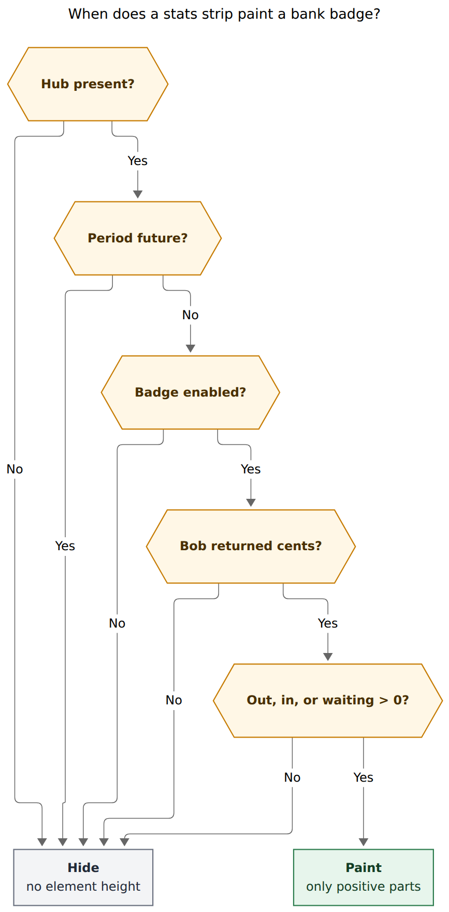
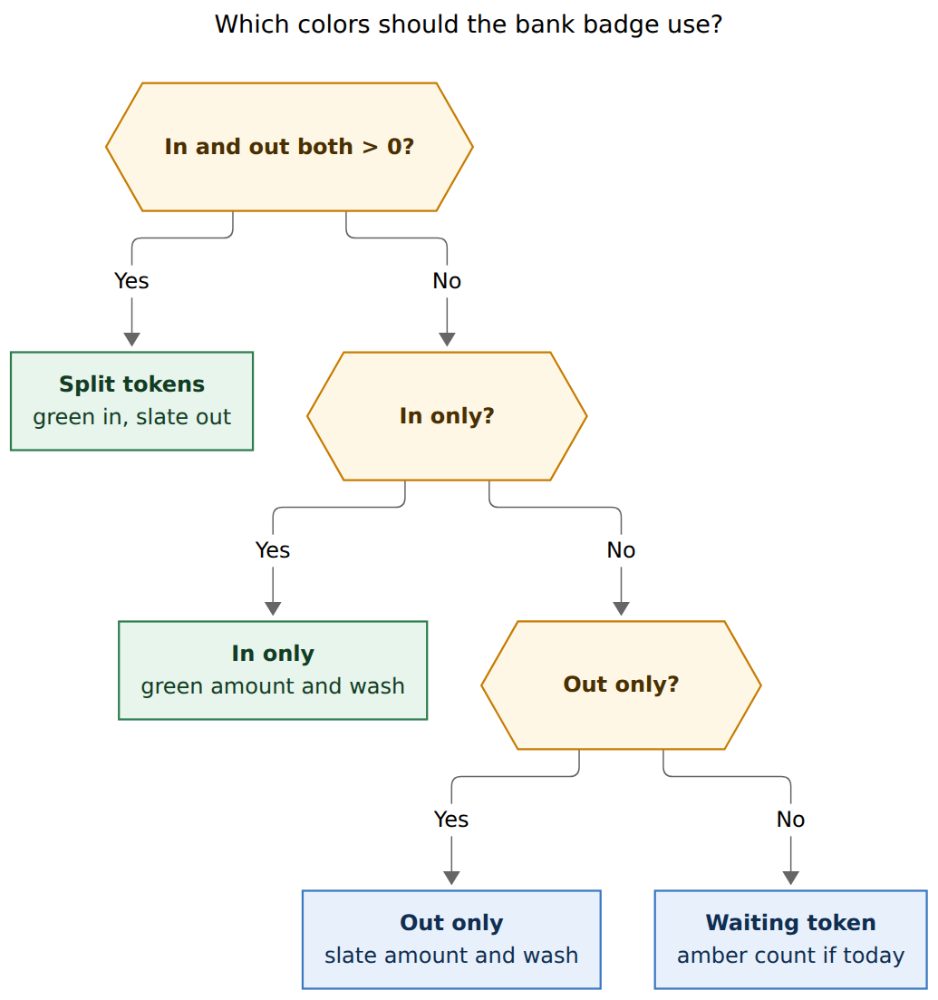
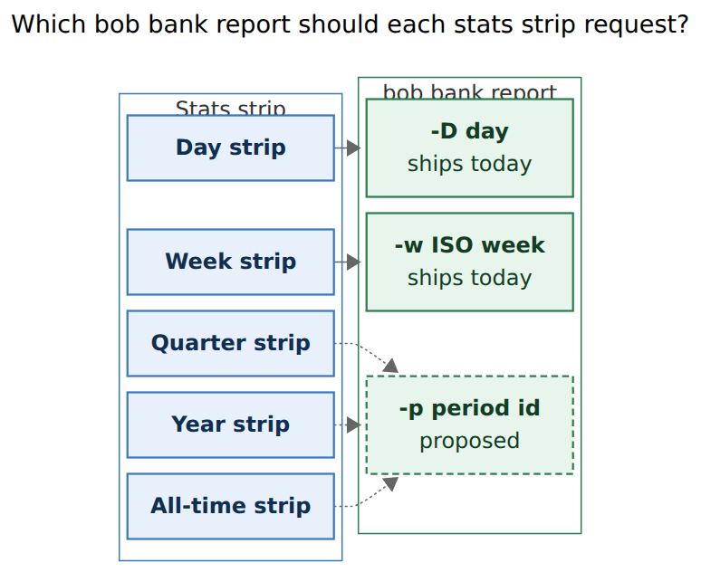

# Bank badge: quiet money on every stats strip

> **Research query:** Improve the day-strip bank badge (incoming/outgoing transactions for that day): add a glossary term, hide zero in/out parts and the whole badge when both are `$0.00`, color it from those values, and render the same badge from every stats strip with period-aggregated totals. Lead the design so it is intuitive, reliable, and beautiful. Critique the plan, adjust requirements where justified, and recommend a solution.

**Researcher:** grk (independent swarm report).
**Date:** 2026-11-14.
**Inputs:** `docs/bank.md`, `docs/stats.md`, `docs/periods.md`, `docs/dashboard.md`, glossary strands for Day Strip, Stats Strip, Period Note, Bank Month Note, and Bank Row; bob-cli `src/native/bank/{report,dates,output,cli}.rs` and `src/native/periods/calendar.rs`; bob-plugins `plugins/bob-ledger-tools/src/241n-plugin-bank-daily-chip.js`, `241l-plugin-bank-cards-model.js`, `241h-plugin-bank-decode.js`, `241j-plugin-bank-data.js`, `239-plugin-period-strip-*.js`, `239-plugin-day-strip-*.js`, `075-work-badge-tone.js`, `styles.css`; plugin tests `scripts/test-ledger-tools-bank-cards.cjs` and `scripts/obsidian-bank-ui-e2e.cjs`; prior research `202611/period_note_tree_and_stats_strips`. Nothing in any repo was changed except this report and its figures.

Renderer: `@mermaid-js/mermaid-cli` 12.0.0 with the Highlights PDF-mirroring config (`--no-sandbox` on this host).

---

## 0. Bottom line

**Yes — hide zeros, color the tokens, and let every stats strip own the same badge. Do it as strip-native money, from `bob bank report` totals, on the period id the note already uses.**

This is a good idea in a stricter form than the request.

1. **The current control is already the right object.** It is a report-driven daily chip that sits after the Day strip, paints `BANK · out $X · in $Y · N waiting`, and opens that day's bank heading. It is named a chip in code (`stats.bank_chip`, `.bob-bank-daily-chip`) and a badge in this request. Promote the name to **Bank Badge**, keep the job (glanceable In/Out for this period), and stop treating it as a plan-lane chip.
2. **Hiding `$0.00` parts is the right quieting.** Today's chip always prints both sides, including `in $0.00` on a spend-only day. That is noise. Integer cents `> 0` is the gate. Hide the whole badge when both sides are zero **except** today's waiting count, which is a ritual reminder and must still be allowed to keep the badge up.
3. **Color the tokens, never the whole badge by net.** Bob already paints inflows green and outflows neutral because spending is not an error. Red is for over-cap work, missed review, and bank-check errors. Net-green on a payday-plus-spend day would lie. Split tokens carry the meaning; labels and `+` signs carry it without color.
4. **Period strips need a CLI period id before they can be honest.** `bob bank report` already has `-D` (day) and `-w` (ISO week). It has no quarter, no all-time, and `-y` is a **calendar** year (`Jan 1 – Dec 31`). Period notes are ISO week-years. Wiring year strips to `-y` would be a silent off-by-days bug at every year boundary. Add `-p/--period` that reuses `PeriodId` (`2026-Q4`, `2026`, `all_time`).
5. **Paint it inside the strip, as a `span[role=link]`, not a `<button>` sibling.** Period strips forbid buttons, cards, and filled chrome; hue lives in bars. The daily chip is a `<button class="bob-plan-chip">` with magenta area-hue wash, sitting next to PENDING/NEXT/READY, whose magenta means "exactly at cap." Move the badge to the last row of every stats strip, restyle it as a quiet money line, and raise the height budgets by one row.

Ship glossary + visibility + token color on the Day strip first, with `-p` in the same bob-cli change so week/quarter/year/all-time strips can follow in the same plugin PR.

---

## 1. Is this a good idea?

**Yes, because the Day strip already taught the glance, and period notes are empty of money.**

### Why it earns a place

- **You already look here.** The Day strip is the first child of `bob-plan` on a canonical daily note. The chip is the first thing under the last bar, above TODAY/PENDING/NEXT/READY. That is the right altitude for "what moved in cash today": after time, before tasks.
- **Bob already owns the numbers.** `bankCardDailyChipModel` reads `day.out_cents` / `day.in_cents` from `bob bank report -D` JSON. The plugin formats cents; it does not classify income, transfers, or cash. That is the same "bob owns every value" rule the stats-strip family already follows.
- **Period notes are the missing sibling.** A week strip shows Worked / Reviewed / Done / Created / Review closed and where the time went. It is silent on Out/In. Weekly prune is exactly when a spending glance would earn its keep, and `bob bank report -w 2026-W46` already returns those totals.
- **Zero noise is real.** The e2e fixture asserts a historical chip of `BANK · out $8.00 · in $0.00`. Half of that string is a zero. A quiet day with no posted In or Out still mounts `BANK · out $0.00 · in $0.00` (and on today, `· N waiting`). Hiding empty parts is how the month card already treats missing heat, and how the Day strip already omits a type lane with no positive parts.
- **Color already has a Bob contract.** `docs/bank.md`: "inflows are green and outflows are neutral, because spending is not an error. State is always carried by text and shape, never by color alone." CSS already does this on month-card In metrics (`.bob-bank-metric-in strong`) and on bank-row amount marks (`.bob-bank-mark-amount.is-in`). The daily chip ignores that contract and paints every amount in `--text-muted` on a magenta wash.

### Where it goes wrong if built as specified

| Risk | Evidence | What the design does |
| --- | --- | --- |
| **Hiding today's waiting reminder** | Today’s chip appends `waiting.all` (every unacked row in every month), not this day's waiting. A quiet calendar day with four leftover rows currently reads `BANK · out $0.00 · in $0.00 · 4 waiting`. Hide-when-both-zero drops that. | Keep a waiting-only badge on **today's Day strip** when `waiting.all > 0`. Period badges never show waiting. |
| **Calendar year on an ISO year strip** | `year_range` is Jan 1 – Dec 31. Period year 2026 is the Monday of W01 through the Sunday of W52/W53 (`docs/periods.md`: 2026 is `Dec 29, 2025 – Jan 3, 2027` in a 53-week year). | Year / quarter / all-time strips call `-p` with the note's `PeriodId`. `-y` stays for month-statement use. |
| **Plugin-summed months** | Tempting to fetch `bank/YYYY-MM.md` reports and add `days[].out_cents` in the plugin. The decoder's job is "Integer cents stay integers; a schema mismatch is never a zero-dollar success." Client-side folds hide accounting bugs. | Bob returns `totals` for the period. The plugin paints `totals.out_cents` / `totals.in_cents`. |
| **A sixth fact column** | Facts wrap at ~34em; height budget is 132 px one-line / 198 px wrapped. Money has no typical-day median and is not a time metric. | A last-row money line under the last bar, ~22 px, strip-native. |
| **Work-badge magenta** | `docs/dashboard.md`: "Magenta marks a lane that is exactly full, and no other Bob chip uses that hue." The daily chip defaults `--bob-area-magenta` as its accent and sits beside those chips. | Retire area-hue chrome on the strip badge. Magenta stays a work-lane signal. |
| **`<button>` inside a strip** | Period and Day strip painters: "Interactive targets are spans with role=link"; "must never be able to resize the strip again"; "No … buttons." The chip is a `<button>`. | `span[role=link] tabindex=0`, Enter/Space, same activate helper as facts. |
| **Loading flash then hide** | `bankDailyChipPaint` writes `Bank · loading` until JSON lands, then would hide a $0 day. | Empty until a ready model with something to show. No skeleton chip. |
| **All-time payload** | Report JSON includes `days[]` with full `rows[]` for every day of the period. All-time with years of imports is a large spawn. The badge needs `totals` and `waiting`. | Use `totals` now. If all-time fetches hitch, add a later compact flag; do not block the badge on it. |
| **Layout jump on today's first import** | A $0 today that later gains a row will grow one row under the strip. | Accept it. The strip already grows for off-clock hints and lane switches. Historical notes are stable. |

### Would I take a different approach?

I would still hide zero parts, color In green / Out neutral, and put the badge on every stats strip.

I would **not** color the whole chrome by net, or paint Out red. Mint/YNAB do that; Bob already rejected it, and red/green is the worst pair for deuteranopia (~8% of men). Labels `out` / `in`, a `+` on inflows (`bankFormatCents` already emits `+$2,015.00` when asked), and optional `↓` / `↑` marks carry the meaning in forced-colors and in grayscale.

I would **not** put waiting on week/quarter/year/all-time badges. Waiting is a daily acknowledgment ritual (`bob bank list`, Ctrl+Enter on a month row). A yearly `4 waiting` is the wrong unit.

I would **not** fetch seven day reports and add them on the week strip. `-w` already exists.

I would **not** restyle this as a plan-lane chip that borrows TODAY's grey/blue/green/yellow/orange/magenta/red cap tones. Those tones mean fill against a limit. Bank In/Out have no cap.

---

## 2. Explicit requirement adjustments

Call these out as changes to the request.

| # | You asked for | I recommend | Why |
| --- | --- | --- | --- |
| **A1** | Glossary term "bank badge" | **Yes.** Keyword `Bank Badge`, aliases `bank chip`, `daily bank chip`. Link it from Day Strip and Stats Strip. | Code and plugin docs say "chip"; the request and the plan-block neighborhood say "badge." One term. |
| **A2** | Show in/out parts only when `> $0.00` | **Yes, on integer cents `> 0`.** Never float. `$0.00` is `0` cents; `$0.01` shows. | Totals are signed `i64` cents. The decoder refuses non-integers. |
| **A3** | Hide the badge when both are `$0.00` | **Hide when out = 0 and in = 0 and no waiting suffix.** Today's Day strip may still show `BANK · N waiting`. | Otherwise the ack ritual disappears on a no-spend day. |
| **A4** | Color the badge from in/out | **Color each visible token.** In = `--color-green` / `--text-success`. Out = `--text-normal` on slate chrome. Waiting = `--text-warning`. Mixed days keep split tokens on slate chrome. Single-sided days may take a 10–14% wash of that token's hue. **Never red for Out. Never net-color the whole badge.** | Matches `docs/bank.md` and the month card; keeps work-badge red/magenta for status; satisfies "state by text and shape." |
| **A5** | Badge on every stats strip, aggregating the period | **Yes, from `totals` of one `bob bank report` whose period id matches the strip.** Day: `-D`. Week: `-w`. Quarter / ISO year / all-time: new `-p/--period`. | Calendar `-y` is the wrong year. Plugin-side sums are the wrong owner. |
| **A6** | *(implied)* Keep the current chip chrome | **Strip-native last row:** small-caps `BANK`, tabular amounts, no filled chip, no `<button>`, no area-hue border. | Period strips ban buttons and card chrome. Magenta wash collides with cap-full work chips. |
| **A7** | *(implied)* Keep `waiting.all` on every chip | **Waiting only on today's Day strip.** Period badges are In/Out only. | Waiting is a daily queue, not a week total. |
| **A8** | *(implied)* Use existing `-y` for year strips | **Do not.** Add `-p` that parses `PeriodId`. Keep `-y` as calendar year for statements and month cards. | ISO 2026 ≠ calendar 2026. |
| **A9** | *(unsaid)* Loading / error | **No loading chip. Hide on teaching-empty, missing hub, future period, failed decode, and `$0/$0` with no waiting.** A muted `Bank unavailable` may show only after a previously ready badge on **today** goes stale-failed. | Avoids a flash of chrome on every quiet historical day. |
| **A10** | *(unsaid)* Click target | **Day → that day's heading (`ensureOpenDay`). Week → that week's Monday heading (today, if the week is current). Quarter / year / all-time → `bank.md` queue card.** | Small periods have a day; large ones are the hub. |

Transfers, cash-account rows, and unclassified inflows stay out of In/Out, as they do on the month card. A day that is only a card payment (`[cat:: transfer]`) stays badge-less. That is the totals contract, and it is the correct quieting.

---

## 3. What ships today

The feature exists. It is just narrower, noisier, and named something else.

### Daily chip

`BobLedgerToolsBankDailyChipMixin` (`241n-plugin-bank-daily-chip.js`) mounts `.bob-bank-daily-plan-host` **after** the Day strip host inside the `bob-plan` block. It is a sibling of the strip, not a child.

Gates already implemented:

- `stats.bank_chip !== false` (default on; the plugin docs' `stats.bank_chip: false` is how you turn it off)
- `bank.md` present
- day ≤ local today
- `bankDataActive`

Paint:

```text
BANK · out $1,362.56 · in +$2,015.00 · 2 waiting
```

`out` uses `bankCardDisplayCents(abs(outCents))` (no leading `+`). `in` uses the explicit-plus form. Waiting is `report.waiting.all` and only when `date === today`. Historical chips must not show waiting; the e2e test fails `out $8.00 · in $0.00 · 4 waiting` on a past day.

Click calls `bankApi().ensureOpenDay(day)`. Stale values keep a dashed start border. Errors paint `Bank unavailable` / `Bank · loading` / `Refresh failed; values may be stale`. `teaching_empty` paints nothing.

### Model

`bankCardDailyChipModel(report, date, today)` requires `command === "report"` and a `days[]` row whose `date` matches, with safe-integer `out_cents` and `in_cents`. Missing days become `day-unavailable`, never `$0.00`. That refusal must survive the redesign.

### Color today

Chip CSS (`styles.css` ~8886–8899): `--bob-area-magenta` (or `bank.md`'s area hue) as a 2 px start border and a 14% wash; `color: var(--text-muted)`; font 0.72 em; tabular nums. **In is not green.** Out is not distinct. The month card and the Category card already green inflows (`.bob-bank-metric-in strong`, `.is-inflow`, `.bob-bank-mark-amount.is-in`). The CLI greens inflow **rows** in `bob bank list`; the `report` totals line is uncolored.

### Data path

`bankBuildArgs({ command: "report", date: day })` → `bob bank report -D YYYY-MM-DD -f json`. The bank data service caches up to `BANK_CACHE_SIZE = 16` keys, generation-guarded, shared with month/queue cards.

`bob bank report` period kinds today: `day`, `week`, `month`, `year` (calendar). JSON `totals` already has `out_cents`, `in_cents`, `net_cents`, refunds, transfers, cash, unclassified. `waiting.period` / `waiting.all` already exist. The chip uses the **day row**, not `totals`; for `-D` they agree.

### Stats-strip family

| Member | Note | Data | Bank today |
| --- | --- | --- | --- |
| Day strip | `YYYY/YYYYMMDD.md` or `bob-day-stats` | `bob stats show` | Daily chip sibling |
| Week strip | `YYYY/YYYY-Www.md` | `bob periods show` | None |
| Quarter strip | `YYYY/YYYY-Qn.md` | same | None |
| Year strip | `YYYY.md` | same | None |
| All-time strip | `all_time.md` | same | None |

Period strips already have a last-row geometry (facts, lanes/charts). They have no plan-chip row. Any badge that is a `bob-plan-chip` sibling has nowhere to sit on a period note except inside the strip.

---

## 4. Visibility

**Reader question:** When does a stats strip paint a bank badge?

**Caption:** The badge appears only when the hub exists, the period is not future, the preference is on, bob returned integer cents, and at least one of out, in, or today's waiting count is greater than zero.



Rendered size: 578 × 1172 px; fit scale: 76.2%.

Positive-part rule, once the badge is allowed:

| out_cents | in_cents | waiting (today Day strip only) | Paint |
| ---: | ---: | ---: | --- |
| 0 | 0 | 0 / n/a | nothing |
| 0 | 0 | N > 0 | `BANK · N waiting` |
| > 0 | 0 | — | `BANK · out $X` |
| 0 | > 0 | — | `BANK · in +$Y` |
| > 0 | > 0 | — | `BANK · out $X · in +$Y` |
| > 0 | > 0 | N > 0 | `BANK · out $X · in +$Y · N waiting` |

`waiting` on a period strip is always omitted, even for the current week.

Future periods already hide the Day strip (`day > today` returns no element height). Period strips in `state: "future"` show `Starts …` and should grow no bank row.

Config: keep the default-on switch. Canonical name `stats.bank_badge`. Read `stats.bank_chip` as a hidden alias with identical behavior (CLI/plugin rule: never hard-rename). Document it next to plugin-only `stats.day_strip` in `docs/stats.md`.

---

## 5. Color

**Reader question:** Which colors should the bank badge use?

**Caption:** Color each visible token. In is green, out is slate, mixed days keep split tokens, waiting is amber, and red stays reserved for errors and over-cap work.



Rendered size: 690 × 736 px; fit scale: 94.6%.

### Why this palette

Bob's own bank contract already chose it. The month card greens In and leaves Out in body text. The Category card greens `.is-inflow`. Bank-row marks green `.is-in`. Human `bob bank list` greens inflow lines. The justification in `docs/bank.md` is the one that matters: **spending is not an error.**

Work-badge tones (`075-work-badge-tone.js`) are a different language: grey → blue → green → yellow → orange → magenta → red against a cap. Bank In/Out have no `L`. Reusing those hues would teach the wrong lesson (a $200 Out looking "healthy green" or "over-cap red" depending on an invented limit).

Dashboard copy reserves **magenta** for a lane that is exactly full. The current chip's default magenta wash is already a collision. Retire it on the strip badge.

External dashboard guidance agrees with Bob's "never color alone" rule: Phoenix Strategy Group (2025) keeps red/amber/green for **status**, not for ordinary money movement, and asks for an arrow or `+/-` so colorblind readers still see direction. Fintech color systems and WCAG chart guidance say the same: ~8% of men have red-green deficiency; encode direction with labels and signs, then tint. Bob already emits `+$2,015.00` for inflows. Keep that sign. Keep the words `out` and `in`. Optional `↓` / `↑` before the amounts are welcome if they stay 1 em and `aria-hidden` (the accessible name still speaks `out $X; in +$Y`).

### Chrome

| Situation | Tokens | Wash |
| --- | --- | --- |
| In only | green amount | `color-mix(in srgb, var(--color-green) 12%, transparent)` |
| Out only | body-color amount | `var(--background-modifier-hover)` / slate, ~10% |
| In and out | green in, body out | slate, no net tint |
| Waiting only | `--text-warning` count | slate |
| Stale | same tokens, dashed start hairline | unchanged |
| Forced colors | `CanvasText` amounts, `GrayText` label | no wash |

Do **not** invent an Out-red. Do **not** tint mixed days by `in - out`. A $2,100 in / $1,418 out day is both a payday and a spend day; split tokens say so.

Focus: 2 px `--interactive-accent` outline, matching period-strip facts (`outline-offset: 1px` or `2px`). The current chip already has `:focus-visible`; keep that test.

---

## 6. Placement and visual language

Put the badge **inside** the strip root as the last child:

- Day strip: after the last painted bar, still above `.bob-plan` lane chips.
- Period strip: after the charts (the strip fence), never inside `bob-period-parts`.

That is what "rendered by every stats strip" has to mean. A plan-block sibling cannot appear on `2026/2026-W45.md`.

Visual grammar, matching facts:

```text
BANK    ↓ $1,418.21    ↑ +$2,100.00    · 4 waiting
```

- Label: small-caps, muted, same size as `WORKED` / `REVIEWED` labels (`0.7–0.72em`, letter-spacing ~0.07–0.08em). Word `BANK`, not 🏦 (the emoji lives on month notes and CLI titles; the strip is a facts row).
- Amounts: tabular nums, body size of the chip today (`0.72–0.8em`), `white-space: nowrap`.
- Separator: `·` between parts, same as `so far · HH:MM`.
- No card, no 7 px rounded chip, no 14% magenta fill.
- One keyboard stop for the whole badge (like a fact), not one stop per token.

Height: add ~22 px to the Day strip budgets (132 → ~154 one-line, 198 → ~220 wrapped) and the same increment to period Both/single-view budgets. Document it next to the existing 700–1000 px figures in `docs/stats.md`.

`bob-day-stats` fences inherit the day badge for their `day:` (or the host daily path). `bob-stats-strip` fences inherit the period badge for their `period:`. Mobile and hosts without process launch already skip the strip; they skip the badge.

The last-bar-as-separator sentence in the Day Strip glossary becomes: the last bar, then the Bank Badge when it paints, then the plan badges.

---

## 7. Data: one report per strip, bob owns cents

**Reader question:** Which `bob bank report` should each stats strip request?

**Caption:** Day and week already have flags. Quarter, ISO year, and all-time need `-p/--period` on the same `PeriodId` the note already uses. Calendar `-y` stays on statements.



Rendered size: 516 × 422 px; fit scale: 100%.

### Proposed CLI

Additive. Options stay alphabetical. Every long option keeps a short alias.

```text
bob bank report -p 2026-W45
bob bank report -p 2026-Q4
bob bank report -p 2026
bob bank report -p all_time
```

`-p/--period` accepts the same forms as `bob periods show` (`PeriodId::parse` in `src/native/periods/calendar.rs`): `2026-W45`, `2026-Q4`, `2026`, `all` / `all_time` / `all-time`, and vault-relative paths. Reuse that parser; do not fork a second calendar.

Period mapping:

| Strip | Flag | Span |
| --- | --- | --- |
| Day | `-D YYYY-MM-DD` | that calendar day (already) |
| Week | `-w YYYY-Www` or `-p 2026-W45` | ISO Monday–Sunday (already) |
| Quarter | `-p 2026-Q4` | W40–W52/W53 (new `PeriodKind::Quarter`) |
| Year strip | `-p 2026` | ISO week-year Monday W01 – Sunday last week |
| All-time strip | `-p all_time` | earliest bank month / account `start` through today |
| Month card | `-m YYYY-MM` | calendar month (unchanged) |
| Statements | `-y YYYY` | calendar Jan 1 – Dec 31 (unchanged) |

**All-time span for bank is the bank universe**, not the period-note all-time span (Monday of the earliest canonical daily). Bank rows can start after dailies. Summing every bank row is the honest lifetime total on `all_time.md`.

`schema_version` stays 1 if `period.kind` merely gains `quarter` and `all_time` (and maybe `iso_year` vs `year`). Prefer `kind: "year"` for `-p 2026` **only if** the JSON `start`/`end`/`label` make the ISO span obvious, and keep `kind: "year"` for `-y` with calendar dates — that collision is a footgun. Cleaner: `-p 2026` emits `kind: "iso_year"` (or `"period_year"`) and `-y` keeps `"year"`. Additive JSON, documented in `docs/bank.md` and `docs/reference/json-outputs.md`.

Plugin `bankBuildArgs` already threads `week` and `year`. Add `period`. Cache key is the argv JSON, so `-p 2026-Q4` is a distinct entry. Opening a year note plus four quarters plus a week plus today plus a month card can approach `BANK_CACHE_SIZE = 16`; bump to 24 if eviction shows up in tests, rather than inventing a second cache.

The badge reads **`totals.out_cents` / `totals.in_cents`** for every non-day strip. Day strips may keep using the matching `days[]` row (today's model) or `totals` of `-D` (equivalent). Missing / non-integer cents still refuse; they never become `$0.00`.

Do not fold bank totals into `bob periods show` or `bob stats show`. Time reports stay time reports. One extra spawn through the existing bank data service is the right seam.

---

## 8. Glossary

New strand `sase/memory/glossary/bank-badge.md`, then `sase memory init` so `docs/reference/glossary.md` and the AGENTS roster pick it up. Implementation (not this research turn) goes through `/sase_memory_write`.

Proposed body:

```markdown
---
keyword: Bank Badge
aliases:
  - "bank chip"
  - "daily bank chip"
---

The read-only In/Out money summary a [[stats-strip]] paints for its
period, from `bob bank report` totals. Each side appears only when its
cents are greater than zero; the badge itself is omitted when both
sides are zero, except that today's [[day-strip]] may still show a
waiting count (`waiting.all`). Amounts are bob's signed tabular
dollars. In ink is green; out ink is neutral; waiting ink is amber.
The control is a `span` role=link that opens the matching bank-month
heading (day and week) or the bank hub (quarter, year, all time).
Hidden without `bank.md`, on future periods, on teaching-empty
vaults, and when `stats.bank_badge` is false (`stats.bank_chip` is
the hidden alias). Not a [[bank-row]], the month card, a plan-lane
badge, or the [[stats-dash]].
```

Day Strip: after "the last bar separates it from the badges", name the Bank Badge as the optional last row of the strip.

Stats Strip: add a bullet that every member may paint a Bank Badge from that period's bank totals.

Bank Month Note / Bank Row: no change required; they remain the source, not the chrome.

---

## 9. Recommended solution

### Object

One **Bank Badge** component, painted by the Day strip and period-strip renderers from a shared pure model.

```text
bankBadgeModel(report, { kind, id, today }) ->
  { kind: "hidden" }
  | { kind: "badge", outCents, inCents, waitingAll,
      parts: ["out"|"in"|"waiting"],
      tone: "in"|"out"|"split"|"waiting",
      open: { dest: "day"|"hub", day? } }
```

`kind: "hidden"` covers: no hub, future, preference off, teaching-empty, invalid report, both cents `=== 0` and no waiting part.

### Copy

- Label `BANK`
- Out part `out $1,418.21` (no plus; `bankCardDisplayCents(abs(out), false)`)
- In part `in +$2,100.00` (`explicitPlus: true`)
- Waiting part `N waiting` (today Day strip only)
- Joined with ` · `
- `aria-label`: `Bank for <period label>: out $X; in +$Y; N waiting across all months. Open <dest>.`
- `title`: dest sentence; if stale, prefix `Bank values are being refreshed; last good values shown.`

### DOM

```html
<span class="bob-bank-badge bob-bank-badge-tone-split"
      role="link" tabindex="0"
      aria-label="…" title="…">
  <span class="bob-bank-badge-label">BANK</span>
  <span class="bob-bank-badge-out">out $1,418.21</span>
  <span class="bob-bank-badge-in">in +$2,100.00</span>
  <span class="bob-bank-badge-waiting">4 waiting</span>
</span>
```

Omit empty part spans. Activate with the existing period/day strip helper (mousedown `preventDefault`, click / Ctrl-click / middle-click / Enter / Space). **No `<button>`.**

### CSS

New classes on the strip stylesheet, next to `.bob-period-strip-*` / `.bob-day-strip-*`. Reuse `--color-green` / `--text-success` for `.bob-bank-badge-in`. Keep Out in `--text-normal`. Waiting in `--text-warning`. Tone class on the host sets the optional wash. `:focus-visible` as today. `[data-stale="true"]` dashed start hairline. Forced-colors: no wash, `CanvasText` amounts.

Delete the daily chip's area-hue host attributes from the strip badge. Month cards keep their cash-area hue; that card is a bank surface, not a work-lane neighbor.

### Mount

- Day strip painter: last child of `.bob-day-strip` when the model is `badge`.
- Period strip painter: last child of `.bob-period-strip` when the model is `badge`.
- Remove `bankSyncPlanHost`'s sibling insert once the Day strip owns the row. Keep the subscribe/cache/config poll; move them to a `BankBadgeMixin` that both strip hosts call.

### Fetch

| Strip | Args |
| --- | --- |
| Day | `{ command: "report", date }` |
| Week | `{ command: "report", week }` or `{ period }` |
| Quarter / ISO year / all-time | `{ command: "report", period }` |

Subscribe through `apiBankSubscribe` so month-card invalidation refreshes badges. Visibility-gate the fetch the way period strips already do (no spawn for hidden/future).

### Click

| Strip | Action |
| --- | --- |
| Day | `ensureOpenDay(D)` |
| Week | `ensureOpenDay(monday)` , or today if the week is current |
| Quarter, year, all-time | open `bank.md` (queue card) |

### Docs and tests

- `docs/bank.md`: `-p/--period`, ISO vs calendar year, badge as a read-time client of `totals`.
- `docs/stats.md` Day strip + period geometry: last-row badge, height budgets, hide rules, color.
- `docs/reference/plugins/bob-ledger-tools.md` / plugin `docs/bob-ledger-tools.md`: rename chip → badge; `stats.bank_badge`; hidden `stats.bank_chip`.
- `docs/reference/configuration.md` / stats-config: plugin-only key, default on.
- Model tests: zero hide, waiting-only today, historical waiting omitted, missing day ≠ zero, ISO year ≠ calendar year.
- CSS tests: `:focus-visible` on `.bob-bank-badge`.
- E2E: replace `assertChip` strings; historical spend-only is `BANK · out $8.00` with no `in $0.00`; today still has waiting.
- Preview fixtures: in-only, out-only, split, waiting-only, hidden, stale, light/dark.

### Sequencing

1. **bob-cli:** `-p/--period` via `PeriodId`, JSON `kind` for quarter / iso_year / all_time, tests for ISO year bounds vs `-y`.
2. **bob-plugins:** shared `bankBadgeModel` + token paint; Day strip last row; hide zeros; token color; drop the plan-host sibling.
3. **bob-plugins:** period-strip last row on the new report kinds.
4. **Glossary + docs** in the same change set (memory decision on the implementation plan).
5. **E2E / height budgets / preview.**

Cross-repo: bob-cli first (or the same train), then plugins. Older bob without `-p` leaves quarter/year/all-time badges hidden (`Bob returned cents?` → No). Week and day still work.

---

## 10. Critique of the original plan, restated

The original plan is the right product: a quieter, colored, period-wide money glance on the strip family.

Three places it would have shipped a worse object:

1. **Hide-both-zero without waiting** drops the only daily reminder that the ack queue still has rows on a no-spend day.
2. **Whole-badge color, especially Out-as-red or net-as-green**, fights the bank contract, the work-badge palette, and colorblind encoding. Token color plus labels plus `+` is the beautiful version.
3. **Period aggregation without `-p`** either uses calendar `-y` (wrong span) or sums months in the plugin (wrong owner). The period tree already has a parser; bank report should call it.

Everything else in the request — glossary term, hide empty parts, every stats strip — should ship as written, on the strip-native last row specified above.

---

## Sources

- `docs/bank.md` (totals, color contract, JSON, CLI periods)
- `docs/stats.md` (Day strip geometry, height budgets, plugin-only config)
- `docs/periods.md` (ISO week / 13-week quarter / ISO year / all_time)
- `docs/dashboard.md` (work-badge tones; magenta reserved for cap-full)
- Glossary: Day Strip, Stats Strip, Period Note, Bank Month Note, Bank Row
- bob-cli `src/native/bank/{report,dates,output,cli}.rs`, `src/native/periods/calendar.rs`
- bob-plugins bank chip, cards model, decode, data service, period/day strip painters, work-badge tones, `styles.css`
- `plugins/bob-ledger-tools` tests and `scripts/obsidian-bank-ui-e2e.cjs`
- Prior research `202611/period_note_tree_and_stats_strips`
- Phoenix Strategy Group, "Dashboard Color Palette: A Finance Leader's Guide" (2025)
- Chart accessibility / WCAG color-independence notes (color-only encoding; red-green CVD)
