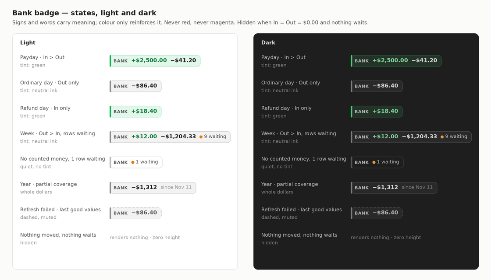
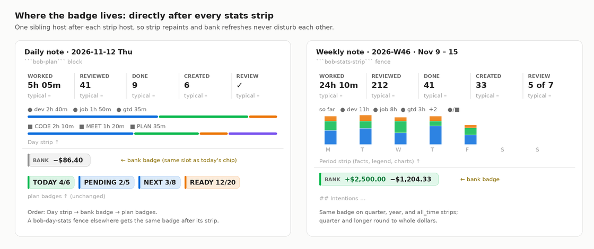

# Bank badge: one money receipt for every stats strip

*Researcher: cld · 2026-11-14 · Repos read: bob-cli (`src/native/bank`,
`src/native/periods`, `docs/`), bob-plugins (`plugins/bob-ledger-tools`), the
glossary web, and the live vault (read-only). Prior research consulted:
`202611/bank_daily_acknowledgment` (final synthesis).*

## TL;DR

- **Yes, build it. Treat it as a promotion, not a restyle.** Today's "daily
  chip" is a one-off widget spliced into the `bob-plan` block. It becomes the
  **bank badge**, a first-class companion of the stats-strip family. Every strip
  (Day strip, `bob-day-stats` fences, and the week, quarter, year, and all-time
  period strips) gets the same badge, built from the same data and painted by the
  same code.
- **Colour encodes net flow, never judgment.** The badge tints **green when In >
  Out** and **neutral ink otherwise**. Inside it, the In amount is set in green
  ink and Out in normal ink. A small warning-ink dot marks rows still waiting.
  It is **never red and never magenta**: Bob already uses red for over-cap,
  blocked, and missed, and magenta for "exactly at limit". The bank contract also
  says spending is not an error. Signs and words carry the meaning, so colour
  only reinforces it.
- **bob owns the badge.** Add `bob bank report -p/--period <period-id>` (days,
  ISO weeks, 13/14-week quarters, ISO years, `all_time`, resolved by the
  periods calendar) and a `badge` object in the report JSON. The object carries
  visibility, tone, displays, coverage, tooltip, words, and the click target, so
  the plugin only paints.
- **I changed eight requirements, all called out in §3.** The most important:
  the badge stays visible when money is **waiting** even if In = Out = $0.00, it
  shows **coverage** when a period is only partly tracked, and **periods come
  from period ids**. `-y 2026` is a calendar year, but `2026.md` covers
  Dec 29, 2025 – Jan 3, 2027.



*Figure 1. The badge states, light and dark (synthetic amounts). Green tint
means more came in than went out. Ink tint means money moved normally. An
orange dot plus words means rows wait for you. Nothing renders when there is
nothing to say.*

## 1. What exists today

| Fact | Evidence |
| --- | --- |
| The chip is a `<button>` reading `BANK · out $X · in $Y · N waiting`. It always shows both amounts, including `$0.00`. | bob-plugins `plugins/bob-ledger-tools/src/241n-plugin-bank-daily-chip.js:207-215` |
| The `N waiting` count is **across all months**, and it appears only on today's note. | `241l-plugin-bank-cards-model.js:289` (`waiting.all`, only when `date === today`) |
| Data comes from `bob bank report -D <day> -f json`, `days[].out_cents/in_cents`. | `241n…:177`, bob-cli `src/native/bank/report.rs:196-255` |
| The chip sits **after the Day strip and before the plan badges**, in its own flex row. | `241n…:142-170`, CSS `.bob-bank-daily-plan-host` (`styles.css:8886`) |
| Its tint is the bank hub's **area hue**. `bank.md` has no `color:`, so it falls back to **magenta**. | `241m-plugin-bank-cards.js:279-292`, `styles.css:8887-8895` |
| Magenta is meant to be unique to "count exactly at its limit". | `styles.css:110-116` (Work badge tones comment) |
| Clicking runs `bob bank ensure`, a **guarded write** that can create a note or heading, even from a past day's `$0.00` chip. | `241n…:221`, `241k-plugin-bank-actions.js:579-602` |
| The bank house style: "inflows are green and outflows are neutral, because spending is not an error. State is always carried by text and shape, never by colour alone." | bob-cli `docs/bank.md` (Commands → `report`), prior research §"Presentation" |
| The Day strip contract has "no card, border, background, shadow, or button" and "the strip contains no `<button>` elements". The period strip's renderer says "hue appears only in bars and stacks". | `docs/stats.md` §Day strip; `239-plugin-period-strip-render.js:222-225` |
| **In** counts only `income`/`refund` inflows. Uncategorized inflows are *unclassified in* and stay outside In. Uncategorized outflows count **inside** Out. Transfers and cash-account rows stay apart. | `src/native/bank/model.rs:131-203` |
| Bank `-y YYYY` is the **calendar** year. Period notes use **ISO week-years**, and there is no quarter or all-time bank period. | `src/native/bank/dates.rs:92-97`; `src/native/periods/calendar.rs:15-20` |
| Period strips read `bob periods show <id>`, the Day strip reads `bob stats`, and the chip reads `bob bank report`. That is three sources. | `239-plugin-period-strip-fence.js:1-6`, `docs/stats.md` §Day strip Data |
| Tracking began **2026-11-11** (one checking account). Imports run **weekly on Monday** from QFX, and the guide says "In last week's note, write one line: what surprised you?" | vault `bank/2026-11.md`, `docs/guides/acknowledge-bank-transactions.md` |

## 2. Is this a good idea? A critique

**The idea is sound, and it finishes work the bank design already planned.**
The original bank research listed "a Stats metric so spending sits beside
Worked", a "year card", and a "week-note fence" as P4 views. A strip-wide badge
delivers the week and year views cheaply. The weekly note is also where the
current ritual asks Bryan to reflect ("what surprised you?"), so a badge there
puts the week's money exactly where that question is asked.

The plan as written has seven problems. Each one is either a reliability bug or
a source of confusion.

1. **Hiding at $0 conflates "nothing happened" with "nothing imported yet",
   which is fine only if the badge never claims $0.** Imports are weekly, so
   today and most of the current week read $0 until Monday. Hiding is the
   *right* answer here: a rendered `$0.00` would be a false statement. The cost
   is that the daily badge becomes retrospective. Past days light up after
   Monday's import, and today's note will usually be blank. Accept this and say
   so in the docs.
2. **The `N waiting` nudge on today's note disappears.** Under the hide rule,
   today's badge is usually hidden, and the all-months count goes with it. That
   count also never belonged there, because it is not about the note's period.
   See ADJ-2.
3. **Partial periods mislead badly right now.** `2026.md`, `2026-Q4.md`, and
   `all_time.md` would show only about one week of money (tracking began
   Nov 11), and "2026: −$1,312" reads like a frugal year. Coverage must be
   visible (ADJ-3).
4. **Period boundaries would silently disagree.** Reusing `-y 2026` on
   `2026.md` drops Dec 29–31, 2025 and adds nothing for Jan 1–3, 2027, while
   the strip above it counts both. Quarters and all-time have no bank period at
   all (ADJ-4).
5. **"In" can hide a paycheck.** An uncategorized inflow is deliberately *not*
   income ("a credit alone is never income"). Until the Category walk, or an
   import rule, files it, a payday shows **no In**. If In = Out = 0, the user's
   rule hides the badge entirely, even though money is waiting for review
   (ADJ-1).
6. **Red/green colouring would fight Bob's chip language.** Red already means
   over-cap, blocked, missed, and error, and would land on about 90 % of days
   (alarm fatigue). Red versus green is also the most common colour-vision
   confusion. See §4.3.
7. **The current chip breaks two strip rules.** It is a `<button>`, so
   Obsidian's global button styles leak in. Its click is a write (`ensure`) on
   a read-only surface. Both must go once the badge joins the strip family
   (ADJ-5).

**Would I take a different approach?** I would keep the goal and change the
architecture:

- **bob computes the badge.** A `badge` object carries tone, displays,
  coverage, words, and the target, instead of the plugin deriving them. This
  matches "bob owns every value" (Day strip contract) and the hue decisions
  ("clients render the hue Bob reports").
- **The badge is a sibling host after each strip, not a sixth fact.** A fact
  column would have to keep its space on every note, which contradicts hide
  when zero. Bank also has no `typical` history yet.
- **Colour follows net flow, never good or bad spending.**

I considered and deferred a **money lane in the period charts** (per-child
In/Out columns under Roots/Types). It is the natural v2 for period notes, but it
belongs to the chart redesign track, not this change.

## 3. Adjustments to the requirements

Each adjustment states what you asked, what I propose, and why.

| # | You asked | I propose | Why |
| --- | --- | --- | --- |
| **ADJ-1** | Hide the badge when In and Out are both $0.00. | Hide only when In = Out = $0.00 **and no row in the period is waiting**. With money waiting but nothing counted, show a quiet `BANK ● 1 waiting`. | An uncategorized paycheck or refund should never make the period look empty. Still nothing is shown when there is nothing to say. |
| **ADJ-2** | (Implicit) keep `N waiting`. | `waiting` becomes **period-scoped** on every badge. The all-months count leaves the daily note. | One scope rule everywhere: the badge describes its own period. The Monday chore and the `bank.md` queue card are the global nudge. |
| **ADJ-3** | — | Show **coverage** when tracking began inside the period (`since Nov 11`) or a closed period is not fully imported (`to Nov 12`, or `not yet imported` for a day). | Otherwise year and all-time totals look complete when they cover one week. |
| **ADJ-4** | "Aggregated transactions for that period." | The period is the strip's own period id, resolved by the periods calendar: ISO week, 13/14-week quarter, ISO year, `all_time`. | The badge must add up to exactly the days the strip above it counts. |
| **ADJ-5** | — | The badge is a `span[role=link]` (no `<button>`), and its click **never writes**. It opens an existing heading or the hub, with no `bob bank ensure`. | It follows the strip contract, and a read-only surface stays read-only. |
| **ADJ-6** | "Colour based on in/out values." | Colour comes **only** from values. The area-hue (magenta) identity tint is removed from the badge. Cards keep their hue. | Identity and value can't share one channel, and magenta is reserved. |
| **ADJ-7** | — | Quarter, year, and all-time show **whole dollars**. Day and week keep cents. A non-zero amount under $1 keeps its cents, so the badge never shows "$0". | Cents on a year total are noise. Exact cents stay in the tooltip. |
| **ADJ-8** | "in/out". | Order is **In, then Out**, using signs (`+$2,500.00 −$41.20`) instead of the words `in`/`out`. The words move to the tooltip and `aria-label`. | This matches your phrasing and statement order (deposits, then withdrawals), and signs are more compact and scannable. |

Also: rename the config key to `stats.bank_badge` and keep `stats.bank_chip` as
a permanent alias. This follows the never-hard-rename CLI rule in spirit.

## 4. Design

### 4.1 Anatomy

```text
▍BANK  +$2,500.00  −$41.20  ● 2 waiting  since Nov 11
 │      │           │        │            └ coverage (faint, only when partial)
 │      │           │        └ waiting (warning-ink dot + muted words, only when > 0)
 │      │           └ Out (normal ink, U+2212 minus, only when > $0.00)
 │      └ In (green ink, explicit +, only when > $0.00)
 └ label (muted small caps), 2px start border + soft fill in the tone colour
```

It reuses the chip grammar Bob already has (`.bob-plan-ready-label` /
`-value`): a muted small-caps label, tabular numerals, a 7px radius, a 2px
start border, and a soft fill. Amounts are not small-caps. The badge is one
inline element that wraps as a unit and never ellipsizes an amount.

### 4.2 States and visibility

Every comparison uses exact integer cents.

| State | Condition | Paint |
| --- | --- | --- |
| **hidden** | no hub, chip/badge off, future period, mobile, **or** In = Out = 0 ∧ waiting = 0 | nothing (zero height, no spawn for future or mobile) |
| **in** | In > Out | green tint; In green ink, Out ink |
| **out** | Out > In | ink tint |
| **even** | In = Out > 0 | ink tint (a wash is not a win) |
| **waiting** | In = Out = 0 ∧ waiting > 0 | no fill, faint border, `● N waiting` |
| **stale** | the last good result is shown while refresh fails | dashed border, muted numerals (the existing `data-stale`) |
| **error, nothing cached** | bob failed, no cache | muted `BANK ⚠` link: tooltip has the hint, Enter retries |
| **older bob** | `-p` unknown (exit 2) | days fall back to `-D` with plugin-derived values; periods show nothing; one `console.warn` per session |
| **loading** | cold cache | **nothing**, no "Bank · loading" chip. The badge appears once, when data settles. |

The older-bob row matters because bob-cli ships on a daily release train, so
the plugin can reach the vault a day before `-p` does.

### 4.3 Colour: which colour, when, and why

**Principles**

1. **Colour must change with something you care about**, or it is decoration.
2. **Spending is not an error.** Bob's bank contract says so already.
3. **Respect Bob's existing meanings:**
   - green: met, healthy, done;
   - red: over cap, blocked, missed, error;
   - orange: warn;
   - yellow: in progress;
   - blue: Ready, low;
   - magenta: exactly at limit;
   - grey: zero or unavailable.
4. **Never colour alone.** `+`/`−` signs, order, and the words in
   `aria-label` carry meaning for colour-blind and forced-colours users.
5. **One rule for days, weeks, quarters, years, and all time.**

**The mapping**

| Element | Colour | Token (theme-native) |
| --- | --- | --- |
| Tint when **In > Out** | green: "more came in than went out" | `--color-green` border; 12 % fill |
| Tint when **Out ≥ In** | neutral **ink** (graphite): "money moved, normal life" | `--text-normal` at 50 % (border) and 6 % (fill) |
| **In** amount | green **ink** | `color-mix(in srgb, var(--color-green) 60%, var(--text-normal))` |
| **Out** amount | normal ink | `--text-normal` |
| **Waiting** dot | warning ink (attention, not alarm) | `--text-warning` (the bank heat grid's waiting mark already uses it) |
| Label, coverage | muted / faint | `--text-muted`, `--text-faint` |
| Stale | muted numerals, dashed border | the existing `data-stale` |

The ink tint is deliberately *not* the work-tone grey (`--text-muted`), which
means "zero/nothing". An ink-tinted badge still reads as present and normal.

**Why green on In > Out (net), not "any In"?** A day with a $12 refund and
$1,800 rent is a spending day, and painting it green would mislead. Net
dominance gives a coherent story at every scale:

- paydays glow;
- pay weeks glow (every other week on a biweekly cadence);
- a green quarter or year means you kept more than you spent.

There is no punishment colour. Out-dominant periods simply stay neutral, which
is also honest, because In covers only tracked accounts and categorized income.

**Contrast (computed).** Obsidian's default light-theme `--color-green`
(`#08b94e`) as text on white is **2.61:1**, and **2.32:1** on a 12 % green
tint, which fails WCAG AA. Mixing 60 % green with `--text-normal` gives
`#127d3c` at **5.22:1** (4.65:1 on the tint) in light mode. In dark mode it
gives a soft mint `#80d399` at **9.28:1**. Use the same `--bob-bank-in-ink`
token for `.bob-bank-metric-in strong` on the month card, which has the same
2.6:1 problem today.

**Rejected palettes**

| Palette | Why not |
| --- | --- |
| Traffic light (In green, Out red) | Red means error or over-cap in Bob, it would land on most days, and red/green is the top colour-vision confusion. |
| Net-sign red/green | Same red problem. Daily net is dominated by payday timing, so red would mostly be noise. |
| Magnitude heat (darker = more spent) | Thresholds don't transfer across a day and a year. The month card's heat grid already covers within-month intensity. |
| Typical-relative (amber when Out ▲ typical) | Worth having, but it needs at least 4 usable prior periods per kind. Bank history starts 2026-11-11, so this is Phase 2, as a hue-less ▲/▼ mark like the strip's typical line. |
| Budget-based | Budgets are explicitly out of bank v1 (ADJ-8 of the bank research). |
| Area hue (magenta) | It encodes identity, not value, and collides with "exactly at limit". |

### 4.4 Placement and mounting



*Figure 2. A schematic of where the badge sits (chip colours illustrative). The
badge is the first thing after every strip. On daily notes that is today's chip
slot, so nothing moves.*

- **Rule:** the badge mounts in a host that is the **next sibling of the strip
  host**. That covers:
  - the Day strip in `bob-plan`;
  - a `bob-day-stats` fence;
  - every `bob-stats-strip` fence (week, quarter, year, all-time).

  A sibling host means strip repaints (which replace their own children) never
  destroy the badge, and bank refreshes never repaint the strip.
- **Daily notes:** keep today's adapter (`bankSyncPlanHost`). The order stays
  Day strip → bank badge → plan badges. With the automatic Day strip off, the
  badge keeps its current fallback position at the top of `bob-plan`.
- **Period notes:** the period strip fence appends the badge host after the
  strip root. The period's `## Intentions` follows.
- **Gating:** the badge subscribes only while its strip is visible (reuse the
  period strip's visibility observer) and unsubscribes on release.
- **Not rendered:** the Stats dash, the parts table, hover popovers, embeds,
  canvas, or mobile (strips don't render there either).

### 4.5 Interaction and accessibility

- `span[role=link]`, `tabindex=0`. Enter or Space activates. `mousedown`
  calls `preventDefault` (vim keeps focus). Ctrl/Cmd-click and middle-click open
  a new tab. This is the strip's interaction model exactly.
- **Click target, from bob:**
  - when the period has waiting rows: the **oldest waiting day's heading** (take
    me to what needs me);
  - otherwise, for a day or week: the **first day heading with counted rows**;
  - otherwise, for a quarter, year, or all-time: `bank.md` (queue and recent
    months).

  The click never runs `ensure`.
- **Tooltip** (bob `title`, multi-line): the period label, then In with its
  income/refund split, then Out with its top 3 categories, then "Not counted:
  transfers $X · unclassified in +$Y", then the waiting count and oldest date,
  then coverage ("imported through Nov 12").
- **`aria-label`** comes from bob `words`, plus "Open bank rows", for example:
  "Bank, week of Nov 9 to 15: in $2,500.00, out $41.20, 2 rows waiting. Open
  bank rows."
- **Forced colours:** amounts and border use `CanvasText`. The signs and words
  still carry meaning.
- **No motion.** The badge appears once and never animates.

### 4.6 Data contract (bob-cli)

**CLI changes.** Both are additive, alphabetical, and have short aliases, per
`cli_rules`.

```text
bob bank report [-b DIR] [-D DAY] [-f human|json] [-m MONTH] [-p PERIOD] [-s] [-w WEEK] [-y YEAR]
  -p, --period PERIOD   A stats-strip period id: YYYY-MM-DD, GGGG-Www, GGGG-Qn,
                        GGGG (ISO week-year, like period notes), or all_time.
                        Boundaries come from the periods calendar.
  -s, --summary         Omit days[] rows (badge, totals, breakdown, waiting only).
```

- `-p` is mutually exclusive with `-D/-m/-w/-y`. The help text must say that
  `-p 2026` is the **ISO** year and `-y 2026` the calendar year.
- `-s` keeps all-time payloads small as history grows (days × rows of row JSON).
- `all_time` uses the same span as `bob periods show all_time`.

**The new `badge` object** is additive under `schema_version: 1` and present in
every report:

```json
"badge": {
  "visible": true,
  "tone": "in",
  "in":  { "cents": 250000, "display": "+$2,500.00" },
  "out": { "cents": 4120,   "display": "−$41.20" },
  "waiting": { "count": 2, "display": "2 waiting", "oldest": "2026-11-12" },
  "coverage": { "start": "2026-11-11", "through": "2026-11-12", "complete": false, "display": "since Nov 11" },
  "target": { "path": "bank/2026-11.md", "line": 14 },
  "title": "Week 2026-W46 · Nov 9 – 15\nIn +$2,500.00 · income\nOut −$41.20 · Dining $30.12 · Coffee $11.08\nNot counted: transfers $500.00\n2 waiting since Nov 12 · imported through Nov 12",
  "words": "Bank, week of Nov 9 to 15: in $2,500.00, out $41.20, 2 rows waiting"
}
```

The rules for each field:

- **`in` / `out` / `waiting`** are `null` when zero.
- **`tone`** is one of `in | out | even | waiting | none`, and `none` ⇔
  `visible: false`.
- **`coverage`**:
  - `start` is when tracking began inside the period (the earliest account
    `start`, clamped to the period);
  - `through` is the last imported date across importable accounts, clamped to
    the period and today;
  - `display` is `null` when complete, and for open periods whose only gap is
    the expected import lag.
- **`target`** is never a path that doesn't exist.
- **Precision** (ADJ-7) is bob's choice.

**Implementation note.** `report.rs` computes day In/Out a second time,
separately from `compute_totals` (`report.rs:216-236` vs `model.rs:131`). The
badge should reuse `compute_totals` over the period rows so the badge, totals,
and card can never drift.

Optionally, `bob bank report` human output can print the same badge line at
its top (green In, default Out), so the CLI and the plugin agree visually.

### 4.7 Copy

- Use `+$2,500.00` / `−$41.20` (U+2212 minus, `$`, thousands separators),
  whole dollars for quarter and longer, and `N waiting` (not "to
  acknowledge", which the guide no longer says).
- The label is `BANK`. Keep it, because on a period note an unlabelled
  `+$7,500 −$4,210` is ambiguous.
- Coverage words come from bob: `since Nov 11`, `to Nov 12`,
  `not yet imported`.

## 5. Glossary term (draft) and the memory/doc touch list

The write must go through `/sase_memory_write`. The new strand is
`sase/memory/glossary/bank-badge.md`. It regenerates `docs/reference/glossary.md`
via `just docs-gen`.

> **Bank Badge** — *aka bank chip, daily bank chip*
>
> The read-only money summary that follows every [[stats-strip]] — after the
> [[day-strip]] in a daily note's `bob-plan` block, after a `bob-day-stats`
> fence, and after each [[period-note]]'s strip — for exactly that strip's
> period. It shows **In** (`income` and `refund` inflows, `+`, green ink) and
> **Out** (outflows except transfers and cash-account rows, `−`), each only when
> above $0.00, plus the period's waiting [[bank-row]]s; with nothing counted and
> nothing waiting it renders nothing. Its tint follows net flow — green when In
> exceeds Out, neutral ink otherwise — and is never red. It names partial
> coverage (`since Nov 11`). bob computes every value, tone, and display from
> [[bank-month-note]] rows at read time (`bob bank report -p <period>`); the
> badge never writes a note, and clicking it opens the rows behind it. Not the
> `bob-bank` month or queue cards, the plan badges (TODAY, PENDING, NEXT,
> READY), or a Stats fact. See `docs/bank.md`.

**Also update:**

- **Memory:**
  - add one clause and link to the `day-strip` and `stats-strip` strands ("the
    [[bank-badge]] follows it");
  - add a "Totals … the [[bank-badge]]" mention to the `bank-month-note` strand;
  - add a decision record `bank-badge-tint-follows-net-flow`: "Green only when
    In exceeds Out, otherwise neutral ink; never red or magenta; signs and words
    carry meaning." Cite this research.
- **bob-cli docs:**
  - `docs/bank.md`: a "Bank badge" section, the `badge` JSON, `-p`/`-s`, and
    the existing "daily chip" wording;
  - `docs/stats.md` §Day strip: "the bank badge follows the strip";
  - `docs/periods.md`;
  - `docs/reference/plugins/bob-ledger-tools.md`: rename "Bank cards and the
    daily chip";
  - CLI reference via `just docs-gen`.
- **bob-plugins docs:** `docs/bob-ledger-tools.md` (same rename).

## 6. Implementation plan

| Phase | Repo | Work | Tests and gates |
| --- | --- | --- | --- |
| **P1** | bob-cli | `-p/--period` (reuse `periods::calendar::PeriodId` + `period_span`); `-s/--summary`; the `badge` object; reuse `compute_totals` for day values; coverage from the journal import windows. `feat(bank): …`, with no Cargo version or CHANGELOG edits (release-train decision). | Parity test: bank `-p` start/end == `periods` span for 2026-W01, 2026-W53, 2026-Q4 (14 weeks, Sep 28 2026 – Jan 3 2027), 2026 (Dec 29 2025 – Jan 3 2027), 2027, `all_time`. Badge vectors (tone, visibility, precision, never "$0", coverage copy). `just docs-check`. |
| **P2** | bob-plugins | Shared `bankBadgeModel()` (decodes bob's `badge`, older-bob fallback) and `paintBankBadge()` (`span[role=link]`, tokens above); a sibling-host adapter for daily notes (migrate the chip), `bob-day-stats`, and `bob-stats-strip`; visibility gating; non-writing navigation; `stats.bank_badge` with the `bank_chip` alias; CSS tokens (`--bob-bank-in-ink` shared with the month card). | Model and DOM tests (no `<button>`, hidden on zero, waiting-only, stale, error, older bob); the existing `obsidian-bank-ui-e2e` extended to a weekly note and to asserting **vault bytes unchanged** after a click; `npm run build:check`, `npm test`, `npm run docs:check`; then `bob plugins sync`. |
| **P3** | memory/docs | Glossary strand, strand links, decision record, docs above. | `just docs-gen && just docs-check`. |
| Later | both | A hue-less ▲/▼ typical mark for Out once 4+ prior periods exist; a money lane in the period charts; a Mac idle-agenda bank line from the same `badge` JSON (thin-client decision). | — |

## 7. Open questions for Bryan

1. **The all-months waiting nudge.** I recommend the Monday chore plus the
   `bank.md` queue card as the only global nudge. Do you want a dashboard
   `BANK N` chip instead of losing the nudge from today's note?
2. **Is "green when In > Out" right for years?** A green 2027 would mean "kept
   more than spent". It is never red the other way. If even green feels too
   evaluative, the fallback is "tint by presence": green iff only In moved,
   otherwise ink.
3. **Whole dollars for quarter and longer?** (I recommend yes.)

## 8. Recommended solution

Ship the **bank badge** as a bob-computed, read-only money receipt that follows
**every stats strip**.

1. **Data (bob-cli):** add `bob bank report -p <period-id> [-s]` and a `badge`
   object. bob decides visibility, tone, displays, coverage, tooltip, words, and
   the click target. Periods resolve through the periods calendar, so the badge
   always covers exactly the days its strip counts.
2. **Visibility:** render the badge when In > $0.00, Out > $0.00, or rows in
   the period wait. Otherwise render nothing: no `$0.00`, no loading chip, zero
   height. Each part appears only when non-zero.
3. **Colour:**
   - green tint when In > Out, neutral ink otherwise;
   - In in accessible green ink (`green 60 % + text`, 5.2:1 in light mode),
     Out in normal ink;
   - waiting as a warning-ink dot plus words;
   - never red, never magenta, never colour alone (`+`/`−`, order, words).
4. **Form:** `▍BANK  +$2,500.00  −$41.20  ● 2 waiting  since Nov 11` in Bob's
   chip grammar, as a `span[role=link]` mounted as the next sibling of each
   strip host. Day and week amounts keep cents; quarter and longer show whole
   dollars.
5. **Behaviour:** the click opens the oldest waiting day, else the period's
   rows, else `bank.md`, and never writes. The tooltip gives the breakdown and
   coverage. An older bob degrades quietly.
6. **Vocabulary and records:** add the **Bank Badge** glossary strand (§5),
   link it from the Day Strip and Stats Strip strands, and record the colour
   rule as a decision.

This keeps the feature **intuitive** (one badge with one rule on every strip,
whose numbers add up to the strip above it), **reliable** (exact ISO period
parity, honest coverage, no writes, no false zeros, skew-tolerant), and
**beautiful** (Bob's own chip grammar, a calm ink badge on ordinary days, and a
green glow on the days money arrives).
