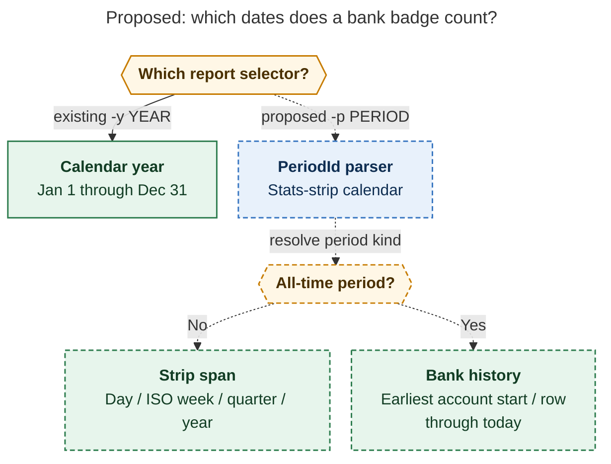
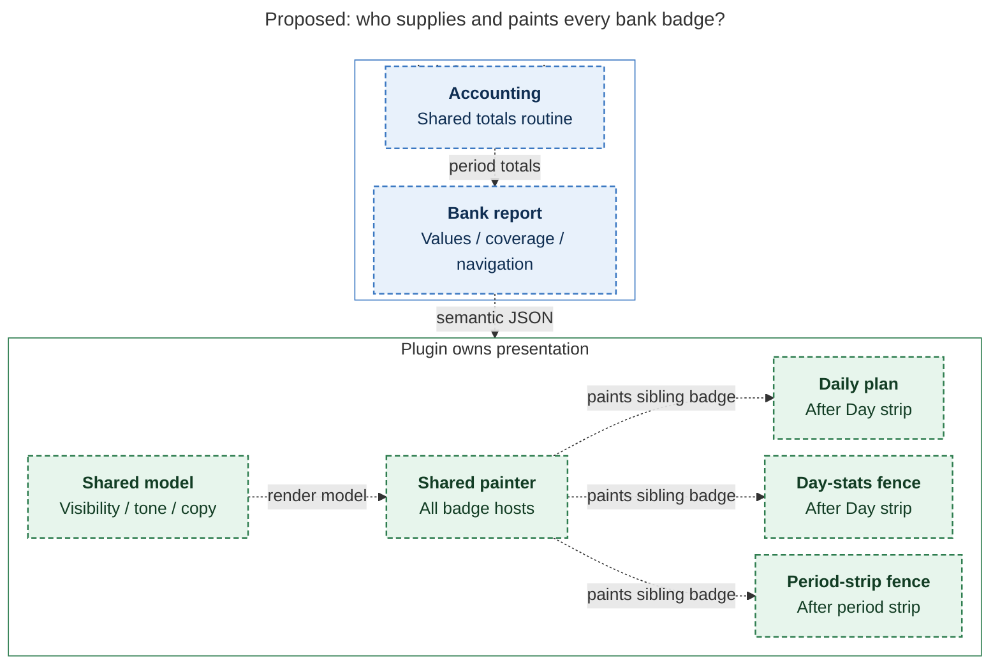

# Diagram proposals: Bank badge for the whole stats-strip family

Proposals for the swarm linker, not a report. Each diagram restates only what the source
report says.

```yaml
source: research:202611/bank_badge_strip_family/bank_badge_strip_family__final.md
producer: research.4l.image
check: "mmdc 12.0.0 with the PDF-mirroring config and Puppeteer --no-sandbox rendered 2 of 2 Mermaid diagrams"
```

## period-routing

```yaml
anchor: |-
  keeps its calendar meaning for statements, and help text must name the
question: |-
  Which calendar and history should each bank-report selector use?
illustrates: |-
  The proposed -p option reuses PeriodId::parse for stats-strip periods, retains the calendar meaning of -y, and gives all-time the bank universe instead of the daily-note tree.
caption: Year-strip badges use ISO week-years, while -y keeps calendar years; all-time uses bank history.
review: "613.906x762 px, fit 100.0%; question, source, and visual checks passed; 1 revision, 2 look rounds"
```



## shared-rendering

```yaml
anchor: |-
  and the period-strip fence (badge host appended after the strip root).
question: |-
  What does bob own, and how does one plugin painter serve every host?
illustrates: |-
  bob emits semantics and the plugin derives presentation, with one painter placing sibling badge hosts after the daily-plan Day strip, bob-day-stats, and period-strip fences.
caption: bob supplies values and metadata; one plugin model and painter serve sibling badge hosts after daily-plan, day-stats, and period strips.
review: "683.062x994 px, fit 89.8%; question, source, and visual checks passed; 1 revision, 2 look rounds"
```


