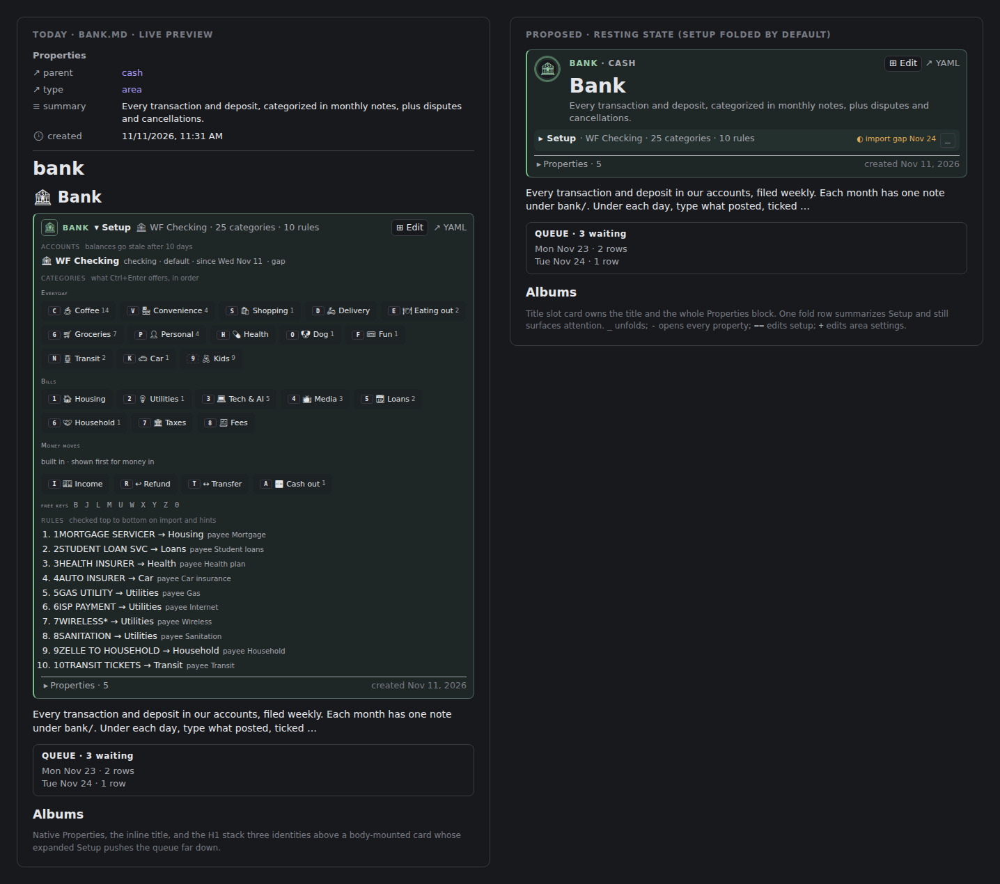
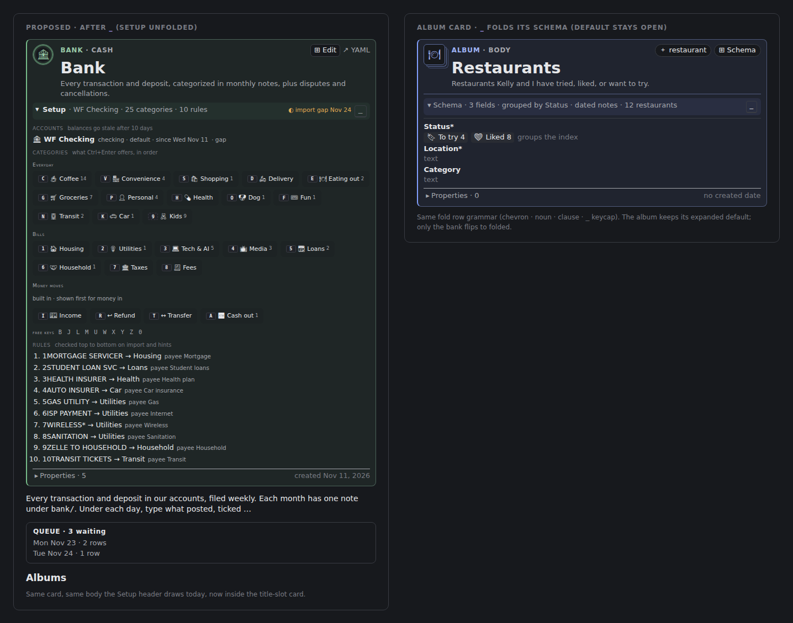

# Bank as a full property card: folded Setup, native Properties takeover, and the `_` fold key

## TL;DR

**Yes, do it.** The request is sound, and both conditions that kept `bank.md` out
of the property-card takeover have now been met. My recommendations:

1. **Move the bank card into the title slot.** It should own the note's title and,
   like album, record, and day/period cards, replace the whole native Properties
   block. Today it sits in the body under `# 🏦 Bank`, which is why it was left out.
2. **Fold Setup by default on the bank card only.** The album schema stays open by
   default. Store the default as one constant per species, because it has already
   flipped once (see §2.4).
3. **Make `_` a general "fold this card's section" key**, not a key that only works
   on bank and album. `-` and `_` share one physical key, so they become the
   show/hide pair, and `=` and `+` become the edit pair. Wire `_` to every card that
   already has a fold: album, bank, record, area, and project.
4. **Two changes to the requirements:**
   - A folded card must still show problems. The fold row carries one attention
     chip, and an unhealthy setup opens by default.
   - Draw every fold as the same kit "fold row", so the four cards stop using four
     different disclosure styles.

Ship it in three small phases: the key and fold model first, then the title-slot
move and Properties takeover, then visual polish (§9).



*Figure 1.* Left: `bank.md` today in Live Preview, with the Setup body expanded and
mounted below the H1. Right: the proposed card in the title slot, with Setup folded.
Both cards are built by the plugin's own DOM builders (`bankSetupBuildEl`,
`propertyCardBuildTitleBlock`, `propertyCardFootBuildEl`) and styled by the
current `bob-ledger-tools/styles.css`. The data is real `bob bank config -f json`
output from the vault, with rule names and payees replaced by generic text.

Some parts of the mock are approximate:

- The native Properties block, the queue box, and the new fold row are hand-written HTML.
- Emoji use the monochrome Noto Emoji font.
- It was rendered in headless Chromium, not Obsidian.



*Figure 2.* Left: the bank card after `_`, with the same Setup body the plugin
draws today. Right: the real album card, restyled in the mock so its `▾ Schema`
line uses the shared fold row with a `_` keycap.

---

## 1. What exists today (evidence)

| Fact | Where |
| --- | --- |
| The bank card is already a property card. It is built with `createPropertyCardHost({ kind: "bank" })`, has the species badge (🏦 **BANK**), the shared foot, and the `-` drawer. | `plugins/bob-ledger-tools/src/248c-plugin-bank-setup-hosts.js:29-110`; glossary *Bank Card* |
| It is mounted in the body, after the first H1: a CodeMirror block widget in Live Preview and an `insertBefore(h1.nextSibling)` in Reading. It does not use the title slot. | `248c…:591` (`bankSetupLiveDecorations`), `bankSetupReadingAnchor` |
| It hides only the native `bank` row. `parent`, `type`, `summary`, and `created` still show in native Properties. | `240b-plugin-property-card-ownership.js:204-215` (`propertyCardOwnBankKeys` → `["bank"]`) |
| Whole-frontmatter ownership is allowed only for `album`, `record`, `day`, `week`, `quarter`, and `year`. | `240q-plugin-property-card-frontmatter-ownership.js:523` |
| Docs say so explicitly: "Bank retains its native Properties block", "bank does not". | `docs/property-editor.md:337`, `docs/develop/architecture.md:233` |
| Setup is expanded by default and the choice lasts only for the session. An invalid config is forced open. | `248a-plugin-bank-setup-model.js:10` (`BANK_SETUP_DEFAULT_EXPANDED = true`), `:294` (`state === "invalid" ? true : expanded`) |
| The album schema is also expanded by default and session-only. | `241w-plugin-album-schema-model.js:113` (`albumHeaderDefaultExpanded` → `true`) |
| Both defaults flipped from collapsed to expanded on Nov 16. | bob-plugins `67073ac5` "expand album schema and bank Setup headers by default" |
| Record, area, and project cards also have session folds, each with its own `▾`/`▸` button and its own Map keyed by path. | `242j-plugin-record-sheet-dom.js:216`, `249c-plugin-home-card-dom.js:98`, `249d…:357` |
| The Vim card keys are handled by one capture-phase keydown handler. `==` waits for Vim's pending `=` operator. `-` and `+` are bare normal-mode keys, with no count, register, or operator, and focus must be in editor content. | `248m-plugin-schema-double-equals.js:128-160` (bare gate), `:493` (key filter) |
| `_` is not mapped in the vault vimrc, which already reserves `-` and `+` for the ledger-tools gate. | `~/bob/obsidian_vimrc.md:42` |
| The earlier research synthesis (D5) left bank out of the takeover for two reasons. First, the body-mounted card would move `parent`, `type`, and `summary` into a drawer around line 67. Second, area contract keys had no typed stages yet. D5 says to revisit this once areas get a title-block card. | `202611/card_owned_frontmatter/card_owned_frontmatter__final.md` §D5 |
| Both D5 blockers are now resolved. Area and project title cards exist, and the Property Editor shows typed **AREA SETTINGS** on `bank.md` from `props_contract_v1`. | `docs/area-and-project-cards.md`; `docs/property-editor.md:48-51,72-92` |

What `bank.md` looks like today, top to bottom:

1. Four native Properties rows.
2. The inline title `bank`.
3. The H1 `🏦 Bank`.
4. The card. Expanded, it holds 1 account, 25 category tiles in 3 groups, the
   free-keys line, and 10 rules.
5. The teaching paragraph, the `bob-bank` queue (the part used every day), and
   `## Albums`.

The note names itself three times before it gets to the queue (Figure 1, left).

---

## 2. Critique: is this a good idea?

### 2.1 Folding Setup by default: good, if it stays honest

Setup is configuration: accounts, the category catalog, and import rules. You
change it a few times a month. The queue below it is what you open the note for. A
folded Setup lets the note open on today's work. The album schema is different. It
describes the collection you are browsing and has 3–8 fields, so keeping it open is
right. **A different default per species is the correct model.**

The risk is that a folded section hides problems. Today an invalid config forces
the section open, and that should stay. But warnings, a stale or `delta` account,
and dead rules would disappear behind `▸ Setup`. The fold row must carry them
(§4.4).

### 2.2 Hiding native Properties: good, but only together with the title-slot move

If you hide native Properties while the card stays in the body, `parent`, `type`,
and `summary` disappear from the top of the note and reappear inside a card in the
middle of it. That is D5's objection, and it still holds. Once the card is in the
title slot, the takeover is clearly better:

- `parent` becomes the kicker crumb.
- `summary` becomes the subtitle.
- `created` moves to the foot.
- `bank` becomes the Setup section.
- `type` becomes the card's identity.
- Any other area key is still reachable two ways: `-` opens the drawer, and `+`
  opens the Property Editor with typed **AREA SETTINGS**.

This makes the bank the only area note that hides native Properties, because area
and project cards deliberately keep them (`249d…:1-9`). I think the exception is
justified. The bank card has its own `==` editor and owns a nested map that native
Properties cannot render. It now matches its peers (album and record), not other
area notes.

### 2.3 The `_` key: good

- It is the Shift layer of `-`. That gives a clear key family: **the minus key
  shows or hides, the equals key edits.** `-` opens the properties drawer, `_`
  folds the card section, `==` opens the species editor, and `+` opens the
  Property Editor.
- It replaces only a low-value Vim motion. Bare `_` moves to the first non-blank
  character, which `^` also does. `d_`, `y_`, `c_`, and `3_` are untouched because
  the bare-key gate refuses operators, counts, and registers.
- It only activates on notes that have a mounted card with a fold.

### 2.4 What I would change

- **Scope.** Limiting `_` to bank and album makes it unpredictable. On a record or
  area note, which also have folds, it would quietly move the cursor instead. A
  key that sometimes folds and sometimes moves the cursor erodes trust in it.
  `-` works on any card with a foot, so `_` should work on any card with a fold.
- **The bank's word for its section.** You called it the "schema". The bank card
  says **Setup**, which is more accurate: it holds accounts, categories, and rules,
  not a record schema. Keep the word **Setup** and make only the *gesture* uniform.
- **Defaults keep changing.** Nov 16 flipped both defaults to expanded, and this
  request flips the bank back. Put the default in one constant per species (a
  `foldDefault` field on the species registry entry). Then the next change is a
  one-line diff with one test.

---

## 3. Requirement adjustments (explicitly called out)

| # | Adjustment | Why |
| --- | --- | --- |
| A1 | `_` folds the mounted card section on **every species that has one**: album (Schema), bank (Setup), record (details), area and project (details). Day and period cards have no fold, so `_` falls through to Vim there. | Predictability, and parity with `-`. Each extra species costs about one registration call. |
| A2 | **Attention survives folding.** The folded bank row carries the single most severe signal: a config error, then a finding, then a non-balanced account status. An **unhealthy** Setup (invalid, missing, unsupported, or refresh-failed) **defaults open** even though the species default is folded. | A section that is folded by default must not hide anything you need to act on. |
| A3 | **Your explicit fold choice wins for the session, but not across a drop in health.** The remembered choice records the health it was made under. If health later gets worse, the choice is discarded and the default for the new health applies. That opens the section once. | Collapsing a healthy setup should not hide a new error later in the same session. |
| A4 | **One shared fold row in the kit.** It is a full-width button with a chevron, the section noun, a summary clause, an optional attention chip, and a `_` keycap. It replaces the four separate disclosure styles. | Consistency, and the keycap teaches the key. |
| A5 | Add a **"Collapse or expand card section"** palette and Command Mode command (`toggle-card-section`), the sibling of **Toggle card properties**. | Reading view has no Vim, and you can search the palette for both "collapse" and "expand". |
| A6 | **Not adopted:** keeping fold state across Obsidian restarts. | With a folded-by-default bank, returning to the default after a restart is intended. Revisit if you find yourself unfolding it every session. There is precedent for persistence: Bank Period Charts stores its collapse in localStorage. |

---

## 4. Design

### 4.1 Card anatomy

**Resting state (bank):**

```
╭───────────────────────────────────────────────────────────────╮
│ (🏦)  BANK · Cash                               ⊞ Edit  ↗ YAML │  kicker: species word + parent crumb
│       Bank                                                    │  title (owns the note title, aria-level 1)
│       Every transaction and deposit, categorized in monthly…  │  subtitle = summary
│ ▸ Setup · WF Checking · 25 categories · 10 rules  ◐ gap  [_] │  fold row (closed)
│ ──────────────────────────────────────────────────────────── │
│ ▸ Properties · 5                       created Nov 11, 2026   │  shared foot (`-` drawer)
╰───────────────────────────────────────────────────────────────╯
Every transaction and deposit in our accounts, filed weekly…    ← authored prose (unchanged)
[ bob-bank queue ]                                              ← now near the top of the note
```

**Open state:** the fold row turns to `▾`, and the body the plugin draws today
follows it: findings, accounts, categories by group with keycaps, free keys, and
rules. The foot stays outside the fold, as it already does on record cards, so the
created stamp and `-` are always visible.

**Album:** nothing changes except that its existing
`▾ Schema · 3 fields · grouped by Status · dated notes · 12 restaurants` line
becomes the shared fold row with the `_` keycap.

### 4.2 The `_` key

| Condition | Result |
| --- | --- |
| Live Preview, Vim normal mode, focus in editor content, no count, register, or operator pending, and the view has a mounted card whose section can fold | Toggle that card's section. Consume the key. |
| No mounted card in the view, or the card has no fold (day, period) | Fall through to Vim's `_` motion |
| A count, register, or operator is pending (`3_`, `"a_`, `d_`) | Fall through to Vim |
| Insert, visual, or replace mode; Source mode; Reading; focus outside editor content | Fall through, or nothing happens |
| The card section is unavailable (loading, mobile line, unsupported bob) | Fall through, since there is nothing to fold |

The key acts on the whole note, not the cursor position. This matches `-`: one card
per note, and the cursor can be anywhere.

**Feedback.**

- *Unfolding* reveals the fold row if it is off-screen, the same way the foot's
  disclosure reveals the drawer when it opens (`pendingScroll` →
  `propertyCardFootReveal`, `240r-plugin-property-card-foot-adapter.js:236-337`).
  That path currently runs on the click handler, so `-` and `_` should both use it.
- *Folding* never scrolls. The title-slot scroll anchor already keeps on-screen
  text still when a card above the viewport changes height (`docs/develop/architecture.md`, *Title slot*).

### 4.3 Fold state model

The kit records **one fold state per note path**, shared by every pane on that
path. This matches the current maps and the drawer.

```
foldOpen(path, species, health) =
  explicit = sessionChoice[path]                 // { open, health } or none
  if explicit && explicit.health ≥ health: return explicit.open   // health same or better
  if health ∈ {invalid, missing, unsupported, refresh-failed}: return true
  return species.foldDefault                      // bank: false; album/record/area/project: true
```

"≥" means *at least as healthy as*, with valid > warn > invalid. `sessionChoice` is
cleared on plugin unload, as today. Fold state is never written to frontmatter or
plugin settings, which keeps the existing rule.

### 4.4 Attention on the folded bank row

Show **at most one** chip, right-aligned, with `+N` if there are more:

1. `✗ 1 error` (error tone) when the config is invalid. The section will be open
   anyway, but the chip stays if you fold it.
2. `⚠ 2 findings` (warning tone) for `bob bank config` findings and warnings.
3. Account status other than `balanced`: `◐ stale`, `✗ delta`, or `◐ gap Nov 24`
   (warning or error tone).

Never show money on this row. That keeps the existing collapsed-line rule
("Money never appears here", `248a…:226`). Drop the leading 🏦 from the clause once
the tile shows 🏦. Today the row reads `🏦 WF Checking · …`, which repeats the tile.

### 4.5 Native Properties takeover for `bank.md`

Use the same coordinator and the same safety checks as album and record cards:

- a mounted card and foot
- desktop Live Preview or Reading
- a closed, valid, duplicate-free YAML mapping that agrees with the cache
- confirmed `props_v1`
- working Property Editor routing

If any check is in doubt, fall back to native Properties with the current per-row
`bank` hiding. Source mode, embeds, hover popovers, canvas, print, and mobile never
take over.

Where each key goes:

| Key | Location after takeover |
| --- | --- |
| `parent` | Kicker crumb (`BANK · Cash`). The link navigates and Mod opens a new tab, like the album kicker. |
| `type` | Implicit identity (the BANK species) |
| `summary` | Subtitle |
| `created` | Foot stamp |
| `bank` | The Setup fold. `==` / ⊞ Edit opens the bank card editor. |
| any other key (`offclock`, `color`, `ready_cap`, …) | The `-` drawer and the `+` Property Editor (**AREA SETTINGS**) |

### 4.6 Title ownership

Use the album's title order: `title:`, then the first H1, then the first alias, then
the file name. One addition: **move a leading emoji in the H1 into the tile**. If the
H1 is `🏦 Bank`, the tile shows 🏦 and the title is `Bank`. The recognizer then
treats that H1 as redundant and hides it at render time. If the H1 has no emoji,
the tile falls back to the species icon (`landmark`). As on every titled card, the
inline title and the H1 hide only at render time, and a Live Preview cursor on the
H1 shows the raw Markdown.

### 4.7 Visual polish (the "beautiful" part)

- **Give the bank its own tile form.** Bank is the only species whose tile form is
  `plain`. A round **`coin`** tile (a pill radius with a faint inner ring in the
  root hue) fits the kit's rule that *form says what*: stack = album, sheet =
  record, leaf = day, field = area, pennant = project, coin = bank. See Figure 1.
- **The fold row** is a lightly tinted full-width bar: about 7% of the card accent
  mixed into the background, the noun in normal ink, the clause muted. That gives a
  large click target, and its weight sits between the title and the foot.
- **Motion:** rotate only the chevron, over about 120 ms, and turn it off under
  `prefers-reduced-motion`. **Do not animate height.** Every height change in the
  title slot makes CodeMirror re-measure, and the slot has a budget of 8
  re-measures per second.
- **Accessibility:** the fold row gets `aria-expanded`, `aria-controls`,
  `aria-keyshortcuts="_"`, and a tooltip of `Collapse setup (_)` or
  `Expand schema (_)`, the counterpart of the foot's `Toggle properties (-)`.
  Re-renders keep focus on the fold row, as today (`data-bank-setup-focus="toggle"`).

---

## 5. Alternatives considered

| Option | Verdict |
| --- | --- |
| Hide native Properties but keep the card in the body | **Rejected.** This is the D5 problem: note identity would be hidden at the top and shown in the middle of the note. |
| Move the card to the title slot but keep native Properties (the area-card model) | **Acceptable intermediate, not the end state.** The native block would only repeat what the card shows (parent, type, summary, created). |
| Use `za`/`zo`/`zc` (Vim folds) instead of `_` | **Rejected.** They depend on the cursor and conflict with heading folds. `_` pairs with `-` on the same key. |
| Make `_` cycle through three states (folded → open → open plus drawer) | **Rejected.** It mixes two separate pieces of state, and `-` already controls the drawer. |
| Make `_` work only on bank and album (the request as written) | **Rejected** in favor of A1, for predictability. |
| Keep fold state across restarts (localStorage or plugin data) | **Deferred** (A6). |
| A plugin setting for each species default | **Rejected.** That adds UI for a one-line constant that a test can pin down. |
| Rename bank "Setup" to "Schema" | **Rejected.** "Setup" is accurate; only the gesture needs to be uniform. |

---

## 6. Reliability and risks

1. **YAML parity on `bank.md`.** The takeover requires `parseYaml(source)` to equal
   the metadata cache exactly. `bank.md` has flow mappings, quoted digit hotkeys
   (`"1"`), and bare dates (`start: 2026-11-11`). Album and record notes also have
   dates and already pass, but this should be spiked. Add a `bank.md` fixture to
   `scripts/obsidian-frontmatter-takeover-e2e.cjs` before turning ownership on. If
   evidence fails, the card simply keeps native Properties, so the failure mode is
   safe.
2. **Title-slot contention.** The adoption kit already falls back to the body mount
   when the slot is unstable or insertion fails. The current CodeMirror widget after
   the H1 becomes that fallback, so no new failure mode is added.
3. **Live Preview navigation gets better.** Today the expanded Setup is a large
   block widget inside the document, which `j`/`k` must step around. In the title
   slot it sits above `.cm-contentContainer`, so it is outside text navigation
   entirely.
4. **Key gate.** Reuse `propertyCardBareKeyGate`. Allow `_`, and add `_` to the
   keydown filter (`248m…:129`, `:493`). Never consume the key unless a fold
   actually toggled.
5. **Multiple panes.** State is keyed by path, so `_` in one pane also re-renders
   the other pane on the same note. That is the drawer's current behavior.
6. **Mobile and Reading.** No change on mobile: the line reads "drawn by bob on
   desktop" and native Properties stay. In Reading view, use clicks and the A5
   command.

---

## 7. Side findings (fix while touching this code)

- **Rules are numbered twice in the Setup body.** `bankSetupPaintRules` puts the
  rules in an `<ol>` and also adds a `.bob-bank-setup-rule-index` span (`248b…:344-346`).
  `styles.css` has no rule for that class, so the headless render shows
  `1. 1MORTGAGE SERVICER → Housing` (Figure 1, left). Check this in Obsidian, then
  remove either the span or the list marker (`list-style: none`).
- **The `gap` account status has no tone.** `bankSetupStatusTone` handles
  `balanced`, `stale`, and `delta` only, so the live `gap` status (hint: "QFX
  coverage gap…") shows as muted `· gap`. Map it to the warning tone if it should
  draw attention (§4.4).
- **The D5 revisit condition has been met** (areas have title cards, and AREA
  SETTINGS are typed). This request is the right moment to act on it.

---

## 8. Implementation sketch (bob-plugins / bob-ledger-tools)

**Kit (new fragment, e.g. `240s-plugin-property-card-fold.js`):**
- Add `propertyCardFoldRegister(plugin, kind, { canFold(path), isOpen(path), toggle(path) })`.
- Add `propertyCardCanToggleFold(view)` and `propertyCardToggleFold(view)`. They
  locate the connected card in the view the same way `propertyCardCanToggleProperties`
  locates its foot (`240p…:304`), read `data-card-kind`, and dispatch to that kind.
- Add the §4.3 state helper, which stores `{ open, health }` for each path.
- Add `propertyCardBuildFoldRow(doc, { noun, clause, open, attention, controls, onToggle })` (A4).
- Add `foldDefault` to the species records in `240f` (bank `false`, others `true`).
  Add the `coin` tile form for bank.

**Keys and commands (`248m`):** add `_` to the keydown filter and the bare-key
gate, add the `_` arm (`canAct` → `propertyCardCanToggleFold`), and add the
`toggle-card-section` command.

**Bank (`248a/248b/248c/248ca`):**
- Replace `BANK_SETUP_DEFAULT_EXPANDED` and the forced-open logic for invalid
  configs with the kit state helper.
- Add the attention chip to the folded clause and drop the 🏦 there.
- Build the title block (kit) followed by the fold row, the body, and the foot.
- Adopt the title through `propertyCardAdoptTitle`, with a bank recognizer that
  moves a leading H1 emoji into the tile. Keep the current after-H1 widget as the
  fallback.
- Acquire ownership through `propertyCardFrontmatterOwnMounted` in the album pattern (`241v…:534-625`).

**Ownership coordinator (`240q`):**
- Add `"bank"` to the eligible kinds (`:523`).
- Make the bank mount-path attribute `data-bank-setup-source` (`:510-514`).
- Add `scheduleBankSetupRefresh` to the refresh list for capability changes (`:683`).
- Call `propertyCardFrontmatterCoordinatorBind(plugin, "bank")` in the bank host setup.

**Album, record, area, and project (`241v/241x`, `242k/242j`, `249d/249c`):**
register their existing fold maps with the kit and switch their disclosures to the
shared fold row.

**CSS:** add the fold row, the coin tile, and the rule-number fix.

**Tests:**
- Unit: the `_` gate, covering every fall-through row in §4.2.
- Unit: the fold model, covering species defaults, the unhealthy-opens rule, and
  health downgrades.
- Unit: the bank model attention chip.
- Unit: the bank title recognizer with the emoji move.
- E2E: flip `obsidian-bank-ui-e2e-setup.cjs` to assert the folded default, and
  press a real `_`.
- E2E: add a bank fixture to the frontmatter-takeover e2e.
- E2E: add a `_` case to the album UI e2e.

**Docs:**
- `docs/bob-ledger-tools.md`: the bank paragraph and the "Property-card properties
  drawer" section.
- `docs/albums.md`: the schema line and `_`.
- `docs/record-card.md`: the gesture table.
- `docs/area-and-project-cards.md`: `_`.
- `docs/property-editor.md`: remove "Bank retains its native Properties block" and
  rename the "Vim family" to `==`, `-`, `+`, `_`.
- `docs/develop/architecture.md`: change "bank does not" and add a fold-kit section.
- Bump the `bob-ledger-tools` manifest (currently `1.157.1`) and run `bob plugins sync`.

**Vault and memory:**
- Change the vimrc comment at `obsidian_vimrc.md:42` to name `_` as well.
- Update the glossary entries *Property Card* (remove "Bank keeps its native block"
  and add `_`) and *Bank Card* through `/sase_memory_write`.
- bob-cli needs no code changes. `bob bank config` and `props_contract_v1`
  already provide everything the card needs.

---

## 9. Recommended solution

Ship it in three small phases, each usable on its own:

1. **The fold verb (low risk, immediate value).**
   - Add the kit fold registry, the `_` key, and the "Collapse or expand card
     section" command.
   - Register album, bank, record, area, and project.
   - Bank Setup **defaults to folded**, and **opens by default when unhealthy**.
     Your choice wins for the session until health drops.
   - Show one attention chip on the folded row.
   - Fix the rule numbering bug.
2. **Bank title card and takeover.**
   - Move the bank card into the title slot and own the title, moving the H1 emoji
     into the tile.
   - Add `bank` to the whole-frontmatter ownership coordinator. Gate this on the
     `bank.md` YAML-parity spike passing in real Obsidian.
   - Native Properties disappear from `bank.md` only when every check passes. Every
     key stays reachable through `-`, `+`, and `==`.
3. **Polish.**
   - Use the shared fold row on all five cards, with the `_` keycap.
   - Add the bank `coin` tile and chevron-only motion.
   - Update the docs, vimrc comment, and glossary.

When all three are done, `bank.md` opens with:

- one title (🏦 **Bank**, kicker *BANK · Cash*, the summary as subtitle)
- a one-line folded Setup that still shows anything needing attention
- the queue immediately below

The keyboard model is the same on every card: `-` shows properties, `_` folds the
card section, `==` opens the species editor, and `+` opens the Property Editor.
