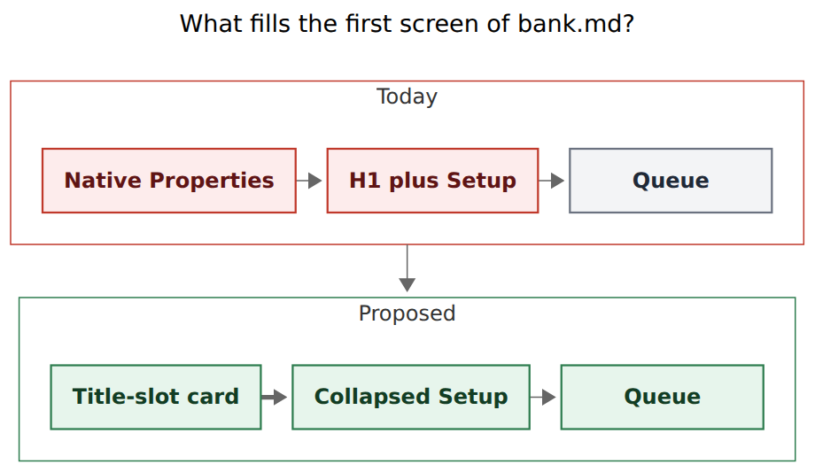
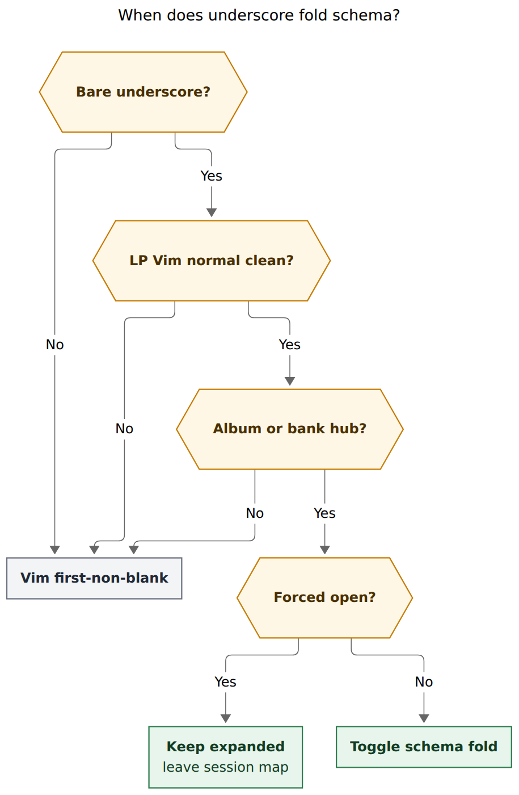
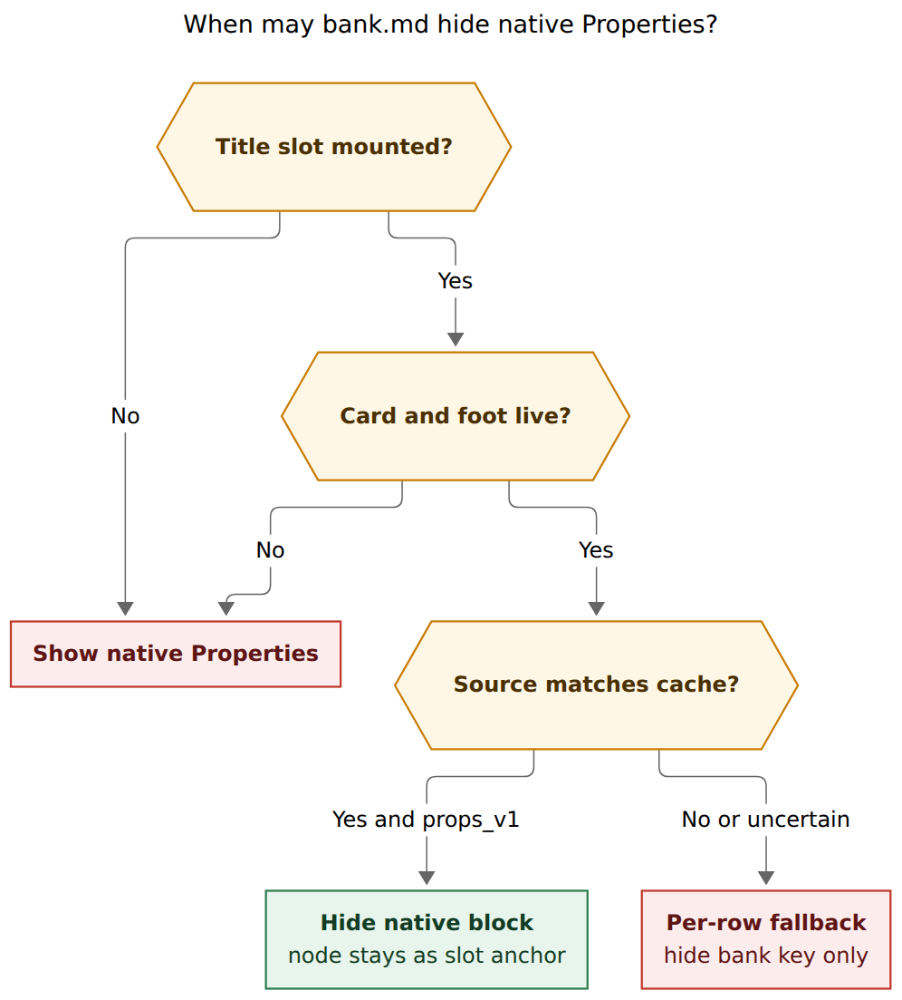

# Make the bank card a proper property card, with `_` for schema fold

*Independent swarm report · researcher `grk` · 2026-11-25*

**Verdict:** Yes — this is the right next move for the property-card family, and `_` is the right key. Bank already wears `.bob-property-card` chrome, a BANK badge, a foot, and `==`. It still mounts like the old album header: a CodeMirror widget after `# 🏦 Bank`, with native Properties kept at the top. Collapse-by-default and a shared `_` fold are cheap and correct. Hiding native Properties is correct only after the card adopts the title slot and whole-frontmatter ownership, the same path album, record, and day/period cards already take.

Do both. Ship them as two stacked PRs in bob-plugins. Keep album Schema expanded by default. Keep bank.md `type: [[area]]`. Keep the words Setup (bank) and Schema (album) on screen.

---

## 1. Is this a good idea?

Yes. Opening `bank.md` still feels like a plugin bolted onto an Obsidian note. The live hub is 84 lines: 63 of YAML (`parent`, `type`, `summary`, `created`, then a nested `bank:` map), then `# 🏦 Bank`, a teaching paragraph, the queue fence, and the albums catalog. The painted Setup body starts expanded (`BANK_SETUP_DEFAULT_EXPANDED = true` in `248a-plugin-bank-setup-model.js`), so category tiles, accounts, and rules sit on the first screen even after the nested `bank:` row is already per-row hidden.

The album card already shows the destination: title-slot identity, summary as subtitle, a one-line schema disclosure, a foot that owns `created` and the Properties drawer, and whole-container hide of native Properties while the mount is eligible. Bank is the last species in that family that still skips title ownership and whole-frontmatter ownership. Architecture says so in as many words: “Identity-only temporal cards qualify; bank does not” (`docs/develop/architecture.md`, Frontmatter ownership). The glossary Property Card strand repeats it: “Bank keeps its native block” and “the bank card shows its species badge without owning the title.”

The 2026-11-22 consolidation `research:202611/card_owned_frontmatter/card_owned_frontmatter__final.md` excluded bank from the hide in v1 (D5) because the card was body-mounted under the H1, so a takeover would have dropped identity keys into a drawer around line 67, and area settings had no typed stages yet. Both of those reasons have aged. Area/project cards exist and already exclude `bank.md` by path (`HOME_CARD_TYPE_NOTES` in `249b-plugin-home-card-model.js`). `+` on `bank.md` already opens AREA SETTINGS in the Property Editor (`docs/property-editor.md`). The remaining D5 reason is the body mount. Adopting the title slot removes it.

`_` is a good idea on its own. Album Schema already toggles from a click and has no keyboard twin. `-` already toggles the Properties drawer through the `248m` bare-key gate. `_` is Shift of `-` on a US keyboard, so the pair reads as two folds on the same card: drawer on `-`, schema/setup on `_`.

Doing only one half leaves the first screen ugly. Collapsing Setup while native Properties stay visible still opens on the identity rump plus the Properties heading. Hiding native Properties while Setup stays expanded still opens on a tall tile field. The first-screen win needs both.



*Figure 1. Today the hub’s first screen is native Properties plus an expanded Setup body above the queue. The proposal puts a title-slot Bank card and a collapsed Setup line in that same place. Teaching prose and the foot remain; they are omitted here so the changed layers stay visible. Rendered 613 × 356 px; fit 100%.*

---

## 2. What exists today

### Bank hub card

- Host: `248c-plugin-bank-setup-hosts.js`, kind `"bank"`, `titleOwnership` left at the host default **false**.
- Paint: Reading inserts the card after the first H1 (`paintBankSetupReading`). Live Preview is a `Decoration.widget` after `notebookHeaderLiveAnchor`, with a comment that this is “exactly where the album header mounts” — album has since moved to the title slot (`241v` + `propertyCardAdoptTitle`).
- Identity: a BANK glyph tile via `propertyCardBuildIdentityBadge`; the card **never** calls `propertyCardApplyIdentity` (`248b-plugin-bank-setup-dom.js`). Accessible name stays `"Bank setup"`.
- Disclosure: `▾ Setup` / `▸ Setup`, session Map `bankSetupExpanded`, default **true**. Invalid configs force `expanded: true` in the model (`248a`). Collapsed grammar already exists and is good: `🏦 WF Checking · 3 categories · 1 hidden · 1 rule`.
- Foot: `248ca-plugin-bank-setup-foot.js` already appends outside collapse, with `where: { bank: "card", created: "foot" }`. Fence, category, and modal surfaces stay foot-free.
- Per-row hide: `propertyCardOwnBankKeys` hides only the `bank` key (`240b`). Parent, type, summary, created, the Properties heading, and **+ Add property** stay native.
- Editor: `==` opens the bank card editor; `+` on this file still shows AREA SETTINGS because the note’s type is area.
- Live identity (`bob query` on `bank.md`): `type: [[area]]`, `parent: [[cash]]`, summary *Every transaction and deposit, categorized in monthly notes, plus disputes and cancellations.*, `created: 2026-11-11T11:31:42-05:00`.

### Album card (the pattern to copy)

- Host: `241v-plugin-album-header.js`, `titleOwnership: true`, binds `propertyCardFrontmatterCoordinatorBind(plugin, "album")`.
- Title slot via `propertyCardAdoptTitle`; body placement is the fallback for embeds, mobile, and failed mounts.
- `propertyCardApplyIdentity` + `propertyCardBuildTitleBlock`: stack tile, `ALBUM · owners` kicker, title, `summary` subtitle.
- Schema disclosure: `▾ Schema · N fields · …` (`241x-plugin-album-schema-dom.js`). Default expanded (`albumHeaderDefaultExpanded` always returns true). Session Map `albumHeaderExpanded`. Click toggles; **no keymap**.
- Whole-frontmatter eligibility includes `"album"` (`240q`).

### Shared keymap family (`248m-plugin-schema-double-equals.js`)

| Key | Gate | Scope | Action |
| --- | --- | --- | --- |
| `==` | Second-key, pending `indentAuto` | Registered property-card kinds | Species editor |
| `-` | Bare-key | Mounted foot in this view | Toggle Properties drawer |
| `+` | Bare-key | Any Markdown note | Property Editor |

`propertyCardBareKeyGate` currently accepts only `"-"` and `"+"`. Capture-phase intercept: Live Preview, Vim normal, empty key buffer, no operator, no count, no register, content target. Palette command `toggle-card-properties` covers Reading and non-Vim. Former `=-` / `=+` chords were deliberately dropped; do not revive them for schema fold.

### Whole-frontmatter gate (`240q`)

Eligible kinds today: `album`, `record`, `day`, `week`, `quarter`, `year`. Bank is absent. The mount-path helper reads `data-album-source`, `data-record-source`, or else `data-intention-source`. Bank already stamps `data-bank-setup-source`; that helper has to learn the bank attribute before eligibility can succeed.

---

## 3. Critique of the request

The request bundles three jobs that look like one:

1. **Fold the painted Setup/Schema body**, default collapsed on bank, default expanded on album, with `_` as the shared gesture.
2. **Make bank a title-owning property card** (identity stack, hide H1, title slot).
3. **Hide native Properties** on `bank.md`.

(1) is a small, well-paved change. (2) is the real design. (3) is a consequence of (2), not a CSS trick on the current widget. Hiding the native block while the card still sits under the H1 would recreate the D5 failure: identity keys vanish from the top of the file and reappear only in a drawer under the heading. The native `.metadata-container` is also the title-slot anchor (`240e`); hiding it without a slot mount leaves an empty header.

A second trap: treating bank.md as an area card. It is an area in the type graph (parent of month notes, hue, AREA SETTINGS in `+`). It is a bank in species chrome. Home cards already exclude the path. Keep that split. Do not retitle the note AREA, and do not change `type`.

A third trap: renaming Setup to Schema. The nested YAML keys differ (`bank:` vs `record:`), the editors differ, and “Edit bank setup” / `aria-label: "Bank setup"` are already in docs, tests, and the glossary. Unify the *gesture*, the *disclosure chrome*, and the *code name* (`toggle-card-schema`). Leave the on-screen words.

---

## 4. Recommended UX

### First screen of `bank.md`

After a successful title-slot mount, the hub opens as:

```
[plain 🏦 tile]  BANK · cash
                 Bank
                 Every transaction and deposit, categorized in monthly notes…
▸ Setup · 🏦 WF Checking · N categories · M rules
────────────────────────────────────────────────
created Nov 11, 2025              ▸ Properties · K
```

Then the existing teaching paragraph and the `bob-bank` queue fence. `# 🏦 Bank` stays in source and hides at render time when it matches the title, the same rule albums use. Cursor on that line in Live Preview reveals the raw heading.

### Identity

Call `propertyCardApplyIdentity(card, { kind: "bank", title: "Bank" })` and `propertyCardBuildTitleBlock` with:

- **Tile:** plain form, emoji 🏦 (species already registered: `tile: "plain"`, `icon: "landmark"`, `word: "Bank"` in `240f`).
- **Kicker:** `BANK` plus a crumb to `[[cash]]`, modifier-click like album owner links.
- **Title:** `Bank`, taken from the H1 with the leading emoji stripped so the tile does not double it. Fall back to the stem.
- **Subtitle:** frontmatter `summary`.
- **Kicker actions:** `⊞ Edit` (desktop) moves up here, matching album `⊞ Schema`. `↗ YAML` can stay as a quiet action or live only inside `==`; it should leave the fold line.

### Disclosure line

Rebuild the bank Setup head so it matches `.bob-album-schema-summary`:

- Full-width muted line under the title block, `▸` / `▾`, `aria-expanded`, `data-schema-fold="open|folded"` when healthy.
- Healthy collapsed text keeps `bankSetupCollapsedLine` (accounts · categories · rules). Money stays off this line.
- Invalid: error color, first finding on the line, body forced open, `_` consumed and ignored.
- Missing `bank:` mapping: teaching line, starter copy still available when expanded.
- Hover raises the line from muted to normal, same as album.

Album keeps its current default (expanded) and its current fold grammar. The two lines should feel like one control with two labels.

### Foot

Already correct. Stays visible while Setup is collapsed. `-` still toggles it. Nested `bank:` row in the drawer still hands off to `==`.

### Defaults

| Surface | Fresh session | After `_` | Invalid |
| --- | --- | --- | --- |
| Bank Setup | Collapsed | Toggles | Forced open; session map unchanged |
| Album Schema | Expanded | Toggles | Forced open; session map unchanged |
| Properties drawer | Collapsed | `-` only | Unrelated |

State stays in the existing per-path session Maps. A new Obsidian session or plugin reload restores the defaults. Painting still writes nothing.

### Beauty rules

- One identity stack, one disclosure line, one foot. No leftover BANK badge beside `▾ Setup`.
- No new hues. Species word and tile form carry identity; hue stays the note’s area hue (`cash`).
- Collapsed bank card height should land near an album card with Schema folded: tile + title + subtitle + one muted line + foot.
- Expand/collapse animates with the existing `grid-template-rows` 160 ms used on the drawer; honor `prefers-reduced-motion`.
- Narrow panes wrap the fold line (`overflow-wrap: anywhere`), matching album. The current bank collapsed span is `white-space: nowrap` with ellipsis; drop that once the line is full-width.

---

## 5. Recommended keymap

Extend `propertyCardBareKeyGate` so `input.key` may be `"-"`, `"+"`, or `"_"`. Match `event.key`, ignore `shiftKey` (on a US layout `_` *is* Shift+`-`; some layouts type `_` unshifted). Keep every existing fall-through: modified, repeat, composing, defaultPrevented, not-content, not-live-preview, no-vim, not-normal, operator-pending, key-buffer, counted, register.

Dispatch `_` like `-`: a built-in arm, not the `+` registry.

```
canAct: propertyCardCanToggleSchema(view)
run:    propertyCardToggleSchema(view)
```

`propertyCardCanToggleSchema(view)` is true when this view contains a live album or bank-hub card that exposes a foldable Setup/Schema disclosure. Record, day, period, area, and project cards leave `_` to Vim. Month notes (`bank/YYYY-MM.md`) have no Setup section; they leave `_` to Vim. `"_` (blackhole register) already fails `registerPending`. Counted `_` already fails `countPending`. `^` remains first-non-blank on these notes.

Invalid / forced-open: `canAct` is true so the key is consumed (the cursor does not jump), `run` is a no-op that **does not write** the session Map, and the disclosure pulses. When the config becomes valid, the previous preference is still there.

Add command `bob-ledger-tools:toggle-card-schema` (“Toggle card schema”), register it in Command Mode next to “Toggle card properties”, and keep the clickable disclosure. Reading view and non-Vim users use those. `_` itself stays Live Preview Vim normal, same as `-`.



*Figure 2. `_` folds Schema/Setup only as a clean Live Preview Vim normal key on an album or bank hub. Forced-open invalid setup stays expanded. Every other case is Vim’s first-non-blank motion. Rendered 609 × 934 px; fit 95.6%.*

Vim cost is real and bounded. CodeMirror Vim’s `_` goes to the first non-blank of the current line (count moves down). On album and `bank.md` in Live Preview normal, `_` becomes the fold. `^` and `0` still move. Everywhere else, including insert, visual, Source, and `"_`, Vim keeps the motion. That is the same bargain already struck for `-` (line up) and `+` (line down).

Rejected keys, for the record: `za` (a `z` prefix, outside the card family), `s` (walk family), `=-` (already retired), Space (too valuable), Tab (focus).

---

## 6. Recommended architecture

Copy the album host. Do not invent a third mount.

1. **Bank host opts in.** `createPropertyCardHost({ kind: "bank", titleOwnership: true, … })`. On setup, `propertyCardFrontmatterCoordinatorBind(plugin, "bank")`; on dispose, release that kind.
2. **Adopt the title.** Reading and Live Preview call `propertyCardAdoptTitle(scope, header, { path, kind: "bank", recognizer, onLost, onMount })`. Fallback keeps today’s after-H1 / widget placement for embeds, hover, mobile, Source, and failed slots.
3. **Build identity + body in one node.** Title block first; schema disclosure and (when expanded) Setup body join inside it; foot last. `propertyCardAdoptPatch` for same-path repaints, as album does.
4. **Extend eligibility.** Add `"bank"` to the kind list in `propertyCardFrontmatterRecordEligible`. Teach `propertyCardFrontmatterMountPath` `data-bank-setup-source`. Require a live `.bob-property-card-foot`, the same source/cache/`props_v1`/routing gate as everyone else.
5. **Shared fold helper.** One `propertyCardToggleSchema(view)` that asks the mounted kind to flip its Map and refresh. Bank and album keep separate Maps and defaults.
6. **Fail-open.** Uncertain capability, bad YAML, Source, embeds, popovers, canvas, print, mobile, and lost mounts restore native Properties. Per-row `bank` hiding remains the fallback, the way album falls back to hiding `record`.



*Figure 3. Native Properties hide only after a title-slot mount, a live card and foot, and source/cache/`props_v1` evidence. Anything short of that restores the native block or the current per-row `bank` hide. Rendered 664 × 736 px; fit 98.4%.*

The File Properties sidebar stays native. `+` still opens AREA SETTINGS plus the on-card `bank` group. **Add file property** on an owned hub routes to Add mode, as it does on other owned cards.

---

## 7. Called-out requirement adjustments

| # | Request | Adjustment | Why |
| --- | --- | --- | --- |
| A1 | Collapse “its schema” on the bank card | Keep the word **Setup** on bank, **Schema** on album. Code, command, and keymap say *schema fold*. | Different nested keys and editors; the gesture is what should feel the same. |
| A2 | `_` expands/collapses bank and album schema | Scope `_` to notes with a live Setup/Schema disclosure (album + `bank.md` hub). | Record/day/area cards have no such section; stealing `_` there would be a silent Vim break. |
| A3 | Hide native Properties on bank.md | Hide only while title-slot + whole-own eligibility hold. | Same fail-open contract as album/record/day. The native node is the slot anchor. |
| A4 | Bank becomes a proper property card | Adopt title slot, identity kit, H1 hide, and whole-own. Keep `type: [[area]]`. | Species chrome is BANK; type graph and `+` settings stay area. Home cards already exclude the path. |
| A5 | (implicit) one change | Two stacked PRs, one design. | Keymap/default-fold is unit-test cheap; title-slot takeover has a known e2e matrix. |
| A6 | (implicit) click already toggles | Add `toggle-card-schema` and a Command Mode row. | Parity with `-` / `toggle-card-properties` for Reading and non-Vim. |
| A7 | (implicit) invalid still force-expands | `_` on forced-open does not write the session Map. | A `_` during a broken config must not collapse the card the moment YAML becomes valid. |
| A8 | Album stays expanded by default | Yes. Empty album Schema may still fold; invalid Schema is forced open like bank. | Teaching empty fields is a choice; hiding findings is not. |
| A9 | (unsaid) persist fold | Session-only, matching every existing card fold. | Painting writes nothing. |
| A10 | Title of the card | `"Bank"` with emoji stripped from the H1. Summary becomes subtitle. Parent `cash` is the kicker crumb. | Matches album identity rules; avoids 🏦 twice. |
| A11 | Setup head layout | Move `⊞ Edit` into kicker actions; make the fold a full-width album-style summary line. | The current one-row head (badge + toggle + ellipsis + Edit + YAML) is what makes bank look like a widget. |

---

## 8. Ship order

**PR 1 — Schema fold + `_` (bob-plugins only).** Flip `BANK_SETUP_DEFAULT_EXPANDED` to `false`. Add `_` to the bare-key gate and a `toggle-card-schema` command. Wire album and bank toggles through one helper. Force-open invalid (and, for album, invalid Schema) ignores `_` without writing the Map. Update `test-ledger-tools-bank-setup.cjs` (“setup header starts expanded…”), `test-ledger-tools-schema-double-equals.cjs` (bare-key table includes `_`; `=` still `not-bare-key`), Command Mode surface tests, and the bank UI e2e that currently waits for an expanded header. Docs: `docs/bob-ledger-tools.md` (expanded by default → collapsed; mention `_`), `docs/albums.md` (keyboard twin of the Schema click), plugin keymap reference.

After PR 1, album `_` works and `bank.md` opens on a collapsed Setup line. Native Properties are still at the top. That is an incomplete beauty win and an acceptable stacked state.

**PR 2 — Bank title-slot takeover (bob-plugins only).** `titleOwnership: true`, `propertyCardAdoptTitle`, identity block, H1 hide, `"bank"` in whole-own eligibility, `data-bank-setup-source` in the mount-path helper, restyle Setup disclosure to the album summary line, move `⊞ Edit` to kicker actions. Extend `obsidian-frontmatter-takeover-e2e` with a bank hub case. Keep per-row `bank` hide as fallback. Docs: `docs/develop/architecture.md` (drop “bank does not”), `docs/property-editor.md` (drop “Bank retains its native Properties block”). Glossary strands **Property Card** and **Bank Card** through `/sase_memory_write`: bank owns the title and, when eligible, the in-document Properties block.

No bob-cli change. No vault migration. `bank.md` YAML stays as written.

Do not land PR 2’s hide before the identity stack is in the title slot. The two PRs may merge as one if the implementer wants a single review; the dependency is PR 2 after the fold helper exists, or both together.

---

## 9. Tests, docs, memory

**Unit**

- Default collapsed bank header; click and helper toggle; invalid stays expanded even when the Map is false.
- `_` bare-key act/fall-through table, including `"_`, counted `_`, insert, Source, non-hub paths.
- `propertyCardCanToggleSchema` true only with a live album/bank-hub disclosure in *this* view.
- Frontmatter eligibility accepts `kind: "bank"` with `data-bank-setup-source`; refuses a footless mount.
- Identity: `propertyCardApplyIdentity` on the bank card yields `data-card-kind="bank"` and `aria-label="Bank: Bank"`.

**E2E**

- `obsidian-bank-ui-e2e-setup.cjs`: first paint collapsed; `_` expands; `_` collapses; invalid auto-expand still holds.
- Album note: `_` collapses Schema; `_` expands it; default remains expanded on a fresh pane.
- Frontmatter takeover: owned `bank.md` hides `.metadata-container` visually, keeps the node, restores on Source, restores on bad YAML.

**Docs / memory**

- New hotkey → plugin reference (`docs.md` routing).
- Behavior change → `docs/bob-ledger-tools.md`, `docs/albums.md`, `docs/property-editor.md`, architecture ownership.
- Glossary Property Card + Bank Card via `/sase_memory_write`.
- Optional decision record: *Bank is a title-owning property card; `_` folds Setup/Schema.* Only needed if Bryan wants D5’s exclusion recorded as superseded. The glossary update is the load-bearing one.

---

## 10. Risks

1. **Title-slot scroll jump.** Expanding Setup in the title slot changes card height above the document. Album already compensates with the slot’s scroll-target listener (`240e`). Default-collapsed bank makes the common path short; the expand path needs the same listener.
2. **Area/BANK dual identity.** Someone will ask why `+` says AREA SETTINGS on a BANK card. That is correct: typed area settings live on this note, and the bank mapping is the on-card group. Do not invent a hybrid kicker.
3. **Focus leak on hide.** Same S1 as the original takeover: a hidden-but-in-DOM metadata container must not trap `k`/`gg`. Bank inherits the existing `inert` + `aria-hidden` + `focusin` guard; add bank to that e2e matrix rather than re-spiking.
4. **Stale album-placement comment in `248c`.** Treat it as a delete during PR 2 so the next reader does not copy the widget-after-H1 pattern again.
5. **Mobile.** Stays the degrade line (“drawn by bob on desktop”). No `_`, no hide, no title ownership. Matches every other species.

---

## 11. Recommended solution (one paragraph)

Give bank the album host treatment: title slot, identity kit (`BANK · cash` / `Bank` / summary), H1 hide, whole-frontmatter ownership with the existing fail-open gate, and a full-width Setup disclosure that starts collapsed. Teach `_` as a `248m` bare key, sibling of `-`, that toggles that disclosure on album (default open) and `bank.md` (default closed), with a `toggle-card-schema` command for Reading. Keep Setup/Schema labels, keep `type: [[area]]`, keep session-only state, keep invalid forced open, keep `+` as AREA SETTINGS plus the on-card `bank` group. Ship fold+`_` first if you want a thin PR; ship title-slot takeover immediately after so native Properties actually leave the first screen.

---

## Sources

- bob-plugins `@1753d730`: `248a`/`248b`/`248c`/`248ca` (bank setup model, DOM, host, foot), `248m` (key family), `241v`/`241w`/`241x` (album header, default expanded, schema summary), `240b`/`240c`/`240e`/`240f`/`240g`/`240k`/`240q` (ownership, host, title slot, species, title block, adopt, whole-frontmatter), `249b` (home-card exclusion of `bank.md`), `docs/bob-ledger-tools.md`, `docs/albums.md`, `docs/property-editor.md`, `docs/develop/architecture.md`, `docs/area-and-project-cards.md`, `scripts/test-ledger-tools-bank-setup.cjs`, `scripts/test-ledger-tools-schema-double-equals.cjs`, `styles.css` (`.bob-bank-setup-*`, `.bob-album-schema-summary`).
- Live hub: `~/bob/bank.md` (84 lines, 63 YAML); `bob query` identity row for `bank.md`.
- Glossary: Property Card, Bank Card, Album Card, Bank Month Note (via `sase memory read`).
- Prior research: `research:202611/card_owned_frontmatter/card_owned_frontmatter__final.md` (D5 bank exclusion; `-`/`+` family; fail-open hide). Figures rendered with `@mermaid-js/mermaid-cli@12.0.0`, PDF-mirroring config from `/sase_memory_read` mermaid skill recipe.
