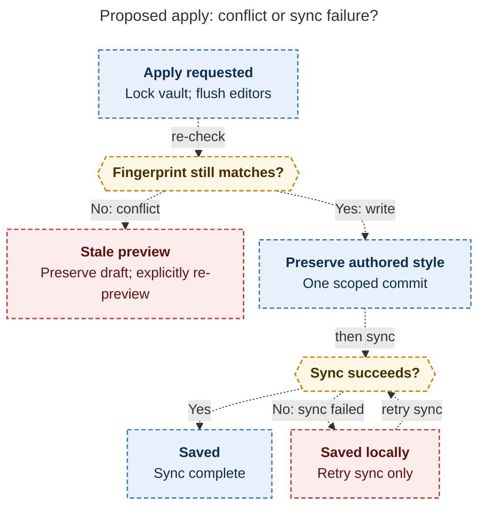
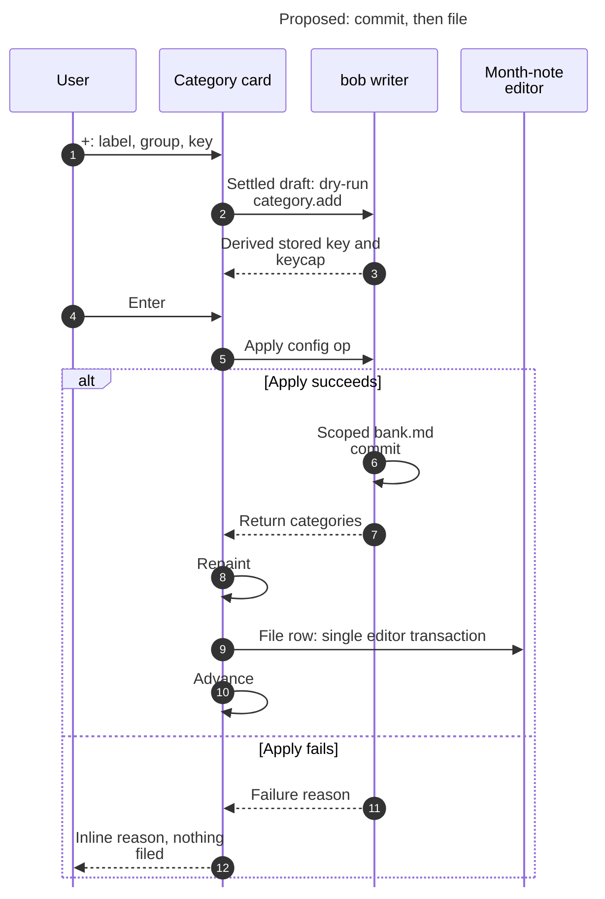

# Diagram proposals: Make bank.md’s bank mapping readable and writable from Obsidian

Proposals for the swarm linker, not a report. Each diagram restates only what the source
report says.

```yaml
source: research:202611/bank_config_read_write_ux/bank_config_read_write_ux__final.md
producer: research.4r.image
check: "mmdc 12.0.0 with the PDF-mirroring config rendered 2 of 2 Mermaid diagrams; selected CLI retained Puppeteer --no-sandbox; malformed-diagram control exited nonzero"
```

## apply-recovery

```yaml
anchor: |-
  shared vault lock, flushes open `bank.md` editors, re-checks the `expect`
question: |-
  How does applying an edit handle stale previews and sync failure?
illustrates: |-
  The proposed writer re-checks the expect fingerprint before one scoped commit, while a post-apply sync failure keeps the local save and offers sync-only Retry.
caption: A stale fingerprint stops the write; a sync failure leaves the commit saved and retries only synchronization.
review: "551.359x938 px, fit 95.2%; question, source trace and visual checks passed; 0 visual revisions"
```



## add-then-file

```yaml
anchor: |-
  card from the writer's returned categories, then files the row through the card's
question: |-
  When does creating a category file the waiting transaction row?
illustrates: |-
  The proposed Category card applies one bank.md config commit before filing the row through its existing single editor transaction, while failed applies file nothing.
caption: Category creation commits configuration before filing the row in a separate editor transaction; a failed apply leaves the row unfiled.
review: "614x956 px, fit 93.4%; question, source trace and visual checks passed; 1 visual revision to prevent title clipping and reduce height"
```


