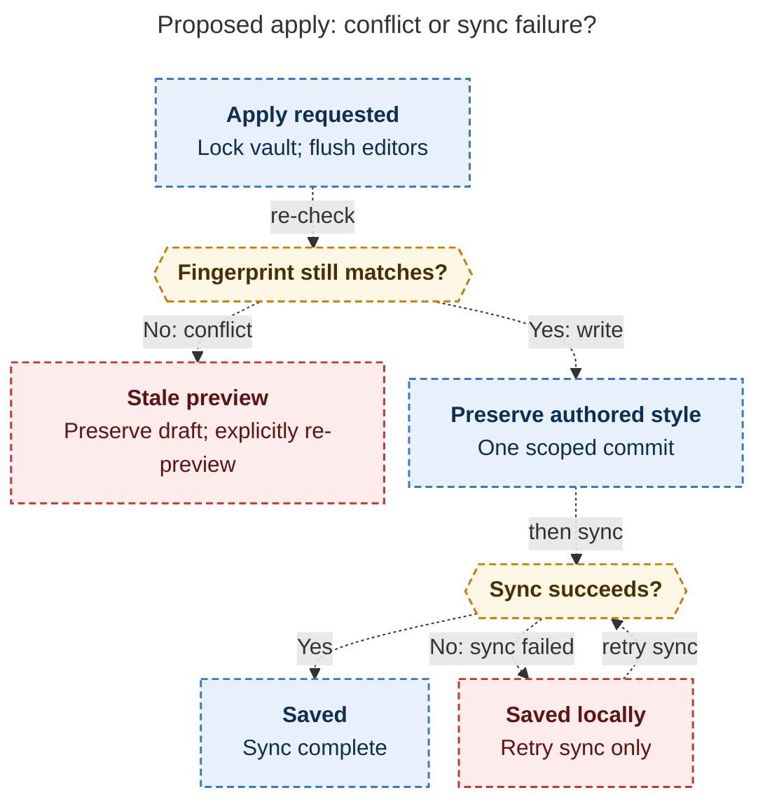
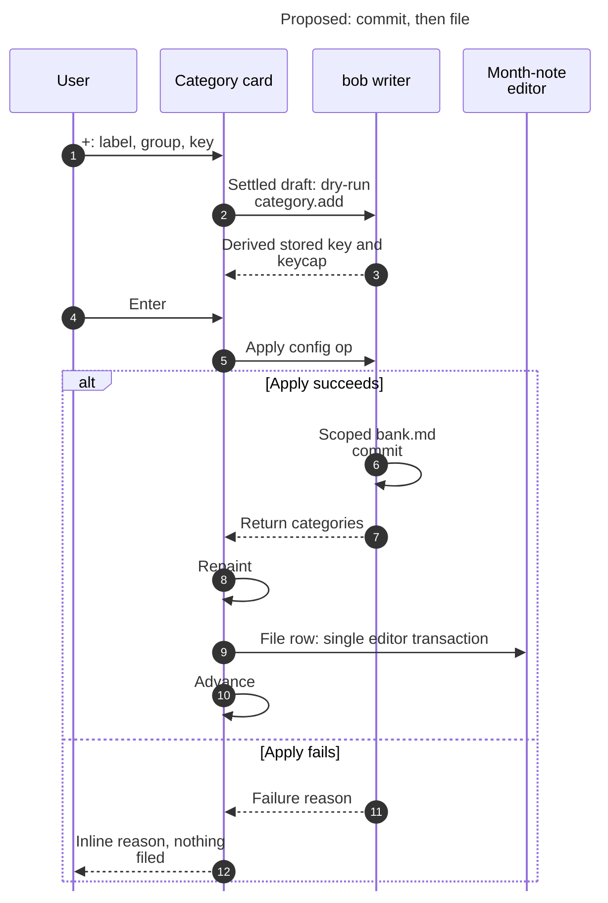
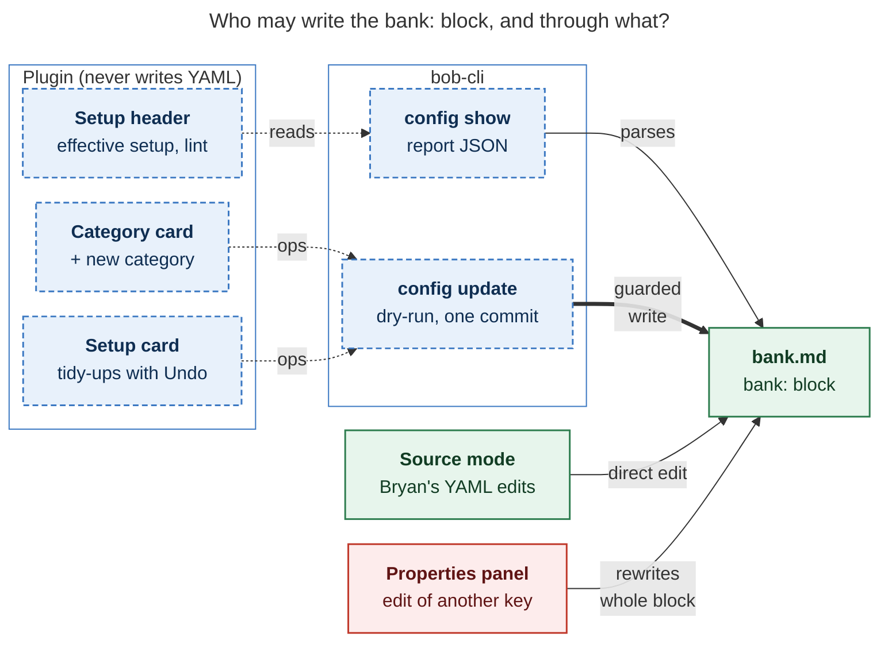

# Make `bank.md`'s `bank:` mapping readable and writable from Obsidian

> **Research query:** How should the `bank` frontmatter field of `~/bob/bank.md`, which
> does not render in Obsidian at all today, be made much easier to read and write from
> Obsidian, taking the album notes' `record` field as context and inspiration, with a
> design that is intuitive, reliable, and beautiful? Is this a good idea, would a
> different approach be better, which requirement adjustments are justified, and what
> is the recommended solution?


## Bottom line

**Build it — but build the right thing.** All five researchers independently reached
the same architecture, and the lead's verification confirms its load-bearing claims:

1. **Keep the nested `bank:` mapping in `bank.md` frontmatter, byte-for-byte, as the
   single source of truth.** Do not [flatten it into scalar properties, move it to a
   sidecar, or split it into per-category notes](#alternatives-considered-and-rejected).
2. **Keep the native Properties row hidden** on the hub ([it is already hidden today](#why-the-field-is-invisible-today)),
   but scope the hide to the rendered replacement surface instead of `document.body`.
3. **Render a collapsed [Setup header](#the-setup-header-for-reading)** under the `# 🏦 Bank` title, in Reading view and
   Live Preview, showing the *effective* configuration — built-ins, derived hotkeys,
   the default account, free keys, account health — not a pretty YAML dump.
4. **Route every write through a new [guarded bob writer](#the-guarded-writer)** (`bob bank config update`)
   that mirrors the shipped `bob albums update` contract: JSON ops, dry-run
   consequences, a fingerprint guard, span-preserving emit, one scoped commit, and
   inverse ops for Undo. The plugin never parses or writes YAML.
5. **Put the most common write gesture at the moment of need:** [`+ New category`
   inside the Category card](#moment-of-need-writes-in-the-category-card), so "none of these categories fits this row" resolves
   without abandoning the row.
6. **[Ship in slices](#sequencing):** read + lint first (cheap, independent), then the writer and the
   Category-card gesture, then a full Bank Setup card sized by the YAML edits actually
   made in the meantime.

The request's framing needs two corrections, [called out in full below](#critique-and-adjusted-requirements): "make the field
render" should mean *render what bob does with the field*, and "easy to write" should
mean *easy to write correctly* — a handful of high-stakes edits must deliberately stay
hard until a real migration flow exists.

## Why the field is invisible today

Two stacked causes, both verified:

1. **Obsidian has no nested-property widget.** cld drove a real Obsidian 1.15.1 over
   CDP against an isolated scratch vault: the `bank` property registers as
   `widget: "unknown"`, the registered widget list has no mapping/object type, and the
   raw row renders one inert JSON string. grk confirmed the forum thread is still open
   and an Obsidian team member answered a 2025-10 ping with "Sorry, it doesn't."
   Waiting on core, or patching undocumented `metadataTypeManager` internals the way
   community nested-property plugins do, is not a plan.
2. **bob-ledger-tools deliberately hides the row and shipped no replacement.**
   `plugins/bob-ledger-tools/styles.css:9094` sets
   `.bob-bank-hub-note .metadata-property[data-property-key="bank"] { display: none !important; }`,
   and `241p-plugin-bank-marks.js` (`bankMarkSyncHubProperty`) applies the class. The
   album work paired the equivalent `record` hide with a header and a Schema Card; the
   bank work shipped only the hide. This is an unfinished surface, not a missing
   parser.

Two sharper findings qualify the hide:

- **The hide is cosmetic, not protective** (cld, measured). In 1.15.1 the raw row is
  not editable — but editing *any other* property on `bank.md` through the Properties
  panel (for example the `summary` row the Areas card points at) re-serializes the
  whole frontmatter: every one-line flow-map category expands into a four-line block
  map (≈21 lines become ≈83) and all YAML comments are deleted. bob still parses the
  result, so this is a style hazard rather than a data hazard, but it means the plugin
  must never write through `processFrontMatter` (same measured behavior), and it pins
  why bob must be the only programmatic writer.
- **The body-class scoping is too wide** (cdx, grk, gem; lead-verified in `241p`). The
  class lands on `document.body` whenever the *active* file is the hub, so a `bank`
  property on an unrelated note in another pane would be hidden too. When the header
  lands, attach the hide to the hub header surface — exactly how the album hide is
  scoped (`.bob-album-header-surface`, `styles.css:8499`) — and keep the existing
  cleanup on path change and unload.

## The evidence that shapes the design

**The live configuration** (verified today): one account (`checking`, "WF Checking",
start 2026-11-11); 21 declared categories as compact flow maps
(`coffee: { label: ☕ Coffee, hotkey: c, group: Everyday }`) — 12 Everyday, 8 Bills
with quoted digit hotkeys `"1"`–`"8"`, one hidden `kids`; no `rules`; no `stale_after`
(default 10). bob adds four built-ins (`income`, `refund`, `transfer`, `cash` in group
*Money moves*, keys `i r t a`), so the Category card offers 24 visible tiles out of 25
effective categories. Free hotkeys: `b j l m u w x y z 9 0`; `q` is reserved. Usage is
young (11 rows; `coffee` 5, `tech` 2). The hub body holds prose, money tasks
(disputes, cancellations), and the `bob-bank` queue card.

**The vault's own git history is the UX evidence** (cld, grk). `bank.md` has three
commits. The 2026-11-13 commit rewrote the category block by hand — scalar categories
became flow maps with groups and pinned hotkeys — and in the same edit both the
`subscriptions` category and the whole `rules:` list (a VENMO → transfer rule)
disappeared. Whether dropping the rule was intended is unknowable from the commit;
a staged, span-preserving editor does not silently omit a sibling key. **"Sibling keys
survive a category edit" must be a first-class test**, not a nicety.

**Semantics that make casual edits dangerous** (sources across all five reports;
first-account behavior additionally demonstrated by cdx with a synthetic-vault
experiment against `bob 0.5.0`):

- Rows without `[acct::]` resolve to the **first** configured account at read time, so
  reordering accounts silently re-attributes them. The import journal stores the
  account alias in every append-only event (`transaction_key = sha256(alias + "\n" +
  bank_id)`), so renaming an alias orphans its history.
- Renaming or merging a category *key* strands every `[cat:: key]` row; the live
  config already uses `hidden: true` (Kids) instead of deletion, which is the right
  default verb.
- Hotkey assignment is a fixed three-pass algorithm (explicit — claimed even when
  hidden — then built-in defaults, then derivation; `q` reserved), so derived keys can
  reshuffle when categories are added or reordered. This is the single hardest thing
  to predict from the YAML.
- Rule matching is *not* uniformly "first match wins": `naming.rs` takes the first
  match for payee/link, while `suggest.rs::rule_category` skips category-less or
  hidden-target rules and can use a later one, and patterns with a 4+ digit run are
  dead at read time because journal descriptions are digit-masked (cdx, gem). The UI
  should say "rules are checked top to bottom" and expose the per-action nuances in
  details — and must not imply a saved rule rewrites historical rows.

**One typo blacks out the whole bank** (cld, verified in a scratch vault). An invalid
`bank:` takes down the queue card, the Category card, and imports at once — a worse
blast radius than one album's bad schema. Today the diagnostics can't even point at
the problem: `bob bank list -f json` on an invalid config returns a single unlocated
error string, and rule findings carry `line: null` because `bank_line_map` skips
sequence-item lines (lead-verified at `config.rs:1015`). cld filed both gaps as bug
bead **`bob-cli-lq`** (READY, small); fixing it is a prerequisite for honest lint.

**What bob's JSON reports today vs. what a header needs.** `bob bank list -f json`
already carries resolved `categories[]` (key, emoji, label, builtin, hotkey, group,
hidden) and `accounts[]` with live status — but no `rules`, `stale_after`, hotkey
provenance (explicit / builtin default / derived), per-entry source lines, usage
counts, or a config fingerprint. The header must not paint "0 rules" from the absence
of a key, and the plugin must not grow a second parser in JavaScript: grow the JSON
additively.

**The album machinery cannot be copy-pasted** (gem's key finding, lead-verified).
`src/native/albums/update/spans.rs` preserves *untouched* entries byte-for-byte, but
its `render_entry`/`render_container` emit **block style for any edited non-empty
container** — editing one hotkey on a flow-map category would unwrap it into four
lines. A flow-preserving emitter ("write new entries in the style of the neighbouring
entries, always quoting digit hotkeys") is genuinely new bank work, and a release
requirement, not polish. Scale also argues for extraction over forking: the album
update engine is ≈8.6k lines of Rust and the plugin's card/session/excursion fragments
≈4.2k lines of JS (cld), justified across five albums and their migrations — one bank
config does not justify a blind copy.

**Sequencing constraint** (cld, lead-verified today): album epic `bob-cli-kr` has
kr.1–kr.3 closed but **kr.4 (editable Schema Card gestures) still IN_PROGRESS**.
Extracting shared writer/session pieces from code that is still landing would collide
with that work. The read-only slice has no such dependency.

## Critique and adjusted requirements

**Is this a good idea? Yes.** The current state is the worst of both worlds: the field is invisible in
Reading view and Live Preview, and the only way to see or change it is Source-mode
YAML where one typo silently disables the whole bank. The configuration is young and
still settling (expect bursts of category churn), the category vocabulary is already
rich enough to justify a purpose-built surface, and a shipped, tested local pattern
(album `record`) exists to follow. The main design risk — flagged independently by
every researcher — is **making consequential changes look cosmetic**.

These adjustments to the request as worded are justified and explicitly called out:

1. **"Make the field render" → "render the effective bank setup."** The YAML is not
   the interesting artifact; what bob *does* with it is. Built-ins, derived hotkeys
   and their provenance, free keys, the default account, group order, and account
   health are all absent from the YAML. Success is: you never need Source mode to know
   what Ctrl+Enter will offer or whether an account is healthy.
2. **"Easy to write" → "easy to write correctly, at the moment of need."** The
   likeliest edit is "none of these categories fits this row," and that moment happens
   in the Category card on a month note, not on the hub. [The first write gesture
   belongs there](#moment-of-need-writes-in-the-category-card).
3. **Some edits deliberately stay hard.** Category-key rename/merge, account alias
   rename, account reorder/default change, kind/start migrations, and deleting used
   entries are refused with a complete-scan usage count and an "edit in YAML" hint
   until a real migration flow exists. Prefer **Hide** to Delete. An editor that made
   `coffee → cafe` one keystroke would be worse than today.
4. **Errors must be loud and located.** Because an invalid config disables the entire
   bank surface, the header auto-expands on errors and lists every diagnostic with its
   line, showing last-good data dimmed. This requires fixing `bob-cli-lq` first.
5. **Writes preserve Bryan's authored style.** Flow maps stay flow maps, digit hotkeys
   stay quoted, comments and unrelated bytes survive, no-ops are byte-identical, and a
   categories edit can never drop `rules` or `accounts`. Obsidian's own APIs fail all
   of these (measured), and the album emitter fails the flow-map one (verified).
6. **Honest status only.** A valid configuration must not render as "Bank healthy" —
   validity does not prove complete imports or a reconciled balance (cdx). Account
   *health* stays the queue card's job; the header shows config facts plus a compact
   status line sourced from the same report the queue uses.
7. **Keep the hub's identity.** `bank.md` stays `type: [[area]]`; the header does not
   steal `Ctrl+Shift+P` (the hub hosts dispute/cancellation money tasks, so the Task
   Card keeps that chord — grk, lead-verified against the live note); collapse state
   lives in pane view state, never in frontmatter; mobile is read-only last-good data
   with an edit-in-YAML hint.

## Alternatives considered and rejected

| Option | Why it loses |
| --- | --- |
| Unhide the native row / wait for Obsidian | No nested widget exists (measured, 1.15.1); core request open for years; the row is an inert JSON blob at best |
| Community nested-property plugins (Nested Properties, Metadata Menu, Meta Bind) | Patch undocumented internals; schema-unaware (no reserved `q`, built-ins, usage, or default-account semantics); vault-wide renames |
| Flatten to scalar top-level properties | Pollutes the vault-wide property namespace, splits one contract, still leaves maps behind, breaking CLI/docs change for no gain |
| One note per category / Bases | Turns a 30-line config into 25+ files; hotkey uniqueness spread across files; renames strand rows; Bases cannot address nested maps |
| Move config to body code block or sidecar | Only option Obsidian never re-serializes (cld), but breaks the documented hub contract, tests, and the record/bank consistency; reopen only if Properties reflows actually bite |
| Config UI inside the existing queue card | Mixes import health with catalog identity; the queue's job is acknowledging money |
| Plugin-side YAML writes (`processFrontMatter` / string splice) | Measured to re-serialize the whole block; duplicates `config.rs` validation in JS, against the thin-client principle |
| Copy the album schema card verbatim | Chip-per-field visuals fit an album schema, not a chart of accounts; `spans.rs` block-normalizes edited flow maps; ~12k lines for one config note |

## Recommended solution

### The Setup header for reading

On `bank.md` only — bob's fixed vault-root hub — in Reading view and Live Preview,
mounted **after the H1**, which is exactly where the album header mounts
(lead-verified: `241v-plugin-album-header.js` inserts after the first `h1`). gem's
alternative (above the H1, visually completing the Properties block) was [considered
and declined](#where-the-researchers-disagreed-and-the-resolutions) for consistency with the shipped album idiom; the double-chrome concern
is answered by the collapsed-by-default one-liner, which doubles as a health check:

```text
# 🏦 Bank
┃ ▸ Setup · 🏦 WF Checking ✓ balanced · 25 categories · no rules        ↗ YAML
```

Expanded, it is the *effective* setup — deliberately the Category card's keyboard laid
flat, so one visual language explains both:

```text
┃ ▾ Setup                                                          ↗ YAML
┃ ACCOUNTS                                      balances go stale after 10 days
┃   🏦 WF Checking   checking · default · since Wed Nov 11
┃                    ✓ balanced  $4,210.55 on Fri Nov 13 · imported today
┃ CATEGORIES                                 what Ctrl+Enter offers, in order
┃   EVERYDAY     [C] ☕ Coffee 5   [V] 🏪 Convenience 1   [S] 🛍️ Shopping 1 …
┃   BILLS        [1] 🏠 Housing   [2] 💡 Utilities   [3] 💻 Tech & AI 2 …
┃   MONEY MOVES  [I] 💵 Income   [R] ↩️ Refund   [T] ↔️ Transfer   [A] 🏧 Cash out
┃                built in · shown first for money in
┃   HIDDEN       🧸 Kids — still valid on rows, never offered
┃   free keys    B J L M U W X Y Z 9 0
┃ RULES                                    checked top to bottom · imports and hints
┃   None yet. bob already learns each merchant's name and category from your
┃   last filing; add a rule only to override that.
```

Invalid configs auto-expand with every located diagnostic and the last-good setup
dimmed below. Interactions: click any tile, account, rule, or diagnostic to jump to
its exact Source-mode line; hover a tile for stored key, hotkey provenance
("pinned" / "built-in default" / "derived — may change; pin it"), and row count;
Source mode gets lint underlines on offending lines (album precedent). A persistent
**↗ YAML** link keeps Source mode first-class; the `y` excursion's **Done** gate
returns only when `bob bank check` reports a valid mapping.

### The guarded writer

The writer is `bob bank config`:

```text
bob bank config [show] [-b DIR] [-f human|json]
bob bank config update [-b DIR] [-d] [-f human|json] [-i FILE]
```

A `config` subgroup whose bare form runs the read-only, flag-only `show` is legal
under the CLI rules (a bare group may default to a flag-only read-only member), and
three of five researchers converged on it; extend `bob bank`'s membership sentence in
`docs/bank.md` to cover "the hub's `bank:` configuration". `show`'s human output is
the expanded header's layout, colored, which also serves terminals and agents.

`show -f json` (additive, versioned) must carry what the header needs and today's JSON
lacks: a config fingerprint, per-entry source lines, hotkey provenance
(`explicit | builtin_default | derived | none`), declared-vs-builtin and
authored-vs-default provenance, free hotkeys, `rules` (present, possibly `[]`),
`stale_after` with explicitness, row-usage counts from the complete month-note scan,
and full located `findings[]` even when the config is invalid (the partial parse
already exists internally). Fixing `bob-cli-lq` rides this slice.

`update` ops are small and typed, mirroring the album envelope
(`schema_version`, `expect` fingerprint, ordered ops, dry-run, per-op results,
`inverse_ops`): `category.add/set/move/remove`, `account.add/set`,
`rule.add/set/move/remove`, `bank.set {stale_after}`, plus `group.rename`. Semantics
that matter:

- **bob derives everything derivable.** `category.add` returns the derived stored key
  and the suggested free hotkey; the dry-run consequence includes the **resulting
  hotkey table**, naming any derived keys that shift — mus is right that this is the
  killer feature, because it is the one thing no one can predict from the YAML.
- **`category.remove` only when the complete scan proves zero rows and zero rule
  references**; otherwise "N rows use it — hide instead." Built-ins can be overridden
  or hidden, never deleted or key-renamed; an override gets **Restore default
  appearance** with a preview (cdx).
- **`account.add` always appends**, so the default account never moves as a side
  effect. Alias rename, account reorder/default change, kind/start migrations, and
  key rename/merge are **refused** with counts and a YAML path (v2 migration flows).
- **Writer guarantees:** preview/cancel/no-op are byte-identical with no lock, no
  commit, no sync; the post-image is validated by the same `parse_bank_config` (bob
  refuses rather than writing an invalid config); only touched entries are re-emitted,
  in the neighbours' style (flow-preserving emitter — new work, [see above](#the-evidence-that-shapes-the-design)); sibling
  keys always survive; anchors/aliases and other unpatchable YAML refuse with a
  Source-mode repair path, never a silent whole-block re-serialize; apply takes the
  shared vault lock, flushes open `bank.md` editors, re-checks the `expect`
  fingerprint, and makes one scoped commit; a post-apply sync failure reads "Saved
  locally; sync failed" with a Retry that only re-syncs, never replays; Undo replays
  bob's `inverse_ops` with exact-byte restoration where possible, and refuses when
  intervening rows now depend on the thing being undone (cdx).

[The apply-recovery diagram](#figure-apply-recovery) traces the two branches of a
proposed apply: the fingerprint re-check before the scoped commit, and the sync-only
Retry after it when sync fails.

<div id="figure-apply-recovery">



_A stale fingerprint stops the write; a sync failure leaves the commit saved and retries only synchronization._

</div>

### Moment-of-need writes in the Category card

The gesture is `+ New category`.

`+` is a free key in the card. Pressing it opens an inline stage on the current
waiting row: Label (emoji allowed), Group (suggesting existing groups), Key
(bob-suggested free key; typing a taken key names its owner inline). A settled
keystroke dry-runs `category.add` so the derived stored key and keycap come from bob,
never JS. **Enter applies the config op (one scoped `bank.md` commit), repaints the
card from the writer's returned categories, then files the row through the card's
existing single editor transaction and advances — exactly like a hotkey.** If the
apply fails, nothing is filed and the reason appears inline. A brand-new category has
zero rows, so a mistaken add is freely removable. [The add-then-file sequence
diagram](#figure-add-then-file) lays out the proposed handoff from card to bob's writer
to month-note editor: config commits first, and the row is filed only on success.

<div id="figure-add-then-file">



_Category creation commits configuration before filing the row in a separate editor transaction; a failed apply leaves the row unfiled._

</div>

gem's triage-time `+ Rule` (pre-seeded from the active row's merchant and chosen
category) is a good later addition on the same envelope. The live Rule Match Tester
gem proposed is worth having **only** as a later enhancement that runs through bob's
actual evaluators and labels import-time vs read-time results (cdx's caution); it is
not a prerequisite, and no graphical condition builder is warranted (mus) — rules are
text rows with ordering.

### The Bank Setup card for tidy-ups

A keyboard-first modal in the Task Card / Schema Card idiom, opened from the header's
**⊞ Edit**, the command palette, and Command Mode — **not** `Ctrl+Shift+P`, which
stays the Task Card's on this note. Sections: **Categories** (initial), **Accounts**,
**Rules**, **Checks**. Letters and digits mean categories here exactly as they do
while filing; verbs live on Enter, `+`, and Ctrl/Alt chords. Every gesture dry-runs
and shows bob's consequence line before Enter; each apply is one commit and the card
repaints; stale fingerprints repaint rather than rebase; Escape cancels the open edit
before it closes the card. The stored key is secondary, copyable information — never
an editable name field.

### How the pieces fit



_Dashed nodes are proposed. Every plugin surface reads bob's report and writes only
through bob's guarded writer. Source-mode YAML stays a direct path, and Obsidian's
Properties panel is the one writer that re-serializes the whole block (measured on
1.15.1)._ (Figure carried over from the cld report; re-rendered and re-measured by
the lead: 791 × 537 px, fit 82.5%, Mermaid CLI 12.0.0 under the PDF config.)

### Visual language

"Beautiful" means calm hierarchy.

- Reuse existing bank tokens and theme variables: the cash-area accent hue (the same
  `data-root-hue` path album headers use — no hard-coded magenta), a 1px tinted
  border, 2px accent start border, 8px radius, small-caps letter-spaced section labels
  in faint ink.
- **Category tiles are the Category card's tiles**, rendered flat (a map, not
  buttons): same keycap component, a 6% accent tint, dashed keycaps for derived
  hotkeys, muted eye-off style for Hidden, small muted tabular-numeral usage counts
  (nothing shown for zero). If the header and the card ever diverge tile-for-tile, the
  header is wrong.
- Labels lead; stored keys trail (tooltip and edit stage). Status always pairs an icon
  and a word with its tone (✓ balanced green, ⚠ stale amber, ✗ delta red); color never
  carries meaning alone; money-green is never awarded for "config is valid."
- Narrow widths (~375–480 px CSS): group labels stack above wrapping tiles, nothing
  scrolls sideways, the Apply region stays visible. Validate light, dark,
  high-contrast, and reduced motion in the real app.
- Accessibility: disclosure carries `aria-expanded`; tiles are labelled
  ("Coffee, key C, 5 rows"); the invalid banner is a live region; every action has a
  visible button and accessible name; typing in inputs never fires letter shortcuts.

### Failure and compatibility states

These states are acceptance, not polish.

| State | Presentation |
| --- | --- |
| Valid | Collapsed summary; editing enabled after a fresh supported report |
| Missing `bank:` mapping | Setup guidance + Open YAML; no silent default insertion |
| Invalid mapping | Auto-expanded located diagnostics + last-good dimmed; never "No categories" |
| Missing/old bob or unsupported protocol | Explain the update requirement; Source access retained; no write fallback |
| Refresh failed | Marked last-good data, Retry, editing disabled |
| Stale preview | Draft preserved; conflict shown; explicit re-preview |
| Apply pending | One in-flight op; double-Apply and late-pane repaint prevented |
| Saved but sync failed | "Saved locally; sync failed" + Retry sync only |
| Mobile | Read-only summary from last-good data + edit-in-YAML hint; no subprocess-backed editing, no second parser for parity |

## Sequencing

**Slice A — read + lint (small/medium; no writer, no album dependency).** bob:
`config show` (or the equivalent additive JSON growth), sequence-item lines in
`bank_line_map`, full located `findings[]` on invalid configs (`bob-cli-lq`). Plugin:
the Setup header with collapsed/expanded/invalid states, surface-scoped hide,
line jumps, Source-mode lint. Acceptance: header and Category card agree
tile-for-tile including built-ins and order; a deliberate config typo and a rule typo
each show a located error; light/dark and 375 px screenshots; plugin-disable restores
the native row; hash-checks prove painting never writes vault bytes. Also pin today's
measured Obsidian behavior with a real-app fixture: edit `summary` via the Properties
panel, assert bob still parses the reflowed block and the header still renders — so an
Obsidian upgrade that changes the re-serialization is caught.

**Slice B — writer + Category-card `+` (medium/large).** **Start only after album
epic `bob-cli-kr` fully lands** (kr.4 was still in progress on 2026-11-15); then
extract, rather than fork: the album envelope/transaction-runner/span engine into a
shared frontmatter-config module parameterized by top-level key (bank adds its op
validator, usage scan, and the new flow-preserving emitter); the plugin's guarded
update session and YAML excursion into a shared session; the album header host into a
shared note-header host. Acceptance: dry-run derives key/hotkey with zero writes;
add-and-file produces exactly one `bank.md` commit plus one editor-undo step on the
month note; a flow-style block gains a flow-style line with every other byte
identical; sibling keys (`rules`, `accounts`, `stale_after`) survive every category
envelope; stale fingerprints, collisions, and `q` refuse cleanly.

**Slice C — [the Bank Setup card](#the-bank-setup-card-for-tidy-ups) (medium/large).** Build after B, scoped by the YAML
tidy-ups actually made in between. Keyboard-only edit and Undo, double-apply guard,
two-pane stale refusal, YAML excursion that won't return while the config is invalid,
account add and rule list with consequences, and the parked confirm-gated operations.
Optional later: `+ Rule` from the Category card and the bob-evaluated rule tester.

Do not let the request close on slice A — shipping the hide without the replacement is
exactly the gap this request exists to fix, and shipping the header without the writer
would repeat it at a higher level.

## Where the researchers disagreed and the resolutions

| Question | Positions | Resolution |
| --- | --- | --- |
| Header placement | Under the H1 (cld, grk, cdx, mus) vs. above the H1 in the Properties slot (gem) | **Under the H1** — matches the album header's actual mount point (lead-verified in `241v`); collapsed-by-default answers the double-chrome concern |
| CLI naming | `bob bank config show/update` (cld, mus, gem) vs. flat `bob bank update` (grk) vs. split (cdx) | **`bob bank config` group**, bare = read-only `show` (legal per CLI rules; majority; separates config ops from row ops); extend the membership sentence either way |
| First write gesture | Category-card `+` early, slice B (cld) vs. hub card first, on-ramp last (grk, gem) | **Ship it with the writer slice** — it is the highest-frequency edit and needs only `category.add`; the full Setup card can trail |
| `Ctrl+Shift+P` on `bank.md` | Fallback to the config card (cld, gem) vs. never steal it (grk) | **Don't take it** — the hub hosts dispute/cancellation money tasks (lead-verified), so the Task Card keeps the chord; palette + Command Mode + header button suffice |
| Rule Match Tester | Build in slice 2 (gem) vs. later/optional via bob evaluators (cdx) vs. no rule builder at all (mus) | **Optional later enhancement** through bob's real evaluators with import-vs-read-time labels; never a prerequisite; no graphical builder |
| Album writer reuse | "Use the album span engine" (mus, grk implicitly) vs. "it block-normalizes flow maps" (gem) | **gem is right** (lead-verified in `spans.rs`): extract the engine but add a flow-preserving emitter; byte-style preservation is a release requirement |

## Open questions for Bryan

1. **Naming:** "Setup" in the UI with `bob bank config` in the CLI (recommended), or
   "Config" everywhere?
2. **Usage numbers in the header:** row counts only (recommended), or money too?
   Money already lives in the Bank Badge and period charts.
3. **Mobile:** do you open `bank.md` on Obsidian mobile? If not, the mobile fallback
   drops out of scope entirely.
4. **Decision record:** should "nested frontmatter is drawn by the plugin and written
   only by bob" become one decision record covering both `record` and `bank`? (Needs
   the memory-write flow; not written by this swarm.)

## Provenance

Consolidated report, 2026-11-15. Lead consolidation of five independent researcher
reports — `__cdx`, `__cld`, `__grk`, `__mus`, `__gem`, all in this directory — plus the
lead's own verification of every disputed claim. Where a finding in this report is
single-sourced, the contributing researcher is named; everything else was found
independently by two or more researchers or re-verified by the lead.

Five independent researcher reports in this directory (`__cdx`, `__cld`, `__grk`,
`__mus`, `__gem`; grk's three rendered figures remain alongside under their original
`bank_hub_frontmatter_ux__grk_*` names). Lead verification this session, in the
bob-cli workspace (`master` @ `9c2c2404`), the bob-plugins linked checkout, and the
live vault: `~/bob/bank.md` frontmatter; `src/native/bank/config.rs` (`BANK_KEYS`,
reserved `q`, `bank_line_map` sequence skip); `src/native/albums/update/spans.rs`
(`patch_entry` → `render_entry`/`render_container` block-style emission for edited
containers); `plugins/bob-ledger-tools/styles.css:8499,9094` (record vs. bank hide
scoping); `241p-plugin-bank-marks.js` (`document.body` class application);
`241v-plugin-album-header.js` (`albumHeaderReadingAnchor` → insert after first H1);
`docs/bank.md` membership sentence; bead reads of `bob-cli-kr` (kr.4 IN_PROGRESS) and
`bob-cli-lq` (READY); SASE memory: `cli_rules.md`, `obsidian.md`, and glossary strands
for Album Note, Record Note, Bank Month Note, Bank Badge, and Bank Row. The embedded
figure originates in the cld report and was re-rendered and visually reviewed by the
lead under the PDF-mirroring Mermaid config (791 × 537 px, 82.5% fit).
