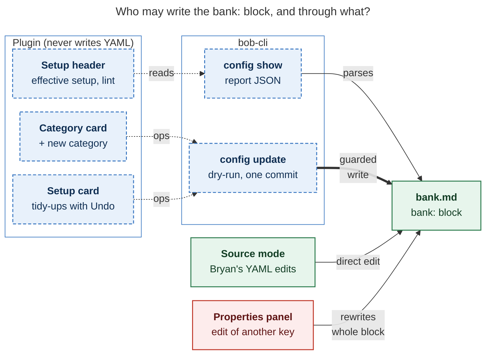

# Bank setup in Obsidian: show what bob does, write through bob

> **Research query:** Make the `bank` frontmatter field of `~/bob/bank.md` much easier to
> read and write from Obsidian. It does not render at all today. Use the album `record`
> field as context and inspiration, lead the design (intuitive, reliable, beautiful),
> critique the plan, call out justified requirement changes, and end with a
> recommendation.

## Bottom line

Do it, but reframe it. "Render the `bank` field" should become **"give the bank hub a
Setup view that shows what bob actually does with the field."** "Easy to write" should
become **"easy to write correctly, at the moment you need to."** Concretely:

1. **Keep the `bank:` mapping in frontmatter, exactly as stored**, and keep the native
   Properties row hidden on `bank.md`. Obsidian 1.15.1 still has no widget for nested
   mappings and no API to add one (I re-verified this in a real Obsidian; see
   [the probe](#what-obsidian-actually-does-with-the-block-real-obsidian-1151)).
2. **Draw a collapsed one-line Setup header under the `# 🏦 Bank` title**, following the
   album schema header. It shows account health and counts. Expanded, it shows the
   *effective* setup: the account list, the exact category keyboard the Ctrl+Enter
   Category card offers (built-ins, derived hotkeys, and free keys included), and rules
   in match order. None of these are fully visible in the YAML. A broken config expands
   by itself and shows located errors.
3. **Put the first write gesture where the need actually comes up: `+ New category`
   inside the Category card.** You are filing a row and none of the 25 categories
   fits. Type `🎁 Gifts`, accept the suggested free key, and press Enter. The category
   is added and the row is filed in one gesture.
4. **All writes go through a new bob writer, `bob bank config update`.** It uses the
   album `bob albums update` contract: JSON ops, dry-run consequences, a fingerprint
   guard, the same Rust validator, span-preserving emit that writes like the
   neighbouring entries, one scoped commit, and inverse ops for Undo. The plugin never
   writes YAML. I verified that the obvious plugin shortcut, `processFrontMatter`,
   rewrites the whole block.
5. **A keyboard-first Bank Setup card handles the periodic tidy-ups** (hotkeys, groups,
   hide, order, rules, add account) in a third slice. Edits that rewrite history stay
   refused, with the count and a YAML path: renaming or merging a category key,
   renaming an account alias, or changing the default account.
6. **YAML stays first-class.** Every chip jumps to its exact Source-mode line, and bob's
   diagnostics (including rule diagnostics, which currently have no line number) paint
   as lint.

Ship it in three slices: **A (read + lint, no writer), B (writer + Category card `+`),
C (Setup card)**. A alone is cheap and fixes "doesn't render". A + B satisfy "easy to
write" for the edit that will happen most often.

## What exists today (verified)

**The data.** `bank.md` holds one account (`checking`, "WF Checking", start
2026-11-11), 21 declared categories (12 in *Everyday*, 8 in *Bills*, plus a hidden
`kids`), no rules, and the default `stale_after` (10 days). bob adds four built-ins
(`income`, `refund`, `transfer`, `cash`, in group *Money moves*, keys `i r t a`). The
Category card therefore offers 24 visible tiles and 25 effective categories. Every
declared hotkey is pinned. The free keys are `b j l m u w x y z 9 0` (`q` is reserved).
Only 11 bank rows exist so far (`coffee` 5, `tech` 2, four others 1 each). The bank is
four days old.

**The edit history** (`git log -- bank.md` in the vault) has three commits:

- creation (Nov 11);
- one wholesale restructure two days later: 14 scalar categories and a VENMO rule became
  21 mapped categories with groups and pinned hotkeys, and both `subscriptions` and the
  rule were dropped;
- a `summary:` line added by a span-preserving bob writer (Nov 15). The `bank:` block
  bytes were untouched.

The config is young and still settling. Expect bursts of category churn for a while,
then long quiet periods.

**Why nothing renders.** bob-ledger-tools hides the row on purpose:
`.bob-bank-hub-note .metadata-property[data-property-key="bank"] { display: none !important; }`
(`plugins/bob-ledger-tools/styles.css:9094`). The class is toggled for the hub only in
`241p-plugin-bank-marks.js:452` and landed in `4e4a580`; the plugin docs say "only
`bank.md` hides its `bank` property". The album work paired the hide with a header and
a Schema Card (its editable gestures are still landing in `bob-cli-kr.4`). The bank work
shipped only the hide, so the field simply vanished.

**What bob reports.** `bob bank list -f json` (≈30 ms) shares `categories[]`
`{key, emoji, label, builtin, hotkey, group, hidden}` and `accounts[]` with live status
(`balanced | delta | gap | stale | unverified | untracked`, balance, as-of date, last
import, hint). It does **not** report:

- `rules`, `stale_after`;
- whether a hotkey is pinned, a built-in default, or derived (derived keys can reshuffle
  when categories are added or reordered);
- per-entry source lines;
- usage counts, or a fingerprint.

**How a bad config fails** (verified in a scratch vault):

- `bob bank list -f json` on an invalid config returns
  `{"ok": false, "error": "<first diagnostic only>"}` with no line and no key path.
- `bob bank check -f json` lists every diagnostic, but rule diagnostics have
  `"line": null`, because the key-line map does not index sequence items. The key path
  exists only inside the message text.
- One typo in `bank:` takes down the queue card, the Category card's categories, and
  imports at once. For a single album, a bad schema affects only that album; here it
  blacks out the whole bank. That raises the bar for both lint and guarded writes.

**Other write constraints.**

- The import journal stores the account alias in every append-only event
  (`journal.rs`), so renaming an alias would orphan its history.
- Rows without `[acct::]` belong to the *first* account, so reordering accounts
  silently reassigns them.
- The Category card orders sections by each group's first appearance in bob's category
  order. For money-in rows it moves *Money moves* first and dims the rest.

**Scale of the album precedent.** `src/native/albums/update/` is 8,651 lines of Rust.
The plugin's schema card, update service, session, and YAML-excursion fragments
(`241w`–`242e`) are about 3,300 lines, plus about 900 for the header. Copying that
shape blindly for one config note would be expensive. Extracting its reusable parts is
the right move ([below](#bob-bank-config-show-and-update)).

## What Obsidian actually does with the block (real Obsidian 1.15.1)

I ran an isolated scratch vault (never the live vault) on athena's Obsidian 1.15.1
(Electron 43) and drove it over CDP. The fixture had `bank.md`-shaped frontmatter with
flow-map categories, a quoted digit hotkey, an integer hotkey, a rule with a quoted
wikilink, and YAML comments.

| Probe | Result |
| --- | --- |
| Property type of `bank` | `{name: "bank", widget: "unknown"}`. Registered widgets: `aliases, checkbox, date, datetime, file, folder, multitext, property, number, tags, text`. No object or mapping widget exists. |
| What the raw row shows | `<span class="metadata-property-value-item mod-unknown">{"accounts":{…` (one JSON string) |
| Focus + blur on the raw row | Not editable; the file stays byte-identical. In 1.15.1 the row is ugly, not dangerous. |
| Edit `summary` in the Properties panel (real DOM edit) | **The whole frontmatter is re-serialized.** Every flow-map category (`coffee: { label: ☕ Coffee, hotkey: c, group: Everyday }`) expands into a 4-line block map, and **all YAML comments are deleted** (both full-line and trailing). Order, `hotkey: "1"` quoting, integer `hotkey: 1`, dates, emoji, and the quoted wikilink survive. |
| `app.fileManager.processFrontMatter` editing `summary` | Same expansion. |

What this means:

- **Hiding the row is cosmetic, not protective.** The real hazard is editing *another*
  property on `bank.md`. The Areas card's "add summary" explicitly sends you to the
  `summary` row in the Properties panel. On your config, that edit would turn 21
  category lines into about 83. bob still parses the result (semantics are preserved),
  but the compact source you read in vim is gone, along with any comments.
- **The plugin must never write through Obsidian's frontmatter APIs.** This is now
  measured, not inferred; bob-navigation-hotkeys' `211-parent-frontmatter-plan.js`
  already avoids `processFrontMatter` for the same reason. A guarded bob writer is the
  only write path that preserves Bryan's style.

## Is this a good idea? (critique)

**Yes. The current state is the worst of both worlds:** the field is invisible in Live
Preview, and the only way to see or change it is Source-mode YAML, where one typo
silently disables the bank. But three parts of the request as worded would lead to the
wrong build.

1. **"Make the field render" aims at the wrong artifact.** The YAML is not the
   interesting thing; the *effective configuration* is. Four built-in categories, their
   default keys, derived hotkeys, which account is the default, group order, free keys,
   and whether each account is balancing are all absent from the YAML. A pretty YAML
   viewer would miss the point. The render should answer "what will bob and the
   Category card do?", not "what did I type?".
2. **The hub note is not where most writes start.** The likeliest edit is "none of these
   categories fit this row", and that moment happens in the Category card on a month
   note. A hub-only editor makes you abandon the row, open `bank.md`, add the category,
   go back, and refile. The first write gesture belongs in the card.
3. **Copying the album schema card's full machinery is premature.** The album effort is
   justified across five albums and their record migrations. One bank config, edited in
   bursts, does not justify ~12k new lines. Reuse the album writer's skeleton, ship the
   moment-of-need gesture first, and size the full Setup card from the YAML edits you
   actually make in the meantime.

**What I would do differently from the album precedent:** lead with read and lint plus
the Category card `+`; make the read view an exact mirror of the Category card's
keyboard so that one visual language explains both; treat account health as part of
the setup view; and extract shared pieces (header host, guarded-update session, span
engine) instead of forking them.

### Options considered

| Option | Verdict | Why |
| --- | --- | --- |
| Make the native Properties row render or edit the mapping | **Rejected** | There is no public property-widget API (1.15.1 re-verified); the community nested-properties plugins patch undocumented internals and know nothing about the bank schema. |
| Paint a strip *inside* the Properties panel where the row was | Rejected | Needs DOM injection plus a MutationObserver on every panel re-render; the album swarm rejected it for the same fragility. |
| **Hidden row + Setup header + guarded writer** (album idiom) | **Recommended** | Gives both structured-frontmatter notes (`record` on 5 albums, `bank` on 1 hub; my vault scan found no other nested mappings) one idiom; bob stays the only validator and writer. |
| A `bob-bank` fence with `view: setup` in the body | Good fallback | It is the bank's existing card idiom and has the simplest lifecycle, but it must be added to the note, can be deleted, and breaks the "structured property → header" consistency with albums. Use it only if the header host can't be shared cheaply. |
| Move the config into a body code block (rendered in place, raw YAML when the cursor enters) | Considered seriously, rejected for now | It is the only option Obsidian never re-serializes, so comments and flow style survive, and Live Preview's render-until-cursor gives a free "view vs edit" toggle. But it breaks the documented contract (`bank_hub_missing` "no `bank:` mapping", the paste-ready teaching block, tests), diverges from albums, and the hazard it removes is cosmetic. **Reopen it** if Properties reflows actually bite, or if you start wanting comments in the config. |
| One note per category (and Bases inline editing) | Rejected | Native editing is real, but it turns a 30-line config into 25+ files, spreads hotkey uniqueness across files, and makes renames (file renames) strand rows. |
| Flat list properties (`bank_categories: ["c ☕ Coffee · Everyday"]`) | Rejected | Native pills, but a hidden mini-grammar per pill, poor at 25 items, and a breaking contract change. |
| Plugin-side YAML writes (`processFrontMatter` / string splice) | Rejected | Measured to reflow the whole block; it also duplicates `config.rs` validation in JavaScript (the thin-client rule, `decisions:mac-capture-is-a-thin-client`). |
| YAML only, plus lint and jump | Partial | This is exactly slice A. It is cheap and safe, but on its own it does not make writing easy. |

## Requirement adjustments (called out)

1. **"Render the `bank` field" → "render the effective bank setup."** That includes
   built-ins, hotkey provenance, free keys, the default account, group order, and live
   account status. Success means "you never need Source mode to know what Ctrl+Enter
   will offer or whether an account is healthy".
2. **"Easy to write" → "easy to write correctly, at the moment of need."** The first
   write gesture lives in the Category card (`+ New category`). Hub tidy-ups come
   second.
3. **Some edits are deliberately not easy.** Renaming or merging a category key
   rewrites `[cat::]` on rows; renaming an account alias breaks the append-only journal;
   reordering or re-defaulting accounts reassigns every untagged row. These are refused
   with counts and a YAML path, pending a real migration flow. An editor that made
   `coffee → cafe` one keystroke would be worse than today.
4. **Add: errors must be loud and located.** An invalid `bank:` disables the whole bank
   surface, so the header expands itself and lists every diagnostic with its line. bob
   must fix two gaps: rule diagnostics have no line, and `list` reports only the first
   error with no line or key path.
5. **Add: writes preserve Bryan's style.** The writer emits new entries in the style of
   the neighbouring entries (one-line flow maps today), never reformats untouched
   entries, and keeps every other byte. Obsidian will not; that is now measured.
6. **Keep:** the native row stays hidden; YAML stays fully editable; nothing moves out
   of frontmatter.
7. **Defer:** account `kind`/`start` edits, key renames and merges, default-account
   changes, and "make a rule from this row". All are rare, high-stakes, or already
   covered by bob's learned-name tier.

## Recommended design

### Principles

- **One parser, one validator, one writer: bob.** The plugin draws bob's JSON and sends
  ops; it never parses or writes YAML.
- **Mirror the Category card.** In every bank surface, a letter or digit means a
  category. The Setup view *is* the Category card's keyboard, laid flat.
- **Quiet by default, loud when broken.** One collapsed line normally; expanded with
  located errors when the config is invalid.
- **Every number from bob.** Usage counts, statuses, and derived keys come from the
  report, never from vault text in JS.

### Read: the Setup header (slice A)

On `bank.md` only (bob's fixed vault-root hub), in Reading view and Live Preview, just
under the H1 (the same mount as the album header). Collapse state lives in pane view
state, never in frontmatter.

**Collapsed (default).** One line that doubles as a health check:

```text
# 🏦 Bank
┃ ▸ Setup · 🏦 WF Checking ✓ balanced · 25 categories · no rules        ↗ YAML
```

**Expanded.** The effective setup. The money below is illustrative; usage counts are
real:

```text
┃ ▾ Setup                                                          ↗ YAML
┃
┃ ACCOUNTS                                      balances go stale after 10 days
┃   🏦 WF Checking   checking · default · since Wed Nov 11
┃                    ✓ balanced  $4,210.55 on Fri Nov 13 · imported today
┃
┃ CATEGORIES                                 what Ctrl+Enter offers, in order
┃   EVERYDAY     [C] ☕ Coffee 5   [V] 🏪 Convenience 1   [S] 🛍️ Shopping 1
┃                [D] 🛵 Delivery   [E] 🍽️ Eating out   [G] 🛒 Groceries
┃                [P] 👤 Personal 1   [H] 💊 Health   [O] 🐶 Dog   [F] 🎟️ Fun
┃                [N] 🚆 Transit   [K] 🚗 Car
┃   BILLS        [1] 🏠 Housing   [2] 💡 Utilities   [3] 💻 Tech & AI 2
┃                [4] 📺 Media   [5] 📆 Loans 1   [6] 🤝 Household
┃                [7] 🏛️ Taxes   [8] 🧾 Fees
┃   MONEY MOVES  [I] 💵 Income   [R] ↩️ Refund   [T] ↔️ Transfer   [A] 🏧 Cash out
┃                built in · shown first for money in
┃   HIDDEN       🧸 Kids — still valid on rows, never offered
┃   free keys    B J L M U W X Y Z 9 0
┃
┃ RULES                                    first match wins · imports and hints
┃   None yet. bob already learns each merchant's name and category from your
┃   last filing; add a rule only to override that (e.g. VENMO → ↔️ Transfer).
```

**Invalid.** The header expands by itself and says what is blocked:

```text
┃ ▾ Setup  ✗ 2 problems — the bank can't list or file rows until they're fixed
┃   line 8   accounts › checking › kind    expected checking, savings, credit, or cash
┃   line 12  categories › cafe › hotkey    "c" is already ☕ Coffee — free: b j l m u …
┃   (last good setup shown dimmed below)                         ↗ Fix in YAML
```

**Interactions (slice A):**

- Clicking any account, tile, rule, or diagnostic jumps to that exact line in Source
  mode.
- Hovering a tile shows the stored key, hotkey provenance ("pinned", "built-in
  default", or "derived — may change when categories change; pin it"), and the row
  count.
- Source mode gets lint underlines on the offending frontmatter lines (album precedent).

From slice C, a click opens the Setup card on that item and Alt-click jumps to YAML.

**Visual spec (the "beautiful" part):**

- Reuse the bank card tokens: `--bob-bank-accent` from the cash root hue, a 1px tinted
  border, an 8px radius, and a 2px accent start border, all from theme variables so
  light and dark work.
- Tiles reuse `.bob-bank-category-keycap` but render flat (a map, not buttons): a 6%
  accent tint, no hover lift. Derived hotkeys get a **dashed** keycap. Hidden categories
  are muted with an eye-off glyph. Usage counts are small, muted, tabular numerals, and
  nothing is shown for zero.
- Section labels are small caps, letter-spaced, in faint ink.
- Account status always pairs an icon and a word with its tone (✓ balanced green,
  ⚠ stale/gap amber, ✗ delta red, · unverified muted). Colour never carries meaning
  alone.
- At narrow widths (≤ 480 px) the group label stacks above its tiles and tiles wrap.
  Nothing scrolls sideways.
- Accessibility: the disclosure carries `aria-expanded`; tiles are labelled "Coffee,
  key C, 5 rows"; the invalid banner is a `role="alert"` live region.

### Write at the moment of need: `+ New category` in the Category card (slice B)

`+` is free in the card: letters and digits file categories, `q`/Escape cancel, Space
files with no category, and Enter accepts the suggestion. A `+ New category` tile closes
the last section, and pressing `+` opens an inline stage:

```text
╭─ Category ───────────────────────────────────────────────────────────╮
│ −$8.40  Blue Bottle Coffee                               Sat Nov 14  │
│ …the usual sections…                                                 │
│ NEW CATEGORY                                                         │
│   Label [🎁 Gifts              ]   Group [Everyday ▾]   Key [B]      │
│   adds 🎁 Gifts to Everyday as B · stored as gifts · files this row  │
│   ↵ add and file · tab next field · esc back                         │
╰──────────────────────────────────────────────────────────────────────╯
```

- After a settled keystroke (≈250 ms debounce), a dry run of `category.add` returns
  bob's derived key (`gifts`) and suggested free hotkey. The JS never derives either.
  Typing a free key into **Key** pins it; a taken key shows its owner inline.
- **Enter** applies the config op (one scoped commit to `bank.md`). The card repaints
  from the categories the writer returns, then files the row through its existing
  single editor transaction (tick + `[cat:: gifts]`) and advances, exactly like a
  hotkey. If the apply fails, nothing is filed and the reason appears inline.
- The new category starts with zero rows, so the Setup card can remove it freely if it
  was a mistake.

### Write for tidy-ups: the Bank Setup card (slice C)

A keyboard-first modal in the Task Card / Schema Card idiom, opened from the header's
`⊞ Edit`, the palette (**Bank: edit setup**), Command Mode, and `Ctrl+Shift+P` on
`bank.md` when the Task Card has no target. It shows the three sections from the
expanded header with a consequence line and a key footer:

```text
╭─ 🏦 Bank setup ─────────────────────────────────────────────────────╮
│ ACCOUNTS   🏦 WF Checking · checking · default        ✓ balanced    │
│ CATEGORIES EVERYDAY [C] ☕ Coffee 5 ▸ … BILLS … MONEY MOVES …       │
│ RULES      (none)                                         + add     │
│ hides 🧸 Kids · still valid on 0 rows · never offered          ← consequence
│ letter/digit go to category · ↵ edit · + add · ⌃D hide/remove       │
│ ⌥↑/⌥↓ move · tab section · ⌃E YAML · ⌃Z undo · esc close            │
╰─────────────────────────────────────────────────────────────────────╯
```

Keys follow the principle that **letters always mean categories**. Pressing `c` focuses
☕ Coffee here, just as it files Coffee in the Category card. Verbs live on Enter, `+`,
and Ctrl/Alt chords. Every gesture dry-runs and shows bob's consequence before Enter.
Each apply is one commit, and the card stays open and repaints. Undo replays bob's
inverse ops. A stale fingerprint repaints rather than retrying. On a sync failure
**Retry sync** runs only `bob vault-sync`. All of these are reused unchanged from the
Schema Card session.

### bob: `bob bank config show` and `update`

```text
bob bank config [show] [-b DIR] [-f human|json]
bob bank config update [-b DIR] [-d] [-f human|json] [-i FILE]
```

Bare `bob bank config` runs the read-only, flag-only `show`, as `cli_rules` allows.
Extend the `bob bank` membership sentence to "…and the hub's `bank:` configuration".
`show`'s human output is the same layout as the expanded header, coloured, which suits
terminals and agents. (A flat `bob bank setup` leaf would also satisfy the rules; this
is a naming call for you.)

**`show -f json` (additive, `schema_version: 1`)**, also returned on invalid configs
from the partial parse that `ConfigParse::Invalid { config }` already carries:

```json
{
  "ok": true, "schema_version": 1, "today": "2026-11-15",
  "config": {
    "path": "bank.md", "fingerprint": "sha256:…", "style": { "categories": "flow" },
    "stale_after": { "days": 10, "explicit": false, "line": null },
    "accounts": [ { "alias": "checking", "label": "WF Checking", "kind": "checking",
                    "start": "2026-11-11", "default": true, "line": 7, "rows": 11,
                    "status": "balanced", "hint": "…" } ],
    "categories": [ { "key": "coffee", "emoji": "☕", "label": "Coffee",
                      "group": "Everyday", "hidden": false, "builtin": false,
                      "declared": true, "hotkey": "c", "hotkey_source": "explicit",
                      "line": 12, "rows": 5, "rule_refs": [] } ],
    "free_hotkeys": ["b", "j", "l", "m", "u", "w", "x", "y", "z", "9", "0"],
    "rules": [ { "index": 0, "match": "VENMO", "payee": null, "cat": "transfer",
                 "link": null, "line": 31, "read_time": true, "journal_matches": 4 } ]
  },
  "findings": [ { "code": "bank_config_invalid", "severity": "error", "path": "bank.md",
                  "line": 8, "key_path": "bank.accounts.checking.kind",
                  "message": "expected checking, savings, credit, or cash", "hint": null } ]
}
```

`hotkey_source` is `explicit | builtin_default | derived | none`. `rows` counts rows
across every month note; the bank scan already reads only `bank.md` + `bank/*.md`, so
this is cheap. `read_time: false` flags a rule whose match has a 4+ digit run. Fix the
key-line map to index sequence items so rule findings carry lines. Separately, make
`bob bank list -f json` on an invalid config return the full `findings[]` instead of a
single `error` string (additive). I filed both gaps as bug task **`bob-cli-lq`** (small).
The causes are `bank_line_map` skipping `-` lines (`config.rs:1009`) and `load_config`
keeping only the first diagnostic (`cli.rs:453`).

**`update` ops, sliced:**

| Slice | Ops | Notes |
| --- | --- | --- |
| B | `category.add {label, group?, hotkey?, position?}` | bob derives the key and hotkey and returns them; refuses key/hotkey collisions, `q`, and built-in keys (those use `category.set`). Default position: after the last member of its group. |
| B | `category.set {key, set:{label, emoji, hotkey, group, hidden}, unset:[…]}` | On an undeclared built-in, it adds the declaration. Consequence names any *derived* hotkeys that shift. |
| C | `category.move`, `group.rename {from,to}` | Moving the first member of a group reorders the card's sections; the consequence says so. |
| C | `category.remove` | Only with `rows = 0`, no `rule_refs`, and not built in; otherwise refused with "N rows use it — hide instead". |
| C | `rule.add / set / move / remove` | Consequences: journal matches, waiting rows whose suggestion changes, `read_time: false` warning, rules shadowed by an earlier match. |
| C | `account.add {label, kind, start}`, `account.set {alias, set:{label}}`, `bank.set {stale_after}` | `account.add` always appends, so the default never moves. |
| Refused (taught, v2 migrations) | category key rename / merge; account alias rename; account reorder / default change; `kind` / `start` change; removing an account with rows or journal events | Each refusal carries the complete-scan count and an "edit in YAML" hint. Alias rename stays refused until the journal gains an alias map. |

**Writer guarantees** (lifted from `bob albums update`; see `docs/records.md`):

- Preview, cancel, and no-op touch nothing: byte-identical, no lock, no commit, no sync.
- The post-image is validated by the same `parse_bank_config`; bob refuses rather than
  writing an invalid config.
- Only the `bank:` entries an op touches are re-emitted, in the neighbours' style, and
  every other byte is kept. YAML features the span engine can't preserve (anchors,
  aliases) are refused, with the YAML path offered instead.
- An `expect` fingerprint guard, plus flushing an open `bank.md` editor buffer before
  apply.
- One transaction under the maintenance lock and one scoped commit
  (`bank: config +category gifts`), then sync.
- Inverse ops with exact-bytes restoration for Undo.

**Reuse plan:** extract three pieces rather than forking them:

1. The album envelope, transaction runner, and span engine
   (`albums/update/{protocol,run,spans}.rs`) into a shared frontmatter-config module
   parameterised by the top-level key. `bank` adds only its op validator and usage scan.
2. The plugin's guarded update session and YAML excursion
   (`242a`/`242b`/`242e`) into a shared session used by both the Schema Card and the
   Setup card.
3. The album header's Reading/Live Preview host into a small shared note-header host.

### How the pieces fit



_Dashed nodes are proposed. Every plugin surface reads bob's report and writes only
through bob's guarded writer. Source-mode YAML stays a direct path, and Obsidian's
Properties panel is the one writer that re-serializes the whole block (measured on
1.15.1)._

## Sequencing and acceptance

1. **Slice A: read and lint** (small/medium; no writer). bob: `config show`,
   sequence-item lines, full `findings[]` on `list`. Plugin: the Setup header (collapsed
   line, expanded effective view, invalid state with last-good dimming), line jumps,
   Source-mode lint, the hide kept. Acceptance:
   - header and Category card agree tile-for-tile, including built-ins and order;
   - a deliberate typo shows the expanded error with a line, and so does a rule error;
   - light/dark and 375 px screenshots;
   - plugin disable restores the native (JSON) row;
   - no vault bytes change from painting.
2. **Slice B: writer and the Category card `+`** (medium/large; most of the cost is
   extracting the album infrastructure). **Start it only after the album epic
   `bob-cli-kr` lands.** Its phases kr.1–kr.3 (report and emitter, the `bob albums
   update` writer, header and read-only card) are closed, but kr.4, the editable Schema
   Card, was still in progress on 2026-11-15. Extracting shared pieces from code that is
   still landing would collide with that work. Slice A has no such dependency.
   Acceptance:
   - dry-run derives key/hotkey with zero writes;
   - add-and-file produces exactly one `bank.md` commit plus one editor undo step on
     the month note;
   - an existing flow-style block gets a flow-style new line, and the rest of the file
     is byte-identical;
   - a stale fingerprint refuses;
   - a collision or `q` refuses inline.
3. **Slice C: the Bank Setup card** (medium/large). Build it after B lands, scoped by
   the YAML tidy-ups you actually made in between. Acceptance follows the Schema Card
   spine: keyboard-only edit and Undo, a double-apply guard, two-pane stale refusal, and
   a YAML excursion that won't return while the config is invalid.
4. **Real-Obsidian fixture** (in A): edit `summary` through the Properties panel, then
   assert that bob still parses the expanded block and the header still renders. This
   pins today's measured behaviour so an Obsidian upgrade that changes it is caught.

## Risks and mitigations

- **A Properties edit reflows the block** (measured). It is semantically harmless; the
  writer keeps writing in the neighbours' style. If it starts to annoy, add a
  `config.format` op ("Compact categories") or reopen the body-block option. Do *not*
  switch canonical emit to block style just to be Obsidian-idempotent: on this config it
  quadruples the line count of the YAML you edit by hand.
- **Invalid config blacks out the bank.** The header shows every error with its line
  and a last-good dimmed view. Card writes can never produce an invalid config.
- **Over-building.** Slices A and B deliver the request; C is sized by evidence, not
  ambition. Reuse is a requirement, not an option.
- **Mobile.** bank surfaces call `bob` and are desktop-only. On mobile, either render
  the last-good cached header read-only (the album precedent) or un-hide the raw row
  there, so the setup is never invisible *and* unreadable.

## Open questions for Bryan

1. **Naming.** "Setup" (UI) with `bob bank config` (CLI)? Or "Config" everywhere, or a
   flat `bob bank setup`?
2. **Placement.** Header under the H1 (recommended, matches albums) or a `## Setup`
   fence at the bottom of `bank.md` ("work first, settings last")?
3. **Usage numbers.** Row counts only (recommended), or also money? Money already lives
   in the badge and period charts.
4. **Mobile.** Do you open `bank.md` on Obsidian mobile? If not, the mobile fallback
   drops out of scope.
5. **Decision record.** Should "nested frontmatter is drawn by the plugin and written
   only by bob" become one decision record covering both `record` and `bank`? (This
   needs the memory-write flow; I did not write it.)

## Provenance

Independent researcher report (`__cld`), 2026-11-15. Sources, all read this session:

- **Live vault:** `~/bob/bank.md` (frontmatter and body); `git log -p -- bank.md` (3
  commits); `bank/2026-11.md` category usage counts; a frontmatter scan of the whole
  vault for nested mappings (found only `record` ×5 and `bank` ×1).
- **bob-cli** (`master` `9c2c2404`): `src/native/bank/config.rs` (keys, hotkey
  assignment, rule and line-map behaviour), `journal.rs` (account alias per event),
  `docs/bank.md` (hub contract, JSON envelopes, findings), `docs/records.md`
  (`bob albums update` contract), `src/native/albums/update/*` (line counts, span
  engine); plus live runs of `bob bank list -f json`, `bob bank check`, and a scratch
  vault with an invalid config.
- **bob-plugins** (opened via `sase repo open`): `styles.css:9094`,
  `241p-plugin-bank-marks.js`, `245`/`247` Category card model and UI,
  `241j-plugin-bank-data.js` (invalidation), `241v-plugin-album-header.js`,
  `211-parent-frontmatter-plan.js`, `docs/albums.md`, `docs/bob-ledger-tools.md`,
  `docs/develop/plugin-apis.md`.
- **Prior research (unrelated swarms):** `202611/album_record_schema_ux/album_record_schema_ux.md`
  (the consolidated `record` design) and `202611/bank_weekly_category_walk/bank_weekly_category_walk.md`
  (where the category mapping form came from); album e2e screenshots in `evidence/`.
- **Real-Obsidian probe:** Obsidian 1.15.1 (Electron 43.8.9) on athena, under
  `xvfb-run`, with an isolated scratch vault and profile in `/tmp` driven over CDP. Two
  runs covered `metadataTypeManager`, raw-row DOM and focus/blur, a Properties-panel
  `summary` edit, and `processFrontMatter`. The live vault was never opened. Results
  are in the [table above](#what-obsidian-actually-does-with-the-block-real-obsidian-1151).
- **Beads:** epic `bob-cli-kr` (album schema render and edit; kr.4 still in progress);
  filed bug `bob-cli-lq` for the diagnostic-location gaps.
- **Memory consulted:** `cli_rules.md`, `obsidian.md`, `tailnet.md`,
  `decisions:mac-capture-is-a-thin-client`, and the glossary entries for Bank Row, Bank
  Badge, Bank Month Note, Walker Footer, and Area Note.
- **Figure:** rendered with `@mermaid-js/mermaid-cli` 12.0.0 under the research-PDF
  config. It measures 791 × 537 px (82.5% fit).
