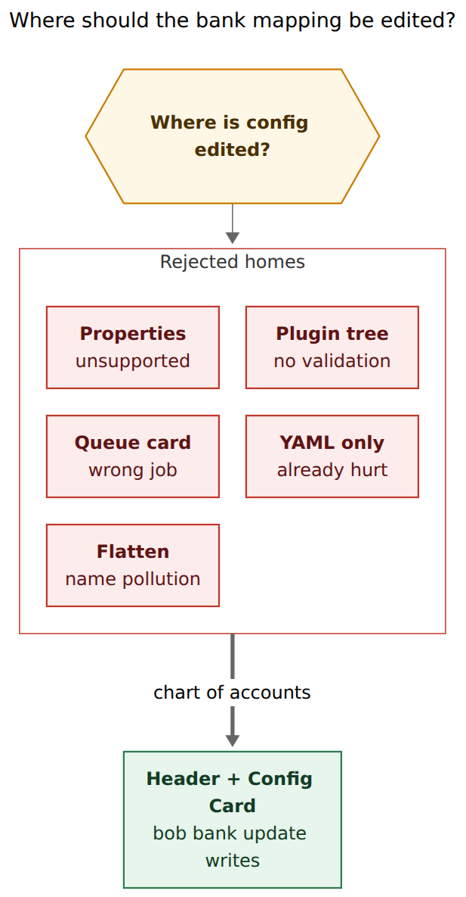
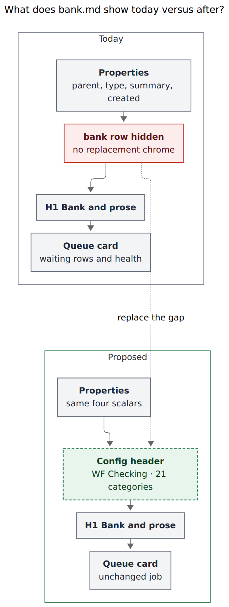
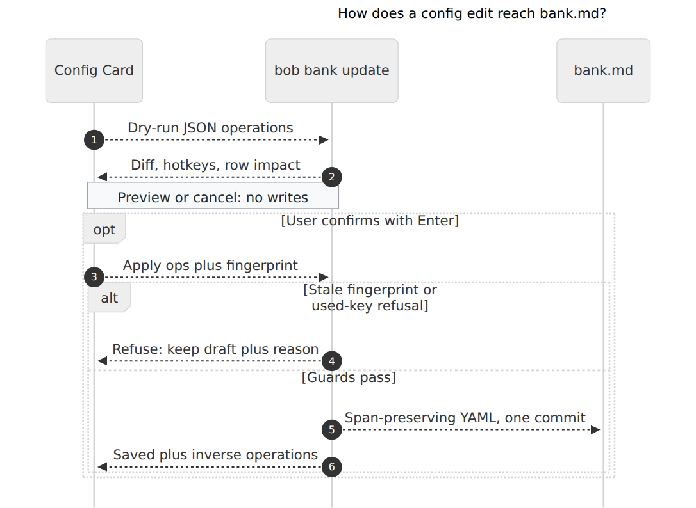

# Bank hub `bank:` mapping: render and edit it in Obsidian

> **Research query:** The `bank` frontmatter field of `~/bob/bank.md` does not render in Obsidian. Using the album `record` field as inspiration, how should it be read and written? Critique the idea, adjust requirements where justified, and recommend an intuitive, reliable, and beautiful design.

## Bottom line

This is a good idea, and it is more urgent than the album case in one respect: **the hide already shipped, and nothing replaced the row.**

- **Keep the nested `bank:` mapping.** It is the right storage shape. Accounts, categories, rules, and `stale_after` are one contract. Flattening them into top-level Properties would pollute the vault-wide property namespace and still leave nested maps behind.
- **Do not try to make native Properties edit this field.** Obsidian still does not support nested properties. Help points at Source mode. The live vault's `.obsidian/types.json` has no `bank` type, so the engine's fallback is an unknown object.
- **The current "does not render" state is a CSS hide, not a missing parser.** Ledger Tools already adds `bob-bank-hub-note` on `bank.md` and sets `.metadata-property[data-property-key="bank"] { display: none }`. Albums hid `record` *and* drew a schema header. Bank hid `bank` and stopped. That is the gap.
- **Replace the gap with a collapsed hub header plus a Config Card**, in the Task Card / album Schema Card idiom, whose every write goes through a new **`bob bank update`**. The plugin paints report JSON. Bob owns YAML, validation, hotkey assignment, usage counts, and the scoped commit.
- **Do not copy the album chip-per-field layout.** Bank config is a chart of accounts. Categories already have a visual language on the Category card (emoji, keycap, group). The Config Card should look like that card, plus a quiet Accounts row and a Rules table.

"Render properly" means a schema-aware surface. "Easy to modify" means the edits Bryan already did by hand on 13 November become one-gesture operations that cannot drop a sibling key.

## What is actually on disk today

### The hub is healthy YAML

`~/bob/bank.md` is a sub-area (`type: "[[area]]"`, `parent: "[[cash]]"`) whose frontmatter holds one nested mapping. Verified today:

```yaml
bank:
  accounts:
    checking:
      label: WF Checking
      kind: checking
      start: 2026-11-11
  categories:
    coffee: { label: ☕ Coffee, hotkey: c, group: Everyday }
    convenience: { label: 🏪 Convenience, hotkey: v, group: Everyday }
    # ... Everyday, then Bills 1–8 ...
    kids: { label: 🧸 Kids, hidden: true }
```

There is **no `rules:` list** and **no `stale_after:`** on the live hub; `stale_after` therefore defaults to 10. `bob bank -f json` reports 25 categories (21 declared + 4 builtins in group `Money moves`), one checking account (`WF Checking`, balanced, last import 2026-11-15), and **no `rules`, `stale_after`, `config`, or fingerprint** keys. Category usage in `bank/2026-11.md` is still small (coffee 5, tech 2, plus singletons). The contract is young; the catalog is already rich.

`docs/bank.md` and `docs/reference/vault-format.md` already freeze this shape: one vault-root hub, nested `bank:` mapping, unknown inner keys are errors with suggestions, unknown *top-level* YAML keys are tolerated. `src/native/bank/config.rs` parses exactly four keys — `accounts`, `categories`, `rules`, `stale_after` — and requires `bank:` to be a mapping.

### Why it "doesn't render at all"

This is **not** the album orange-JSON screenshot. Albums still showed a truncated unknown-type row until the header shipped. Bank already hides the row.

In `plugins/bob-ledger-tools/styles.css`:

```css
.bob-bank-hub-note .metadata-property[data-property-key="bank"] { display: none !important; }
```

`241p-plugin-bank-marks.js` (`bankMarkSyncHubProperty`) adds `bob-bank-hub-note` to `document.body` when the *active* file is `bank.md`, and to each markdown leaf's `containerEl` / `contentEl` when that leaf's path is the hub (`bankIsHubPath` in `241i-plugin-bank-source.js`, `/^bank\.md$/i`). The e2e helper `obsidian-bank-ui-e2e-lib.cjs` records `bankPropDisplay` and `hubClass`. Unit coverage in `test-ledger-tools-bank-marks.cjs` asserts the class is added for `bank.md` and removed for `bank/2026-11.md`.

Reading view of `bank.md` therefore shows four working scalar properties (`parent`, `type`, `summary`, `created`) and then jumps to the H1. The mapping that defines every Category-card tile, every `[cat::]` key, every import account, and every stale window is invisible. Source mode still shows the YAML. The queue card (`view: queue`) shows account *health* and waiting rows. That is a different job.

The body-class half of the hide is slightly too wide: if `bank.md` is active, `document.body.bob-bank-hub-note` would hide a `bank` property in *every* pane sharing that document. No other live note uses that key, but album hide is surface-scoped (`.bob-album-header-surface`) for this reason. **When the replacement header lands, attach the hide to the hub surface, not to `body`.**

### The November 13 rewrite is the UX evidence

Vault git `7dc371a9a` (athena, 2026-11-13) rewrote the category block in place: scalar `"🛒 Groceries"` values became flow maps with `label` / `hotkey` / `group`; Bills took quoted digit hotkeys; `kids` became `hidden: true`; **the `rules: [{match: VENMO, cat: transfer}]` list disappeared.** That is exactly the class of edit a structured writer exists to make safe. Whether dropping the Venmo rule was intentional is unknowable from the commit; a span-preserving editor that stages "edit categories" does not omit a sibling key.

Two days later, `d63a7f866` added only `summary:` — a scalar Properties *can* edit. The nested mapping is the part that hurts.

## The album analog, and where bank must diverge

The album `record:` work is the right precedent. Independent research and the shipped plugin contract (`docs/albums.md`, fragments `241u`–`242e`) already decided:

1. Nested mapping stays nested.
2. Hide the native row on the owning note only.
3. Paint a collapsed header from report JSON.
4. Edit through a keyboard-first card.
5. Every write is `bob albums update`: JSON envelope, dry-run consequence, fingerprint, span-preserving YAML, inverse ops, one scoped commit.
6. The plugin never parses or writes schema YAML.
7. `y` jumps to Source mode; YAML stays first-class.
8. Mobile is read-only with an edit-in-YAML hint.
9. `processFrontMatter` is forbidden (`211-parent-frontmatter-plan.js`: whole-block re-serialize rewrites unquoted wikilinks).

Reuse that architecture. **Do not reuse the chip-per-field visual.** An album schema is an ordered list of fields with kinds and choice chips; the `[!records]` index shares those chips. Bank config is three subsystems with different edit frequencies:

| Subsystem | Live vault | Edit frequency | Visual language already in the product |
| --- | --- | --- | --- |
| Categories | 21 declared + 4 builtins, grouped Everyday / Bills / Hidden / Money moves, hotkeys, one hidden | Weekly, whenever a new merchant appears | Category card tiles: emoji, keycap, group |
| Accounts | 1 checking, start 2026-11-11 | Rare, high stakes | Queue card account health (balanced / unverified / untracked) |
| Rules | none | Power-user, import time | Suggestion source `rule` on waiting rows |
| `stale_after` | default 10, undeclared | Almost never | Account stale hints |

A "schema field row" for `categories` would be a lie. The Category card already taught Bryan the catalog. The Config Card should be that catalog in edit mode.

Bank also differs in identity:

- **Singleton path, not a type.** `bank.md` is `type: [[area]]`. Hide and chrome are path-scoped to the hub, never to every area.
- **Do not steal `Ctrl+Shift+P`.** The hub holds dispute tasks. Task Card keeps that chord. Albums could fall back to Schema Card when the Task Card had no target; bank.md always has a task target in principle.
- **The page's job is the queue card.** Album notes exist to browse records, so a schema summary may sit above the index. Bank.md exists to acknowledge money. The config header stays **collapsed by default** so it does not push the queue down.

## Critique of the request

The request is right about the problem and slightly wrong about the surface.

**What is right.** Nested YAML in Properties is a dead end. The album work proved a replacement pattern. Bryan already maintains this mapping by hand. Making it easy *and* safe is the product.

**What would be a bad reading of "easier to read/write from Obsidian."**

- Making the Properties row pretty. Core Obsidian has no nested widget API. Forum request [Properties & Bases: Support multi-level YAML](https://forum.obsidian.md/t/properties-bases-support-multi-level-yaml-mapping-of-mappings-nested-attributes-nested-properties/63826) is still open; WhiteNoise (Obsidian team) answered a 2025-10-16 ping with "Sorry, it doesn’t." Help still lists nested properties as unsupported and recommends Source mode. Waiting on core is not a plan.
- A generic nested-YAML tree (community Nested Properties, Metadata Menu objects, Meta Bind). Those patch undocumented `metadataTypeManager` widgets, rename keys vault-wide, and know nothing about reserved hotkey `q`, builtin `income`/`refund`/`transfer`/`cash`, or `[cat:: dining]` usage.
- Putting a second `bob-bank` fence (`view: config`) in the body. That fights the queue card for vertical space and invents a second bob-owned region on a note that already has one.
- Plugin-side YAML writes through `processFrontMatter`. Navigation Hotkeys already refuses that API for `parent:` because it re-serializes the whole frontmatter. Bank.yaml is flow maps plus quoted digit hotkeys plus a wikilink `parent`. A JS dump will not round-trip it.

**Is a full `bob bank update` overkill for one file?** No. The writer is justified by *stakes*, not by hub count. Renaming `dining` strands every `[cat:: dining]` row; moving the first account changes the default alias; a category rewrite already deleted a rule list once. Albums needed a writer because 104 restaurants depend on one mapping. Bank needs a writer because every future import and every Category-card keypress depend on this one.

## Requirement adjustments (called out)

These change the request. Each is a tightening, not a new product.

1. **"Render in Obsidian" means a config-aware header, not a fixed Properties row.** Success is "Bryan never needs the raw `bank` row in Reading view", not "the raw row looks good".
2. **"Easy to modify" means easy to modify *correctly*.** Adding a category, retitling, grouping, hiding, and setting a hotkey become one-gesture ops. Renaming a category *key*, deleting a used category, renaming an account alias, and deleting a used account are refused with a usage count and an `edit in YAML (y)` hint until a migration flow exists.
3. **Keep the nested mapping and the hub type.** Do not flatten. Do not change `type: [[area]]` to `[[bank]]`. Parent walks, area catalogs, and cash-area hue stay as they are.
4. **Hide stays, and becomes surface-scoped.** Continue hiding `data-property-key="bank"` on the hub only. Move the class from `document.body` to the hub header surface, matching albums. Source mode stays untouched.
5. **YAML stays first-class.** `y` jumps to the key's line (`config.rs` already builds `line_by_path`). A Done control returns from Source only when `bob bank check` reports a valid mapping. Invalid config paints diagnostics and never impersonates an empty catalog.
6. **The Config Card is not the queue card.** Account *health* (balanced, last import, ledger delta) stays on `view: queue`. Account *identity* (alias, kind, start, default) lives on the Config Card. Mixing them teaches the wrong lesson: a stale import is not a reason to edit `start`.
7. **Emit the live YAML style.** Categories on disk are flow maps (`coffee: { label: ☕ Coffee, hotkey: c, group: Everyday }`). Digit hotkeys are quoted. Accounts are block mappings. The writer preserves that style and unrelated bytes (comments, `summary`, `parent`, BOM, CRLF). A categories-only envelope must not drop `rules` or `accounts`.
8. **Grow bank JSON additively before the header claims completeness.** `list` / `check` already share `categories[]` `{key, emoji, label, builtin, hotkey, group, hidden}` and `accounts[]` with kind/start/default. They omit `rules`, `stale_after`, a config fingerprint, and YAML line numbers. Slice A adds those fields; it does not invent a second parser in JavaScript.
9. **Do not steal Task Card chords on `bank.md`.** Palette command `Edit bank config`, header **⊞ Config**, Command Mode Vault row. `Ctrl+Shift+P` remains the Task Card.
10. **Mobile is read-only**, same as albums: last-good catalog plus "edit this mapping in YAML (Source mode)".
11. **A later slice may add a category from the Category card.** That is when a missing merchant is noticed. It is not v1; v1 is the hub surface. Call it out so it does not sneak into the first writer.

## Options considered



**Caption:** Native Properties, flattening, a generic nested tree, the queue card, and Source YAML all lose. Hide the hub `bank` row and edit the contract on a Config Card that writes through `bob bank update`.

Rendered size: 410.5 × 791 px; fit scale: 100%. Mermaid CLI 12.0.0, PDF-mirroring config.

| Option | What it would feel like | Why it loses |
| --- | --- | --- |
| Native Properties | Click an unknown-type JSON blob, or un-hide the row | Nested mappings unsupported; unknown type can stringify on save (`bank: must be a mapping`); no hotkeys, groups, or impact |
| Flatten `accounts_*` / `cat_*` to top-level keys | Extra scalar rows | Vault-wide All Properties pollution; `accounts` and `categories` remain maps; splits one contract |
| Community Nested Properties / Metadata Menu | Collapsible YAML tree in the panel | Schema-unaware; undocumented widget API; vault-wide rename/delete; no reserved `q`, no builtins |
| `view: config` fence | Second bob-bank card on the hub | Fights the queue for space; second bob-owned region |
| Edit inside the queue card | Click an account chip to retitle it | Mixes import health with catalog identity; queue is for acknowledgment |
| Body Markdown table of categories | Visible, greppable table | Second source of truth; Category card and `bob bank check` would drift |
| Source YAML only | Vim the flow maps | Fine as an escape hatch; already failed as the primary path on 13 November; fails mobile |
| Plugin `processFrontMatter` | JS object in, YAML out | Rewrites `parent: "[[cash]]"` and quoting; no span preservation; duplicates `config.rs` |

The winning shape is **hide + collapsed header + Config Card + `bob bank update`**.

## Recommended solution

### 1. The hub page, after

Keep Properties for the scalars that already work: `parent`, `type`, `summary`, `created`. Hide only `bank`, and only on the hub surface (Reading and Live Preview, in-document and sidebar). Source mode still shows the raw mapping.

Directly under that chrome, reuse the album/notebook header language (8px radius, 2px cash-area start border, interface font, 0.9em), collapsed by default:

```text
Cash › Bank                                              ⊞ Config

▸ WF Checking · 21 categories · 0 rules

# 🏦 Bank
Every transaction and deposit in our accounts, filed weekly. …

```bob-bank
view: queue
```
```

Expanding the disclosure, or opening **⊞ Config**, shows the catalog — not a field-kind table:

```text
Accounts
  ★ WF Checking    checking    from Nov 11    default
  + Account

Categories
  Everyday
    [C] ☕ Coffee     [V] 🏪 Convenience     [S] 🛍️ Shopping     [D] 🛵 Delivery
    [E] 🍽️ Eating out [G] 🛒 Groceries      [P] 👤 Personal     [H] 💊 Health
    [O] 🐶 Dog        [F] 🎟️ Fun            [N] 🚆 Transit      [K] 🚗 Car
  Bills
    [1] 🏠 Housing    [2] 💡 Utilities      [3] 💻 Tech & AI    [4] 📺 Media
    [5] 📆 Loans      [6] 🤝 Household      [7] 🏛️ Taxes        [8] 🧾 Fees
  Hidden
    🧸 Kids
  Money moves
    [I] 💵 Income     [R] ↩️ Refund         [T] ↔️ Transfer     [A] 🏧 Cash out
  + Category

Rules
  No import rules yet. First match wins at import and at suggestion time.
  + Rule

Stale after 10 days
```



**Caption:** Today the nested `bank` mapping is CSS-hidden with no replacement chrome, so the queue card is the first bob-owned surface. The proposal keeps the four scalar properties, fills the gap with a collapsed config header, and leaves the queue card's job unchanged.

Rendered size: 428.6 × 1136 px; fit scale: 78.6%.

Beauty rules, copied from surfaces that already exist:

- **Category tiles on the Config Card are the same tokens as the Category card.** `[C] ☕ Coffee` on the hub is the key you press while filing. If those ever diverge, the Config Card is wrong.
- **Human labels lead; keys trail.** Show `Eating out`, with `dining` in a tooltip and on the edit stage.
- **Groups are section headers**, in declared order, then Hidden, then builtin `Money moves`. Hidden is a muted section, not a mixed-in grey tile.
- **Builtins stay visible and marked.** Declaring one may override label/hotkey/group/hidden; deleting a builtin is impossible (it always exists).
- **Default account is a quiet star and the word `default`**, never color alone. Kind is a word (`checking`, `savings`, `credit`, `cash`).
- **Required/error is a lint banner**, not a red blob. Invalid config paints the first `bob bank check` diagnostic on the collapsed summary and expands to the lint list. Empty-of-categories (legal only as a teaching state before the first add) says `Add a category so Ctrl+Enter can file waiting rows.` The two states never impersonate each other.
- **Collapse state lives in view state**, keyed by `bank.md`, never in frontmatter.
- **Light/dark and ~375 px wrap** the way Category tiles already must. Groups stack; tiles wrap.
- **Accent follows the cash-area hue**, the same `data-root-hue` path album headers use. Do not hard-code the Category card's magenta fallback on the hub.

### 2. The easy edits (the actual UX)

Optimize the gestures the 13 November commit was reaching for. Park the rest.

**Add a category (most common).** `+ Category` or `a`. Stage: label (emoji allowed in the label, split with the album/bank `split_icon` rule), optional group (suggest existing group names: Everyday, Bills), optional hotkey. The stored key derives with `normalize_stem` / `[a-z][a-z0-9_]*`. Empty, invalid, reserved, or colliding keys refuse with a diagnostic instead of silent suffixing. Derived hotkeys follow the existing assignment order in `config.rs` (explicit, then builtin defaults, then first free character of key/label, then `1`–`9`/`0`; `q` reserved). The dry-run paints the assigned keycap before Enter.

**Retitle / emoji / group / hide.** Click a tile. Stage edits display fields. Stored key stays. Hide moves the tile into Hidden and drops it from Category-card suggestions; existing `[cat:: kids]` rows stay valid.

**Set or clear a hotkey.** Same stage. Collision with another visible category refuses. Clearing falls back to derivation. Hidden categories without an explicit hotkey report `null`, matching today's parser.

**Reorder categories.** `Alt+J` / `Alt+K`, same as album fields. Declaration order is Category-card order.

**Stale-after chip.** Typed days, with explicit Unset to restore the default 10.

**Parked behind confirm, with an impact line from a complete month-note scan:**

- move an account to position 0 (changes the default alias for rows without `[acct::]`)
- change account `kind` (cash is never imported)
- change account `start` (coverage / stale / before-start import counts)

**Refused in v1, with `edit in YAML (y)` and a usage count:**

- rename category key or account alias
- remove a category or account that any row still uses
- change a builtin key
- kind/list-shape migrations of any sort

Rules in v1: add / retitle match / set `cat` / reorder / remove. A match with four or more digits warns that read-time suggestions cannot use it (already in `docs/bank.md`). Empty rules is the live state; the empty teaching line is enough until the first rule.

Accounts in v1: add (alias, kind, start unless cash, label), retitle, reorder with default confirm. One live account is enough reason to keep the section visible and small.

### 3. The write path



**Caption:** The Config Card sends a JSON envelope to `bob bank update`. Dry-run paints hotkeys and row impact; Enter applies only that preview as one span-preserving commit with inverse ops for Undo.

Rendered size: 724 × 529 px; fit scale: 90.2%.

New command, nested under the existing `bank` noun (membership already includes the hub). Alphabetical options, every public long option a short alias, JSON additive. Mirror `bob albums update`:

```text
bob bank update [-b DIR] [-d] [-f human|json] [-i FILE]
```

`-i -` (default) reads stdin. The command catalog excludes it; the Config Card owns it. A schema no-op previews without a lock or sync. A changed apply takes the shared vault lock, pre-syncs, replans with the original `expect` fingerprint, writes only the `bank:` span, and makes one scoped `bank: update bank.md (<short op summary>)` commit. Exit 0 success/no-op, 2 invalid/refusal, 1 runtime/lock/transaction. Post-sync failure keeps the local commit and offers **Retry sync** (`bob vault-sync` only, never replay).

Envelope, schema_version 1:

```json
{
  "schema_version": 1,
  "expect": "sha256:…",
  "ops": [
    { "op": "category.add", "label": "Pets", "emoji": "🐾", "group": "Everyday", "position": 12 }
  ]
}
```

| Operation | Behavior |
| --- | --- |
| `category.add` | Label required; optional emoji, group, hotkey, position. Key derived. New category is visible. |
| `category.set` | Key plus `set`/`unset` for label, emoji, group, hidden, hotkey. Key is immutable here. |
| `category.move` | Key and position. |
| `category.remove` | Key; allowed only when the complete scan proves filled = 0. |
| `account.add` | Alias, kind, start unless cash, optional label. |
| `account.set` | Alias plus `set`/`unset` for label, kind, start. Alias is immutable here. |
| `account.move` | Alias and position; position 0 is called out as default-account change. |
| `account.remove` | Alias; filled = 0 only. |
| `rule.add` / `rule.set` / `rule.move` / `rule.remove` | `{match, payee?, cat?, link?}`. First-match-wins order. |
| `bank.set` | `stale_after`; `unset` restores default 10 and omits the YAML key. |

Unknown ops, duplicate keys, and wrong types refuse with structured diagnostics. Labels, JSON, and YAML are never interpolated into shell commands. Inverse ops plus optional `restore.spans` preserve quoting, comments, flow-map vs block style, and absent keys. Undo replays `inverse_ops` with the returned `after` fingerprint as `expect`, same as albums.

The plugin already caches `bob bank list` / `report` (`241h`–`241j`, `api.bank` v2). It must not grow a YAML parser. It paints the new additive JSON and sends envelopes.

### 4. JSON the header can actually paint

Today's shared objects (`docs/bank.md` JSON) are *almost* enough for categories and accounts and *not* enough for a complete header. Grow them additively on `list` and `check` (same objects both already emit):

```json
"config": {
  "fingerprint": "sha256:…",
  "stale_after": 10,
  "stale_after_explicit": false,
  "rules": [
    { "match": "VENMO", "payee": null, "cat": "transfer", "link": null, "line": 34 }
  ]
}
```

Add `line` on each `categories[]` and `accounts[]` entry for `y` jumps. Fingerprint hashes the parsed config (ordered accounts, categories, rules, stale_after), same idea as `schema_fingerprint` on albums. Older plugin builds ignore unknown keys. `issues` on `list` currently reports `{errors: 0, warnings: 0}` even when the interesting diagnostics live on `check`; either attach config findings to the shared object or have the header subscribe to `check` when `list` is clean. Do not paint "0 rules" from absence of a key — that is why `config.rules` must be present (possibly `[]`) once the header ships.

### 5. Reliability details that are easy to miss

- **Span-preserving write of `bank:` only.** `summary`, `parent`, `type`, `created`, body prose, and the `bob-bank` fence stay byte-identical. The 15 November `summary:` add must remain a no-op for the writer.
- **Sibling keys survive.** A categories envelope does not omit `rules` or `accounts`. This is the 13 November failure mode.
- **Hotkey assignment is bob's**, not the plugin's. The dry-run returns the post-image key table so the card can show the keycap that will actually file.
- **Usage scans month notes, not the journal.** `[cat:: dining]` on a typed row counts; a journaled payee without a row does not. Incomplete scan refuses removals.
- **First account is default.** Import omits `[acct::]` for that alias. Moving it is a confirm, not a quiet reorder.
- **Cash accounts are never imported.** Changing kind to `cash` is a confirm that names that consequence.
- **Hide cleanup on path change, unload, and teardown** already exists for the class; keep it when the class moves onto the header surface.
- **Unrelated `bank` property fixture.** An ordinary note may legally carry a `bank` key. The hide and header must not touch it. Albums already demand this for `record`.
- **Verification.** Offline wrappers in the album style: header paint, property hiding, YAML jump, dry-run/apply/Undo, stale fingerprint, used-removal refusal, flow-map round-trip, sibling-key preservation, light/dark ~375 px screenshots. Real-Obsidian CDP walkthrough when `BOB_BIN` is set.

### 6. Ship in two slices (A alone does not close the request)

**Slice A — plugin header + JSON growth, still YAML to edit.** Additive `config` / `line` / fingerprint on `list` and `check`. Hub header, collapsed summary, expandable catalog, surface-scoped hide, `y` jump, invalid lint. Palette command opens Source mode at `bank:`. This removes the ghost-row problem. It does **not** make adding `🐾 Pets` easy.

**Slice B — `bob bank update` + editable Config Card.** Category add/set/move/hide/hotkey, `stale_after`, Undo, consequence line. Accounts and rules visible read-only on the card, YAML to change them, unless they fit in the same envelope without stretching the phase.

**Slice C — finish the card, then the Category-card on-ramp.** Account add/kind/start/default-confirm; rules table; `+` on the Category card while filing (creates via the same envelope, then files the current row). Slice C is how the catalog stays complete without opening `bank.md` every time a new merchant appears.

Do not let the request close on slice A. That was the album mistake this request exists to avoid repeating.

## Would I take a different approach?

I would take **this** approach, with two emphases the album copy-paste would miss:

1. **Design the catalog, not a nested-YAML widget.** If the Config Card does not look like the Category card, it will feel like a settings panel and Bryan will keep editing YAML.
2. **Protect sibling keys as a first-class test.** The live history already lost a `rules:` list during a category rewrite. Album tests worry about index rebuilds; bank tests must worry about omitting `accounts` / `rules` / `stale_after`.

I would not wait for Obsidian nested properties. I would not flatten. I would not put this on the queue card. I would not give the plugin a YAML serializer. I would not change `bank.md` into a non-area type.

The idea is sound. The requirement to "make the field render in Obsidian" is the part to rewrite: **hide stays, a Config header appears, and bob writes the mapping.**

## Non-goals

- Budgets, multi-currency, feeds, subscriptions (already out of `docs/bank.md`).
- Editing month notes' `month:` scalar (Properties already can).
- A Bases view over `bank.categories` (Bases cannot address nested maps).
- Auto-creating categories from payees.
- Migrating category keys across rows in v1.
- Rendering the mapping in the Properties *sidebar* as a custom widget.
