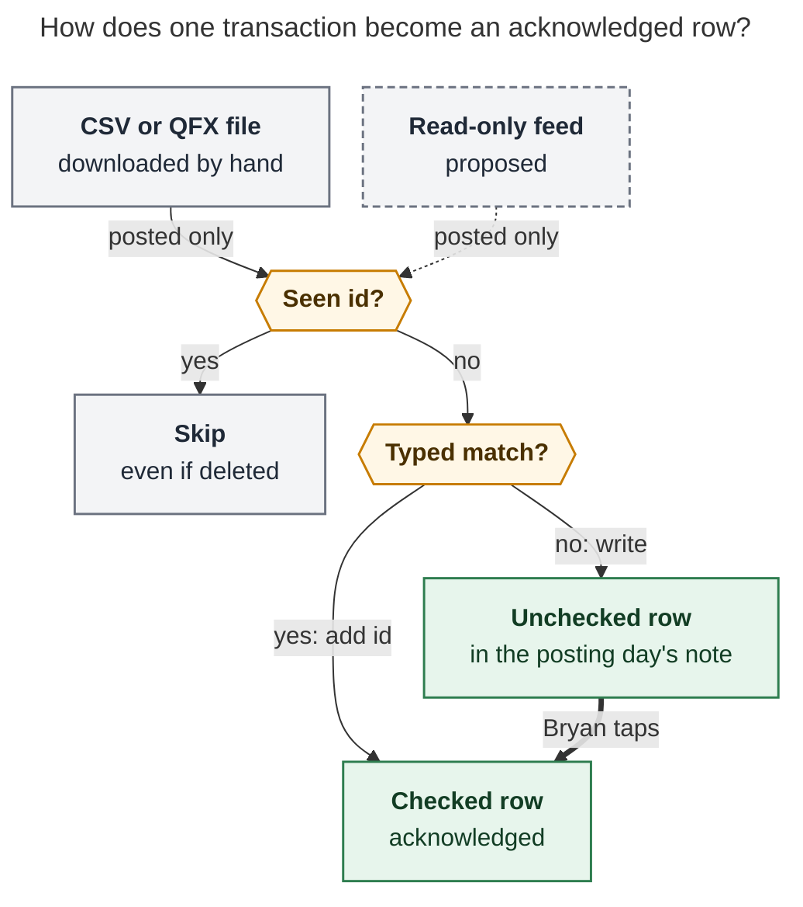

# Bank transactions in Bob: build a ledger you acknowledge daily, and keep albums for subscriptions

*Researcher: cld · 2026-11-11 · Context: `bob.md ^bank-records`, `cash.md
^daily-bank-records-again`, epic `bob-cli-k3` (album notes)*

## TL;DR

- **The habit is worth restoring.** You already kept it for 21 months. The 2024–2025
  `## @BANK` sections in your `_habit` notes hold about **2,500 transactions** (2024-04-10
  → 2025-12-26, about 120 a month). The habit did not die of tedium. It ended in a
  holiday "Skipping until …" spiral that started on 2025-12-28 and took the whole habit
  log with it. With manual entry, every skipped day made catching up more expensive.
- **A "bank" album holding one record per transaction is the wrong container.** Albums
  are built for durable *things* you choose among: one note per restaurant, show, or
  movie. A transaction is an *event* in a log. Your own record-type test from the
  previous research sends logs elsewhere: "a spot is the thing; a session is a dated
  note." One record per transaction would mean 1,400–2,500 thin notes a year in a vault
  of about 6,800, filename collisions (`7-Eleven` appears 278 times in the old ledger),
  and a `[!records]` index regenerated across thousands of rows. It would also have no
  date grouping and no money totals.
- **What I recommend instead:**
  - **A bank ledger.** Each transaction is one checkbox row in a `## Bank` section of
    the daily note for the day it posted. The `## Pomodoros` ledger rows and the
    `## Events` sync already work this way, and so did your old `## @BANK`.
  - **Acknowledging is ticking the box.** The checkbox is plain, with no `#task`, so the
    task system ignores it.
  - **bob imports rows instead of you typing them.** It writes each posted transaction
    once, deduplicates against an import journal, and matches any row you typed by hand.
    Imported rows are complete, and typed rows still count, because typing a purchase
    helps you remember it.
  - **Views are drawn, not written.** A `bob-bank` block in a new `bank.md` sub-area of
    `cash` draws the inbox, month, and week from `bob bank report -f json`.
- **Keep an album, but make it the right one: `subscriptions`.** It holds the recurring
  charges you decide to keep or cancel. It passes the record-type test (a repeated
  keep-or-cancel choice, about 15 siblings from `old_recur.md`, and a named lookup in
  `cash.md ^audit-monthly-subscriptions`). Only this part waits for `bob-cli-k3`. The
  ledger can start now.
- **You can start tomorrow with no code.** Type yesterday's rows in the agreed grammar.
  Phase 1 parses those exact rows, and Phase 2's import matches them instead of
  duplicating them.

## Contents

- [What I looked at](#what-i-looked-at)
- [Is this a good idea?](#is-this-a-good-idea)
- [Why not an album of transactions](#why-not-an-album-of-transactions)
- [Requirement adjustments (called out)](#requirement-adjustments-called-out)
- [The design](#the-design)
  - [The row](#the-row)
  - [Where rows live](#where-rows-live)
  - [Acknowledging](#acknowledging)
  - [Getting transactions in](#getting-transactions-in)
  - [Payees, categories, and links](#payees-categories-and-links)
  - [Reconciliation: proving you saw every transaction](#reconciliation-proving-you-saw-every-transaction)
  - [Views](#views)
  - [`bank.md` and the subscriptions album](#bankmd-and-the-subscriptions-album)
  - [CLI and JSON](#cli-and-json)
  - [Privacy and security](#privacy-and-security)
- [Alternatives considered](#alternatives-considered)
- [Phasing](#phasing)
- [Open questions for you](#open-questions-for-you)
- [Recommended solution](#recommended-solution)
- [Sources](#sources)

## What I looked at

| Source | What it shows |
| --- | --- |
| `bob.md ^bank-records` and `cash.md ^daily-bank-records-again` | The goal ("go through bank records every day again"). Kept with the 🎲 P1→P2 decay since 2026-10-17. |
| `2024/*_habit.md`, `2025/*_habit.md` (`## @BANK`) | 494 notes have the section. 2,500 transaction lines on 346 days, from 2024-04-10 to 2025-12-26. Lines look like `13.71 ([[eat#smash_burger]])`. Outflows only, with no deposits. A daily `total: day / week-to-date` line reset every Monday. |
| `2025-12-28_habit.md` … `2026/20260222_habit.md` | "Skipping until 2026-01-05!", then "…01-12", "…01-20", "…01-26", "…02-09", and "…02-23". The 2026 habit notes never got an `@BANK` section, and the habit notes end on 2026-02-22. |
| `command.md ^z-240821-0f`, `z_key.md` | A perl one-liner that summed yesterday's `@BANK`, and `@BANK` defined as "A bank transaction". |
| `cash.md` | Monthly balance snapshots (`^balance`, a 30-day recurring task), a dangling `[[bank]]` link in the intro, and a blocked `^audit-monthly-subscriptions`. |
| `old_recur.md` | A zorg table of 24 recurring charges (Spotify, Audible, Claude, The Farmer's Dog, …). |
| `eat/` | 104 restaurant records, only 2 of which have `visited`. The old ledger links about 650 lines to `[[eat#…]]`. |
| Epic `bob-cli-k3` and plan `plan:202611/album_and_record_notes.md` | The album contract: "one durable thing, one file", `record_checkbox` is an error, the index is a pure function over every record head, and records hold no tasks. The `ledger-mining` phase already reads "a spending line means bought there". |
| `research:202611/record_notes_data_unlock/…` | The record-type test (recurring choice → many siblings → named lookup → one-line capture). "Most proposals fail … or are logs." |
| Gmail (read-only, via `gog`) | Wells Fargo alerts are configured only for Zelle sends, statements, mobile deposits, and FICO, not for each purchase. Email is not a usable feed today. |
| `docs/gcal.md`, `docs/stats.md`, `docs/records.md`, `docs/vault-git-sync.md` | Precedents: a feed projected into daily notes, values drawn at read time, per-host journals, and same-point Markdown insertions unioned on merge. |
| Web: Copilot Money, YNAB, SimpleFIN, Teller, Wells Fargo exports, Obsidian Bases, and consumer research | See [Sources](#sources). |

## Is this a good idea?

**Yes. The goal is sound, and you have evidence for it.** The things to get right are
the container, how complete the data is, and how cheaply you can catch up.

What's right about it:

- **The goal fits now more than ever.** The `cash.md ^balance` snapshots have fallen
  steeply over recent months. Each new transaction is the moment you can still choose
  differently.
- **It is a proven personal habit, not an aspiration.** You sustained 21 months and
  2,500 entries, with no visible decay before the holiday break. The monthly counts were
  still 131 in December 2025.
- **Writing a payment down changes how you remember it.** Soman (2001) found that past
  payments curb later spending most when you had to write the amount down ("rehearsal")
  and when the money left immediately. Card payments are low-salience and get
  underestimated. A daily acknowledgment restores some of that rehearsal for card
  spending.
- **Honest caveat on the evidence.** The evidence that tracking alone *reduces*
  spending is suggestive but mostly correlational (Zhang 2023, app data). A randomized
  budgeting field experiment (Clarity Money, about 9,000 people) found no reduction.
  Lukas & Howard (2023) found that even over-optimistic budgets reduce spending for
  months. So expect **awareness, error and fraud catching, and subscription hygiene**
  for sure, and spending reduction only maybe. If reduction becomes the goal, a weekly
  target is the next lever (see [Phasing](#phasing), "later").

What I would change:

1. **Container.** Use a ledger, not a transaction album. See the next section.
2. **Completeness.** "Acknowledge *every* transaction" needs the bank's list to
   acknowledge against. Typing from memory or the app cannot prove completeness.
   Importing can, and a balance check proves it (see
   [Reconciliation](#reconciliation-proving-you-saw-every-transaction)).
3. **Recovery cost.** The habit died in a skip-until spiral. Under manual entry, a week
   off means about 30 transactions to reconstruct from the app. With import, a week off
   means about 30 pre-filled boxes to tick. Habit research agrees that one missed day
   doesn't matter, *if you resume* (Lally et al. 2010). Design for resuming.
4. **No budgeting app in v1.** Leave out envelopes and budgets. Copilot, YNAB, and
   Monarch are better at that. Build the acknowledgment ritual and honest totals first.

## Why not an album of transactions

The album contract (`bob-cli-k3`) is excellent for what it was designed for. Here is how
a transaction fits it:

| Album contract says | A transaction record would… |
| --- | --- |
| "A record note represents **one durable thing**" (`docs/records.md`) | be an event, not a thing. The previous research's test routes logs to "one note or a log". |
| Filename = normalized title; duplicates **refused**, never suffixed | collide constantly: `7-Eleven` ×278, `T5` ×243, `Amazon` ×86. Every capture would need `@bank/^2026-11-11-711-2`. |
| `record_checkbox` is an error; records hold facts, not work | need acknowledgment stored as a frontmatter `status`. Every tick becomes a YAML edit plus an album-index rewrite, which is slower than a checkbox on the phone. |
| Index = pure function over **every** record head, rewritten on each record write | mean 1,400+ rows after one year, re-planned on every capture. Mac live preview plans on each keystroke pause, so it would read every head each time. |
| Index groups by a choices field; facets print numbers plainly | offer no grouping by day or week, no sums, no currency formatting. Those are the views you actually need. |
| Notes are worth opening | be thin: about 8 frontmatter lines and an empty `## Notes`. That's 1,400–2,500 such notes a year, +21–37% on a 6,800-note vault, cluttering the quick switcher, graph, search, and git. |

What an album *would* give you is genuinely nice: an Obsidian Base with group-by and Sum
(Obsidian 1.10), Mac capture rows, and a catalog chip. But the cost is structural, and
the ledger design below gets the same views with a plugin-drawn report instead.

**Steelman, rejected: "one record per *month*."** `bank/2026-11.md` could be an album
record with `status: open|reconciled`, and the index would read "11 months · 🟡 1 open ·
✅ 10 reconciled". It's tempting, and it stays small. But every useful number in that
record (spent, in, net) is derived. Under the Stats and album principles, derived values
are *drawn, never written*. The month view belongs in a report.

## Requirement adjustments (called out)

| # | Your requirement | Adjusted to | Why |
| --- | --- | --- | --- |
| **ADJ-1** | A new "bank" **album** | A **bank ledger** (daily-note rows) plus a small **`subscriptions` album** | Transactions are a log, and a log fails the record-type test. Subscriptions pass it. |
| **ADJ-2** | Wait for `bob-cli-k3` | **Only the subscriptions album waits.** The ledger needs no album code and can start now (Phase 0 needs no code at all). | Removes an unnecessary dependency. Consider changing `^bank-records`'s "starts after `^record-h2-sections`" relation accordingly. |
| **ADJ-3** | "Acknowledge every transaction / deposit" | **Acknowledged = the row's checkbox is ticked.** "Every" is *proven* by reconciling against the bank's balance. | Makes "every" checkable, not aspirational. |
| **ADJ-4** | (implicit) type transactions in | **Import is primary, and typing is first-class.** A typed row is acknowledged by construction, and import matches it. | Completeness from import. Typing still means writing the payment down. |
| **ADJ-5** | Deposits too | **Inflows are rows** (`+$412.00`), and **transfers** are marked so they never count as spending. | The old ledger had outflows only. Paying a card bill from checking would otherwise double-count. |
| **ADJ-6** | "Excellent, structured view" | **Drawn views:** day header, inbox, week vs. typical, month by category, year. bob owns the values, the plugin paints them, and nothing derived is written to notes. | Same rule as Stats and album catalogs, so there's no churn and nothing goes stale. |
| **ADJ-7** | — | **Cheap catch-up is a requirement.** After 3 or more days, a per-day "acknowledge these N" is allowed once the day's rows have been shown. Recent days stay one box per row. | Your habit died of catch-up cost. Copilot caps its Mac review card at 25 for the same reason. |
| **ADJ-8** | — | **Out of scope for v1:** budgets, envelopes, investment accounts, splitting one transaction across categories, multi-currency. | Keeps it a ritual, not a finance app. |

## The design

### The row

A transaction is one line. bob writes it once, and you own it from then on.

```markdown
## Bank

- [x] **$13.71** Smashburger [cat:: dining] [[eat/smashburger|🍽️]] ^bank-8f3a2c1d
- [x] **$4.25** 7-Eleven [cat:: convenience] — coffee on the walk ^bank-0b9e07f2
- [ ] **$214.63** The Farmer's Dog [cat:: dog] ^bank-77c1d0aa
- [ ] **+$412.00** NJ Unemployment [cat:: income] ^bank-1c0e77aa
- [x] **$20.00** Farmers market [cat:: groceries] [acct:: cash]
```

The grammar:

- **Checkbox.** `[ ]` means not yet acknowledged and `[x]` means acknowledged. There is
  no `#task`. The Tasks global filter is `#task`, so these are not tasks, exactly like
  the `## Pomodoros` ledger rows.
- **Amount.** Bold, with an optional sign. Unsigned means money out, the common case,
  as in your old ledger. `+` means money in. The parser accepts `$`, no `$`, commas,
  and `-`/`−`. Money is integer cents, never floats.
- **Payee.** Free text up to the first field, link, `—`, or block ID.
- **Fields.** `[cat:: key]` sets the category, a key from `bank.md`. `[acct:: alias]` is
  written only when you have more than one account. `[on:: YYYY-MM-DD]` is written only
  when the row is not in its posting day's note.
- **Links.** These are optional: an `[[eat/…]]` restaurant or a `[[subscriptions/…]]`
  record.
- **Note.** Anything after `—` is yours.
- **ID.** bob writes `^bank-<8 hex>`, a hash of account and bank transaction ID. Typed
  rows have no ID until import matches them. The block ID makes every transaction
  linkable, for example from a restaurant's `## Notes`.

**Ownership** follows the gcal precedent (`decisions:gcal-root-follows-google-until-edited`):

- **bob writes a row once.** After that, the only edit bob ever makes to a row is to
  *append* `^bank-…` to a typed row it matched.
- **Your edits always win.** You can rename the payee, recategorize, fix the amount, or
  delete the row. If your amount differs from the bank's, `bob bank check` reports it
  once and never reverts it.

### Where rows live

**In the `## Bank` section of the daily note for the day the transaction posted** (or
the day it happened, when the feed provides that date).

- It mirrors your 2024–25 habit, where the day's note held the day's spending.
- It sits beside that day's `## Events` and `## Pomodoros`, so a day reads as one
  story.
- Stats can derive values trivially from it (`docs/stats.md`: "derives every number at
  read time from vault data").
- Day notes are small files, so writes stay local. `bob vault-sync` already unions
  same-point Markdown insertions.

The rules:

- **Placement.** On first write, bob creates `## Bank` immediately after the
  `## Pomodoros` section, or else at the end of the file. Later writes append inside the
  section, wherever you moved it.
- **Write window.** bob writes into notes from the last 14 days only. If the posting
  day's note is missing (12 days of 2026 have none) or older than the window, the row
  goes to *today's* note with `[on:: date]`. That keeps it rare and explicit.
- **Pending transactions are never imported, only posted ones.** Aggregators issue a
  *new* ID when a pending transaction posts, which is a classic source of duplicates.
  Posted-only costs a lag of 0–2 days, which suits a morning review of yesterday.

### Acknowledging

```mermaid
---
title: "What states can one bank row be in?"
accTitle: "Bank row lifecycle"
accDescr: "A row is born unchecked by import or checked by typing; matching attaches a bank id to a typed row; a tap acknowledges; deleting a synced row leaves a journal tombstone so sync never re-adds it."
---
stateDiagram-v2
  state "Unchecked: imported, awaiting Bryan" as NEW
  state "Typed: checked, no bank id yet" as TYPED
  state "Acknowledged: checked, bank id known" as ACK
  state "Tombstoned: deleted, journal remembers" as GONE
  [*] --> NEW: sync writes a posted transaction
  [*] --> TYPED: Bryan types a row
  TYPED --> ACK: import matches amount and date
  NEW --> ACK: Bryan taps the box
  ACK --> NEW: Bryan unticks it
  NEW --> GONE: Bryan deletes the row
  ACK --> GONE: Bryan deletes the row
  TYPED --> TYPED: cash, never matched
```



*Figure 1. A row is acknowledged either by typing it yourself or by ticking an imported
row. A deleted row is remembered by the import journal, so sync never re-adds it.*
(Rendered 774 × 796 px, fit 84.3%, Mermaid CLI 12.0.0.)

- **The ritual.** Add one `#gtd #pre` chore: "Acknowledge new bank transactions (inbox
  at 0)". Because it is a `#pre` chore, your existing `habits` Stats metric counts it,
  with no new streak machinery. Add `bank sync` to the existing "Run `gcal sync` +
  `gkeep pull` + `gmail sync`" chore, or run it in `bob nightly`.
- **Where you tick.** Start in today's note: the plugin draws a quiet "🏦 4 to
  acknowledge" chip under the `bob-plan` badges that jumps to the oldest unchecked row.
  Or start in `bank.md`'s inbox card, or in yesterday's note through the `prev` link.
  Everything works as plain Markdown on the phone.
- **Make each tick mean something.** The day header shows *week so far vs. a typical
  week* (the median of the previous 8 weeks, the same "typical" idea as Stats). Unusual
  rows get a badge: first time at this payee, the largest charge in 30 days, or a
  subscription whose price changed.
- **Flag, don't fix, in the moment.** Type `⚑` in a row to mean "look into this"
  (dispute, ask Kelly, cancel). `bob bank check` lists flagged rows. Capture a task in
  `bank` that links the row's `^bank-…` block.
- **Later (optional):** a `BANK` tier in the `]s` walk right after PRE, where one key
  acknowledges and advances. This is the most "Bob" version of the ritual, but it
  extends a task-only walk, so it waits until the basics prove themselves.

### Getting transactions in



*Figure 2. Import is idempotent. An ID the journal has seen is never written again, a
typed row absorbs its bank twin, and everything else lands unchecked in the posting
day's note.* (Rendered 540 × 638 px, fit 100%, Mermaid CLI 12.0.0.)

**Sources, ranked for you (Wells Fargo):**

| Source | Complete? | Effort | Verdict |
| --- | --- | --- | --- |
| **CSV / Quicken (QFX) download** from Wells Fargo Online | Yes, for posted transactions | You download a file (2FA login). The default window is 90 days. | **Phase 2: build first.** No third party and works today. QFX carries a stable `FITID`, while CSV needs a synthetic ID. |
| **Read-only aggregator:** SimpleFIN Bridge (about $15/yr; pricing pages conflict) or Teller (free developer tier, 100 connections) | Yes, if Wells Fargo is supported | Zero per day after `bob bank login` | **Phase 3, after a spike.** I could not confirm Wells Fargo support from a primary source for either one. SimpleFIN caps each request at 90 days. |
| Gmail alert emails (`bob gmail`) | **No.** Today only Zelle, statements, and mobile deposits alert. Per-purchase alerts are threshold-based, without IDs, and skip ACH and bill pay. | Low | **Reject as the ledger source.** Notification-grade, not ledger-grade. |
| Typing from the app (Phase 0) | Only what you remember to type | About 2 minutes a day, and catching up is expensive | **Keep as a mode, not the source.** |

**Identity and deduplication (the reliability core):**

- **ID.**
  - From QFX, OFX, or a feed: the bank's transaction ID.
  - From CSV: YNAB's proven synthetic scheme, `amount:date:occurrence`. The occurrence
    index counts identical amount-and-date tuples within one file, so two $4.25
    7-Eleven runs on the same day stay two rows across overlapping downloads.
  - Every ID is hashed with the account alias into `^bank-<8 hex>`. bob checks for
    collisions.
- **Import journal.**
  - Each host appends to its own file, `.bob/bank/<host>.jsonl`, and readers fold all of
    them (the `decisions:theme-prefs-live-in-per-host-journal` pattern), so merges never
    conflict.
  - Each entry records the bank ID, account, posting and transacted dates, amount in
    cents, the masked raw description, and the target note and block.
  - "Seen" means *any* host's journal has it. A deleted row therefore stays deleted,
    which is a tombstone, the gcal "proposes once" rule.
- **Matching typed rows.**
  - A typed row matches when it has no `^bank-…`, the same account (cash rows never
    match), the same sign and amount, and its note date is between 1 day before and 3
    days after the posting date. Each typed row matches at most once.
  - Ties go to the nearest date. A remaining tie is left unmatched and reported by
    `check`. YNAB found that matched imports needed no second approval, and so does
    this design: a typed row is already acknowledged.
  - The typed row stays where you put it, because your purchase date beats the bank's
    posting date.
- **Changing sources** (CSV, then a feed): IDs differ between sources. The first run
  of the new source fuzzy-matches against the journal (same account, amount, and date
  within ±2 days, with a similar payee). It reports "already have" and records an alias
  instead of writing a duplicate.
- **One feed host.** `bank.sync_host` (for example `athena`) runs `sync`, just as
  `docs/gcal.md` "Where it runs" pins gcal. Manual `import` on any host pre-syncs the
  vault first, as `bob albums sync` does.
- **Guarded writes.** Every row write uses the existing guarded writer with
  preimages. `--dry-run` prints the exact bytes.

### Payees, categories, and links

Categories must cost you about zero, or the ritual dies.

- **Categories live in the vault**, in `bank.md` frontmatter, with the same `key: emoji
  Label` shape as album choices. Rows reference the keys. About 14 defaults: 🛒
  groceries, 🍽️ dining, 🏪 convenience, 🏠 home, 💡 utilities, 🚆 transport, 🩺 health,
  🧸 kids, 🐶 dog, 🔁 subscriptions, 🛍️ shopping, 🎁 gifts, 💵 income, ↔️ transfer.
  `transfer` never counts as in or out.
- **bob learns from your rows, with no rules to write.**
  - A new import's merchant key is the raw description with store numbers, processor
    prefixes (`SQ *`, `TST*`, `PAYPAL *`), and location suffixes stripped, then
    lowercased.
  - bob looks up the most recent *acknowledged* row with the same key and copies that
    row's payee text, category, and link.
  - When you rename "SQ *SMASHBURGER 1234" to "Smashburger" once, every future
    Smashburger arrives named, categorized, and linked. This is deterministic and
    inspectable (`bob bank check` can show the key behind any row), not machine
    learning.
- **Explicit rules are optional.** A `rules:` list in `bank.md` handles the rare
  override, for example "anything matching `VENMO` → transfer".
- **Restaurant synergy.**
  - When a row's payee exactly matches an `eat/` record title, bob proposes the link
    once.
  - An acknowledged row linked to `[[eat/x]]` sets that restaurant's `visited` to the
    row date when the date is newer, through `bob records update`, with a report line.
  - `bob-cli-k3.10` already accepted that "a spending line means bought there". Only 2
    of 104 restaurant records have `visited` today. The bank ledger keeps it current
    with no typing.

### Reconciliation: proving you saw every transaction

- `bank.md` records each account's **opening balance and date**.
- A feed reports each account's current balance on every sync, and bob journals it. A
  file-only setup uses the monthly statement balance instead. Your existing 30-day
  `cash.md ^balance` chore becomes "enter the statement balance".
- `bob bank check` compares *opening + Σ (journal amounts of rows still in the vault)*
  with the bank's balance:
  - `✓ balanced` means every transaction the bank knows about is in your vault.
  - `Δ $12.40` means one is missing, deleted, or duplicated, and check lists the
    suspects.
- This is the difference between "I think I saw everything" and "I did".

### Views

Every number is drawn from `bob bank report -f json`, and nothing derived is written to
notes. The figures below are illustrative.

**1. The daily `## Bank` section.** Plugin decoration in Live Preview and Reading view;
plain Markdown underneath.

```text
🏦 BANK · Tue Nov 10                  3 to acknowledge · out $252.59 · in +$412.00
 ☑    $13.71  Smashburger         🍽️ Dining       ↗ Restaurants
 ☑     $4.25  7-Eleven            🏪 Convenience  coffee on the walk
 ☐   $214.63  The Farmer's Dog    🐶 Dog          🔁 same as Oct 10
 ☐  +$412.00  NJ Unemployment     💵 Income
 ☑    $20.00  Farmers market      🛒 Groceries    💵 cash
 week so far $412 · typical week $560
```

- **Amounts.** Tabular numerals, right-aligned, with money in drawn in green.
- **Unchecked rows** carry a thin left bar in `cash`'s area hue (magenta), the same
  area-hue accent language as the album and notebook cards.
- **Acknowledged rows** dim slightly, as done rows do.
- **Raw `[cat:: …]` fields** render as emoji chips. Raw `^bank-…` IDs are hidden.

**2. `bank.md`, the inbox card** (a `bob-bank` fence with `view: inbox`). Every
unacknowledged row across days, grouped by day, each linked to its note.

```text
╭─ 🏦 To acknowledge · 5 ─────────────────────────────────────────╮
│ Mon Nov 9     $61.20  ShopRite             🛒                    │
│ Tue Nov 10   $214.63  The Farmer's Dog     🐶                    │
│             +$412.00  NJ Unemployment      💵                    │
│ Wed Nov 11     $7.14  T5                   🍽️                    │
│               $23.23  7-Eleven             🏪                    │
╰─ synced 05:19 · ✓ balanced with Wells Fargo ────────────────────╯
```

**3. `bank.md`, the month card** (`view: month`). Out / in / net, a bar per category
sorted by spend with ▲/▼ against a typical month, a Monday-first calendar heat strip
(darker means more out), and the top payees. A `‹ ›` control steps months. A **year
card** shows twelve out/in column pairs. Clicking a category lists its rows.

```text
NOVEMBER 2026 · so far                                         ‹ Oct
Out $1,904 · In +$824 · Net −$1,080              typical month out $2,350
🛒 Groceries      ███████████░░░░░░  $512  27%
🍽️ Dining         ██████░░░░░░░░░░░  $281  15%  ▲ $64 vs typical
🐶 Dog            █████░░░░░░░░░░░░  $215  11%
🔁 Subscriptions  ████░░░░░░░░░░░░░  $188  10%
Top payees  ShopRite $244 · Amazon $198 · 7-Eleven $61
```

**4. The terminal.** Bare `bob bank` shows the inbox. It respects `NO_COLOR` and pipes,
and it never depends on terminal width (the album list's rules).

```text
$ bob bank
To acknowledge · 5                                      synced 05:19 · ✓ balanced
Mon Nov 9
  ·     $61.20  ShopRite               🛒 groceries
Tue Nov 10
  ·    $214.63  The Farmer's Dog       🐶 dog
  ·   +$412.00  NJ Unemployment        💵 income
Wed Nov 11
  ·      $7.14  T5                     🍽️ dining
  ·     $23.23  7-Eleven               🏪 convenience
Week so far  out $412 · in +$412 · typical week out $560
```

**5. Later.**

- A `bank` Stats metric kind (`spent` and `received` per day), so spending can appear
  on the Stats dash next to Worked. The Stats engine supports configured metric kinds.
- A `view: week` fence for weekly period notes.
- One line in Bob Mac Capture's idle agenda ("🏦 5 to acknowledge"), rendered from
  bob's JSON per `decisions:mac-capture-is-a-thin-client`.

### `bank.md` and the subscriptions album

**`bank.md` becomes a sub-area of `cash`.** This also resolves `cash.md`'s dangling
`Related: [[bank]]`. It holds:

- the ledger configuration (accounts, categories, rules) in frontmatter;
- the drawn views;
- the bank tasks (dispute a charge, cancel a subscription; the flags land here);
- the `## Albums` catalog for subscriptions.

Credentials never go here.

````markdown
---
parent: "[[cash]]"
type: "[[area]]"
color: magenta
bank:
  accounts:
    checking: {label: Wells Fargo checking, emoji: 🏦, opening: {date: 2026-12-01, balance: 0.00}}
  categories:
    groceries: 🛒 Groceries
    dining: 🍽️ Dining
    # …
    income: 💵 Income
    transfer: ↔️ Transfer
  rules:
    - {match: "VENMO", category: transfer}
---

# Bank

Every dollar in and out, acknowledged daily. Rows live in each day's `## Bank`;
`bob bank` shows what is waiting.

```bob-bank
view: inbox
```

```bob-bank
view: month
```

## Albums
…generated…

## Tasks
…
````

(The YAML above uses flow maps only to stay short. bob would write block style, per
the album contract's canonical-YAML rule.)

**The `subscriptions` album (after `bob-cli-k3`).** It is created with
`bob albums create bank subscriptions -n subscription -s "…"`.

```yaml
---
parent: "[[bank]]"
type: "[[album]]"
summary: Everything that charges us on repeat, and whether it still earns its keep.
emoji: 🔁
index_facets: [amount, cadence, category]
record:
  noun: subscription
  label: Subscription
  fields:
    status:
      required: true
      values:
        to_cancel: ✂️ To cancel
        active: 💚 Active
        cancelled: 🚫 Cancelled
    amount:
      required: true
      values: number
      min: 0
    cadence:
      required: true
      values:
        monthly: Monthly
        yearly: Yearly
    category:
      suggest: true
    url:
      values: url
---
```

The album index then reads:

```markdown
> [!records] 15 subscriptions · ✂️ 2 to cancel · 💚 12 active · 🚫 1 cancelled
```

The actionable group comes first, by the album rule.

- **Seed.** Seed it from `old_recur.md`'s discretionary rows: Spotify, Audible, YouTube,
  Claude, ChatGPT, Medium, Reuters, Copilot, reMarkable, PIA, GoDaddy, noip, XMind,
  DigitalOcean, and The Farmer's Dog. Then de-zorg the rest into `legacy_cash`, using
  the `eat.md` recipe.
- **Mortgage, loans, and insurance stay payee rules.** They are obligations, not
  keep-or-cancel choices, so they fail the "recurring choice" question.
- **Linking.** A payee rule or learned link (`[[subscriptions/spotify|🔁]]`) ties
  ledger rows to their record.
- **Detection.** `bob bank check` reports a price change (✂️ "Spotify $11.72 →
  $12.99") and **proposes** new recurring candidates: three or more charges at the same
  payee about 30 or about 365 days apart. It never creates a record by itself.
- **Lookup moment.** This is `cash.md ^audit-monthly-subscriptions`. With the album and
  the feed, that task becomes a five-minute read instead of an archaeology project.

### CLI and JSON

`bob bank` goes in the **Integrations** section beside `gcal`, `gkeep`, and `gmail`.
Options are alphabetical and each has a short alias. Bare `bank` runs the read-only
`list` (`sase/memory/cli_rules.md`).

```text
bob bank [list] [-a] [-b DIR] [-D DAY] [-f human|json]   # inbox; -a all rows; -D one day
bob bank check  [-b DIR] [-f human|json]                  # lint, drift, flags, matches, balance, recurring
bob bank import FILE... [-a ACCOUNT] [-b DIR] [-d] [-f human|json]   # CSV / QFX / OFX
bob bank report [-b DIR] [-f human|json] [-m MONTH] [-w WEEK] [-y YEAR]
bob bank sync   [-b DIR] [-d] [-f human|json] [-q]        # feed (phase 3)
bob bank doctor | login | logout                           # feed setup, mirroring gcal
```

JSON is versioned (`schema_version: 1`) and additive:

- Each row carries `id`, `date`, `amount_cents`, `direction`, `payee`, `category`,
  `account`, `acknowledged`, `flagged`, `source` (`typed|import|feed`), `note`, `line`,
  and `links`.
- `report` adds `totals`, `by_category`, `by_day`, `typical`, `balance`, and `issues`.
- `check` exits 1 on an error (an unbalanced account, a duplicate ID, a malformed row),
  `list` and `report` exit 0, and `import` and `sync` exit 2 on refusal.
- Read-only commands never repair.

### Privacy and security

- **Credentials** (the SimpleFIN access URL, Teller tokens) live in the OS keyring
  through `bob bank login`. They never appear in the vault, config, argv, logs, or JSON
  (the `docs/gcal.md` Security rule).
- **The vault holds** amounts, dates, cleaned payees, categories, and account
  *aliases*. Never account or routing numbers. Raw descriptions in the journal are
  masked: runs of 4 or more digits become `••••`.
- **The bank is read-only to bob by construction.** SimpleFIN and Teller cannot move
  money, and file import obviously cannot.
- **Know the exposure.** The vault is pushed to a private GitHub repository, and SASE
  agents read daily notes; period-review drafts do, for example. Bank rows therefore
  reach model providers whenever an agent reads those notes. `cash.md` balances and two
  years of `@BANK` already do, so this is not new, but decide it on purpose (open
  question 6).

## Alternatives considered

| Option | Verdict |
| --- | --- |
| **A. One album record per transaction** (as asked) | **Reject.** Volume, filename identity, index scale, thin notes, and acknowledgment as a YAML edit. See [above](#why-not-an-album-of-transactions). |
| **B. One album record per month** | **Reject.** Forced: every useful field is derived, and derived values are drawn, not written. |
| **C. Monthly ledger notes** (`bank/2026-11.md`) | **Runner-up.** Good for statement reconciliation and one place per month. But it loses the day context, every write hits one hot file for 30 days, and Stats would need a second source. Choose it if you dislike rows in daily notes. |
| **D. Daily-note `## Bank` rows** | **Recommend.** It mirrors your 21-month habit and the `## Pomodoros` and `## Events` precedents. Small files, plain Markdown on the phone, trivial derivation. |
| **E. Hidden journal only, plus drawn views** | **Reject as primary.** Robust, but acknowledging would need bob or the plugin rather than a checkbox on the phone. The journal stays as import bookkeeping. |
| **F. Use Copilot, Monarch, or YNAB** | **Honest fallback.** A polished "To review" inbox (Copilot: `R` marks reviewed, bulk review, inbox zero). But it lives outside Bob, costs a subscription, and can't link restaurants, subscriptions, or Stats. Pick it if build time is the constraint. |
| **G. Plain-text accounting** (hledger, beancount) | **Not as the home.** The best accounting rigor, but it is a separate world from your notes. Offer `bob bank export --hledger` later if you want double-entry reports. |

## Phasing

| Phase | Scope | Depends on | Size |
| --- | --- | --- | --- |
| **P0 · Restart (no code)** | Create `bank.md` (sub-area of `cash`, with the row grammar in its intro). Add the `#gtd #pre` chore. Type yesterday's rows into `## Bank` from the Wells Fargo app. Download a CSV each Sunday to eyeball completeness. | nothing | tiny |
| **P1 · `bank-read`** | Row parser (typed and imported forms). `bob bank list / report / check` (read-only). `bank.md` config parsing. Plugin row decoration, day header, and `bob-bank` inbox and month fences. Docs (`docs/bank.md`, the CLI reference, the vault format). | P0 grammar | medium-large |
| **P2 · `bank-import`** | `bob bank import` (Wells Fargo CSV and QFX/OFX). Synthetic and FITID IDs. Per-host journal and tombstones. Typed-row matching. Learned payees. Placement window and fallback. Dry-run. Golden tests with fake Wells Fargo files. | P1 | large |
| **P3 · `bank-feed`** (spike first) | One-day spike: SimpleFIN Bridge vs. Teller against your real Wells Fargo (coverage, ID stability, latency, cost). Then `login / doctor / sync`, keyring storage, the `bank` nightly step, balance journaling, and reconciliation. **Gate:** a 2-week shadow run in which feed IDs and amounts equal a CSV of the same weeks. | P2 | medium |
| **P4 · `bank-views`** | Year card, typical-week and typical-month comparisons, unusual-row badges, the `bank` Stats metric kind, a period-note `view: week` fence, and the Mac idle line. | P1 (P3 for balances) | medium |
| **P5 · `subscriptions` album** | Create the album, seed it from `old_recur.md`, de-zorg the leftovers, link rows to records, report price changes and propose recurring candidates, and update eat `visited` from linked rows. | **`bob-cli-k3` complete** (albums create, index, catalog), and P2 | medium |
| *Later, optional* | `]s` BANK walk tier, a `bob bank review` TUI, a weekly target, `export --hledger`, and decision records (for example `bank-rows-live-in-daily-notes`, through `/sase_memory_write` with your approval) | — | — |

Each code phase follows the repository's habits: `just` gates, `just docs-gen` and
`just docs-check`, conventional commits, and no version or CHANGELOG edits. Plugin work
happens in `bob-plugins`, deployed with `bob plugins sync`. Sequence P1's plugin work
after `bob-cli-k3.7` lands, to avoid colliding in `bob-ledger-tools`.

## Open questions for you

1. **Why did the habit stop?** The data says the holiday skip spiral starting
   2025-12-28 and the end of the zorg habit log, not dislike of the bank part. If typing
   *was* the pain, P2 and P3 are the priority. If it wasn't, P0 plus P1 may be enough
   for a while.
2. **Which accounts?** Wells Fargo checking only, or also credit cards, Kelly's
   accounts or a joint account, Venmo, and cash? Each card account needs transfers
   marked so a card payment isn't counted twice.
3. **Is a read-only third-party aggregator acceptable** (SimpleFIN or Teller hold a
   bank connection token)? Or files only?
4. **`bank.md` as a sub-area of `cash`** (my default), or everything in `cash.md`?
5. **Categories:** are about 14 defaults fine, or do you want payees only?
6. **Should SASE agents read bank rows?** The period-review drafts would gain "this week
   you spent …". Or should agent-facing tooling skip `## Bank`?
7. **Default acknowledgment mode:** tap imported rows, or keep typing (rehearsal) and
   let import only fill the gaps?

## Recommended solution

1. **Don't build a "bank" album of transactions.** Build a **bank ledger**:
   - one checkbox row per transaction in the `## Bank` section of the posting day's
     daily note;
   - a ticked box means acknowledged;
   - bob writes each row once, and your edits always win.
2. **Import is the source of truth, and typing is still welcome.** Wells Fargo CSV/QFX
   import first. A read-only feed (SimpleFIN or Teller) follows once a spike proves it
   for Wells Fargo. Deduplication is idempotent through a per-host journal with
   tombstones. Typed rows are matched and never duplicated. Only posted transactions
   are imported.
3. **Prove "every".** Opening balance plus rows must equal the bank's balance, and
   `bob bank check` says `✓ balanced` or names what's missing.
4. **Make it beautiful by drawing, not writing:**
   - a decorated `## Bank` section with a day header and week-vs-typical;
   - inbox, month, and year cards in a new `bank.md` sub-area of `cash`;
   - a colorful `bob bank` inbox in the terminal;
   - later, a Stats metric and a Mac idle line.
5. **Make it intuitive by reusing your rituals:**
   - one `#gtd #pre` chore (already counted by your `habits` metric);
   - `bank sync` beside `gcal sync`;
   - a "🏦 N to acknowledge" chip in today's note;
   - categories and payee names learned from your own edits;
   - cheap per-day catch-up after a break, so one missed week never kills the habit
     again.
6. **Use albums where they shine:** a **`subscriptions` album** under `bank`, seeded
   from `old_recur.md`, linked to ledger rows, and audited from
   `^audit-monthly-subscriptions`. Bonus: linked restaurant rows keep `eat/` `visited`
   current. Only this part waits for `bob-cli-k3`.
7. **Start tomorrow (P0, no code):** create `bank.md`, add the PRE chore, and type
   yesterday's rows in the grammar above. Every row you type now becomes a first-class,
   matched, acknowledged row the day import ships.

## Sources

Vault and repository evidence (read 2026-11-11):

- `~/bob/bob.md ^bank-records`; `~/bob/cash.md` (`^daily-bank-records-again`,
  `^balance`, `^audit-monthly-subscriptions`, `Related: [[bank]]`);
  `~/bob/old_recur.md`; `~/bob/command.md ^z-240821-0f`; `~/bob/z_key.md`;
  `~/bob/2024/*_habit.md`, `~/bob/2025/*_habit.md`, `~/bob/2026/*_habit.md`;
  `~/bob/eat/`; `~/bob/gtd_daily.md`; `~/bob/2026/20261111.md`.
- `plan:202611/album_and_record_notes.md` (epic `bob-cli-k3`), and
  `research:202611/record_notes_data_unlock/record_notes_data_unlock.md` (record-type
  test).
- bob-cli `docs/records.md`, `docs/gcal.md`, `docs/stats.md`,
  `docs/vault-git-sync.md`, and `sase/memory/cli_rules.md`. The glossary (Area Note, Day
  Strip, Stats Strip, Event Task) and decisions (`gcal-root-follows-google-until-edited`,
  `theme-prefs-live-in-per-host-journal`, `mac-capture-is-a-thin-client`).
- Gmail (read-only search of `alerts@notify.wellsfargo.com`, the last 365 days): only
  subject tallies were used.

External:

- Soman, D. (2001). Effects of payment mechanism on spending behavior: The role of
  rehearsal and immediacy of payments. *Journal of Consumer Research* 27(4), 460–474.
  [IDEAS](https://ideas.repec.org/a/oup/jconrs/v27y2001i4p460-74.html)
- Lukas, M. F. & Howard, R. C. (2023). The influence of budgets on consumer spending.
  *Journal of Consumer Research* 49(5), 697–720.
  [St Andrews](https://research-portal.st-andrews.ac.uk/en/publications/the-influence-of-budgets-on-consumer-spending/)
- Clarity Money budgeting field experiment (Center for Advanced Hindsight).
  [Case study](https://case-studies.advanced-hindsight.com/case-studies/GfCI1P8I/clarity-money-budgeting-experiment)
- Zhang (2023), tracking persistence and discretionary spending (app data,
  correlational), as summarized at
  [k24.digital](https://k24.digital/lifestyle/money/why-tracking-your-spending-is-the-money-habit-that-works).
  A secondary source; I did not read the primary paper.
- Lally, P., van Jaarsveld, C., Potts, H., & Wardle, J. (2010). How are habits formed:
  Modelling habit formation in the real world. *European Journal of Social Psychology*
  40(6), 998–1009. Cited from memory, not re-fetched.
- Copilot Money help: [Dashboard and To Review](https://intercom.help/copilotmoney/en/articles/6045480-dashboard-tab-overview),
  [Copilot for macOS](https://help.copilot.money/en/articles/6778561-copilot-for-macos),
  [To Review card for Mac](https://www.copilot.money/dispatch/to-review-card-for-mac),
  and [bulk editing](https://help.copilot.money/en/articles/7668990-bulk-editing-transactions).
- YNAB: [Approving and matching transactions](https://support.ynab.com/en_us/approving-and-matching-transactions-a-guide-ByYNZaQ1i.md)
  and [Reconciling accounts](https://support.ynab.com/en_us/reconciling-accounts-a-guide-BJFE3fHys.md).
  The `import_id` format `YNAB:[milliunit_amount]:[iso_date]:[occurrence]` is from the
  YNAB API documentation (from memory; verify at implementation).
- SimpleFIN Bridge: [bridge.simplefin.org](https://bridge.simplefin.org) and
  [pricing/info](https://bridge.simplefin.org/simple). Client notes on pending IDs and
  the 90-day cap are in
  [dataflow simplefin.js](https://gitea.hptrow.me/pt/dataflow/src/branch/master/api/lib/simplefin.js).
  [Actual Budget SimpleFIN docs](https://actualbudget.org/docs/experimental/simplefin-sync).
- Teller: [teller.io](https://teller.io/) and [API docs](https://teller.io/docs/api).
- Wells Fargo exports: [Web Connect](https://wellsfargo.com/online-banking/software/web-connect),
  [Business account activity (90 days default, up to 18 months)](https://www.wellsfargo.com/biz/online-banking/deposit-details/?linkLoc=fn).
  Consumer limits are unverified.
- Obsidian Bases grouping and summaries:
  [table view help](https://obsidian.md/help/bases/views/table) and
  [1.10 changelog](https://obsidian.md/changelog/2025-10-01-desktop-v1.10.0/).
