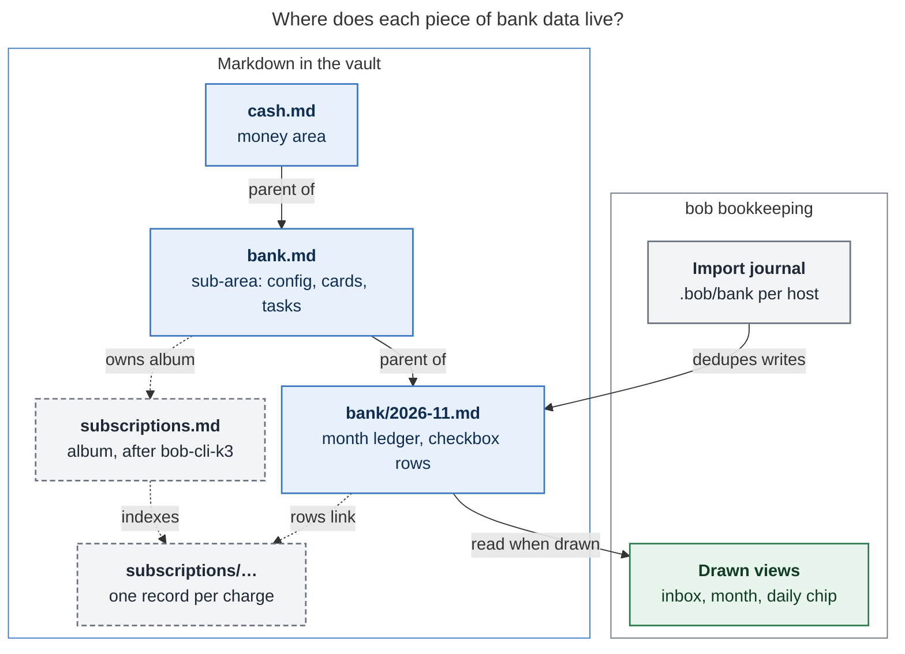
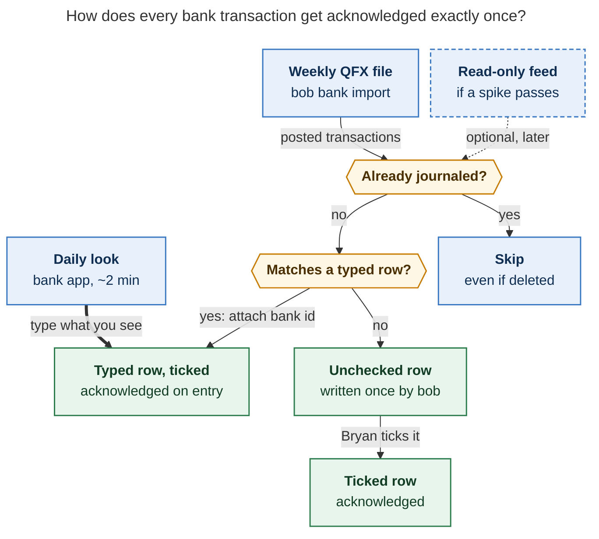

# Bank: a monthly ledger you acknowledge daily, with an album for subscriptions

*Lead researcher consolidation · 2026-11-11 · Inputs: five independent reports
(`__cdx`, `__cld`, `__grk`, `__mus`, `__gem` in this folder) plus my own checks of the
vault, the `bob-cli-k3` epic and its approved plan, `docs/records.md`, and the web.
Context: `bob.md ^bank-records` ("Use records to start tracking bank transactions
again!") and `cash.md ^daily-bank-records-again` ("Go through bank records every day
again!"). All amounts in the examples are made up.*

## Bottom line

- **Restart the habit. It's a good idea, and you've already proven it works for you.**
  You logged spending by hand for about two years: `## expenses` from Nov 2023 to Feb
  2024, then `## @BANK` from Apr 2024 to Dec 2025, about 2,400 lines in total. It
  didn't die because you got bored of it. It died in a holiday "Skipping until …"
  spiral, and the revival task then decayed down the P-ladder.
- **Don't make one album record per transaction.** All five researchers looked at this.
  Four rejected it outright, and the fifth (cdx) accepted it only with a separate banking
  module and an open question about scale. I checked the claims against the approved
  album contract. The `[!records]` index lists *every* record and is rebuilt on every
  record write. Filenames come from titles, and collisions are refused. A checkbox
  anywhere in a record is an error (`record_checkbox`). A record is "one durable thing."
  A year of transactions (about 1,400 or more) breaks all four rules.
- **What I recommend:**
  - **`bank.md`** is a new sub-area of `cash`. It holds the configuration, the drawn
    views, and bank tasks like disputes and cancellations.
  - **Month ledger notes** (`bank/2026-11.md`) hold one checkbox row per transaction,
    under day headings. A ticked row means acknowledged.
  - **Daily, you type** what you see in the bank app. A typed row counts as acknowledged
    the moment you write it.
  - **Weekly, `bob bank import`** reads a Wells Fargo QFX download. It skips
    transactions it has already seen, attaches the bank ID to rows you typed, writes
    the rows you missed as unchecked, and checks the balance. That proves "every."
  - **All totals and views are drawn by bob, never written** into notes.
- **Your album goes to subscriptions.** That's where an album actually fits:
  `subscriptions` under `bank`, seeded from `old_recur.md` and used by
  `^audit-monthly-subscriptions`. It's the only part that has to wait for
  `bob-cli-k3`.
- **Start tomorrow without writing any code.** Create the month note, add a `#gtd #pre`
  chore, and type rows in the final grammar. Every row you type now becomes a matched,
  acknowledged row once import ships.

## What the evidence says

I re-checked everything below against the vault snapshot (`bobs-org/bob` at
`c5ff769`), the plan `plan:202611/album_and_record_notes.md`, and `docs/records.md`
at bob-cli `f7332f58`.

| Fact | Evidence | Why it matters |
| --- | --- | --- |
| The habit ran for about 2 years | `## expenses` in 118 `_habit.md` notes (2023-11-13 → 2024-02-21). `## @BANK` in 494 notes (2024-04-10 → 2025-12-27). | It is a proven habit. gem's claim that it "ceased around March 2024" is wrong: the section was only renamed. |
| Volume | About 2,420 `@BANK` transaction lines. 341 days had spending: a median of 6 lines and a max of 34. About 115 lines a month. About 140–150 days logged a `total: 0.00`. | That's about 1,400 outflows a year *before* adding deposits. The $0 days show that "I looked" was part of the ritual. |
| Outflows only | Not one negative or credit line in `@BANK`. Balances lived in `cash.md ^balance`. | Your new goal, "every transaction / deposit," is a real change of scope. |
| `w` = ATM withdrawals | About 500 lines. The amounts are a round number plus $2.75 or $3.50 (e.g. 63.50, 43.50), often followed by a separate $2.50/$3.00 line. Those small lines add up to about $550 over 21 months and look like the bank's ATM fees. | Cash is about 7% of the dollars you logged. A bank import can't see where cash goes. It's also a concrete example of what this habit can catch. |
| Recurring charges are big | `[[old_recur…]]` links are about 29% of logged dollars. `old_recur.md` is a zorg table with about 25 active charges. `^audit-monthly-subscriptions` is still open. | This is a natural album (see below). |
| How it ended | `2025-12-28`: "Skipping until 2026-01-05!", followed by more skips. The habit notes end `2026-02-22` ("Skipping habit tracking…"). | The cadence failed and catching up got expensive. The data model wasn't the problem. |
| The revival task decays | `^daily-bank-records-again` is a P-level task with no `repeat::`. It went P0 → P1 → P2 and is now scheduled for 2026-12-01. | No schema will bring back a daily habit that is filed as a decaying task. |
| The daily ritual has a home | `gtd_daily.md` has `#gtd #pre` chores with `[repeat:: every day when done]`, including the gcal/gkeep/gmail sync chore. | This is the right place for the habit. |
| Plain checkbox rows are idiomatic | Daily notes' `## Pomodoros` rows are `- [x]` without `#task`. The Tasks plugin's `globalFilter` is `#task`. | Ledger rows can be checkboxes without becoming tasks. |
| Bank | Wells Fargo: there's a vault task about the WF Wallet. cld's read-only Gmail check found WF alerts only for Zelle, statements, mobile deposits, and FICO. | Acquisition design is specific to WF. Email alerts are not a ledger feed. |
| No phone vault | Vault sync is git on athena, apollo, and the Mac. Obsidian Sync is retired. I found no sign of Obsidian on the phone. | "Tick it on the phone" isn't a design driver. The phone is where the *bank app* lives. |
| Album epic | `bob-cli-k3`: phases 1–3 are closed. Capture, index, catalog/create, plugin, Mac, cutover, ledger-mining, and wrap-up are still in progress. | Anything album-shaped waits for `bob albums create` and the cutover. |
| Album contract | One durable thing per record. The index is a pure function over every record's frontmatter, rewritten with every record write, with no cap. Filenames come from titles, and collisions are refused. `record_checkbox` and `album_checkbox` are errors. Albums hold no tasks. `status` can't have a default. `number` parses to `f64`. `dated_notes` stamps *today*. | These rules decide the container (next section). |
| Related tasks | `cash.md ^budget` ("Set up Actual Budget!") is blocked. `wait.md` plans a monthly spending limit after 12 balance snapshots. | Budgeting is already a separate, later track. Keep it out of v1. |

## Is this a good idea?

**Yes, as long as acknowledgment is the product and bookkeeping serves it.** The
behavioral evidence supports a light, deliberate review loop. It doesn't support any
promise that spending will go down:

- Monitoring progress improves goal attainment on average (Harkin et al. 2016: 138
  randomized studies, d ≈ 0.40). Writing a payment down makes it more memorable, and
  card payments are the ones people underestimate (Soman 2001, "rehearsal").
- A randomized test of a budgeting app (Clarity Money, about 9,000 people) found no
  reduction in spending. So the outcomes you can count on are **awareness, catching
  errors and fraud, and subscription hygiene**. Lower spending is only a maybe.
- The CFPB also pairs tracking with reflecting on surprises, which is why the design
  adds a one-line weekly question.

My critique of the plan as stated has five parts:

1. **Container.** Transactions are *events in a log*. Albums are built for *durable
   things you choose among*. This is the main correction (next section).
2. **Cadence.** A beautiful index won't help if the daily look is filed as a decaying
   P-task. It needs to be a daily `#gtd #pre` chore.
3. **Completeness.** You can't prove "every transaction" by typing from memory or from
   the app. Only the bank's own list can prove it, so a weekly import and a balance
   check have to close the loop.
4. **Cost of catching up.** The old habit died in a skip spiral. With typing alone, a
   week off means retyping about 40 rows. With import, it means ticking about 40
   pre-filled rows. Design for coming back, not for streaks.
5. **Scope creep.** Envelopes, budgets, net worth, and investments belong to Actual
   Budget (already a blocked task) or similar tools. Don't build a second finance app.
   Bob's edge is context: linking a charge to a restaurant, a subscription, or a task.

## Where the researchers disagreed, and how I resolved it

| Question | Positions | Resolution |
| --- | --- | --- |
| **What is one record?** | **Transaction:** cdx. **Month statement:** grk, gem (and mus's fallback). **Payee:** mus. **No transaction records; ledger rows instead:** cld. | **Transactions are rows, not records.** A month-statement album can't hold per-row acknowledgment (`record_checkbox`), and its useful numbers are derived. A payee album duplicates `eat/` restaurants and fails the record-type test ("the same choice recurs"). The album that passes the test is **subscriptions**. |
| **Where do rows live?** | **Daily notes, `## Bank`:** cld. **A month note:** grk, gem. | **Month ledger notes under `bank/`.** It reads like a bank statement, it gives you one place to "go through bank records," and reconciliation is per statement. It also keeps money out of the busy daily notes that agents read, and it adds no new writers to them. Your old habit also lived in a *sibling* `_habit` file, not the main daily note. The daily note gets a drawn chip. cld's daily-note placement is the runner-up. |
| **How do you acknowledge?** | **A status field bound to a facts revision:** cdx. **A checkbox:** cld, gem. **Writing the line is the acknowledgment:** grk. **Unchanged `@BANK` lines:** mus. | **A checkbox on a plain row, no `#task`.** It's legal because ledger notes are not records. Typed rows start out ticked. gem's design puts checkboxes *inside album records*, which is invalid. mus's design has no home, because the habit notes ended in Feb 2026. |
| **Typing or import?** | **Typing only:** grk. **Import first:** cld. **Manual pilot, then one export format:** cdx. **Import before any amounts:** mus. | **Type daily, import weekly.** Wells Fargo exports need a website login with 2FA, so downloading a file every day is *more* friction than typing about 6 rows from the app. Typing keeps the "rehearsal." A weekly import makes "every" provable and makes catching up after a lapse cheap. A feed comes only after a spike shows it works. |
| **Must it wait for `bob-cli-k3`?** | **No:** cld. **Yes:** everyone else. | **The ritual restarts now, with no code.** Ledger code doesn't depend on albums. Sequence the plugin work after `k3.7`, though, to avoid collisions in `bob-ledger-tools`. The **subscriptions album** waits for `bob albums create` (`k3.6`) and the cutover (`k3.9`). |
| **Should totals be stored?** | **Hand-kept or auto-written frontmatter totals:** grk, gem. **Drawn at read time:** cld, cdx. | **Drawn, never written**, the same as Stats and album catalogs. It avoids churn and stale numbers. |
| **How is money represented?** | **Decimal strings, exact arithmetic:** cdx. **Integer cents:** cld. | **Rows are text, and bob parses them to integer cents.** No floats are ever involved, and v1 is USD only. cdx's `f64` warning applies to album `number` fields, which the ledger doesn't use. |

## Requirement adjustments (called out)

| # | You asked for | Adjusted to | Why |
| --- | --- | --- | --- |
| **ADJ-1** | A new `bank` **album** | A **`bank` sub-area** with monthly **ledger notes**, plus a **`subscriptions` album** under it | Transactions fail the album contract and the record-type test. Subscriptions pass both. |
| **ADJ-2** | Wait for `bob-cli-k3` | **Only the subscriptions album waits.** The ritual starts now. | Waiting months to restart a habit that only needs a text file would cost you the habit. |
| **ADJ-3** | "Acknowledge every transaction / deposit" | **Acknowledged means the row is ticked** (typed rows start ticked). **"Every"** is proven weekly by an import plus a balance check. **Posted** transactions only. Deposits are rows. Transfers are marked so they never count as spending. | This makes "every" checkable instead of aspirational, and keeps a card payment from being counted twice. |
| **ADJ-4** | "Every day" | **A daily chance to look, not a daily obligation.** It's a `#gtd #pre` repeating chore, and `^daily-bank-records-again` is retired as replaced. After a gap, import fills in what you missed, and you can tick a whole day at once once its rows have been shown. | The previous habit died from the cost of catching up and from a decaying task. |
| **ADJ-5** | Implicit: categorize everything | **Categories are optional** and learned from your own edits. `transfer`, `income`, and `cash` are the only ones that matter for totals. | Required categorizing is the fastest way to kill the ritual. |
| **ADJ-6** | Implicit: all spending | **Coverage is explicit.** v1 covers the Wells Fargo checking account, plus any card you actually spend on. ATM withdrawals show as "cash out, destination unknown." Typed cash rows are optional. | About 7% of logged dollars were cash. Don't claim insight you don't have. |
| **ADJ-7** | "An excellent, structured view" | **Drawn views:** the month header, an inbox card, a month card, a daily chip, the terminal, and later Stats. | Same principle as the album catalogs. You get rich views with no derived bytes in notes. |
| **ADJ-8** | — | **Out of v1:** budgets and envelopes, split transactions, multiple currencies, investments, net worth, pending transactions, and cloud-model categorization. | Keep it a ritual, not a finance app. Actual Budget is the fallback if budgeting becomes the goal. |

## The design



*Figure 1. The ledger rows in the month notes are the source of truth. bob's journal
only prevents duplicate writes, every number is drawn at read time, and the only part
that waits for the album epic is the subscriptions album (dashed).* (Rendered 827 × 617
px, fit 79%, Mermaid CLI 12.0.0.)

### `bank.md`: the hub

`bank.md` is a sub-area: `parent: "[[cash]]"`, `type: "[[area]]"`, `color: magenta`.
That fixes the dangling `Related: [[bank]]` link in `cash.md`. The note holds:

- **Ledger configuration in frontmatter**, versioned with the data the way album
  schemas are:
  - accounts, using aliases only, each with an opening anchor (date and balance);
  - about 12 categories, written `key: emoji Label`;
  - optional payee rules.
- **Drawn cards**: `bob-bank` fences with `view: inbox` and `view: month`. These follow
  the existing `bob-plan` fence precedent.
- **Bank tasks**: dispute this charge, cancel that trial, and so on. Albums can't hold
  tasks, so these need an area. This also means `@bank` stays an ordinary task route.
- **Later, a `## Albums` catalog** with the subscriptions row.

No credentials are ever stored here.

### The month ledger note

Path: `bank/YYYY-MM.md`. Frontmatter: `parent: "[[bank]]"`, `type: "[[bank_month]]"`,
and `month: 2026-11`. The body has a `bob-bank` fence (`view: month`) and then one
`## Day` heading per day, oldest first, like a statement:

```markdown
## Tue Nov 10

- [x] **$13.71** Smashburger [cat:: dining] [[eat/smashburger|🍽️]] ^bank-8f3a2c1d
- [x] **$4.25** 7-Eleven — coffee on the walk
- [ ] **$61.20** ShopRite [cat:: groceries] ^bank-2b91c0e4
- [ ] **$214.63** The Farmer's Dog [cat:: dog] [[subscriptions/the_farmers_dog|🔁]] ^bank-77c1d0aa
- [ ] **+$1,250.00** Payroll [cat:: income] ^bank-1c0e77aa
- [x] **$63.50** ATM withdrawal [cat:: cash] ⚑ fee again? ^bank-5e0d9a17
```

**The grammar (bob parses exactly this, starting with the rows you type in P0):**

- **Checkbox.**
  - `[ ]` means waiting for you and `[x]` means acknowledged.
  - There's no `#task` tag and no custom statuses. Your vault's `[?]`, `[/]`, and `[*]`
    already mean task states.
- **Amount.**
  - The amount is bold. Unsigned means money out, the common case, as in `@BANK`.
  - `+` means money in.
  - bob accepts `$`, commas, and `−` or `-`, and stores integer cents.
- **Payee.** Free text, up to the first field, link, `—`, `⚑`, or block ID.
- **Optional extras:**
  - `[cat:: key]` sets the category.
  - `[acct:: alias]` names the account, written only when you have more than one.
  - Links: `[[eat/…]]`, `[[subscriptions/…]]`.
  - `— note` adds your own text.
  - `⚑` means "look into this." `bob bank check` lists flagged rows, and you capture a
    `bank` task for anything that needs action.
- **ID.** `^bank-<8 hex>` is a hash of the account and the bank's transaction ID.
  Import writes it. A typed row has no ID until import matches it.
- **Ownership** follows the gcal precedent:
  - bob writes a row once. After that, its only edit is appending an ID to a typed row
    it matched.
  - **Your edits always win.** If your amount differs from the bank's, `check` reports
    it once and never reverts it.

### The daily and weekly rhythm

**Daily, about 2 minutes. A `#gtd #pre` chore: "Acknowledge bank: inbox at 0".**

1. Open the Wells Fargo app on your phone.
2. On desktop, open this month's note. A plugin command or hotkey jumps to today's
   heading.
3. Type any new posted rows. They're ticked by construction, which is the rehearsal
   that makes a purchase memorable.
4. Tick any unchecked rows the last import left you. Glance at the drawn header: week
   so far vs. a typical week.

On a day with nothing new, completing the chore *is* the record that you looked. It
replaces the old `total: 0.00` line, and no fake $0 transaction is written.

**Weekly, about 5 minutes (Sunday, or alongside the weekly review).**

1. Download a Quicken/QFX file covering the last 14 days. Overlap is safe.
2. Run `bob bank import ~/Downloads/*.qfx`.
3. Tick the rows you missed, and read the balance line.
4. Optionally, write one line answering "what surprised me?" in the week note.

**After a lapse.** Don't retype anything. Import fills in the missing weeks as
unchecked rows. Once the inbox card has shown a day's rows, you can acknowledge the
whole day with one action. That's the fix for the spiral that killed the last habit.

### Getting transactions in: identity and deduplication



*Figure 2. Typing is the main daily path. The weekly import never re-adds a
transaction it has already recorded, gives each typed row its bank twin's ID, and leaves
only the transactions you missed for you to tick.* (Rendered 733 × 694 px, fit 89%,
Mermaid CLI 12.0.0.)

**Sources, ranked for Wells Fargo:**

| Source | What it gives | Verdict |
| --- | --- | --- |
| **QFX (Quicken Web Connect)** from *Download Account Activity* | `FITID` per transaction, plus the OFX ledger balance and its as-of date. The default window is 90 days, and longer ranges are available. | **Build first.** It provides both identity and a free balance check on every import. |
| CSV ("Comma Delimited") | Date, amount, and description. No IDs. The column layout isn't confirmed. | Fallback profile with a synthetic ID: `amount:date:occurrence`, YNAB-style. |
| Read-only feed (SimpleFIN Bridge, Teller) | Daily rows with no downloads | **Spike only.** Wells Fargo support is *unverified* for both. WF's data sharing runs through Mastercard Open Banking (formerly Finicity). Neither cld nor I could confirm WF support for either service from a primary source. Gate it on a two-week shadow run that matches the QFX data. |
| Gmail alerts (`bob gmail`) | Zelle, statements, mobile deposits | **Not ledger-grade.** No IDs, and incomplete. |

**Rules that make this reliable** (combined from cld and cdx):

- **Journal.**
  - Each host appends to `.bob/bank/<host>.jsonl`, and readers fold every host's file
    together. This follows the theme and relation pattern of per-host journals with
    last-writer-wins, so merges never conflict.
  - An entry records the bank ID, the account alias, posted date, signed cents, a
    masked raw description (runs of 4 or more digits become `••••`), and the target note
    and block.
  - **"Seen" means any host has journaled it.** So a row you deleted stays deleted: a
    tombstone, the same "proposes once" rule as gcal.
- **Typed-row matching.** A typed row matches an import when all of these hold:
  - it has no ID yet;
  - it's on the same account (cash rows never match);
  - it has the same signed cents;
  - its note date is 1 day before to 3 days after the posting date.

  Each typed row matches at most once, and ties go to the nearest date. If a tie is
  still left, it is **reported, never guessed**. Two identical purchases on the same day
  both survive, thanks to the occurrence index.
- **When amounts drift** (a pending $20 tab that posts as $24 with a tip):
  - the typed row doesn't match, so import writes the posted row unchecked;
  - `check` lists the pair as "possible twins." You delete one, and nothing merges
    automatically.
- **Preview before committing.**
  - `-d/--dry-run` prints the exact bytes.
  - A normal run summarizes counts (new, matched, skipped, ambiguous, rejected), plus
    the date range and the in/out totals.
  - A malformed row blocks the whole batch. There is no silent partial import.
- **Posted only.** Pending transactions get new IDs when they post, which is a classic
  source of duplicates. Posting lags by 0–2 days, which suits a morning review.
- **Where rows land.** Each row goes under its posting day in its posting month's note.
  A transaction that arrives late for a month you already reconciled marks that month's
  check as stale.
- **Writes** go through bob's guarded writer. Raw QFX files stay in `~/Downloads` and
  are never copied into the vault.

### Proving "every": the balance check

`bob bank check` verifies three things for each account:

1. **Coverage.** Imported date ranges are contiguous since the opening anchor.
2. **Presence.** Every journaled transaction still has its row.
3. **Balance.** The opening anchor plus the sum of the journaled amounts equals the QFX
   ledger balance at its as-of date. Compare it against the *ledger* balance, never the
   *available* balance, which includes holds.

The result is either `✓ balanced` or `Δ $12.40` with a list of suspects. bob never
writes an adjusting row to force it to balance. Unmatched typed rows are listed
separately ("bank hasn't shown these yet"). The existing 30-day `^balance` snapshot
chore becomes optional once this works.

**What the totals mean** (from cdx):

- **Out** is posted outflows, excluding transfers. Refunds show separately.
- **In** is only rows categorized as income or refund. A credit by itself is never
  counted as income.
- **Transfers net out.** A $120 card purchase plus a $120 payment from checking to that
  card is $120 of spending, not $240.
- ATM withdrawals show as **"cash out, destination unknown."**
- Unclassified rows are counted and shown, never hidden.

### Payees, categories, and links

Categories should cost you close to zero.

- **Learned names and categories.**
  - On import, bob normalizes the raw description into a merchant key: it strips store
    numbers, `SQ *` / `TST*` prefixes, and locations.
  - It then copies the payee text, category, and link from the most recent
    *acknowledged* row with the same key.
  - Rename "SQ *SMASHBURGER 1234" to "Smashburger" once, and it arrives named from
    then on. The rule is deterministic and inspectable, not machine learning.
- **Optional `rules:`** in `bank.md` handle overrides, e.g. `VENMO` → `transfer`.
- **Restaurant links.**
  - When a payee exactly matches an `eat/` record title, bob proposes the link once.
  - Later, once `k3.10` has settled "a spending line means bought there," a linked
    acknowledged row could *propose* a newer `visited` date. Not in v1.

### Views: the beautiful part

Every number comes from `bob bank report -f json`. Every view below is drawn, never
written.

**The month note in Reading view or Live Preview** (illustrative):

```text
🏦 NOVEMBER 2026 · so far                       ✓ balanced with WF checking · Nov 8
Out $1,904 · In +$2,500 · Net +$596             3 to acknowledge · typical out $2,350
🛒 Groceries      ███████████░░░░░  $512   27%
🍽️ Dining         ██████░░░░░░░░░░  $281   15%   ▲ $64 vs typical
🔁 Subscriptions  ████░░░░░░░░░░░░  $188   10%
💵 Cash out       ███░░░░░░░░░░░░░  $130    7%   destination unknown
Mo Tu We Th Fr Sa Su   ░▒▓ spend heat strip, Monday first

Tue Nov 10                                       out $357.29 · in +$1,250.00
 ☑     $13.71  Smashburger        🍽️ Dining
 ☑      $4.25  7-Eleven           —               coffee on the walk
 ☐     $61.20  ShopRite           🛒 Groceries
 ☐    $214.63  The Farmer's Dog   🐶 Dog          🔁 same as Oct 10
 ☐  +$1,250.00 Payroll            💵 Income
 ☑     $63.50  ATM withdrawal     💵 Cash out     ⚑ fee again?
```

- **The inbox card on `bank.md`** shows every unchecked row, across months, grouped by
  day and linked to its note. Its footer reads "synced · ✓ balanced," or names the
  account that is stale.
- **The daily note** gets one quiet drawn chip under `bob-plan`: "🏦 3 to acknowledge ·
  out $41 yesterday". It links to the ledger, and nothing is written into the daily
  note.
- **The terminal.** Bare `bob bank` is the read-only inbox. It respects `NO_COLOR` and
  pipes.
- **Later:**
  - a `bank` Stats metric, so spending sits beside Worked;
  - a year card;
  - a Bob Mac Capture idle-agenda line, rendered from bob's JSON (the thin-client
    decision).

**Visual rules:**

- Amounts use tabular numerals, right-aligned, with an explicit sign.
- Inflows are green, and outflows are neutral, because an expense is not an error.
- Unchecked rows carry a thin `cash` magenta bar, the same area-hue accent the album
  and notebook cards use. Ticked rows dim.
- State is shown with text and shape, never color alone.
- Raw `^bank-…` IDs and `[cat::]` syntax render as chips or hidden text.

### The subscriptions album (after `bob-cli-k3`)

This is the album that fits. A recurring keep-or-cancel choice, about 15–25 siblings
that blur together in memory, and a named lookup moment (`^audit-monthly-subscriptions`)
pass the record-type test that came out of the record-notes research. Create it with
`bob albums create` under `bank`:

```yaml
parent: "[[bank]]"
type: "[[album]]"
summary: Everything that charges us on repeat, and whether it still earns its keep.
emoji: 🔁
index_facets: [amount, cadence, category]
record:
  noun: subscription
  label: Subscription
  fields:
    status:
      required: true
      values: {to_cancel: ✂️ To cancel, active: 💚 Active, cancelled: 🚫 Cancelled}
    amount: {required: true, values: number, min: 0}
    cadence: {required: true, values: {monthly: Monthly, yearly: Yearly}}
    category: {suggest: true}
    renews: {values: date}
    url: {values: url}
```

(bob would write block style. Flow maps are used here only to keep the example short.)

- **Seed** it from the discretionary rows in `old_recur.md`, then de-zorg the rest,
  following the `eat.md` recipe. Mortgage, loans, and insurance stay ledger categories
  and rules: they're obligations, not keep-or-cancel choices.
- **Ledger rows link to records** (`[[subscriptions/x|🔁]]`).
- **`bob bank check` proposes, never creates:**
  - price changes (✂️ "Spotify $11.72 → $12.99");
  - new candidates: 3 or more charges from the same payee about 30 or about 365 days
    apart.
- **Index:**
  `[!records] 15 subscriptions · ✂️ 2 to cancel · 💚 12 active · 🚫 1 cancelled`,
  with the actionable group first, by the album rule.

### A sketch of the CLI (to finalize against `cli_rules.md`)

`bob bank` would go in the **Integrations** help section. Its membership rule is
"commands over bank ledger rows and their import journal." Bare `bob bank` runs the
read-only inbox. Every option has a short alias, and options are alphabetical.

```text
bob bank [list] [-a] [-b DIR] [-D DAY] [-f human|json]       # inbox (default), -a all rows
bob bank check  [-b DIR] [-f human|json]                     # coverage, presence, balance, twins, flags, prices
bob bank import FILE... [-a ACCOUNT] [-b DIR] [-d] [-f human|json]
bob bank report [-b DIR] [-f human|json] [-m MONTH] [-w WEEK] [-y YEAR]
```

- The JSON carries `schema_version: 1` and only grows additively.
- Read-only commands never repair anything.
- `check` exits 1 on errors.
- `import` exits 2 when it refuses a batch.
- `sync`, `login`, and `doctor` are added only if the feed spike passes.

### Privacy and security

- **The vault is a private GitHub repo** synced to three hosts, and git keeps history
  forever. Your `@BANK` amounts and balance snapshots are already in it, so this isn't
  new exposure, but scope it on purpose:
  - use account *aliases* only;
  - no account or routing numbers;
  - mask digits in raw descriptions;
  - never commit raw QFX/CSV files;
  - keep feed credentials, if any, in the OS keyring, never in the vault, config, argv,
    or logs.
- **Agents.** SASE agents read daily notes, period-review drafts for example. Keeping
  rows in `bank/` rather than in daily notes means agent-facing tooling can skip one
  folder. Decide whether period reviews may say "this week you spent…" (open
  question 3).
- **No cloud-model categorization in v1.** Deterministic payee memory is enough.

## Alternatives considered

| Option | Verdict |
| --- | --- |
| **A. Album with one record per transaction** (as asked; cdx's pick) | **Reject.** About 1,400 or more thin notes a year, in a vault of about 6,750. The index would list every row and be rewritten on every write. Filenames come from titles and collisions are refused (`7-Eleven` appears 277 times). Acknowledgment would be a YAML edit. It would *also* still need a full banking module, plus album-contract changes such as a bounded index and generated stems. Revisit only if a feed exists *and* the album contract grows a bounded index. |
| **B. Album of month statements** (grk, gem) | **Reject as the home for the ledger.** It can't hold per-row acknowledgment checkboxes, its numbers are derived, and the album index of months would be thin. A month note is the right *unit*; it just shouldn't be a *record*. |
| **C. Album of payees** (mus) | **Reject.** It duplicates `eat/` restaurants, fails the "recurring choice" test, and its transactions would have no home. |
| **D. `## Bank` rows in daily notes** (cld) | **Runner-up.** It gives each day its full context. Choose it if seeing purchases next to that day's events matters more to you than a statement-like page. |
| **E. Month ledger notes under a `bank` sub-area** | **Recommend.** |
| **F. Actual Budget, with a Bob reminder and links** | **Fallback**, if the goal becomes budgeting. The `^budget` task already exists. Never keep two independently editable ledgers. |
| **G. hledger or beancount** | Not as the home. A `bob bank export --hledger` could come later. |
| **H. Copilot, YNAB, or Monarch** | Polished review inboxes, but they're outside Bob, cost a subscription, and can't link restaurants or subscriptions. |

## Phasing

| Phase | Scope | Depends on |
| --- | --- | --- |
| **P0 · Restart (no code)** | <ul><li>Create `bank.md`, with the row grammar in its intro, and `bank/2026-11.md`.</li><li>Add the `#gtd #pre` chore and close `^daily-bank-records-again` as replaced.</li><li>Type rows daily.</li><li>Download a QFX each Sunday just to eyeball it.</li></ul> | nothing |
| **P1 · bank-read** | <ul><li>Row parser.</li><li>`bob bank list`, `report`, and `check` (lint, twins, flags).</li><li>`bank.md` config.</li><li>Plugin month header, inbox card, and daily chip.</li><li>Docs (`docs/bank.md`, CLI reference).</li></ul> | P0 grammar. Plugin work after `k3.7`. |
| **P2 · bank-import** | <ul><li>QFX import, plus one CSV profile.</li><li>The journal and tombstones.</li><li>Typed-row matching.</li><li>Preview and dry-run.</li><li>The balance check.</li><li>Learned payees.</li><li>Golden tests with synthetic WF fixtures.</li></ul> | P1 |
| **P3 · subscriptions album** | <ul><li>Create it, seed it, and de-zorg `old_recur.md`.</li><li>Link ledger rows.</li><li>Price-change and candidate detection.</li></ul> | **`bob-cli-k3` complete**, and P2 |
| **P4 · views** | <ul><li>Typical-week and typical-month comparisons.</li><li>Year card.</li><li>Stats metric.</li><li>Mac idle line.</li><li>Week-note fence.</li></ul> | P1 |
| **P5 · feed spike** (optional) | SimpleFIN or Teller against your real Wells Fargo account, checking coverage, ID stability, and cost. Then `login`, `sync`, and a nightly step. | Only if the weekly download turns out to be the friction you measure |

**Trial.** Run P0 and P1 for 2–4 weeks. These targets are product goals, not findings
from the research:

- the median daily session is under about 3 minutes;
- a missed week is recovered within one sitting;
- the weekly check comes back `✓ balanced`;
- you get at least one useful observation a week (the ATM fees are a likely first one).

If the time goes mostly to typing, move import or the feed earlier. If it goes mostly
to categorizing, drop categories.

**Acceptance cases for implementation:**

| Case | Required outcome |
| --- | --- |
| Importing the same QFX twice, or overlapping windows | No new rows, and the review state is unchanged. |
| Two identical purchases on the same day | Both survive, and overlapping imports never double them. |
| A typed row, then the import of its twin | One row, ticked, now carrying `^bank-…`, with your text kept. |
| A $20 typed tab that posts at $24 | The posted row is written unchecked, and `check` lists the pair as possible twins. Nothing merges automatically. |
| An imported row you then deleted | It stays deleted. `check` shows Δ, because "deleted" is not the same as "never happened." |
| A card payment from checking, a salary, a refund | Transfers net out, and a credit alone is never counted as income. |
| `$0.10 + $0.20`, commas, `−` signs | Exact integer-cent totals. |
| A gap in imports, or a stale account | No unqualified "all caught up." The stale account is named. |
| A day with no transactions | Completing the chore is the record. No fake row is written. |
| A historical `@BANK` `total:` line | Never imported as an expense. Old notes stay as history. |

## Corrections to the individual reports

- **gem:**
  - The habit didn't stop in March 2024. `## expenses` became `## @BANK` and ran until
    December 2025.
  - Its statement design puts `- [ ]` rows inside album records, which is an error
    under `record_checkbox`.
  - It routes bare `@bank` to "append to this month," which contradicts the album's
    bare-route refusal.
  - It writes derived totals into frontmatter.
  - "Guaranteed to fail" and "<2 s capture" are assertions, not evidence.
- **mus:** Its plan to keep `@BANK` lines in the daily habit notes has no live target:
  those notes ended on 2026-02-22.
- **grk:**
  - Hand-maintained `spent`, `deposited`, and `closing_balance` fields contradict "drawn,
    never written."
  - Without any import, "every transaction" can't be proven.
  - Its reading of `w` as cash withdrawals is right. The amounts confirm it.
- **cdx:**
  - Its per-transaction album needs exactly the album-contract changes it flags itself:
    generated stems and a bounded index.
  - Its `f64` concern doesn't apply to text rows parsed into cents.
  - Its review-state, totals, and reconciliation rules are adopted above.
- **cld:**
  - Its design is the closest to this one. I moved rows from daily notes into month
    notes for the reasons in the disagreement table.
  - Its "checkbox on the phone" argument doesn't apply: I found no evidence that
    Obsidian runs on your phone.

## Open questions for you

1. **Accounts.** Wells Fargo checking only, or also a credit card you spend on, a
   joint account with Kelly, or savings? Each extra card needs transfers marked.
2. **Third parties.** Is a read-only aggregator holding a bank token acceptable later,
   or files only?
3. **Agents.** May SASE agents (for example, period-review drafts) read `bank/`, or
   should agent-facing tooling skip it?
4. **Rehearsal versus ticking.** My default is that you type daily and import is the
   net. Would you rather just tick imported rows?
5. **Subscriptions scope.** Discretionary charges only (my default), or also
   obligations like the mortgage and insurance, for a "fixed burn" total?

## Recommended solution

1. **Restart now, with no code.**
   - Create `bank.md` as a sub-area of `cash`, and create this month's
     `bank/2026-11.md`.
   - Replace the decaying `^daily-bank-records-again` with a `#gtd #pre` chore
     (`[repeat:: every day when done]`).
   - Type each day's posted transactions and deposits as checkbox rows in the grammar
     above.
2. **Don't build an album of transactions.** A ticked ledger row is the
   acknowledgment. The ledger lives in month notes, which read like a statement, under
   the `bank` sub-area.
3. **Make "every" provable.**
   - A weekly `bob bank import` of a Wells Fargo QFX dedupes against a per-host journal,
     attaches IDs to the rows you typed, and writes only the rows you missed, unchecked.
   - The QFX's own ledger balance then proves coverage, presence, and balance.
   - A read-only feed is added only after a spike proves it works with WF.
4. **Make it beautiful by drawing, never writing:**
   - the month header with category bars and a heat strip;
   - the inbox and month cards on `bank.md`;
   - a quiet "🏦 N to acknowledge" chip in today's note;
   - a colorful `bob bank` in the terminal;
   - later, a Stats metric and a Mac idle line.
5. **Make it intuitive by reusing rituals you already have:**
   - the PRE chore;
   - the gcal-style "bob writes once, your edits win" rule;
   - payee names and categories learned from your own edits;
   - one-action catch-up per day after a break, so a missed week can't kill the habit
     again.
6. **Give the album to subscriptions** under `bank`, after `bob-cli-k3` completes.
   Seed it from `old_recur.md`, link ledger rows to it, and audit it from
   `^audit-monthly-subscriptions`.
7. **Keep Actual Budget as a deliberate fallback** if the goal ever shifts from
   awareness to budgeting.

## Sources

**Researcher reports** (this folder): `bank_daily_acknowledgment__cdx.md`,
`__cld.md`, `__grk.md` (figures `bank_album_record_unit__grk.*` and
`bank_album_daily_ritual__grk.*` alongside), `__mus.md`, and `__gem.md`.

**Local evidence** (2026-11-11):

- Bead `bob-cli-k3` and `plan:202611/album_and_record_notes.md`: the vocabulary, design
  calls 5–6, the index rules, and `record_checkbox` / `album_checkbox`.
- bob-cli `docs/records.md` at `f7332f58`: the filename rule, field kinds, and
  `dated_notes`.
- Vault `bobs-org/bob` at `c5ff769`:
  - `bob.md ^bank-records`;
  - `cash.md` (`^daily-bank-records-again`, `^balance`, `^budget`,
    `^audit-monthly-subscriptions`, `Related: [[bank]]`);
  - `gtd_daily.md`, `old_recur.md`, `wait.md`;
  - `2023`–`2026` `*_habit.md` (`## expenses`, `## @BANK`, and the "Skipping until"
    notes);
  - `2026/20261110.md` (daily note structure);
  - `.obsidian/plugins/obsidian-tasks-plugin/data.json` (`globalFilter: #task`).
- Memory: `obsidian.md` (git sync on three hosts, Obsidian Sync retired),
  `cli_rules.md`, and the decisions `mac-capture-is-a-thin-client`,
  `gcal-root-follows-google-until-edited`, `bob-gcal-is-read-only-and-proposes-once`,
  and `theme-prefs-live-in-per-host-journal`.

**External:**

- Harkin et al. (2016), progress-monitoring meta-analysis:
  [PubMed](https://pubmed.ncbi.nlm.nih.gov/26479070/) (via cdx).
- [CFPB spending-tracker guidance](https://www.consumerfinance.gov/archive/blog/track-your-spending-with-this-easy-tool/)
  (via cdx).
- Soman (2001), payment rehearsal:
  [IDEAS](https://ideas.repec.org/a/oup/jconrs/v27y2001i4p460-74.html) (via cld).
- [Clarity Money budgeting field experiment](https://case-studies.advanced-hindsight.com/case-studies/GfCI1P8I/clarity-money-budgeting-experiment)
  (via cld).
- YNAB:
  [approving and matching](https://support.ynab.com/en_us/approving-and-matching-transactions-a-guide-ByYNZaQ1i.md)
  and [pending transactions](https://support.ynab.com/en_us/pending-transactions-an-overview-Bk0WoOcA5).
  The `import_id` occurrence scheme is cited from memory by cld; verify it at
  implementation.
- Actual Budget:
  [importing](https://actualbudget.org/docs/transactions/importing/),
  [reconciliation](https://actualbudget.org/docs/accounts/reconciliation/),
  [transfers](https://actualbudget.org/docs/transactions/transfers/), and
  [bank-sync security boundary](https://actualbudget.org/docs/advanced/bank-sync/)
  (via cdx).
- [hledger import assumptions](https://hledger.org/1.52/hledger.html) (via cdx).
- SimpleFIN:
  [Bridge](https://bridge.simplefin.org/) and
  [protocol v1](https://www.simplefin.org/protocol-v1.html).
- Wells Fargo:
  - [Plaid transactions lifecycle](https://plaid.com/docs/transactions/transactions-data/)
    (pending → posted IDs, via cdx);
  - [Wells Fargo via Mastercard Open Banking](https://openbankingtracker.com/mastercard-open-banking/wells-fargo-bank);
  - [Wells Fargo account activity downloads](https://www.wellsfargo.com/biz/online-banking/deposit-details/)
    (90 days by default, up to 18 months; the business page — consumer limits are
    unverified);
  - [export formats guide](https://www.thebricks.com/resources/guide-how-to-export-wells-fargo-statements-to-excel-using-ai)
    (a third-party guide: CSV columns are unconfirmed, so check a real download).
- Obsidian Bases: [table view](https://obsidian.md/help/bases/views/table) (via cld).
