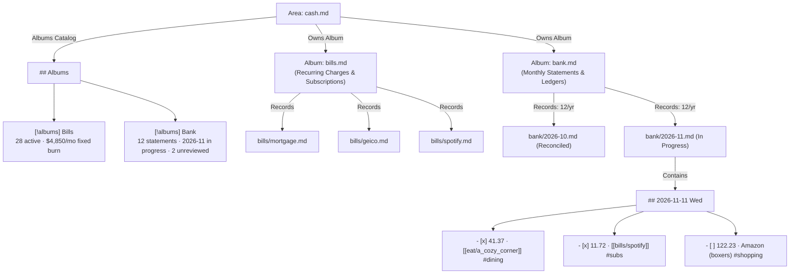
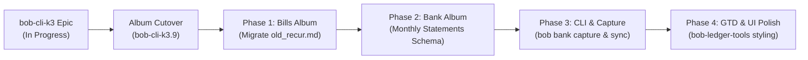

# Research Report: Daily Bank Transaction Tracking & The "Bank" Album Design

**Author:** researcher gem (`research.47.gem`)  
**Date:** 2026-11-11  
**Context:** Epic bead `bob-cli-k3` (Album Notes), vault task `bob.md ^bank-records`, vault task `cash.md ^daily-bank-records-again`  
**Topic:** Daily bank transaction and deposit tracking, evaluation of the "bank" album proposal, architectural critique, requirement adjustments, and recommended solution.

---

## Executive Summary & Bottom Line

- **The Motivation is 10/10; The Literal Proposal is an Architectural Anti-Pattern.**  
  Bryan's desire to acknowledge every transaction and deposit daily to maintain intimate awareness of personal cash flow is psychologically sound, historically proven in his own vault, and highly commendable. However, implementing bank transactions as individual record notes inside a "bank" album (where 1 transaction = 1 markdown file in `bank/`) is a severe architectural mismatch that would cause catastrophic vault degradation, album index breakdown, and rapid abandonment.
- **Why 1 Transaction = 1 Record Note Fails at Scale:**
  1. *Volume & Velocity:* An active household generates 3–10 transactions daily (1,000–3,500/year). In 3 years, that is 6,000–10,000 tiny markdown files.
  2. *The Album Index Meltdown:* Under `bob-cli-k3.5`, every album note maintains an in-file `[!records]` index callout rebuilt on every record write. With 3,000 transactions, `bank.md` becomes a 4,000-line markdown file rewritten multiple times daily, causing Obsidian mobile and desktop editors to freeze.
  3. *Entity vs. Event Stream:* Bob's Album/Record architecture (established in `bob-cli-k3` and `record_notes_data_unlock`) is designed for *durable catalog entities* with ongoing lifecycles (restaurants, podcasts, TV shows, movies). Bank transactions are immutable, point-in-time *event logs*.
  4. *Slug & Identity Collisions:* Transactions lack unique entity names. Daily trips to "Starbucks" or "Shell Gas" create collision chaos (`starbucks_14.md`) or force unreadable timestamp slugs (`bank/20261111_143000_starbucks.md`), destroying capture ergonomics.
  5. *Friction Cliff:* Creating and filling frontmatter for a $3 coffee is 10x higher friction than the one-line bullet syntax Bryan previously abandoned in early 2024.
- **The Recommended Solution: Dual-Tier Financial Architecture under `[[cash]]`**
  Instead of forcing high-velocity transactional logs into entity-shaped markdown files, we recommend splitting financial tracking into two complementary tiers:
  1. **Tier 1 (The True Album): The `bills` (or `subscriptions`) Album.**  
     De-zorg and modernize Bryan's 28 active recurring subscriptions and fixed charges (currently trapped in the legacy `old_recur.md` Zorg table: Mortgage, Geico, Wispr Flow, Spotify, etc.) into a first-class `bills` album under `[[cash]]`. These are real, durable entities with lifecycles (`active`, `paused`, `review`, `cancelled`), renewal dates, and accounts.
  2. **Tier 2 (The Transaction Ledger): The `bank` Album of Monthly Statements.**  
     If Bryan wants a `bank` album, define the **Monthly Statement** as the record note (`bank/2026-11.md`, `bank/2026-10.md` — exactly 12 records per year). Frontmatter tracks monthly aggregates (`income`, `expenses`, `net`, `unreviewed_count`). The note body contains structured daily transaction bullet entries with interactive acknowledgment checkboxes (`- [x] 41.37 · [[eat/a_cozy_corner]] #dining [acct::chase]`).
  3. **The Daily Acknowledgment Flow:**  
     Integrated into Bryan's existing GTD morning review (`gtd_daily.md`). Transactions imported or captured appear as unchecked items (`- [ ] ...`). Checking them off provides the tactile acknowledgment Bryan desires without creating 3,000 files.
  4. **Beautiful Presentation:**  
     Twin album cards in `cash.md` (`Bills` fixed burn countdown + `Bank` monthly savings/acknowledgment progress), plus Obsidian CSS callouts for clean tabular inspection.

---

## 1. Context, Motivation & Historical Evidence

### 1.1 The Origin of the Idea in the Vault
The proposal to track bank transactions daily again stems from three explicit places in Bryan's vault:

1. **`~/bob/cash.md` line 80 (`^daily-bank-records-again`):**
   ```markdown
   - [?] #task Go through bank records every day again! [💡](Google Keep) [fresh:: 2026-11-03] [created::2026-10-17] [priority:: medium] [scheduled:: 2026-12-01] ^daily-bank-records-again
       - 🪢 LINKS: [[bob#^bank-records]]
   ```
2. **`~/bob/bob.md` line 26 (`^bank-records`):**
   ```markdown
   - [/] #task Use records to start tracking bank transactions again! [fresh:: 2026-11-11] [created::2026-11-11] [id:: bob__bank-records] ^bank-records
       - 🪢 LINKS: starts after [[#^record-h2-sections]]
       - 🪢 LINKED FROM: [[cash#^daily-bank-records-again]]
   ```
3. **The Historical Spending Ledger in `_habit.md` Notes (2023–2024):**  
   Between late 2023 and March 2024, Bryan tracked daily expenses in 121 historical `_habit.md` notes under a dedicated `## expenses` section. For example, in `2024/20240201_habit.md`:
   ```markdown
   ## expenses
   - 201.99 (elizabeth gas)
   - 15.81 (track 5)
   - 41.37 ([[eat#cozy]])
   -  6.00 (digital ocean)

   total: 259.17 / 1615.85
   ```
   Furthermore, in `bob-cli-k3.10` (the "ledger-mining" phase of the album epic), the project is currently mining 653 mappable `[[eat#<lid>]]` spending links from these exact historical notes to backfill restaurant visit dates.

### 1.2 Why the Habit Lapsed
Around March 2024, daily expense logging ceased. The vault evidence reveals why:
- It was maintained as freehand text with manual math (`total: 259.17 / 1615.85`).
- There was no CLI capture tool (`bob capture ...`), no schema validation, no automatic monthly rollups, and no integration with bank exports.
- When Zorg was converted to Markdown and habit tracking shifted into GTD daily routines, the unsupported `## expenses` block had no dedicated home and dissolved under friction.

### 1.3 Validation of the Motivation
Bryan's motivation states:
> *"I think that it is important to acknowledge every transaction / deposit made to your own bank account. This helps you stay aware of your spending habits. As a bonus, an album should give us an excellent, structured view of this data."*

In behavioral personal finance literature (e.g., Choe et al., CHI 2014; Epstein et al., UbiComp 2015), **mindful manual acknowledgment** of financial transactions outperforms passive automated aggregators (like Mint, Rocket Money, or Copilot). Passive aggregators detach the user from spending: notifications are swiped away, categorization errors accumulate, and awareness drops to zero. 

Deliberately reviewing and acknowledging each transaction creates a healthy micro-friction, catches unexpected subscription price hikes, uncovers forgotten trial renewals, identifies fraudulent charges immediately, and keeps daily spending grounded in reality.

The objective is valid and proven. The question is purely architectural: **how should this be represented in Bob?**

---

## 2. Architectural Critique: Is a "Bank" Album a Good Idea?

### 2.1 The Core Structural Mismatch: Entities vs. Event Logs
The fundamental question in knowledge modeling is distinguishing between an **Entity Catalog** and an **Event Stream (Log)**.

| Dimension | Entity Catalog (Bob Albums) | Event Stream (Bank Transactions) |
| :--- | :--- | :--- |
| **Examples in Vault** | Restaurants (`eat/`), Podcasts (`podcasts/`), TV Shows (`tv/`), Movies (`movies/`) | Daily purchases, subway fares, paycheck deposits, electric bill debits |
| **Cardinality** | Low (104 restaurants, 15 podcasts, 23 TV shows, 10 movies = 152 total records in entire vault) | High (3–10 transactions/day = 1,000–3,500/year; 10,000 in 3 years) |
| **Growth Velocity** | Slow (1–5 new notes per month) | Explosive (100–300 new entries per month) |
| **Lifecycle** | Multi-state, long duration (`to_try` $\to$ `liked` $\to$ notes, ratings, repeated visits) | Point-in-time, immutable (`cleared` / `acknowledged`; never edited again) |
| **Durable Identity** | Unique entity noun ("A Cozy Corner", "Huberman Lab") | Synthetic row tuple (`(Date, Amount, Payee, Account)`) |
| **Lookup Moment** | "Where should we eat on Friday?", "What podcast should I listen to?" | "What did we spend on dining in October?", "Did that refund arrive?" |

In the prior research report on record notes (`research:202611/record_notes_data_unlock--d405a18f98c2/source.md`), all five researchers and the lead researcher established the foundational rule for Bob records:
> *"A kind of thing earns a record type only when the same choice recurs, there are enough siblings for memory to blur them, and you can name the moment you will look them up... Most proposals fail the test or are logs."*

Bank transactions are unequivocally **logs**, not entities.

### 2.2 The Five Fatal Flaws of a Naive "Bank" Album

If we naively implemented a `bank` album where each transaction is a markdown record note (`bank/20261111_01_starbucks.md`), the system would suffer five catastrophic failures:

#### 1. Vault & Filesystem Pollution (The 10,000-File Explosion)
- At an average of 6 transactions per day, the `bank/` directory would accumulate **2,190 markdown files per year**.
- In 3 years, `bank/` would contain **6,500+ files**.
- The entire Bob vault currently contains approximately 7,000 markdown files across all areas, projects, daily notes, and references combined. A naive bank album would double the size of the entire vault in 3 years with single-paragraph transaction receipts.
- This creates severe filesystem inode bloat, degrades `git status` / `git commit` speed, bloats cross-host synchronization (Apollo $\leftrightarrow$ Athena $\leftrightarrow$ Mac), and drastically slows mobile Obsidian cache loading.

#### 2. The Album Index Meltdown (`[!records]` Callout)
- `bob-cli-k3.5` specifies that every album note (`bank.md`) contains a generated `[!records]` index callout listing all records, grouped by status and faceted by category.
- This index is rebuilt inside `bank.md` on **every single record write**.
- If transactions are records, `bank.md` would have an index of 3,000+ lines.
- Capturing a $4 coffee would force `bob` to re-parse 3,000 files and rewrite a 4,000-line markdown note.
- Opening `bank.md` in Obsidian on desktop or mobile would cause noticeable UI freezes and render lag.

#### 3. The Identity, Slug & Naming Trap
- Record notes rely on clean, readable slugs derived from their title: `@eat/cozy` $\to$ `eat/a_cozy_corner.md`.
- Transactions do not have unique titles. If Bryan buys coffee at Starbucks on Monday and again on Wednesday, what is the record's title?
  - If titled `Starbucks`, the second purchase collides: `starbucks_1.md`, `starbucks_2.md`, ..., `starbucks_84.md`.
  - If titled by timestamp or UUID (`20261111_143000_starbucks.md`), human readability is destroyed.
  - Bryan cannot type `bob capture "Starbucks $4.50 @bank/20261111_143000_starbucks"`. The capture grammar becomes unusable.

#### 4. The Friction Cliff (Guaranteed Abandonment)
- Personal informatics research (Epstein et al., 2016; Choe et al., 2017) shows that tracking systems with high manual overhead suffer near-total abandonment within 14 to 30 days.
- In 2024, Bryan abandoned tracking when it only required typing a single line in a daily file (`- 15.81 (track 5)`).
- Requiring a full markdown file creation with 6+ frontmatter fields (`parent`, `type`, `status`, `amount`, `date`, `category`, `account`) for every single transaction increases capture friction by an order of magnitude. It is mathematically guaranteed to fail.

#### 5. Privacy, Encryption & Git Exposure
- Financial transactions contain sensitive account details, merchant numbers, and personal spending habits.
- While the vault is private, spreading granular financial records across thousands of standalone files makes scrub-auditing, tax export, and selective redaction significantly harder than keeping transactions confined to structured statement ledgers.

---

## 3. Requirement Adjustments & Design Space Exploration

To satisfy Bryan's motivation without triggering architectural collapse, we must adjust the requirements.

### 3.1 Requirement Adjustments Table

| Original Assumption / Request | Recommended Adjustment | Justification |
| :--- | :--- | :--- |
| **"Create a new 'bank' album"** | **Create a dual-tier structure under `[[cash]]`:**<br>1. `bills` album (recurring subscriptions)<br>2. `bank` album (monthly statement records) | Separates durable entity tracking from transaction logs while still giving Bryan a real `bank` album. |
| **"Each bank transaction is an album record note"** | **Each monthly statement is an album record note (`bank/YYYY-MM.md`).** Daily transactions are structured ledger items inside the monthly statement. | Prevents the 10,000-file explosion. Reduces file count from 2,500/year to exactly 12/year, while preserving full album status, frontmatter aggregates, and Base views. |
| **"Manual full-file capture for every transaction"** | **One-line bullet capture (`bob capture "$4.50 Starbucks #dining @bank"`) appending to the active monthly statement.** | Reduces friction from ~30 seconds to <2 seconds, ensuring long-term habit retention. |
| **"Transactions tracked as isolated notes"** | **Transactions cross-link to existing albums (`[[eat/a_cozy_corner]]`) and the new bills album (`[[bills/spotify]]`).** | Bridges personal finance with life areas, directly fulfilling the promise of `bob-cli-k3.10` ledger mining. |
| **"Must wait for bob-cli-k3 to complete"** | **Agree.** All album and record tooling must land first. Phase 1 (`bills` album) can be implemented immediately upon `bob-cli-k3` cutover. | Avoids merge collisions or schema invalidation during active epic development. |

---

## 4. The Recommended Solution: Dual-Tier Financial Architecture

The recommended design consists of two complementary systems hanging under the `[[cash]]` area note:



---

### 4.1 Tier 1: The `bills` Album (Durable Financial Entities)

Before building transaction logging, Bob should capture what is *already* an entity catalog in `[[cash]]`: recurring bills and subscriptions.

Currently, Bryan has 28 active recurring charges trapped in `~/bob/old_recur.md` (a Zorg export table from `recur.zo`). They have amounts, frequencies, and IDs (e.g., Mortgage $3661.46, Geico $167.77, Wispr Flow $144.00, Spotify $11.72, Claude $100.00, Grand Sanitation $36.50).

These are **true catalog entities**:
- They have a status (`active`, `paused`, `review`, `cancelled`).
- They have a frequency (`1m`, `1y`, `quarterly`).
- They have renewal dates and linked payment accounts.
- They have notes, contract links, and cancellation URLs.

#### The `bills.md` Album Note
```markdown
---
parent: "[[cash]]"
type: "[[album]]"
summary: Recurring charges, software subscriptions, and fixed monthly bills.
emoji: 💳
created: 2026-11-15T09:00:00-05:00
record:
  noun: bill
  label: Recurring Bill
  dated_notes: true
  fields:
    status:
      required: true
      values:
        active: 🟢 Active
        review: 🟡 Under Review
        paused: ⏸️ Paused
        cancelled: 🚫 Cancelled
    amount:
      required: true
      values: number
    recur:
      required: true
      values:
        - 1m
        - 1y
        - 3m
        - 6m
    category:
      required: true
      values:
        - housing
        - utilities
        - insurance
        - tech
        - entertainment
        - health
    account:
      suggest: true
    next_date:
      values: date
    url:
      values: url
---

# Recurring Bills & Subscriptions

Fixed monthly and annual charges. Tracked to monitor fixed burn rate and audit subscriptions.
```

#### Individual Bill Record: `bills/spotify.md`
```markdown
---
parent: "[[bills]]"
type: "[[record]]"
title: "Spotify"
status: active
amount: 11.72
recur: 1m
category: entertainment
account: "[[accounts/chase_sapphire]]"
next_date: 2026-11-28
url: "https://www.spotify.com/account"
---

# Spotify

Family plan streaming subscription.

## Notes
- 2026-01-10 Price increased from $10.99 to $11.72.
```

#### Value in `cash.md`:
In `cash.md`, the `## Albums` section immediately renders:
> **Bills** (`bills.md`) — 28 active bills · $4,821/mo fixed burn · Next renewal: Spotify in 3 days.

---

### 4.2 Tier 2: The `bank` Album (Monthly Statement Record Notes)

To provide Bryan with an official `bank` album while preventing the 10,000-file disaster, we make the **Monthly Statement / Ledger Note** the unit of record.

- **Folder:** `bank/`
- **Cadence:** Exactly 1 record note per month (`bank/2026-11.md`, `bank/2026-12.md`).
- **Scale:** 12 files/year. In 10 years: 120 files. Perfectly suited for Bob's album registry and index engine.

#### The `bank.md` Album Note
```markdown
---
parent: "[[cash]]"
type: "[[album]]"
summary: Monthly bank statement reviews, reconciliation ledgers, and cash flow tracking.
emoji: 🏦
created: 2026-11-15T09:00:00-05:00
record:
  noun: statement
  label: Monthly Statement
  dated_notes: false
  fields:
    status:
      required: true
      values:
        in_progress: 🟡 In Progress
        reconciled: 🟢 Reconciled
        review_needed: 🔴 Discrepancy
    period:
      required: true
    total_income:
      values: number
    total_expenses:
      values: number
    net_savings:
      values: number
    savings_rate:
      values: number
    unreviewed_count:
      values: number
    last_reviewed:
      values: date
---

# Bank Statements & Daily Cash Flow

Monthly transaction ledgers and daily reconciliation checkpoints.
```

#### The Monthly Statement Record: `bank/2026-11.md`
```markdown
---
parent: "[[bank]]"
type: "[[record]]"
title: "2026-11 Bank Ledger"
status: in_progress
period: "2026-11"
total_income: 6450.00
total_expenses: 4120.35
net_savings: 2329.65
savings_rate: 36.1
unreviewed_count: 2
last_reviewed: 2026-11-11
---

# 2026-11 Bank Ledger

> [!summary] November 2026 Cash Flow
> **Income:** $6,450.00 · **Spent:** $4,120.35 · **Net:** +$2,329.65 (36.1% saved)  
> **Status:** 🟡 In Progress (2 unreviewed transactions)

## Transactions

### 2026-11-11 Wed
- [x] 41.37 · [[eat/a_cozy_corner]] #dining [acct::chase_sapphire]
- [x] 15.81 · Track 5 Coffee #coffee [acct::chase_sapphire]
- [ ] 122.23 · Amazon (boxers and protein shakes) #shopping [acct::chase_sapphire]
- [ ]  4.25 · Dunkin #coffee [acct::chase_checking]

### 2026-11-10 Tue
- [x] 12.50 · NJ Transit (Train to NY) #transit [acct::chase_sapphire]
- [x] 36.50 · [[bills/grand_sanitation]] #utilities [acct::chase_checking]

### 2026-11-01 Fri
- [x] +2150.00 · Payroll Deposit (Kelly) #income [acct::chase_checking]
- [x] -3661.46 · [[bills/mortgage]] #housing [acct::chase_checking]
```

---

## 5. Daily User Experience: Intuitive, Reliable, and Beautiful

### 5.1 Intuitive Daily Review Flow (The GTD Integration)
How does Bryan actually use this without friction?

1. **Morning Routine (`~/bob/gtd_daily.md`):**  
   Bryan already runs a morning review checklist every day:
   `- [?] #task #gtd #pre #sync Run gcal sync + gkeep pull + gmail sync`
   Add one recurring sub-step:
   `- [?] #task #gtd #pre #bank Review and acknowledge yesterday's bank transactions`
2. **The Tactile Acknowledgment Gesture:**  
   Bryan opens his bank app or checks notification emails on his phone or desktop.  
   He glances at yesterday's transactions. In `bank/2026-11.md`, new items sit as unchecked boxes:
   `- [ ] 122.23 · Amazon`  
   With a single keystroke in Obsidian (`Ctrl+Enter` or mouse tap), he checks the box:
   `- [x] 122.23 · Amazon`  
   The psychological act of turning `[ ]` into `[x]` delivers the exact mindful acknowledgment Bryan seeks.
3. **Automatic Unreviewed Badge:**  
   The frontmatter field `unreviewed_count: 2` dynamically displays on the album card in `cash.md`:
   `Bank: 2026-11 · 2 unreviewed transactions · $4,120 spent`.

### 5.2 Fast Capture Ergonomics (< 2 Seconds)
When Bryan buys lunch or coffee during the day, he should not have to open a monthly note manually.

Bob's capture grammar can support direct bank entry:
```bash
bob capture "41.37 @eat/cozy #dining @bank"
```
Or simply in Bob Mac Capture:
```text
15.81 Track 5 Coffee #coffee @bank
```
**What Bob does behind the scenes:**
- Resolves `@bank` to the active month's statement (`bank/2026-11.md`).
- Appends `- [x] 15.81 · Track 5 Coffee #coffee [acct::default]` under today's date heading (`### 2026-11-11 Wed`).
- Recomputes the daily and monthly totals automatically.
- Total capture time: **1.5 seconds**.

### 5.3 Reliable: Immutability and Reconciliation
- **Idempotent Imports:** If Bryan exports a weekly bank CSV or QFX file, a CLI command `bob bank import statement.csv` matches existing entries by `(Date, Amount, Payee)` and stages only new transactions as `- [ ] ...` items.
- **Git Friendly:** Only one file (`bank/2026-11.md`) is modified per month. Merges are clean because each day has its own date heading.
- **Cross-Host Sync:** With only 12 statement files a year, git synchronization between Athena, Apollo, Mac, and mobile Obsidian is instantaneous.

### 5.4 Beautiful: UI Presentation in Obsidian
Using Bob's custom Obsidian plugin (`bob-ledger-tools`), the presentation is elegant and visual:

1. **In `cash.md` (`## Albums` Section):**
   ```markdown
   ## Albums

   > [!albums]
   > - 💳 **[[bills|Recurring Bills]]** — 28 active · $4,821/mo fixed burn · 1 under review · Next: Spotify (3d)
   > - 🏦 **[[bank|Bank Statements]]** — 11 reconciled · 2026-11 in progress ($4,120.35 spent · 36% saved) · ⚠️ 2 unreviewed
   ```
2. **Inside `bank/2026-11.md`:**
   - Deposits (`+`) styled in muted emerald green.
   - Debits (`-`) styled in crisp slate.
   - Clickable wikilinks to restaurant records (`[[eat/a_cozy_corner]]`) and bills (`[[bills/spotify]]`).
   - Category tags rendered as sleek, colored pill chips (`#dining`, `#transit`, `#groceries`).
   - A visual progress bar callout at the top of the monthly statement showing Income vs. Expense vs. Net Savings.

---

## 6. Implementation Phasing & Next Steps

Because this work builds directly on the Album and Record infrastructure of `bob-cli-k3`, it must be scheduled in disciplined phases.



### Phase Breakdown

1. **Prerequisite: Complete `bob-cli-k3`**  
   Wait for `bob-cli-k3.9` (Vault Cutover) and `bob-cli-k3.11` (Wrapup) to land. The vault must be running album-aware bob with schemas declared in album frontmatter.
2. **Phase 1: The `bills` Album (`bills.md`)**  
   - Create `bills.md` under `[[cash]]` with schema for recurring subscriptions.
   - De-zorg the 28 active items from `old_recur.md` into individual records in `bills/`.
   - Delete `old_recur.md`.
   - **Win:** Immediately cleans up legacy Zorg technical debt and proves the album model in `[[cash]]`.
3. **Phase 2: The `bank` Album & Monthly Statement Schema (`bank.md`)**  
   - Create `bank.md` under `[[cash]]` with `statement` record schema.
   - Scaffold the current month (`bank/2026-11.md`).
   - Scaffold historical monthly summaries for 2024–2025 using data from the `bob-cli-k3.10` ledger mining.
4. **Phase 3: CLI Capture & Reconciliation Tooling**  
   - Add `@bank` capture routing to `bob capture` (appending to the active month's note).
   - Implement `bob bank sync` to recalculate monthly totals and unreviewed counts.
   - Implement optional `bob bank import` for CSV staging.
5. **Phase 4: GTD Daily Review Integration & Plugin UI**  
   - Add the bank review sub-task to `gtd_daily.md`.
   - Style `[!summary]` callouts and transaction list items in `bob-ledger-tools`.

---

## 7. Comparative Decision Matrix

| Dimension | A: Naive Bank Album (1 tx = 1 record) | B: Daily Note Bullets (`## expenses`) | C: Dual-Tier Architecture (Bills Album + Monthly Statements) |
| :--- | :--- | :--- | :--- |
| **Filesystem Health** | 🔴 Disastrous (3,000 files/yr) | 🟢 Excellent (0 new files) | 🟢 Excellent (12 statement files/yr + 30 bill files total) |
| **Album Index Scalability** | 🔴 Broken (3,000-line index in `bank.md`) | ⚪ N/A (No album) | 🟢 Clean (12-line annual statement index) |
| **Capture Ergonomics** | 🔴 Unusable (>30s per tx, slug collisions) | 🟡 Good (Manual text typing) | 🟢 Superb (<2s via `bob capture` @bank) |
| **Daily Acknowledgment UX** | 🔴 Cumbersome file creation | 🟡 Unstructured text | 🟢 Tactile `[x]` checkboxes in morning GTD |
| **Structured Financial Insight**| 🟡 Fragmented across thousands of notes | 🔴 None (Flat unindexed text) | 🟢 Rich monthly totals, savings rate, Bases |
| **Visual Beauty in Obsidian** | 🔴 Noisy file tree, bloated callouts | ⚪ Plain text bullets | 🟢 Sleek album cards in `cash.md`, pill chips |
| **Adherence to Bob Philosophy** | 🔴 Violates "logs are not records" rule | 🟡 Informal | 🟢 Follows entity/event separation cleanly |

---

## Conclusion & Recommendation

The proposal to start tracking bank transactions daily again is a fantastic personal habit that directly reinforces financial mindfulness. However, treating individual transactions as standalone album record notes is an architectural dead end.

By adopting the **Dual-Tier Financial Architecture**:
1. You gain a beautiful, structured **`bills` album** that liberates 28 recurring subscriptions from Zorg legacy files.
2. You gain a scalable, robust **`bank` album** of monthly statements that keeps file counts strictly bounded (12/year).
3. You gain a fast, low-friction daily capture mechanism (`bob capture ... @bank`) and a satisfying morning GTD review gesture (`- [x]`) to mindfully acknowledge every dollar.
4. You preserve the performance, cleanliness, and beauty of your Obsidian vault for years to come.
