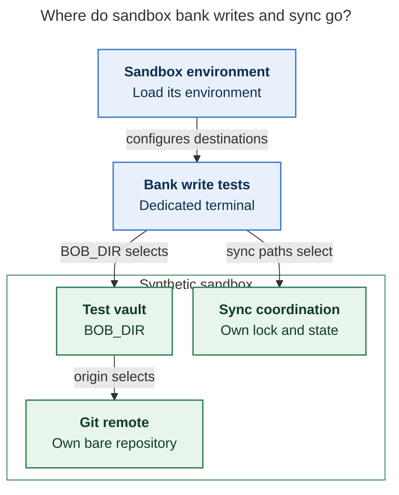

# Diagram proposals: Your first bank acknowledgment (Thu Nov 12) and an end-to-end test of `bob-cli-kd`

Proposals for the swarm linker, not a report. Each diagram restates only what the source
report says.

```yaml
source: research:202611/bank_first_ack_and_kd_e2e_guide/bank_first_ack_and_kd_e2e_guide__final.md
producer: research.49.image
check: "mmdc 12.0.0 with the PDF-mirroring config rendered 1 of 1 Mermaid diagrams; pinned CLI with Puppeteer --no-sandbox"
```

## sandbox-isolation

```yaml
anchor: |-
  It's a synthetic vault with its own bare remote and
question: |-
  How are bank write tests isolated from the real vault?
illustrates: |-
  The Appendix sandbox has its own bare remote, sync lock, and state, so write tests
  use separate destinations instead of touching the real vault or blocking real sync.
caption: A dedicated terminal loads sandbox paths so bank write tests use their own vault, remote, sync lock, and state.
review: "481.875x723 px, fit 100.0%; reader question, labels, arrows, source tracing and unique anchor checks passed; 1 revision across 2 visual looks"
```


