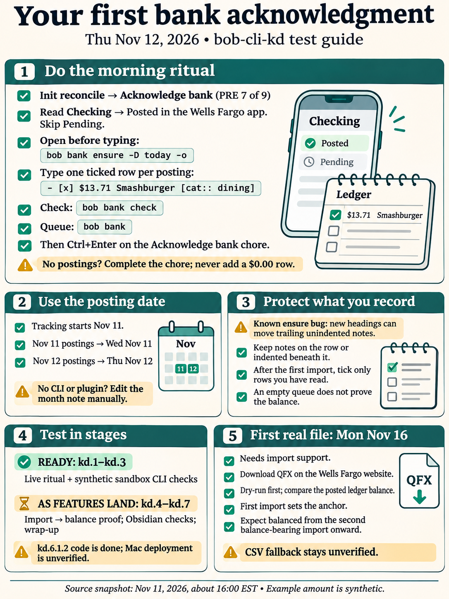
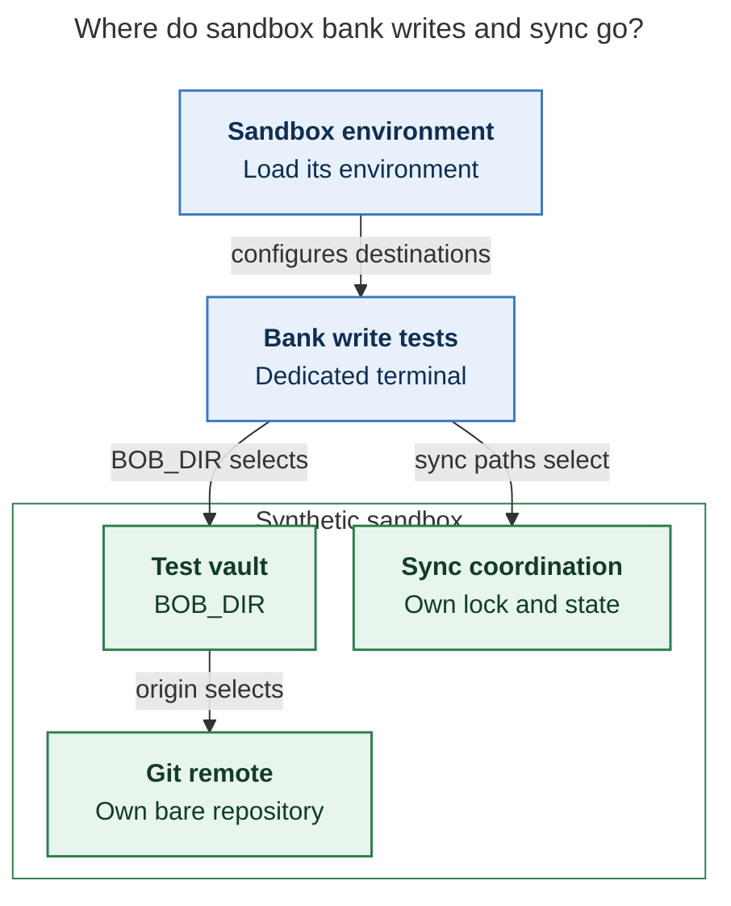

# Your first bank acknowledgment (Thu Nov 12) and an end-to-end test of `bob-cli-kd`

> **Research query:** What do I need to do to acknowledge my bank transactions for the
> first time tomorrow, and how do I end-to-end test the `bob-cli-kd` epic bead? The goal
> is an excellent, concise user guide that walks me through both.



## Bottom line

- **Tomorrow's ritual needs no new code.** `bank.md`, `bank/2026-11.md` (with an empty
  `## Wed Nov 11`), and the PRE chore **Acknowledge bank** are already in the vault. The
  installed `bob` has `bob bank`, `check`, `report`, `ensure`, and `ack`. In tomorrow's
  review walk the chore is **PRE 7 of 9**, after init → terminal → browser ×3 → sync.
- **Day one has one twist.** The account `start` is **Nov 11**, not Nov 12. Type Nov 11
  postings under the existing `## Wed Nov 11` and Nov 12 postings under `## Thu Nov 12`.
  Never type a row dated before Nov 11.
- **Only phases kd.1–kd.3 are done.** Import (kd.4), balance proof (kd.5), the Obsidian
  cards (kd.6), and wrap-up (kd.7) are still open. After the five researchers looked,
  **kd.6.1.2 closed at 15:50 EST.** It added **Bank: open today**, Enter continuation,
  category suggestions, and the guard that stops task gestures on bank rows. That code is
  on `bob-plugins` master (`c35662b`) but is **not deployed**: apollo's sync refuses a
  protected deploy stamp, and the Mac was offline, so I couldn't check it.
- **Tomorrow, "end-to-end" means two things:** the live ritual and the sandbox CLI checks
  (blocks [A](#block-a-on-the-live-vault-tomorrow) and
  [B](#block-b-in-the-sandbox-with-the-shipped-cli)). Everything else is a checklist to
  run as each phase lands ([blocks C to G](#what-you-can-test-and-when)). The epic can't
  close on "queue empty" alone.
- **One real bug affects you now.** When `ensure` adds a new day heading, it moves the
  previous day's trailing unindented lines (prose, a plain checklist line, a `- [x] $`
  stub) under the new day. cld recorded it on `bob-cli-kd`, and I reproduced it
  ([issue 1](#issues-found-while-preparing-this)). Until it's fixed, keep notes on the
  row (`-- note`) or in an indented child bullet.

## Before you start

This takes 2 minutes, on the Mac.

```sh
bob bank --help            # expect ack, check, ensure, list, report
                           # (an `import` line means kd.4 has landed)
sase bead show bob-cli-kd  # which phases are ✓ now
```

- **If `bob bank` is unknown on the Mac,** run `just install-all` from your bob-cli
  checkout. It pulls, installs `bob`, deploys the plugins, and restarts Obsidian.
- **In Obsidian:** if the command palette has **Bank: open today**, kd.6.1.2 is deployed.
  If `bank/2026-11` draws a month card instead of a raw ```` ```bob-bank ```` block,
  kd.6.1.3 is deployed.
- **If `bob plugins sync` says** "refusing to overwrite plugin bob-ledger-tools deployed
  from uncommitted build", don't pass `-F` while an agent owns that deploy. The bead
  assigns that deploy to the kd.6.1 land agent.
- **Nothing here blocks tomorrow.** Without the CLI or the plugins, you can still type in
  the note and complete the chore.

## Your first acknowledgment

This takes about 5 minutes the first time.

1. **Walk to the chore.** Start `]s` and do the PRE rows in order. The `#init` reconcile
   clears the chore's date-blocked `[?]`. Do the bank work **before** you complete
   **Acknowledge bank**.
2. **Look at the bank.** In the Wells Fargo app, open **Checking** and read only
   **Posted**. Skip Pending, because a pending amount can change. For example, a $20 tab
   can post as $24 with the tip, and the two would later show up as twins.
3. **Open the note before typing.** Run **Bank: open today** if it exists (it has no
   hotkey). Otherwise run `bob bank ensure -D today -o`. It's also `:bank-ensure` in
   Command Mode. Expect:

   ```text
   Created heading Thu Nov 12 in bank/2026-11.md
   bank/2026-11.md:18
   ```

   Running it again changes nothing. It prints where the next row goes but doesn't move
   your cursor. With no CLI, open `bank/2026-11.md` and add `## Thu Nov 12` yourself.
4. **Type one ticked row per posting, under the day it posted.**

   ```markdown
   ## Wed Nov 11

   - [x] $13.71 Smashburger [cat:: dining]

   ## Thu Nov 12

   - [x] $61.20 ShopRite [cat:: groceries]
   - [x] +$1,250.00 Payroll [cat:: income]
   - [x] $100.00 Chase autopay [cat:: transfer]
   - [x] $40.00 ATM withdrawal [cat:: cash] !! fee again?
   ```

5. **Check your work:**

   ```sh
   bob bank check          # exit 0, "0 errors, 0 warnings"; a ⚑ row shows as info
   bob bank                # "nothing to acknowledge"
   bob bank report -D today
   bob bank report -D yesterday
   ```

   `WF Checking · unverified` is expected until import and the balance proof ship.
6. **Close the chore.** Press **Ctrl+Enter** on **Acknowledge bank**. If nothing posted,
   just complete it: completing the chore is the record. Never type a `$0.00` row
   (`check` flags `bank_row_zero`). Leave `bob.md ^bank-records` open.

**Tomorrow counts as a success if:** you looked at checking, typed every posting since
Nov 11, `check` is clean, the queue is empty, and the chore is done. Only checking is
tracked, so this says nothing about credit-card spending or where withdrawn cash went.

### The grammar on one card

| You type | It means |
| --- | --- |
| `- [x] $13.71 Smashburger` | A ticked (acknowledged) outflow. Typed rows start ticked. `$` is required, and a bare number isn't a row. |
| `- [ ] …` | Waiting: imported but not yet seen. Tick it in the note or with `bob bank ack`. |
| `+$1,250.00` | Money in. Only `[cat:: income]` or `[cat:: refund]` counts as **In**. An uncategorized credit stays outside In, and `check` doesn't warn you. |
| `[cat:: …]` | Optional. Your keys are `groceries dining coffee transit car home utilities dog kids health shopping subscriptions fun fees`. The built-ins `income refund transfer cash` change the math: `transfer` never counts as spending, and `cash` counts as "cash out, destination unknown". |
| `!!` or `⚑` | A flag. `check` lists it as info. |
| `-- note` or `— note`, or an indented `  - …` | A note that stays with the row. |
| `[[eat/smashburger\|🍽️]]` | A link. Links are welcome anywhere in the tail. |
| Never use | `#task`, `[acct::]` (checking is the default), a made-up `^bank-` ID, or a typed total. |

### Until the editor guards are deployed

- **Ticks.** Obsidian's own list continuation inserts `- [ ] `. Change it to `[x]` as you
  type, or run `bob bank ack -D today` at the end (preview first with `-d`). That
  shortcut is safe **only before your first import**. After that, it would also tick
  imported rows you haven't read.
- **Task gestures.** Don't use Ctrl+Enter or the cycler keys **on a bank row**. If one
  slips through, `check` reports `bank_row_status` or `bank_row_task`.
- **Notes.** Keep them on the row or indented under it (the
  [`ensure` bug](#issues-found-while-preparing-this)).
- **Dollar signs.** Avoid a second `$` inside one row, for example in a note. Two `$` on
  one line can render as inline math until kd.6.1.4 ships.
- **Reading reports.** A spending day prints `Net $13.71` without a minus sign. JSON's
  `net_cents` is negative.
- **The empty queue's hint.** It suggests `bob bank import ~/Downloads/*.qfx`. That
  command doesn't exist until kd.4.

## End-to-end test of bob-cli-kd

### What you can test and when

| Phase | State (16:00 EST Nov 11) | Test block | Run it when |
| --- | --- | --- | --- |
| kd.1 restart, kd.2 grammar, kd.3 CLI | ✓ closed | [A](#block-a-on-the-live-vault-tomorrow) (live), [B](#block-b-in-the-sandbox-with-the-shipped-cli) (sandbox) | Tomorrow |
| kd.4 import (child epic kd.4.1: 1 of 4 child phases done) | ◐ | [C](#block-c-import) | `bob bank --help` lists `import` |
| kd.5 balance proof | ◐, blocked on kd.4 | [D](#block-d-balance-proof) | `import --help` shows `-F` |
| kd.6 Obsidian (child epic kd.6.1: 6.1.1–6.1.2 done, 6.1.3–6.1.5 open) | ◐ | [E](#block-e-in-obsidian) | Cards, chip, and guards are deployed on the Mac |
| Real Wells Fargo file | needs kd.4 | [F](#block-f-first-real-file) | Mon Nov 16 |
| kd.7 wrap-up | ◐, blocked on kd.5 and kd.6 | [G](#block-g-close-out) | Everything above passes |

**Ground rules for every write test:**

- Run writes in the [Appendix sandbox](#appendix-sandbox-script). It's a synthetic vault with its own bare remote and
  its own sync lock and state, so it never touches `~/bob` or blocks the real sync. Do it
  in a dedicated terminal, because `source …/env` sets `BOB_DIR`.
- Set `BOB_NOW` for each step.
- Record the CLI and plugin commits plus the observed results.
- Report counts only, never real payees or amounts.

[The sandbox-isolation diagram](#figure-sandbox-isolation) traces how sourcing the
sandbox environment in a dedicated terminal routes write tests to the test vault, its own
sync lock and state, and its own bare remote.

<div id="figure-sandbox-isolation">



_A dedicated terminal loads sandbox paths so bank write tests use their own vault, remote, sync lock, and state._

</div>

### Block A on the live vault tomorrow

Pass when all of these hold:

1. `]s` lands on **Acknowledge bank** in PRE.
2. `ensure` inserts `## Thu Nov 12` and leaves `## Wed Nov 11` intact.
3. `check` reports 0 errors.
4. `bob bank` says "nothing to acknowledge".
5. `report -D today` Out/In match what you typed, with transfers off Out/In and ATM
   `cash` in Cash out.
6. Ctrl+Enter completes the chore, and it reschedules for Fri.
7. Bank rows are invisible to task tooling. Both of these print `0`:

   ```sh
   bob freshness list | grep -c 'bank/'
   bob task archive -n | grep -c 'bank/'
   ```

### Block B in the sandbox with the shipped CLI

This block runs today; cld and I both observed these outputs.

```sh
bash bank-e2e-sandbox.sh /tmp/bank-e2e && source /tmp/bank-e2e/env
F=$BOB_DIR/bank/2026-11.md; Q=/tmp/bank-e2e/qfx; export BOB_NOW=2026-11-12T08:00:00
bob bank ensure -D yesterday            # Created bank/2026-11.md · bank/2026-11.md:16
cat >> "$F" <<'EOF'

- [x] $13.71 Smashburger [cat:: dining]

## Thu Nov 12

- [x] $20.00 Joe's Bar [cat:: dining] -- tab; tip not in yet
- [x] $
- [x] $5.00 Parking
- [x] **$4.10** Coffee cart [cat:: coffee] !! charged twice?
- [x] $42.00 Dog walker [acct:: wallet]

## Sat Nov 14

- [x] $5.00 Parking
EOF
bob bank ensure -D 2026-11-13   # Created heading Fri Nov 13 (between Thu and Sat)
bob bank ensure                 # idempotent → bank/2026-11.md:25
bob bank check                  # 1 info (bank_flagged, Coffee cart), 0 errors, exit 0
bob bank report -D 2026-11-12   # Out $29.10 (the wallet row is cash traced, not Out)
bob bank report -w 2026-W46     # Out $47.81
```

| # | Do | Pass if |
| --- | --- | --- |
| B1 | The block above | Outputs match the comments, and the `- [x] $` stub raises no finding. |
| B2 | On four rows, make one change each: `dining`→`dinning`, `[cat::`→`[cta::`, `$5.00`→`$5.001`, `[x]`→`[/]`. Run `check`, then revert. | Exit 1, with `bank_category_unknown`, `bank_field_unknown`, `bank_row_unparsed`, and `bank_row_status`, each at `path:line`. |
| B3 | Add `- [ ] $3.00 Typed waiting` under Thu. Run `bob bank`, then `ack -d -D 2026-11-12`, then `ack -D 2026-11-12`, then `ack deadbeef`. | "1 to acknowledge". The dry run writes nothing, the row ticks, and the unknown ID exits **2** with no change. `ack` makes no commit. |
| B4 | `report -m 2026-11 -f json` | Integer cents, `schema_version: 1`, and checking `unverified` / wallet `untracked`. |
| B5 | Under Wed, add an unindented prose line after the last row, then `ensure -D 2026-11-12` on a note that has no Thu heading yet | **Currently fails.** The prose moves under Thu. Pass once the bug is fixed. |

### Block C import

Needs kd.4. Continue in the same sandbox.

| # | Do | Pass if |
| --- | --- | --- |
| C1 | `BOB_NOW=2026-11-16T08:00:00`, then `bob bank import -d $Q/week1.qfx` | Diffs print. Afterward there are no new rows and no `.bob/bank/`. |
| C2 | `bob bank import $Q/week1.qfx` | 9 new · 1 matched · 1 ambiguous · 1 before start. Commit `bank: import 9 rows (checking)`. Ledger balance $2,003.79. |
| C3 | Inspect `$F` | Smashburger keeps its text and tick and gains ` ^bank-…`. **Two** `$4.25 7-Eleven` rows exist. `$24.00 Joes Bar` waits next to your $20 row. VENMO and the autopay are `transfer`. Payroll has no category. The tied `$5.00` parking is written new, not guessed. Nothing on Nov 10. |
| C4 | `grep -c 'SYN90\|0000000000' $BOB_DIR/.bob/bank/*.jsonl` | `0`: no bank IDs or account numbers are stored. |
| C5 | Import week1 again | 0 new, and `git log -1` is unchanged. |
| C6 | Rename and tick the waiting `Joes Bar` row, delete your typed $20 row, then `BOB_NOW=2026-11-23T08:00:00` and import `week2.qfx` | 2 new. The Nov 19 row arrives as `Joe's Bar [cat:: dining]`, learned from your rename. |
| C7 | `bob bank import $Q/bad.qfx` | Exit **2**, naming the `TRNAMT` record. `git status` and the journal are unchanged. |

### Block D balance proof

Needs kd.5; continue from C6.

| # | Do | Pass if |
| --- | --- | --- |
| D1 | `bob bank`, then `check` | `WF Checking ✓ balanced`. Info covers unmatched typed rows and the Parking twins, and nothing for wallet rows. |
| D2 | Delete ShopRite, run `check`, `import week2.qfx`, then `import -F week2.qfx` | Δ and `bank_row_missing`. The plain import does **not** re-add the row. `-F` restores it, and the status is ✓ again. |
| D3 | Change Payroll to `+$1,200.00`, then `check` | `bank_amount_edited`. Revert afterward. |
| D4 | `BOB_NOW=2026-12-05T08:00:00 bob bank` | Stale (more than 10 days). Never an unqualified "nothing to acknowledge". |
| D5 | `BOB_NOW=2026-12-07T08:00:00`, then import `week4.qfx` | `gap` for Nov 24–29, even though the balance holds. |
| D6 | Add a second account plus a card payment | You must choose the account explicitly when it's ambiguous, and the transfer stays off Out/In. |

### Block E in Obsidian

Needs kd.6 deployed; real vault, your own rows.

1. **Month card** on `bank/2026-11`: header, status chip, Out/In/Net, category bars, and a
   Monday-first heat strip. Only months that exist are links.
2. **Queue card** on `bank.md`: "✓ nothing to acknowledge" **with** the `unverified`
   caveat.
3. **Daily note chip:** one quiet `🏦 out … · in …` chip. Clicking it ensures the day and
   jumps there.
4. **Bank: open today, Enter, and `[cat:: `:** the cursor lands on the next-row slot.
   Enter after a row gives `- [x] $`, and Enter on a stub clears it. Categories are
   suggested in declared order.
5. **Guard:** on a scratch `- [ ] $1.00 Guard test`, Ctrl+Enter and the cycler keys only
   flip `[ ]`↔`[x]` or refuse with a notice, and add no `#task` or `[completion::]`.
   Delete the line afterward.
6. **Rendering:** amounts are right-aligned and inflows green. The cursor line shows raw
   text. No `$…$` math in Live Preview or Reading view.
7. **After an import:** the queue card's **Acknowledge day** ticks only the rows it drew.
   A row that arrives later stays waiting. The CLI's `ack -D` is deliberately broader.

### Block F first real file

Mon Nov 16, needs kd.4.

This is the one test no agent can run for you: the plan's top risk is that the real Wells
Fargo file doesn't match the fixtures.

1. On **wellsfargo.com** in a browser (not the app), open the checking account, choose
   **Download Account Activity**, and pick **Quicken Web Connect (QFX)**. Set a start
   date on or before **Nov 11**. Save the file outside the vault. Menu labels may differ
   slightly from the help pages.
2. Run `bob bank import -d ~/Downloads/<file>.qfx` first. It should resolve to checking,
   with a window starting on or before Nov 11. A nonzero "before start" count is fine.
3. **Compare with the ledger (posted) balance, not the available balance.** The available
   balance includes pending items.
4. Import for real **from one host only**, tick what it wrote, then delete the QFX.
5. **Expect `✓ balanced` from the second balance-bearing import onward.** The first
   import only sets the anchor, and importing the same file twice only tests dedup.
6. **CSV is a fallback.** It imports rows, but the account stays `unverified`.

### Block G close-out

This is kd.7. The epic is done when all of these hold:

- **Walkthrough:** the 10-step walkthrough (blocks
  [B](#block-b-in-the-sandbox-with-the-shipped-cli), [C](#block-c-import), and
  [D](#block-d-balance-proof) above) is pasted into the wrap-up report, and E passes on
  the Mac.
- **Guide and docs:**
  - `docs/guides/acknowledge-bank-transactions.md` exists, covering the daily ritual, the
    Monday import, catching up after a lapse, adding an account or rule, and statuses.
  - `docs/bank.md`, `vault-format.md`, `json-outputs.md`, `vault-git-sync.md`, the CLI
    reference, and the plugin page match shipped behaviour.
  - `just docs-check` passes.
- **Real vault:** read-only `check`, `bob bank`, and `report` are reported as counts only.
- **Memory:** only `glossary:bank-month-note` and `glossary:bank-row` are added. No
  `decisions:bank-rows-not-records` (the reviewer declined it).
- **Follow-ups proposed:** the subscriptions album (depends on `bob-cli-k3`,
  discretionary scope), the later views after a 2–4 week trial, and a feed spike only if
  downloading turns out to be the friction.
- **Chores:** the import phase's Monday chore exists, with no duplicate. The `ensure` bug
  is fixed (B5 passes).

## Issues found while preparing this

1. **`ensure` moves trailing unindented lines into the next day.**
   - Where: `day_end_line`, `src/native/bank/month.rs:300`.
   - `check` is silent, and `ensure`'s printed line points at the moved text.
   - It also affects **Bank: open today**, the chip click, and any import that reuses
     `plan_insert_day`.
   - Status: a `DISCOVERED ISSUE:` note on `bob-cli-kd`, reproduced by the lead.
2. **Net has no minus sign on spending days.** You decide whether you want `−$116.49`.
3. **Odd success marks in `ack`.**
   - A refused `ack <unknown>` prints `✓ Acknowledged 0 rows`, then exits 2.
   - `ack -d` prints "Dry run — nothing written" and then "✓ Acknowledged 1 row".
4. **The empty-queue hint teaches `import` before it exists.** Plural typos like
   `grocery` get no suggestion. `list`/`report` columns aren't padded. All cosmetic.
5. **Start date.** The plan's examples use Nov 12, but the real seed is **Nov 11**. Teach
   Nov 11. Don't edit it to make coverage pass.
6. **Undeployed plugin code.** The kd.6.1.2 ledger-tools bundle is stamp-blocked on
   apollo. The task-status-cycler bundle on apollo is from Nov 10, so it doesn't have the
   guard yet either. Check the Mac separately.

## Where the reports disagreed and how this guide resolves it

| Claim | Resolution |
| --- | --- |
| Type Nov 11 postings "under today's heading" (gem, mus) | No: put them under the day they posted (`## Wed Nov 11`). I verified that `ensure` leaves the empty Wed heading intact. |
| kd.6.1.2 is still in progress; plugin sync fails on `check-ignore` (all reports) | kd.6.1.2 closed at 15:50 EST. The `check-ignore` fix (`1a9b6828`) is in the installed binary. Today's blocker is a protected deploy stamp. |
| The daily chip and **Bank: open today** work tomorrow (gem) | Only if deployed (see [Before you start](#before-you-start)). The chip needs kd.6.1.3. |
| `ack -D` is the routine way to tick a day (grk, mus) | Safe only before the first import (cld, cdx). After that, tick what you read. |
| `ensure -o` puts you on the insertion line (gem) | It prints the line and opens the note, but doesn't move the cursor. |
| `check` shows `✓ balanced`, `import -F` takes no file, a `bank_account_stale` code (gem) | Not in the contract: status shows on `bob bank` and `report`, `-F` takes the file, and the status name is `stale`. |
| Download the QFX from the app (implied by some reports) | Use the app for the daily look. **Download Account Activity** is on the website. |

## Sources

_Lead consolidation · Wed 2026-11-11, about 16:00 EST · merges the cdx, cld, grk, mus, and
gem reports with fresh checks of the beads, `bob-plugins` master, the live vault (read-only),
and two throwaway vaults. Every amount in this guide is synthetic._

- **Beads** (`sase bead read`): `bob-cli-kd` and its note, `.4.1`, `.5`, `.6.1`, `.6.1.2`
  (closed 15:50 EST), and `.7`.
- **Plan:** `plan:202611/bank_daily_acknowledgment.md`, covering bank-wrapup, acceptance
  cases, risks, success criteria, and reviewer decisions.
- **Code:**
  - bob-cli `master` at `6e3d8837`: `src/native/bank/`, `src/native/catalog/table.rs`
    (`bank-*` Command Mode entries), and `scripts/install_all`.
  - `bob-plugins` `c35662b` (bank action service and cycler guards).
- **Live, read-only (apollo):**
  - Vault: `bank.md`, `bank/2026-11.md`, `gtd_daily.md:12`, `bob.md:48`, `cash.md:192`.
  - Commands: `BOB_NOW=2026-11-12T07:00:00 bob freshness list` and
    `bob plugins sync -d -n -p bob-ledger-tools`.
  - Plugin deploy stamps under `~/bob/.obsidian/plugins/`.
  - The Mac (`ssh mac`) timed out.
- **Throwaway vaults (lead):** a copy of the real hub and month note run through tomorrow's
  flow (ensure, type, check, list, `ack -d`, `ack`, report, unknown-ID exit 2); the
  `ensure` bug repro; and cld's sandbox Step A, which matched exactly.
- **Researcher reports in this directory:**
  - `__cld`: sandbox, A–E tables, and findings.
  - `__cdx`: CLI run, reconciliation statuses, and the ledger vs available balance point.
  - `__grk`: PRE order and Command Mode.
  - `__mus`: catch-up and status glossary.
  - `__gem`: test outline (see the
    [corrections](#where-the-reports-disagreed-and-how-this-guide-resolves-it)).
- **Wells Fargo:** Web Connect,
  [Account Activity (90-day default, up to 18 months; business page)](https://www.wellsfargo.com/biz/online-banking/deposit-details/),
  and [activity FAQ: ledger vs available balance](https://www.wellsfargo.com/help/online-banking/activity-faqs/).

## Appendix sandbox script

This is cld's script, `bank-e2e-sandbox.sh`; I ran it on apollo. It creates only
synthetic data and refuses to overwrite an existing directory. The anchor is $1,000.00 at
the start of Nov 11, which gives these balances:

- `week1`: $2,003.79
- `week2`: $1,924.59
- `week4`: $1,914.60. It skips Nov 24–29 to trigger `gap`.

Neither cld nor I could run the files through `import`, because that command hasn't
shipped. If C2 rejects one, run with `-f json` to see the field it names. That's more
likely a fixture bug than an import bug.

```bash
#!/usr/bin/env bash
# Throwaway bank vault + synthetic Wells Fargo-shaped QFX files. No real data.
# Usage: bash bank-e2e-sandbox.sh [DIR]   (DIR must not exist; default /tmp/bank-e2e)
set -euo pipefail
SB=${1:-/tmp/bank-e2e}
[[ -e $SB ]] && { echo "refusing: $SB exists" >&2; exit 1; }
V=$SB/vault Q=$SB/qfx
mkdir -p "$V" "$Q"
cat > "$V/bank.md" <<'EOF'
---
parent: "[[cash]]"
type: "[[area]]"
bank:
  accounts:
    checking:
      label: WF Checking
      kind: checking
      start: 2026-11-11
    wallet:
      label: Wallet
      kind: cash
  categories:
    groceries: 🛒 Groceries
    dining: 🍽️ Dining
    coffee: ☕ Coffee
    car: 🚗 Car
    fees: 🧾 Fees
  rules:
    - match: VENMO
      cat: transfer
---

# 🏦 Bank
EOF
git init -q -b master "$V"
git init -q --bare "$SB/remote.git"
git -C "$V" remote add origin "$SB/remote.git"
git -C "$V" add -A
git -C "$V" commit -qm "sandbox: bank.md"
git -C "$V" push -q -u origin master
cat > "$SB/env" <<EOF
export BOB_DIR=$V
export BOB_VAULT_SYNC_LOCK_FILE=$SB/sync.lock
export BOB_VAULT_SYNC_STATE_FILE=$SB/sync.json
export BOB_VAULT_SYNC_NOTIFY=0
EOF

# qfx FILE DTSTART DTEND BALAMT DTASOF "FITID|YYYYMMDD|AMOUNT|NAME"...
qfx() {
  local f=$1 s=$2 e=$3 bal=$4 asof=$5 t id d amt name ty; shift 5
  {
    printf 'OFXHEADER:100\nDATA:OFXSGML\nVERSION:102\nSECURITY:NONE\nENCODING:USASCII\n'
    printf 'CHARSET:1252\nCOMPRESSION:NONE\nOLDFILEUID:NONE\nNEWFILEUID:NONE\n\n'
    printf '<OFX>\n<BANKMSGSRSV1>\n<STMTTRNRS>\n<STMTRS>\n<CURDEF>USD\n<BANKACCTFROM>\n'
    printf '<BANKID>000000000\n<ACCTID>0000000000\n<ACCTTYPE>CHECKING\n</BANKACCTFROM>\n'
    printf '<BANKTRANLIST>\n<DTSTART>%s\n<DTEND>%s\n' "$s" "$e"
    for t in "$@"; do
      IFS='|' read -r id d amt name <<<"$t"
      if [[ $amt == -* ]]; then ty=DEBIT; else ty=CREDIT; fi
      printf '<STMTTRN>\n<TRNTYPE>%s\n<DTPOSTED>%s120000.000[-5:EST]\n<TRNAMT>%s\n' "$ty" "$d" "$amt"
      printf '<FITID>%s\n<NAME>%s\n</STMTTRN>\n' "$id" "$name"
    done
    printf '</BANKTRANLIST>\n<LEDGERBAL>\n<BALAMT>%s\n<DTASOF>%s\n</LEDGERBAL>\n' "$bal" "$asof"
    printf '</STMTRS>\n</STMTTRNRS>\n</BANKMSGSRSV1>\n</OFX>\n'
  } > "$f"
}
W1=(
  "SYN9001|20261110|-25.00|SHOPRITE #123"            # before start: never written
  "SYN9002|20261111|-13.71|SQ *SMASHBURGER"          # matches your typed row
  "SYN9003|20261111|-4.25|7-ELEVEN #4567"            # two identical purchases,
  "SYN9004|20261111|-4.25|7-ELEVEN #4567"            #   both must survive
  "SYN9005|20261112|-24.00|TST* JOES BAR"            # your typed $20 tab posts at $24
  "SYN9006|20261112|-63.50|ATM WITHDRAWAL"           # built-in: cash
  "SYN9007|20261112|-3.50|NON-WF ATM FEE"            # built-in: fees (if recognized)
  "SYN9008|20261113|-5.00|CITY PARKING"              # equidistant tie: ambiguous
  "SYN9009|20261113|1250.00|ACME CORP PAYROLL"       # a credit alone is never income
  "SYN9010|20261113|-8.00|VENMO PAYMENT"             # bank.rules: transfer
  "SYN9011|20261116|-120.00|CHASE CRD AUTOPAY"       # built-in: transfer
)
W2=("${W1[@]}"
  "SYN9012|20261118|-61.20|SHOPRITE #123"
  "SYN9013|20261119|-18.00|TST* JOES BAR"            # should arrive with your learned name
)
qfx "$Q/week1.qfx" 20261102 20261116 2003.79 20261116 "${W1[@]}"
qfx "$Q/week2.qfx" 20261109 20261123 1924.59 20261123 "${W2[@]}"
qfx "$Q/week4.qfx" 20261130 20261207 1914.60 20261207 "SYN9015|20261201|-9.99|SPOTIFY USA"
qfx "$Q/bad.qfx"   20261102 20261116 2003.79 20261116 "${W1[@]}" "SYN9099|20261114|-1.234|BAD AMOUNT"
echo "sandbox ready: source $SB/env"
```
