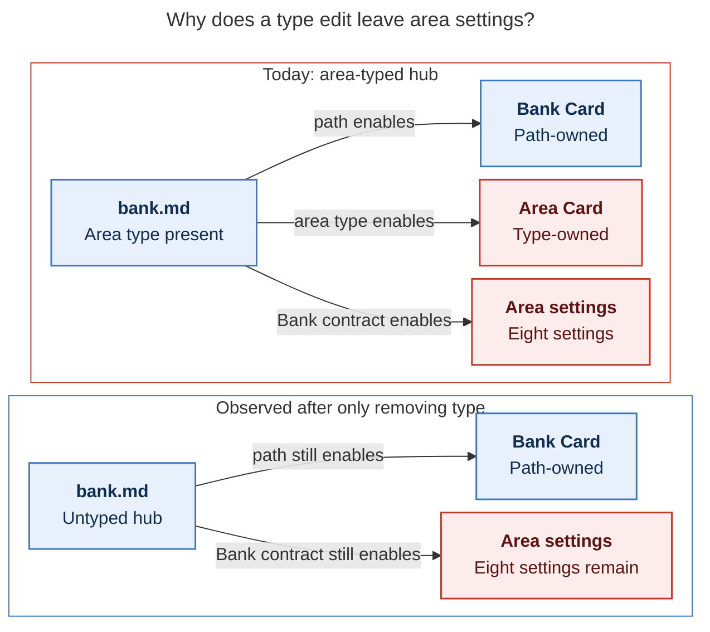
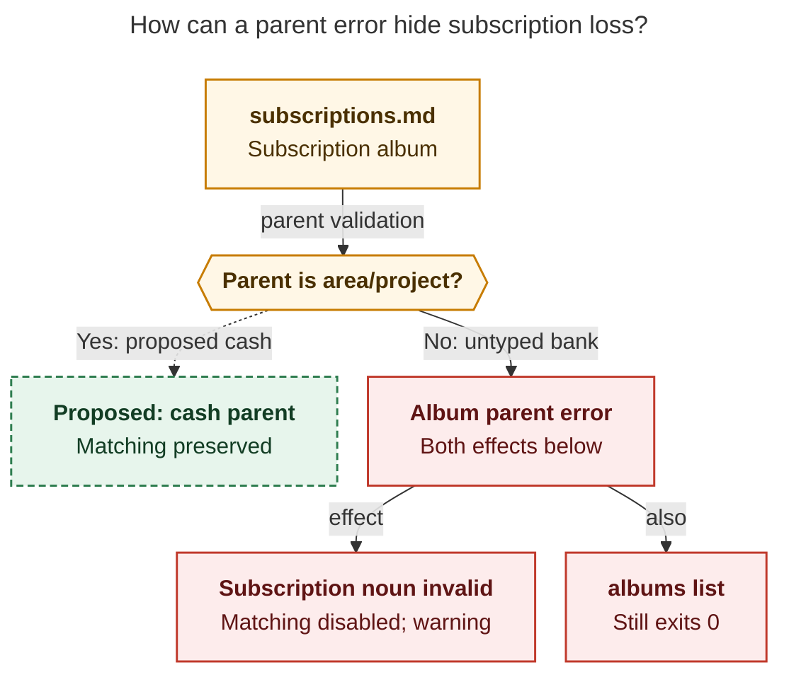
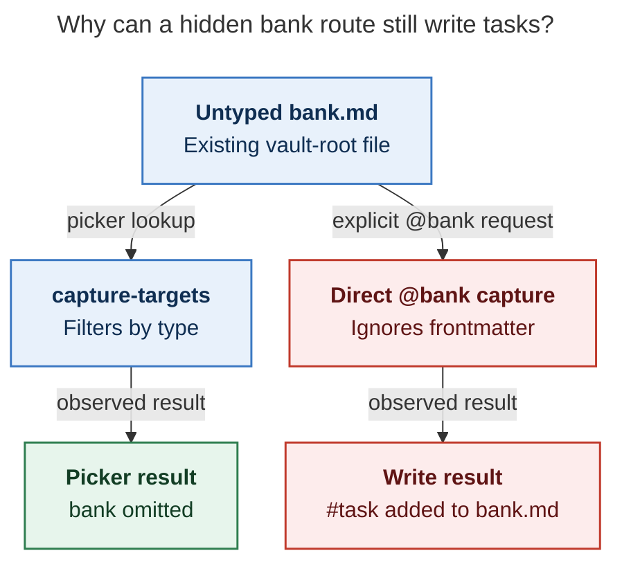

# Diagram proposals: bank.md Is a Bank Hub, Not an Area

Proposals for the swarm linker, not a report. Each diagram restates only what the source
report says.

```yaml
source: research:202611/bank_hub_demotion/bank_hub_demotion__final.md
producer: research.6h.image
check: "mmdc 12.0.0 with the PDF-mirroring config and Puppeteer --no-sandbox rendered 3 of 3 Mermaid diagrams"
```

## type-edit-residue

```yaml
anchor: |-
  an untyped hub still receives the full eight-setting area contract from `bob props`
question: |-
  Why does untyping remove a card but leave area settings?
illustrates: |-
  Untyping stops the Area Card from mounting, but the path-keyed Bank contract still exposes the eight area settings.
caption: "A type-only edit removes the Area Card; removing the residual area settings also requires changing the Bank contract."
review: "703.156×770 px, fit 92.8%; question and visual checks passed; 1 revisions"
```



## album-parent-failure

```yaml
anchor: |-
  albums must parent to an area or project (`albums/registry.rs::analyze_direct_parent` →
question: |-
  Why can the wrong parent silently disable subscription matching?
illustrates: |-
  An invalid album parent disables subscription matching with a warning even though albums list still exits 0.
caption: "Reparenting subscriptions to cash preserves matching; leaving an untyped bank parent causes errors that exit codes alone can hide."
review: "583.039×788 px, fit 100.0%; question and visual checks passed; 0 revisions"
```



## capture-picker-bypass

```yaml
anchor: |-
  `bank.md`: `bob capture-targets` no longer lists `bank` (type-keyed, confirmed),
question: |-
  Why can a hidden @bank route still write a task?
illustrates: |-
  After demotion, capture-targets no longer lists bank, but direct @bank capture still writes a task because the write path ignores frontmatter.
caption: "The picker filters by type while direct capture accepts the root filename; hiding bank therefore does not prevent task writes."
review: "459.117×494 px, fit 100.0%; question and visual checks passed; 0 revisions"
```


