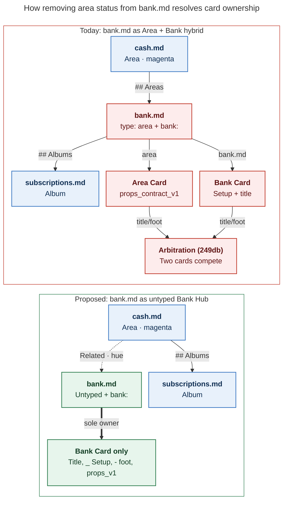
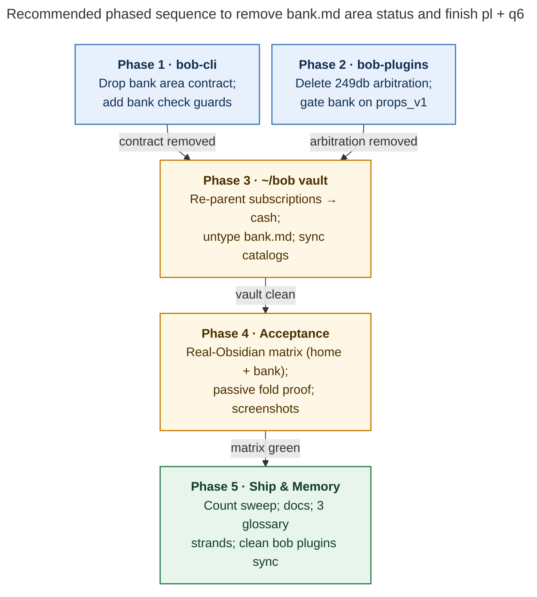

# Removing Area-Note Status from `bank.md` and Completing `bob-cli-pl` and `bob-cli-q6`

**Date:** 2026-11-26  
**Researcher:** `gem`  
**Scope:** `bob-cli`, `bob-plugins`, `bob-mac-capture`, and Bryan's Bob vault (`~/bob/`)  
**Canceled Epics Audited:** `bob-cli-pl` (`plan:202611/area_project_cards.md`) and `bob-cli-q6` (`plan:202611/bank_property_card_fold.md`)

---

## 1. Executive Summary

**Verdict: Removing `type: "[[area]]"` from `~/bob/bank.md` and deleting the Bank–Area arbitration layer before finishing `bob-cli-pl` and `bob-cli-q6` is strongly the right decision.**

The failure Bryan recorded this morning (`~/tmp/screencasts/20261126_070316.mp4`) — where `bank.md` flipped between a **BANK** card and an **AREA** card on cursor movement and stacked **both** cards simultaneously with duplicate `Properties · 5` feet on `_` — was not an isolated rendering race. It was the direct consequence of two sequentially planned epics giving `bank.md` two incompatible title-owning, foot-owning, frontmatter-owning Property Cards (`area` from `bob-cli-pl` and `bank` from `bob-cli-q6`). Treating `bank.md` as an Area Note also leaked false task-home semantics (`0/5 ready`, `@bank` capture targeting, `AREA SETTINGS`, `## Areas` catalog rows, and `Area` classification in `//` Go To Notes) onto a note that never holds tasks.

However, a full codebase and vault audit surfaced **five concrete requirement adjustments** that must be handled explicitly so the migration does not break existing Bob invariants:

1. **Critical Blocker — `~/bob/subscriptions.md` has `parent: "[[bank]]"`:** `bob albums` enforces a hard error (`album_parent_kind`) requiring every album's parent to be an **area or project**. Removing `type: "[[area]]"` from `bank.md` without re-parenting `subscriptions.md` immediately breaks `bob albums check` **and disables all subscription attribution** in `bob bank import`/`list`/`report`/`subscriptions`/`check`. **Recommended adjustment:** re-parent `subscriptions.md` to `parent: "[[cash]]"` (`cash.md` already lists subscriptions in its summary, and `bob bank` binds subscriptions strictly by noun `subscription`, never by parent).
2. **Make `bank.md` an untyped singleton hub (omit `type:` entirely):** Matches existing vault singletons (`dash.md`, `rotten.md`, `crowded.md`), avoids a broken self-referential `type: "[[bank]]"` link, avoids inventing a cardinality-1 `bank_hub.md` type note, and works cleanly with every existing Bob reader (`bob bank`, `bob props`, `note_catalog`, `pomodoroHomeResolve`, and `albumHeaderOwnerChain`).
3. **Drop `NoteKind::Bank` from `bob props`'s area settings contract (`props_contract_v1`):** On a non-area `bank.md`, 6 of the 8 `AREA SETTINGS` (`color`, `task_type`, `clock`, `ready_cap`, `task_refresh`, `project_name_aliases`) are inert or meaningless (`pomodoro_homes` ignores `color:` on non-area/non-project notes). Returning `bank.md` to plain `props_v1` (with `bank:` still card-owned by `==`, and `parent`/`summary`/`created` editable as loose properties in `+`) makes Bank identical to Album, Record, and Day/Period cards. Because `bob props` has not shipped in a crates.io release yet (latest tag is `v0.6.0`), removing it now leaves zero published breaking change.
4. **Add three low-cost regression guardrails:** keep `"bank.md"` defensively excluded in `bob-ledger-tools`'s `HOME_CARD_TYPE_NOTES` (so stale multi-host syncs can never stack two cards again), check `is_bank_note` before `facts.is_area` in `src/native/note_catalog/mod.rs` (matching `src/native/props/roles.rs:222`), and add non-blocking `bank_hub_area_type` and `bank_hub_task` warnings to `bob bank check`.
5. **Drop `q6.6`'s "area strip on bank card" requirement and merge the remaining work of both epics into one 5-phase epic** (also fixing the deterministic self-test failure in `scripts/obsidian-frontmatter-takeover-e2e-lib.cjs:1063` and replacing the uncommitted `bob-ledger-tools 1.166.5` deploy drift).

---

## 2. Ground Truth: What Happened & Exact Epic Audit

### 2.1 Why Two Cards Collided on `bank.md`

1. **`bob-cli-pl` (planned 2026-11-22)** assumed the Bank Setup card lived in the note body below `# 🏦 Bank` and treated `bank.md` as a hybrid Area Note (`type: "[[area]]"`, `parent: "[[cash]]"`, `bank:` mapping). Phases `pl.2` and `pl.3` gave `NoteKind::Bank` the full 8-row Area settings contract (`props_contract_v1`), and `pl.9` was planned to mount the **Area Card** in `bank.md`'s title slot while suppressing Bank's foot.
2. **`bob-cli-q6` (planned 2026-11-25)** launched while `pl.9` was still pending and promoted the **Bank Card** itself into the title slot (`q6.3`) with whole-frontmatter Properties ownership (`q6.4`), relying on `249b-plugin-home-card-model.js` excluding `bank.md` from Home Cards (`HOME_CARD_TYPE_NOTES = ["area.md", "project.md", "bank.md"]`).
3. **`bob-cli-pl.9` (started 2026-11-25 evening)** encountered the landed title-slot Bank Card, removed `"bank.md"` from `HOME_CARD_TYPE_NOTES` in commit `06c87a06`, and spawned child epics `pl.9.1` → `pl.9.1.2` → `pl.9.1.2.1` to arbitrate two competing title/foot/frontmatter owners on one note. Across **10 commits** (`06c87a06` through `831ac794`), this added `249db-plugin-bank-area-arbitration.js` and arbitration hooks across 11 plugin source files and ~1,000+ lines of test code.
4. **Live failure evidence (`~/tmp/screencasts/20261126_070316.mp4`):** Inspecting the extracted frames and Keystrokes WebVTT track confirms the exact failure Bryan saw at 07:03 AM on 2026-11-26:
   - **00:02 (`⌘O bank ↩`):** Opening `bank.md` renders the **BANK · CASH** title card (`⊞ Setup`, `▸ Setup · WF Checking · 25 categories · 10 rules`, `▸ Properties · 5`), while native Obsidian **Properties** remain visible right underneath (`parent: cash`, `type: area`, `bank: {...}`).
   - **00:07 (`k`, `jjk`):** Cursor movement flips the top card to the **AREA · ● CASH** card (`🏦 Bank`, `⊞ Settings`, `▸ Properties · 5`), native Properties still visible.
   - **00:09 (`⇧_`):** Pressing `_` causes **both** cards to stack vertically — the **AREA** card (`0/5 ready  0 today`, `▸ Properties · 5`) directly above the **BANK** card (`▸ Setup …`, `▸ Properties · 5`), with duplicated titles and duplicated Properties feet.
   - **00:11 (`-`, `-`):** Pressing `-` twice fails to toggle the Properties drawer cleanly while the two feet compete.

### 2.2 Phase-by-Phase Status of `bob-cli-pl` and `bob-cli-q6`

Almost all implementation work for both epics has **already landed on `master`**. Only the bank-arbitration fallout, final real-Obsidian acceptance, retired-count verification, passive-fold proof, docs, and approved glossary strands remain:

| Epic / Phase | Scope | Resolution | Code State on `master` |
| --- | --- | --- | --- |
| `bob-cli-pl.1` | Retire `bob-project-tasks` count writer + project creation `processFrontMatter` + `projects.base`/`project.md` | **Done** | Landed & verified |
| `bob-cli-pl.2` | Area/project roles, validation, setting ops in `bob props` | **Done** | Landed (`d39680dd`); includes `NoteKind::Bank` hybrid to remove |
| `bob-cli-pl.3` | Settings contract JSON, `effects[]`, `contract_issues[]`, `props_contract_v1` | **Done** | Landed (`4b23bbef`, `447ef1a5`); includes `NoteKind::Bank` hybrid to remove |
| `bob-cli-pl.4` | Local Area Card & Project Card (`249b–249e`) | **Done** | Landed (`5717d518`, `b5f2f6c1`, `45697ae0`) |
| `bob-cli-pl.5` | Report-backed lifecycle reasons, readouts, lint, `^prj` goal line (`249f`) | **Done** | Landed (`d59ee11b`) |
| `bob-cli-pl.6` | Settings group in `+`, ghost rows, simple stages, `==` registration | **Done** | Landed (`876782fe`, `9d305022`); includes `bank` in `PROPERTY_EDITOR_SETTING_ORDER` to remove |
| `bob-cli-pl.7` | Hue, default type, clock-policy stages (`298ya`) | **Done** | Landed (`691182f4`) |
| `bob-cli-pl.8` | Lives under stage with consequence preview + catalog sync (`298aa`) | **Done** | Landed (`0d319a53`) |
| `bob-cli-pl.9.1.1` | Gate home-card Properties ownership (`props_contract_v1`) + native entry routing | **Done** | Landed (`8698046c`) |
| `bob-cli-pl.9.1.2.1.1–2` | Bank acceptance probes + pane-local Bank–Area arbitration | **Done** | Landed (`06c87a06`..`313a8cac`) — **delete arbitration** |
| `bob-cli-pl.9.1.2.1.3` | Bank & Area editor gestures (`+` on bank.md → Area Settings) | **Canceled** | Partially landed (`831ac794`) — **revert** |
| `bob-cli-pl.9.1.2.1.4` | Real Bank acceptance + bundle deploy | **Canceled** | Not finished |
| `bob-cli-pl.9.1.3` | Real-Obsidian Area/Project + Bank takeover acceptance matrix | **Canceled** | Never ran |
| `bob-cli-pl.9.1.4` | Re-run retired-count sweep, final docs, 3 approved glossary strands | **Canceled** | Never ran |
| `bob-cli-q6.1` | Shared fold kit (`240s`), `_` key (`248m`), `toggle-card-details`, album Schema | **Done** | Landed (`1ff10aa4`, `bdb85e34`) |
| `bob-cli-q6.2` | Bank Setup collapses by default, honest attention chip, rules CSS, container queries | **Done** | Landed (`fbe5fd86`) |
| `bob-cli-q6.3` | Bank card moves to title slot (`248cb`), emoji split, `⊞ Setup`, hue walk | **Done** | Landed (`7d53d189`) |
| `bob-cli-q6.4` | Hide native Properties on `bank.md` (`240q`, `248cc`) + `bank-card`/`property-card` glossary | **Canceled** | Code landed (`b2e6ea1f`..`dc6c76f4`) & glossary landed (`1ca74ece`); blocked only on acceptance due to `pl.9.1.2` |
| `bob-cli-q6.5` | `_` reaches record, area, project folds + foot `-` hover keycap | **Done** | Landed (`a71a59db`) |
| `bob-cli-q6.6` | Area strip on bank card (**now obsolete**), passive-fold proof, family screenshots, docs sweep | **Canceled** | Never ran |

**Pre-existing hygiene defects observed on clean `master`:**
- `bob plugins list` currently shows `bob-ledger-tools 1.166.5` (and `bob-navigation-hotkeys 2.107.12`) drifting from an uncommitted build at `313a8ca` deployed on 2026-11-26T12:16Z.
- `node --test scripts/test-obsidian-frontmatter-takeover-e2e.cjs` fails 1/18 deterministically (`scripts/obsidian-frontmatter-takeover-e2e-lib.cjs:1063` omits `visible: true, activeInside: true` from its `modalLifecycleFailures` self-test fixture; recorded on `bob-cli-pl.9.1` note #1).

---

## 3. Critique of the Plan & Alternatives Considered

### 3.1 Why Removing Area Status from `bank.md` Is the Right Call

Beyond eliminating the two-card bug, removing `type: "[[area]]"` fixes **five independent architectural inconsistencies** simultaneously:

1. **One Note → One Property Card Species.** Every other card-owned note in Bob has a single unambiguous species (`album`, `record`, `day`/`week`/`quarter`/`year`, `area`, `project`). Making `bank.md` strictly `bank` eliminates the lone dual-species exception and deletes the entire `249db` arbitration layer.
2. **Honest Task-Home Semantics.** `glossary:area-note` defines an Area Note as a task residence with `## Tasks`, per-note Ready caps (`decisions:note-ready-cap-counts-the-lane`), freshness review (`task_refresh`), default task types (`task_type`), and clock defaults (`decisions:off-clock-follows-tag-then-note-default`, `decisions:off-clock-note-defaults-filter-by-task-type`). Live vault verification confirms `~/bob/bank.md` has **zero `#task` lines**, no `done/bank_done.md`, and zero `[root:: bank]` references anywhere in `~/bob/`. Removing area status also removes the bogus `bank` task-capture route from `bob capture-targets` and `bank` from `bob areas list` / `## Areas` catalogs.
3. **Follows Bob's Own Recorded Precedent.** `decisions:notebook-routes-write-notes` explicitly rejected modeling non-task notes as sub-areas because *"Sub-areas… drag in Ready caps, `## Tasks`, Stats roots, and tasks."* That exact reasoning applies to `bank.md`.
4. **Fixes Inverted `//` Go To Notes Classification.** In `src/native/note_catalog/mod.rs:1135-1159`, `if facts.is_area` executes before `if is_bank_note(relative)`, causing `bank.md` to classify as `area` while `bank/2026-11.md` classifies as `bank`. Removing `type: "[[area]]"` (plus reordering those two checks) aligns `bank.md` as `bank`.
5. **Restores a Uniform 4-Key Card Grammar.** Without dual identity, `-` (Properties drawer), `_` (card's own fold: Setup on Bank, Schema on Album, details on Record/Area/Project), `==` (species editor), and `+` (Property Editor) work with zero ambiguity on every card.

### 3.2 Alternatives Seriously Considered

- **Alternative A — Keep `bank.md` as `type: "[[area]]"`, delete arbitration, and permanently re-add `"bank.md"` to `HOME_CARD_TYPE_NOTES` (returning to `q6`'s assumption).**  
  *Critique:* Smaller diff in `bob-cli` and no vault edit, and it does fix the double-card bug. **Rejected** because it treats the symptom rather than the disease: `bank.md` remains an area in `bob areas list`, `cash.md`'s `## Areas`, `bob capture-targets` (`@bank`), `note_catalog` (`//`), and `bob props` (`AREA SETTINGS`), still requires `q6.6`'s special-case area strip on the Bank Card, and still invites accidental task capture into `bank.md`.
- **Alternative B — Keep both cards on `bank.md` and finish debugging `bob-cli-pl.9.1.2.1` arbitration.**  
  *Critique:* **Rejected.** Ten commits and four recovery phases still left two cards stacking in live Obsidian (`20261126_070316.mp4`). Maintaining pane-local arbitration between two independent CodeMirror/Reading card hosts for a single file is permanent architectural debt with negative UX value (showing `0/5 ready  0 today` on a taskless note).

### 3.3 Before vs. After Architecture



*Caption: Removing `type: "[[area]]"` from `bank.md` and re-parenting `subscriptions.md` under `cash.md` eliminates the Area/Bank arbitration layer (where both Area Card and Bank Card currently converge and compete) so the Bank Card alone owns `bank.md`, while `cash.md` owns both area tasks and the Subscriptions album (the dashed link shows `bank.md`'s non-catalog `parent: "[[cash]]"` / `Related:` link that continues supplying `cash`'s magenta hue).*

---

## 4. Justified Adjustments to the Requirements

### Adjustment 1 (Critical): Re-Parent `~/bob/subscriptions.md` from `[[bank]]` to `[[cash]]`

**Why this was hidden in the request:** Grepping `parent:.*\[\[bank` across `~/bob/` finds exactly two children: `bank/2026-11.md` (`type: "[[bank_month]]"`, which has no area-parent requirement) and **`~/bob/subscriptions.md`** (`type: "[[album]]"`, `parent: "[[bank]]"`).

In `src/native/albums/registry.rs:631-650`, an album's parent **must** be `LiteKind::Area` or `LiteKind::Project`:

```rust
let kind = files.get(&target_path).and_then(|target| match target.lite.kind {
    LiteKind::Area => Some("area"),
    LiteKind::Project { .. } => Some("project"),
    _ => None,
});
// Otherwise emits hard Error `album_parent_kind`:
// "album parent must be an area or project note"
```

If `type: "[[area]]"` is removed from `bank.md` while `subscriptions.md` keeps `parent: "[[bank]]"`, three things break immediately:
1. `bob albums check` exits `1` with `album_parent_kind` on `subscriptions.md`.
2. `RecordContext::lookup_noun("subscription")` returns `RecordKindResolution::Invalid`, which causes `src/native/bank/subscriptions/loader.rs:410` and `registry.rs` to **disable all subscription matching and ledgers** across `bob bank import`, `list`, `report`, `subscriptions`, and `check` (`bank_subscription_album_invalid`).
3. `src/native/albums/catalog.rs:344` only manages `## Albums` on `LiteKind::Area | LiteKind::Project`, stranding the existing `## Albums` callout at the bottom of `bank.md` as dead unmaintained text.

**Two ways to resolve this:**
- **Option 1A (Recommended): Change `~/bob/subscriptions.md` to `parent: "[[cash]]"`.**
  - `bob bank` binds subscriptions purely via `RecordContext::lookup_noun("subscription")` (`docs/bank.md:654`), never by parent path. Verified in `src/native/bank/subscriptions/`: zero code cares whether `subscriptions.md` is parented under `bank` or `cash`.
  - `~/bob/cash.md:4` already says `summary: "Money, purchases, and paperwork: accounts, benefits, subscriptions, disputes, and taxes."`
  - `bob albums list` groups `🔁 Subscriptions` under `cash` (a real area, matching `body`, `dev`, `fun`, `sase_blog`); `cash.md` gains the live `## Albums` catalog; `subscriptions.md`'s Album Card shows `ALBUM · Cash` in `cash`'s magenta hue.
  - Fits Bryan's roadmap task (`~/bob/bob.md:125`: moving `## Albums`/`## Notebooks` into Area/Project cards) without forcing Bank Card to become an album-cabinet host too.
  - Adding one prose link in `bank.md` (e.g., `Recurring charges live in [[subscriptions|🔁 Subscriptions]].`) preserves one-click navigation between Bank and Subscriptions.
  - **Migration ordering detail:** Re-parent `subscriptions.md` to `[[cash]]` and run `bob albums sync` **before** removing `type: "[[area]]"` from `bank.md` (so `bob albums sync` cleanly removes `bank.md`'s `## Albums` region automatically), or remove `## Albums` from `bank.md` in the same vault edit and run `bob albums sync`.
- **Option 1B (Alternative — Not Recommended): Teach `albums`, `notebooks/snapshot.rs`, and `bob-plugins`'s `albumHeaderOwnerChain` (`241u:88`) that `bank.md` is an album-hosting non-area parent.**  
  Adds `LiteKind::BankHub` special-casing across Rust discovery, catalog planning, `bob albums create`, parent-picker UI, and `docs/records.md` just to preserve one parent edge on one album, contradicting the goal of making `bank.md` strictly for bank-row tracking.

### Adjustment 2: Make `bank.md` an Untyped Singleton Hub (Omit `type:`)

Audit of all `~/bob/*.md` files establishes two strict vault conventions:
1. Every `type: "[[X]]"` points to a distinct type-definition note `X.md` under `type.md` (`area.md`, `project.md`, `album.md`, `record.md`, `notebook.md`, `article.md`, `day.md`, `done.md`, `ref.md`, `mail.md`, `bank_month.md`). **Zero notes self-link their own `type:`**. Therefore `type: "[[bank]]"` on `bank.md` must be rejected (it would self-link `bank.md` to itself).
2. **Singleton utility/hub notes under an area are untyped** and carry only `parent: "[[<area>]]"`: `dash.md`, `rotten.md`, and `crowded.md` all have `parent: "[[gtd]]"` with no `type:` key.

Making `bank.md` untyped (`parent: "[[cash]]"`, `summary:`, `created:`, `bank:`) was verified against every consumer in both repos:
- `bob bank` (`src/native/bank/`): identifies the hub purely by path `bank.md` + `bank:` mapping; never inspects `type:`.
- `bob props` (`src/native/props/roles.rs:222`): classifies `bank.md` as `NoteKind::Bank` purely by `relative_path == "bank.md"`.
- `bob-plugins` Bank Card (`248c`, `248cb`, `248ca`, `248cc`, `248m`): identifies the hub purely by `bankSetupIsHubPath(path)`.
- **Hue walk (`notebookHostHueName` → `pomodoroHomeResolve`, `142-pomodoro-home-chips.js:464-510`):** walks `bank.md` (`type: "other"`) → `parent: "[[cash]]"` (`cash.md`, `type: "area"`, `color: magenta`) → returns **`magenta`** for both the title-slot Bank Card and all `bob-bank` fences (`bankCardRootHue`).
- **Kicker crumb (`bankSetupIdentityModel` → `albumHeaderOwnerChain`, `241u:60-115`):** starts from `bank.md`'s `parent: "[[cash]]"`, resolves `cash.md` (`area`), stops at `area.md` (`other`), and renders **`BANK · Cash`** unchanged.
- **Home Cards (`249b:58-89`):** `homeCardKindFromFrontmatter` returns `null` for untyped notes, so Area Card will not match.

*(Alternative 2B: creating `~/bob/bank_hub.md` with `parent: "[[type]]"` and putting `type: "[[bank_hub]]"` on `bank.md`. Workable if Bryan prefers an explicit locked `type:` row on every card-owned note, at the cost of a cardinality-1 type file at the vault root.)*

### Adjustment 3: Remove `NoteKind::Bank` from `bob props`'s Area Settings Contract

Currently `src/native/props/contract/settings.rs:82` includes `| NoteKind::Bank` alongside `NoteKind::Area`, causing `bob props show bank.md` to emit `props_contract_v1` and 8 `AREA SETTINGS` (`Summary`, `Lives under`, `Hue`, `Default type`, `Clock`, `Ready cap`, `Review`, `Capture names`).

**Why it must be removed:**
- On a non-area `bank.md`, `task_type`, `clock`, `ready_cap`, `task_refresh`, and `project_name_aliases` have zero consumers. Worse, `pomodoro_homes::chain_hue` (`src/native/pomodoro_homes/resolve.rs:665`) skips any note that is not `Area | Project`, so even `color:` set via `AREA SETTINGS` on untyped `bank.md` would be silently ignored!
- Removing `| NoteKind::Bank` makes `bob props show bank.md` emit `note_kind: "bank"`, `capabilities: ["props_v1"]`, `contract: None`, with `bank` staying `role: card` (`owner: "bank"`, `editor: "=="`) and `parent`/`summary`/`created` staying `loose` (editable directly in `+`).
- **Properties takeover gate:** `240q-plugin-property-card-frontmatter-ownership.js:518-527` drops its `bankHub` special case so `bank` gates on `props_v1` — identical to `album`, `record`, `day`, `week`, `quarter`, and `year` (and matching `bob-cli-q6.4`'s original design).
- **Release-train impact (`decisions:bob-cli-releases-ride-a-daily-train`):** `git tag` confirms the latest published release is `v0.6.0`, which predates all of `bob props` (`e98c7fe9`..`447ef1a5` are all post-`v0.6.0`). Removing `NoteKind::Bank` from `props/contract` before the next release train publishes means no released crates.io version ever ships the hybrid contract. (If a daily release cuts beforehand, mark the commit with `!` per the decision.)

### Adjustment 4: Add Three Lightweight Guardrails

1. **Defensive path exclusion in `249b-plugin-home-card-model.js`:** Keep `"bank.md"` in `HOME_CARD_TYPE_NOTES` (renamed e.g. `HOME_CARD_EXCLUDED_PATHS = Object.freeze(["area.md", "project.md", "bank.md"])`). Zero arbitration code is retained, yet even if another host (Mac/athena) receives the plugin update before pulling the `~/bob/bank.md` vault edit, **two cards can never collide on `bank.md`**. Mirrors `src/native/props/roles.rs:222`.
2. **Classification order in `src/native/note_catalog/mod.rs:1135-1159`:** Move `if is_bank_note(relative)` above `if facts.is_area` so `//` Go To Notes matches `props/roles.rs:222` unconditionally.
3. **Contract warnings in `bob bank check` (`src/native/bank/check.rs`):** Add two non-blocking warning findings (exit `0`, never breaking scripts):
   - `bank_hub_area_type` when `bank.md` declares `type: "[[area]]"`.
   - `bank_hub_task` when `bank.md` contains any `#task` checkbox outside fenced code (pointing to `[[cash]]`).

### Adjustment 5: Retire `q6.6`'s Area Strip & Fold Remaining `pl`/`q6` Work Into One Epic

- **Explicitly drop** `bob-cli-q6.6` item 1 ("render the authored-only area strip on the bank card") — `bank.md` has no area policies and no Ready lane.
- **Explicitly retain** every other unfinished item from both canceled epics in one cohesive epic so nothing falls through the cracks:
  - `q6.4` + `pl.9.1.3`: Real-Obsidian frontmatter-takeover acceptance matrix covering **Area**, **Project**, and **Bank** cards (LP + Reading hidden; fail-open on Source, embed, popover, mobile, bad YAML, unclosed fence, path change, mount failure, unload, old bob; `^prj` cursor integrity; no `j`/`k`/`gg` focus trap; light/dark × wide/narrow screenshots).
  - `q6.6`: Passive-rendering unit proof (repeated `_` folds + refreshes across bank/album/record/area → zero vault writes, zero paint-triggered `bob` spawns) + family-wide screenshot review + key-family docs sweep.
  - `pl.9.1.4`: Re-run `scripts/retire-project-count-keys.cjs --dry-run` (apply if stale hosts recreated counts), finalize docs, author the **3 previously approved glossary strands** (`glossary:area-card`, `glossary:project-card`, `glossary:property-card` — now cleanly reflecting single-owner `bank.md`!), fix the `obsidian-frontmatter-takeover-e2e-lib.cjs:1063` self-test bug, and perform a clean `bob plugins sync` + isolated post-sync smoke check.

---

## 5. Exact Codebase & Vault Removal / Change Manifest

### 5.1 `bob-cli`

| File | Change |
| --- | --- |
| `src/native/props/contract/settings.rs:1,82` | Change `NoteKind::Area \| NoteKind::Bank` → `NoteKind::Area`; update module doc comment. |
| `src/native/props/contract/read.rs:1,33` | Update doc comments (`area and project notes`). |
| `src/native/props/cli.rs:55` | Update `long_about` (`Area and project notes`). |
| `src/native/props/contract/tests.rs:427-455,626-640` | Replace `bank_show_uses_the_area_contract` with tests asserting `NoteKind::Bank` emits `contract: None`, `capabilities: ["props_v1"]`, `bank` stays `card`-owned, and `setting.set` refuses `prop_setting_disabled`. |
| `src/native/props/roles.rs:798` | Update bank fixture in test to untyped `parent: "[[cash]]"`. |
| `src/native/note_catalog/mod.rs:1135-1159` | Move `if is_bank_note(relative)` before `if facts.is_area`. |
| `src/native/bank/check.rs` | *(Recommended)* Add `bank_hub_area_type` and `bank_hub_task` warning findings + unit tests. |
| `docs/bank.md:88-95`, `docs/props.md:96,193-196,291,346,450,460`, `docs/reference/vault-format.md:488`, `docs/reference/json-outputs.md:452` | Document `bank.md` as an untyped bank hub under `[[cash]]` (no area contract, no tasks); run `just docs-gen && just docs-check`. |
| `sase/memory/glossary/` (via `/sase_memory_write` with plan approvals) | Add `area-card`, `project-card`; update `property-card` (add area/project species, bank owned by Bank Card on `props_v1`) and tighten `bank-card` wording ("Under `# 🏦 Bank`" → title-slot wording); run `sase memory init`. |

### 5.2 `bob-plugins` (`plugins/bob-ledger-tools/`)

| File | Change |
| --- | --- |
| `src/249db-plugin-bank-area-arbitration.js` | **Delete entire file** (78 lines); remove from `src/fragments.json` and `src/374g-exports-home-card.js:45-49`. |
| `src/249ca-plugin-home-card-property-editor-routing.js` | Delete `homeCardPropertyEditorNoteKind` (added only for `bank.md` Area→`"bank"` mapping); keep/inline `homeCardIsDesktopPlatform`. |
| `src/249b-plugin-home-card-model.js:7` | Restore `"bank.md"` in `HOME_CARD_TYPE_NOTES` (defensive guard against unmigrated hosts). |
| `src/249da-plugin-home-card-ownership.js:58-63,141-166,182,221` | Remove all `bank.md` / `BankArea` registration and release hooks. |
| `src/249d-plugin-home-card-host.js:382-390,703,727,811,824,868,918,935` | Remove all `homeCardRegisterBankAreaMount` / `ReleaseBankAreaMount*` calls; revert `homeCardOpenSetting` to `area \| project`. |
| `src/249e-plugin-home-card-foot.js:145-152,201-203,209-220` | Remove all `filePath === "bank.md"` special cases and `propertyCardHomeBankAreaCurrent` refresh trigger. |
| `src/248cc-plugin-bank-setup-frontmatter-host.js:21-30,36-40,49-51,76-80,86-88` | Delete `bankSetupAreaFrontmatterEligible` and all `propertyCardHomeBankAreaCurrent` checks. |
| `src/248cb-plugin-bank-setup-title.js:305-311` | Delete `propertyCardHomeBankAreaCurrent` early fallback branch in `bankSetupAdoptTitle`. |
| `src/248ca-plugin-bank-setup-foot.js:63,137-152,168-169` | Delete `bankSetupAreaArbitration` check in `bankSetupTrackFoot` and arbitration suffix in `bankSetupFootSignature`; emit `where.type = "tile"` only when frontmatter actually has `type`. |
| `src/248c-plugin-bank-setup-hosts.js:246,507,572-574,783-785,823-826` | Remove `bankSetupAreaArbitration`, `suppressBankFoot`, `bankAreaGeneration`, `arbitration.owner` anchor hack, and `scheduleHomeCardRefresh` cross-call. |
| `src/240q-plugin-property-card-frontmatter-ownership.js:518-527` | Revert `propertyCardFrontmatterContractReady` to check `props_contract_v1` for `area` and `project` only (restoring `bank` to `props_v1`). |
| `src/298w-plugin-property-editor-settings-rows.js:6,118` | Remove `bank:` from `PROPERTY_EDITOR_SETTING_ORDER` and `"bank"` from `propertyEditorSettingsFallbackHint`. |
| `src/298m-plugin-property-editor-entrypoints.js:135-151,200-203` | Remove `propertyEditorEntryBarePlusOptions` (`831ac794`); bare `+` opens standard Property Editor on `bank.md`. |
| `src/240r-plugin-property-card-foot-adapter.js` & `src/374f-exports-property-card-foot.js` | Audit `propertyCardFootAdapterPruneDisconnected` (added in `a0ebe63e`/`3af803f9`); remove if unused outside bank arbitration. |
| `scripts/test-ledger-tools-*.cjs` & `scripts/obsidian-frontmatter-takeover-e2e*.cjs` | Remove Bank–Area arbitration tests; restore clean single-card Bank takeover assertions; fix `modalLifecycleFailures` self-test at `obsidian-frontmatter-takeover-e2e-lib.cjs:1063`; add `q6.6` passive-fold proof. |
| `docs/area-and-project-cards.md`, `docs/property-editor.md`, `docs/bob-ledger-tools.md`, `docs/develop/architecture.md`, `docs/develop/validation.md` | Document single-owner Bank Card (`props_v1`), Area/Project takeover (`props_contract_v1`), and unified `-`/`_`/`==`/`+` key family; rebuild `main.js` (`npm run build`), bump manifest, pass `npm test` and `npm run docs:check`. |

### 5.3 `bob-mac-capture`

**Verified: zero changes needed.** `bob-mac-capture` only reads `bob walks` (`b` bank attention) and `bob capture-targets` / `bob note_catalog` from `bob` at runtime (`decisions:mac-capture-is-a-thin-client`); removing `type: "[[area]]"` from `bank.md` automatically removes `@bank` from Mac Capture route suggestions and fixes `//bank` classification to `bank`.

### 5.4 Bob Vault (`~/bob/`)

Execute in this exact order (so catalog syncs self-clean cleanly):
1. Edit `~/bob/subscriptions.md`: change `parent: "[[bank]]"` → `parent: "[[cash]]"`.
2. Run `bob albums sync`: automatically removes `## Albums` (`> [!albums]`) from `~/bob/bank.md` while it is still `LiteKind::Area` and creates `## Albums` (`🔁 Subscriptions`) on `~/bob/cash.md`!
3. Edit `~/bob/bank.md`:
   - Delete `type: "[[area]]"`.
   - Update `summary:` to `Every transaction and deposit, categorized in monthly notes.` (dropping *"plus disputes and cancellations"*).
   - Update body prose line 74: replace *"Money tasks like disputes and cancellations live here too."* with a pointer such as *"Money tasks live in [[cash]]; recurring charges live in [[subscriptions|🔁 Subscriptions]]."*
4. Run `bob areas sync`: removes `[[bank]]` from `~/bob/cash.md` and `~/bob/area.md` `## Areas` catalogs (`cash.md` keeps its `Related: [[bank]]` link on line 13).
5. Verify clean state: `bob areas check`, `bob albums check`, `bob bank check`, and `bob props show bank.md` all report **0 errors, 0 warnings** (and `bob capture-targets` no longer offers `@bank`).

---

## 6. Recommended Solution: One Unified 5-Phase Implementation Epic

Rather than reviving two separate epics that already collided once, create **one focused 5-phase epic** that removes the `bank.md` area-note hybrid first and finishes every remaining acceptance, cleanup, documentation, and memory requirement of both `bob-cli-pl` and `bob-cli-q6`.



*Caption: Phases 1 (`bob-cli`) and 2 (`bob-plugins`) can run in parallel; both must complete before Phase 3 migrates the vault, after which Phase 4 proves real-Obsidian takeover and passive folding and Phase 5 ships docs, approved glossary strands, and clean plugin deployment.*

### Phase Breakdown

1. **Phase 1 — `bob-cli`: Remove `bank.md` area contract & add hub guards** *(Size: small)*
   - Drop `NoteKind::Bank` from `props/contract/settings.rs`; update tests, CLI help, `docs/bank.md`, `docs/props.md`, `docs/reference/vault-format.md`, `docs/reference/json-outputs.md`.
   - Move `is_bank_note` before `facts.is_area` in `note_catalog/mod.rs`.
   - Add `bank_hub_area_type` and `bank_hub_task` warning findings to `bob bank check`.
   - Verify `just check` and `just docs-check`.
2. **Phase 2 — `bob-plugins`: Delete Bank–Area arbitration & restore single-owner Bank Card** *(Size: medium)*
   - Delete `249db`, simplify `249ca`, restore `"bank.md"` defensive exclusion in `249b`, remove all arbitration hooks in `249d`/`249da`/`249e`/`248c`/`248ca`/`248cb`/`248cc`, revert `240q` `bankHub` contract gate to `props_v1`, drop `bank` from `298w`/`298m`.
   - Fix `obsidian-frontmatter-takeover-e2e-lib.cjs:1063` (`visible: true, activeInside: true`) and add the `q6.6` passive-rendering proof unit test.
   - Rebuild (`npm run build`), pass `npm test`, and verify `npm run build:check`.
3. **Phase 3 — Vault migration (`~/bob/`)** *(Size: small)*
   - Re-parent `subscriptions.md` → `parent: "[[cash]]"`, run `bob albums sync` (cleans `bank.md`'s `## Albums` and populates `cash.md`'s `## Albums`).
   - Remove `type: "[[area]]"` from `bank.md` and update its summary/prose.
   - Run `bob areas sync` (removes `bank` from `cash.md` and `area.md`).
   - Verify `bob areas check`, `bob albums check`, `bob bank check`, `bob props show bank.md`, and `bob capture-targets`.
4. **Phase 4 — Real-Obsidian Acceptance & Visual Review** *(Size: medium)*
   - Run the full real-Obsidian frontmatter-takeover matrix on athena (with current-master `BOB_BIN`) covering **Area**, **Project**, **Bank**, **Album**, **Record**, and **Day/Period** cards:
     - Desktop Live Preview & Reading hide native Properties (`props_v1` for Bank; `props_contract_v1` for Area/Project); zero double cards on `bank.md`.
     - Every fail-open path restores native Properties (Source, embed, popover, mobile, invalid YAML, unclosed fence, path change, mount failure, plugin unload, old `bob`).
     - Keyboard parity on `bank.md`: `_` toggles Setup, `-` toggles Properties drawer, `==` opens Bank Setup editor, `+` opens standard Property Editor (`bank` row hands off to `==`), `j`/`k`/`gg` never trap.
     - `^prj` cursor integrity on Project notes; `area.md` and templates untouched; File Properties sidebar native.
   - Capture and inspect light/dark × wide/narrow family screenshots (bank, album, record, area, project).
5. **Phase 5 — Cleanup, Docs, Memory, and Clean Deploy** *(Size: small–medium)*
   - Re-run `scripts/retire-project-count-keys.cjs --dry-run` (apply if any stale host recreated `task_count`/`open_task_count`).
   - Finalize `bob-plugins` docs (`area-and-project-cards.md`, `property-editor.md`, `bob-ledger-tools.md`, `develop/architecture.md`, `develop/validation.md`) and confirm `docs:check` clean (accounting for any baseline word-budget debt).
   - Author the authorized glossary updates via `/sase_memory_write` (`glossary:area-card`, `glossary:project-card`, `glossary:property-card`, and optional one-sentence polish on `glossary:bank-card`), run `sase memory init`, `just docs-gen`, and `just docs-check`.
   - Deploy cleanly from `master` with `bob plugins sync` (clearing the uncommitted `bob-cli_10` drift on `bob-ledger-tools`) + isolated Obsidian post-sync smoke check, and remind Bryan to run `bob plugins sync` and upgrade `bob` on Mac/athena.

### Resulting Uniform Property-Card Contract

| Card Species | Mounted On | Title Owner | Properties Gate | `_` Fold | `-` Drawer | `==` Species Editor | `+` Property Editor |
| --- | --- | --- | --- | --- | --- | --- | --- |
| **Bank** | `bank.md` (untyped hub) | Bank Card (`BANK · Cash`) | `props_v1` | Setup (default closed) | Properties | Bank Setup (`bank:`) | Generic (`bank` → `==`) |
| **Album** | `type: "[[album]]"` | Album Card | `props_v1` | Schema (default open) | Properties | Album Schema (`record:`) | Generic (`record` → `==`) |
| **Record** | `type: "[[record]]"` | Record Card | `props_v1` | Details (default open) | Properties | Record Card | Generic (fields → `==`) |
| **Day / Period** | Canonical day/period | Day/Period Card | `props_v1` | *(falls through to Vim)* | Properties | Intentions editor | Generic (intentions → `==`) |
| **Area** | `type: "[[area]]"` | Area Card (`AREA`) | `props_contract_v1` | Details (default open) | Properties | `+` focused on `AREA SETTINGS` | Typed `AREA SETTINGS` + loose |
| **Project** | `type: "[[project]]"` | Project Card (`PROJECT`) | `props_contract_v1` | Details (default open) | Properties | `+` focused on `PROJECT SETTINGS` | Typed `PROJECT SETTINGS` + `^prj` + loose |

---

## 7. Decisions to Confirm Before Writing the New Epic Plan

1. **`subscriptions.md` parent (Adjustment 1):** Confirm re-parenting `~/bob/subscriptions.md` to `parent: "[[cash]]"` (recommended) rather than extending `albums` to allow non-area Bank Hub parents.
2. **`bank.md` `type:` key (Adjustment 2):** Confirm dropping `type:` completely (untyped singleton hub like `dash.md`/`rotten.md`, recommended) rather than introducing a new `bank_hub.md` type note.
3. **`bob bank check` warnings (Adjustment 4):** Confirm adding non-blocking `bank_hub_area_type` and `bank_hub_task` warnings in `bob bank check` (recommended).
4. **Glossary memory approvals (Phase 5):** Re-approve `glossary:area-card`, `glossary:project-card`, `glossary:property-card` (carried over from canceled `bob-cli-pl`) plus the minor one-sentence cleanup to `glossary:bank-card` ("Under `# 🏦 Bank`" → title-slot wording).
