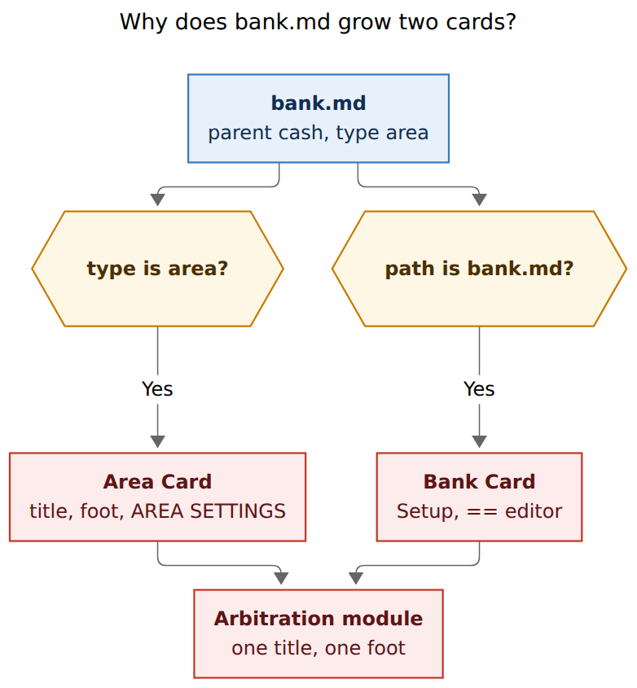
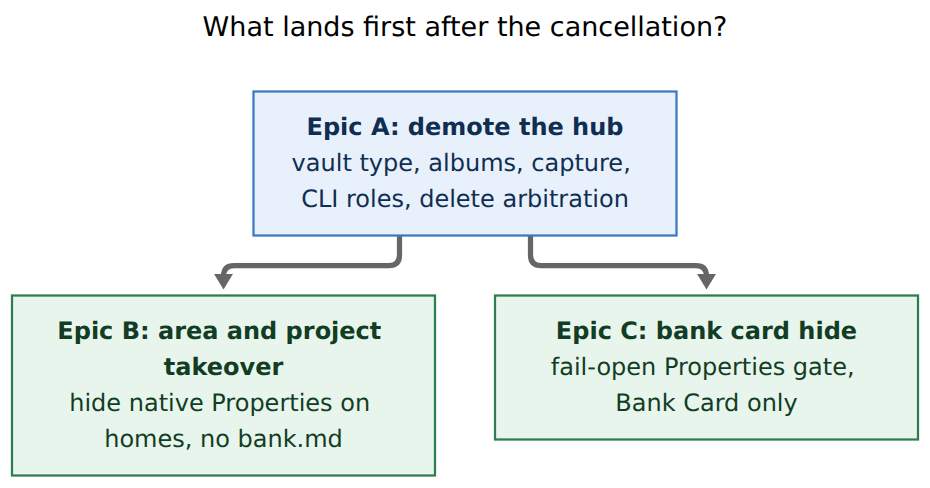
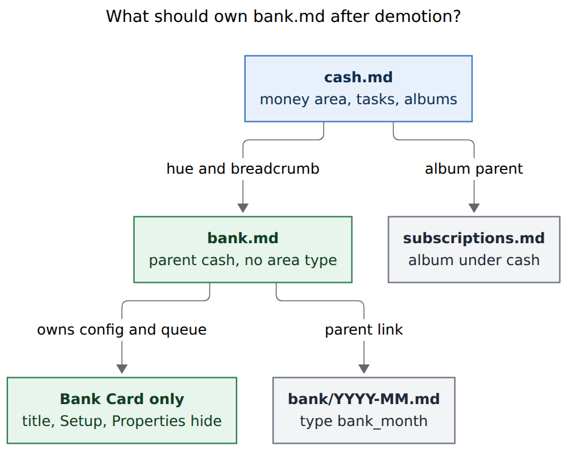

# Bank hub is not an area note

> **Research query:** `~/bob/bank.md` should never have been an area note. It
> stays a child of `~/bob/cash.md` and exists only for bank-row tracking; it
> never holds tasks. The `bob-cli-pl` and `bob-cli-q6` epics were canceled so
> this inconsistency can be fixed first, then their remaining card work can
> finish. How should that be implemented? Critique the plan. Is it a good
> idea? Would a different approach be better? Call out justified requirement
> adjustments, and recommend a solution.

## Bottom line

**Yes — demote `bank.md` off the area kind, and do that before any replay of
the canceled card work.** The diagnosis is right. The two-card fear is
already true in shipped plugin code, not a future risk. The canceled plans
encoded the hybrid on purpose (`type: [[area]]` plus path-based Bank kind,
Area Card plus Bank Card, `+` opening AREA SETTINGS on a BANK card).
Finishing those plans as written would put the inconsistency back.

**Recommended shape, in one sentence:** `bank.md` is a path-canonical bank
hub that parents to `cash` for hue and breadcrumb, owns the `bank:` mapping
and the queue card, and is invisible to the area graph, Ready caps, clock
defaults, capture-as-home, and album ownership.

Ship that as **Epic A**. Then finish the leftover card work as two uncoupled
species: **Epic B** (area/project Properties takeover, no `bank.md`) and
**Epic C** (Bank Card fail-open Properties hide). Do not resurrect
pane-local Area/Bank arbitration or the bank-card "area strip."

## Recommended solution

1. **Drop `type: "[[area]]"` on the live hub.** Keep `parent: "[[cash]]"`,
   `summary`, `created`, and the nested `bank:` mapping. Identify the hub by
   the vault-root path `bank.md`, which `bob props` already does
   (`NoteKind::Bank` short-circuits on that path before the area classifier
   runs).
2. **Reparent `subscriptions.md` from `[[bank]]` to `[[cash]]`.** Albums
   may parent only to an area or a project. Leaving the album under a
   demoted hub produces `album_parent_kind`. Remove the generated
   `## Albums` region from `bank.md`; `bob albums sync` will place the row
   on `cash.md`.
3. **Let `bob areas sync` drop `[[bank]]` from `cash.md` and `area.md`.**
   `recur.md` stays the only cash sub-area. Month notes keep
   `type: "[[bank_month]]"` and `parent: "[[bank]]"`.
4. **Narrow the bank settings contract.** Today `NoteKind::Bank` reuses the
   full area setting list (Ready cap, clock, default type, capture names).
   After demotion the hub keeps `summary` and `parent` (hue/breadcrumb).
   Task-home policies leave with the area kind. The `bank:` mapping stays
   card-owned behind `==`.
5. **Refuse `@bank` as a task capture destination**, with a teaching hint
   toward `@cash`. Capture-target listing already keys on `type: [[area]]`,
   so the picker drops the route once the type changes; the write path still
   treats every vault-root stem as a place that can hold tasks.
6. **Delete the dual-card logic in bob-plugins.** The Area Card stops
   mounting once the type is gone; the arbitration module, bank-md
   special cases, and `bank-area-*` e2e cases still have to come out,
   because they are the support for the strange state.
7. **Then finish the two card leftovers as separate species.** Area/project
   takeover never mentions `bank.md`. Bank Properties hide is one Bank Card
   behind the existing fail-open gate.

## Is this a good idea?

Yes. The hybrid is the reason the last two card epics spent their energy on
arbitration instead of takeover.

**What it buys**

- **One note, one species.** Property cards already dispatch
  bank → album → record → day/period. An Area Card on the same path fights
  that order for title, foot, and whole-frontmatter ownership. The
  `249db-plugin-bank-area-arbitration.js` module exists to paper over that
  fight.
- **The live vault already matches the intended use.** `bank.md` has zero
  `#task` lines. Bank rows are forbidden from carrying `#task`. Money work
  (disputes, cancellations, Starbucks, 401K) already lives on `cash.md`.
- **CLI already half-believes this.** `resolve_note_context` classifies
  `bank.md` as `NoteKind::Bank` by path, ignoring `type: [[area]]`. Areas,
  albums, capture-targets, and home cards still classify it as an area by
  type. Demotion makes those classifiers agree with props.
- **It removes a class of bugs that kept failing real Obsidian.** Duplicate
  feet, second-pane Area loss, Bank title yielding to Area, `+` showing AREA
  SETTINGS on a BANK kicker, and the q6.4 / pl.9.1.2.1 coordination notes
  are all symptoms of two owners.

**Where it goes wrong if it is only a type edit**

Changing YAML and leaving the rest produces a broken album, a leftover
`## Albums` callout, a still-writable `@bank` task route, and dead
arbitration tests that fixture `type: [[area]]`. The type change is the
identity fix; the surrounding graph, capture, contract, and plugin cleanup
are the same change.

## Critique of the canceled plan

Canceling `bob-cli-pl` and `bob-cli-q6` in order to fix the model first is
the right call. Replaying those epics after a vault-only type edit is not.

The written plans treat the hybrid as a feature:

- `plan:202611/area_project_cards.md` takes over native Properties on area
  and project notes, **`bank.md` included**.
- `plan:202611/area_project_takeover.md` prefers **Area owns title, foot,
  and whole frontmatter; Bank stays in the body**.
- `plan:202611/bank_property_card_fold.md` says **dual identity is
  correct**: `+` shows AREA SETTINGS on a BANK card, and `type: [[area]]`
  stays. Its polish phase paints an **area strip** on the bank card.
- Earlier research
  (`research:202611/area_project_property_cards/area_project_property_cards.md`,
  `research:202611/bank_property_card_fold/bank_property_card_fold.md`)
  recommended keeping `type: [[area]]`. This report reverses that.

A large fraction of both epics **already landed** and should be kept:

| Keep | Why |
| --- | --- |
| pl.1–pl.8 | Area/project cards, settings stages, `bob props` contract |
| pl.9.1.1 | Home-card `props_contract_v1` ownership plumbing |
| q6.1–q6.3 | Shared `_` fold kit, Setup collapsed-when-healthy, Bank Card in the title slot |
| q6.5 | `_` on record, area, and project folds |

| Drop or rewrite | Why |
| --- | --- |
| pl.9.1.2 and its child `bank_area_arbitration_repair` | Dual-card arbitration |
| q6.4 as written | Hide was specified on top of Area ownership |
| q6.6 | Area strip on the bank card |

The leftover that is still worth doing is ordinary species work: hide native
Properties on area/project notes, and hide them on the bank hub, each behind
the fail-open gate those species already use.

## Two cards: already true

Yes. Opening `bank.md` in desktop Live Preview or Reading is supposed to
mount **both** an Area Card and a Bank Card. Arbitration then tries to leave
one title and one Properties foot.



*Caption: `type: [[area]]` fires the Area Card; the path `bank.md` fires the
Bank Card. The arbitration module exists because both answers are Yes.*

Evidence in bob-plugins master:

- `homeCardEligible("bank.md", { type: "[[area]]" })` returns kind `area`
  (`scripts/test-ledger-tools-home-card-host.cjs`).
- `249db-plugin-bank-area-arbitration.js` registers an Area owner on
  `bank.md` and sets `suppressBankFoot` when that Area foot is live.
- `248cb-plugin-bank-setup-title.js` **yields the title slot** when an Area
  mount is current: the Bank Card falls back to the body.
- `249da-plugin-home-card-ownership.js` releases Bank whole-frontmatter
  ownership as soon as an Area mount is live on `bank.md`.
- `docs/property-editor.md`: on `bank.md`, `+` opens **AREA SETTINGS** and
  `==` opens the bank editor.
- Takeover e2e names `bank-area-live-arbitration` and
  `bank-area-reading-arbitration`.

The older area-card docs still say `bank.md` is excluded. The tests and
arbitration fragment have already moved past that exclusion. That drift is
the inconsistency in code form.

## Current vault

Live `bank.md` frontmatter:

```yaml
parent: "[[cash]]"
type: "[[area]]"
summary: Every transaction and deposit, categorized in monthly notes, plus disputes and cancellations.
created: 2026-11-11T11:31:42-05:00
bank:
  accounts: { checking: { … } }
  categories: { … }
  rules: [ … ]
```

Body: `# 🏦 Bank`, teaching prose that still says money tasks live here, a
`view: queue` fence, and a generated `## Albums` row for
`[[subscriptions]]`. **Zero `#task` lines.**

`cash.md` is the real money home: `type: [[area]]`, `parent: [[area]]`,
`color: magenta`, `## Areas` listing **bank** and **recur**, `## Notebooks`,
`## Tasks`. Its summary already names subscriptions, disputes, and taxes.

`subscriptions.md` is `type: [[album]]`, `parent: "[[bank]]"`. Month notes
are `type: [[bank_month]]`, `parent: "[[bank]]"`. Those month-note parents
stay; they name the hub, not the area kind.

## Blast radius if only the type changes

| System | Today | After a type-only edit | Required extra work |
| --- | --- | --- | --- |
| `bob props` note kind | Path → `bank` | Still `bank` | Narrow the copied area settings list |
| Areas catalog | `bank` nested under `cash` | Row disappears on next `bob areas sync` | Expected; rewrite docs examples that use `bank.md` as a sub-area |
| Home / Area Card | Eligible because type is area | Stops mounting | Delete arbitration and `bank.md` special cases |
| Bank Card | Title slot, yields to Area | Keeps the title | Finish Properties hide without Area |
| Albums | `subscriptions` parented to bank; catalog on bank.md | `album_parent_kind` error; leftover `[!albums]` on a non-host | Reparent to cash; remove bank.md catalog |
| Capture targets | `@bank` listed as an Area | Picker drops it | Refuse writes to `bank.md` anyway |
| Ready cap / clock / aliases | Available as area settings on a note with no tasks | Settings linger on `NoteKind::Bank` | Drop them from the bank contract |
| Hue | Bank Card walks parent to cash magenta (`decisions:theme-hue-is-config-pin-exempt-area-hash`) | Same, if `parent: [[cash]]` stays | Keep parent |
| Month notes | `parent: [[bank]]` | Unchanged | None |

## Requirement adjustments

These are changes to the request. Each one follows from an existing
contract.

### 1. Reparent the subscriptions album to `cash` (required)

The request says the hub is only for bank-row tracking. The live hub also
owns an album. Album parents must be an area or a project (`docs/records.md`,
`album_parent_kind`, `bob albums create` refusal
`album_parent_unsupported`). Demotion without reparenting breaks
`subscriptions.md`.

`cash.md` is the money area and already describes subscriptions in its
summary. After reparent, `bob albums sync` hosts the catalog there. Do not
invent a third host kind so an album can hang off the bank hub.

### 2. Keep `parent: "[[cash]]"` as hue and breadcrumb, not as an area-tree edge

The request already keeps the child link. Make the semantics explicit: it is
not membership in `## Areas`. It feeds the Bank Card kicker (`BANK · Cash`)
and the hue walk. Props may keep a `parent` setting on the hub so `+` can
retarget that breadcrumb. Areas sync ignores it once the type is gone.

### 3. Do not introduce `type: "[[bank]]"`

`[[bank]]` already resolves to the hub file. A self-typed note would make
the type wikilink and the hub the same file. Month notes already have a real
type note (`bank_month.md`). Daily notes are also path-canonical. The CLI
already keys the hub on path.

An acceptable alternative, if a visible Obsidian type is wanted, is a new
type note `bank_hub.md` and `type: "[[bank_hub]]"`. That is extra vocabulary
for no classifier that currently needs it. Prefer **untyped hub, path
identity**.

### 4. Refuse task capture onto `bank.md`

`capture_targets` lists root files with `type: [[area]]` as Area routes, so
`@bank` leaves the picker after demotion. `capture_active_tasks` still says
every vault-root routable note can hold active tasks, type ignored. A typed
`@bank Buy stamps` would recreate the "tasks on the hub" state. Refuse that
write with a pointer to `@cash`.

### 5. Narrow bank's copied area settings

`src/native/props/contract/settings.rs` maps `NoteKind::Bank` onto the area
list (Summary, Lives under, Hue, Default type, Clock, Ready cap, Review,
Capture names). Ready cap counts resident Ready tasks
(`decisions:note-ready-cap-counts-the-lane`). Clock defaults walk area and
project notes
(`decisions:off-clock-follows-tag-then-note-default`,
`decisions:off-clock-note-defaults-filter-by-task-type`). A hub with no
tasks should not offer those policies. Keep `summary` and `parent`. Drop
Ready cap, clock, default type, review, and capture names from the bank
contract. `+` on `bank.md` then edits leftover loose keys; it no longer
opens AREA SETTINGS.

### 6. Rewrite teaching prose that parks money tasks on the hub

`docs/bank.md` and the live note still say the hub holds bank tasks such as
disputes. Move that sentence to `cash.md`. Bank rows stay non-tasks.

### 7. Do not replay dual-card plans

Do not mount an Area Card on `bank.md`. Do not keep `249db`. Do not paint an
area policy strip on the Bank Card (q6.6). Do not document `+` as AREA
SETTINGS on the hub.

### 8. Replace `bank.md` in areas-catalog fixtures

`tests/cli/areas.rs` and `src/native/areas/{report,sync}.rs` use `bank.md` as
the example sub-area of `cash`. After demotion those fixtures teach the old
model. Use a generic sub-area stem (`bills`, `taxes`, or the live `recur`
pattern).

## Alternatives considered

**Taskless-area flag.** Keep `type: [[area]]`, add `tasks: false` or a
home-card exclusion. The note would still appear in `## Areas`, still be a
clock/Ready home, still be a capture target, and still be album-eligible.
The dual-card fight remains unless plugins special-case the path forever.

**Exclude `bank.md` from home cards only.** That was the state the area-card
docs describe, and pl.9 deliberately reversed it so takeover could reach the
hub. Path exclusions that fight the type classifier are the hybrid in
another costume.

**Move the hub out from under cash.** The request keeps the child link, and
the Bank Card already borrows cash's magenta. Cutting `parent` would make
the hub an orphan for hue.

**Let the hub host albums.** That is a new catalog-host kind beside area and
project, for one file. Reparenting subscriptions to cash reuses the rule
albums already have.

**One combined "finish the cards" epic.** Demotion, area takeover, and bank
hide share docs, but area takeover is large and independent once `bank.md`
is out of its scope. Two follow-on epics after Epic A stay reviewable.

## Implementation sequence



*Caption: Demote the hub and delete dual-card logic first. Area takeover and
bank Properties hide then finish in parallel as separate species.*



*Caption: cash remains the money area: tasks, the subscriptions album, and
the areas catalog. bank.md keeps parent cash, owns the Bank Card, and
parents month notes.*

### Epic A — Bank hub is not an area

Vault, bob-cli, bob-plugins, docs, glossary. Serial phases are fine.

1. **Vault identity.** Remove `type: "[[area]]"` from `bank.md`. Keep
   `parent: "[[cash]]"`. Reparent `subscriptions.md`. Delete `## Albums`
   from the hub. Rewrite hub prose. Run `bob areas sync` and
   `bob albums sync`.
2. **CLI classifiers and contract.** Keep the path → `NoteKind::Bank` rule.
   Stop copying area settings onto Bank except `summary` and `parent`.
   Refuse `@bank` task writes. Retarget areas-catalog fixtures. Update
   `docs/bank.md`, `docs/props.md`, `docs/areas.md`,
   `docs/reference/vault-format.md`.
3. **Plugin cleanup.** Delete `249db` and every `bank.md` Area special case
   in ownership, foot, title adoption, and frontmatter host. Remove
   `bank-area-*` e2e cases and tests that expect
   `homeCardEligible("bank.md", area)`. Bank Card keeps the title slot.
   `==` stays bank-first. `+` edits remaining loose keys.

**Done when:** `bob areas list` has no `bank.md` row; `bob albums check` is
clean with subscriptions under cash; `bob props show bank.md` reports
`note_kind: bank` without Ready/clock/alias settings; plugins paint one Bank
Card and no Area Card; `@bank` as a task item is refused.

### Epic B — Area and project Properties takeover

Scope of canceled pl.9 minus every `bank.md` clause. Home-card ownership
from pl.9.1.1 stays. Hide native Properties on eligible area and project
notes behind `props_contract_v1`. Real-Obsidian matrix, docs, and the
authorized glossary strands `glossary:area-card`, `glossary:project-card`,
and the area/project sentences in `glossary:property-card`.

`^prj` stays the project control
(`decisions:projects-block-from-prj-line`).

### Epic C — Bank Card Properties hide

Scope of canceled q6.4 minus Area ownership. The Bank Card already sits in
the title slot (q6.3). Wire `bank` into the shared fail-open coordinator
the way album/record/day already do. Spike YAML parity on the live
flow-mapping hub first; never loosen the gate. No area strip.

B and C may run in parallel after A.

## Memory and docs that must move with A

- `glossary:area-note` — the hub is not an example area.
- `glossary:bank-card` / `glossary:property-card` — one species on
  `bank.md`; drop AREA SETTINGS and dual-card sentences.
- `glossary:bank-month-note` — parent `[[bank]]` still names the hub.
- New optional `glossary:bank-hub` only if a type note is added; skip it
  under the untyped-path recommendation.
- `glossary:area-card` still does not exist (pl.9 cleanup never ran). Do
  not write it in Epic A; Epic B owns it and must omit `bank.md`.

Use `/sase_memory_write`. Releases stay on the daily train
(`decisions:bob-cli-releases-ride-a-daily-train`).

## Governing decisions

Read from `roster:decisions` while forming this recommendation:

- `decisions:theme-hue-is-config-pin-exempt-area-hash` — keep `parent:
  [[cash]]` so the hub continues to wear cash's hue.
- `decisions:note-ready-cap-counts-the-lane` — Ready cap is a residence
  count on area/project notes; the hub should not offer one.
- `decisions:off-clock-follows-tag-then-note-default` and
  `decisions:off-clock-note-defaults-filter-by-task-type` — clock defaults
  walk area and project notes; a non-area hub is skipped, which is the
  wanted outcome.
- `decisions:projects-block-from-prj-line` — leftover project-card work
  still must not hide or rewrite `^prj`.
- `decisions:bob-cli-releases-ride-a-daily-train` — no Cargo.toml version
  or CHANGELOG edits in these epics.
- `decisions:decision-rules-are-read-at-planning-time` — the next planner
  cites these records; this report is not a substitute for that read.

No existing decision claims the hub is an area. The hybrid lived in
research, plans, docs, and code. A new decisions-web record is justified
once Epic A lands: **the bank hub is path-canonical and is not an area
note.** That record can wait for plan approval; this research should not
write it.

## Sources

- Live vault: `bank.md`, `cash.md`, `subscriptions.md`, `bank/2026-11.md`,
  `area.md`, `bank_month.md`
- Canceled beads: `bob-cli-pl`, `bob-cli-q6`, `bob-cli-pl.9`,
  `bob-cli-pl.9.1`, `bob-cli-pl.9.1.2`, `bob-cli-q6.4`, `bob-cli-q6.6`
- Kept landings: `bob-cli-pl.1`–`pl.8`, `bob-cli-pl.9.1.1`,
  `bob-cli-q6.1`–`q6.3`, `bob-cli-q6.5`
- Plans: `plan:202611/area_project_cards.md`,
  `plan:202611/area_project_takeover.md`,
  `plan:202611/bank_property_card_fold.md`,
  `plan:202611/bank_area_arbitration_repair.md`
- Prior research this reverses on the hybrid:
  `research:202611/area_project_property_cards/area_project_property_cards.md`,
  `research:202611/bank_property_card_fold/bank_property_card_fold.md`
- bob-cli: `src/native/props/roles.rs`,
  `src/native/props/contract/settings.rs`,
  `src/native/albums/{registry,create,catalog}.rs`,
  `src/native/capture_targets.rs`, `src/native/capture_active_tasks.rs`,
  `docs/bank.md`, `docs/props.md`, `docs/areas.md`,
  `docs/reference/vault-format.md`
- bob-plugins: `249db-plugin-bank-area-arbitration.js`,
  `249da-plugin-home-card-ownership.js`,
  `248cb-plugin-bank-setup-title.js`, `249b-plugin-home-card-model.js`,
  `docs/property-editor.md`,
  `scripts/obsidian-frontmatter-takeover-e2e.cjs`
