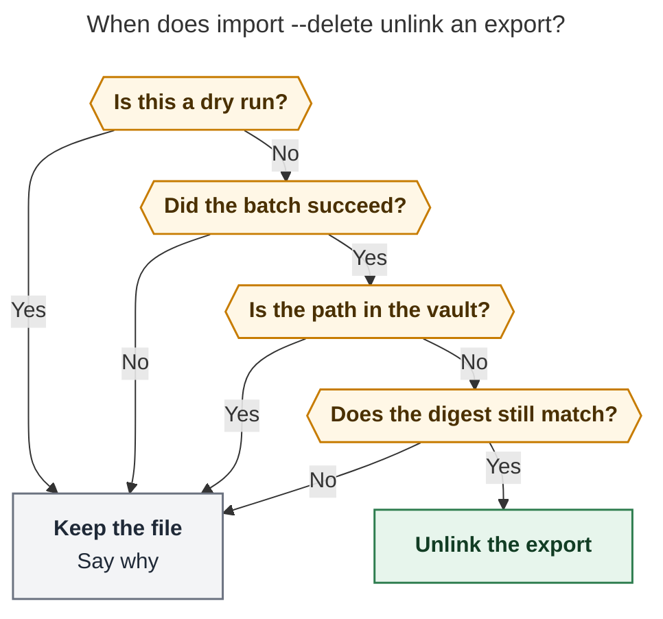

# Delete export files after a successful `bob bank import`

> **Research query:** How should `bob bank import` grow a `-D|--delete` option so
> `bank import -D ~/Downloads/*.qfx` works from Bob Command Mode, deleting the
> imported QFX files only when every import in the batch succeeds? Is that a good
> idea, which requirement adjustments are justified, and what is the recommended
> design?

Mermaid CLI 12.0.0; delete-gate SVG 585.2 × 954 px, fit 93.6%. Puppeteer PNG
export timed out on this host (`ConnectionClosedError`); the SVG is the
reviewed render.

## Bottom line

**Ship consume-on-success on `bob bank import`.** The Monday chore already
documents `bob bank import ~/Downloads/*.qfx && rm ~/Downloads/*.qfx` because
the QFX holds the full account number (`docs/guides/acknowledge-bank-transactions.md`).
Command Mode cannot run that `&& rm`: it tokenizes with shell-style quoting and
then `spawn(bob, argv)` with no shell, and a sequence may contain only bob
commands. The flag belongs on `import`.

Three adjustments make the feature intuitive and safe:

1. **Name the option `--delete` with short `-X`.** Bank-wide `-D` is already
   `--day`. Import's `-d` is `--dry-run`; a shifted `-D` would sit on the
   adjacent key of preview and would mean "write the vault and destroy the
   exports."
2. **Expand `~` and a trailing glob on every `FILE` argument**, including
   without `--delete`. Without that, the typed command from Command Mode is a
   literal path `~/Downloads/*.qfx` and `fs::read` fails.
3. **Unlink after the vault transaction commits**, only for prepared sources
   whose SHA-256 still matches, never during `-d`, never for a path inside the
   vault.

A no-op re-import of an already-seen file is a successful import. Those files
should be deleted. That is the leftover-Downloads case.

With `--delete` and no `FILE`, default to `~/Downloads/*.{qfx,ofx}` (CSV stays
explicit because it always needs `-a`). The Command Mode chord becomes
`bank import -X`.

## Critique of the proposed plan

The idea is sound. Import is already an all-or-nothing batch: one malformed
member refuses the whole run with no vault, journal, Git, or sync change
(`docs/bank.md` Import; `prepare_sources` in `src/native/bank/import_run.rs`).
"Delete iff all imports were successful" maps onto `failure.is_none()` after
`apply_with_restore`, including a `changed: false` re-import. Putting the
unlink in bob, behind an opt-in flag, is the right shape for Command Mode.

The as-stated spelling and the as-stated `FILE` contract are the weak parts.

**`-D` is already a bank family option.** `docs/bank.md` says `-D` takes
`today`, `yesterday`, `tomorrow`, or `YYYY-MM-DD`. `ensure`, `ack`, and
`report` all bind `-D` to `--day` (`src/native/bank/cli.rs`). Import has no
day flag, so clap would accept a local boolean `-D`, but `bank import -D today`
would then treat `today` as a file to import and delete. The `ensure -D today`
muscle memory is the footgun.

**`-D` is also the shift of `-d`.** Import's preview flag is `-d/--dry-run`.
Command Mode is `Policy::PreviewFirst` with preview args `["--dry-run"]`
(`src/native/catalog/table.rs`, `bank-import`). A human who means preview and
types `-D` would skip the dry run, write the vault, and unlink the exports.

**The glob in the example does not expand today.** Command Mode's
`cmTokenizeBobArgv` splits on whitespace and honors quotes; it does not expand
`*` or `~` (`plugins/bob-command-mode/src/175-args-vim.js`). The runner
`spawn`s the bob binary with those tokens, `cwd` set to the vault
(`src/060-runner.js`). `execute_import` passes `FILE` through as `PathBuf`
with no `expand_tilde` (`src/native/bank/cli.rs`). `~` expansion exists for
`--bob-dir` and many other path flags (`src/native/env.rs`), and not for
import sources. Completing `!files` in Command Mode offers **vault notes**,
not host files (`cmVaultPathCandidates`). Tab therefore cannot assemble
`~/Downloads/Checking1.qfx` either.

**`&& rm` cannot be a Command Mode sequence.** Sequences accept only bob
catalog rows. `rm` is not a bob command. Copy-as-`&&` is for a real shell.

**"Successful" needs a contract sentence.** Import already treats these as
success (exit 0, `ok: true`): new rows, typed-row matches, already-seen
identities, `before_start` journal-only events, and `-F` restorations. A
post-sync warning leaves `failure: None` and still prints the commit
(`run_locked` in `src/native/host_catalog/txn.rs`). Those are successful
imports. A refused parse, identity conflict, ignored journal, lock failure, or
pre-sync failure is not. Dry-run is a successful *preview* and must keep the
files.

**Deleting before the commit would be the wrong order.** Sources are parsed
before the maintenance lock. The lock then pre-syncs, plans, writes month
notes and the journal, verifies after-images, and commits. If unlink ran
before `apply_and_commit` returned, a later commit or verify failure would
destroy the only copy of a statement that never landed. rsync's
`--remove-source-files` waits until each file is duplicated on the receiving
side; import should wait until the scoped `bank: import` commit exists (or
until a no-op run reports `failure: None`).

**Trash is the wrong sink.** The guide uses `rm` because the file holds the
account number. bob discards `ACCTID` / `BANKID` during parse and never stores
them (`docs/bank.md` Account resolution). The QFX on disk is the remaining
copy of that number. Unlink matches the current chore. A Trash folder would
keep the number recoverable.

hledger's newer `archive` rule *moves* CSV into `data/archive/` after a
successful `hledger import bank.rules`, because CSV layouts drift and the
archive is for regenerating rules. Bob's OFX/QFX parser is the contract, and
the per-host journal is the audit. Archiving QFX into the vault would park
account numbers next to notes. Unlink is the better bob answer; overlapping
re-downloads are already healed by FITID / journal identity.

## Adjusted requirements

Call-outs, each a change to the request as written:

| # | Adjustment | Why |
| --- | --- | --- |
| A1 | Long option `--delete`, short **`-X`**, not `-D` | Bank-wide `-D` is `--day`. `-D` is the shift of dry-run `-d`. CLI rules still get a short alias. |
| A2 | Expand `~` and trailing globs on **every** `FILE`, including without `--delete` | Command Mode passes argv through. The example command is otherwise a literal asterisk path. |
| A3 | Empty glob match is refused input (exit 2, `bank_import_no_match`), zsh-`NOMATCH` style | A literal `*.qfx` read error is a worse teaching message. |
| A4 | `--delete` with no `FILE` and without `-F` defaults to `~/Downloads/*.{qfx,ofx}` | Command Mode file completion is vault-scoped. CSV stays explicit (`-a` is required). |
| A5 | `-d --delete` **previews** unlinks (`Would delete …`) and leaves files | PreviewFirst injects `--dry-run`. Refusing the combo would break Shift+Enter on the Monday command. |
| A6 | Unlink **after** `apply_with_restore` returns with `failure.is_none()` | Commit-then-delete. A failed delete is retryable because a second `-X` run is a seen no-op. |
| A7 | Unlink only prepared sources whose current SHA-256 still matches `file_digest` | The bytes on disk are still the statement that was imported. |
| A8 | Refuse to unlink any path inside the vault root | Import writes `bank/YYYY-MM.md`; a mistaken `FILE` must not consume vault bytes. |
| A9 | Unlink, do not trash or shred | Matches the current `rm`, removes the account number from Downloads. |
| A10 | JSON grows an additive `delete` object; `schema_version` stays 1 | Additive envelope, no `!` contract break. Omit the key when `--delete` is off. |
| A11 | Keep catalog `Policy::PreviewFirst` | A second confirm card would tax the Monday chore. Ctrl+Enter already skips preview. |

Out of scope for this flag, worth a later bead: Command Mode host-filesystem
completion for `!files` on `bank import` (today it lists vault notes). Glob
expansion makes the typed command work without that.

## How import behaves today

Membership: `bob bank import [FILE...] [-a ALIAS] [-b DIR] [-d] [-F] [-f human|json]`.
Omitting `FILE` is exit 2 (`bank_import_missing_files`) unless `-F` restores
from the journal. Files parse before the lock. A malformed member refuses the
batch. Apply runs under `run_locked`: identity check, lock, pre-sync, plan,
`apply_and_commit`, post-sync. Post-sync failure becomes a warning; the commit
stands.

Exit 2 is refused input / unsafe batch. Exit 1 is runtime (lock, I/O, verify).
Exit 0 is `failure.is_none()`, including "No changes; no import commit."

Human output already names each source file, counts (new / matched / seen /
ambiguous / before start), money, and `Next:`. JSON `files[]` carries
`file`, counts, `status: new_evidence|seen`. `PreparedSource` keeps the
label and parsed statement; the statement already has `file_digest`.

That is enough state to delete the right bytes after success. No planner
change is required for matching, restoration, or subscriptions.

## Command Mode is why the flag exists

Evidence from bob-plugins (opened for this report):

- Typed lines use `cmTokenizeBobArgv` (quotes and backslashes, no glob).
- `cmExpandHome` exists for the bob binary path, not for user `FILE` words.
- `spawn(spec.resolution.path, spawnArgs, { cwd: spec.vaultBase, detached: true })`.
- `!files` / `!files <glob>` become `cmVaultPathCandidates`.
- Sequences: bob rows only; Copy joins with `&&` for a real shell.

A zsh user outside Command Mode already has glob and tilde, and the guide's
`&& rm` already skips `rm` on a refused import. The new flag is for the
Obsidian sheet, where that shell contract is absent. Implementing glob
expansion in bob keeps one behavior for Command Mode, quoted shell
invocations, and tests.

## Flag design

CLI rules: every public long option gets a short alias; options stay
alphabetical; help is generated.

Alphabetical long names on import become: `--account`, `--bob-dir`,
`--delete`, `--dry-run`, `--force`, `--format`, `--help`.

| Spelling | Verdict |
| --- | --- |
| `--delete` / `-D` | Reject. Family `-D` is day; adjacent to `-d`. |
| `--delete` / `-X` | **Take.** Distinct from `-d`, unused on `bank import`, reads as expunge. |
| `--consume` / `-C` | Pretty verb, weaker than the requested name `--delete`. |
| Default delete with no flag | Reject. Destroying Downloads must stay an explicit gesture. |
| Command-Mode-only glob | Reject as the sole expansion site. bob must understand the path it is asked to delete. |

Help text:

```text
-X, --delete
        Delete imported QFX/OFX files after a successful write
```

`after_help` examples:

```text
bob bank import -X
bob bank import -X ~/Downloads/*.qfx
bob bank import -d -X ~/Downloads/checking.qfx
```

`-X` without `FILE` and without `-F` means "consume `~/Downloads/*.{qfx,ofx}`."
`-F` without `FILE` stays restore-only. `-F -X` without `FILE` is exit 2:
pass `FILE` to delete after restore, or omit `-F` to consume Downloads.

## When a file is unlinked

**Reader question:** When does `bob bank import --delete` unlink an export?

**Caption:** Unlink only after a committed successful batch, only for the
exact bytes that were imported, and never for a dry run or a vault path.



Rendered size: 585.2 × 954 px; fit scale: 93.6%.



"Did the batch succeed?" means `report.failure.is_none()` after apply, which
includes seen-only no-ops and post-sync warnings. It excludes parse refusals
and lock/sync/verify failures.

Lifecycle, in order:

1. Expand each `FILE` (`~`, glob, dedupe by canonicalize, refuse directories
   and empty matches).
2. `prepare_sources`: read bytes, parse, keep `file_digest`.
3. Dry-run: plan, print diffs, print `Would delete N export files.`, exit 0.
4. Apply: `run_locked` → commit (or no-op success).
5. If `failure.is_some()`, print the failure and **stop**. Files stay.
6. Else unlink each surviving candidate. Print `Deleted N export files.`
7. If any unlink fails, keep the import summary, then report
   `bank_import_delete_failed` (exit 1). Hint: retry the same `-X` command;
   the batch is now a seen no-op.

Never unlink under the vault lock. Downloads is outside the worktree; holding
the lock across `unlink(2)` would stall other writers for no benefit.

## Glob and tilde rules

Apply to `FILE` even when `--delete` is off, so Command Mode
`bank import ~/Downloads/*.qfx` starts working.

For each argv token:

1. `expand_tilde` (`~` and `~/…` only; same helper as `--bob-dir`).
2. If the path exists as a regular file, use it, even if the name contains
   `*`. A real file named `foo*.qfx` wins.
3. Else if the path contains unescaped glob characters, expand with
   non-recursive matching (`*` and `?` do not cross `/`; no `**`). Sort each
   expansion lexically, like bash/zsh. Concatenate expansions in argv order.
4. Empty expansion: exit 2, `no files match {pattern}`.
5. A non-glob missing path keeps today's read error.
6. Dedupe by canonical path so `a.qfx a.qfx` does not become two statements.
7. A directory is refused input.

Relative paths resolve against process cwd. Command Mode's cwd is the vault,
so `Downloads/*.qfx` without `~` looks in the vault and should fail loudly.
The documented examples keep `~/Downloads/`.

Do not add a `glob` crate unless the stdlib path is painful; a small helper
that expands only the last component (`dir/*.qfx`) covers the Monday case.
`*.{qfx,ofx}` brace expansion is a bob convenience for the no-`FILE` default,
not a general brace language.

Completion: change `Kind::Files(None)` for `bank import` to
`Kind::Files(Some("*.qfx *.ofx *.csv"))` so zsh/bash native `!files` filters
exports. Command Mode will still map that glob onto vault notes until a
host-fs follow-up lands; the typed glob still works via A2.

## Human and JSON

Human, after the existing commit / `Next:` lines, in the same styler:

- Success: `Deleted 2 export files.` (green), listing basenames when N ≤ 3,
  otherwise the count plus the parent directory.
- Dry-run: `Would delete 2 export files.` (dim), same listing.
- Partial unlink: import summary unchanged, then
  `✗ bob bank import: could not delete Checking1.qfx: Permission denied`
  and the retry hint.

JSON, additive, only when `--delete` was passed:

```json
"delete": {
  "requested": true,
  "deleted": ["/Users/bryan/Downloads/Checking1.qfx"],
  "kept": [],
  "would_delete": []
}
```

`would_delete` is filled on dry-run; `deleted` is empty then. `kept` entries
are `{ "file": "…", "reason": "vault_path"|"digest_changed"|"io"|"not_a_file" }`.
Paths in JSON stay absolute after tilde expansion so a client can show them.
Do not echo FITID, ACCTID, or raw OFX.

`ok` is false when delete fails, even though the vault commit happened. That
matches "the command the user ran did not fully succeed" and keeps retry
honest. `commit` still reports the sha.

## Alternatives considered

**Keep `&& rm` in a real shell.** Works in Terminal.app. Fails in Command
Mode. The request is specifically the Obsidian sheet.

**Command Mode expands globs for every file-taking command.** Broader, and
the right long-term shell-replacement move. It does not by itself delete
files, and it still needs bob to refuse vault unlinks and digest-mismatch.
Do the bob-side work first.

**hledger-style archive into `data/archive/`.** Useful when the source format
is a moving CSV. Bob's journal already records identities; QFX account
numbers should leave the disk.

**Default `--delete` on.** Too surprising next to PreviewFirst's Ctrl+Enter
skip. Opt-in `-X` is the gesture.

**Per-file success in a partial batch.** Import does not have partial
success. Teaching a per-file delete rule would imply a per-file write rule
the planner does not offer. Keep the batch gate.

**`bank.import_dir` in `bank.md`.** Nice later. `~/Downloads` is the chore
today; a config key can wait until a second host wants a different inbox.

## Recommended solution

Implement **`--delete` / `-X`** on `bob bank import` with adjustments A1–A11.

The Command Mode command Bryan asked for becomes either:

```text
bank import -X
```

or, with an explicit glob that bob now expands:

```text
bank import -X ~/Downloads/*.qfx
```

The Monday guide replaces

```bash
bob bank import ~/Downloads/*.qfx && rm ~/Downloads/*.qfx
```

with

```bash
bob bank import -X ~/Downloads/*.qfx
```

and mentions `bank import -X` from Command Mode. The `&& rm` sentence about
account numbers stays, now as the reason `-X` exists.

### Code sketch

- `src/native/bank/cli.rs`: add `--delete` / `-X` (`ArgAction::SetTrue`) in
  alphabetical option order; expand `FILE` before `prepare_sources`; after
  printing the report, if `--delete` and not dry-run and `failure.is_none()`,
  unlink; if unlink fails, print the error and return 1. Default Downloads
  glob when `--delete` and `FILE` is empty and `-F` is off.
- `src/native/bank/import_run.rs` (or a sibling `import_sources.rs`):
  `expand_source_args`, `paths_under_vault`, `unlink_prepared_sources`
  using `statement.file_digest`. Keep delete **out** of `planned_txn` /
  `run_locked`.
- `ImportReport`: optional `delete` summary for JSON and human.
- `src/native/bank/tests.rs`: help lists `-X, --delete`.
- Unit tests around expand + unlink (tempdir, digest mismatch, vault skip,
  dry-run, failed parse, seen no-op, default Downloads).
- `src/native/completion/kinds.rs`: `Kind::Files(Some("*.qfx *.ofx *.csv"))`.
- Docs: `docs/bank.md` contract line, Import examples, JSON `delete` object;
  `docs/guides/acknowledge-bank-transactions.md`; `just docs-gen` for
  `docs/reference/cli/bank.md`. Additive JSON, no changelog `!`.

`bank-import` catalog policy stays PreviewFirst with `--dry-run`. No new
confirm text.

### Tests that pin the contract

- Help contains `-X, --delete` and the new examples; `-D` is still unknown on
  import (clap error), so `bank import -D today` does not silently mean day.
- `-d -X` leaves files, JSON `would_delete` filled, `deleted` empty, exit 0.
- Successful new-row import with `-X` unlinks; a second `-X` on a replacement
  file with the same identities also unlinks (seen no-op).
- Malformed member: exit 2, files remain.
- Digest changed between parse and unlink: file kept, `kept.reason` is
  `digest_changed`, exit 1.
- Path inside the vault: import may proceed if it parses; unlink is skipped
  with `vault_path`.
- `~/…` and `dir/*.qfx` expand; empty match is exit 2.
- `-X` and no `FILE` expands Downloads qfx/ofx; a Downloads CSV is ignored
  until passed explicitly with `-a`.
- `-F -X` with no `FILE` is exit 2.

## Is this a good idea?

Yes. The chore already wants this. Command Mode is the reason it has to live
on `import`. The batch planner already gives a single success bit. The
design work is naming, glob/tilde, and the post-commit unlink gate — not a
new import semantics.

The one thing I would not take from the request as written is `-D`. Use
`--delete` / `-X`, expand `FILE`, and let bare `bank import -X` consume
`~/Downloads/*.{qfx,ofx}`.
