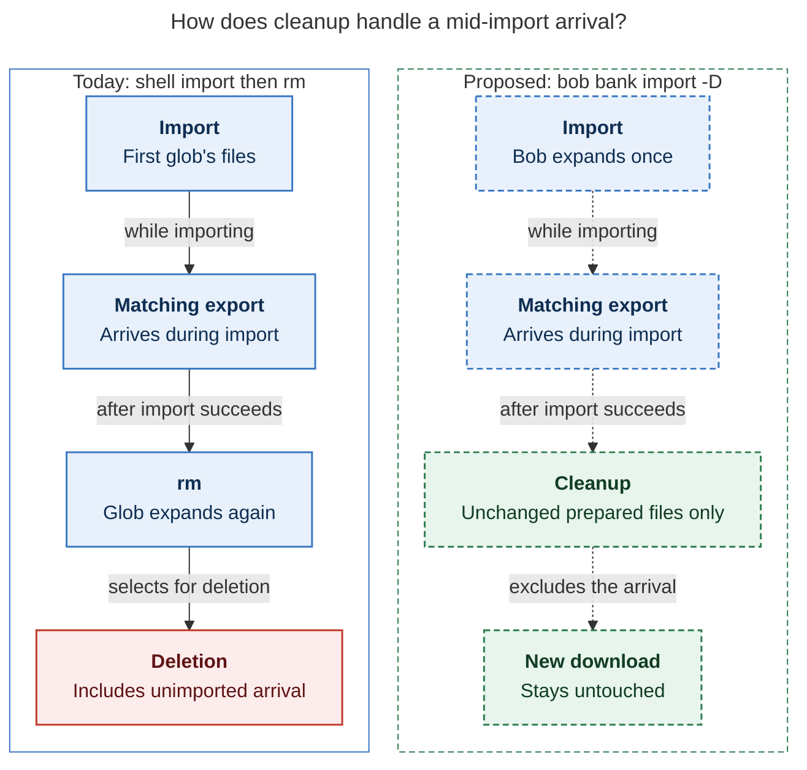
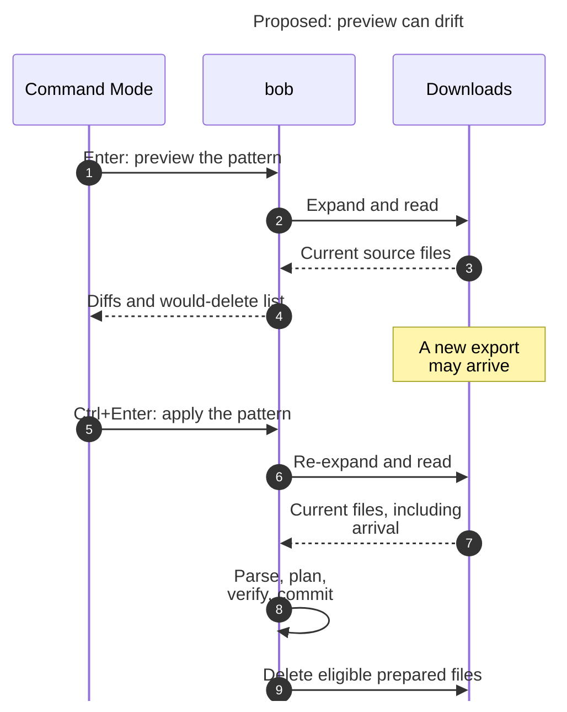

# Diagram proposals: `bob bank import -D|--delete`: consolidated design for success-gated source cleanup

Proposals for the swarm linker, not a report. Each diagram restates only what the source
report says.

```yaml
source: research:202611/bank_import_delete_flag/bank_import_delete_flag__final.md
producer: research.5j.image
check: "mmdc 12.0.0 with the PDF-mirroring config rendered 2 of 2 Mermaid diagrams; Puppeteer --no-sandbox; SVG and PNG reviewed; invalid input rejected"
```

## mid-import-arrival

```yaml
anchor: |-
  and the re-expanded `rm` glob can delete a file
question: |-
  Which files can cleanup remove if another matching export arrives during import?
illustrates: |-
  The re-expanded `rm` glob can delete a file that arrived mid-import, while the new flag deletes exactly the files it parsed.
caption: A second shell glob can delete a mid-import arrival; proposed cleanup targets only unchanged prepared sources.
review: "656x673 px, fit 99.5%; question, source trace, labels, arrowheads, reading direction and PNG visual checks passed; 1 revision"
```



## preview-apply-drift

```yaml
anchor: |-
  The glob re-expands at apply; a file arriving between
question: |-
  Can Apply include an export that was absent from preview?
illustrates: |-
  The glob re-expands at apply, so a file arriving between Enter and Ctrl+Enter can be imported and deleted without having been previewed.
caption: Successful Apply may record and delete an export that arrived after preview; it re-expands the pattern.
review: "515x754 px, fit 100.0%; question, source trace, labels, arrowheads, reading direction and PNG visual checks passed; 1 revision"
```


