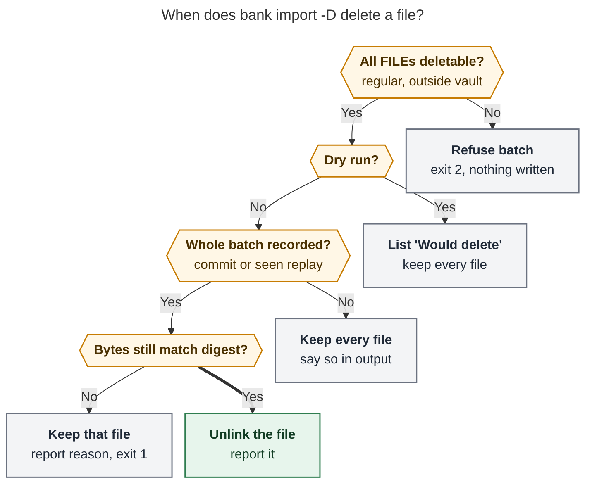
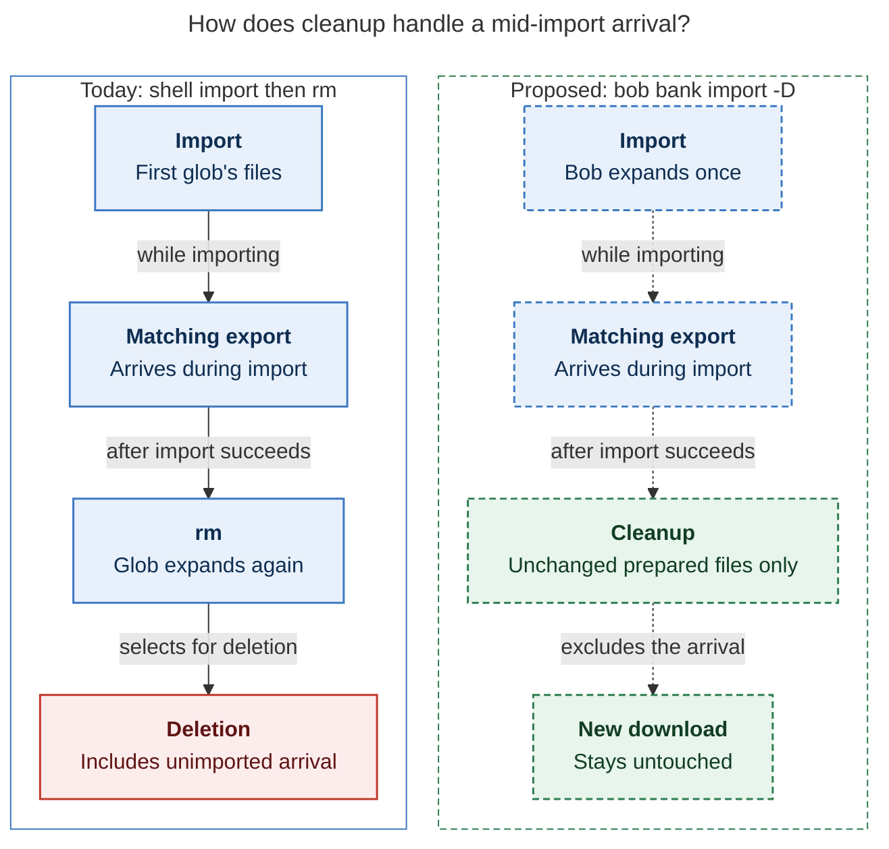
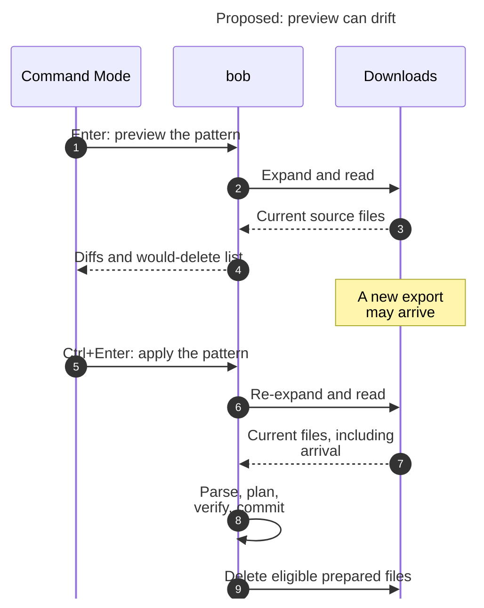

# `bob bank import -D|--delete`: consolidated design for success-gated source cleanup

> **Research query:** How should a new `-D|--delete` option for `bob bank import` be
> designed so that `bank import -D ~/Downloads/*.qfx`, run from bob's command mode in
> Obsidian, deletes the imported QFX files if and only if all imports succeed, in a way
> that is intuitive, reliable, and beautiful? Is this a good idea, would a different
> approach be better, which requirement adjustments are justified, and what solution is
> recommended?


## Bottom line

**Build it.** All five researchers independently reached the same conclusion, and my
verification confirms their shared evidence. The Monday guide already prescribes
`bob bank import ~/Downloads/*.qfx && rm ~/Downloads/*.qfx` because the QFX holds the
full account number (`docs/guides/acknowledge-bank-transactions.md:32`). `-D` moves
that cleanup into bob, where it belongs: bob is the only component that knows exactly
which files it recorded, and the `&& rm` idiom both re-expands the glob after the
import (a file downloaded mid-import is deleted unimported) and cannot be expressed
in Command Mode at all.

**But the flag alone does not deliver the requested command.** Command Mode spawns
`bob` directly with no shell (`spawn(bobPath, args, {cwd: vaultBase})`;
`cmTokenizeBobArgv` handles quotes only), so `~/Downloads/*.qfx` reaches bob as a
literal string, and `execute_import` turns FILE operands into `PathBuf`s with no
tilde or glob expansion (`src/native/bank/cli.rs:532-536`; only `--bob-dir` gets
`expand_tilde`). Two researchers confirmed this with a live probe of the installed
`bob 0.5.0`: literal `~/Downloads/*.qfx` fails with
`could not read source: No such file or directory`, exit 2. The enabling change —
unanimous across all five reports — is that **[bob expands `~` and glob patterns in
`bank import` FILE operands itself](#operand-expansion)**. `-D` is the small part.

The feature is safe to build precisely because import is already all-or-nothing: every
source parses before the lock, one malformed member refuses the whole batch with no
vault, journal, Git, or sync change, and a successful apply is one guarded transaction
with one scoped commit. "Delete iff all imports were successful" maps onto a single
boolean, [`report.failure.is_none()`, checked after `apply_with_restore`
returns](#lifecycle-and-the-delete-gate).

## Requirement adjustments

Each adjustment below is a deliberate change to the request as written.

1. **bob expands `~` and glob patterns in `bank import` FILE operands — with or
   without `-D`.** (Required; unanimous.) Without it the requested command cannot work
   from Command Mode. Expanding in bob rather than in the plugin keeps one behavior
   across shell, scripts, and Obsidian — and keeps Command Mode's RECENT entry storing
   the *pattern*, so next Monday's one-click replay re-expands against the new
   downloads instead of replaying last week's now-deleted filenames (cld's decisive
   argument against plugin-side expansion).
2. **"QFX files" becomes "the source files bob imported": QFX, OFX, and the Wells
   Fargo CSV profile.** The importer treats all three identically; leaving an `.ofx`
   or `.csv` behind in a `-D` batch would violate least surprise.
3. **"Successful" is defined precisely:** `report.failure.is_none()` after a non-dry-run
   `apply_with_restore`. That *includes* the all-seen replay ("No changes; no import
   commit" — the re-downloaded `Checking1 (1).qfx` case is the main leftover-Downloads
   scenario, and deleting it is the point) and the post-sync-failure success (local
   commit durable). It *excludes* every refusal (exit 2), every runtime failure
   (exit 1), and every dry run.
4. **"Iff" is a safety gate plus an attempted cleanup, not a guarantee** (cdx's
   framing). A vault commit and a Downloads unlink cannot share an atomic transaction.
   No file is ever removed before the batch succeeds; a successful batch may still
   retain files when removal is unsafe (bytes changed) or impossible (permissions).
   Those outcomes are reported per file and are retryable — never silent, never a
   rollback of the committed import.
5. **Deletion is permanent unlink, not Trash** (adjustment vs. cld's recommendation;
   see [the disagreements table](#where-the-researchers-disagreed-and-the-calls-i-made)).
6. **`-D` requires at least one FILE operand**; `-D -F` with no FILE is exit 2; an
   expansion that matches nothing is exit 2 with a teaching message. A typo like
   `~/Download/*.qfx` must fail loudly, not "succeed."

## Recommended design

### CLI contract

```text
bob bank import [FILE...] [-a ALIAS] [-b DIR] [-D] [-d] [-F] [-f human|json]

  -a, --account <ALIAS>  Choose a configured importable account
  -b, --bob-dir <DIR>    Bob vault root; defaults to BOB_DIR or ~/bob
  -D, --delete           Delete each FILE after the whole batch is recorded
  -d, --dry-run          Preview diffs without writing
  -F, --force            Restore journaled transactions whose rows are missing
  -f, --format <FORMAT>  Output format: human or json [default: human]
```

Options stay alphabetical with uppercase before lowercase, matching today's `-F`/`-f`
(per the `cli_rules` memory). clap:
`Arg::new("delete").long("delete").short('D').action(SetTrue).requires("files")`.
`long_about` gains one sentence: *"FILE accepts `~` and glob patterns
(`~/Downloads/*.qfx`), so callers without a shell, such as command mode, can pass
them. `-D` permanently deletes every FILE only after the whole batch is recorded and
only when the file is unchanged since bob read it; a refused or failed import keeps
every file."* `after_help` gains `bob bank import -D ~/Downloads/*.qfx`.

### Operand expansion

For each FILE operand, in order:

1. **Literal first.** If the operand exists as a path (after step 2's tilde
   expansion is attempted both ways), use it as-is — a real file named
   `statement [1].qfx` wins over pattern interpretation, so shell-expanded arguments
   see no behavior change.
2. Expand a leading `~`/`~/` with the existing `bob_env::expand_tilde` (already used
   for `--bob-dir`, `ref create -o`, attachments).
3. If the result contains unescaped `*`, `?`, or `[`, glob it: non-recursive (`*`
   and `?` never cross `/`, no `**`, no brace expansion, no env or command
   substitution, no `~otheruser`), regular files only, hidden entries only when the
   pattern component starts with `.`, case-sensitive, each pattern's matches sorted
   lexically with argv order preserved across patterns.
4. A pattern matching nothing → exit 2, `bank_import_no_match`
   (`no files match ~/Downloads/*.qfx`, hint: download an export or check the
   pattern). A non-glob missing path keeps today's read error. A directory is
   refused input.
5. Deduplicate by canonical path, first appearance wins, so overlapping patterns
   neither double-parse nor double-delete.

House it in a small shared helper (e.g. `native::host_paths::expand_operands`) so
`attachments import` and `ref create` can adopt it later — Command Mode's shell gap
affects every host-file operand. A focused final-component matcher covers the Monday
case; the zero-dependency `glob` crate is an acceptable alternative if bracket
classes get fiddly (the manifest currently has no glob dependency; implementer's
choice).

Relative paths stay relative to the process cwd — which is the vault in Command Mode
— so documented examples always use `~/Downloads/`.

### Lifecycle and the delete gate

**Reader question:** When does `bank import -D` delete a source file?

**Caption:** A source file is unlinked only after the whole batch is recorded —
committed, or an identical already-seen replay — and only when its bytes still match
what bob parsed; preview, every refusal, and every failure path keep every file.



Rendered with Mermaid CLI 12.0.0 under the PDF config; 842.3 × 982 px, fit 77.5%.
(Puppeteer PNG export times out on this host — the same environment limit the `__grk`
report hit — so the measured SVG is the reviewed render.)



In order:

1. **Expand** operands ([above](#operand-expansion)). With `-D`, **pre-flight every file**: regular file
   (no symlink, directory, or FIFO), canonicalized path outside the vault root.
   A violation refuses the batch, exit 2 (`bank_import_delete_unsupported`), before
   the lock, sync, or any write. This keeps the "iff" honest in both directions:
   a successful import never leaves a file behind for a reason knowable up front
   (cld A5, cdx #6).
2. **`prepare_sources`** as today: read bytes, parse, keep `file_digest` (SHA-256),
   plus the captured `(dev, inode, len, mtime)` identity from the open handle.
3. **Dry run:** plan and print diffs as today, plus the planned-deletion list.
   Nothing is removed. Exit 0.
4. **Apply:** the unchanged `run_locked` lifecycle — lock, pre-sync, fresh
   whole-batch plan, write, verify, scoped commit, post-sync. Deletion is never
   inside this transaction, never under the vault lock, and never in its rollback
   set (unanimous).
5. **If `failure.is_some()`:** print the failure and stop. Every file stays, and the
   output says so.
6. **Else, for each unique prepared file:** re-hash; if the bytes still match the
   parsed digest, `fs::remove_file`. A mismatch or unlink error keeps that file with
   a per-file reason and continues to the next (best-effort; one locked file must
   not strand the rest).
7. **Report.** All deleted: exit 0. Any kept after a committed import: full import
   summary and commit sha still print, then the per-file outcomes and a final error
   (`bank_delete_failed`, exit 1) with the retry hint — re-running the same command
   is a seen no-op that retries only the cleanup.

Implementation subtlety, verified: `ImportReport::exit_code()` maps every
`bank_import_*` failure code to exit 2, so the cleanup failure must **not** be
modeled as a `bank_import_*` `failure`. Keep the delete result a separate report
field and compute the final exit code after printing (hence `bank_delete_failed`,
outside the prefix). Crash behavior stays simple: before commit, nothing was
removed; after commit, re-running imports nothing new and finishes the cleanup.

Deletions are **never journaled** — raw host paths are banned from journal payloads
— and the commit subject does not change.

### Output

Human, real run, after the existing `Sync:` line (last side effect last), before
warnings and `Next:`:

```text
Committed bank: import 9 rows (checking) (1a2b3c4)
Sync: pre ok, post ok
Deleted 2 files from ~/Downloads: Checking1.qfx, Checking1 (1).qfx
Next: file the 9 waiting rows in bank/2026-11.md — …
```

Basenames when few, count plus the shared `~`-abbreviated directory otherwise.
Dry-run prints `Would delete 2 files from ~/Downloads: …` (highlighted — this is the
line the Command Mode preview pager must make obvious before Ctrl+Enter). A refused
batch adds one line that answers "did it delete my files?":
`Kept 2 files — nothing is deleted until the whole batch imports.` A partial cleanup
failure prints per-file ✓/✗ outcomes, then
`✗ bob bank import: committed import, but could not delete 1 file` with the hint
`Remove it manually — it may contain your account number — or re-run the import.`
All through the existing `Styler` (green success, dim hints, red refusals), honoring
`NO_COLOR` and pipes.

JSON (additive; `schema_version` stays 1; `"delete": null` when the flag is off):

```json
"delete": {
  "requested": true,
  "files": [
    { "path": "/home/bryan/Downloads/Checking1.qfx", "status": "deleted", "reason": null },
    { "path": "/home/bryan/Downloads/Checking1 (1).qfx", "status": "kept", "reason": "changed_since_read" }
  ]
}
```

`status` ∈ `would_delete | deleted | kept`; `reason` ∈
`import_failed | changed_since_read | io | not_a_file | vault_path`. On cleanup
failure after a committed import: top-level `ok: false`, exit 1, `commit` still
carries the sha, and the `files[]`/`rows[]` import summary is intact. Never echo
FITID, ACCTID, or raw OFX. Additive keys mean no `!` contract break under the daily
release train; leave `Cargo.toml` and `CHANGELOG.md` alone.

### Command Mode integration

**Required: nothing.** Once bob expands operands, the typed
`bank import -D ~/Downloads/*.qfx` previews on Enter (PreviewFirst injects
`--dry-run`; the preview shows the diffs plus the would-delete list) and applies on
Ctrl+Enter. RECENT replays the pattern every Monday. No new confirm card — the
opt-in flag plus the existing preview/apply gesture *is* the consent (unanimous; a
second dialog would tax the weekly chore).

**Recommended companions, small and separable:**

- **Light up bank refresh.** `bob-ledger-tools` already handles a `"bank"`
  invalidation tag on `bob-command-mode:run-finished`
  (`283-plugin-command-mode-refresh.js:51`, verified), but `KNOWN_INVALIDATES` in
  `src/native/catalog/table.rs:31` omits `"bank"` and the `bank-import` row emits
  none — so today a Command Mode import does not refresh Bank Badges, cards, or `]b`
  walk state. Add `"bank"` to both (and consider `bank-ack`/`bank-ensure`). This is
  a pre-existing gap worth fixing with or without `-D` (gem's find).
- **Completion:** change `bank import`'s files kind from `Kind::Files(None)` to
  `Kind::Files(Some("*.qfx *.ofx *.csv"))` so zsh/bash Tab filters exports. Command
  Mode's `!files` still maps to vault notes — host-filesystem completion is a worthy
  later bead, not a blocker, since the typed glob now works.
- **Phase 2 (cld):** make the bank card's `Weekly import:` footer a one-click
  `api.commandMode.preview(["bank", "import", "-D", "~/Downloads/*.qfx"])` button —
  the same path keep-inbox actions use. One click → preview with the would-delete
  list → Ctrl+Enter. Optionally add `delete`/`downloads` to the catalog keywords.
- **Optional, defer:** gem's outcome adapter for crisper toasts ("Imported 9 rows ·
  deleted 2 files"), and cld's macOS TCC hint (when Downloads reads fail with
  EPERM, point at System Settings → Privacy & Security instead of "fix the source
  file").

### Docs and memory

- `docs/bank.md`: synopsis, a short "Deleting imported downloads (`-D`)" subsection
  under Import (the gate, expansion rules, no journaling), exit-code bullets, the
  JSON field. Then `just docs-gen` + `just docs-check`.
- `docs/guides/acknowledge-bank-transactions.md`: replace the `&& rm` line with
  `bob bank import -D ~/Downloads/*.qfx`, keep the account-number rationale as the
  reason `-D` exists, and mention it now works from Command Mode. While editing:
  cld found the guide's sample import output has drifted from what `print_human`
  actually prints — fix it in the same pass.
- One decision record (via `/sase_memory_write` during implementation): *bob expands
  `~` and globs in host-file operands, literal-first, because Command Mode has no
  shell* — a durable cross-command policy. The delete gate itself is contract
  material for `docs/bank.md`, not a decision record.

## Where the researchers disagreed and the calls I made

| Question | Positions | My call | Why |
| --- | --- | --- | --- |
| Flag spelling | cdx, cld, gem: keep `-D, --delete`. grk, mus: respell `-X, --delete` (`-D` = `--day` elsewhere in `bank`; shift-of-`-d` footgun) | **Keep `-D, --delete`** | See [the spelling section below](#flag-spelling). Misuse fails safe, in-repo precedent exists, and Bryan asked for it twice. The dissent is recorded; never add a second spelling later. |
| Unlink vs Trash | cdx, grk, mus, gem: permanent `fs::remove_file`. cld: OS Trash (NSFileManager / freedesktop) | **Unlink** | The documented reason for deletion is that the QFX holds the account number; Trash retains that PII on disk. Unlink matches the `rm` ritual exactly, adds no platform dependency, and behaves identically on all hosts. Re-import safety comes from the journal, not from Trash. |
| Exit code when cleanup fails after a committed import | grk, gem, cdx: exit 1, `ok: false`. mus, cld: exit 0 + warning | **Exit 1** | The flag's entire promise is the cleanup. Exit 0 would let Command Mode show a green "completed" toast while a file with the account number remains in Downloads. The import summary and commit sha still print; a re-run is a seen no-op that retries the cleanup, so recovery is one gesture. |
| Delete when post-sync fails | cld, grk, mus, gem: yes (local commit is durable). cdx: hold files, exit 1 | **Delete** | `run_locked` keeps the local commit and returns `failure: None` with a warning (pinned by `post_sync_failure_keeps_the_local_commit_and_journal`). The evidence is durably committed; keeping PII in Downloads because the network hiccuped is strictly worse. |
| `-D` with no FILE | grk: default to `~/Downloads/*.{qfx,ofx}`. cld, gem, cdx: refuse exit 2 | **Refuse, exit 2** | Implicitly scanning and deleting files the user never named is the opposite of intuitive for a destructive flag, and it would break the existing "no FILE is refused" contract. The one-gesture result grk wanted comes from the bank-card button ([Phase 2](#command-mode-integration)) instead, which spells the full pattern out. |
| Per-file journal receipt check before delete | cld: verify each file's SHA-256 appears in a `bank.import` event. Others: gate on `failure.is_none()` only | **Optional, not load-bearing** | I verified the check is *sound*: `is_new_evidence` (`import_plan.rs:1061-1076`) appends an event for any new digest/window/balance, and a non-new file matched an existing event — so after any successful import every processed file's digest is in the journal. But the committed, verified transaction already proves the same thing. Do it only if the journal is already reloaded for `refresh_accounts`; the on-disk digest recheck is the guard that matters. |
| Bind Command Mode Apply to previewed bytes | cdx: expected-source fingerprint through the `BOB_RUN_RECEIPT` channel. cld: accept apply-time re-expansion. Others: silent | **Reject for v1** | The drift window (a file arriving between Enter and Ctrl+Enter) is safe: any file deleted was first fully parsed, planned, verified, and committed. Ctrl+Enter is already a deliberate skip-preview gesture for vault writes. The fingerprint protocol spans the runner, receipt format, and plugin compatibility — far too much machinery for that residual. Revisit only if real drift ever bites. |
| Case-insensitive globbing (`*.qfx` matches `.QFX`) | cld: yes. Others: silent/shell parity | **Case-sensitive** | The same typed command should match the same files in zsh and in Command Mode. Divergence between the two surfaces is worse than an occasional explicitly-typed `*.QFX`. |

### Flag spelling

**Keep `-D, --delete`, with the dissent recorded.**

Two of five researchers wanted `-X`. Their facts are correct and I verified them:
`-D` means `--day` on `bank report`, `bank ensure`, and `bank ack`
(`src/native/bank/cli.rs:432-458`), and `-D` sits one shift key from `-d, --dry-run`.
I still recommend keeping `-D`, for four reasons:

1. **The family collision fails safe.** On `bank import`, `-D` is free, and muscle-memory
   misuse is harmless: `bank import -D today` makes `today` a FILE operand, the read
   fails, and the whole batch is refused with exit 2 — nothing written, nothing
   deleted. (cld's probe demonstrated this failure shape live.)
2. **The adjacency precedent already exists in this codebase.** `capture` and
   `task merge` pair value-taking `-D (--drawer)` beside `-d (--dry-run)` today
   (`src/native/capture/cli.rs:817`, `src/native/task_merge/command.rs:91`) without
   incident.
3. **The requested surface is PreviewFirst.** In Command Mode, Enter always injects
   `--dry-run` (`bank-import` row, `src/native/catalog/table.rs:1349-1357`), so the
   `-d`-vs-`-D` typo cannot skip preview there. In a raw shell, mistyping `-D` for
   `-d` commits a real import (revertible) and deletes only files whose evidence was
   fully recorded first — a bounded, recoverable mistake (re-download from the bank).
4. **`-X` costs discoverability.** It has no mnemonic connection to `--delete`, and the
   CLI rules demand *a* short alias, not an unmemorable one.

Whichever way this lands: ship exactly one spelling. Hidden aliases are permanent in
this codebase, so do not add `-X` as a fallback or `-D` as a hidden alias of `-X`.
If the shell-typo risk feels heavier to Bryan than it does to me, the respelling case
is fully argued in `__mus` §4.1 and `__grk` A1.

## Rejected alternatives

- **Keep the shell idiom `&& rm`.** Impossible in Command Mode (no shell; sequences
  accept only bob catalog rows), and the re-expanded `rm` glob can delete a file
  that arrived mid-import, unimported. The new flag deletes exactly the files it
  parsed, like `rsync --remove-source-files` (precedent family: tar
  `--remove-files`, zip `-m`, Image Capture's "Delete after import").
- **Plugin-side `~`/glob expansion.** Breaks the catalog's "binary is source of
  truth" architecture, is unsafe for non-path arguments (`bob query "*foo*"`), and
  would persist expanded, since-deleted filenames into RECENT.
- **Archive the QFX into the vault (bean-file model) or a bob-owned directory.**
  `docs/bank.md` promises account and routing numbers are never stored; the QFX
  carries `ACCTID`. The journal plus `-F` already restore everything bob needs.
- **Trash instead of unlink** — see [the disagreements table](#where-the-researchers-disagreed-and-the-calls-i-made).
- **Default-on deletion, `--keep` inversion, folder watch, auto-import.** Destroying
  downloads must stay an explicit gesture, and a watcher skips the preview-first
  review of a money write.
- **Per-file delete in a partial batch.** Import has no partial success; teaching a
  per-file delete rule would imply a per-file write rule the planner doesn't offer.

[The mid-import-arrival diagram](#figure-mid-import-arrival) sets both cleanup paths
side by side: the re-expanded `rm` glob can delete a mid-import arrival, while the new
flag deletes exactly the files it parsed.

<div id="figure-mid-import-arrival">



_A second shell glob can delete a mid-import arrival; proposed cleanup targets only unchanged prepared sources._

</div>

## Implementation and test sketch

Code (bob-cli): `delete_arg()` in `src/native/bank/cli.rs` (alphabetical);
`native::host_paths::expand_operands` (new, shared); pre-flight + post-success unlink
in a focused helper (`import_run::remove_sources` or sibling module), keeping
`plan_import`/`import_plan.rs` pure and deletion out of `planned_txn`/`run_locked`;
`PreparedSource` keeps path + captured identity; `ImportReport.delete:
Option<DeleteReport>` feeding `print_human` and `to_json`; completion kind;
catalog `invalidates`. Commit as `feat(bank): …`, non-breaking.

Tests that pin the contract (merged from all five reports):

- Help lists `-D, --delete` in order `-a -b -D -d -F -f -h`; `-D` without FILE
  (including `-D -F`) exits 2.
- Expansion: literal `~/Downloads/*.qfx` with a temp HOME (the Command Mode shape);
  literal-exists-wins for `statement [1].qfx`; spaces; directory refusal; zero-match
  exit 2 before lock/sync; overlapping patterns dedupe (parse once, delete once);
  deterministic order; non-UTF-8 paths.
- Gate: success unlinks; all-seen replay (no commit) unlinks; mixed QFX/CSV unlinks
  all; post-sync failure unlinks; malformed member / unresolved account / identity
  conflict / ignored journal / lock busy / stale note keep every file and print the
  kept line; `-d -D` keeps every byte and fills `would_delete`.
- Safety: digest changed between read and unlink → that file kept with
  `changed_since_read`, commit intact, exit 1; fault-injected unlink failure on the
  second file → first deleted, second kept, import summary intact, exit 1, re-run
  heals; symlink/FIFO/vault-path refused up front, exit 2.
- JSON contract snapshot (additive keys; `delete: null` without the flag).

bob-plugins (Phase 2): bank-card footer button test, `invalidates: ["bank"]`
triggers `apiBankInvalidate`, then `npm test` and `bob plugins sync`. A real Mac
smoke test from Command Mode is required before relying on it — if Obsidian's
spawned bob is ever sandboxed, Downloads unlinks could fail where vault writes
succeed (the per-file keep path covers it, but verify once on hardware).

## Risks and open questions

1. **Spelling sign-off.** `-D` vs `-X` is [the one genuine judgment call](#flag-spelling) (two of five
   researchers dissent). One line from Bryan settles it; the design is otherwise
   identical.
2. **Preview/apply drift.** The glob re-expands at apply; a file arriving between
   Enter and Ctrl+Enter is imported and deleted without having been previewed. It is
   still fully parsed, planned, and committed first, so I accept it (with cld);
   cdx's source-fingerprint hardening is the documented escape hatch if this ever
   bites.
3. **Unrecoverability.** The journal is a normalized record, not an archive: `-F`
   restores rows, never the QFX file. Mitigated by opt-in, preview, the digest gate,
   and the bank's own re-download capability — but it is the real cost of choosing
   unlink, and `docs/bank.md` should say so plainly.
4. **macOS TCC.** Obsidian-spawned bob may be denied Downloads access; reads fail
   before anything is written (safe direction), but the hint text should stop saying
   "fix the source file" for EPERM.

[The preview-drift sequence diagram](#figure-preview-apply-drift) walks from Enter to
Ctrl+Enter, showing how a file arriving between them can be imported and deleted
unpreviewed, because the glob re-expands at apply.

<div id="figure-preview-apply-drift">



_Successful Apply may record and delete an export that arrived after preview; it re-expands the pattern._

</div>

## Provenance

**Lead researcher consolidation** · 2026-11-19 · merges five independent swarm reports
(`__cdx`, `__cld`, `__grk`, `__mus`, `__gem` in this directory) plus the lead's own
verification against bob-cli at `e7aa392d` (`src/native/bank/{cli,import_run,import_plan,journal}.rs`,
`src/native/catalog/table.rs`, `src/native/completion/kinds.rs`, `docs/guides/acknowledge-bank-transactions.md`),
the linked bob-plugins checkout (`plugins/bob-ledger-tools/src/283-plugin-command-mode-refresh.js`),
and the `cli_rules` memory.

All five reports agreed on the core: build it, expand operands in bob, gate on
`failure.is_none()` post-commit, treat seen replays as deletable successes, keep the
batch all-or-nothing, PreviewFirst untouched, additive JSON, opt-in forever. Beyond
that consensus: **cdx** contributed the "permit, not guarantee" framing, the
literal-first/ordering rules, and the (deferred) preview-fingerprint design; **cld**
the live probes, the RECENT-stores-the-pattern argument, the `&& rm` race analysis,
the pre-flight removability check, the Trash counter-position, and the bank-card
button; **grk** the exit-code prefix subtlety, the seen-no-op retry story, the
original delete-gate figure this report's figure adapts, and the completion-filter
change; **mus** the sharpest spelling critique, the planner-purity implementation
shape, and the alternatives table; **gem** the cross-repo seam audit (the half-wired
`"bank"` invalidation tag, verified here), the TOCTOU digest check, and the outcome-
adapter polish. The lead verified every load-bearing claim above against the
checkouts and resolved [the seven disagreements in the table](#where-the-researchers-disagreed-and-the-calls-i-made).
