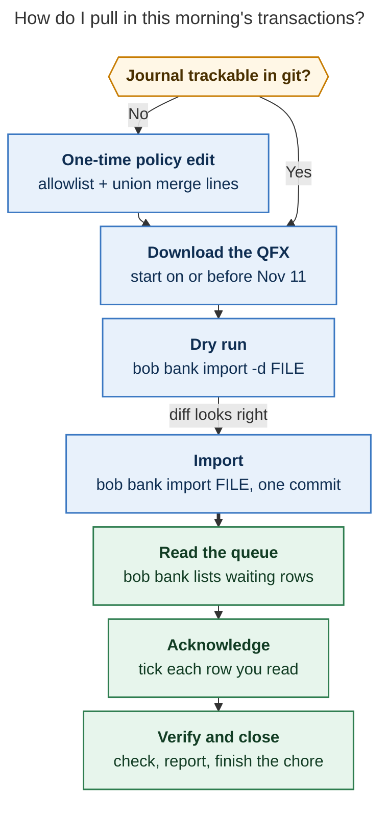
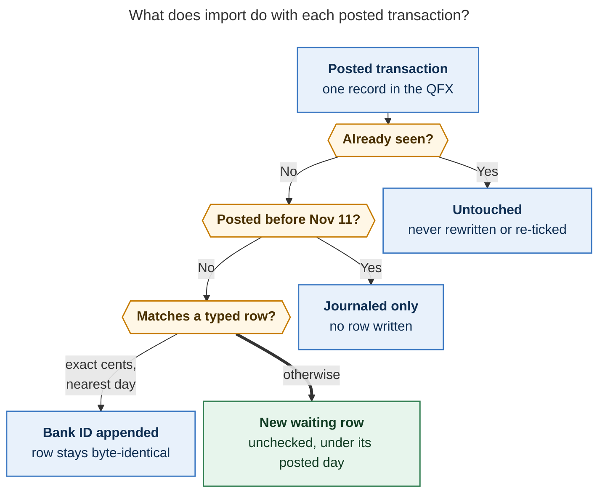

# Pull in this morning's bank transactions (Wed Nov 12)

> **Research query:** Walk me through what I need to do to pull in the bank transactions
> that I am supposed to acknowledge this morning (see the `bob-cli-kd` epic bead for
> context).

## Bottom line

- **Your vault queue is empty right now.** As of this morning, `bob bank check` is clean
  (2 notes, 0 errors) and `bob bank` says *nothing to acknowledge*. The transactions you
  owe an acknowledgment are still at Wells Fargo — you pull them in with your **first
  real `bob bank import`**, which shipped overnight.
- **The installed `bob` is ready.** Your `bob` 0.5.0 binary was rebuilt this morning
  (04:16) from master and includes `bob bank import` plus all of the kd.4.1 landing
  repairs (`ae6a28d0`). I re-ran the day-heading bug repro from the epic's
  `DISCOVERED ISSUE:` note against it in a throwaway vault: **fixed** — `## Thu Nov 12`
  now lands after the whole previous day, trailing prose and checklist lines included.
- **One step only you can do: the vault git policy edit.** The vault `.gitignore`
  ignores everything by default, so the import journal (`.bob/bank/<host>.jsonl`) is
  untrackable until you add the allowlist line. `import` checks this before writing and
  **refuses with exit 2** until it's fixed. Agents were blocked from touching `~/bob`,
  which is the only reason phases kd.4/kd.4.1 are still open.
- **Expect `unverified`, not `balanced`.** The balance proof is kd.5 and hasn't landed.
  Your first import records the ledger balance as an anchor but proves nothing yet.
- **The account start is Nov 11.** Anything posted earlier is journaled for audit and
  never written as a row — a nonzero *before start* count is normal.

## The flow at a glance



_One one-time policy edit gates the first import; after that the morning is download →
dry run → import → tick what you read → verify._

## Step 0 — make the journal trackable (one time, ~2 min)

The vault allowlist ignores everything by default, and `import` refuses to write rows
while git ignores its journal destination. Check, then add two lines:

```bash
git -C ~/bob check-ignore -v .bob/bank/apollo.jsonl
```

If that prints an ignoring match (it will today), append to **`~/bob/.gitignore`**:

```gitignore
!/.bob/bank/*.jsonl
```

and to **`~/bob/.gitattributes`** (so concurrent per-host journal appends merge
cleanly):

```gitattributes
.bob/bank/*.jsonl merge=union
```

Verify both — the ignore check should now show the negated line as the last match, and
the attr check should print `merge: union`:

```bash
git -C ~/bob check-ignore -v .bob/bank/apollo.jsonl
git -C ~/bob check-attr merge -- .bob/bank/apollo.jsonl
```

Vault-sync carries the edit to athena and the Mac. **Side effect:** this is the exact
blocker holding kd.4.1 and kd.4 open — once done and verified, the land agent's last
obligation is satisfiable.

## Step 1 — download the QFX

On **wellsfargo.com** in a browser (not the phone app): open the checking account,
**Download Account Activity**, format **Quicken Web Connect (QFX)**, start date **on or
before Nov 11**. Save it outside the vault (e.g. `~/Downloads`).

## Step 2 — dry run

```bash
bob bank import -d ~/Downloads/<file>.qfx
```

No lock, no git, no journal — just the exact month-note and journal diffs a real run
would produce. Expect: account resolves to **checking** on its own (QFX carries the
account kind; only CSV needs `-a checking`), a coverage window starting on or before
Nov 11, and possibly a *before start* count.

## Step 3 — import for real

```bash
bob bank import ~/Downloads/<file>.qfx
```

Run it **from one host only** — the one where the file landed. You get exactly one
scoped commit, `bank: import N rows (checking)`, carrying the new rows and the journal
together, with pre/post vault-sync. Rows you already typed (Nov 11–12) are matched by
exact cents and gain a trailing ` ^bank-…` ID; everything else about your writing stays
byte-identical.



_Only the **new waiting rows** — unchecked, filed under their posted day — are yours to
acknowledge; matched, seen, and before-start transactions ask nothing of you._

## Step 4 — acknowledge what arrived

```bash
bob bank                      # the waiting queue, grouped by day, oldest first
bob bank ensure -D today -o   # or the "Bank: open today" command in Obsidian
```

Read each `[ ]` row against what you know and tick it in the note, or use the CLI:

```bash
bob bank ack <id>        # tick one row by its ^bank- id prefix
bob bank ack -D today    # tick ALL of today's waiting rows
```

Now that imports exist, `ack -D` is a blanket gesture — use it only after you've
actually read every row it would tick, otherwise the acknowledgment habit means nothing.
Rename or recategorize freely while you're there (`[cat:: …]`, a `-- note`, a flag
`!!`): your edits always win, and renames even teach future imports the payee.

## Step 5 — verify and close the chore

```bash
bob bank check            # expect 0 errors, 0 warnings
bob bank                  # expect "nothing to acknowledge"
bob bank report -D today  # today's exact cents; transfers stay off Out/In
```

`WF Checking · unverified` is still correct — the balance verdict is kd.5. Then
**Ctrl+Enter** on the **Acknowledge bank** chore in the `]s` walk, and delete the QFX
from `~/Downloads`.

## What changed since yesterday's guide

Yesterday's consolidated guide (`bank_first_ack_and_kd_e2e_guide`) was written hours
before the import landed; three of its claims are now stale:

| Yesterday's guide said | This morning |
| --- | --- |
| `import` hasn't shipped; first real file Mon Nov 16 | `import` is in your installed binary. You can import today; Monday's PRE chore (Nov 16) re-import is a safe no-op replay on anything already seen. |
| The `ensure` day-heading bug moves trailing prose — keep notes on the row | Fixed in `ae6a28d0` and verified against your installed binary; free-form child notes are safe again. |
| `ack -D today` is safe (no imports exist yet) | No longer blanket-safe once you import — tick what you read. |

Still open, for honesty's sake: kd.5 (balance proof — statuses stay `unverified`), kd.6
(month/queue cards and the daily chip need a plugin deploy check on the Mac), kd.7
(wrap-up). Nothing in those blocks this morning's pull-in.

## Sources

_apollo · Wed 2026-11-12 morning · all live-vault commands read-only; no real payees or
amounts appear above._

- **Beads** (`sase bead read`): `bob-cli-kd` (epic + its two notes), `bob-cli-kd.4`,
  `bob-cli-kd.4.1` (landing audit, repairs-implemented, and gate-result notes — the
  live-vault policy blocker and the Monday Nov 16 chore).
- **Docs** (workspace `bob-cli_10`, master `d1d0db6f`): `docs/bank.md` (contract: row
  grammar, import matching, journal, commit/replay), `docs/vault-git-sync.md`
  §Bank import journal (the exact allowlist/union lines and verify commands).
- **Installed CLI:** `bob 0.5.0`, binary dated Nov 12 04:16; `bob bank --help` and
  `bob bank import --help`.
- **Live, read-only:** `bob bank check` (✓ 2 notes, 0 errors) and `bob bank` (empty
  queue, `WF Checking · unverified · Nov 12`).
- **Synthetic repro:** the epic note's `ensure` trailing-prose scenario re-run in a
  `mktemp` vault against the installed binary — heading placement correct.
- **Prior guide:** `research:202611/bank_first_ack_and_kd_e2e_guide/bank_first_ack_and_kd_e2e_guide.md`
  (audited read), including its Wells Fargo download walkthrough and sandbox script.
