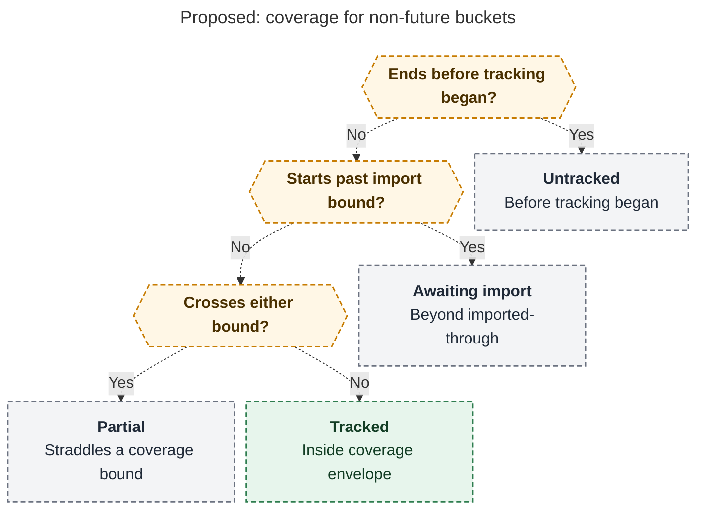
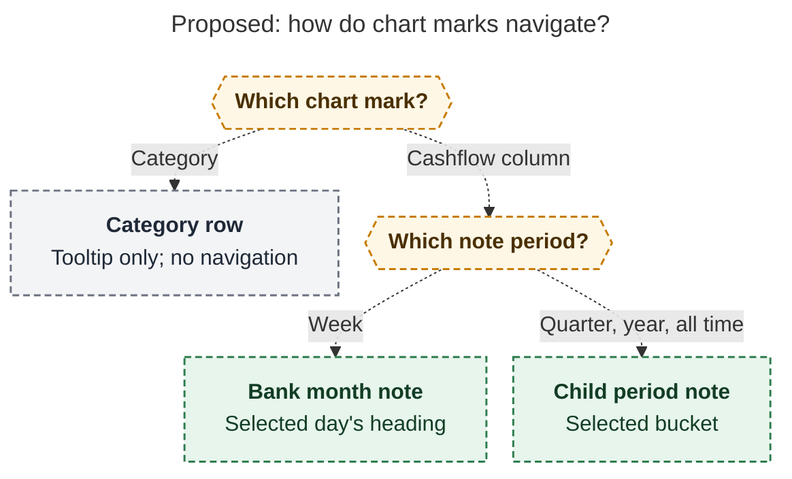

# Diagram proposals: Bank period charts: transaction visualizations for period notes

Proposals for the swarm linker, not a report. Each diagram restates only what the source
report says.

```yaml
source: research:202611/bank_period_charts/bank_period_charts__final.md
producer: research.4m.image
check: "mmdc 12.0.0 with the PDF-mirroring config rendered 2 of 2 Mermaid diagrams; Puppeteer --no-sandbox; broken-source control exited nonzero"
```

## coverage-for-started-buckets

```yaml
anchor: |-
  in exact cents; states derive from `coverage`
question: |-
  How is coverage classified once a bucket has started?
illustrates: |-
  For buckets whose start is no later than today, the proposed coverage-envelope rules distinguish untracked, awaiting_import, partial, and tracked without treating missing imports as zero.
caption: For buckets starting by today, tracking and imported-through bounds distinguish untracked, awaiting-import, partial, and tracked; the envelope does not prove continuous coverage.
review: "752.571x832 px, fit 86.7%; question, source tracing, labels, arrowheads, reading direction and visual checks passed; 1 revision, 2 look rounds; future branch excluded by the stated non-future scope"
```



## chart-navigation

```yaml
anchor: |-
  Click/Enter/Space on a column: week → that day's heading in the bank month note
question: |-
  What happens when I activate a chart mark?
illustrates: |-
  Cashflow columns navigate to a day's heading in the bank month note on weeks and to a child period note on larger periods, while category rows remain non-links with tooltips.
caption: Cashflow columns open bank month day headings on weeks and child period notes on larger periods; category rows provide tooltips without navigation.
review: "644.49x538 px, fit 100.0%; question, source tracing, labels, arrowheads, reading direction and visual checks passed; 0 revisions, 1 look round"
```


