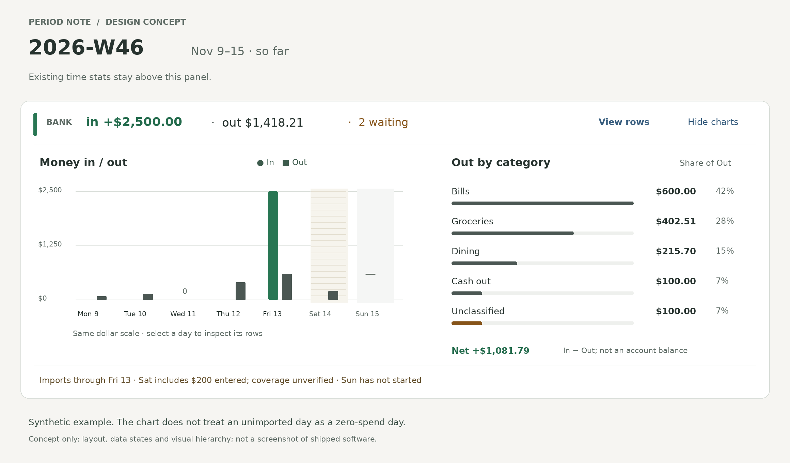

# Bank transaction visualizations for period notes

Independent research and design recommendation · researcher **cdx** · 2026-11-14

**Recommendation:** add one compact, read-only bank panel immediately after the existing Bank Badge on weekly, quarterly, yearly, and all-time notes. Give it two charts: **Money in / out** over the period and **Out by category**. Every amount should lead to the rows that explain it. Build the aggregates and data-quality decisions in bob-cli, and paint them through bob-ledger-tools’ existing period host and bank data service. Make coverage trustworthy before adding comparisons.

This is a good extension of the bank work if its purpose is to make a period review easier. It becomes a weaker idea if “an excellent set” turns into a dashboard builder, a budgeting system, or financial judgments inferred from incomplete transaction exports. The most valuable improvement is explainability: **when did money move, where did the outflows go, and can I trust this picture?**

## Evidence and scope

I independently read `bob-cli-lh`, its approved plan, the bank/period glossary and contracts, and the current implementation. I did not consult another report or researcher from this swarm. I did not read Bryan’s actual bank rows or import files. All numbers in the visual concept are synthetic.

The epic was **in progress** when inspected: its report and shared badge phases were closed; host integration and documentation were still active. The approved plan settles In-before-Out, quiet surplus green, whole-dollar badge display from quarters upward, and period-scoped waiting. This proposal preserves those choices and the badge’s existing navigation. It does not reinterpret a declined memory-record edit as a rejected product choice. `plan:202611/bank_badge_strip_family.md` (audited artifact read), [epic](https://github.com/bobs-org/bob-cli--beads/blob/main/pages/bob-cli-lh/README.md).

Code snapshots inspected:

- **bob-cli:** `575f9e66d638d0034978574dba19016c4a35b010`.
- **bob-plugins:** `008700bd3adb4db6de7f5f0dcea0406fc9f35cd4`.

These establish the baseline, not a claim that every epic phase has landed. In particular, the inspected plugin’s `bankBuildArgs` still selects day/week/year/month rather than the full new `-p` family. Rebase the implementation design on the completed epic before wiring charts. [Argument builder and decoder](https://github.com/bobs-org/bob-plugins/blob/008700bd3adb4db6de7f5f0dcea0406fc9f35cd4/plugins/bob-ledger-tools/src/241h-plugin-bank-decode.js).

## What the existing system implies

| Existing contract | Design consequence |
| --- | --- |
| Bank money is signed integer cents; totals are computed from current month-note rows. | Keep one accounting path. Never reconstruct totals from rendered text, pixels, or rounded labels. |
| Waiting is acknowledgment state; waiting rows already count in money totals. | “2 waiting” means two rows to review, not two pending bank transactions or money omitted from the charts. |
| Out excludes transfers and cash-account rows, but includes ATM cash out and uncategorized outflows. | Label the category chart **Out by category**. “What I bought” would overclaim knowledge of cash destinations. |
| In includes income and refunds; other credits are unclassified inflows outside In. | Use **Money in / out**, not earned income, profit, savings rate, or balance. Expose refunds and excluded inflows in details. |
| Category `hidden` affects suggestions, not validity or totals. | Historical money in hidden categories remains visible in charts. |
| Periods are ISO weeks, 13/14-week quarters, and ISO years; there are no monthly period notes. | Use the existing calendar and hierarchy. Do not resurrect monthly period notes or silently use Gregorian quarters. |
| Bank all-time starts at its own earliest account start/row, not the earliest daily note. | Label the bank history independently; never crop it to the time ledger. |
| Period scaffolds are create-only and personal prose belongs to Bryan. | Attach to existing live hosts. No mass rewrite of historical Markdown and no generated finance prose in Reflection. |

These are code-backed constraints, not newly proposed accounting rules. [Bank contract](https://github.com/bobs-org/bob-cli/blob/575f9e66d638d0034978574dba19016c4a35b010/docs/bank.md), [totals implementation](https://github.com/bobs-org/bob-cli/blob/575f9e66d638d0034978574dba19016c4a35b010/src/native/bank/model.rs), [period contract](https://github.com/bobs-org/bob-cli/blob/575f9e66d638d0034978574dba19016c4a35b010/docs/periods.md), [bank period resolution](https://github.com/bobs-org/bob-cli/blob/575f9e66d638d0034978574dba19016c4a35b010/src/native/bank/report.rs).

One important limit: these notes remain **live views of the current ledger**, including past periods. Recategorizing an old row changes the old chart. “What the ledger says now about that period” is the honest promise. Frozen year-end statements would be a separate export feature.

## Research findings and chart selection

The ONS recommends horizontal bars for comparing categories, with a zero baseline and usually a descending order. For flows measured over time, its column-chart guidance favors columns, explicitly addresses gaps, and cautions against crowding clustered series. That supports a simple category ranking plus a small two-series timeline; it does not support a crowded stack of every category across dozens of days. [ONS bar charts](https://service-manual.ons.gov.uk/data-visualisation/chart-types/bar-charts), [ONS column charts](https://service-manual.ons.gov.uk/data-visualisation/chart-types/column-chart).

Actual Budget demonstrates useful separation between summary cards, cash flow, spending analysis, and deeper reports. Its custom reports also explicitly distinguish transaction sums from account balances. The transferable ideas are a compact overview, clear metric semantics, and drilldown—not importing its account rules, adjustable dashboard, or forecasting suite into Bob. This is my design inference from its documented product structure. [Actual reports](https://actualbudget.org/docs/reports/), [Actual custom reports](https://actualbudget.org/docs/reports/custom-reports/).

| Candidate | Recommendation | Reason |
| --- | --- | --- |
| In/out columns over time | **Ship** | Explains timing and scale using two already-defined measures. |
| Ranked horizontal category bars | **Ship** | Easy to compare, long labels fit, amounts remain readable without a legend. |
| Exact transaction table | **Ship as drilldown and accessible alternative** | Explains every chart value and makes classification mistakes visible. |
| Category change versus previous period | **Later, eligibility-gated** | Useful once comparable coverage and stable scope exist. |
| Cumulative net line | Defer | Easy to mistake for an account balance; payday timing dominates short periods. |
| Pie/donut/treemap | Do not use as the default | Less useful for comparing similar amounts; many tiny categories demand more legend work. |
| Sankey | Do not ship here | Transfers, refunds, incomplete coverage, and unknown cash destinations do not form a clean end-to-end allocation story. |
| Daily calendar heatmap | Defer | Attractive, but encodes dollars less precisely and adds another calendar to period notes. |
| Spending/worked-hour correlation, scores, forecasts | Out of scope | No agreed financial goal or causal model supports these interpretations. |

These are task-specific design judgments, not claims that those chart types are universally bad. A dedicated money dashboard could later justify some of them; period notes should first answer the three questions above.

## Proposed experience



**Figure 1.** A layout concept, not shipped software. Durable image snapshot: `file:explicit:c4332c03c8670608c9586a1b`. The week has In $2,500.00, Out $1,418.21, and Net $1,081.79. Wednesday is a verified zero in this synthetic example; Saturday has $200 of entered rows but unverified import coverage; Sunday has not started. The concept uses a wide layout to expose the hierarchy; production dimensions and theme colors require testing.

The figure’s exact data is available here as text:

| Day | In | Out | Example state |
| --- | ---: | ---: | --- |
| Mon 9 | $0.00 | $79.30 | Covered |
| Tue 10 | $0.00 | $136.40 | Covered |
| Wed 11 | $0.00 | $0.00 | Covered, no counted activity |
| Thu 12 | $0.00 | $402.51 | Covered |
| Fri 13 | $2,500.00 | $600.00 | Covered |
| Sat 14 | $0.00 | $200.00 | Entered rows; coverage unverified |
| Sun 15 | — | — | Future, no entered rows |

Categories are Bills $600.00, Groceries $402.51, Dining $215.70, Cash out $100.00, and Unclassified $100.00. Both decompositions sum to Out exactly. Displayed percentages may not sum to 100 because of rounding.

### Placement and density

Attach a **period-only chart host after the Bank Badge** inside the existing `bob-stats-strip` fence wrapper, as a sibling of the replaceable time-strip host. The approved epic already solves sibling-host survival during repaint. Do not put charts inside the badge’s link target or the part of the DOM the time painter clears. Render in Reading and Live Preview. Daily notes retain their badge and receive no charts.

Show the two charts by default when there is counted activity. A separate **Hide charts / Show charts** control remembers a per-device preference; collapsing never changes the badge or edits the note. Keep **View rows** as a separate action. The badge still opens its established waiting/first-row/hub target. Bank visibility configuration continues to govern the family; avoid a new configuration matrix at launch.

Use a two-column layout only when labels and amounts fit (initial breakpoint around 800 CSS pixels, to be validated). In narrower desktop panes, stack the charts. Aim for roughly 300–360 CSS pixels of added height at normal desktop width, with natural growth for large text; never enforce clipping to meet a height target. The image is deliberately more spacious. Avoid adding five large KPI tiles when the badge already tells the reader In and Out.

A settled period with no counted activity should not display ornamental blank axes. Show a concise state only when it explains something material: waiting rows, excluded-only activity, or incomplete data. A clean, empty historical period can collapse to nothing. This slightly broadens chart-panel visibility beyond the badge’s zero-money rule without changing the badge itself.

### Chart 1: Money in / out

Use two adjacent columns per time bucket, In consistently first and Out second. Both use the **same dollar scale and zero baseline**. Direct legend labels, stable left/right positions, exact keyboard/touch details, and table access carry meaning in addition to color. Do not use two independently scaled y-axes, smooth curves, or fake minimum-height money bars. A tiny amount can remain discoverable through the bucket’s full hit area and table.

| Note | Initial timeline buckets | Boundary rule |
| --- | --- | --- |
| Week | Seven days | Monday–Sunday, including month/year crossings |
| Quarter | 13 or 14 ISO weeks | Q4 includes W53 when present |
| Year | Four ISO quarters | Each is the existing 13/14-week child, not a calendar quarter |
| All time | ISO years intersecting bank history | First and current years can be partial |

Yearly quarters are intentionally coarse: the chart’s job is orientation, and a bucket’s detail includes an explicit **Open quarter note** link. The bucket itself opens money rows so its behavior stays consistent with category bars. A later “by week” detail view is preferable to forcing 53 tiny columns into the note.

For unusually long all-time histories, retain all data but coarsen to labeled multi-year buckets after 24 years, selecting whole-year group sizes in bob. The details expose constituent years. Treat this as a bounded-output policy, not permission to silently truncate older history. The all-time caption always states the actual bank start date and any partial first bucket.

Keep “so far,” incomplete imports, and future time distinct. An open period is not itself an error. Empty future buckets have no zero-valued activity claim. If someone explicitly entered future-dated rows within a currently visible period, retain the existing report totals and distinguish those observations as **future-dated entries**; do not silently omit them or portray them as verified posted transactions.

### Chart 2: Out by category

Rank categories by exact Out descending, breaking ties by stable category key. Start with the five largest ordinary categories, plus **Other (N categories)** when needed. Keep **Cash out — destination unknown** and **Unclassified** separately visible whenever nonzero; they must never disappear inside Other. At most eight rows result from that policy. Expand Other into its constituent categories, rather than sending the user to an unexplained lump.

Amounts are right-aligned with tabular numerals; labels remain directly adjacent. Bars are neutral, with restrained amber for attention states. Use the same category keys and current labels as the bank report; a hidden suggestion category still counts. The visual order can differ from the Category card’s configured order without changing the underlying breakdown contract.

Each category amount means gross Out under the current bank rules. A $100 purchase and a later $20 refund remain $100 Out and $20 In; do not silently net refunds against the category. The details explain that distinction. Below the charts, a compact disclosure names refunds, transfer in/out, cash traced, and unclassified inflows when nonzero, preserving their respective inclusion/exclusion rules.

### Drilldown, accessibility, and appearance

Selecting a bucket or category opens an inline details region with the **explicit selection**, exact subtotal, row count, and a paginated list. Rows show date, payee, signed amount, category, account label, acknowledgment, and flags; opening a row navigates read-only to its existing source. A category selection does not silently filter the other chart or rewrite the badge. Clear selection restores the whole-period details. Escape closes details and restores focus. Do not require hover to obtain exact values.

Use native buttons for state changes, with locally reset styles so Obsidian’s global button sizing cannot distort them. Navigation remains navigation. Give the timeline one tab stop with arrow/Home/End movement among buckets, and normal activation for category rows. Explicit “Open week/quarter/year note” links preserve existing period navigation without conflating it with financial inspection.

W3C’s complex-image guidance supports a short chart description plus a structured textual equivalent. Provide a **View data** table with all plotted values and coverage states, not an enormous `aria-label` or tooltip as the only alternative. Focus and pointer selection should expose the same information. [W3C complex images](https://www.w3.org/WAI/tutorials/images/complex/).

Match the existing badge’s green In and neutral Out treatment; a negative net is not a red failure. Use Obsidian theme tokens, restrained separators, and whitespace rather than a new rainbow category palette. Qualify the chart through visible text as well as hatch/outline treatments. Normal text should meet 4.5:1 contrast and essential graphical marks 3:1 against adjacent colors. Targets should be at least 24×24 CSS pixels or satisfy the documented spacing exceptions; aim larger for ordinary controls. Verify light, dark, forced-colors, zoom, reduced motion, and narrow panes. No animated count-ups. [Text contrast](https://www.w3.org/WAI/WCAG22/Understanding/contrast-minimum.html), [non-text contrast](https://www.w3.org/WAI/WCAG22/Understanding/non-text-contrast.html), [target size](https://www.w3.org/WAI/WCAG22/Understanding/target-size-minimum.html).

## Reliability: make uncertainty visible

### The current coverage flag is insufficient for chart confidence

`report.rs::coverage_for` takes the latest import end per importable account and then the minimum across accounts. Its `complete` checks the start/end envelope; it does **not** prove continuous coverage of every interior date. By contrast, `status.rs::coverage_gap` considers OFX coverage intervals. Existing account status can also describe a current stale/gap condition outside a historical period. Therefore neither the report’s envelope nor a current account status alone should authorize “this bucket is complete.” This is a documented limit of the inspected implementation, not a claim that the badge epic failed its own specification. [Coverage computation](https://github.com/bobs-org/bob-cli/blob/575f9e66d638d0034978574dba19016c4a35b010/src/native/bank/report.rs), [account proof](https://github.com/bobs-org/bob-cli/blob/575f9e66d638d0034978574dba19016c4a35b010/src/native/bank/status.rs).

Add a period-scoped quality object for charts, without silently redefining the existing badge fields:

- Merge trusted OFX coverage windows **per account** and intersect with each bucket and that account’s configured active range. A later account start must not invalidate dates before it existed in the tracked scope. State that coverage describes configured tracked accounts, not every account Bryan may own.
- CSV exports and typed rows supply observations, not proof that empty days had no transactions. Empty OFX statements can supply coverage without rows. Preserve source provenance.
- Separate **coverage**, **ledger validity**, **classification**, and **acknowledgment**. Full import coverage does not prove that an edited/deleted/duplicate ledger row is correct; all rows acknowledged does not prove that all money has been imported.
- Surface report-relevant parse problems, missing journaled rows, edited amounts, unknown accounts/categories, and duplicate identities. The current report serializes `issues` as zero and its row collection skips unparsed rows; do not use that envelope as a clean-health certificate. Reuse the bank checking logic in a shared read-only layer rather than running a second independent subprocess and racing two snapshots. [Report serialization](https://github.com/bobs-org/bob-cli/blob/575f9e66d638d0034978574dba19016c4a35b010/src/native/bank/report.rs), [row collection](https://github.com/bobs-org/bob-cli/blob/575f9e66d638d0034978574dba19016c4a35b010/src/native/bank/model.rs), [bank checker](https://github.com/bobs-org/bob-cli/blob/575f9e66d638d0034978574dba19016c4a35b010/src/native/bank/check.rs).

| State | Required presentation |
| --- | --- |
| Covered, valid, no counted rows | A true zero is permitted. |
| Some observed money, incomplete/unknown coverage | Plot the observed money, mark its incompleteness, and name the cause. |
| No rows, unknown coverage | “No imported activity / coverage unverified,” not $0 spent. |
| Future with no entered rows | “Not yet,” distinct from zero and import failure. |
| Invalid relevant rows | “Some rows need correction”; show only defensible observed totals and disable comparisons. If trustworthy aggregation is impossible, show unavailable. |
| Refresh failed, last-good payload exists | Keep the last-good view with visible stale state and retry. |
| Cold failure or incompatible chart contract | “Bank charts unavailable,” never a blank clean-zero chart. Preserve a working badge. |

For all states, rounding is presentation only. Use checked integer arithmetic in Rust and maintain the plugin’s `Number.isSafeInteger` validation; values beyond safe transport bounds must fail clearly rather than become approximate cents. An omitted field is unknown, not a default zero.

### Comparisons should wait

Do not ship percentage change arrows, typical spending, budgets, or automated verdicts in the first version. For a later comparison feature, require matching account scope, equivalent durations/buckets, reliable coverage on both sides, and valid classification of relevant values. Closed Q4 in a 53-week year is longer than an ordinary quarter; a partial current week is not comparable to a complete prior week. If comparing equal elapsed windows, show the two exact date ranges. If the denominator is zero, show an absolute change or “new,” not infinity.

Current category edits can rewrite both sides of historical comparisons. New accounts and changed category schemas need visible scope notes. “10% lower” is a numerical observation, not evidence of improvement. There is no need to block useful first-version charts while solving this later analytical problem.

## Implementation approach

### Extend bank report, keep the client thin

Add opt-in chart aggregates to `bob bank report`, for example `-c/--charts`, producing an additive `charts` object with its own version. A period host requests `bob bank report -c -p <period> -s -f json`. Existing `-s` behavior still omits full daily rows; the chart payload carries bounded aggregates. Existing callers and the outer schema retain their meanings. Final option spelling must follow the project’s alphabetical help and short-alias rules.

A proposed logical contract is:

```text
charts.version = 1
charts.period = canonical kind/key/start/end, evaluated date, bank-history start
charts.snapshot = revision of the report inputs
charts.timeline = granularity, ordered buckets:
  key/label/start/end, in_cents/out_cents/net_cents,
  waiting, coverage state + reasons, future state, detail selector, note target
charts.categories = ranked display groups:
  key/label/out_cents/share/rows, member keys, detail selector
charts.quality = coverage intervals/account scope, diagnostics, classification counts
charts.explanations = included and excluded money summaries
```

This is a design sketch, not an already implemented API. Bob owns classification, grouping, sorting, Other membership, bounds, dates, and quality. The plugin owns widths, pixels, responsive arrangement, focus, and display state. It must not rescan bank Markdown or duplicate accounting logic. The precedent is `periods/charts.rs`, where Rust already produces the time strip’s ranked series. [Existing period chart contract](https://github.com/bobs-org/bob-cli/blob/575f9e66d638d0034978574dba19016c4a35b010/src/native/periods/charts.rs).

Implement the timeline with one partition of selected rows into buckets, using the shared totals rules. Do not spawn one report process per day/week/category or return every transaction for all-time chart painting. Separate bounded transaction-detail reads from summary reads. Extend the existing bank list/report plumbing with period/category or server-issued selection, stable ordering, a page limit, and a cursor; settle its public syntax during implementation design rather than inventing a second finance query language here. The important contract is that **all pages reconstruct the selected subtotal** and no default page hides the presence of more rows.

Use a snapshot token derived from all relevant input revisions for summary/detail consistency. On an input change, invalidate the cursor and refresh; do not mix row pages from different snapshots. Prefer existing stable bank IDs when navigating; typed rows without IDs need a verified path/line plus content fingerprint. If the source moved, resolve afresh or report that the row changed. Never create a missing bank or period note as a consequence of inspection.

### Reuse the existing host and data-service machinery

The bank service already provides keyed caching, in-flight deduplication, generation protection, last-good reports, subscriptions, and focus/visibility revalidation. Extend it rather than adding an unrelated chart cache. Include chart mode, period, schema, and detail selection in keys. Feed badge and charts from one successful report snapshot when expanded; a collapsed panel can retain the cheap badge request. Update the normalizing decoder explicitly: new JSON fields otherwise disappear. [Bank service](https://github.com/bobs-org/bob-plugins/blob/008700bd3adb4db6de7f5f0dcea0406fc9f35cd4/plugins/bob-ledger-tools/src/241j-plugin-bank-data.js), [decoder](https://github.com/bobs-org/bob-plugins/blob/008700bd3adb4db6de7f5f0dcea0406fc9f35cd4/plugins/bob-ledger-tools/src/241h-plugin-bank-decode.js).

For reliable coverage updates, invalidation must include `.bob/bank/*.jsonl` as well as `bank.md` and month notes. The inspected `bankRelevantPath` only recognizes the latter two. An empty statement can change coverage without changing any transaction row. Obsidian’s handling of hidden-directory events must be verified; use the existing import-completion signal where available and a bounded revision check on focus/visible refresh as fallback, rather than assuming every journal change triggers a vault event. [Source recognizer](https://github.com/bobs-org/bob-plugins/blob/008700bd3adb4db6de7f5f0dcea0406fc9f35cd4/plugins/bob-ledger-tools/src/241i-plugin-bank-source.js), [journal model](https://github.com/bobs-org/bob-cli/blob/575f9e66d638d0034978574dba19016c4a35b010/src/native/bank/journal.rs).

Draw these modest charts with scoped DOM/CSS and SVG where needed, following the existing model/painter split. A general chart library adds lifecycle, accessibility, theme, and bundle work without a clear benefit for two bounded charts. Canvas would require a parallel accessible interaction layer. If later requirements include dense brushing or thousands of points, reconsider the renderer then. The existing period painter already has a shared axis and keyboard movement worth reusing. [Period painter](https://github.com/bobs-org/bob-plugins/blob/008700bd3adb4db6de7f5f0dcea0406fc9f35cd4/plugins/bob-ledger-tools/src/239-plugin-period-strip-charts-render.js).

Retain the badge epic’s desktop execution boundary, hover/embed exclusions, and no-spawn behavior for missing configuration or wholly future periods. Responsive desktop panes are in scope; full mobile bank computation is not promised by a responsive chart. If mobile parity becomes a requirement, design an explicit versioned, dated snapshot transport separately; do not quietly add Markdown parsing in the mobile plugin.

## Requirement adjustments I recommend

| Adjustment | Why it improves the request |
| --- | --- |
| **A1. “Excellent set” becomes two default charts plus exact details.** | Preserves review focus and offers an implementation that can be polished thoroughly. |
| **A2. Every period supports the feature; empty/future periods need no blank chart furniture.** | Availability does not require visual noise. Daily notes remain unchanged. |
| **A3. Use Money in/out and gross Out terminology.** | Matches refunds, cash, and transfer treatment; avoids suggesting net worth or savings. |
| **A4. Treat period-scoped coverage and ledger-quality reporting as foundational work.** | Prevents absent imports from looking like successful zero-spending days. |
| **A5. Keep chart clicks read-only and separate from badge navigation.** | Adds exploration without breaking an accepted gesture or mutating notes. |
| **A6. Keep all aggregations in bob and use existing period hosts.** | Avoids a second accounting engine and historical-note migration. |
| **A7. Defer comparisons, forecasts, budgets, and net-worth charts.** | The current request and data support observation more reliably than evaluation. |
| **A8. Desktop first, with explicit compatibility and stale states.** | Matches the existing subprocess-based bank surfaces; no accidental promise of mobile parity. |
| **A9. Existing category semantics stay authoritative; no automatic merchant merging or refund allocation.** | Both require new identity/accounting policy, not merely prettier charts. |

These are proposed adjustments for the lead/user to accept, not newly accepted decision records. No memory was edited and no new implementation bead was created by this research.

## Delivery and acceptance

The work should follow the completed `bob-cli-lh` baseline. I recommend three implementation slices, with the first two required for the initial feature:

1. **Trustworthy aggregate contract.** Add opt-in bounded charts, per-bucket coverage/diagnostics, and paginated detail selection. Preserve existing totals and serialization compatibility. Establish invariants and synthetic fixtures before rendering.
2. **Two polished charts on every period kind.** Add decoder/models/painters, host integration, read-only inspection, accessible table, theme treatments, cache lifecycle, and error states. Use the existing preview machinery; follow bob-plugins’ source-build and `bob plugins sync` requirements when implementing.
3. **Evidence-driven comparisons later.** Only after observing whether Bryan can explain a weekly total and follow it to rows without confusion. No prerequisite dashboard builder or taxonomy overhaul.

Acceptance should focus on invariants and real interactions:

- Every timeline In/Out sum equals its report total, and category Out (including Other/Cash/Unclassified) equals Out in exact cents. Refund, transfer, credit-card payment, cash-account, hidden-category, and waiting cases are explicit fixtures.
- For compatible fixed scopes, child-period sums equal the parent; test W01 crossing December, W53, Q4’s 14 weeks, leap days, and all-time bank history predating daily notes. Never require equality after comparing differently clipped bank/time spans.
- A gap between two OFX imports remains a gap; CSV-only and typed-only histories remain unverified; valid empty statements establish coverage; later-starting accounts do not create false historical gaps; malformed/missing/duplicate rows never get a clean certificate.
- Test pending refresh, failure, schema mismatch, stale response arriving after a new one, rename/delete/import, journal-only updates, midnight rollover, detach/unload, and two visible copies of one period. No per-bucket spawn fanout or leaked subscriptions.
- Selecting a chart value leads to a reconciling row set. A moved/deleted source fails safely. Opening, focusing, selecting, and refreshing do not alter note bytes, journal, vault index, or Git HEAD.
- Test real Obsidian Live Preview and Reading view with light/dark themes, 200% zoom, keyboard-only navigation, forced colors, narrow panes, and inherited global button styles. Validate against the actual deployed plugin, not just a browser mock.
- Benchmark a synthetic 10-year/100,000-row ledger. A reasonable initial **target**, not a measured result, is a bounded summary under 100 KB and warm repaint under 50 ms on the reference Mac, with 100-row detail pages. Measure CLI scan time separately before promising latency or introducing a persistent index.

This research made no application-source changes and ran no application test suite. Validation here consisted of audited context reads, source inspection at the recorded revisions, primary-source web research, synthetic arithmetic assertions, and visual inspection of the concept. Its colors are illustrative, not a completed accessibility certification. Private financial data, actual vault volume, and real Obsidian rendering were not evaluated.

## Recommended solution

**Build a quiet, two-chart bank panel under each non-daily period’s existing Bank Badge: a period-aligned in/out timeline and a directly labeled outflow ranking, both backed by exact read-only transaction detail.** Reuse bob-cli’s money rules and ISO calendar, extend `bank report` with bounded versioned aggregates and honest per-bucket quality, and reuse bob-ledger-tools’ cache and host lifecycle. Keep the badge’s approved appearance and click behavior.

Ship this after the current badge epic lands, with coverage, arithmetic parity, and drilldown as release requirements. Defer comparative judgment and the larger finance dashboard. This provides a clear improvement to Bryan’s review ritual while keeping the numbers explainable, the interface calm, and the maintenance burden proportionate.
