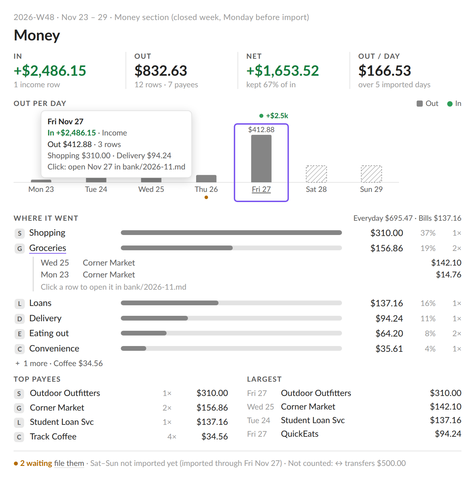
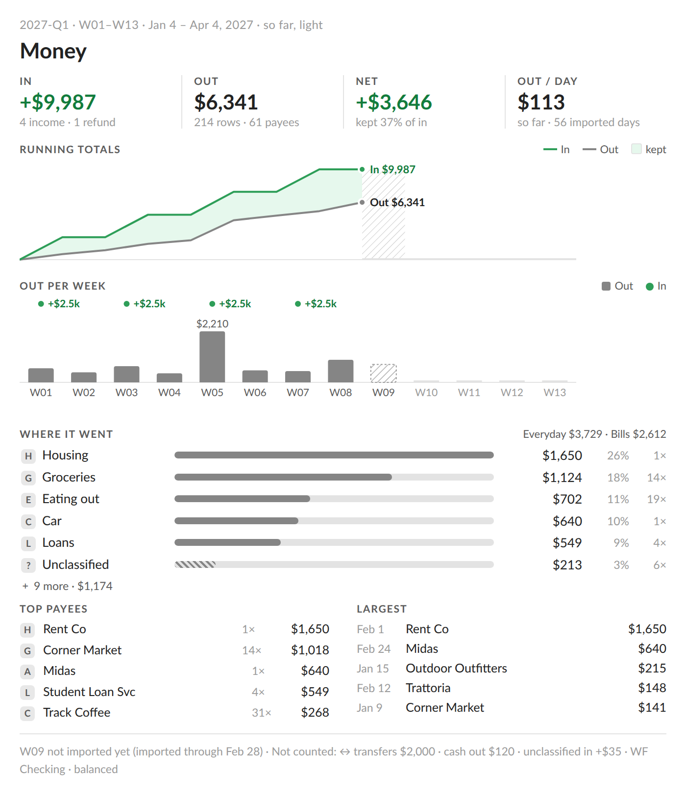
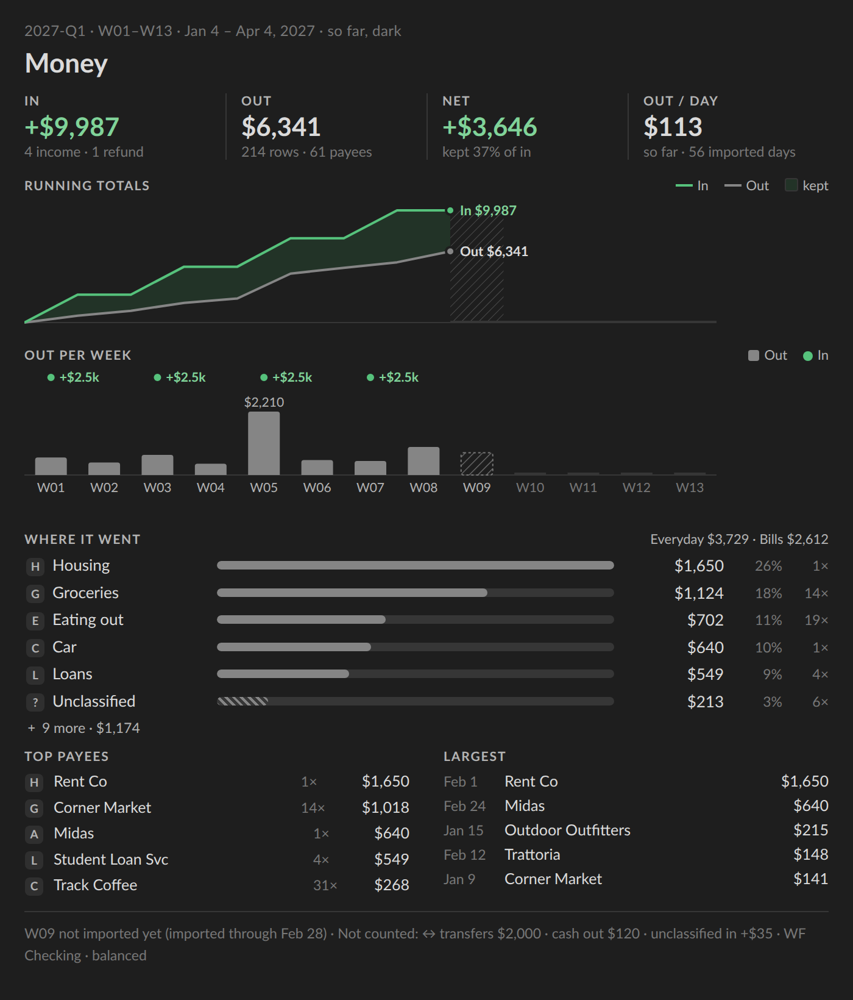
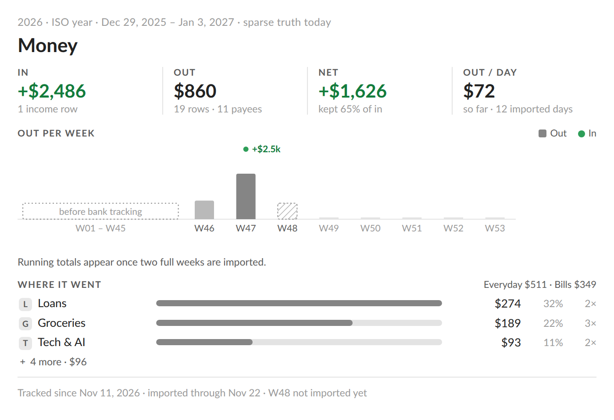

# Bank money views for period notes (researcher cld)

> **Research query:** Build on the Bank Badge work (epic `bob-cli-lh`) by adding an
> excellent set of new bank-transaction visualizations to each period note (week,
> quarter, year, all time; not daily notes). Lead the design so it is intuitive,
> reliable, and beautiful. Is this a good idea? Would I take a different approach?
> Which requirement adjustments are justified (called out)? End with a recommended
> solution.

## Bottom line

**Build it, but as one calm, bob-computed "Money" section in each period note, not as
more chrome in the stats strip, and ship the week view first.** The idea is sound.
Period notes are where Bryan reviews a week, quarter, or year. The bank already turns
every transaction into a categorized row, and the Bank Badge already gives each period
a one-line total. What's missing is the *second look*: where the money went, when it
moved, who got it, and whether more came in than went out. A period note is the right
place for that.

Five findings shape the design:

1. **The data is about three days old.** Bank tracking began **2026-11-11**. There is
   one checking account, one month note, and one day with money (seven rows, $249.77
   out, nothing in; verified with `bob bank report -m 2026-11 -f json`). For months,
   quarter, year, and all-time views will be mostly empty, so the design has to make
   sparse data look **honest and intentional**. It does that by collapsing everything
   before tracking into one quiet ghost. A week view is the only kind with dense data
   soon, so it should ship first.
2. **Imports land weekly, so the current week is always partly missing.** The QFX
   import runs on Monday (`docs/guides/acknowledge-bank-transactions.md`), so days after
   the last import show $0 even when money moved. A chart that draws them as zero lies.
   "Not imported yet" has to be its own visible state, separate from "nothing spent".
   This is the single most important reliability rule here.
3. **The stats strip is already full.** The period strip runs about 260–282 px in Both
   view (`docs/stats.md`, "Period strip geometry"). Charts inside it would push
   Intentions/Outcomes below the fold. The badge epic also chose to keep bank and strip
   lifecycles apart. So the new visuals belong in a **new `## Money` section**: a
   `bob-bank` fence with `view: period`, a sibling of the existing `view: month` and
   `view: queue` cards.
4. **Bob must compute every number.** Today's `bob bank report -p … -s` gives totals,
   the category breakdown, waiting, coverage, and navigation. Per-child-period columns,
   running totals, payees, largest rows, and pace do not exist yet. Following the badge
   epic's rule ("never plugin-side summation"), they should be **additive JSON from
   bob**, with parity tests. The plugin should never add money.
5. **Color has to stay inside the contracts the badge just set.** In is green ink,
   spending is neutral ("spending is not an error"), never red, never magenta. The bank
   cards' accent is the `cash` area hue, which is **magenta**, so the period view must
   **not** inherit the month card's accent. Category identity comes from the configured
   emoji, not from 25 generated hues.

The recommended set (rendered mockups below) is a **facts row** (In · Out · Net ·
Out/day), an **Out-per-child rhythm chart** with In shown as green event markers, a
**running-totals chart** (quarter and up), **Where it went** (ranked category meters
with inline drill-down), **Top payees and Largest**, and an **honesty footer**
(coverage, not-imported days, not-counted money, waiting rows). Each block answers one
review question and looks the same on every period kind.



_Figure 1. Week (2026-W48, illustrative data), viewed on the Monday before import. Sat
and Sun are hatched "not imported yet", not drawn as $0. Friday is focused with its
tooltip. Groceries is expanded inline. The amber dot under Thu marks waiting rows.
Category emoji appear as letter placeholders because the render host has no emoji
font._

## What exists today (verified)

| Fact | Evidence |
| --- | --- |
| Bank tracking started 2026-11-11 with one account (`checking`, WF Checking). Its status is `gap` and its balance anchor is 2026-11-12. One month note holds seven rows, all on Nov 12: $249.77 out, $0 in, 0 waiting. | `bob bank report -m 2026-11 -f json` (read-only), `~/bob/bank.md`, `~/bob/bank/2026-11.md` |
| 25 categories in three configured groups: **Everyday** (12), **Bills** (8), and **Money moves** (built-ins `income`, `refund`, `transfer`, `cash`), plus hidden `kids`. Each has an emoji label. | report `categories[]` |
| `bob bank report` already has `-p/--period` (day, ISO week, quarter, ISO week-year, all time over bank history) and `-s/--summary`, plus `coverage {tracked_since, imported_through, start, through, complete}` and `navigation {waiting, first, months}`. Day totals go through `compute_totals`. | `src/native/bank/report.rs` (`PeriodKind`, `Coverage`, `Navigation`), commit `575f9e66`, `docs/bank.md` |
| The **installed** `bob` (0.5.0) still rejects `-p`. The plugin will reach the vault before the release train ships it. | `bob bank report -p all` → `unexpected argument '-p'` |
| A month report runs in about 20 ms; the bank scan reads only `bank.md` and `bank/*.md`. | `time bob bank report -m 2026-11 -f json` ×3, `docs/bank.md` "Files" |
| The month card (`bob-bank`, `view: month`) already draws totals, "Out by category" share bars, a four-bucket "Daily Out" heat calendar, waiting/flagged pills, and account status. Its accent is the **bank hub's area hue**. `cash.md` has `color: magenta`. | `241l-plugin-bank-cards-model.js`, `241m-plugin-bank-cards.js`, `styles.css` `.bob-bank-card[data-root-hue]`, `~/bob/cash.md` |
| The Bank Badge model and painter are in (`241n`, `241na`). The fence hosts after every strip are still in progress (`bob-cli-lh.3`). The badge decided: In before Out, a green tint only when In > Out, whole dollars from quarter up, period-scoped waiting, and coverage text. | `sase bead read bob-cli-lh`, `plan:202611/bank_badge_strip_family.md` |
| Period-note scaffolds are written once and are a pure function of the period id. Fences belong to bob, and only the agent callout can be refreshed (`ensure -R`). `structure_ok` requires the strip, the parts fence, and the kind's headings. | `docs/periods.md` "Note anatomy and ownership", `src/native/periods/scaffold.rs`, `note.rs::structure_ok` |
| Period strips chart children on a shared child axis: days for a week; weeks for a quarter; weeks grouped by quarter for a year, falling back to four quarter columns below about 400 px; quarters grouped by year for all time. An untracked child is a short dotted ghost, a future child a 2 px stub, and leading untracked years collapse. Column ids match period ids (`2026-W46`). | `docs/stats.md` "Period strip geometry", `bob periods show 2026-Q4 -f json` `columns[]` |
| The strip contract: no `<button>`, no card, border, background, or shadow; `span[role=link/button]` stops; `mousedown` preventDefault keeps vim focus; a 160 ms fade-in only for newly shown charts. | `docs/stats.md` "Day strip" / Layout |
| A real-browser preview harness exists for stats renderers (light/dark × narrow/wide matrix). | `bob-plugins/scripts/preview-stats-block.cjs`, `docs/stats.md` "Browser preview and fixtures" |
| Totals semantics: Out excludes transfers and cash-account rows but includes ATM `cash` and uncategorized outflows. In is only `income` and `refund`. Uncategorized inflows are "unclassified in" and are never counted as In. | `docs/bank.md` "Totals" |

## Is this a good idea? (critique)

### Why it is worth doing

- **It fits the review ritual.** Bryan imports QFX and walks the Category card on
  Monday, which is also when last week's note is reviewed and its `## Review` drafted.
  A week Money view, right after the walk, turns filing into insight: where the week
  went, which days, and who got paid.
- **The data model is ready.** Rows are categorized, merchant keys exist
  (`identity.rs::merchant_key`), coverage and navigation exist, and period resolution
  matches period notes exactly. The new aggregates are small, bounded additions.
- **It completes a family.** The queue card on the hub, the month card on month notes,
  and the period view on period notes would cover the bank at every zoom level, with
  one painter vocabulary.

### What could make it bad

1. **Dashboard bloat.** Period notes already hold a five-fact strip with two charts, a
   parts table, and three prose sections. A money dump of donuts, Sankey diagrams, and
   ten charts would bury the review. *Mitigation:* each block answers one named
   question, the section is foldable, and blocks are dropped (not shrunk) when data is
   too thin.
2. **False zeros.** Weekly imports and three days of history mean most rendered periods
   are partially covered. A naive chart says "you spent nothing" exactly when it
   doesn't know. *Mitigation:* bob emits a per-child coverage state, and the painter
   has distinct marks for *before tracking*, *not imported yet*, *partial*, and
   *future*.
3. **Judgment creep.** Money visuals drift toward red deficits, ▲/▼ versus typical,
   budgets, and scores. Bob's written contract says spending is not an error, and the
   badge research rejected median "typical" lines for bursty money. *Mitigation:* no
   red, no typical, no budgets, no grades. Net is green only when positive, otherwise
   body ink.
4. **Two implementations drifting.** If the month card and the period view compute or
   format money differently, they will disagree. *Mitigation:* bob computes, and the
   plugin shares formatting (`bankBadgeAmount`), the category meter, and the row
   drill-down between the cards.
5. **Payoff timing.** The quarter, year, and all-time views are mostly ghost until
   2027. That isn't a reason to skip them (the design shows tracking began here
   honestly), but it is a reason to **ship the week view first** and to consider
   **history backfill** (below).

### What I'd do differently from the literal ask

- **One Money section, not visuals sprinkled into the strip.** Bryan asked for "a set
  of new bank transaction visualizations to each period note". I'd deliver one section
  per note holding a set of blocks, so it reads as one thing, folds as one thing, and
  can be deleted as one thing.
- **Ship week first, then quarter, then year and all time.** Each kind gets the same
  blocks, but the higher kinds need the leading-untracked collapse and grouping before
  they look good.
- **Seriously consider importing history (separate epic).** Bank activity downloads
  typically reach back many months (verify Wells Fargo's current QFX limit). Moving the
  account `start` back and importing older exports would turn `2026.md` from one
  tracked week into a much fuller year at once, but it
  would also create several hundred waiting rows to file, and every period badge would
  show amber "waiting" until they're filed. This is the biggest lever on the feature's
  value. It needs Bryan's call and a bulk-filing story, so it is out of scope here.

## Adjustments to the requirements

_Explicit call-outs; each is a deliberate change or addition to the literal request._

| # | Request (literal) | Adjusted to | Why |
| --- | --- | --- | --- |
| **R1** | "Visualizations to each period note" | One **`## Money` section** per period note: a `bob-bank` fence with `view: period`, placed after the parts section and before `## Review` (`## Notes` on all time). It does **not** go inside the stats strip. | The strip is already about 270 px tall; charts there push Bryan's planning sections down. A fenced section is foldable, movable, deletable, and keeps bank and strip lifecycles apart, as the badge epic chose. |
| **R2** | "An excellent set" (open-ended) | A **curated set of five blocks plus a footer**, each tied to one review question (see [The set](#the-set-one-block-per-question)). Explicitly no Sankey, donut, per-category hues, budgets, typical/median, net-worth, or balance line in v1. | Restraint is what keeps it beautiful. Every rejected form is listed with its reason in [Deliberately left out](#deliberately-left-out). |
| **R3** | *(implied)* charts by calendar month, the way money usually rolls up | **Children of the period**: days for a week, ISO weeks for a quarter, weeks grouped by quarter for a year, quarters grouped by year for all time. **Never calendar months.** | Period notes are whole ISO weeks, so the parts must add up to the whole. Months straddle ISO quarters (2026-Q4 holds 3 days of September and 3 of January). Child columns line up with the strip's columns and open the same child notes. |
| **R4** | *(not stated)* | **Every number comes from bob**, including per-child totals, running totals, out/day, payees, and largest rows. The plugin only lays out what bob reports. | Same rule as the badge: client-side folds hide accounting bugs and drift from the month card. |
| **R5** | *(not stated)* | **Coverage is a first-class visual state.** Children are *tracked*, *partial*, *before tracking*, *not imported yet*, or *future*, each with its own mark. Facts say "over N imported days". Nothing unknown is drawn as $0. | Weekly imports plus three days of history: most periods are partial. |
| **R6** | "Each period note" | **Not on periods that ended before bank tracking began.** The one-time insertion skips `2026-W01`…`2026-W45`. New scaffolds always include the section (scaffolds stay pure), and a period with no tracked days renders one quiet line. | An empty Money section on 45 historical weeks is clutter, not honesty. |
| **R7** | "Daily files don't need this" | Agreed. Daily notes keep only the Day-strip badge, and **month notes keep the month card unchanged**. Later, the month card can reuse the period view's payee and largest blocks. | Keeps scope tight. The month card's magenta accent is a separate cleanup. |
| **R8** | *(not stated)* | The view is **read-only** and **never writes vault bytes**. Navigation opens rows, day headings, and child notes; it never calls `ensureOpenDay`. | Same contract as the strips and the badge. |
| **R9** | *(not stated)* | **Money stays out of agent briefs and Reviews** in v1. `bob periods brief` gains no money, and the callout needs no change ("the brief is your only source of numbers" already keeps money out of drafts). | Putting money into agent prose is a separate privacy and tone decision for Bryan. |
| **R10** | *(not stated)* | **Ship the week view first.** Quarter, year, and all time follow once the collapse and grouping are in place. | Only weeks have dense data in 2026. |

## Design

### Placement and ownership

```text
# 2026-W48 · Nov 23 – 29
‹ W47 · ↑ 2026-Q4 · W49 ›
Mon 23 · Tue 24 · …
[bob-stats-strip fence]                               ← work stats (unchanged)
BANK · in +$2,486.15 · out $832.63 · 2 waiting      ← Bank Badge (bob-cli-lh)
## Intentions                                         ← Bryan
## Days    + [bob-period-parts fence]                 ← parts table (unchanged)
## Money   + [bob-bank fence, view: period]           ← NEW: this report
## Review                                             ← agent via bob periods draft
## Reflection                                         ← Bryan
> [!agent]- …                                         ← callout
```

- **Ownership** follows the existing rule: the heading and fence belong to bob (written
  once), and the rendered content belongs to bob-ledger-tools (live, no number ever
  written into Markdown). If Bryan deletes or moves the section, bob never re-adds it.
- **The fence infers its period** from the note's frontmatter `id:` and path, the way
  `view: month` validates `month:` against the filename. A mismatch shows an inline
  error, never zeros. An optional `period: 2026-Q4` line allows embedding the view in
  any note, such as a `cash` project note.
- **Why not the alternatives:**

| Alternative | Verdict |
| --- | --- |
| Auto-mount the panel after the badge inside the `bob-stats-strip` fence (no note change) | Rejected. It adds about 400–550 px above Intentions, can't be folded natively, and recouples the bank and strip lifecycles that the badge epic separated. |
| A money column in the `bob-period-parts` table | Useful complement later, but it can't answer "where" or "who", and it widens an already wide table. |
| A separate `dash_bank.md` with a period picker | Not what was asked ("each period note"). The review happens in the period note. |
| Expand the badge into a disclosure panel | The badge's click target is decided (oldest waiting row, else a day heading or month note, else `bank.md`), and a popover can't hold this much. |

### The set: one block per question

| Block | The review question it answers | Form (why this form) | Kinds |
| --- | --- | --- | --- |
| **Facts row**: IN · OUT · NET · OUT/DAY | "How much, in a sentence?" | Four stat tiles in the strip's fact anatomy: a small-caps label, a large value, and a quiet sub-line. Sub-lines are *context*, never typical: `1 income row`, `12 rows · 7 payees`, `kept 67% of in` (or `out was 112% of in`), `over 5 imported days`. A headline number is a stat tile, not a chart. | all |
| **Rhythm**: Out per child, with In markers | "When did money move? Which week was heavy?" | Neutral Out columns on the strip's child axis. **In appears as a green event marker** (dot plus `+$2.5k` label) in a lane above the plot, not as a bar. Paychecks are rare, large events and spending is the frequent shape. Mirrored in/out bars would shrink every spending column to a sliver next to a paycheck, and two scales would break the one-axis rule. Only the tallest column gets a direct value label; the rest use the tooltip and table. | all |
| **Running totals**: cumulative In vs Out | "Over the period, did more come in than went out, and when did that change?" | Two step lines on **one** dollar axis with end labels (`In $9,987`, `Out $6,341`). The gap is washed green only while In leads, matching the badge's one-way tint. Running sums absorb burstiness: paydays become steps and rent becomes a stair, which is why this works where "typical" didn't. Its x positions are the rhythm chart's child slots, so the two charts read as one. | quarter, year, all (after about 14 imported days) |
| **Where it went**: category meters | "Where did it go?" | Ranked horizontal meters in one neutral hue, each with emoji label, amount, share, and row count. Top 6, then `+ N more · $X` (expandable). A text line `Everyday $3,729 · Bills $2,612` summarizes the configured groups. Unclassified is hatched and always shown; cash out reads "destination unknown". **Click or Enter expands the category's largest rows inline**, and each row opens its line in the month note. These are ranked bars because 25 classes would break any categorical palette, and emoji carry identity. | all |
| **Top payees** and **Largest** | "Who got it? What were the big tickets?" | Two compact lists side by side (stacked when narrow). Payees are grouped by bob's merchant key and show the count (`31×`), total, and category emoji; largest rows show date, payee, and amount. Each entry opens its row(s). Habit spend (31 coffees) and one-offs (a car repair) are the insights category totals hide. | all (5 payees and 5 largest per kind) |
| **Honesty footer** | "Can I trust this, and what's left to do?" | One wrapped text line: waiting rows (amber, links to the oldest), not-imported days (`Sat–Sun not imported yet (imported through Fri Nov 27)`), not-counted money (`↔ transfers $500 · cash traced $… · unclassified in +$…`, nonzero only), tracked-since on partial periods, and account status when not `balanced`. | all |



_Figure 2. Quarter (2027-Q1, illustrative), so far through W08. W09 is hatched "not
imported yet" in both charts, and W10–W13 are 2 px future stubs. Running-total points
sit at each week's end, aligned with the rhythm columns below. Amounts are whole dollars
from quarter up (badge rule)._



_Figure 3. The same quarter in dark mode. Dark mode is *selected*, not flipped: the In
ink and marker are lighter steps of the same green, and the Out fill keeps ≥ 3:1
against the surface._



_Figure 4. The 2026 year note as it would look in late November, using roughly today's
real shape. Forty-five untracked weeks fold into one quiet ghost, so the chart is honest
without being mostly empty. Running totals wait for about 14 imported days and say so
in one line._

### Per-kind adaptation

| | Week | Quarter | Year | All time |
| --- | --- | --- | --- | --- |
| Rhythm columns | 7 days (`Mon 23`) | 13–14 weeks (`W01`) | 52–53 weeks grouped by quarter (`Q3` captions, no per-column values); below about 400 px, 4 quarter columns | quarters grouped by year; collapse leading untracked |
| Click a column | day heading in the bank month note | that week's note, at `#Money` | that week's note (or quarter note in the fallback), at `#Money` | that quarter's note, at `#Money` |
| Running totals | — (seven days is too short to read as a trend) | yes | yes | yes |
| Amounts | exact cents | whole dollars (sub-$1 keeps cents) | whole dollars | whole dollars |
| Payees / Largest | 5 / 5 | 5 / 5 | 8 / 5 | 8 / 5 |
| Before-tracking state | one quiet line if no tracked day | ghost columns, or the whole view collapses to one line | collapse leading untracked weeks into one ghost slot | the span starts at bank history, so none |

Drilling down by **clicking a column opens the next level down at its Money section**,
and at day level, the statement itself. That gives the whole tree one navigation idea:
quarter → week → day → rows.

### Honesty states (reliability)

| State (from bob) | Rhythm mark | Running totals | Facts and footer |
| --- | --- | --- | --- |
| `tracked` | Out column (graphite fill), In marker when > 0 | line point | counted |
| `partial` (tracking began mid-child, or the child is only partly imported) | Out column with a **dotted cap** (not a lighter fill: a lighter grey fails 3:1, 1.96:1 measured) | point | tooltip: `partial · tracked from Wed Nov 11` |
| `untracked` (before `tracked_since`) | dotted ghost at about 35% height (the strip's convention); leading runs collapse to one slot | dotted baseline, "before bank tracking" | footer `Tracked since Nov 11, 2026` |
| `awaiting_import` (started, after `imported_through`) | **hatched** column at about 35% height; typed rows, if any, draw on top | hatched band | footer `Sat–Sun not imported yet (imported through Fri Nov 27)`; facts say `over 5 imported days` |
| `future` | 2 px baseline stub | line stops | — |
| waiting rows in a child | amber dot under its caption (as on the month heat grid) | — | `● 2 waiting` links to the oldest row |
| stale refresh | last-good render held at reduced opacity, plus a dashed note line; **no skeleton flash** | same | `Updating · last good values shown` |
| failure, nothing cached | one muted `Bank unavailable` line with a retry `span[role=button]`; **never zeros** | — | — |
| report period ≠ note period | treated as failure | — | — |
| older bob (no `-p` or no `children`) | one muted teaching line: `Money view needs bob ≥ <version> (bank report -p)` | — | Unlike the badge, which hides silently, a visible section with no content would just be confusing. |
| no `bank.md` | nothing (zero height) | — | — |
| mobile, hover popover, embed | nothing, and no `bob` spawn (as the strips) | — | — |

### Color, type, and marks

| Element | Token / rule | Measured (Obsidian default) |
| --- | --- | --- |
| In values, In labels | `--bob-bank-in-ink` = `color-mix(in srgb, var(--color-green) 60%, var(--text-normal))` (the badge's token) | 5.28:1 light, 9.28:1 dark ✓ text AA. Raw `--color-green` text is only 2.61:1 ✗. |
| In marker and running-In line | `--color-green` (a graphic, not text) | 3.42:1 light ✓ (≥ 3:1 for graphics) |
| Out columns, Out line, category meters | `--bob-bank-out-fill` = `color-mix(in srgb, var(--text-normal) 55%, var(--background-primary))` | 3.69:1 light, 4.52:1 dark ✓ |
| "Kept" wash | `--color-green` at about 10% (light) or 12% (dark), only while In leads | In ink on the wash is 4.78:1 ✓ |
| Net value | In ink when > 0; body ink with `−` otherwise. **Never red.** | — |
| Labels | `--text-muted`, small caps, 0.09em tracking | — |
| Sub-lines and footer facts | `--text-muted`. Use `--text-faint` only for decorative captions (future columns), because faint text is about 2.3–2.8:1 and fails AA for information. | ✓ |
| Waiting | `--text-warning` amber | — |
| Focus | 2px `--interactive-accent` outline, offset 2px (the strips' rule) | — |
| Forced colors | `CanvasText` outlines, hatches for partial and awaiting, no washes; words and signs carry the meaning | — |
| Never | red, magenta, the bank hub's area hue, per-category hues, gradients, shadows, card chrome | — |

Marks follow the strips: columns `min(24px, slot − 2px)` with 2 px rounded data ends
anchored to the baseline and 2 px gaps; 2 px lines; ≥ 8 px markers with a 2 px surface
ring; hairline solid baselines; tabular figures in lists and axes, proportional
figures on the large fact values; the 160 ms fade-in only on first show, and data
repaints never animate.

**The view is chrome-less.** Unlike the month card it has no frame, wash, or accent.
It inherits the strip's typographic system, so a period note reads as one document,
not a dashboard of widgets. The month card's magenta accent is a known collision with
the "magenta means at-cap" reservation; leave it to a separate cleanup.

### Interaction and accessibility

- **Stops** are `span[role=link]` (captions, payees, largest rows) and
  `span[role=button][aria-expanded]` (category rows, `+ N more`). There are no
  `<button>` elements. `mousedown` calls `preventDefault`. Ctrl/Cmd-click and
  middle-click open a new tab. Click, Enter, and Space activate.
- **Tooltips enhance and never gate.** Hovering or focusing a column shows its range,
  In with category, Out with row count, the top two categories, waiting, state, and
  the click action (Figure 1). Every value is also in a visually hidden `<table>` twin
  per chart (child, in, out, net, rows, state) and in an `aria-label` sentence.
- **Drill-down stays read-only.** Category, payee, and largest rows open
  `bankOpenMonthPathAtLine(path, line, {newLeaf})`, and columns open child notes at
  `#Money` or day headings. Nothing writes, and tests assert unchanged vault bytes.
- **Narrow layout (< 34em):** facts fold 2×2, meters drop the share column, lists
  stack, and the year rhythm falls back to quarter columns (the strip's rule).

### Deliberately left out

| Idea | Verdict |
| --- | --- |
| Sankey (income → categories) | Rejected. In has only two classes (income, refund), so it degenerates, and it is unreadable at note width. |
| Donut or pie of categories | Rejected. With 25 classes, ranked meters compare better (data-viz rule: part-to-whole with > 6 parts uses ranked bars). |
| Per-category colors | Rejected. More than 8 hues fail color-blind checks; emoji already carry identity. |
| Mirrored In/Out columns | Rejected for v1. Paycheck spikes flatten every spending bar, and two scales would violate one-axis. Markers plus running totals carry In better. |
| Calendar-month axis | Rejected (R3). It breaks "parts add up to the whole" on ISO periods. |
| Daily heat calendar (GitHub-style, 53×7) | Deferred. The month card already owns the daily grid, and weekly columns align with the strip. It's a good v2 alternate for the year view. |
| Typical/median lines, ▲/▼ marks | Rejected. Same reason as the badge: medians over bursty money mislead. |
| Previous-period comparison ticks on category meters | **Deferred (v2).** These are honest when the previous period is fully covered: two real numbers, no judgment color. Add once data exists to compare. |
| Budgets, targets, savings-rate goals | Out of scope (`docs/bank.md` "Current limits"). |
| Balance or net-worth line | Deferred. The only account is in `gap` status, and multi-account balance semantics (credit liabilities, internal transfers) need their own design. Revisit when accounts are `balanced`. |
| Linked records (e.g. `[[eat/…]]` restaurant links on payee rows) | Nice later touch. Rows already carry `links`. |

## Data contract (bob-cli, additive, `schema_version` stays 1)

The view and the badge request the same command,
`bob bank report -p <PERIOD> -s -f json`, so on quarter, year, and all-time notes they
**share one cache entry and one spawn**. Week badges currently use `-w`. Switching them
to `-p` once it ships makes week notes share as well; that's a small follow-up to the
strip-hosts phase. All new blocks are bounded, so they stay present under `-s`.

```jsonc
{
  "period": { "kind": "quarter", "key": "2027-Q1", "start": "2027-01-04", "end": "2027-04-04", "so_far": true, … },
  "coverage": { …existing…, "days": 56 },            // NEW: imported days in the period through today
  "pace": { "out_per_day_cents": 11323,               // NEW: out_cents / coverage.days, null when days = 0
            "out_to_in": 0.6349 },                     //      out / in, null when in = 0
  "counts": { "out_rows": 214, "in_rows": 5, "payees": 61 },        // NEW
  "children": [                                        // NEW: the period's own child partition
    { "id": "2027-W05", "kind": "week", "label": "W05", "start": "2027-02-01", "end": "2027-02-07",
      "group": null,                                   // "2026-Q4" for year weeks; "2026" for all-time quarters
      "state": "tracked",                              // tracked | partial | untracked | awaiting_import | future
      "in_cents": 252833, "out_cents": 221000,
      "cum_in_cents": 749845, "cum_out_cents": 435600, // running totals from period start
      "rows": 31, "waiting": 0,
      "target": { "path": "2027/2027-W05.md" } }       // a day child: { "path": "bank/2027-02.md", "line": 14 }
  ],
  "groups": [ { "id": "2026-Q4", "label": "Q4", "in_cents": …, "out_cents": …, "state": "partial" } ],  // year / all time only
  "inflows": [ { "key": "income", "emoji": "💵", "label": "Income", "in_cents": 994460, "rows": 4 },
               { "key": "refund", "emoji": "↩️", "label": "Refund", "in_cents": 4218, "rows": 1 } ],
  "breakdown": [ { …existing…, "group": "Everyday",   // NEW: the category's configured group
                   "largest": [ { "date": "2027-02-01", "cents": -165000, "payee": "Rent Co",
                                  "path": "bank/2027-02.md", "line": 9 } ] } ],   // ≤ 5 rows
  "payees": [ { "name": "Track Coffee", "category": "coffee", "out_cents": 26784, "rows": 31,
                "last": { "path": "bank/2027-03.md", "line": 7, "date": "2027-02-27" } } ],  // ≤ 8, by out_cents
  "largest": [ { "date": "2027-02-01", "cents": -165000, "payee": "Rent Co", "category": "home",
                 "path": "bank/2027-02.md", "line": 9 } ]                                    // ≤ 5 outflows
}
```

Rules and invariants (each one a test):

- **One accounting path.** Children, groups, inflows, breakdown, payees, and largest
  all come from `compute_totals` and `is_counted_money` over the same rows as `totals`.
  Parity: `Σ children.out = totals.out`, `Σ children.in = totals.in`,
  `Σ breakdown.out = totals.out`, `Σ inflows.in = totals.in`, and the last child's
  `cum_*` equals `totals.*`. Test across transfer, cash-account, zero-cent,
  uncategorized-inflow, and month-straddling rows.
- **The child partition comes from the periods calendar** (`PeriodId` children), so
  `children[].id` equals `bob periods show` `columns[].id` for the same period. All
  time uses quarters from the bank's first quarter (bank history), grouped by ISO year.
- **States** come from `coverage` and `today`: `future` if `start > today`; `untracked`
  if `end < tracked_since`; `awaiting_import` if `start > imported_through` and
  `start ≤ today`; `partial` if the child straddles either bound; otherwise `tracked`.
- **Payees** group by `merchant_key(payee)` (the import's own key; typed rows join the
  same way). The name is the most recent row's payee text, which is already masked
  (`••••`). Ties break by name. Hidden categories still count, because totals include
  them.
- Bounded sizes: children ≤ 64, breakdown ≤ categories (each with ≤ 5 rows), payees
  ≤ 8, largest ≤ 5. By my estimate a year payload stays around 20 KB (not measured,
  since `-p` isn't installed yet).
- Human output (`bob bank report -p 2026-Q4`) gains a children sparkline row and the
  top payees, never depending on terminal width (the existing human contract).
- Docs: `docs/bank.md` JSON and Commands, plus `docs/reference/json-outputs.md#bank-reports`.
  No `Cargo.toml` or `CHANGELOG.md` edits (release-train decision). Commit as
  `feat(bank): …` (additive, no `!`).

## Note scaffold and one-time insertion (bob-cli)

- **Scaffolds:** `render_week`, `render_quarter`, and `render_year` add the block below
  between the parts section and `## Review`; `render_all_time` adds it between
  `## Years` and `## Notes`.

  ````markdown
  ## Money

  ```bob-bank
  view: period
  ```
  ````

  Scaffolds
  stay a pure function of the id, so the section is always present on new notes, and
  the plugin renders nothing when there's no bank hub.
- **`structure_ok` is unchanged.** Money is optional, so a deleted section never makes
  a note `unscaffolded`.
- **Existing notes:** add `bob periods ensure -s/--sections`, documented as "insert
  bob-owned sections added after a note was scaffolded (today: `## Money`)". It is
  modeled on `-R`:
  - it inserts before `## Review` (or `## Notes`), else after the parts fence, else
    reports `section_unplaced`;
  - it skips notes that already contain a `bob-bank` fence or a `## Money` heading;
  - it skips periods that ended before the bank's `tracked_since` (R6), dirty notes,
    and notes with no anchor;
  - it writes one offline `vault_rewrite` commit, `periods: add Money sections`, and
    `-n` plans without writing.

  It's explicit and one-time, so a section Bryan later deletes stays deleted unless he
  reruns the command. The option name keeps options alphabetical with a short alias
  (`cli_rules`).
- **Agent callouts:** no `INSTRUCTIONS_VERSION` bump. "Edit nothing else" and "the
  brief is your only source of numbers" already keep agents out of the section (R9).

## Plugin architecture (bob-plugins `bob-ledger-tools`)

- **Fence:** extend `bankCardParseFence` to accept `view: period` and an optional
  `period:`. Validate against frontmatter `id`, path, and `type: [[day]]` as the month
  view validates `month:`.
- **Decoder (`241h`):** pass through the new blocks with strict shapes. A malformed
  block is `bad-shape`, never silently zero. When `children` is missing, the view
  shows the older-bob line.
- **Pure model** (a new fragment, e.g. `241r-plugin-bank-period-model.js`):
  `bankPeriodViewModel(report, context)` returns
  `hidden | unavailable | older-bob | untracked-line | view{facts, rhythm, running?, where, payees, largest, footer}`.
  Every visibility and density decision lives here (the running chart needs ≥ 14
  imported days; leading-untracked collapse; the year narrow fallback; top-N folding),
  tested with vectors like the badge model.
- **Painter** (e.g. `241s-plugin-bank-period-view.js`): chrome-less DOM and SVG.
  **Reuse the period strip's child-axis helpers** (captions, group captions, ghost and
  stub geometry, legend-fit observer) by extracting a small shared child-axis module
  from `239-plugin-period-strip-charts-render.js`, rather than copying them. That reuse
  is what makes W46 here look exactly like W46 in the strip. Share `bankBadgeAmount`
  and the meter and row components with the month card. Keep every hand-edited
  fragment at or under 1000 lines, and never hand-edit `main.js`.
- **Data:** `apiBankSubscribe({command: "report", period, summary: true})`, the same
  key as the badge, revalidated on bank-file changes. Fetch only after the section
  first becomes visible (IntersectionObserver, as the strips do), and release on
  unload. Hold last-good values during refresh.
- **Preview harness:** add fixtures (week dense, week before import, quarter so far,
  sparse year, all time, older bob, failure) to a `preview-bank-period.cjs` modeled on
  `preview-stats-block.cjs`, which captures light/dark × narrow/wide. "Beautiful" gets
  verified by eye on real renders, not asserted in prose. The mockup source in
  `bank_period_money_views__cld_figs/mockup_src/` is a starting visual target.

## Verification plan

- **bob-cli:** the parity tests above; a span test where `children[].id` equals
  `periods show columns[].id` for `2026-W53`, `2026-Q4` (14 weeks), `2026` (53 weeks
  with quarter groups), and all time; a state matrix (tracking starts mid-week, imports
  through Friday, typed row on an awaiting day, future); payees grouping imported and
  typed rows of one merchant; `-s` keeping the new blocks; and the scaffold plus
  `ensure -s` with dry run, skip rules, a dirty-note refusal, and idempotence.
- **bob-plugins:** model vectors for every honesty state and density rule; the painter
  emits no `<button>`, has a hidden table twin, and keeps ink tokens; a click changes
  no vault bytes and runs no bob write; the badge and view on one note issue one spawn;
  unload unsubscribes; there is no fetch before visibility; and CSS has no magenta or
  red in the period-view rules.
- **By eye in Obsidian (light and dark):** W46 (partial, since Nov 11), W47 the Monday
  before import (hatched days), 2026-Q4, `2026.md` (collapsed ghost), and
  `all_time.md`. Each column click lands one level down at `#Money`.

## Phasing

| Phase | Repo | Size | Depends on |
| --- | --- | --- | --- |
| 0. Finish `bob-cli-lh`; the release train ships `bank report -p` | both | — | — |
| 1. Report aggregates: children and groups with states, running totals, pace, counts, inflows, breakdown group and largest, payees, largest; parity tests; docs | bob-cli | medium | 0 |
| 2. `## Money` in scaffolds plus `bob periods ensure -s/--sections`; `docs/periods.md` | bob-cli | small–medium | — |
| 3. `view: period` core for **week and quarter**: fence, decoder, model, painter (facts, rhythm, where with drill-down, payees and largest, footer), honesty states, shared cache, preview fixtures | bob-plugins | medium–large (split model and painter) | 1 |
| 4. Running totals; year and all-time grouping; leading-untracked collapse; narrow fallback | bob-plugins | medium | 3 |
| 5. Vocabulary: glossary strand (proposed **Money Section**, aka bank period view), docs, plugin docs | bob-cli | small | 3 |
| Later | — | — | previous-period ticks; per-category sparklines; heat-calendar alternate for years; balance line once accounts are `balanced`; month card adopts payees and largest; history backfill epic |

## Open questions for Bryan

1. **Heading name:** `## Money` (my pick: it reads like a review topic, like `## Days`)
   or `## Bank` (matches the subsystem)?
2. **History:** should `2026-W01`–`W45` get the section (I recommend no, R6)? Separately,
   is a QFX **history backfill** worth an epic, given the filing work it creates?
3. **Payee names on screen:** comfortable showing merchant names in period notes
   (screen-sharing), or should the payees list sit behind a fold by default?
4. **Week running totals:** leave them off (my pick) or show them on weeks too for
   uniformity?
5. **Memory:** add the glossary strand **Money Section**? Optionally add a decision
   record, "period money charts use the period's children, never calendar months".
   (The badge's color record was declined, so I'd only propose this one.)

## Recommended solution

Add a **Money section** to every period note: a bob-owned `## Money` heading with a
`bob-bank` fence (`view: period`) between the parts table and `## Review`
(`## Notes` on all time). It goes in new scaffolds and is added once to existing
post-tracking notes by `bob periods ensure -s/--sections`. bob-ledger-tools paints it
read-only and chrome-less, in the strip's typography, from
`bob bank report -p <period> -s -f json`, sharing the badge's cache entry. The view
holds:

1. **Facts:** IN · OUT · NET · OUT/DAY, with context sub-lines and no typical line.
2. **Rhythm:** neutral Out columns on the period's own child axis, the same columns as
   the strip, with In as green event markers. Columns drill one level down.
3. **Running totals** (quarter and up): cumulative In vs Out on one axis, washed green
   only while In leads.
4. **Where it went:** ranked neutral meters with emoji identity, a group summary line,
   always-visible unclassified, and inline drill-down to rows.
5. **Top payees and Largest:** merchant-key groups and single big tickets, each opening
   its rows.
6. **Honesty footer:** waiting, not-imported days, not-counted money, tracked-since,
   and account status.

Make **bob** compute every figure as additive, bounded, parity-tested JSON: children
with coverage states, running totals, pace, inflows, payees, and largest. Make
**coverage a visual state**, so "not imported yet" and "before tracking" never look
like $0. Keep the badge's color contract (green ink for In, neutral spending, never red
or magenta, never the hub hue) and the strip's interaction contract (no buttons,
read-only, keyboard and vim safe, a table twin). **Ship it in this order:** bob
aggregates, then week and quarter, then year and all time. Verify by eye with a
preview harness in light and dark. Treat history backfill as the separate, high-leverage
decision it is.
