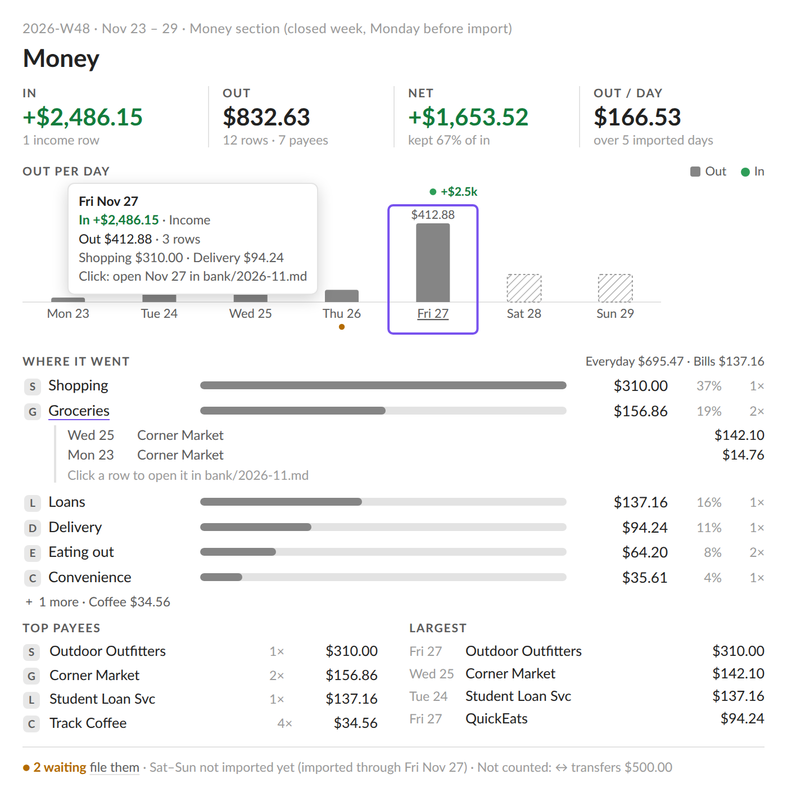

# Bank period charts: transaction visualizations for period notes

> **Research query:** Improve on the Bank Badge work (epic `bob-cli-lh`) by adding an
> excellent set of new bank transaction visualizations to each period note (week,
> quarter, year, all time; daily files excluded). Lead the design so it is intuitive,
> reliable, and beautiful. Critique the plan, call out justified requirement
> adjustments, and end with a recommended solution.

Consolidated from five independent swarm reports — [cdx](bank_period_charts__cdx.md),
[cld](bank_period_charts__cld.md), [grk](bank_period_charts__grk.md),
[mus](bank_period_charts__mus.md), [gem](bank_period_charts__gem.md) — plus the lead's
own verification of the epic, beads, and both repos on 2026-11-14.

## Bottom line

**Build it — as one compact, read-only panel with two charts, not a gallery.** All five
researchers independently reached the same verdict: the idea is sound, period notes are
the right home, and the single biggest risk is the phrase "excellent set." A pile of
pies, heatmaps, Sankeys, and payee clouds would fight Bob's strip grammar, lie about a
three-day-old ledger, and bury the note's human purpose (Intentions, Review,
Reflection). Two well-chosen encodings answer the questions a period review actually
asks:

1. **When did money move?** A child-period cashflow chart on the same axis the work
   charts already use (days of a week, weeks of a quarter, weeks-grouped-by-quarter of a
   year, quarters-grouped-by-year of all time).
2. **Where did Out go?** Ranked horizontal category bars from the report's existing
   `breakdown[]` — top five or six plus `N more`, with Unclassified and Cash out never
   folded away.

Mount the panel as a third sibling host after the Bank Badge inside the existing
`bob-stats-strip` fence, so every existing period note lights up with no scaffold
surgery. bob computes every cent through the one shared accounting path; the plugin only
paints. Coverage honesty ("not imported yet" ≠ "$0 spent") is foundational, not polish.
Typical-comparisons, budgets, payee lists, and any agent-facing money stay deferred
behind the existing bank-trial gate (`bob-cli-ku`). Start after `bob-cli-lh` closes.



_Daily notes keep only the Bank Badge. Period notes mount a money panel after the strip
and badge inside the existing fence — the host split `bob-cli-lh.3` already built.
(Figure from researcher grk; it matches the consolidated recommendation.)_

## Verified current state (lead-checked, 2026-11-14)

The researchers ran hours apart and disagreed on a few facts; these are the resolved
versions, verified directly in this workspace:

| Fact | Status |
| --- | --- |
| Epic `bob-cli-lh` phases: lh.1 (report `-p`/`-s`/coverage/navigation), lh.2 (shared badge model/painter), lh.3 (badge hosts after every strip) | **CLOSED.** lh.4 (vocabulary + docs) still in progress. Verified via `sase bead read bob-cli-lh`. |
| Workspace bob-cli (`50b015b1`) | Has `PeriodKind::{Quarter, IsoYear, AllTime}`, `coverage_for`, navigation (`src/native/bank/report.rs`). mus's claim that `-p`/`-s` "do not exist yet" described the **installed** bob 0.5.0, not the workspace — the release train has not shipped them yet. |
| bob-plugins master (`6a1778b feat(ledger-tools): add bank badge hosts after every stats strip`) | Fence split landed: `record.badgeHost` sibling hosts, `bankBuildArgs` emits `-p`/`-s` for quarter/year/all, `BANK_CACHE_SIZE` is now **24** (grk read 16 pre-lh.3; cdx's plugin snapshot `008700b` predates lh.3). |
| Badge epic plan out-of-scope list | Explicitly defers "a money lane in period charts" and "a period detail panel" — **this request is that deferred work, now explicitly asked for.** |
| Live data (cld, grk, mus, consistent) | Tracking since **2026-11-11**; one checking account (status `gap`); one counted day; 7 rows; $249.77 out; $0 in; 25 categories in 3 groups. |
| `bob-cli-ku` (snoozed to 2026-12-14) | Gates "later bank views" — typical comparisons, a year card, a `bank` Stats metric, a Mac idle-agenda line, **and a week-note fence** — on a 2–4 week trial plus two months of rows. Carries the standing **privacy rule: v1 adds no bank data to agent-facing outputs** (period briefs, Stats, the Mac app). |
| Badge plan reviewer decisions | The badge **color decision record was declined** (`memory_badge_color_record = no`); only the glossary edits were approved. Relevant precedent for any memory proposals here. |

## Critique: is this a good idea?

**Yes.** The badge gives each period one line; a quarter or year review still cannot see
*shape* — payday versus rent week, coffee versus bills, which week drove the total. The
data model is ready (categorized rows, merchant keys, exact ISO period resolution,
coverage metadata), the review ritual already happens on these notes (the Monday QFX
import and Category-card walk land beside the week note), and the panel completes a
family: queue card on the hub, month card on bank month notes, charts on period notes.

Every report converged on the same failure modes, each with a concrete fix:

1. **The "excellent set" trap.** Dashboard bloat is the product risk: period notes
   already hold a ~260–282 px stats strip, a badge, a parts table, and three prose
   sections. *Fix: one panel, two charts, ~120–150 px, collapsible.* (All five; Few's
   dashboard pitfalls and Cleveland–McGill's encoding rankings back the restraint.)
2. **False zeros.** Imports land weekly on Monday and tracking is three days old, so
   most rendered buckets are partially covered. A chart that draws an unimported
   Saturday as $0 lies — this is the single most important reliability rule. *Fix:
   per-bucket coverage states, drawn distinctly, never as zero.* (All five; cld
   strongest.)
3. **Judgment creep.** Money visuals drift toward red deficits, ▲/▼ typicals, budgets,
   scores. Bob's written contract says spending is not an error, and medians over
   bursty, three-day-old money are noise. *Fix: absolute money only in v1; green only
   for In/surplus; never red or magenta; typicals stay behind the `ku` trial gate.*
4. **Two accounting paths drifting.** If the plugin folds days into ISO weeks itself,
   the calendar-year/ISO-week-year bug the badge epic existed to kill comes back. *Fix:
   bob emits the child series; the plugin never adds money.* (All five.)
5. **Privacy leak.** The `ku` bead's standing rule keeps bank data out of agent
   surfaces. A live plugin panel honors it; anything that writes money into note bytes
   or `bob periods brief` breaks it. *Fix: read-only panel, briefs untouched.* (mus;
   gem's brief-enrichment idea is therefore deferred to an explicit Bryan decision.)

**Would a different approach be better?** Alternatives all five weighed and rejected: a
`dash_bank.md` explorer (review happens on the period note), a money lane inside the
ROOTS/TYPES charts (unit clash, coupled repaints — the badge epic deferred it
deliberately), a sixth Stats fact (typical semantics are wrong for money, and Stats
feeds the brief), cloning the month card's heat calendar (that is the month statement's
grain), and expanding the badge into a popover (its click target is already settled).

**One timing tension to call out:** `bob-cli-ku` gates "later bank views" — including a
week-note fence — on the trial and two months of rows. This request pre-empts part of
that scope. That is Bryan's call to make and he has made it explicitly; the panel also
makes the trial itself more informative. But the *comparison* features stay gated, and
`ku` should be re-scoped against whatever this ships when it wakes in December.

## Where the five reports agree (adopt without debate)

- **Read-only everywhere.** `span[role=link]`, no `<button>` in strip hosts, Enter/Space
  activate, `mousedown` preventDefault, Ctrl/Cmd/middle-click new tab; clicks open rows
  or notes and never write vault bytes.
- **bob owns every number.** Additive JSON on `schema_version: 1`, integer cents,
  `compute_totals` as the single path, `sum(children) == totals` as a tested invariant;
  the plugin never sums, never parses bank Markdown, never uses `-y` for period notes.
- **Ranked horizontal bars for categories.** Largest first, top 5–6 plus one `N more`
  rest row; `Unclassified` and `Cash out — destination unknown` always visible when
  nonzero; emoji + label carry identity; one neutral fill, **no** per-category rainbow,
  pie, donut, treemap, or Sankey.
- **Badge contracts inherited.** Green `--bob-bank-in-ink` for In, body ink for Out,
  amber for waiting, never red/magenta, never color alone; cents on weeks, whole dollars
  from quarter up (sub-$1 keeps cents), exact cents in tooltips; hide on 0/0/0
  (transfer-only and cash-only still hide); stale = last-good with dashed edge; failure
  = muted "Bank charts unavailable", never a clean zero; period mismatch = failure;
  cold load renders nothing (no skeleton); future periods spawn no bob; hidden on
  mobile, embeds, and hover popovers.
- **Coverage is a first-class visual state** with the badge's `since`/`to` caption
  reused on every partially tracked period.
- **Defer:** typicals/trends, previous-period comparisons, budgets, forecasts,
  net-worth/balance lines, subscriptions duplication, agent-brief money.
- **Start after `bob-cli-lh` closes** (only docs remain, but parallel edits to the same
  files and fence would collide).

## Where they disagree, and the resolutions

### 1. Placement: strip host vs a new `## Money` section — **strip host wins**

cdx, grk, and gem mount the panel inside the existing `bob-stats-strip` fence after the
badge host. cld proposes a bob-owned `## Money` section (scaffold change plus a new
`bob periods ensure -s/--sections` migration command); mus proposes a manually placed
`bob-bank-period` fence.

**Resolution: a third sibling host (`div.bob-bank-period-host`) inside the existing
fence, after the badge host.** Period scaffolds are create-only, so any new fence
leaves every existing week/quarter/year/all-time note dark until a migration — new
machinery and a vault rewrite that the host approach simply does not need. lh.3 built
the sibling-host split precisely so one painter's repaint cannot blank another's host,
and badge + panel can share one `bob bank report` fetch and cache entry. cld and gem's
crowding concern (pushing `## Intentions` below the fold) is real but is answered by
budget, not relocation: ~120–150 px for the default Both view, a per-device
collapse/switch, and aggressive hide rules (below). If real use shows Bryan wants the
charts near `## Review` instead, gem's optional `bob-bank` `view: period` fence (which
suppresses the top panel) is a clean later add — deferred, not designed away.

### 2. Cashflow encoding: mirrored bars vs In-as-markers — **adapt by grain**

grk draws In up / Out down mirrored bars everywhere on a shared `max(in, out)` scale;
cld rejects mirrored bars outright because a $2,500 paycheck crushes $40 grocery columns
to sub-pixel slivers, and draws Out columns with In as labeled green event markers; cdx
uses paired columns (same crush exposure); gem splits by grain and adds outlier
soft-capping.

**Resolution (gem + cld synthesis): the encoding follows the bucket grain.**

- **Week (7 day buckets):** neutral Out columns on the week's own Out scale, with In as
  green `+$2.5k` markers in a thin rail above the plot. Daily In and Out magnitudes are
  incomparable, and paydays are rare events, not a daily series.
- **Quarter / year / all time (week or quarter buckets):** mirrored zero-baseline
  columns — In up in `--bob-bank-in-ink`, Out down in a muted body-ink fill — on one
  shared scale (`max` bucket). At weekly and quarterly aggregation In and Out are
  comparable magnitudes, and the mirror makes "did more come in than go out, and when?"
  visible without a second axis.

Defer gem's outlier cap-with-chevron: it is clever but adds model complexity before any
real data shows crush at these grains; tooltips and the accessible table always carry
exact values, and the cap can be added later without contract changes. No fake
minimum-height bars (cdx): a tiny amount stays discoverable through the bucket's full
hit area and the table.

### 3. Data contract shape — **one opt-in flag, buckets only**

cdx proposes `-c/--charts` with a rich `charts` object; gem `-v/--viz` with buckets,
groups, inflow breakdown, and highlights; grk an always-on `series[]`; mus a minimal
`buckets[]`; cld a large `children[]` plus pace, counts, inflows, payees, and largest.

**Resolution: one opt-in flag on `bob bank report` (exact spelling settled at
implementation under `cli_rules` — alphabetical options, short alias) that adds one
bounded, versioned aggregate.** Opt-in keeps existing payloads byte-stable; `-s` still
drops `days[]`. v1 content is deliberately minimal because **the category chart needs no
new data at all** — period-scoped `breakdown[]` already ships:

```jsonc
"charts": {
  "version": 1,
  "granularity": "day | week | quarter",     // the period's child grain
  "buckets": [                               // ids match periods-calendar children
    { "id": "2026-W46", "kind": "week", "label": "W46",
      "start": "2026-11-09", "end": "2026-11-15",
      "group": "2026-Q4",                    // year/all-time grouping caption
      "in_cents": 0, "out_cents": 24977, "waiting": 0, "rows": 7,
      "state": "tracked",                    // tracked|partial|untracked|awaiting_import|future
      "target": { "path": "bank/2026-11.md", "line": 4 } }   // day buckets only
  ]
}
```

Rules (every one a test): bucket ids equal `bob periods show` `columns[].id` for the
same period (the periods calendar is the one source of children); every bucket's totals
come from `compute_totals` over that bucket's rows; `sum(buckets.in/out) == totals.in/out`
in exact cents; states derive from `coverage` (`future` if start > today; `untracked` if
end < `tracked_since`; `awaiting_import` if start > `imported_through` and start ≤
today; `partial` if straddling either bound; else `tracked` — cld's rules); bounded by
construction (≤ 64 buckets; multi-year coarsening on very long all-time histories per
cdx, with the real start date always named). Malformed or missing `charts` in the
decoder is `null`/`bad-shape`, never a silent empty chart. cld's payees, largest,
running totals, pace, and inflow breakdown, and gem's highlights, are **v2 candidates**,
not v1 — each is additive later.

### 4. Content scope: two charts vs four-to-six blocks — **two charts plus one honest line**

cld's facts row and mus's summary header duplicate the badge sitting directly above the
panel; they are dropped. cld's payees/largest lists are genuinely insightful (31 coffees
vs one car repair) but add payload, height, and a screen-share privacy question Bryan
has not answered — v2. cld's running-totals chart reads well on quarters but is a third
chart — v2. What survives from the richer designs is the **extras line** (cld's
"honesty footer", grk's "not counted" line, gem's kept-apart pills): one quiet wrapped
line naming nonzero transfers, refunds, cash traced, unclassified inflows, waiting (with
a link to the oldest row), and the coverage caption. That line is what keeps "In only
counts income and refunds" and "an unfiled paycheck is invisible to In" from becoming
mysteries.

### 5. Config — **independent `stats.bank_period` key (default true)**

grk, mus, and gem want an independent key; cdx prefers no new configuration. The panel
is taller and more opinionated than a one-line badge, and a broken panel must never take
the badge down: independent kill-switch wins. One key gates every period host.

### 6. Category interactivity — **tooltips in v1, drilldown in v2**

cdx and cld specify inline row drilldown per category; grk and mus defer category
clicks. v1 ships category rows as non-links with exact cents and row counts in
tooltips; timeline columns do navigate (below). Inline per-category row inspection is
the strongest v2 candidate — explainability is the feature's long-term value (cdx) —
but it needs new per-category navigation/selection JSON and pagination design that
should not block two good charts.

### 7. Coverage rigor — **envelope now, quality object later**

cdx alone dug into `coverage_for` and found it computes a start/end **envelope**, not
proof of continuous interior coverage, and that the report serializes `issues` as zero
while skipping unparsed rows — so neither is a health certificate. True per-account OFX
interval merging and a coverage/validity/classification quality object are the right
long-term answer. For v1, per-bucket states from the shipped envelope match the badge's
own semantics and are honest at today's one-account, days-old scale; document the limit
and file the quality object as a follow-up rather than blocking the panel on it.

### 8. Year and all-time grain — **match the strip's axis**

The period strip paints a year as weeks grouped under Q1–Q4 captions with a narrow
(<~400 px) fallback to four quarter columns, and all time as quarters grouped by year
with leading-untracked collapse (cld verified in `docs/stats.md`). grk and cdx prefer
always-four-quarters for the money year chart. **Resolution: match the strip** — weeks
grouped by quarter on year notes with the same narrow fallback, quarters grouped by
year on all time with the same leading collapse (and cdx's labeled multi-year
coarsening for very long histories). Axis identity with the work charts directly above
is the core of "intuitive": W46 here must be W46 there. If real rendering shows a
53-column money comb is noise, dropping to quarters is a painter-only change; flagged
as an open question.

## Recommended design (consolidated)

**Name:** Bank Period Charts (working name; glossary strand proposed in the docs
phase — aliases *bank period panel*, *period bank charts*). A read-only money chart
block that follows a period note's stats strip and Bank Badge and covers exactly that
strip's period. bob computes every value from bank month rows at read time; the plugin
owns presentation; it never writes the vault. Not a Bank Badge, not a `bob-bank` card,
not a Stats fact, not a `bob-period-parts` column.



_Closest existing visual target (cld's week mockup, illustrative data): strip
typography, neutral Out columns with a green In marker, hatched "not imported yet"
days, amber waiting dot, ranked category meters, honesty footer. The consolidated v1
drops the facts row and payees/largest lists shown here and keeps the rest of the
grammar. cdx's concept (`bank_period_visualizations_design__cdx.png`) and cld's
quarter/year mockups (`bank_period_money_views__cld_figs/`) show the same language at
other grains._

### Hosts and lifecycle

- `div.bob-bank-period-host` is the third child of a `bob-stats-strip` fence (surface
  `strip`, kind `week|quarter|year|all`): strip host, badge host, period host. Never on
  daily `bob-plan`/`bob-day-stats`, day-delegated strips, `bob-period-parts`, embeds,
  hover popovers, mobile, or future periods.
- Subscribe through `apiBankSubscribe` only after the strip is first visible (same
  observer as the badge); share the badge's report snapshot and cache entry; release on
  unload. Bank file events refresh money; period-stats events never repaint it, and its
  repaint clears only itself.
- **Implementation note (cdx):** bank-relevant invalidation today recognizes only
  `bank.md` and month notes. Journal-only changes (`.bob/bank/*.jsonl`) can change
  coverage without touching rows — extend the recognizer or use focus/visibility
  revalidation so coverage captions do not go stale.
- Older installed bob without the charts aggregate: hidden plus one `console.warn`,
  exactly the badge's precedent. Do not build a temporary `days[]`-folding week
  fallback — the release train ships daily, and a plugin-side fold is the exact bug
  class `-p` exists to kill.

### Visibility (integer cents, panel-specific rows added to the badge table)

| Condition | Paint |
| --- | --- |
| in = 0, out = 0, period waiting = 0 (incl. transfer-only / cash-only) | Nothing — a clean empty historical period collapses to zero height, no blank axes |
| Waiting rows but no counted money | One quiet `N waiting` line, no empty charts |
| Counted money | Both charts (or the remembered single view) + extras line |
| Pre-tracking period (ended before `tracked_since`) | Nothing |
| Stale / failure / mismatch / cold load / config off | Badge rules verbatim (last-good dashed; muted "Bank charts unavailable"; never zeros; nothing until data settles) |

### Chart 1 — Cashflow (when)

One plot (~44 px in Both view, ~62 px alone) on the period's child axis with the
strip's own captions (`Mon` / `W46` / `Q4` / `2026`), zero baseline, shared dollar
scale per period. Week grain: Out columns + In marker rail. Quarter and up: mirrored
In-up/Out-down columns. Bucket states paint exactly like the strip family: hatched
ghost for `untracked` and `awaiting_import` (visually distinct in words/tooltip),
dotted cap for `partial`, 2 px stub for `future`, dashed outline + `so far` on the
current child, amber dot for waiting, leading-untracked collapse on year/all-time.
Click/Enter/Space on a column: week → that day's heading in the bank month note
(`bankOpenMonthPathAtLine`, read-only); quarter/year/all time → the child period note.
Hover/focus dims sibling columns and feeds a one-line readout plus tooltip (exact
cents, net, top categories, state, action).

### Chart 2 — Out by category (where)

Ranked meters from `breakdown[]`: emoji + label, one neutral-fill length bar
(share-of-Out), right-aligned tabular amount, muted percent. Top five or six by exact
`out_cents` (stable-key tiebreak), then `N more · $X`; `Unclassified` (amber-dotted)
and `Cash out — destination unknown` pinned visible when nonzero. Gross Out semantics:
a $100 purchase with a later $20 refund stays $100 Out / $20 In — never silently
netted (cdx); the extras line explains. Hidden categories still count (totals do).

### Extras line

`Not counted: transfers ↔ $X · unclassified in +$Y · cash traced $Z` (nonzero parts
only) `· ● N waiting (oldest Nov 12 →)` `· since Nov 11` — one wrapped muted line,
reusing `bankBadgeCoverageText` and the badge's waiting navigation target.

### Controls, copy, and appearance

- **Both / Cashflow / Categories** switch, remembered per device under its own
  localStorage key (mirrors the strip's Both/Roots/Types switch), plus a collapse that
  never edits the note. Default Both.
- Badge precision rules: cents on weeks; whole dollars from quarter up; sub-$1 keeps
  cents; exact cents in tooltips. Tabular numerals, ~0.75 em, wrap between parts only.
- Strip grammar: no card, border wash, shadow, or `<button>`; the only chrome is the
  quiet baseline and the badge-family edge. 160 ms fade on first show only; data
  repaints never animate; reduced-motion honored; forced-colors degrades to
  `CanvasText`, hatches, words, and signs.
- Tokens: `--bob-bank-in-ink` for In; Out fill ≈
  `color-mix(in srgb, var(--text-normal) 45–55%, var(--background-primary))` (cld
  measured ≥3:1 both themes); `--text-warning` waiting; `--text-muted` labels;
  **never red, never magenta, never the bank hub's area hue, never per-category hues.**
  A negative net is body ink with a minus, not a failure color.
- Accessibility (cdx, W3C complex-images): a visually hidden table twin per chart with
  every plotted value and coverage state; `aria-label` spelling period, in, out, net,
  top categories, coverage; one roving tab stop per axis with Arrow/Home/End; values
  never gated behind hover; targets ≥ 24×24 px.

## Adjustments to the requirements (explicit call-outs)

| # | Requested / implied | Adjusted to | Why |
| --- | --- | --- | --- |
| A1 | "An excellent set of visualizations" | One panel, two charts, one extras line | Restraint is what keeps it excellent; every rejected form is listed with reasons across the five reports |
| A2 | "Each period note" | Every period kind supports it, but empty/future/pre-tracking periods render nothing; daily notes stay badge-only; month notes keep the month card | Availability does not require blank chart furniture |
| A3 | *(implied: new section/fence in the note)* | Third host inside the existing `bob-stats-strip` fence; no scaffold change, no migration | Scaffolds are create-only; the host reaches every existing note on day one |
| A4 | *(unsaid: plugin can aggregate)* | bob emits the child-bucket aggregate behind an opt-in flag; plugin never folds calendars or sums money | One accounting path; the ISO/calendar bug stays dead |
| A5 | *(unsaid)* | Per-bucket coverage states are foundational: `tracked / partial / untracked / awaiting_import / future`, each visually distinct | Weekly Monday imports + 3-day history: "not imported yet" must never read as $0 |
| A6 | *(tempting: typicals, budgets, comparisons)* | Absolute money only in v1; comparisons/typicals stay gated on `bob-cli-ku`'s trial + two months of rows | Medians over bursty, days-old money are noise; the badge plan already rejected them |
| A7 | *(tempting: money in briefs/Stats/Mac)* | Nothing written to notes, briefs, Stats, or Mac surfaces | Standing `ku` privacy rule; breaking it needs Bryan's explicit decision |
| A8 | "In/out" terminology | Money in / gross Out, refunds never netted, cash-out labeled destination-unknown | Matches `docs/bank.md` totals semantics; avoids implying net worth or savings rate |
| A9 | *(unsaid: config)* | New `stats.bank_period` key (default true), independent of `stats.bank_badge` | Independent kill-switch; a broken panel never takes the badge down |
| A10 | "Beautiful" | Family resemblance: strip typography, badge inks, same child axis and ghost language as the work charts, honest empty states | Bob already has a beautiful chart language; copying it *is* the beauty |

## Implementation order

0. **Wait for `bob-cli-lh` to close** (lh.4 docs in flight; parallel edits to
   `docs/bank.md` and the fence code would collide). The release train then ships `-p`
   to the installed bob.
1. **bob-cli:** the charts aggregate (opt-in flag, `buckets[]` with states) through
   `compute_totals`; parity and span tests (2026-W01, 2026-W53, 2026-Q4's 14 weeks, ISO
   2026 vs `-y 2026`, all-time predating daily notes, `BOB_NOW` cutoffs,
   transfer/cash/zero/unclassified rows, sum-equals-totals); docs
   (`docs/bank.md`, `docs/reference/json-outputs.md`, `just docs-gen`/`docs-check`).
   `feat(bank): …`, additive, no `!`, no version/CHANGELOG edits.
2. **bob-plugins (`plugins/bob-ledger-tools`):** decoder pass-through with strict
   shapes (`bad-shape`, never silent zeros); pure model fragment + painter fragment
   (≤1000 lines each, e.g. `241nb`/`241nc`); period host in the fence split;
   `stats.bank_period` gate; journal-aware invalidation; model vectors (hide,
   waiting-only, out-only — today's real shape, in-only, mirrored scale, top-N+rest,
   whole-dollar quarter, every coverage state, older-bob, strip-repaint survival,
   click-writes-nothing); preview fixtures light/dark × narrow/wide; `npm run build`,
   `npm test`, Obsidian e2e where the environment allows; deploy via `bob plugins sync`.
3. **Docs + vocabulary:** glossary strand (via `/sase_memory_write`), one clause on
   Stats Strip / Bank Badge strands, `docs/bank.md`/`docs/periods.md`/`docs/stats.md`,
   plugin docs. Note the declined badge color record before proposing any new decision
   record.
4. **Gated v2 (re-scope `ku` when it wakes):** per-category row drilldown, payees and
   largest rows, running totals, previous-period comparisons with coverage eligibility
   gates, the coverage quality object, optional `view: period` fence placement, any
   brief/Stats/Mac surface (explicit privacy decision first).

## Open questions for Bryan

1. **Default view:** Both (recommended — empty days are the review) or
   Categories-first on weeks?
2. **Year grain:** weeks-grouped-by-quarter matching the strip (recommended), or always
   four quarter columns if the 52-week money comb proves noisy?
3. **History backfill (cld's biggest-lever question):** import older QFX exports to
   fill 2026 retroactively? High value for year/all-time charts, but it creates
   hundreds of waiting rows and needs a bulk-filing story — a separate epic and an
   explicit decision.
4. **Payee names on period notes (v2):** comfortable showing merchant names during
   screen shares, or behind a fold?
5. **Placement comfort check:** if the panel under the badge feels crowded in real use,
   the fallback is gem's opt-in `bob-bank` `view: period` fence placed lower in the
   note — say so after a week of living with it.

## Sources and method

Five independent researcher reports, each read via audited `sase artifact read`
(suffixes cdx, cld, grk, mus, gem; none read the others). Lead verification this
session: `sase bead read bob-cli-lh` and `bob-cli-ku`;
`sase artifact read plan:202611/bank_badge_strip_family.md`; bob-cli at `50b015b1`
(`src/native/bank/report.rs` period kinds, coverage); bob-plugins at `6a1778b` (badge
host split, `bankBuildArgs` period args, `BANK_CACHE_SIZE = 24`); glossary strands for
Bank Badge, Bank Month Note, Bank Row, Period Note, Stats Strip, Stats Dash, Day Strip.
Factual corrections folded in: mus's "`-p` does not exist" described the installed bob
only; grk's cache-size 16 and cdx's plugin snapshot predate lh.3's landing.
Visualization evidence cited by the researchers: Cleveland & McGill (1984), Few's
dashboard pitfalls, ONS bar/column-chart guidance, W3C complex-image guidance, WCAG 2.2
contrast/target-size, Actual Budget's report structure, YNAB and Penny category views.
No application source was changed and no memory was edited by this research.
