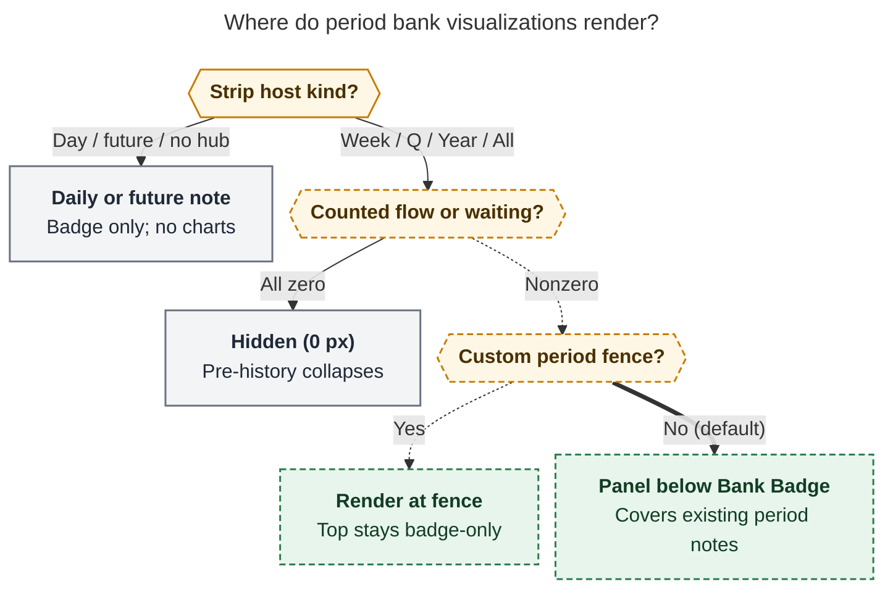
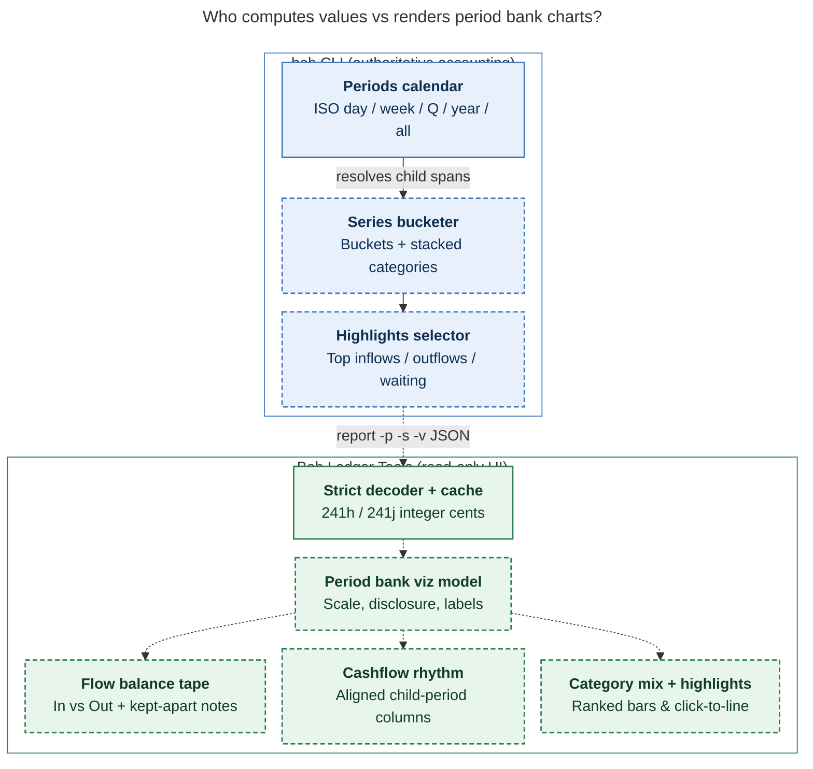

# Period Note Bank Transaction Visualizations — Design & Architecture Research

> **Design brief:** Build upon the `bob-cli-lh` Bank Badge work by designing an **intuitive, reliable, and beautiful** suite of bank transaction visualizations for every **period note** (`YYYY/YYYY-Www.md`, `YYYY/YYYY-Qn.md`, `YYYY.md`, `all_time.md`), excluding daily notes. Critique the overall idea, call out justified adjustments to the requirements, and recommend an end-to-end solution across `bob-cli` and `bob-plugins`.

---

## Executive Summary

**Verdict: Build it — as a compact, progressive, period-aligned Bank Panel anchored to the period strip's Bank Badge, NOT as a stacked mini-dashboard above `## Intentions`.**

The `bob-cli-lh` epic (whose `bob-cli` report changes landed in `575f9e66` and whose shared badge model/daily host landed in `bob-plugins` `008700b`) proves out the hardest accounting invariant: `bob bank report -p <PERIOD>` counts the **exact ISO period spans** that period notes use (`Week`, `Quarter`, `IsoYear`, `AllTime`), computes exact integer-cent totals through one shared path (`compute_totals`), and tracks partial coverage (`tracked_since`, `imported_through`). However, a one-line `BANK · in +$2,500 · out $1,418 · 2 waiting` badge still leaves every pattern question unanswered: *which days or weeks drove that outflow, how did categories break down, was net cashflow a paycheck week or an outlier purchase, and which exact rows caused the spike?*

At the same time, **naively dropping three stacked financial charts onto every period note has four structural traps**:

1. **Above-the-fold crowding:** `bob-stats-strip` already takes ~260–282 px at desktop widths for `Worked` charts and facts (`docs/stats.md:1710`). Adding a tall vertical financial dashboard above `## Intentions` / `## Outcomes` buries the reflection note's human purpose.
2. **Create-only period notes:** `bob periods ensure` never edits existing period-note bodies (`docs/periods.md:6`). Relying on a brand-new mandatory code fence in `scaffold.rs` leaves every existing `all_time.md`, `2026.md`, `2026-Q4.md`, and current week note dark without migration.
3. **Asymmetric & early-history data:** Bank tracking started recently (November 2026), inflows arrive as sparse lump paydays while outflows happen daily, and pre-tracking periods (`2025`, `2026-Q1..Q3`, `W01..W45`) have zero tracked data. Naive linear dual bars crush daily spending beside paydays, and unguarded charts draw empty frames for months with no data.
4. **Payload bloat & visual noise:** Today `bob bank report` is all-or-nothing: `-s` strips *all* time-series buckets (`days: []`), while omitting `-s` serializes 365+ empty calendar days and every raw `BankRow`. Meanwhile, adding an arbitrary 8-color category rainbow underneath the already colorful `Roots` and `Types` charts creates confetti and risks colliding with Bob's reserved `--color-red` (over-cap/error) and `--bob-area-magenta` (at-cap) tokens.

**The recommended solution ("Time Above, Money Below")** avoids all four traps:

- **Placement:** Mount a collapsible **Period Bank Panel** (`div.bob-bank-panel`) inside the period note's `.bob-bank-badge-host` immediately after the enhanced Bank Badge (which already attaches to every existing period note's `bob-stats-strip`), plus support an optional `bob-bank` fence (`view: period`) for notes that prefer custom placement (auto-suppressing the top panel so charts never render twice). Daily notes remain badge-only.
- **Visualizations (2-column compact desktop grid, ~155–185 px expanded height; 0 px when untracked):**
  1. **Flow Proportion Tape & Kept-Apart Strip:** Crisp In vs Out proportional meter, calm surplus/drawdown net badge (green-tinted *only* when surplus; never red/magenta), and one-line footnotes for excluded money (`transfers`, `cash out`, `uncategorized inflows`, `waiting`).
  2. **Child-Period Cashflow Rhythm Chart:** Plotted on the **exact same CSS-grid child axis** as `bob-period-strip` (`Mon..Sun` on Week; `W40..W53` on Quarter; `W01..W53` grouped by `Q1..Q4` with `< 420px` Q1–Q4 fallback on Year; Quarters grouped by Year on All-time, collapsing leading untracked periods into one quiet ghost). Week uses Out bars + non-crushing green payday stems above; Quarter+ uses an intuitive **diverging zero-baseline butterfly chart (`+In` upward in `--bob-bank-in-ink` green, `Out` downward in muted slate)** with outlier cap glyphs so a tax bill or bonus never flattens ordinary weeks.
  3. **Ranked Category Mix:** Horizontal proportion tracks ordered largest-first (top 5 + `Other`, keeping `Unclassified` and `Cash out` visible when non-zero) with emojis and neutral tonal ramp — **no pie charts, no 8-color category rainbow**. Hovering a category highlights/dims the breakdown cleanly and inspects top contributors.
  4. **Period Highlights & Waiting Nudge:** Top 3–5 largest outflows (plus notable inflows and the oldest waiting row when `waiting > 0`), each a `span[role=link]` jumping directly read-only to exact `bank/YYYY-MM.md:line`.
- **CLI & Schema Contract:** Add `-v, --viz` (`bob bank report -p <PERIOD> -s -v -f json`) emitting lightweight `viz` metadata (`buckets[]` along the period's child grid, `inflow_breakdown[]`, `highlights { top_out[], top_in[], max_waiting }`) computed solely by `bob` through `compute_totals`, keeping `days: []` light and `schema_version: 1` backward-compatible.

---

## 1. Grounded Context: Where `bob-cli-lh` and Period Notes Stand Today

Every recommendation below builds on the verified architecture in `bob-cli` (`575f9e66`) and `bob-plugins` (`008700b`):

| Surface / Contract | Verified Current State | Design Consequence |
| --- | --- | --- |
| **Period note scaffolds** (`src/native/periods/scaffold.rs`, `docs/periods.md:6,92-102`) | Every `Week`, `Quarter`, `Year`, and `AllTime` note contains a `bob-stats-strip` fence near the top and a `bob-period-parts` fence under `## Days` / `## Weeks` / `## Quarters` / `## Years`. `bob periods ensure` is strictly create-only. | Any visualization attached to `bob-stats-strip` (or `bob-period-parts`) works on **every existing period note** immediately without vault migration. A brand-new scaffold fence only reaches future notes unless migrated. |
| **Bank badge foundation** (`bob-cli-lh`, `241n-plugin-bank-badge-model.js`, `241na-plugin-bank-badge.js`) | `bob bank report -p <PeriodId> [-s]` resolves `Week`, `Quarter`, `IsoYear`, and `AllTime` (bank universe) via `PeriodId::parse`, returning `totals`, `breakdown`, `waiting`, `coverage`, and `navigation`. `bankBadgeModel` formats cents on day/week and whole dollars on quarter+, hides on `0/0/0`, and styles `In` (`--bob-bank-in-ink`), `Out` (`--text-normal`), `Waiting` (`--text-warning`), and green chrome iff `In > Out`. | We already have exact period-boundary parity, integer-cent safety, coverage metadata, and WCAG-verified tokens (`--bob-bank-in-ink`: `color-mix(in srgb, var(--color-green) 60%, var(--text-normal))`). Note that `bankBuildArgs` (`241h-plugin-bank-decode.js:131-153`) and `239-plugin-period-strip-fence.js` still need the period `-p`/`-s` host wiring from `bob-cli-lh.3`/`.4`. |
| **Period charts language** (`239-plugin-period-strip-charts-render.js`, `styles.css:7911-8010`) | CSS Grid child columns aligned across chart rows, ticks, axis labels, and quarter/year groups; `44px–62px` bars; hatched fill for unattributed/missing, `2px` dashed stub for future; collapsed leading untracked ghost on `all_time`; Year `< ~400px` Q1–Q4 fallback (`@container`); roving keyboard focus; zero `<button>` elements inside strip hosts (`docs/stats.md:1652`). | Aligning financial bars to the exact same child-period axis grammar makes Money feel native next to Time. Zero buttons and roving keyboard axis preserve Vim/keyboard ergonomics. |
| **Bank card language** (`241l-plugin-bank-cards-model.js`, `241m-plugin-bank-cards.js`, `styles.css:8789-8886`) | `Out / In / Net` metrics, `Out by category` ranked bars (`minmax(6rem, 1fr) minmax(3rem, 2fr) auto 3.2em`), `Unclassified` & `Cash out` extras row, and Monday-first 4-level Out heat grid with `•` waiting dot. | Period notes should echo the month card's calm typography, category bar grammar, and `•` waiting dot while avoiding heavy bordered `.bob-bank-card` boxes inside the borderless strip family (`docs/stats.md:1658`). |
| **Accounting & category rules** (`docs/bank.md:483-496`, `src/native/bank/config.rs:18`, `report.rs:563-673`) | Transfers and `cash`-account rows stay out of `In`/`Out`; `In` accepts only `income` and `refund` categories (`unclassified_in_cents` holds uncategorized credits!); `breakdown[]` covers Out categories only (configured order, plus `cash` and `unclassified`); categories have `label`, `emoji`, `hotkey`, `group`, `hidden` — **no `color` field**. | Visualizations must surface uncategorized inflows and kept-apart transfers/cash explicitly so `$0 In` on a paycheck week isn't misread, and category visuals cannot depend on per-category colors that don't exist yet. |

---

## 2. General Critique: Is This a Good Idea? What Could Go Wrong?

Bryan asked for an honest critique of the plan and whether a different approach is warranted.

### Why It *Is* a Good Idea

1. **Period notes are the natural scale for money:** A single day's spending is high-variance noise (`$0` Monday, `$140` groceries Tuesday). Weeks, quarters, years, and all-time reveal cadence, burn rate, category concentration, and savings rate — matching how weekly and quarterly reviews actually happen (`docs/periods.md`).
2. **Closes the Monday QFX feedback loop:** Under `docs/guides/acknowledge-bank-transactions.md`, bank imports and Category-card walks are weekly Monday chores. Seeing last week's spend rhythm and unacknowledged rows directly inside `2026-W46.md` turns the period note into a calm check-in rather than an isolated productivity log.
3. **Zero manual data entry:** Because `bob` owns every calculation at read time (`bob bank report -p ...`), Bryan gains rich financial insight across every week, quarter, and year without ever copying a number into Markdown.

### Five Real Design Hazards (and How They Shape a Different Approach)

1. **The "Mint Inside My Journal" Risk (Vertical Bloat Above Intentions):**
   Look at a week note's top fold (`src/native/periods/scaffold.rs`). Right above `## Intentions` sits `bob-stats-strip`, which already takes ~260–282 px (`Both` view) for two stacked time charts and five metric facts (`docs/stats.md:1710`). Stacking an always-open 350 px bank dashboard (summary + flow chart + category bars + top transactions) beneath the badge pushes `## Intentions` over **650 px down the page** — completely off-screen on a laptop split pane.
   *Alternative considered:* Put all bank visualizations *only* at the bottom under `## Review` or inside `bank.md`.
   *Why reject pure hiding in `bank.md` / `## Review`:* `bank.md` is calendar-month oriented and detached from ISO week/quarter reflection; meanwhile `bob periods ensure` won't add a new `## Review` fence to existing notes.
   *Right synthesis:* Compact, horizontal-first 2-column geometry inside a collapsible **Bank Panel** anchored to the existing badge host (capping desktop added height to ~155–185 px when expanded, collapsible in 1 click to 0 px extra, and hidden completely when untracked).

2. **The Pre-History Desert (`tracked_since` = Nov 2026):**
   Because bank tracking started in November 2026, almost all existing history (`2025.md`, `2026-Q1..Q3`, `2026-W01..W45`) has **zero** bank coverage, and `2026.md` / `2026-Q4.md` / `all_time.md` have only days or weeks of real data. Drawing empty category lists, zero bars, or "−100% vs typical" gauges on `2026.md` would look broken.
   *Design mandate:* Untracked periods render **zero pixels**; partially tracked periods collapse leading untracked spans into **one single quiet ghost column** (just like `all_time` in `239-plugin-period-strip-charts-model.js`); and **typical-period money comparisons are explicitly deferred** until ≥4 closed tracked periods exist per kind.

3. **Income Spikes Crushing Daily/Weekly Spending:**
   On a week (`7 days`), six days may average `$40 Out` while Friday receives a `$3,500` paycheck (`In`). On a shared upward bar chart, `$40` shrinks to `1.1%` (~0.6 px) — literally invisible. Even at weekly scale, a twice-monthly `$4,000` paycheck or an annual `$12,000` tax/tuition outflow dwarfs regular `$600` weeks.
   *Design mandate:*
   - On **Week (daily bins)**: never put daily `In` and `Out` on the same positive bar axis. Plot **daily `Out` bars** on the local daily-Out scale and surface inflows as **floating `+In` green stem pills** above the payday column.
   - On **Quarter / Year / All-time (week or quarter bins)**: use a **diverging zero-baseline butterfly plot (`+In` upward above a central hairline; `Out` downward below)** with **gentle outlier capping** (when a single spike exceeds `3×` the p75 non-zero bucket, cap the visual bar height with a crisp diagonal break chevron `↗` and print the true dollar amount cleanly on hover/caption).

4. **Calendar-Month Bills vs ISO-Week Period Notes:**
   Period notes follow ISO weeks (`2026-Q4` ends `2027-01-03`; `2026` starts `2025-12-29`), whereas rent, utilities, and statements follow calendar months. Comparing two neighboring weeks ("why was W44 $2,800 while W43 was $420?") often just reflects the 1st of the month falling in `W44`! Visualizing the **monthly boundary tick** (`Dec 1`, `Nov 1`) directly along the weekly axis (matching `bob-period-strip-chart-ticks`!) and listing the **top transactions (`Highlights`)** turns an otherwise baffling cliff into an instant "oh, Nov 1 rent" recognition.

5. **Visual Confusion Between `Out` Spending, Negative `Net`, and Over-Cap Errors:**
   By Bob's contract (`docs/bank.md:464-465`, `styles.css:114`), **spending is not an error**, red means blocked/missed/over-cap, and magenta means at-cap. A naive financial UI that paints net-outflow weeks red (`In < Out`, which happens on *every non-paycheck week*!) makes 75% of weeks look like failures.
   *Design mandate:* Outflows always stay in **neutral ink/slate**; `In` and surplus net (`In > Out`) use calibrated **green (`--bob-bank-in-ink`)**; `Waiting` / uncategorized items use **amber (`--text-warning`)**; drawdown weeks (`Out > In`) use **calm warm-stone/muted neutral ink + explicit minus (`−$412`)**, never red or magenta.

---

## 3. Explicit Adjustments to the Requirements

Calling out every deliberate modification to a literal interpretation of *"add visualizations to each period note"*:

| # | Original / Implied Expectation | Adjusted Requirement | Rationale |
| --- | --- | --- | --- |
| **A1** | Add always-visible multi-chart bank widgets to every period note | Render a **compact collapsible Period Bank Panel** anchored to the period note's Bank Badge host (default open when tracked money/waiting exists and `stats.bank_visuals` is enabled, 1-click collapsible per device via `localStorage`), arranged in a **2-column desktop layout (~155–185 px tall)**. | Delivers immediate visual value without pushing `## Intentions` / `## Outcomes` below the fold; lets Bryan fold it to a 1-line badge whenever focusing purely on prose. |
| **A2** | Add a new section or code fence in `bob periods` templates (`scaffold.rs`) | Attach primarily to the **existing `bob-stats-strip` bank badge host**; additionally allow optional ` ```bob-bank\nview: period\n``` ` placement (which suppresses the top expanded panel to avoid duplication). | `bob periods ensure` is strictly create-only (`docs/periods.md:6`). Attaching to the existing strip host brings visualizations to **all existing period notes on day one** without risky vault migrations. |
| **A3** | Show visualizations on all period notes uniformly | **Coverage-gate and scale-adapt by `PeriodKind`**: hide completely (`0 px`) when `in=0 && out=0 && waiting=0` or future; collapse leading untracked spans before `tracked_since` into one quiet ghost; adapt bin granularity and chart geometry between `Week` (daily Out + Payday stems) and `Quarter`/`Year`/`All-time` (diverging In/Out butterfly). | Prevents blank frames on pre-Nov-2026 notes (`2025`, `2026-Q1..Q3`) and fixes daily payday scale crushing. |
| **A4** | Add a money column to `bob-period-parts` (`## Days` / `## Weeks` / `## Quarters` / `## Years`) | **Defer / keep `bob-period-parts` time-only by default** (can be an explicit opt-in `columns: bank` fence option later). | `bob-period-parts` already carries 5–6 columns (`Week` has `Child, Dates, Worked, Done, Review, Summary`, `239-plugin-period-strip-parts.js:394`). Adding money columns narrows `Summary` headlines on split panes and duplicates the child bars already shown in the Cashflow Rhythm chart. |
| **A5** | Use `bob bank` categories as an 8-color chart palette (like Roots/Types) or use pie charts | **No pie/donut charts and no 8-color category rainbow.** Use **ranked horizontal percentage bars** in muted neutral/tonal slate ramp + category emojis + explicit `Cash out` / `Unclassified` rows; reserve green strictly for `In`/surplus and amber strictly for `Waiting`/needs-filing. | `bank.md` categories have no `color` config key (`src/native/bank/config.rs:18`); a third bright rainbow below `Roots` and `Types` creates clutter and risks colliding with reserved `--color-red` / `--bob-area-magenta`. |
| **A6** | Fetch full `bob bank report -p <id>` (with `days[].rows[]`) in the plugin and aggregate in JS | **Add `-v, --viz` flag to `bob bank report`** so `bob` computes child-period `buckets[]`, `inflow_breakdown[]`, and capped `highlights` inside Rust alongside `compute_totals`, keeping `days: []` omitted (`-s -v`). | Eliminates 365+ empty day objects and thousands of raw rows over IPC on Year/All-time notes while guaranteeing 100% calendar & accounting parity in one codebase. |
| **A7** | Include spending vs "typical week/quarter" reference markers | **Keep typical baselines out of v1**, matching `bob-cli-lh`'s `bank_badge_strip_family` conclusion. Revisit only once ≥4 closed tracked periods exist per kind. | Median/typical lines over bursty early-stage cashflow (e.g., 1 rent week vs 1 grocery week) are statistically misleading. |
| **A8** | Allow inline quick-acknowledge checkboxes inside the period note | Keep the period note surface **100% read-only (`span[role=link]`, zero `<button>` elements inside strip)**. Clicking a waiting nudge, day bar, or highlight row opens the exact `bank/YYYY-MM.md:line` in Obsidian, where `Ctrl+Enter` Category Card already files rows. | Preserves the strip read-only contract (`docs/stats.md:1652`, `bank_badge_strip_family` A6) and prevents unexpected note writes during review. |

---

## 4. Recommended Design: Visual Architecture & Period-by-Period Experience

### 4.1 Placement & Disclosure Flow

Every period note already flows vertically from **Header + Strip (`bob-stats-strip`) → Intentions/Outcomes → Parts (`bob-period-parts`) → Review/Reflection**. Anchoring inside the existing `.bob-bank-badge-host` below the period strip charts creates one clean visual boundary:

<div id="figure-placement">



_Primary attachment through `bob-stats-strip`'s `.bob-bank-badge-host` lights up every existing period note automatically; an explicit `bob-bank` (`view: period`) fence overrides placement cleanly._

</div>

#### How the Toggle & Strip Borderless Aesthetic Work Together

Notice in `docs/stats.md:1658`: the period strip deliberately uses **hairline rules, quiet typography, and zero heavy box shadows or card borders**. Rather than boxing the bank visualizations inside a bordered `.bob-bank-card` (which belongs in `bank.md` / `bank/YYYY-MM.md`), the Period Bank Panel uses **the exact same language as `.bob-period-strip`**:

- A **thin hairline divider + small-caps header strip** inside `.bob-bank-badge-host`:
  - Left: `.bob-bank-badge` (`BANK · in +$2,500 · out $1,418 · 2 waiting · since Nov 11`) — clicking it navigates straight to `navigation.waiting` / `first` / `bank.md`.
  - Right (only on `week | quarter | iso_year | all_time` when data is non-empty): a quiet `span[role=button]` disclosure toggle (`▾ Charts` / `▴ Collapse`, mirroring `.bob-day-strip-lanes` styling) + active keyboard hover/focus readout.
- Clicking the toggle smoothly reveals or collapses `.bob-bank-panel` (`160ms ease-out` fade on reveal, disabled under `prefers-reduced-motion`), persisted per device via `app.saveLocalStorage("bob-ledger-tools.period-bank-open", "1" | "0")` and inspectable/toggleable via command **`Toggle period bank visualizations`**.
- **Config gate (`~/.config/bob/config.yml`):** `stats.bank_visuals` (`true` by default; accepts `true | false | "expanded" | "collapsed"`). Setting `stats.bank_visuals: false` (or `stats.bank_badge: false`) leaves period notes strictly badge-only or badge-free.

---

### 4.2 Desktop & Narrow Layout Blueprint

At desktop reading widths (`>= 620 px`, via `@container (min-width: 620px)` on `.bob-bank-panel-frame`), placing **Flow Rhythm** on the left (`58%`) and **Categories + Highlights** on the right (`42%`) keeps the entire expanded suite around **~160–190 px tall** — less vertical space than *two* period-strip time lanes (`~260 px`):

```text
─── Worked · Reviewed · Done · ... ─── [Roots + Types Charts] ─────────────────────────────────
┃ BANK · in +$2,500.00 · out $1,418.21 · 2 waiting · since Nov 11              [▴ Hide charts]
└───────────────────────────────────────────────────────────────────────────────────────────────
  CASHFLOW  [█████████████████████████░░░░░░░░░░░░░░]  +$1,081.79 net (+43%)   ↔ $400 transfer
            In +$2,500.00           Out $1,418.21

  WHEN (Mon 9 – Sun 15) · Out daily ($620 max)          WHERE (Out by category · 14 rows)
          +$2.5k                                        🏠 Housing      ████████████   $680   48%
           ◆                                            🛒 Groceries    █████░░░░░░░   $312   22%
     ·     ·     █     ·     █     ▄     ·              🍽️ Dining       ███░░░░░░░░░   $198   14%
     ·     █     █     ▂     █     █     ·              🚗 Transport    ██░░░░░░░░░░   $128    9%
    Mon   Tue   Wed   Thu   Fri   Sat   Sun             ·  Unclassified ██░░░░░░░░░░   $100    7%
    $24   $148  $620  $38   $380  $158   $50
                                                        LARGEST & QUEUE
                                                        • Nov 11  $680.00  Acme Property  🏠
                                                        • Nov 13  $212.40  Whole Foods    🛒
                                                        ● 2 waiting (oldest Nov 14 · $64.20) →
────────────────────────────────────────────────────────────────────────────────────────────────
```

*(Note: when an inflow or highlight list is collapsed in narrow `< 620 px` panes, the CSS grid stacks seamlessly into 1 column: Balance Tape → Cashflow Rhythm → Category Mix → Highlights, with `0` horizontal overflow.)*

---

### 4.3 The Four Coordinated Visualizations in Detail

#### Visualization 1: Flow Proportion Tape & Kept-Apart Strip ("The 2-Second Read")

At the top of `.bob-bank-panel`, a single full-width band replaces any ambiguous headline boxes:

- **Opposing Proportion Meter (`7px` height, pill ends):**
  - Left segment filled in `--bob-bank-in-ink` green = `in_cents / (in_cents + out_cents)` (omitted cleanly if `in_cents == 0`).
  - Right segment filled in calm slate (`color-mix(in srgb, var(--text-normal) 42%, transparent)`) = `out_cents / (in_cents + out_cents)` (omitted if `out_cents == 0`).
  - Reads intuitively at a glance: *> 50% green means money grew in this period; mostly slate means spending dominated.*
- **Signed Net Pill:**
  - When `in_cents > out_cents`: `+$1,082 surplus` (`43% saved`), green border/tint matching `[data-tone="surplus"]`.
  - When `out_cents > in_cents`: `−$418 net`, calm neutral muted surface (`--text-muted` / `--text-normal`) — **never red**.
  - When `in_cents == 0 && out_cents > 0`: omits artificial `−$X net` redundancy (just `Out $X`), optionally showing **`unfiled credits +$Y`** in amber-muted if `totals.unclassified_in_cents > 0` so Bryan knows a paycheck is awaiting `[cat:: income]`!
- **Kept-Apart Footnote Pills (rendered ONLY when non-zero):**
  - `↔ Transfers $X` (`max(transfer_out_cents, transfer_in_cents)`)
  - `↩️ Refunds +$X` (part of `In`, called out so net income vs reimbursed spend stays clear)
  - `🏧 Cash out $X` (`cash_out_cents`, ATM withdrawals) / `💵 Cash traced $X` (`cash_traced_cents`, cash-account spends)

#### Visualization 2: Child-Period Cashflow Rhythm Chart ("When Money Moved")

Instead of inventing a generic calendar grid (which already belongs to `bob-bank` month cards and ignores ISO week/quarter boundaries), plot cashflow along the **exact same child-period axis** as `bob-period-strip`:

| Period Note | Child Columns (`N`) | Bin Geometry | Boundary & Partial Markers | Click / `Enter` Action |
| --- | --- | --- | --- | --- |
| **Week** (`YYYY-Www`) | **7 days** (`Mon..Sun`) | **Out-Focused Columns + Floating Inflow Stems:** Upward `54px` bars stacked by top categories (top 4 + `Other`) on the week's max daily Out; Paydays/Inflows render as green `+ $X` diamond/pill stems pinned in a `16px` header rail above the day; amber `•` dot marks any day with `waiting > 0`. | Pre-`tracked_since` days render hatched muted ghost; future days in current week render `2px` dashed baseline stub; Today gets dashed border matching `.bob-period-strip-column-current`; exact dollar caption (`$148`) beneath each tracked day. | Opens that day's `### Day` heading in `bank/YYYY-MM.md:line` (read-only). |
| **Quarter** (`YYYY-Qn`) | **13–14 ISO weeks** (`W40..W53`) | **Diverging Mirror Butterfly (`40px` In rail above zero hairline / `48px` Out rail below):** Positive `In` (`income`+`refund`) grows upward in `--bob-bank-in-ink` green; `Out` grows downward from the hairline (optionally stacked by top 4 spending categories + muted `Other`). Amber `•` dot flags weeks with waiting rows. | Calendar month ticks (`Nov`, `Dec`) painted along the zero/tick strip (reusing `.bob-period-strip-chart-ticks`) so rent/1st-of-month weeks are immediately identifiable! Partial coverage uses hatched ghost for untracked leading weeks and `x/7` badge on boundary weeks. | Opens the child week note (`YYYY/YYYY-Www.md`) if it exists, else opens `bank.md` or the month note. |
| **Year** (`YYYY`) | **52–53 ISO weeks grouped under `Q1..Q4`** *(below ~420 px width: **4 Quarter columns**)* | Same **Diverging Mirror Butterfly**, grouped under `Q1..Q4` captions (`Q4 · out $3.1k` / `+$4.2k`). **Leading untracked collapse:** when `tracked_since` sits mid-year (e.g., `2026-11-11`), weeks before tracking collapse into one single quiet hatched placeholder column (`Until Nov 10 · not tracked`) so active weeks (`W46..W53`) fill the width cleanly! | Quarter dividers + Q-summary captions; container query fallback (`@container (max-width: 420px)`) swaps cleanly to 4 Quarter bars without overflowing narrow split panes. | Opens child week note (`YYYY/YYYY-Www.md`) or fallback Quarter note (`YYYY/YYYY-Qn.md`). |
| **All time** (`all_time`) | **Tracked Quarters grouped by `Year`** *(or `Years` if span exceeds ~20 tracked quarters)* | Same **Diverging Mirror Butterfly** across quarters grouped under year captions (`2026 · +$X / $Y`), starting strictly at `all_time_period` (earliest bank `start` / earliest row, independent of daily notes). | Leading pre-bank quarters never draw empty bars; current quarter carries dashed `so far` outline. | Opens Quarter (`YYYY/YYYY-Qn.md`) or Year (`YYYY.md`) note (or bank month note if period note absent). |

**How the Outlier / Scale Guard Works (Critical for Trust):**
Suppose one week has `$4,800` income (or `$3,200` rent + taxes) while discretionary weeks average `$420` Out.
- Within **Diverging Butterfly**, compute a shared symmetric reference scale `S = max(in_cap, out_cap)` so a `$2,000` green bar above and a `$2,000` neutral bar below genuinely represent equal dollars (making **Net = visual area above minus visual area below**!).
- **Outlier soft-cap rule:** If the global max bucket exceeds `3.5 × p80` of non-zero buckets (e.g., an annual tax payment or bonus), cap the visual chart ceiling at `2.5 × p80` (still preserving true proportions among ~90% of buckets!) and render that single spike bar full-height with a crisp **diagonal cap break chevron (`≈` / jagged top notch) + muted exact figure badge (`+$12k`)**. The tooltip always displays exact dollar cents. Zero silent truncation, zero crushed baseline weeks!

**Keyboard & Hover Interaction (Zero Friction):**
- Follows `.bob-period-strip-chart-axis` (`239-plugin-period-strip-charts-render.js`): single roving `tabindex="0"` along columns (`ArrowLeft`/`ArrowRight`/`Home`/`End`), `Enter`/`Space` navigates (with `Ctrl/Cmd` or middle-click opening a new tab), `mousedown` calls `preventDefault()` so Vim normal mode never drops focus.
- Hovering or focusing a column illuminates that bucket and updates a compact inline **status readout line**:
  `W46 (Nov 9–15) · In +$2,500 · Out $1,418 · Net +$1,082 · Top: Housing $680, Groceries $312 · 2 waiting`

#### Visualization 3: Ranked Category Mix ("Where Money Went")

Reuses and refines the month card's ranked horizontal bar idiom (`241m-plugin-bank-cards.js`) cleanly without pie charts or loud colors:

- **Top 5–6 non-zero Out categories** sorted descending by `out_cents` (NOT fixed config order, which wastes vertical lines on `$0` categories during a weekly view), rolling any remaining long tail into one calm `Other (N cats)` line.
- **Pinned exceptions:** `🏧 Cash out` and `· Unclassified` always stay visible (when `> 0`) rather than disappearing into `Other` — `Unclassified` carries a small `--text-warning` amber dot and acts as a clickable link (`span[role=link]`) opening `navigation.waiting`.
- **Subtle Tonal Ramp Instead of Confetti:**
  - Rather than adding 8 bright area hues right below `Roots` and `Types`, category fills use a **restrained, monochromatic slate-blue / cool-neutral stepped ramp** (anchored on `var(--text-normal)` / `color-mix(in srgb, var(--bob-area-blue) 45%, var(--text-muted))` with 100% → 72% → 52% → 38% → 25% stepped alpha by rank, and hatched/amber-dotted only for `Unclassified`!). Category emojis (`🏠`, `🛒`, `🍽️`, `🚗`) carry instant visual scannability with zero palette collision against Bob's `Roots`, `Types`, `red` (errors), or `magenta` (at-cap)!
- **Coordinated Brushing (Hover Sync):**
  - Hovering any Category row highlights that category's stacked slice inside every **Cashflow Rhythm** bar (dimming other slices to `0.25` opacity) and reveals exact stats in the row's tooltip (`$312.40 · 22.0% of Out · 5 transactions · largest: Whole Foods $118.20`).
- **Quiet Inflow Mix (Conditional):**
  - Only when `in_cents > 0` **and** `refund_cents > 0`, show a 1-line sub-caption under Categories: `Inflows: 💵 Income +$2,400 · ↩️ Refunds +$100`.

#### Visualization 4: Period Highlights & Queue Nudge ("Why This Period Looked Like This")

A chart shows *when* money moved; **Highlights** explains *why* in 3–5 scannable lines (capped strictly at `max 3` on narrow widths, `4` outflows + `1` inflow on desktop Week/Quarter, `5` outflows + `1–2` inflows on Year/All-time):

- Each row fits on **one ellipsis-safe line** (`gap: 0.45em; font-variant-numeric: tabular-nums`):
  - **Outflow highlight:** `Nov 11 · $680.00 · Acme Property · 🏠` (hover tooltip shows full note/links; click jumps directly to `bank/2026-11.md:<line>`).
  - **Inflow highlight (when `in_cents > 0`):** `Nov 14 · +$2,500.00 · Acme Payroll · 💵` (amount in `--bob-bank-in-ink`).
- **Period Queue Callout (only when `waiting.period > 0`):**
  - Compact clickable amber pill/row at the bottom of Highlights: `● 2 unacknowledged rows in this period (oldest Nov 12 · $64.20 Acme Café) · Open to file →`.
  - Clicking jumps directly to `navigation.waiting` (`path:line`) so `Ctrl+Enter` opens the Category Card right on the oldest unfiled transaction.

---

### 4.4 Color, Contrast, Typography & Accessibility Contract

All tokens preserve `docs/bank.md:464-465`, `styles.css:114,5409-5456,8833-8908`, and `bank_badge_strip_family`:

| Element | Light & Dark Theme Token | Semantic Meaning / Rule |
| --- | --- | --- |
| **Inflow values & bars** | `--bob-bank-in-ink: color-mix(in srgb, var(--color-green) 60%, var(--text-normal))` (shared with `bob-bank-badge-host`) | ~5.2:1 light / ~9.3:1 dark AA text contrast. Used exclusively for `income`/`refund` flows and surplus `+Net` ink. |
| **Outflow values & bars** | Ink: `--text-normal`; Base bar fill: `color-mix(in srgb, var(--text-normal) 42%, transparent)` (rank 1 category fills use cooled slate `color-mix(in srgb, var(--bob-area-blue) 45%, var(--text-muted))` stepping downward in opacity) | Outflows stay calm and non-punitive ("spending is not an error"). |
| **Net drawdown (`Out > In`)** | Text: `--text-normal` / `--text-muted`; Chrome: neutral `var(--text-normal)` at 6% wash | Explicitly `−$418 net` in text/sign; **NEVER red, NEVER magenta, NEVER orange**. |
| **Waiting & Unclassified attention** | `--text-warning` + amber `•` dot / explicit `"waiting"` or `"Unclassified"` text | Draws the eye only to unfinished categorization/acknowledgment chores. |
| **Missing / Untracked / Future** | Same `.bob-period-strip-series-hatch` (135° diagonal) & `2px dashed` stub (`styles.css:7977,8008`) | Instant visual parity with time charts: hatched = not yet tracked, dashed = future. |
| **Focus & Forced Colors** | `outline: 2px solid var(--interactive-accent); outline-offset: 2px`; `@media (forced-colors: active)` uses `CanvasText` / `Highlight` and removes translucent washes | Keyboard accessibility preserved without reliance on translucency or color alone. |
| **Motion** | Reveal fade `160ms ease-out`; zero animation on live data repaints; disabled cleanly under `@media (prefers-reduced-motion: reduce)` | Matches `.bob-day-strip-lane-enter` (`styles.css:7317`). |

---

## 5. Data Contract & System Ownership (`bob-cli` + `bob-plugins`)

<div id="figure-ownership">



_Split of responsibility: `bob` owns child-period bucketing, `compute_totals` accounting, and target row selection; `Bob Ledger Tools` owns scale capping, layout adaptation, disclosure state, and DOM rendering._

</div>

### 5.1 Additive `bob-cli` Additions (`schema_version: 1`)

Follow `sase/memory/cli_rules.md` (alphabetical options, every public long option gets a short alias, non-breaking additive fields on `schema_version: 1`, never edit `Cargo.toml` version or `CHANGELOG.md`):

```text
bob bank report ... [-p PERIOD] [-s] [-v] [-f json]
  -v, --viz    Include period visualization aggregates (`viz` object:
               child-period buckets aligned to stats-strip columns,
               inflow breakdown, and capped highlights). Intended with -s
               so `days` stays [] and payloads stay compact.
```

*(Note: `-v` / `--viz` sits alphabetically between `--summary` and `--week` in `src/native/bank/cli.rs`.)*

When `--viz` (`-v`) is passed on `bob bank report`, add one top-level `"viz"` object to the `schema_version: 1` JSON payload (`None`/omitted when `-v` is not passed, preserving exact byte-stability for existing `-s` and default callers):

```json
{
  "viz": {
    "granularity": "week",
    "group_kind": "quarter",
    "groups": [
      { "key": "2026-Q1", "label": "Q1", "in_cents": 0, "out_cents": 0, "net_cents": 0, "tracked": false },
      { "key": "2026-Q4", "label": "Q4", "in_cents": 250000, "out_cents": 141821, "net_cents": 108179, "tracked": true }
    ],
    "buckets": [
      {
        "id": "2026-W46",
        "kind": "week",
        "label": "W46 · Nov 9–15",
        "caption": "W46",
        "tick": "Nov",
        "group": "2026-Q4",
        "start": "2026-11-09",
        "end": "2026-11-15",
        "state": "current",
        "partial": "5/7",
        "tracked": true,
        "note_path": "2026/2026-W46.md",
        "note_exists": true,
        "in_cents": 250000,
        "out_cents": 141821,
        "net_cents": 108179,
        "unclassified_in_cents": 0,
        "waiting": 2,
        "flagged": 0,
        "rows": 14,
        "target": { "path": "bank/2026-11.md", "line": 42, "date": "2026-11-11" },
        "out_by_cat": [
          { "key": "housing", "out_cents": 68000 },
          { "key": "groceries", "out_cents": 31240 }
        ]
      }
    ],
    "inflow_breakdown": [
      { "key": "income", "emoji": "💵", "label": "Income", "in_cents": 240000, "share": 0.96, "rows": 1 },
      { "key": "refund", "emoji": "↩️", "label": "Refund", "in_cents": 10000, "share": 0.04, "rows": 1 }
    ],
    "highlights": {
      "top_out": [
        {
          "date": "2026-11-11",
          "cents": -68000,
          "payee": "Acme Property",
          "category": "housing",
          "emoji": "🏠",
          "label": "Housing",
          "account": "checking",
          "acknowledged": true,
          "path": "bank/2026-11.md",
          "line": 18
        }
      ],
      "top_in": [
        {
          "date": "2026-11-14",
          "cents": 250000,
          "payee": "Acme Payroll",
          "category": "income",
          "emoji": "💵",
          "label": "Income",
          "account": "checking",
          "acknowledged": true,
          "path": "bank/2026-11.md",
          "line": 55
        }
      ]
    }
  }
}
```

#### Key Implementation Guarantees on the `bob-cli` Side

1. **Bucket calendar parity with `periods` (`src/native/periods/calendar.rs` + `report.rs`):**
   - `Day` or `Month`: `-v` emits daily buckets for `[start ..= end]` (so explicit `-m` callers or future tools benefit too, though the plugin suppresses the panel on daily notes).
   - `Week`: emits 7 `day` buckets (`Mon..Sun`).
   - `Quarter`: emits 13–14 `week` buckets matching `PeriodId` weeks inside that quarter.
   - `IsoYear`: emits 52–53 `week` buckets tagged `group: "YYYY-Q1".."YYYY-Q4"` PLUS `groups[]` carrying exact 4-quarter aggregates (powering both group captions AND the `< 420px` 4-quarter narrow fallback in one payload!).
   - `AllTime`: emits `quarter` buckets grouped by `year` (`group: "YYYY"`) PLUS `groups[]` per year inside `[all_time.start ..= all_time.end]` (automatically switching to `year` buckets if tracked quarters exceed 32, keeping bar widths readable over multi-decade use!).
2. **Exact Sum Invariant:**
   - Every `bucket.in_cents`, `bucket.out_cents`, `bucket.net_cents`, and `bucket.waiting` MUST be computed via `compute_totals(&bucket_rows, config)` — guaranteeing `sum(buckets[].out_cents) == report.totals.out_cents` and `sum(buckets[].in_cents) == report.totals.in_cents` on every snapshot!
   - `bucket.tracked` is `true` iff `bucket.end >= tracked_since && bucket.start <= imported_through` (intersecting `coverage`) and `bucket.state != "future"`. This makes "leading untracked collapse" exact and deterministic.
3. **Top-K Highlight Selection:**
   - Excludes `transfer` and `cash`-account rows (same `is_counted_money` predicate in `report.rs:420`), sorts `top_out` by `abs(cents)` descending then date/path/line (capped at e.g. 6 rows), and `top_in` by `cents` descending (capped at 4 rows).
4. **Payload Budget & Compatibility:**
   - Even for a 53-week year, `buckets` + `groups` + `top_out` serializes to ~8–12 KB JSON (vs >150 KB when shipping raw `days[].rows[]`).
   - Wait for `bob-cli-lh.3`/`.4`? Note that `bankBuildArgs` in `bob-plugins` (`241h-plugin-bank-decode.js:131`) must accept `opts.period` (`-p`), `opts.summary` (`-s`), and `opts.viz` (`-v`), and tolerate older `bob` binaries without `-v` cleanly by falling back to `-s` badge-only mode (one `console.warn` per session, matching `bank_badge_strip_family`).

### 5.2 Plugin Architecture (`bob-plugins/plugins/bob-ledger-tools`)

Respect `bob-plugins/AGENTS.md` (`<= 1,000` lines per fragment, run `npm run build`, never hand-edit `main.js`, run `npm test` + `scripts/obsidian-bank-ui-e2e.cjs` / browser visual check, deploy via `bob plugins sync`):

1. **Decoder (`241h-plugin-bank-decode.js`):**
   - Extend `bankBuildArgs` with `period` (`-p`), `summary` (`-s`), `viz` (`-v`).
   - Add strict `bankNormalizeViz(value)` validating integer cents via `bankSafeCents`, dates via `bankIsoDateOrNull`, counts via `bankCount`, and nullable `target` via `bankNormalizeNavigationLocation`. Malformed `viz` is rejected rather than turned into `$0` fake bars (while still preserving badge totals if `totals` is valid, surfacing a quiet inline note `"Period charts unavailable"`).
2. **Data Cache (`241j-plugin-bank-data.js`):**
   - Bump `BANK_CACHE_SIZE` from `16` to `32` (since navigating across a year note, 4 quarters, and recent weeks — alongside daily notes and `bank.md` — will keep `-p ... -s -v` entries warm without thrashing).
   - Fetch gating: share the `bob-stats-strip` `IntersectionObserver` (`record.visible !== false`, `239-plugin-period-strip-fence.js:818`) so off-screen/folded period notes never spawn `bob bank report`. Fetch `-s -v` only on period notes when `stats.bank_visuals` is enabled and `bank.md` exists; daily notes keep lightweight `-D <day>` / `-s`.
3. **New Pure Presentation Model (`241nb-plugin-bank-period-viz-model.js`, < 450 lines):**
   - `bankPeriodVizModel(report, context)` → `{ state: "hidden" | "collapsed" | "ready" | "older-bob" | "unavailable", ... }`
   - Collapses leading untracked buckets into a single `{ ghost: true, label, spanText }` item (same idiom as `periodStripChartCollapseLeadingUntracked` in `239-plugin-period-strip-charts-model.js`).
   - Computes **Scale & Outlier Clamping** (`visualScaleMax`, `isCapped` flag per bar) using integer/float math over bucket magnitudes, never modifying underlying tooltip/caption dollar amounts.
   - Groups long-tail categories past top 5 into `Other` while keeping `cash` (`Cash out`) and `unclassified` (`Unclassified`) unmerged when `> 0`.
   - Formats period-appropriate precision (`cents` on Week, compact whole dollars / `$1.4k` on compact bar labels for Quarter/Year/All-time, exact cents always in hover/focus tooltips and `Highlights`).
4. **New Painter & Lifecycle Wiring (`241nc-plugin-bank-period-viz.js`, < 500 lines):**
   - Renders `.bob-bank-panel` inside the period badge host (or standalone `.bob-bank-card-period` when invoked inside ` ```bob-bank\nview: period\n``` `).
   - Implements shared hover brushing (`data-hover-cat` highlights matching category bar + cashflow bar slices; `data-hover-col` updates the live column readout strip).
   - Reuses `bankBadgeActivate` (`span[role=link]`, `mousedown` `preventDefault`, `Enter`/`Space`, `Ctrl/Cmd`/middle-click new leaf) and adds arrow-key roving `tabindex` (`←`/`→`/`Home`/`End`) on the Cashflow Rhythm axis.
   - Updates `241l-plugin-bank-cards-model.js` (`bankCardParseFence`) and `241m-plugin-bank-cards.js` to optionally recognize `view: period` (optional inferred `period` from `periodNotesPeriodForPath(sourcePath)`).
   - Updates `fragments.json`, `310-install-methods.js` (register **`Toggle period bank visualizations`** command), and `170-plugin-lifecycle.js` / `teardown` hooks.
5. **Styles (`styles.css`):**
   - Dedicated `@container` breakpoints (`<= 620px` stacks 2-column grid to 1-column; `<= 420px` on `iso_year` swaps 53 weekly columns for the 4 Quarter summary columns).
   - Zero `<button>` tags inside strip hosts; explicit `forced-colors: active` and `prefers-reduced-motion: reduce` blocks.

---

## 6. Considerations Outside Period Notes (`bob periods brief` & Dedicated Hub Analytics)

1. **Should `bob periods brief` (`src/native/periods/brief.rs`) also get a compact bank paragraph?**
   - Evaluating `docs/periods.md`: Bryan runs `bob periods brief` to draft the weekly/quarterly/annual `## Review`. Adding a compact **Money** summary section to `brief v2` (Totals, Top 3 categories, largest 3 outflows, `since` coverage caveat) lets review agents cite exact spending facts when summarizing the week/quarter *without touching privacy-sensitive note bodies*.
   - **Recommendation:** Include this as an **optional follow-up bead (`Phase 4`)**, behind `bank.md` existence (zero change if absent), keeping `brief` cleanly optional and strictly opt-out/bounded inside existing character budgets (`WEEK_BUDGET = 6000` etc.).
2. **Keep Deep Exploration on `bank.md` / dedicated Bank analytics:**
   - Account balance trends over months (`accounts[].balance_cents` / `delta_cents`), cross-month payee/merchant search tables, and subscription detection belong in `bank.md` (or a future `bob bank trends` / `bob-bank` hub card), **not** crammed onto `2026-W46.md`. Period notes answer *"How did money move in this period, and what stood out?"* in ≤ 10 seconds.

---

## 7. Phased Implementation Plan & Verification Checklist

1. **Prerequisites (complete `bob-cli-lh.3`/`.4`):** Ensure `bob-plugins` finishes wiring `bankBuildArgs` `-p`/`-s` and mounting `.bob-bank-badge-host` on `bob-stats-strip` so period notes have their anchor badge live.
2. **Phase 1 — `bob-cli`: `-v, --viz` on `bob bank report`:**
   - Add `-v, --viz` in `src/native/bank/cli.rs` (alphabetical, with short alias `-v`).
   - Reuse `periods::calendar` bucket enumeration inside `src/native/bank/report.rs` to compute `viz.{granularity, group_kind, groups, buckets, inflow_breakdown, highlights}` through `compute_totals` + `is_counted_money`.
   - **Tests:** Snapshot/property test proving `sum(viz.buckets[].in_cents) == totals.in_cents` and `sum(viz.buckets[].out_cents) == totals.out_cents` for ISO `Week`, `Quarter` (including 14-week Q4 in 53-week years like `2026-Q4`), `IsoYear` (`2026` spanning `2025-12-29..2027-01-03`), and `AllTime` (including rows older than daily notes); test `BOB_NOW` current-period cutoff and partial `tracked_since` boundaries.
   - Update `docs/bank.md`, `docs/reference/cli/bank.md` (`just docs-gen` / `just docs-check`), and `docs/reference/json-outputs.md`.
3. **Phase 2 — `bob-plugins`: Period Bank Viz Model, Painter & Fence Support:**
   - Update `241h-plugin-bank-decode.js` (`bankBuildArgs`, `bankNormalizeViz`), `241j-plugin-bank-data.js` (`BANK_CACHE_SIZE = 32`).
   - Add `241nb-plugin-bank-period-viz-model.js` + `241nc-plugin-bank-period-viz.js` + `styles.css` + optional `view: period` in `241l`/`241m`.
   - Add command `Toggle period bank visualizations` (`app.saveLocalStorage`) and `stats.bank_visuals` config check (`docs/periods.md`, `docs/reference/plugins/bob-ledger-tools.md`).
   - **Tests:** Unit vector suite (pre-tracking all-zero period -> `hidden`; partial coverage ghost collapse; payday outlier capping; unclassified-inflow annotation; malformed `viz` refusal; older-`bob` `-v` fallback); run `npm run build`, `npm test`, and light/dark/narrow/forced-colors browser visual checks (`scripts/obsidian-bank-ui-e2e.cjs`) asserting **zero vault file modifications** on clicks and height budget conformance (`<= 190 px` desktop panel height when expanded).
4. **Phase 3 — Memory, Glossary & Optional `brief` Enrichment:**
   - Record a concise decision entry via `/sase_memory_write` for period-bank placement/color/anti-rainbow rules and update `glossary:bank-badge` + `glossary:period-note`.
   - Optionally enrich `bob periods brief` (`schema_version: 2` additive bank block) for automated weekly/quarterly review drafting.

---

## 8. Recommended Solution (Final Decision Summary)

Ship **Period Bank Visualizations** as a **2-column, progressive-disclosure Bank Panel (`bob-bank-panel`) attached to every period note's Bank Badge host** (`Week`, `Quarter`, `Year`, `All time` — never daily notes), powered by `bob bank report -p <PERIOD> -s -v -f json`:

1. **Intuitive:** Money mirrors Bob's existing Time strip grammar — child-period bins sit on the exact same `Mon..Sun` / `W01..W13` / `Q1..Q4` spine, calendar month boundaries appear as subtle axis ticks, inflows always read green-upward / green-ink, outflows read neutral, and clicking any column, category nudge, or transaction row opens the exact source note line.
2. **Reliable:** `bob` owns every sum (`compute_totals`), child bucket, coverage boundary, and jump target in Rust; zero-tracked and pre-`tracked_since` periods vanish cleanly (`0 px`); leading untracked periods collapse into one quiet ghost; strict JS schema validation refuses corrupt fields rather than faking `$0`; and outlier clamping keeps payday/rent spikes from crushing daily/weekly spending bars without ever falsifying numbers.
3. **Beautiful:** No card border clutter inside strips, no pie charts, no red/magenta alarm colors on normal spending, no competing 8-color category rainbow — just a clean horizontal balance tape, diverging cashflow rhythm bars, ranked tonal category tracks with emojis, and clickable highlight rows tucked neatly under ~160–190 px at desktop width (and 1-click collapsible whenever pure prose focus is wanted).
