# Bank Period Strip: transaction charts on period notes

> **Research query:** How should Bob add an excellent set of bank-transaction
> visualizations to each period note (daily notes stay badge-only), improving on
> the Bank Badge epic (`bob-cli-lh` / `plan:202611/bank_badge_strip_family.md`),
> so the result is intuitive, reliable, and beautiful? Is the request a good
> idea, which requirement adjustments are justified, and what solution should
> ship?

**Researcher:** grk · 2026-11-14 · independent swarm report

## Bottom line

**Build it, after `bob-cli-lh` lands, as one named surface with two charts — not
a gallery.** Period notes are the right home. Daily notes, bank month notes, and
the Stats dash already have their jobs. The phrase "excellent set of
visualizations" is the product risk: a pile of pies, heatmaps, treemaps, and
payee clouds would fight Bob's strip grammar, lie about a one-week sample, and
make week notes too tall to review.

Ship a **Bank Period Strip**: a read-only sibling host after the stats strip and
Bank Badge, inside the existing `bob-stats-strip` fence. It answers two
questions with encodings people can actually read:

1. **When did money move?** A mirrored cashflow over the same child periods the
   work charts already use (In up in `--bob-bank-in-ink`, Out down in body ink).
2. **Where did Out go?** Ranked horizontal bars of `breakdown[]`, top six plus
   `N more`, amounts in dollars, share muted.

bob owns every cent. The plugin paints CSS bars, the way the period strip
already paints ROOTS and TYPES. No Chart.js, no new Markdown fence, no money
lane inside the minute stacks.

## Critique: is this a good idea?

Yes. The Bank Badge is a one-line glance (`BANK · in +$… · out $…`). A week,
quarter, or year review still cannot see *shape*: payday versus rent day, coffee
versus bills, a quiet Tuesday. Period notes already exist for that kind of look
— Intentions / Outcomes / Theme, then Review. Putting live money next to live
time is the natural next sentence of the badge epic, which explicitly deferred
"a money lane in period charts" and "a period detail panel."

Daily notes should stay badge-only, as requested. Planned's 2026 cash-flow
guidance is the same rule in other words: check cash flow weekly; ignore
day-to-day balance swings, because they measure timing. Bob already has a
daily glance (the badge) and a monthly statement (the `bob-bank` month card
with Out-by-category bars and a Monday-first heat grid). Period notes are the
missing review cadence.

I would take a *narrower* approach than "an excellent set":

- One surface, two questions, strip-family chrome.
- Coverage named as loudly as the numbers, because tracking began
  2026-11-11 on a single checking account. A year note that paints `$250` of
  Out as if it were 2026 is a lie the badge research already caught.
- Wait for `bob-cli-lh` (badge model, painter, fence split, `-p`/`-s`) to
  close. This work mounts on that host split.

I would not build a `dash_bank.md`, would not clone the month-card heat
calendar onto week notes, and would not thread dollars into the ROOTS/TYPES
stacks.

## Adjustments to the requirements

_Explicit call-outs._

| # | Requested | Ship as | Why |
| --- | --- | --- | --- |
| **A1** | Excellent *set* of visualizations on every period note | One **Bank Period Strip** with cashflow + Out-by-category, Both/Cashflow/Categories switch | Stephen Few's dashboard pitfalls: meaningless variety, exceeding one screen, poorly chosen media. Two encodings beat six chart types. |
| **A2** | Daily files don't need this | Daily notes stay badge-only; `bob-day-stats` and `bob-stats-strip` day-delegation get no panel | Agreed. A day is a glance. The month card already owns the calendar grain. |
| **A3** | *(implied: new charts somewhere in the note)* | Mount a third host inside the existing `bob-stats-strip` fence, after the badge host. No new fence, no `bob periods migrate` | Scaffolds are create-only (`docs/periods.md`). A new `bob-bank-period` fence would miss every existing week/quarter/year note. |
| **A4** | *(tempting: money lane in the period charts)* | Own plot, own axis, own fetch lifecycle | Minutes and cents are different units. A strip repaint must never blank money; a bank refresh must never rebuild ROOTS. The badge epic split hosts for this reason. |
| **A5** | *(tempting: clone the month card)* | Keep heat calendars on `bank/YYYY-MM.md`. Period notes use child-period bars | A week is seven days, a quarter is 13–14 ISO weeks, a year is four quarters. Those are bar axes. The month heat grid is a statement surface and already ships. |
| **A6** | *(tempting: pie / donut / treemap / Sankey)* | Ranked bars for composition; mirrored bars for cashflow | Cleveland & McGill (1984): position on a common scale and length beat angle and area. Penny's finance app made the same call: absolute dollars on horizontal bars, not slice percents. |
| **A7** | *(unsaid: plugin can fold `days[]`)* | Week may reuse seven `days[]` totals. Quarter / year / all-time need a compact `series[]` from bob. Never fold ISO children in JS | The badge epic exists because `-y 2026` is a calendar year and `2026.md` is an ISO week-year. A plugin fold reopens that bug. |
| **A8** | *(unsaid: fetch full `days[]`)* | Keep `-s` for omitting per-day rows; add `series[]` that never carries `rows` | Installed `bob bank report -y 2026` is ~58 KB for 365 day objects and seven real rows. All-time would grow without bound. |
| **A9** | *(unsaid: typical ▲/▼ for money)* | No typical-relative money marks in v1 | Stats typical is a median of prior *work* periods. Money is lumpy (payroll, rent). History is one week. The badge plan already rejected this. |
| **A10** | *(unsaid: budgets / net-worth / account balances)* | Out of scope | No budget system exists. Account `gap`/`stale`/`delta` already live on the month and queue cards. Net worth is a different product. |
| **A11** | *(unsaid: rainbow category hues)* | One Out fill (body ink at a quiet wash); emoji + label identify the category | Area hues belong to notes. A 25-color category palette would collide with ROOTS and with the bank rule that color never carries state alone. Length is the encoding. |
| **A12** | *(unsaid: same config as the badge)* | New key `stats.bank_period` (default `true`), independent of `stats.bank_badge` | Charts are taller and more opinionated than a one-line badge. Bryan should be able to keep the badge and hide the panel. |
| **A13** | Improve upon badge work | Start after `bob-cli-lh` closes. Reuse badge inks, hide rules, coverage text, navigation helpers, and the fence split | The strip-hosts phase is in flight. Parallel edits to `renderPeriodStripFence` will collide. |
| **A14** | Beautiful | Strip grammar: no card, no shadow, no `<button>`, CSS bars, 44 px cashflow plot, tabular numbers, whole dollars from quarter up | Beauty here is family resemblance with the stats strip and the badge, plus honest empty/partial states. |

## What exists today (verified)

| Fact | Evidence |
| --- | --- |
| Bank Badge is a read-only in/out/waiting line that follows a stats strip for exactly that period | Glossary `Bank Badge`; epic `bob-cli-lh`; plugin `241n-plugin-bank-badge-model.js` / `241na-plugin-bank-badge.js` |
| Badge epic deferred money lanes, typical marks, budgets, and a period detail panel | `plan:202611/bank_badge_strip_family.md` Out of scope |
| Period notes open with `bob-stats-strip`, then Intentions/Outcomes/Theme, then `bob-period-parts` | `src/native/periods/scaffold.rs`; glossary `Period Note` |
| Period strip paints five facts plus ROOTS and TYPES stacked bars on a child-period axis (7 days / 13–14 weeks / 4 quarters or 52–53 weeks / years). Both plot height is 44 px | `docs/stats.md` period-strip geometry; `239-plugin-period-strip-charts-render.js` |
| Strip painters clear their host's children; badge work splits fence into strip host + badge host so a repaint cannot wipe the other | Epic plan, verified code fact; `paintPeriodStrip` |
| Scaffolds are written once; `ensure` does not edit existing notes | `docs/periods.md` Ownership |
| Month card already has Out-by-category tracks and a Monday-first Out heat grid | `241m-plugin-bank-cards.js` `bankCardRenderMonth` / `bankCardRenderHeat` |
| `bob bank report` totals: In = `income`/`refund` only; Out excludes `transfer` and cash-account rows; breakdown is Out by declared category, then `cash`, then unclassified | `docs/bank.md` Totals; `compute_totals` in `model.rs` |
| Workspace bob has `-p`/`-s`, `coverage`, `navigation`. Installed `bob 0.5.0` does not (`unexpected argument '-p'`). Week reports work today with `-w` | Manual runs 2026-11-14 |
| Live vault, 2026-11-14: one checking account `start: 2026-11-11`, status `gap`; 7 rows on 1 day; In $0; Out $249.77; 5 of 25 categories nonzero (groups Everyday 12, Bills 8, Money moves 4) | `bob bank report -w 2026-W46` / `-m 2026-11` / `-y 2026`, counts only |
| Calendar-year JSON without `-s` is ~58 KB for 365 day slots | Same run |
| Human `report` already prints share bars and a **month-only** heat strip | `output.rs` `print_heat_strip` |
| Plugin bank charts are CSS. No Chart.js/d3 in bob-ledger-tools | Repo search |
| Color contract: inflows green, outflows neutral, spending is not an error, state never by color alone; badge uses `--bob-bank-in-ink`; never red/magenta on money | `docs/bank.md`; badge design |
| `BANK_CACHE_SIZE` is still 16 in the fragments I read; the badge plan raises it to 24 | `241h-plugin-bank-decode.js` |

## Design: the Bank Period Strip

### What it is

A read-only money chart block that follows a period note's stats strip and Bank
Badge and covers **exactly that strip's period**. bob computes every value from
bank-month rows at read time. The plugin owns presentation. It never writes the
vault. It is not a Bank Badge, not a `bob-bank` card, not a Stats fact, and not
a `bob-period-parts` column.

Glossary draft (write later via `/sase_memory_write`): keyword **Bank Period
Strip**, aliases *period bank charts*, *bank period panel*. Link from
[[stats-strip]], [[bank-badge]], [[period-note]], [[bank-row]].

<div id="figure-placement">



_Daily notes keep the Bank Badge. Period notes get their own money plot, mounted after the strip and badge inside the existing fence._

Rendered size: 473 × 641 px; fit scale: 100%.

</div>

### Hosts and lifecycle

- **Where.** `div.bob-bank-period-host` is the third child of a `bob-stats-strip`
  fence whose surface is `strip` and whose kind is `week|quarter|year|all`.
  Order: strip host, badge host, period host.
- **Not on** daily `bob-plan`, `bob-day-stats`, day-delegated `bob-stats-strip`,
  `bob-period-parts`, future periods, mobile, hover embeds, or canvas.
- **Fetch.** Subscribe through `apiBankSubscribe` only after the strip is first
  visible, same observer as the badge. Week: `["bank","report","-w",id,"-f","json"]`
  until `series[]` exists, then `-p` + `-s`. Quarter/year/all-time: `-p` + `-s`
  once `series[]` is present; older bob → hidden + one `console.warn`.
- **Repaint.** The period host clears only itself. Bank file events refresh
  money; period-stats events do not.
- **Hide.** Same integer-cent rule as the badge: nothing when in = out =
  waiting = 0 (including transfer-only / cash-only). Waiting-only: a quiet
  `N waiting` line, no empty charts. Cold load: nothing (no skeleton that
  collapses). Stale: last-good, dashed edge. Failure with no cache: muted
  `Bank charts unavailable`, never a clean zero. Period mismatch: unavailable.
- **Config.** `stats.bank_period` default true. Pref off empties every period
  host. Independent of `stats.bank_badge`.

### The two charts

<div id="figure-questions">



_bob supplies totals, a child-period series, and Out breakdown; the panel paints a mirrored cashflow and ranked category bars._

Rendered size: 617 × 286 px; fit scale: 100%.

</div>

**Cashflow (when).** One plot, 44 px in Both (62 px in Cashflow-only), shared
child-period axis:

| Kind | Columns | Source |
| --- | --- | --- |
| Week | 7 days, Mon–Sun | `days[]` in/out, or `series[]` |
| Quarter | 13 or 14 ISO weeks | `series[]` keyed `GGGG-Www` |
| Year | 4 quarters (narrow width already falls back this way on the work charts; money always uses quarters — 52 Out bars are unreadable) | `series[]` keyed `GGGG-Qn` |
| All time | ISO years; leading untracked years collapse to one ghost, same idea as the work charts | `series[]` keyed `GGGG` |

Each column is a mirrored bar from a shared baseline: In grows up in
`--bob-bank-in-ink`, Out grows down in `--text-normal` at ~45% fill. Zero
baseline. Common scale across columns (max of in and out in the period, so a
$2,500 paycheck and a $13 coffee share a plot without a second axis). Future
children: 2 px stub. Untracked / pre-coverage / post-import: hatched ghost at
~35% height, matching the strip. Current child: dashed outline and `so far`.
Waiting on a child: amber dot, same language as the month-card heat waiting
mark.

Click / Enter / Space on a column:

- Week → that day's heading in the bank month note (`bankOpenMonthPathAtLine`,
  read-only).
- Quarter / year / all time → the child period note (the child's own badge +
  panel). Ctrl/Cmd/middle-click opens a new tab.

**Out by category (where).** Ranked horizontal bars, largest first among
entries with `out_cents > 0`. Show at most six, then one `N more · $X` rest
row. Each row: emoji + label, a length bar (`width = share of Out`), tabular
amount, muted percent. Unclassified and `cash` ("destination unknown") keep
their report order and copy. A quiet extras line lists nonzero
`unclassified_in`, transfers, refunds, cash traced — the badge tooltip's "Not
counted" facts, visible without hover.

Category rows are not links in v1. Tooltips name exact cents and row counts.
A later drill can jump to the first counted row of that category once bob
emits a per-category target.

**Switch.** Both / Cashflow / Categories, remembered per device under its own
localStorage key, independent of `Cycle period stats charts`. Default Both.

**Copy and precision.** Follow the badge: week shows cents; quarter / year /
all time show whole dollars, sub-$1 keeps cents; exact cents always in the
tooltip. Coverage caption reuses `bankBadgeCoverageText` (`since Nov 11`,
`to Dec 14`, all-time with year). Aria spells the period, in, out, net, top
three categories, and coverage.

### Visual grammar (beauty)

Bob already has a beautiful period chart language. Copy it.

- No card, border wash of the month-card kind, shadow, or `<button>`. The
  only chrome is the same quiet edge the badge uses, plus the plot baseline.
- Tabular numerals, ~0.75 em, `flex-wrap` between the cashflow and the
  category list on narrow notes.
- Height budget on top of the strip's ~260–282 px Both: about 120–150 px for
  Both (44 px plot + axis + six category rows). That is a review instrument,
  not a dashboard.
- Hover / focus dims sibling columns or bars to 0.35 opacity, same trick as
  the ROOTS legend.
- Forced colors: `CanvasText` fills, no wash; words and length remain.
- Reduced motion: data repaints do not animate (the strip already fades only
  a newly shown chart).
- Composited In ink on any surplus wash still needs ≥ 4.5:1, as the badge
  plan required.

Family resemblance with the work charts is the beauty: same child order, same
ghost language, same interaction helpers. Pixel-perfect column alignment
*through* the badge is a trap — the badge wraps. Give cashflow its own axis
labels (`Mon` / `W46` / `Q4` / `2026`) in the same order as the strip.

### Anatomy

```text
[ stats strip: facts + ROOTS + TYPES ]
BANK · out $250 · since Nov 11
CASH   ▁ in
     ──┬──┬──┬──┬──┬──┬──  baseline
       ▂  ▁     ▇  ▁        out     Mon Tue Wed Thu Fri Sat Sun
OUT    💻 Tech           ████████░░░░  $120
       🛍️ Shopping        ████░░░░░░░░  $61
       ☕ Coffee          ██░░░░░░░░░░  $42
       3 more · $27
Not counted: transfers ↔ $0
```

On today's live week that drawing is honest: six quiet days, one spending
day, no In, coverage starting mid-week. Empty columns stay. They are the
review.

## Data contract (bob-cli, additive, `schema_version` stays 1)

<div id="figure-data">



_Week notes may reuse seven day totals. Longer periods need a compact ISO child series from bob. A plugin-side fold of daily rows would bring the calendar/ISO bug back._

Rendered size: 689 × 340 px; fit scale: 94.7%.

</div>

Add `series[]` to every `bob bank report` JSON document. `-s` still sets
`"days": []`. Totals, breakdown, waiting, coverage, and navigation stay as
the badge epic specified.

```json
"series": [
  {
    "id": "2026-W46",
    "kind": "week",
    "start": "2026-11-09",
    "end": "2026-11-15",
    "in_cents": 0,
    "out_cents": 24977,
    "waiting": 0,
    "covered": false
  }
]
```

Rules:

- `id` / `kind` / `start` / `end` match the period strip's child columns
  (`periods/report.rs` already emits `YYYY-MM-DD` days, `GGGG-Www` weeks,
  `GGGG-Qn` quarters, `GGGG` years).
- `in_cents` / `out_cents` / `waiting` come from `compute_totals` over that
  child's rows. One accounting path.
- `covered` is false when the child sits outside `coverage.start`…
  `coverage.through`. The painter hatches those columns.
- Child grain:

  | Report kind | Series members |
  | --- | --- |
  | day | one day (unused by this panel) |
  | week | seven days |
  | month | days of the calendar month (month card keeps using `days[]`) |
  | quarter | ISO weeks of that quarter |
  | iso_year | four quarters |
  | calendar year (`-y`) | twelve months, or omit and document "no series on `-y`" — period notes never use `-y` |
  | all_time | ISO years of the bank universe |

- No `rows`, no per-child breakdown in v1. Rest stays a period-level fold of
  `breakdown[]`.
- Decoder: missing `series` is `null` (older bob); malformed is `bad-shape`,
  never a silent empty chart.
- Options stay alphabetical with short aliases. No new subcommand. No
  Cargo.toml version bump.

Week v1 can ship against installed bob using `days[].in_cents` /
`out_cents` and treating missing coverage as complete. Quarter/year/all-time
wait for `series[]`.

## Rejected alternatives

| Alternative | Why it loses |
| --- | --- |
| Pie / donut of Out | Angle is a weak perceptual task; 25 categories become slices; Bob already prints percents beside bars |
| Category-over-time stacked columns | Needs a hue per category; stacked non-baseline segments drop to length judgments; 13 weeks × 12 colors is noise |
| Calendar heatmap on week/quarter/year | Already the month card's job; weeks are not months; saturation is the weakest Cleveland encoding for *amount* |
| Money as a third ROOTS/TYPES lane | Unit clash; coupled repaint; the badge epic deferred this on purpose |
| New `bob-bank-period` fence | Create-only scaffolds; existing notes go dark until a migrate |
| `dash_bank.md` as v1 | Review already happens on the period note; a dash is a later explorer (payees, multi-period compare) |
| Typical ▲/▼ versus prior periods | One week of history; paydays dominate any median |
| Net red/green or terracotta deficit | Spending is not an error; most "deficit" weeks are timing |
| Payee cloud / table as a default view | Noise, privacy in screenshots, and the Category card is the filing grain |
| Chart.js / SVG library | The strip and month card already prove CSS bars; a new renderer is a reliability tax |
| Plugin-side ISO folding of `days[]` | Calendar 2026 ≠ ISO 2026 at both ends — the bug `-p` exists to kill |

## Implementation order

Work in bob-cli and bob-plugins (`plugins/bob-ledger-tools` fragments, then
`npm run build`). Do not start until `bob-cli-lh` is closed and the fence
split is on `master`.

1. **bob-cli `series[]`.** Child grains above, `compute_totals` per child,
   `covered` from existing coverage dates. Tests: 2026-W01, 2026-W53,
   2026-Q4 (2026-09-28..2027-01-03), ISO 2026 vs `-y 2026`, all-time bank
   universe, `BOB_NOW` cutoff, sum of series in/out equals period totals for
   fully covered children. Docs in `docs/bank.md` and JSON outputs.
   `feat(bank): …`, additive, no `!`.
2. **Plugin model + painter.** New fragments under the 241n badge family,
   e.g. `241nb-plugin-bank-period-model.js` and `241nc-plugin-bank-period.js`,
   each ≤ 1000 lines. Pure model: hidden / unavailable / panel `{tone,
   series, categories, coverage, switch}`. One `bankPeriodPaint(host, model,
   handlers)`. CSS under `.bob-bank-period-*`, reusing `--bob-bank-in-ink`.
3. **Fence host.** Extend the strip-hosts split with `record.periodHost`.
   Kind gate, visibility subscribe, future skip, older-bob hide, pref
   `stats.bank_period`. Raise `BANK_CACHE_SIZE` to 24 if the badge phase has
   not.
4. **Week first in the painter.** `days[]` fallback so a week note works on
   today's installed bob. Quarter/year/all-time light up when `series[]`
   validates.
5. **Tests.** Model vectors: 0/0/0 hide; waiting-only; out-only (today's
   real shape); in-only; mirrored scale uses max(in, out); top-six + rest;
   whole-dollar quarter; coverage hatch; older-bob; day fence has no host;
   strip repaint keeps the period host; click writes no vault bytes. Update
   period-strip host-order tests. Offline UI self-test + `npm test`.
   Obsidian e2e on one week note if the environment can; otherwise say so.
6. **Docs + glossary.** Bank Period Strip strand; one clause on the Stats
   Strip strand; `docs/bank.md`, `docs/periods.md`, `docs/stats.md`, plugin
   docs; `just docs-gen` / `docs-check`; `npm run docs:gen` / `docs:check`.
7. **Deploy.** `bob plugins sync` per bob-plugins `AGENTS.md`. Until the
   release train ships `series[]`, week charts work; longer periods stay
   hidden.

## Open questions for Bryan

Small, and none should block the plan:

1. **Default switch: Both, or Categories on week?** Both is my pick even
   with six empty days — emptiness is the review. Categories-only would hide
   the payday/rent rhythm the cashflow exists to show.
2. **Year grain: four quarters always, or 52 weeks on wide notes?** Four
   quarters always. The work charts already fall back to quarters below
   ~400 px; money should not grow a 52-bar comb.
3. **Category click in v1?** I would wait. Columns already navigate. A
   category target needs new navigation JSON.

## Recommended solution

Ship the **Bank Period Strip** as the period-note companion to the Bank Badge:

1. **Placement.** Third host after the stats strip and badge, inside
   `bob-stats-strip`, period kinds only. Daily notes stay badge-only. No new
   fence, no money lane in the minute charts, no `dash_bank.md` in v1.
2. **Charts.** Mirrored child-period cashflow (In up, Out down, zero
   baseline, coverage ghosts) plus ranked Out bars (top six + rest, emoji +
   length + dollars). Both/Cashflow/Categories switch. Strip grammar, badge
   inks, CSS only.
3. **Data.** Additive `series[]` on `bob bank report`, ISO children, integer
   cents, `covered` flags, `-s` still drops `days[]`. Week may use `days[]`
   until then. Plugin never folds calendars.
4. **Reliability.** Same hide / stale / unavailable / older-bob / future /
   embed rules as the badge. One accounting path. Read-only clicks.
   Independent config `stats.bank_period`. Start after `bob-cli-lh`.
5. **Honesty.** Coverage caption on every partially tracked period. Today's
   live shape — seven rows, $0 in, ~$250 out, tracking since 11 Nov, account
   `gap` — must look like a short sample, not a frugal year.

That is intuitive (two questions, same children as the work charts), reliable
(ISO-exact series, integer cents, refusals never become zeros), and beautiful
(Bob's own strip language, calm Out, green only on In, empty days left empty).

## Sources and method

Independent research, 2026-11-14. I did not read other swarm reports for this
request.

**Bob, verified in this workspace**

- Epic `bob-cli-lh` and `sase artifact read plan:202611/bank_badge_strip_family.md`
- Consolidated prior research `research:202611/bank_badge_strip_family/bank_badge_strip_family.md` (shared input for the badge epic)
- Glossary: Bank Badge, Bank Month Note, Bank Row, Period Note, Stats Strip, Day Strip, Stats Dash
- `docs/bank.md`, `docs/periods.md`, `docs/stats.md`, `docs/guides/acknowledge-bank-transactions.md`
- `src/native/bank/{report,model,output,cli}.rs`, `src/native/periods/{scaffold,report}.rs`
- bob-plugins: `241l`/`241m` bank cards, `241n`/`241na` badge, `241h`/`241j` decode/data, `239-plugin-period-strip-*`, `styles.css`
- Live `bob 0.5.0` reports for `-w 2026-W46`, `-m 2026-11`, `-y 2026` (structure and counts; no payees copied here)

**Visualization**

- Cleveland, W. S., & McGill, R. (1984). Graphical Perception. *JASA* 79(387), 531–554. Position on a common scale > length > angle > area > saturation.
- Few, S. *Information Dashboard Design* — thirteen pitfalls, especially exceeding one screen, excessive precision, inappropriate media, meaningless variety, misuse of color, decoration.
- Quach, A. (2017). "Why pie charts often suck." Penny's horizontal-bar category view; absolute dollars over percents.
- YNAB Income v Expense: category groups, hide empty spending bars, averages as a later context — not a v1 typical mark.
- Planned (2026). Read cash flow weekly; treat category spikes as diagnostics; ignore day-to-day balance swings.

Mermaid CLI `@mermaid-js/mermaid-cli@12.0.0`, PDF-mirroring config, DejaVu Sans.
