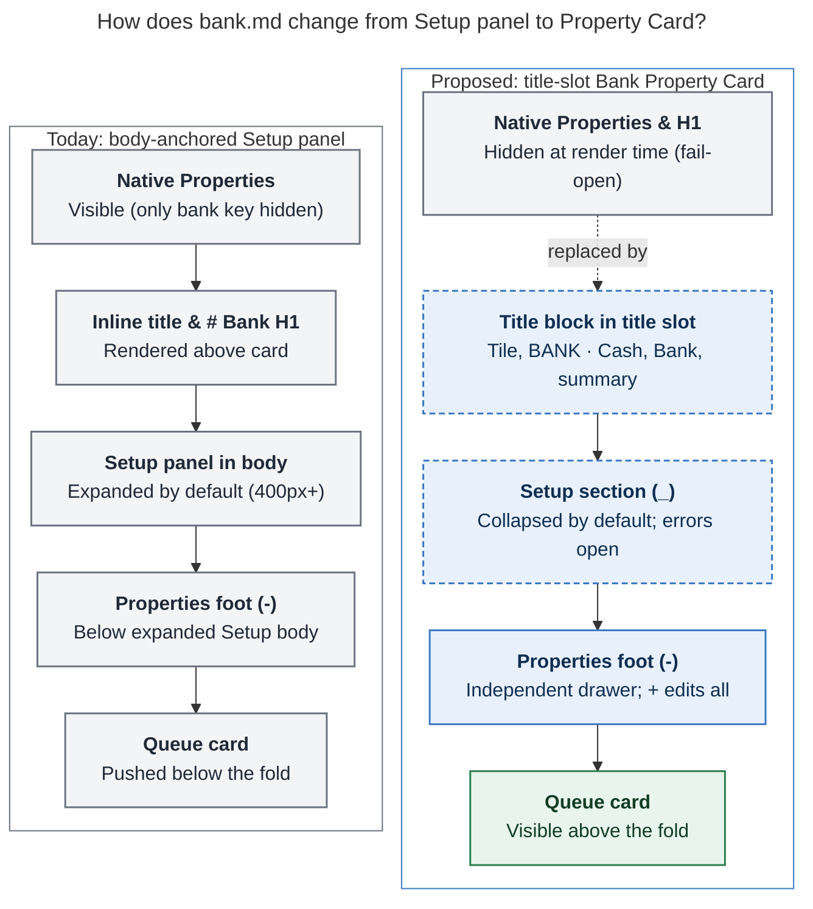
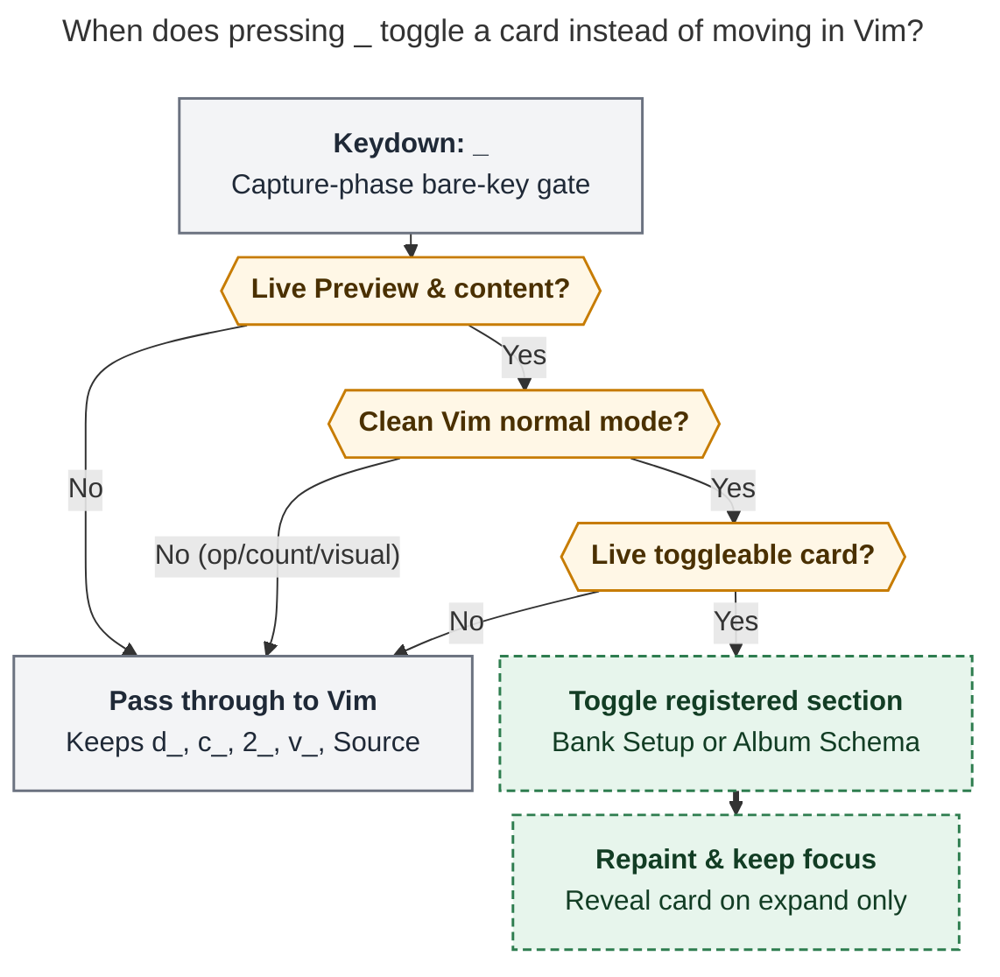

# Bank Property Card & `_` Schema Toggle — Design, Critique & Implementation Plan

> **Scope:** Elevating the Bank Card on `~/bob/bank.md` to a full Property Card (title slot, title ownership, whole-frontmatter ownership, default-collapsed Setup section) and introducing the bare `_` Vim normal-mode toggle across Bank and Album cards (plus evaluating Area/Project cards).
>
> **Codebase verified:** `bob-plugins` (`eac9d744`, `bob-ledger-tools` v1.157.1 + `bob-command-mode`) and `bob-cli` (`814b6583`), plus live vault files (`~/bob/bank.md`, `~/bob/cash.md`, `~/bob/subscriptions.md`, `~/bob/obsidian_vimrc.md`).

---

## Executive Summary

**Yes — this is a genuinely strong idea, and all backend prerequisites are already in place.** On `~/bob/bank.md` today, a user opening the note to process waiting transactions has to look past three stacked header zones—Obsidian's native Properties block, the raw `# 🏦 Bank` heading, and an expanded-by-default 400 px+ Bank Setup wall (21 category tiles across 3 groups plus 10 rules)—before reaching the `bob-bank` queue card. Meanwhile, `bob props show bank.md` already ships `note_kind: "bank"`, `props_v1`, `props_contract_v1`, card ownership for `bank`, and the full Area Settings contract, so hiding native Properties loses zero editing or recovery capability.

However, implementing the request *literally* as "collapse `bankSetupExpanded` by default + hide `.metadata-container` + bind `_`" would leave glaring design seams: `parent: "[[cash]]"`, `summary`, and any authored Area policies on `bank.md` would vanish into the `-` drawer, `# 🏦 Bank` would float awkwardly above a detached box, and an existing bug in `248a-plugin-bank-setup-model.js` would make `_` appear broken whenever `bank:` has a lint error.

**Recommended solution in brief:**
1. **Graduate Bank into a full title-slot Property Card** using the same two-phase `{ identity, body }` architecture as Album Card (`propertyCardAdoptTitle` + `propertyCardFrontmatterOwnMounted`), with smart leading-emoji deduplication so `# 🏦 Bank` renders cleanly as `[🏦]` tile + **`Bank`** without editing note bytes.
2. **Honor `bank.md`'s hybrid Area identity**: surface `parent` as clickable `BANK · ● Cash` breadcrumbs (walking real root-area hue instead of hardcoding `magenta`), `summary` as the subtitle, and authored Area policy chips / Ready count *only when present*.
3. **Collapse valid Setup by default behind one unified full-width disclosure bar** matching Album Card's `▸ Schema · …` grammar, surfacing quiet inline status/warning pills (`⚠ stale`, `✗ delta`, `⚠ 1 warning`) so problems stay visible when folded, while auto-expanding `invalid` and `missing` states as defaults (and fixing the bug that currently prevents collapsing an invalid config).
4. **Add bare `_` to `propertyCardBareKeyGate` backed by a small shared card-body toggle registry** (`240s-plugin-property-card-body-toggle.js`) plus a companion `Toggle card details` (or `Toggle card schema`) Obsidian + Command Mode command for Reading view—preserving every operator-pending, counted, visual, Source-mode, and non-card Vim `_` motion (`d_`, `c_`, `y_`, `2_`, `v_`).
5. **Zero `bob-cli` binary changes required**; everything ships cleanly in `bob-plugins` (plus a comment update in `obsidian_vimrc.md` and glossary updates).

---

## 1. Current State Audit: Why `bank.md` Is the Odd Card Out

Across the nine species in `PROPERTY_CARD_SPECIES` (`240f-plugin-property-card-species.js`), Bank is the sole remaining card that still behaves like a legacy body widget rather than a title-slot Property Card:

| Species | Mount slot | Owns title (inline title + H1)? | Owns whole frontmatter (`.metadata-container`)? | Collapsible body / schema | Default state | `==` editor | `+` editor |
|---|---|---|---|---|---|---|---|
| **Album** (`album`) | Title slot (`240k`) | Yes | **Yes** (`240q`) | `▾ Schema · …` | Expanded | Album Schema | Property Editor |
| **Record** (`record`) | Title slot (`240k`) | Yes | **Yes** (`240q`) | None | — | Record Card | Property Editor |
| **Day / Period** | Title slot (`240k`) | Yes | **Yes** (`240q`) | Content-gated | — | Intentions | Property Editor |
| **Area** (`area`) | Title slot (`240k`) | Yes | No *(native kept)* | `▾`/`▸` in actions | Expanded | Property Editor (Settings) | Property Editor |
| **Project** (`project`) | Title slot (`240k`) | Yes | No *(native kept)* | `▾`/`▸` in actions | Expanded | Property Editor (Settings) | Property Editor |
| **Bank** (`bank`) **today** | **Body (after H1)** | **No** *(inline badge only)* | **No** *(only `bank` row hidden via `240b`)* | `▾ Setup` | **Expanded** | Bank Setup | Property Editor (Area Settings) |

### What happens on `~/bob/bank.md` today
Inspecting `~/bob/bank.md` reveals its exact structure:
- **Frontmatter (65 lines):** `parent: "[[cash]]"`, `type: "[[area]]"`, `summary: "Every transaction and deposit, categorized in monthly notes, plus disputes and cancellations."`, `created: 2026-11-11T11:31:42-05:00`, and `bank:` (1 account, 21 categories across 2 custom groups + 4 built-ins, 10 rules).
- **Body:** `# 🏦 Bank` → short intro paragraph → ```` ```bob-bank\nview: queue\n``` ```` → `## Albums` (`Subscriptions`).

Because `bank.md` is explicitly excluded from Home Cards (`HOME_CARD_TYPE_NOTES = ["area.md", "project.md", "bank.md"]` in `249b`), excluded from `240q` whole-frontmatter ownership (line 523), and lacks `titleOwnership: true` in `248c`, opening `bank.md` renders:
1. Native Obsidian Properties (`parent`, `type`, `summary`, `created`, plus "Add property") — with only `bank` hidden.
2. `# 🏦 Bank` (plus Obsidian's inline title if enabled).
3. `.bob-bank-setup` jammed into the body below H1, expanded by default to ~400+ px of accounts, 21 category tiles, free keys, and 10 rules, followed by `.bob-property-card-foot`.
4. Only far below the fold: the intro text, the `bob-bank` queue card, and `## Albums`.

---

## 2. Critique of the Plan & Justified Requirement Adjustments

### Overall Verdict: Strong Yes
Turning Bank into a proper default-collapsed Property Card that hides native Properties and adding `_` for Bank and Album schema toggling directly solves the worst visual-density regression in the vault and completes a remarkably coherent four-key Property Card keyboard grammar.

### Critique of Subtle Pitfalls & Proposed Adjustments

Below are **six justified adjustments** to the original requirements, each grounded in codebase behavior and UX evidence:

#### Adjustment 1: Adopt the Title Slot & Own the Title — Don't Just Hide Native Properties
- **Why:** If we hid native Properties while leaving `.bob-bank-setup` as a body widget under `# 🏦 Bank`, `parent: "[[cash]]"` and `summary` would disappear from the note surface, and `# 🏦 Bank` would sit detached above a small `🏦 BANK  ▾ Setup` strip—contradicting every other Property Card in `bob-ledger-tools`.
- **Adjustment:** Mount Bank in the title slot via `propertyCardAdoptTitle` (with `titleOwnership: true` on `createPropertyCardHost`), painting local identity at 0 ms before `bob bank config` returns, exactly like Album Card.
- **Subtle catch — `# 🏦 Bank` double-emoji trap:** `~/bob/bank.md` (and `docs/bank.md`) uses `# 🏦 Bank` as its H1, and has no `title:` or `emoji:` key in frontmatter. Because the Bank tile already displays `🏦`, rendering `# 🏦 Bank` verbatim produces `[🏦]  🏦 Bank` (double bank emoji). Conversely, stripping `🏦` from the display title without updating the title recognizer breaks H1 hiding (`propertyCardHomeTitleRecognizer("Bank")` will not match `# 🏦 Bank`).
  - **Fix:** Add `propertyCardBankTitleRecognizer` (in `240h`): extract a leading emoji from the first-body H1 (if present) for the tile, display the cleaned remainder (`Bank`) as the card heading, and match the exact original H1 text so `# 🏦 Bank` hides cleanly at render time and reveals when the Live Preview cursor touches it—requiring **zero edits to `~/bob/bank.md`**.

#### Adjustment 2: Preserve `bank.md`'s Hybrid Area Contract (Ancestry, Hue Walk, Optional Policy Chips)
- **Why:** In `bob-cli`, `bank.md` is a hybrid (`docs/props.md` §Area and project settings): `note_kind: "bank"`, `bank:` is card-owned (`==`), and all other keys follow the **Area** contract (`summary`, `parent`, `color`, `task_type`/`theme`, `offclock`/`offclock_types`, `ready_cap`, `task_refresh`, `project_name_aliases`). Additionally, `bank.md` holds bank tasks ("Money tasks like disputes and cancellations live here too").
- **Adjustments:**
  1. **Clickable kicker ancestry + real hue walk:** Resolve `parent` via the shared ancestry walker to paint `BANK · ● Cash` (clickable breadcrumb with `cash`'s hue pip). Replace `bankCardRootHue`'s hardcoded `"magenta"` fallback (`241m` line 311) with `notebookHostHueName(path, metadataCache, vault) || this.bankCardRootHue(path)` so Bank follows actual area-hue inheritance (still magenta today via `cash.md`, and automatically responsive if `cash.md` or `bank.md` sets a new `color:`).
  2. **Zero-clutter Area policy strip:** Reuse `homeCardChips` and `homeCardReadyModel` to paint authored policy chips (`#ADMIN`, `off-clock`, `review 14d`, `aka …`) and Ready readout **only when explicitly authored or when `ready.count > 0`**. On `~/bob/bank.md` today (no policies authored, 0 tasks), **this row does not render at all**, keeping the card razor-clean while ensuring nothing vanishes if Bryan later configures an Area policy via `+`. Clicking any policy chip opens `+` Property Editor directly on that setting.
  3. **Truthful Properties foot `where`-marks:** Upgrade `248ca-plugin-bank-setup-foot.js` from `{ bank: "card", created: "foot" }` to truthfully report `{ type: "tile", parent: "kicker", summary: "subtitle", bank: "setup", created: "foot", ...(authoredColor ? { color: "tint" } : {}), ...chipMarks }` (plus `homeCardManagedMap()` for housekeeping keys like `done_tasks`), matching Album and Area cards.

#### Adjustment 3: Fix the Invalid-State Lock & Surface Quiet Warnings When Collapsed
- **Existing bug discovered (`248a` line 294):** Currently `bankSetupModel` hardcodes `expanded: state === "invalid" ? true : expanded`. If `bank:` has an error, clicking `▾ Setup` or pressing `_` flips `this.bankSetupExpanded` to `false`, triggers a repaint, and the model **silently ignores it**, leaving the user stuck unable to collapse an invalid Setup section.
- **Adjustment:** Switch to default-based expansion matching Album Card (`241v`/`241w`):
  - **Default expanded state:** `false` for `valid`; `true` for `invalid` (config errors) and `missing` (no `bank:` mapping yet, so the starter copy flow is visible).
  - **Session override respected:** Once the user explicitly clicks or presses `_`, `this.bankSetupExpanded.get(path)` wins—even on `invalid`—so the toggle never behaves like a broken button.
  - **Error-transition guard:** If `bank.md` transitions from `valid` → `invalid` mid-session (e.g., after a hand edit), clear any stored `false` collapse override once so newly introduced errors always surface immediately.
  - **Glanceable health while collapsed:** On a `valid` collapsed Bank Card, include a quiet account-status glyph (`✓` muted, `⚠ stale` amber, `✗ delta` red) and a compact `⚠ N warning(s)` pill when warning findings exist (e.g. a digit-masked read-time-dead rule), so issues stay visible without forcing the entire 400 px panel open.

#### Adjustment 4: Unify the Bank Setup Disclosure Bar & Simplify Header Actions
- **Critique of current Bank header (`248b` lines 430–527):** Today only the tiny text `▾ Setup` is clickable; the summary `🏦 WF Checking · 21 categories · 10 rules` is an unclickable `<span>`, it repeats the `🏦` emoji that's already on the tile, and `↗ YAML` crowds the top bar next to `⊞ Edit`.
- **Adjustments:**
  1. Make the entire Setup summary row **one full-width clickable `<button>`** styled identically to Album Card's `.bob-album-schema-summary`:
     `▸ Setup · WF Checking · 21 categories · 10 rules`
     with `title="Toggle bank setup (_)"` (and add `title="Toggle album schema (_)"` to Album Card's summary button, matching the Properties foot's `title="Toggle properties (-)"`).
  2. Move **`⊞ Setup`** (or keep **`⊞ Edit`** for muscle-memory/test continuity; see naming comparison in §3.4) into the title-block `.bob-property-card-actions` slot, aligned with Album's `⊞ Schema` and Area's `⊞ Settings`.
  3. **Remove `↗ YAML` from the collapsed valid header:** No other Property Card (Album, Record, Day/Period, Area, Project) puts `↗ YAML` in its resting header; YAML remains reachable via `==` (`y`/Ctrl+E), via `-` Properties drawer (`y` on any row), and by clicking any Account/Category/Rule row when Setup is expanded. Keep `↗ YAML` visible directly on `invalid`, `missing`, `unsupported`, and `mobile` states where Source-mode YAML repair is the primary action.

#### Adjustment 5: Implement `_` via a Shared Card-Body Toggle Registry + Reading-View Command
- **Critique of hardcoding `_` for Bank + Album:** Hardcoding `if (bank) ... else if (album) ...` inside `248m-plugin-schema-double-equals.js` duplicates view/mount resolution logic and leaves Reading view and Command Mode with no way to invoke the toggle.
- **Critique of Vim `_` conflict (rigorous check):**
  - In Vim normal mode, `_` is a downward linewise motion to the first non-blank character (`[count - 1]` lines down; bare `_` = `^`).
  - Running `_` through the existing **`propertyCardBareKeyGate`** (`248m` lines 127–158) eliminates every dangerous Vim conflict:
    - Operator-pending (`d_`, `c_`, `y_`, `>_`, `=_`) → `snap.operator != null` → **falls through to Vim**.
    - Counted (`2_`, `3_`) → `snap.countPending === true` → **falls through to Vim**.
    - Visual / Insert / Replace (`v_`, typing `_`) → **falls through to Vim**.
    - Source mode / inputs / modals → **falls through to Vim**.
    - Any note without a mounted collapsible card (daily notes, tasks, records, plain notes) → `canAct === false` → **falls through to Vim**.
    - Even on Bank and Album notes in bare normal mode, `^` remains untouched for first-non-blank navigation—matching the exact precedent of `-` and `+` (which replaced Vim's `-`/`+` line-first-non-blank motions in commit `da688dd3`, since `k`/`j` already cover them).
  - Checked all 10 plugins in `bob-plugins` and `~/bob/obsidian_vimrc.md`: **zero conflicts** exist with bare `_` in editor `contentDOM`.
- **Adjustments:**
  1. Introduce a small, view-local toggle registry (`240s-plugin-property-card-body-toggle.js`, modeled directly on `propertyCardCanToggleProperties` / `propertyCardToggleProperties` in `240p`): each collapsible card registers a provider that requires a **connected, path-matching, actually toggleable mount inside the active view** (so an Album card still in `pending` state without a report, or a Bank card in `loading`/`unsupported`/`refresh-failed` state, cleanly declines instead of flipping invisible state).
  2. Register a companion Obsidian command (`Toggle card schema` or `Toggle card details`) and expose it in `bob-command-mode`'s `CM_SHEET_SURFACE_ROWS` (`160-sheet-rank.js`), mirroring `Toggle card properties` (`-`) so Reading view, Command Palette, and Command Mode all have full parity.
  3. **Scroll-reveal on expand only + zero focus theft:** Mirror `propertyCardFootReveal` (`240o` lines 54–66): when `_` **expands** a schema section while the user is scrolled down a long note (e.g., deep in `subscriptions.md`'s `## Records` or `bank.md`'s queue), smoothly `scrollIntoView({ block: "nearest" })` (instant under `prefers-reduced-motion`) without moving the cursor or stealing focus from `.cm-content`—so pressing `_` a second time immediately collapses it again without scrolling!

#### Adjustment 6: Decision Callout — Should `_` Also Toggle Area & Project Cards?
- **Discovery:** Area and Project cards (`249c`/`249d`) **already have a `▾`/`▸` collapse button** (`homeCardCollapsed` / `aria-label="Collapse card details"`) with **no keyboard shortcut**.
- **Trade-off to decide explicitly:**
  - **Option A — Universal `_` across Bank, Album, Area, and Project (Recommended):** One mental model for the entire Property Card family (`-` toggles Properties drawer, `_` toggles card body/details; `==` opens species editor, `+` opens Property Editor). Command name: **Toggle card details** (`toggle-card-details`). Only minor caveat: bare `_` in Live Preview normal mode on task-heavy area/project notes (like `cash.md`) toggles the header instead of acting like `^` (while `d_`, `c_`, `2_`, `v_`, `^`, and Source mode all keep Vim behavior).
  - **Option B — Scoped strictly to Bank & Album (v1 conservative):** Matches the literal prompt; leaves bare `_` untouched on Area/Project notes. Command name: **Toggle card schema** (`toggle-card-schema`). Because the toggle registry (`240s`) is decoupled, wiring Home Card later is a ~15-line additive change.
- **Recommendation:** Ship the registry architecture either way, and **default to Option B if you want minimal blast radius on task-heavy Area/Project notes, or Option A if you want complete Property Card keymap symmetry** (personally, **Option A** feels far cleaner once you've lived with `-` and `+`, because you never have to ask "does `_` work on this card?").

---

## 3. Visual & Interaction Design

### 3.1 Architecture Comparison: Before vs. After on `bank.md`

**Reader question:** *How do mounting, title ownership, frontmatter ownership, and default collapse change on `bank.md`?*



*Caption: Moving the bank card into Obsidian's title slot lets one unified card replace native Properties, the inline title, and `# 🏦 Bank` (failing open on any error or denied context), while collapsing Setup by default brings the queue card above the fold.* *(Rendered with `@mermaid-js/mermaid-cli@12.0.0`, 684.6×745 px, fit 95.4%.)*

---

### 3.2 Visual Anatomy & Layout States

#### A. Resting Default State (Valid Config, Collapsed Setup — ~95% of visits)

```text
╭─────────────────────────────────────────────────────────────────────────╮
│ ┏━━━━┓  BANK · ● Cash                                         ⊞ Setup  │
│ ┃ 🏦 ┃  Bank                                                           │
│ ┗━━━━┛  Every transaction and deposit, categorized in monthly notes,   │
│         plus disputes and cancellations.                               │
├─────────────────────────────────────────────────────────────────────────┤
│ ▸ Setup · WF Checking ✓ · 21 categories · 10 rules                     │
├─────────────────────────────────────────────────────────────────────────┤
│ ▸ Properties · 5                                        created Nov 11 │
╰─────────────────────────────────────────────────────────────────────────╯
```

**Why this looks calm, cohesive, and unmistakable:**
- **Material & Hue:** `.bob-property-card[data-card-kind="bank"]` uses the same **8% area wash** as Album and Area cards (`--bob-property-card-tint: 8%`), inheriting `cash`'s magenta accent via `notebookHostHueName` (falling back to `--bob-bank-accent`), with the same `1px` accent-mixed divider below `.bob-property-card-title-block:not(:last-child)` as Album Card (`styles.css` lines 12400–12403).
- **Tile Form (`plain` refined):** Give `.bob-property-card-tile[data-tile-form="plain"]` a crisp `background: var(--background-primary)` (instead of `transparent`) inside the title block so the `🏦` tile stands cleanly off the 8% magenta tint in both light and dark themes, matching Album's `stack` and Record's `sheet` while keeping its clean square silhouette distinct from `stack` (album), `sheet` (record), `field` (area), and `pennant` (project).
- **Typography Scale Fix:** Currently `.bob-bank-setup` sets `--bob-property-card-font-size: 0.9em` on the root section (`styles.css` line 10603), which would shrink the title block below Obsidian's inline title scale. Move the `0.9em` compact density to `.bob-bank-setup-summary` and `.bob-bank-setup-body`, letting `.bob-property-card-title-block` inherit full note-text sizing just like Album and Area cards.
- **No double emoji, no dead text:** The `🏦` tile + `BANK` kicker carry identity; the heading reads simply **`Bank`**; the full-width Setup button drops the redundant leading `🏦` (`▸ Setup · WF Checking ✓ · 21 categories · 10 rules`) and highlights gently on hover (`color: var(--text-normal)`).

#### B. Expanded State (After pressing `_` or clicking the Setup bar)

```text
╭─────────────────────────────────────────────────────────────────────────╮
│ ┏━━━━┓  BANK · ● Cash                                         ⊞ Setup  │
│ ┃ 🏦 ┃  Bank                                                           │
│ ┗━━━━┛  Every transaction and deposit, categorized in monthly notes,   │
│         plus disputes and cancellations.                               │
├─────────────────────────────────────────────────────────────────────────┤
│ ▾ Setup · WF Checking ✓ · 21 categories · 10 rules                     │
│ ─────────────────────────────────────────────────────────────────────── │
│ ACCOUNTS  balances go stale after 10 days                              │
│   🏦 WF Checking  checking · default · since Tue Nov 11  ✓ balanced    │
│                                                                        │
│ CATEGORIES  what Ctrl+Enter offers, in order                           │
│   EVERYDAY                                                             │
│   [C ☕ Coffee 4] [V 🏪 Convenience] [S 🛍️ Shopping 2] ...              │
│   BILLS                                                                │
│   [1 🏠 Housing 1] [2 💡 Utilities 3] ...                              │
│   MONEY MOVES  built in · shown first for money in                     │
│   [I 💵 Income 2] [R ↩️ Refund] [T ↔️ Transfer] [A 🏧 Cash out]         │
│   FREE KEYS  B J L M Q U W X Y Z 0 9                                   │
│                                                                        │
│ RULES  checked top to bottom on import and hints                       │
│   1. CROSSCOUNTRY MORTGAGE → 🏠 Housing  payee Mortgage                │
│   2. DEPT EDUCATION STUDENT LN → 📆 Loans  payee Student loans         │
│   ...                                                                  │
├─────────────────────────────────────────────────────────────────────────┤
│ ▸ Properties · 5                                        created Nov 11 │
╰─────────────────────────────────────────────────────────────────────────╯
```

- **Lazy DOM + Crisp Motion:** Keep `.bob-bank-setup-body` omitted from the DOM while collapsed (zero hidden tab stops, fast initial render of 21 tiles + 10 rules), and animate expand with a subtle 120 ms CSS `@keyframes` fade-and-2px-slide (disabled under `prefers-reduced-motion: reduce`), which survives `propertyCardAdoptPatch` cleanly!

#### C. Special & Degraded States

| State | Default expanded? | Setup bar text & inline affordances | Frontmatter ownership (`240q`) |
|---|---|---|---|
| **Loading** *(before `bob bank config` returns)* | Collapsed (no body) | `Setup · loading…` *(non-toggleable until report lands; title block + foot already painted at 0 ms)* | Active immediately if local source/cache + `props_v1` + routing pass |
| **Valid (clean)** | **Collapsed** | `▸ Setup · WF Checking ✓ · 21 categories · 10 rules` | Active |
| **Valid + warnings / stale / delta** | **Collapsed** | `▸ Setup · WF Checking ⚠ stale · 21 categories · 10 rules · ⚠ 1 warning` *(amber/red inline pills; click or `_` expands to show findings)* | Active |
| **Invalid (`bank:` errors)** | **Expanded** *(collapsible by user; re-expands on valid→invalid transition)* | `▾ Setup · ✗ 2 problems in bank:` (red error text) + `↗ YAML` + expanded alert banner with line jumps | Active *(if top-level YAML still parses & matches cache)*; fails open automatically if YAML itself is broken |
| **Missing (`bank:` absent)** | **Expanded** | `▾ Setup · no bank: mapping yet` + `↗ YAML` + starter copy panel | Active *(valid YAML without `bank:`)* |
| **Refresh failed** | Collapsed (no body) | `Setup · refresh failed` + `Retry` button | Active |
| **Unsupported (old `bob`)** | Collapsed (no body) | `Setup needs a newer bob — run bob update` + `↗ YAML` | Fails open (`props_v1` unconfirmed → native Properties kept) |
| **Mobile / Embed / Popover / Slot lost** | Collapsed (valid) | Title block demoted (`role="heading"` removed), placed below H1, `drawn by bob on desktop` + `↗ YAML` on mobile | Denied → native title, H1, and Properties remain intact |
| **Source mode** | N/A *(card unmounted)* | Source-mode wavy lint marks remain active; inline title, H1, and raw YAML stay native | Released in same CodeMirror transaction |

#### D. Narrow Viewport (`≤ 375 px` container query)
The Title Block Kit (`styles.css` lines 12849–12865) already handles narrow containers automatically:
- Tile shrinks from `2.4em` to `1.8em`.
- Kicker row switches to `display: contents`, wrapping `.bob-property-card-actions` (`⊞ Setup`) neatly below the subtitle so `BANK · ● Cash` never truncates or collides.
- The full-width Setup summary button wraps cleanly (`white-space: normal; overflow-wrap: anywhere`), matching Album Card's `.bob-album-schema-summary`.

---

### 3.3 The Four-Key Property Card Grammar (`-`, `_`, `==`, `+`)

Look at how naturally `_` completes the physical two-key cluster at the top right of a US keyboard:

| Physical Key | Unshifted | Shifted | Mental Model |
|---|---|---|---|
| **`-` / `_`** | **`-`** → Toggle **Properties** drawer | **`_`** → Toggle **Setup / Schema** section *(and optionally Area/Project details)* | **Inline disclosures** *(read-only, in-place)* |
| **`=` / `+`** | **`==`** → Open **Species Card Editor** | **`+`** → Open **Property Editor** | **Modal editors** *(guarded writes)* |

**Reader question:** *When does pressing `_` in Obsidian toggle a card section instead of running Vim's `_` motion?*



*Caption: Any `No` branch passes `_` untouched to Vim, so operator-pending (`d_`, `c_`, `y_`, `=_`), counted (`2_`), visual (`v_`), Source-mode, and non-card notes stay native; only a bare Live Preview normal-mode `_` on a view with a live toggleable card toggles the section while keeping editor focus.* *(Rendered with `@mermaid-js/mermaid-cli@12.0.0`, 614.4×960 px, fit 93.0%.)*

### 3.4 Key Naming & Polish Details
- **Kicker action button on Bank Card (`⊞ Setup` vs. `⊞ Edit`):**
  - `⊞ Setup` aligns directly with Album's `⊞ Schema` and Area's `⊞ Settings` (and clearly distinguishes what `==` edits from what `+` Area Settings edits).
  - `⊞ Edit` preserves the existing button text asserted in `obsidian-bank-ui-e2e-setup.cjs`.
  - **Recommendation:** Use **`⊞ Setup`** (and update the E2E assertion alongside the other layout/default-collapse test updates), because once Bank sits in the title slot with a Properties foot and Area Settings in `+`, a generic `⊞ Edit` becomes slightly ambiguous whereas `⊞ Setup` is self-explanatory.
- **Command Palette & Command Mode entry:**
  - Add `toggle-card-schema` (**"Toggle card schema"**) — or `toggle-card-details` (**"Toggle card details"**) if Area/Project cards are wired in too — right beside `toggle-card-properties` in `248m-plugin-schema-double-equals.js` and `plugins/bob-command-mode/src/160-sheet-rank.js`.
- **Discoverability hints:**
  - Bank Setup disclosure tooltip: `title="Toggle bank setup (_)"`
  - Album Schema disclosure tooltip: `title="Toggle album schema (_)"`
  - (If Area/Project wired in): Home Card collapse tooltip: `title="Toggle card details (_)"`
  - All match the Properties foot's existing `title="Toggle properties (-)"`.

---

## 4. Technical Architecture & Implementation Blueprint

### 4.1 Critical Engineering Constraints & Bug Traps Identified

1. **1,000-line fragment ceiling (`bob-plugins/AGENTS.md`):**
   - `248c-plugin-bank-setup-hosts.js` is already **798 lines**; `240q-plugin-property-card-frontmatter-ownership.js` is **837 lines**; `249d-plugin-home-card-host.js` is **1,000 lines**.
   - **Solution:** Follow the exact split pattern used by Record Card (`242kb-plugin-record-sheet-title.js`) and Intention Card (`296d-plugin-intention-card-title-slot.js`):
     - Create **`248cb-plugin-bank-setup-title.js`** (~180–220 lines) for Bank's title-slot adoption, live in-place patching, and frontmatter ownership helpers.
     - Create **`240s-plugin-property-card-body-toggle.js`** (~120–160 lines) for the shared `_` card-body toggle registry and view-local resolution.
     - Add both to `plugins/bob-ledger-tools/src/fragments.json` and run `npm run build`.

2. **Live Preview ↔ Source Mode transition bug trap (`248c` + `240d`):**
   - Unlike Album Card (whose `viewPath` becomes `null` in Source mode), Bank Setup's `viewPath(view)` returns `"bank.md"` in **both** Live Preview and Source mode so Source-mode config lint marks can paint (`248c` line 64).
   - Because `path !== this.path` in `240d` line 52 is `false` on an LP ↔ Source toggle, `createPropertyCardHost` **will not rebuild** unless `248c` supplies a `shouldRebuild` hook checking `update.startState.field(editorLivePreviewField) !== update.state.field(editorLivePreviewField)` (identical to `249d` lines 93–97).
   - Furthermore, when `buildBankSetupDecorations` enters the Source-mode lint branch (`248c` line 580), it **must** explicitly release title adoption (`bankSetupReleaseAdoption`), frontmatter ownership (`bankSetupReleaseFrontmatter`), per-row keys (`bankSetupReleaseKeys`), and tracked foot (`bankSetupTrackFoot(..., null)`), so switching to Source mode never strands the title-slot card while lint paints.

3. **Two-pane & Focus Safety on `_`:**
   - When `_` fires from `.cm-content`, the toggle flips the session map (`bankSetupExpanded` / `albumHeaderExpanded`) and repaints via `propertyCardAdoptPatch` (Live Preview deferred microtask, Reading synchronous).
   - Focus restoration runs **only** when `doc.activeElement` was already inside the card; when invoked from `.cm-content`, focus stays in `.cm-content` so repeated `_` presses toggle back and forth immediately.
   - Expanding scrolls the toggled card into view via `scrollIntoView({ block: "nearest", behavior: reducedMotion ? "auto" : "smooth" })` (using a `pendingScroll` `Set` mirroring `240r` line 334); collapsing never scrolls.

4. **Frontmatter Ownership Coordination (`240q`):**
   Only **three surgical edits** are needed in `240q-plugin-property-card-frontmatter-ownership.js`:
   - Line 510 (`propertyCardFrontmatterMountPath`): add `kind === "bank" ? "data-bank-setup-source"`.
   - Line 523 (`propertyCardFrontmatterRecordEligible`): add `"bank"` to `["album", "record", "day", "week", "quarter", "year", "bank"]`.
   - Line 683 (`propertyCardFrontmatterCoordinatorCapabilityChanged`): add `"scheduleBankSetupRefresh"` to the refresh scheduler list.

---

### 4.2 Exact File-by-File Change Plan

All implementation work lives in **`bob-plugins`** (plus minor vault/memory doc updates):

| Repo / File | Purpose & Key Changes |
|---|---|
| `plugins/bob-ledger-tools/src/240h-plugin-property-card-title-range.js` | Add `propertyCardBankTitleRecognizer(headingText)` matching the recognized first-body H1 (including `# 🏦 Bank` or `# Bank`) with no followers. |
| `plugins/bob-ledger-tools/src/240q-plugin-property-card-frontmatter-ownership.js` | Enable `"bank"` in `propertyCardFrontmatterMountPath`, `propertyCardFrontmatterRecordEligible`, and `propertyCardFrontmatterCoordinatorCapabilityChanged`. |
| **NEW** `plugins/bob-ledger-tools/src/240s-plugin-property-card-body-toggle.js` | Shared `_` card-body toggle registry: `propertyCardRegisterBodyToggle`, `propertyCardUnregisterBodyToggle`, `propertyCardCanToggleBody(view)`, `propertyCardToggleBody(view)`, `propertyCardBodyToggleReveal(el)`, and reset on teardown. Checks connected, path-matching, toggleable mounts inside the active view (mirroring `240p`). |
| `plugins/bob-ledger-tools/src/248a-plugin-bank-setup-model.js` | Change `BANK_SETUP_DEFAULT_EXPANDED` from `true` to `false`; add `bankSetupDefaultExpanded(state)` (`true` for `invalid`/`missing`, `false` for `valid`), `bankSetupIdentityModel` (local `parent` crumbs, `title` with leading-emoji extraction, `summary`, optional `homeCardChips` + `homeCardReadyModel`, hue walk), and `bankSetupCardModel` (`{ identity, body }`); refine `bankSetupCollapsedLine` (drop redundant leading `🏦`, include quiet account status / warning count pills); fix `expanded` so explicit session toggles work even on `invalid`. |
| `plugins/bob-ledger-tools/src/248b-plugin-bank-setup-dom.js` | Build `.bob-bank-setup.bob-property-card` using `propertyCardApplyIdentity` + `propertyCardBuildTitleBlock` (`kind: "bank"`, `BANK · ● Cash` kicker, `Bank` title, `summary` subtitle, `⊞ Setup` action in `block.actions`), optional authored Area policy strip when present, unified full-width clickable Setup disclosure bar (`title="Toggle bank setup (_)"`, `data-bank-setup-toggleable="true"` when toggleable), lazy expanded body, and `↗ YAML` on `invalid`/`missing`/`unsupported`/`mobile`. |
| `plugins/bob-ledger-tools/src/248ca-plugin-bank-setup-foot.js` | Update `bankSetupFootSpec(path, card)` with truthful `where` marks (`type`, `parent`, `summary`, `bank`, `created`, authored `color`, and any painted policy chips) + `homeCardManagedMap()`, and expose `openSetting` handler for foot lint chips. |
| **NEW** `plugins/bob-ledger-tools/src/248cb-plugin-bank-setup-title.js` | Mixin `BobLedgerToolsBankSetupTitleMixin`: `bankSetupOwnMountedFrontmatter`, `bankSetupReleaseFrontmatter`, `bankSetupReleaseAdoption`, `bankSetupPatchLive`, `bankSetupBodyNodes`, `bankSetupPlaceInBody` (exact mirror of `242kb-plugin-record-sheet-title.js`). |
| `plugins/bob-ledger-tools/src/248c-plugin-bank-setup-hosts.js` | Enable `titleOwnership: true`; add `shouldRebuild` for `editorLivePreviewField` flips; bind/release `propertyCardFrontmatterCoordinatorBind(plugin, "bank")`; adopt title slot in `paintBankSetupReading` and `bankSetupLiveDecorations` (with body widget fallback); release adoption/frontmatter/keys/foot in Source-mode lint branch; register Bank in `propertyCardRegisterBodyToggle`; reset collapse override once on `valid` → `invalid` transitions; trigger expand reveal via `pendingScroll`. |
| `plugins/bob-ledger-tools/src/241v-plugin-album-header.js` & `241x-plugin-album-schema-dom.js` | Register Album in `propertyCardRegisterBodyToggle` (checking live connected `.bob-album-schema-summary` inside `view` matching current path); add `title="Toggle album schema (_)"` tooltip; add expand-only `scrollIntoView({ block: "nearest" })` reveal via `albumHeaderPendingReveal`. |
| *(Optional — Option A)* `plugins/bob-ledger-tools/src/249e-plugin-home-card-foot.js` & `249c-plugin-home-card-dom.js` | Register Area/Project in `propertyCardRegisterBodyToggle` (toggling `homeCardSetCollapsed` for live connected `.bob-home-card-collapse` in `view`) and add `title="Toggle card details (_)"`. |
| `plugins/bob-ledger-tools/src/248m-plugin-schema-double-equals.js` | Extend `propertyCardBareKeyGate` and `handleSchemaDoubleEqualsKeydown` to accept `key === "_"` alongside `"-"` and `"+"` (dispatching `propertyCardCanToggleBody(view)` / `propertyCardToggleBody(view)`); register Obsidian command `toggle-card-schema` (or `toggle-card-details`). |
| `plugins/bob-ledger-tools/src/170-plugin-lifecycle.js`, `310-install-methods.js`, `363-*.js`, `369-*.js`, `374-*.js`, `fragments.json` | Wire new mixin + fragments + test helper exports, then run `npm run build`. |
| `plugins/bob-ledger-tools/styles.css` | Add `.bob-property-card[data-card-kind="bank"]` 8% wash & title-block divider (matching Album); give `[data-tile-form="plain"]` crisp `--background-primary` fill inside title blocks; move `0.9em` font sizing off card root onto Setup summary/body; style unified `.bob-bank-setup-summary` full-width button + inline status/warning pills + subtle 120 ms expand `@keyframes` (respecting `prefers-reduced-motion` and `forced-colors`). |
| `plugins/bob-command-mode/src/160-sheet-rank.js` | Add `toggle-card-schema` (or `toggle-card-details`) to `CM_SHEET_SURFACE_ROWS` under `"vault"`, then rebuild `bob-command-mode`. |
| `docs/bob-ledger-tools.md`, `docs/albums.md`, `docs/property-editor.md`, `docs/develop/architecture.md`, `docs/develop/validation.md` | Update key family docs (`==`, `-`, `_`, `+`), note that Bank now owns title + frontmatter and starts collapsed, and run `npm run docs:gen && npm run docs:check`. |
| `~/bob/obsidian_vimrc.md` *(vault)* & `bob-cli` glossary (`Property Card`, `Bank Card`) | Update line 42 comment in `obsidian_vimrc.md` to list `-`, `_`, and `+` as unmapped key-gate keys; update glossary entries through `/sase_memory_write` when the feature ships. |

---

### 4.3 Verification & Test Matrix

1. **Unit tests (`npm test` in `bob-plugins`):**
   - `scripts/test-ledger-tools-bank-setup.cjs`: update default-expanded tests to default-collapsed for `valid`; add tests for leading-emoji title extraction & `# 🏦 Bank` hiding, `invalid` default-expanded + user-collapsible + valid→invalid auto-reopen, `missing` default-expanded, inline warning/stale pills while collapsed, hybrid Area policy chips when present vs. absent, and truthful foot `where` marks.
   - `scripts/test-ledger-tools-schema-double-equals.cjs`: add full bare-key gate matrix for `_` (`shiftKey: true`, operator-pending `d_`/`c_`/`=_`, counted `2_`, visual `v_`, register `"a_`, insert mode, Source mode, focus outside `contentDOM`, live vs. missing/non-toggleable mount).
   - `scripts/test-ledger-tools-property-card-frontmatter-ownership.cjs`: add `"bank"` to coordinator eligibility, mount path, and capability-change refresh assertions.
   - New unit test `scripts/test-ledger-tools-property-card-body-toggle.cjs`: view-local isolation (pane A open does not arm pane B on another note; detached mounts decline; two panes on same note stay synced; Bank/Album loading/pending states decline cleanly).
2. **Real-Obsidian CDP E2E tests:**
   - `scripts/obsidian-bank-ui-e2e-setup.cjs` & `obsidian-bank-ui-e2e-lib.cjs`: update `assertLiveDefault` / `assertBankIdentity` for title-slot mounting, hidden `# 🏦 Bank` + inline title, default-collapsed Setup bar, `_` round-trip (`_` expand → `_` collapse without losing editor focus), `-` independent toggle, and Source-mode round-trip (verifying card disappears cleanly while wavy lint renders and re-adopts on return to Live Preview).
   - `scripts/obsidian-frontmatter-takeover-e2e.cjs`: promote `"bank-native"` to full Bank frontmatter takeover verification (Live Preview + Reading hide `.metadata-container`, `Add file property` routes to Property Editor Add mode, File Properties sidebar stays native, invalid YAML / old `bob` / mobile fail open, plus light/dark × wide/narrow screenshots).
   - `scripts/obsidian-album-ui-e2e.cjs`: add `_` round-trip test on an Album note (starts expanded → `_` collapses → `_` re-expands, focus stays in editor, Reading view via command).

---

## 5. Recommended Solution Summary

Implement this in **two clean, logically cohesive phases** (shippable together or sequentially):

1. **Phase 1 — Bank as a Proper Title-Slot Property Card:**
   - Adopt the title slot + title ownership (with `# 🏦 Bank` emoji deduplication so zero bytes change in `~/bob/bank.md`).
   - Paint `BANK · ● Cash` ancestry kicker (walking real root-area hue), `Bank` heading, `summary` subtitle, `⊞ Setup` action, optional authored Area policy chips (invisible when none are set), and truthful Properties foot `where`-marks.
   - Enable whole-frontmatter ownership for `"bank"` in `240q` (fail-open on broken YAML / stale cache / old `bob` / mobile / Source / embeds).
   - Flip valid Bank Setup to **collapsed by default** with a unified full-width disclosure bar showing quiet account-health/warning pills; auto-expand `invalid`/`missing` as defaults while fixing the bug that currently locks `invalid` open.
   - Guard LP ↔ Source transitions via `shouldRebuild` + explicit release in the Source-mode lint branch.

2. **Phase 2 — Shared `_` Toggle Registry, Bare-Key Gate & Command Parity:**
   - Add `240s-plugin-property-card-body-toggle.js` and wire Bank Setup and Album Schema (plus Area/Project cards if you choose Option A for full family symmetry).
   - Extend `propertyCardBareKeyGate` in `248m` to handle bare `_` identically to `-` and `+`, preserving all Vim operator-pending, counted, visual, Source, and non-card `_` motions.
   - Register the companion Obsidian + Command Mode command (`Toggle card details` / `Toggle card schema`) for Reading view and Command Palette, with expand-only `scrollIntoView({ block: "nearest" })` and zero focus theft from `.cm-content`.
