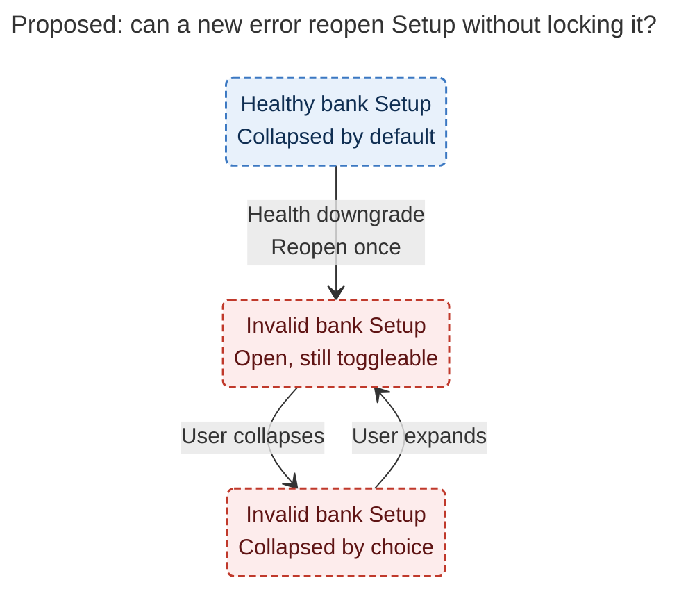

# Diagram proposals: Bank as a proper property card: folded Setup, hidden native Properties, and the `_` fold key

Proposals for the swarm linker, not a report. Each diagram restates only what the source
report says.

```yaml
source: research:202611/bank_property_card_fold/bank_property_card_fold__final.md
producer: research.6b.image
check: "mmdc 12.0.0 with --no-sandbox and the PDF-mirroring config rendered 1 of 1 Mermaid diagrams; broken-diagram rejection passed"
```

## unhealthy-setup-remains-toggleable

```yaml
anchor: |-
  while fixing what it breaks (a disclosure that ignores clicks).
question: |-
  Can a new error reopen collapsed bank Setup without locking it open?
illustrates: |-
  A health downgrade re-surfaces bank Setup once, while the user's explicit choice still works on the invalid card.
caption: A health downgrade reopens Setup once; the user can then collapse and expand the invalid card.
review: "549.422x638 px, fit 100%; question, source-trace, arrow and visual checks passed; 0 revisions; 1 visual review and 1 batch check"
```


