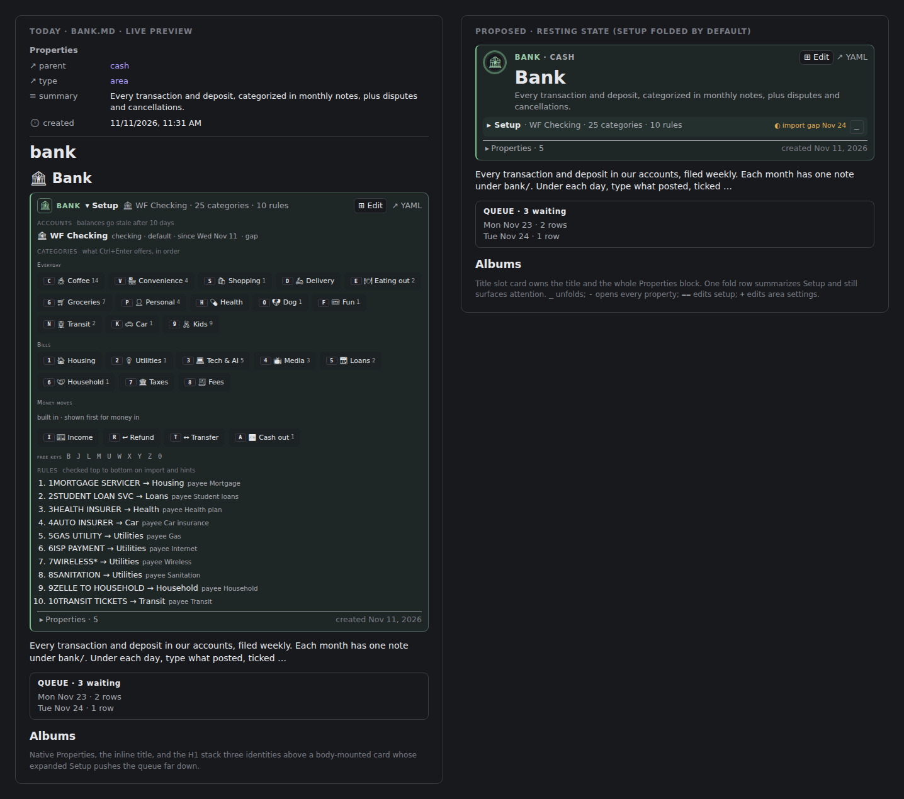
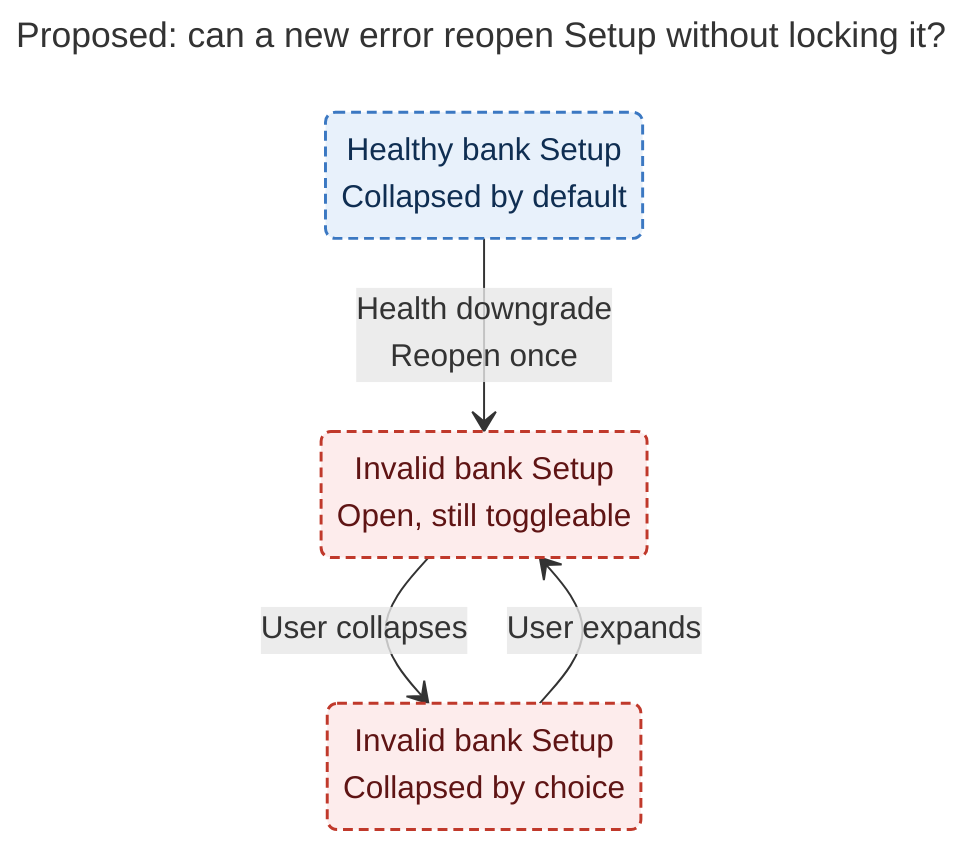
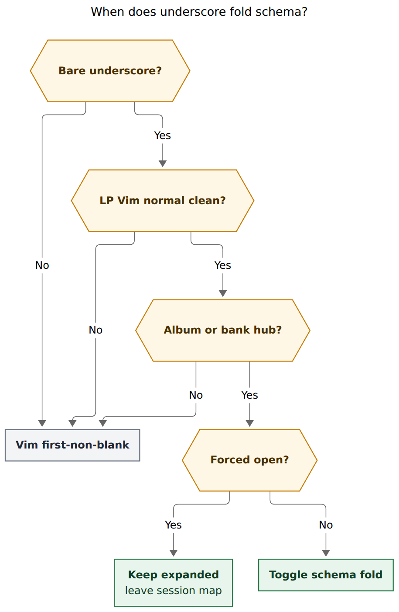
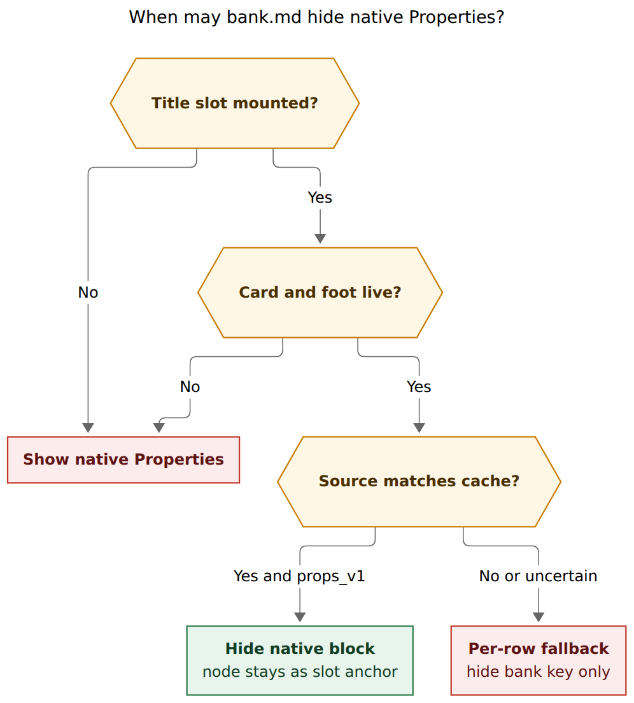

# Bank as a proper property card: folded Setup, hidden native Properties, and the `_` fold key

> **Research query:** Should the bank card in `~/bob/bank.md` become a proper property
> card that collapses its schema by default and hides the native Obsidian Properties
> shown at the top of the file, with a new `_` keymap that expands/collapses the schema
> section on the bank card and on album cards (expanded by default)? Critique the plan,
> call out any justified changes to the requirements, design it to be intuitive,
> reliable, and beautiful, and end with a recommended solution.


## Bottom line

**Yes — do it, and do slightly more than the request asks.** All five researchers
independently reached the same conclusion: the request is sound, the infrastructure
already exists, and this is assembly rather than invention. The bank card already wears
`.bob-property-card` chrome, a BANK badge, the shared foot, and `==`; it is the last
species in the album/record/day-period family that neither owns the note title nor hides
the whole native Properties block.
[The one material correction to the request](#d1-hide-native-properties-with-or-without-the-title-slot-move),
endorsed by four of five researchers and by the prior D5 research: **hiding native
Properties is only right if the bank card simultaneously moves into the title slot and
owns the title** — otherwise `parent`, `summary`, and the note's identity vanish from the
top of the file and reappear only in a drawer. Ship it in phases so the cheap,
high-value fold work lands first.

**Recommendation in brief:**

1. **PR 1 — fold + `_` key.** Bank Setup defaults to collapsed (healthy configs only);
   album Schema stays expanded. Add `_` as a guarded bare key in the existing `248m`
   dispatcher — the Shift twin of `-` — toggling the Setup/Schema disclosure on bank and
   album, plus a palette/Command Mode command for Reading view and non-Vim use. Move the
   attention signals (findings, stale/`delta`/`gap` account status)
   [out of the fold](#the-folded-card-must-stay-honest) so a collapsed card never hides a
   problem, and [fix the invalid-state lock](#d3-what-the-fold-does-on-an-unhealthy-card)
   so the toggle always works.
2. **PR 2 — title slot + native-Properties takeover.** Give the bank host
   `titleOwnership: true`, [adopt the title slot](#the-title-slot-card-in-pr-2) via
   `propertyCardAdoptTitle` (with a recognizer that moves the `# 🏦 Bank` leading emoji
   into the tile), and add `"bank"` to the whole-frontmatter ownership coordinator with
   the same fail-open evidence gate every other owned species uses. Gate the hide on a
   real-Obsidian YAML-parity fixture for `bank.md`.
3. **PR 3 — polish.** One shared fold-row component across the card family, `_`
   [extended to the record/area/project folds](#d2-scope-of-the-underscore-key) that
   already exist, tile/typography refinements, docs, vimrc comment, and glossary updates.

No bob-cli changes, no vault migration, no new YAML:
[everything ships in bob-plugins](#implementation-blueprint) (`bob-ledger-tools`, plus
one Command Mode row), deployed with `bob plugins sync`.



*Figure 1 (from `__cld`). Left: `bank.md` today in Live Preview — native Properties,
inline title, `# 🏦 Bank`, and an expanded Setup wall before the queue. Right: the
proposed title-slot card with Setup folded and the queue above the fold. Mock built from
the plugin's real DOM builders and `styles.css` over live `bob bank config` data
(rule/payee names genericized); the native block, queue box, and fold row are
hand-written HTML rendered in headless Chromium, not Obsidian.*

## What exists today (verified)

| Fact | Evidence |
| --- | --- |
| Bank is already a property card in chrome but not in ownership: `createPropertyCardHost({ kind: "bank" })`, species badge, shared foot, `==` editor — but no `titleOwnership` (album sets it at `241v:41`) and a body mount after `# 🏦 Bank` (CodeMirror widget in Live Preview, `insertBefore` in Reading). | `248c-plugin-bank-setup-hosts.js` |
| Setup defaults expanded; session-only per-path Map. | `248a:10` `BANK_SETUP_DEFAULT_EXPANDED = true` |
| **Invalid-state lock (bug):** the model hardcodes `expanded: state === "invalid" ? true : expanded`, so on an invalid config a click or keypress flips the session Map and the repaint silently ignores it — the toggle looks broken. | `248a:294` |
| **Collapsed cards hide problems (design trap):** findings, the stale "Updating" note, and per-account status rows paint only inside the expanded body, after the `if (!model.expanded) return root` early return. Flipping the default alone would bury warnings. | `248b:529–553` |
| Album Schema defaults expanded (`albumHeaderDefaultExpanded` returns `true` unconditionally), session-only, click-only — no keymap. Both defaults were flipped collapsed→expanded on Nov 16 (`67073ac5`), so this request is the second flip. | `241w:113` |
| The shared key family is one capture-phase dispatcher: `==` opens the species editor, bare `-` toggles the Properties drawer, bare `+` opens the Property Editor. The bare-key gate accepts only `"-"` and `"+"` (`248m:129`); the keydown filter accepts `=`, `-`, `+` (`248m:493`). Gate requires desktop Live Preview, readable Vim normal mode, empty key buffer, no operator/count/register, focus in content, no ctrl/alt/meta. | `248m-plugin-schema-double-equals.js` |
| Whole-frontmatter ownership is allowed only for `album`, `record`, `day`, `week`, `quarter`, `year`; the mount-path helper only knows `data-album-source` / `data-record-source` / `data-intention-source`. Bank hides only its `bank` row per-row (`240b`). | `240q:511–523` |
| Docs state the exclusion explicitly ("Bank retains its native Properties block"; "bank does not"), and the takeover e2e has a `bank-native` case asserting native Properties stay — these must flip intentionally. | `docs/property-editor.md:337`, `docs/develop/architecture.md:233`, `scripts/obsidian-frontmatter-takeover-e2e.cjs` |
| Record, area, and project cards **all have folds already** (session Maps, `▾`/`▸` buttons, no keymap): record "Collapse record details" (`242j:220–225`), home cards "Collapse card details" (`249c:104`, `249d:359`). One researcher's species table claimed record has none; that is wrong. | verified by lead |
| `bank.md` live: 60+ lines of YAML (`parent: [[cash]]`, `type: [[area]]`, `summary`, `created`, nested `bank:` with 1 account / ~21–25 categories / 10 rules), then `# 🏦 Bank`, teaching prose, the `bob-bank` queue fence, `## Albums`. The note names itself three times before the queue. `+` already opens typed AREA SETTINGS (`props_contract_v1`). | `__cld`/`__grk`/`__gem`, `docs/property-editor.md` |
| `~/bob/obsidian_vimrc.md` maps no `_`; the vimrc comment (line 42) already reserves `-`/`+` for the ledger-tools gate. | `__cld`/`__gem`/`__grk`, consistent |
| The two D5 blockers that excluded bank from the v1 takeover — body mount below the H1, and untyped area settings — are both resolved: area/project title cards exist and `+` shows typed AREA SETTINGS on `bank.md`. D5 said to revisit; this is the revisit. | `card_owned_frontmatter__final.md` §D5, `docs/area-and-project-cards.md` |

### Bugs found in the baseline

Fix these while here. All verified by the lead in source; confirm the visual pair in real
Obsidian:

- **Invalid-state lock** — `248a:294`, above. The fix is part of the fold-state model.
- **Dangling `aria-controls`** — the disclosure sets
  `aria-controls="bob-bank-setup-body"` (`248b:443`) but the body div only ever gets
  that string as a **class** (`248b:531`), never an `id`. Album's chip list id is
  stem-derived (`bob-album-schema-chips-${stem}`, `241x:86`), so two panes on the same
  note produce duplicate ids. Fix both with unique per-mount ids.
- **Double-numbered rules** — `bankSetupPaintRules` emits an `<ol>` *and* a
  `.bob-bank-setup-rule-index` span (`248b:335–345`); `styles.css:10634` sets no
  `list-style: none`, so rules render "1. 1MORTGAGE…". Remove one numbering source.
- **`gap` account status has no tone** — `bankSetupStatusTone` (`248a:63`) handles only
  `balanced`/`stale`/`delta`; the live `gap` status falls to muted `·` and draws no
  attention. Map it to the warning tone.
- **Viewport media queries** — bank CSS responsiveness lives partly in
  `@media (max-width: …)` blocks (e.g. `styles.css:10653`), which cannot see a narrow
  split inside a wide window. New fold-row CSS should wrap intrinsically or use the
  title-block kit's container queries.
- **Stale comment** — `248c` still says the bank widget mounts "exactly where the album
  header mounts"; album has since moved to the title slot. Delete during PR 2 so the
  pattern isn't copied again.

## Where the swarm agreed (adopt without debate)

- **Proceed; it's assembly, not invention.** 5/5.
- **Bank collapsed by default, album stays expanded.** 5/5. Setup is configuration you
  touch a few times a month; the queue below is the daily surface. An album's schema
  describes the collection being browsed and stays open. Same gesture, different
  defaults, per species — store each default as one constant on the species registry so
  the next flip (there has already been one) is a one-line diff with one test.
- **Keep the on-screen words "Setup" (bank) and "Schema" (album).** 5/5. Accounts and
  import rules are configuration, not a record schema; unify the gesture and chrome, not
  the noun.
- **`_` extends the existing `248m` bare-key gate** — never a separate document-wide
  hotkey, vimrc mapping, or revived `=-` chord. 5/5. Match `event.key === "_"` (allow
  Shift — `_` *is* Shift+`-` on US layouts and unshifted on some others; never hard-code
  the physical Minus key), keep every existing fall-through (modified, repeat, composing,
  default-prevented, not-content, not-live-preview, no-vim, not-normal,
  operator-pending, key buffer, count, register), and never consume the key unless a
  fold actually exists to toggle. The Vim cost is one near-worthless motion (bare `_` ≈
  `^`, which survives untouched), the same bargain already struck for `-`/`+`.
- **A command accompanies the key.** 5/5. Palette + Command Mode row beside "Toggle card
  properties", covering Reading view and non-Vim users; it also provides the
  disable/remap route a bare character shortcut needs.
- **Fold state stays session-only**, per-path Maps shared across panes, never written to
  frontmatter, settings, or localStorage. 5/5.
- **Native Properties hide only through the `240q` coordinator's fail-open gate**:
  mounted card + foot, desktop Live Preview/Reading, closed valid YAML matching the
  metadata cache, confirmed `props_v1`, working editor routing. Any doubt restores the
  native block (with the current per-row `bank` hide as fallback). Source mode, embeds,
  popovers, canvas, print, mobile, and the File Properties sidebar never change. 5/5.
- **`-`, `+`, `==` keep their exact jobs; the fold is independent of the drawer.** 5/5.
- **Keep `type: [[area]]` and the hybrid identity.** `bank.md` is an area in the type
  graph (`+` correctly opens AREA SETTINGS) and a bank in species chrome; home cards
  already exclude the path. Don't retitle, don't change `type`, don't invent a hybrid
  kicker.
- **No bob-cli changes, no vault migration, zero edits to `~/bob/bank.md`.** 5/5.

## The three real disagreements, resolved

### D1 Hide native Properties with or without the title-slot move

Four researchers (`cld`, `grk`, `mus`, `gem`) treat the title-slot move as a
prerequisite of the hide; `cdx` would keep the card body-mounted, hide the native block
anyway, and defer title ownership as "a separate future visual decision", arguing the
foot keeps every key reachable.

**Resolution: the title-slot move is part of the takeover (PR 2), and the hide never
ships without it.** This is the position of the prior D5 research, and `cdx`'s own
evidence undercuts the alternative: with the card in the body, `parent` and `summary`
leave the visible top of the note and survive only inside the `-` drawer, while the note
keeps three titles (inline title, `# 🏦 Bank`, badge). The title-slot card converts
exactly those keys into the kicker crumb (`BANK · Cash`) and subtitle, which is the
whole point of calling it a *proper* property card. `cdx`'s real concern — risk — is
answered by phasing: PR 1 carries none of the title-slot risk, and PR 2 inherits the
adoption kit's existing fallback (body mount on failed/unstable slots), so no new
failure mode is added. A side benefit (`cld`): in the title slot the card sits above
`.cm-contentContainer`, so `j`/`k` no longer step around a giant block widget.

### D2 Scope of the underscore key

**Scope of `_`:** bank + album only, or every card with a fold?

The request says bank + album. `cld` argues predictability demands all foldable species;
`gem` leans the same way; `grk` and `mus` argue for the literal scope — but both built
that case partly on the belief that record cards have no fold, which is false
(`242j:220`). On a record/area/project note, a scoped `_` silently becomes a cursor
motion; a key that sometimes folds and sometimes moves the cursor erodes trust.

**Resolution: end state universal, staged.** PR 1 wires bank + album exactly as
requested, but through a small shared registry
(`propertyCardRegisterBodyToggle`/`canToggle`/`toggle`, modeled on the `240p` foot
helpers) rather than hardcoded species branches. PR 3 registers the existing record,
area, and project folds — roughly one registration call each — so the family rule
becomes: **the minus key shows and hides (`-` properties, `_` the card's own section);
the equals key edits (`==` species editor, `+` Property Editor).** Day/period cards have
no fold; `_` falls through to Vim there, by design. This staging respects the request's
scope while removing the "does `_` work on this card?" question at the end.
*Called-out adjustment: the universal end state goes beyond the request.*

Name the command **"Toggle card details"** (`toggle-card-details`): the codebase already
calls these sections "card details" in its own aria-labels (`242j:221`, `249c:104`),
and "schema" would be wrong for the record/area/project sections the key grows into.

### D3 What the fold does on an unhealthy card

`grk` would keep invalid forced-open (`_` consumed, pulse, no state write); `cdx`, `cld`,
and `gem` all let the user's explicit toggle win, differing only in bookkeeping.

**Resolution: health picks the default; the user's explicit choice always works and
wins; a health downgrade re-surfaces the card once.** Concretely, the shared fold-state
helper computes:

```
foldOpen(path, species, health):
  explicit = sessionChoice[path]              # { open, health } or none
  if explicit and explicit.health is at least as healthy as health:
      return explicit.open
  if health in {invalid, missing}: return true
  return species.foldDefault                  # bank: false; album (and later record/area/project): true
```

This replaces the `248a:294` hardcode. It keeps what the force was for (a broken or
missing config teaches and diagnoses immediately; new errors never hide behind a stale
"collapsed" choice) while fixing what it breaks (a disclosure that ignores clicks).
States with no body at all — `loading`, `unsupported`, `refresh-failed`, `mobile` —
report `canToggle: false`, so `_` falls through to Vim rather than being swallowed.
`grk`'s forced-open rule is rejected as a codification of the current bug.
[The unhealthy-Setup fold diagram](#figure-unhealthy-setup-remains-toggleable) traces the
path from healthy and collapsed to invalid: a health downgrade re-surfaces bank Setup
once, and the user's explicit toggle keeps working.

<div id="figure-unhealthy-setup-remains-toggleable">



_A health downgrade reopens Setup once; the user can then collapse and expand the invalid card._

</div>

## The folded card must stay honest

**Required, not optional.** Because findings and account status currently paint only
inside the expanded body (`248b:529–553`), the default flip **must** move attention out
of the fold in the same change, or a collapsed bank card will hide exactly what needs
acting on:

- The fold row keeps the existing collapsed grammar
  (`▸ Setup · WF Checking · 21 categories · 10 rules`; count hidden categories when
  present; **money never appears on this line** — existing rule, keep it) and gains **at
  most one right-aligned attention chip**, most severe first, with `+N` overflow:
  config errors (`✗ 2 problems`), then warning findings (`⚠ 1 warning`), then
  non-balanced account status (`⚠ stale`, `✗ delta`, `⚠ gap` — after the tone fix).
- The stale/"Updating · last good values shown" notice, retry access, and
  cached-report provenance stay outside the fold.
- Distinguish unknown/loading from healthy: missing data never masquerades as zero or
  "all good". Don't label a card healthy merely because its configuration parses.
- Drop the leading `🏦` from the collapsed clause once the tile carries it (it currently
  repeats).

## Recommended design

### Interaction contract

| Gesture | Meaning | Visible twin |
| --- | --- | --- |
| `_` | Show/hide this card's own section (bank Setup, album Schema; later record/area/project details) | The full-width disclosure row |
| `-` | Show/hide the complete note Properties inventory | The foot drawer |
| `==` | Open the species editor | `⊞ Setup` / `⊞ Schema` action |
| `+` | Open the Property Editor (typed AREA SETTINGS on `bank.md`) | Foot/drawer affordances |

Neither disclosure writes YAML, launches a Bob process from a paint path, or touches the
other's state; opening the editor never expands the schema as a side effect. The key
acts on the note's mounted card (like `-`), not the cursor position; targets are the
note-top bank/album card only — never a `bob-bank` fence, an album catalog row, or
record-group folds.



*Figure 2 (from `__grk`). `_` folds Schema/Setup only as a clean Live Preview Vim-normal
bare key on a note with a live foldable card; operators (`d_`), counts (`2_`), registers
(`"a_`), insert/visual/replace, Source mode, Reading, and notes without a fold all keep
Vim's first-non-blank motion. One delta from the figure: with the D3 fix, an invalid
card is no longer permanently forced open — the user's explicit toggle works there too.
Rendered 609 × 934 px, fit 95.6%.*

**Feedback and focus.** Expanding reveals the card if it is off-screen through the
existing `pendingScroll` → `propertyCardFootReveal` path (`240r:334–337`), which `-` and
`_` should share; collapsing never scrolls, and the title-slot scroll anchor keeps
reading position stable. When `_` fires from `.cm-content`, focus stays in the editor so
a second `_` immediately toggles back; a pointer/keyboard toggle on the button keeps
focus on the button (bank's `data-bank-setup-focus` repaint restore already does this).
No jump-history entry for folding. A short guard swallows double-fired events (the
dispatcher listens on both window and document — keep its dedup and
`stopImmediatePropagation` discipline).

**Accessibility.** Real `<button>` with `aria-expanded`, a **unique per-mount**
`aria-controls` target ([fixing both id bugs above](#bugs-found-in-the-baseline)),
`aria-keyshortcuts="_"`, and tooltips in the house style: `Toggle bank setup (_)` /
`Toggle album schema (_)`, matching the foot's `Toggle properties (-)`. Enter/Space
activate normally. Status chips live outside the hidden subtree; the collapsed body
contributes no tab stops (keep it out of the DOM, as today). Communicate problems with
words and an icon, not color alone.

### The title-slot card in PR 2

```
╭──────────────────────────────────────────────────────────────────╮
│ [🏦]  BANK · Cash                                      ⊞ Setup  │   kicker: species + parent crumb (real hue walk)
│       Bank                                                      │   owns the note title
│       Every transaction and deposit, categorized in monthly…    │   subtitle = summary
│ ▸ Setup · WF Checking · 21 categories · 10 rules       ⚠ stale │   full-width fold row (collapsed) + one attention chip
│ ───────────────────────────────────────────────────────────────  │
│ ▸ Properties · 5                            created Nov 11, 2026│   shared foot (`-`), outside the fold
╰──────────────────────────────────────────────────────────────────╯
teaching prose · bob-bank queue · ## Albums                           ← now the first screen's payload
```

- **Key placement after takeover:** `parent` → kicker crumb (click navigates, Mod opens
  a tab); `type` → implicit species identity; `summary` → subtitle; `created` → foot;
  `bank` → the Setup fold (edited via `==`); any other area key → the `-` drawer and `+`
  AREA SETTINGS. The foot's `where` marks become truthful
  (`{ type: "tile", parent: "kicker", summary: "subtitle", bank: "setup", created: "foot" }`).
- **Emoji dedup recognizer:** a bank title recognizer extracts the leading emoji from
  the first-body H1 into the tile, displays the remainder (`Bank`) as the title, and
  matches the original H1 text so `# 🏦 Bank` hides at render time and reveals under the
  Live Preview cursor — zero bytes change in `bank.md`, and no `[🏦] 🏦 Bank` doubling.
- **Area policy strip only when authored:** reuse `homeCardChips`/`homeCardReadyModel`;
  on today's `bank.md` (no authored policies) the row doesn't render at all, but nothing
  vanishes if Bryan later sets one via `+`. Replace the hardcoded `"magenta"` hue
  fallback with the real area hue walk (reported by `__gem` at `241m:311`; verify line
  on implementation) so the card follows `cash`'s hue like everything else.
- **Header simplification:** move `⊞ Edit` into the kicker actions and rename it
  `⊞ Setup` for parity with album `⊞ Schema` / area `⊞ Settings` (minor taste call —
  update the e2e assertion either way). Drop `↗ YAML` from the healthy resting header;
  keep it on `invalid`/`missing`/`unsupported`/`mobile`, where Source-mode repair is the
  primary action. The fold row and the edit action stay separate sibling controls — a
  click on Edit never toggles the body.
- **Invalid YAML vs invalid bank settings:** broken YAML loses the source/cache proof
  and restores native rendering; a valid YAML mapping whose `bank:` settings fail
  validation keeps ownership (complete inventory, diagnostic card, working recovery).
  Never re-implement Bob's validation in JavaScript just to decide UI ownership.



*Figure 3 (from `__grk`). Native Properties hide only behind a title-slot mount, a live
card and foot, and the coordinator's source/cache/`props_v1`/routing evidence; anything
short of that restores the native block or today's per-row `bank` hide. Rendered
664 × 736 px, fit 98.4%.*

### Beauty rules

- Reuse the existing shared chrome: muted tinted panel (the 8% area wash other cards
  use), thin accent edge, existing radius and typography, species tile. The collapsed
  bank card should land near the height of an album card with Schema folded: tile +
  title + subtitle + one muted line + foot. One identity stack, one disclosure line, one
  foot — no leftover BANK badge beside the fold row, no new hues.
- **The fold row is a full-width button** (today only the tiny `▾ Setup` text is
  clickable and the summary is an inert span): leading chevron, section noun in normal
  ink, summary clause muted, optional attention chip, subtle hover raise, and an
  understated `_` keycap where the shortcut is live — the keycap is how the key teaches
  itself. Wrap in narrow panes (`overflow-wrap: anywhere`; drop the current
  `white-space: nowrap` ellipsis); base responsiveness on the pane, not the viewport.
- **Motion: chevron-only, ~120 ms, `prefers-reduced-motion` honored. Never animate card
  height** — every height change in the title slot forces CodeMirror re-measures, and
  stable scroll beats a folding flourish. (This overrules one researcher's
  `grid-template-rows` suggestion for the title-slot context.)
- Move the `0.9em` compact density off the card root onto the Setup summary/body so the
  title block inherits full note-text sizing like album/area cards (reported by `__gem`
  at `styles.css:10603`).
- Optional taste call for Bryan: a distinct bank tile form (a round `coin` with a faint
  inner ring — "form says what": stack/sheet/leaf/field/pennant/coin) versus simply
  giving the existing `plain` tile a crisp background inside the title block. Default to
  the lighter touch; the coin can ride PR 3 if it earns its keep in a screenshot review.

## Implementation blueprint

Everything here ships in bob-plugins only.

**PR 1 — fold model + `_` (low risk, immediate value).**

- New `240s-plugin-property-card-body-toggle.js`: the registry
  (`propertyCardRegisterBodyToggle(plugin, kind, { canFold, isOpen, toggle })`),
  view-local resolution mirroring `propertyCardCanToggleProperties` (`240p`) — a
  connected, path-matching, actually-toggleable mount in the active view; detached
  mounts, other panes' notes, and bodyless states decline. Plus the
  [D3 fold-state helper](#d3-what-the-fold-does-on-an-unhealthy-card) and `foldDefault`
  per species in `240f`.
- `248a/248b/248c`: replace `BANK_SETUP_DEFAULT_EXPANDED` and the `:294` hardcode with
  the helper; add the attention chip + `gap` tone; make the fold row a full-width
  button with unique ids; fix the rules double-numbering; register bank's toggle.
- `241v/241x`: register album's existing toggle; add the tooltip/keycap; unique ids.
- `248m`: add `"_"` to the keydown filter (`:493`) and bare-key gate (`:129`); add the
  `_` arm (`canAct` → registry); add the `toggle-card-details` command; register the
  Command Mode row (`bob-command-mode/src/160-sheet-rank.js`).
- Tests: gate matrix for `_` (every fall-through row, `"_`/`2_`/`d_`/insert/Source/
  non-card paths, never-consume-without-fold); fold-model matrix (species defaults,
  unhealthy-opens, explicit-choice-wins, downgrade re-surface); bank attention chip;
  registry view-locality; flip the bank-setup and bank UI e2e expanded assertions; add
  `_` round-trips to the bank and album e2e.

**PR 2 — title slot + takeover (gated on the YAML-parity spike).**

- `bank.md` has flow mappings, quoted digit hotkeys (`"1"`), and bare dates; the
  coordinator requires `parseYaml(source)` to equal the metadata cache exactly. Add a
  `bank.md` fixture to `scripts/obsidian-frontmatter-takeover-e2e.cjs` **first**; if
  parity fails, the card simply keeps native Properties — fail-open makes the spike
  cheap and the failure safe.
- `248c` + new `248cb-plugin-bank-setup-title.js` (the 1000-line fragment ceiling —
  `248c` is already ~800 lines — forces the split, mirroring `242kb`/`296d`):
  `titleOwnership: true`, `propertyCardAdoptTitle` with the emoji-dedup recognizer and
  body-mount fallback, `propertyCardApplyIdentity`/`propertyCardBuildTitleBlock`,
  frontmatter acquisition via the mounted/deferred path, and — critically — a
  `shouldRebuild` hook on `editorLivePreviewField` flips plus explicit release of
  adoption/ownership/keys/foot in the Source-mode lint branch (bank's `viewPath`
  returns the path in Source mode, unlike album's, so the host won't rebuild on its
  own; reported by `__gem`, matching the `249d` pattern).
- `240q`: three surgical edits — `data-bank-setup-source` in
  `propertyCardFrontmatterMountPath` (`:511`), `"bank"` in the eligibility list
  (`:523`), bank's refresh scheduler in the capability-change list.
- `248ca`: truthful foot `where` marks. Keep per-row `bank` hiding as the fallback.
- E2E: promote the `bank-native` takeover case to full bank takeover verification
  (hide in both modes, Add-property routes to the editor, sidebar stays native,
  invalid YAML / old bob / mobile fail open, light/dark × wide/narrow screenshots,
  no hidden tab stops / `k`/`gg` traps — bank joins the existing `inert` +
  `aria-hidden` + `focusin` guard matrix).

**PR 3 — polish.** Shared fold-row component across the five foldable species with the
`_` keycap; register record/area/project toggles; tile/density refinements; passive-
rendering check (no writes, no new paint-triggered Bob subprocesses across repeated
folds/refreshes).

**Docs and memory (with the PR that changes each behavior):**
`docs/bob-ledger-tools.md` (collapsed default, `_` row beside `-`/`+`/`==`),
`docs/albums.md`, `docs/property-editor.md` (drop "Bank retains its native Properties
block"), `docs/develop/architecture.md` (drop "bank does not"), later
`docs/record-card.md` / `docs/area-and-project-cards.md`; `npm run docs:gen && npm run
docs:check`; bump the plugin manifest and `bob plugins sync`. Vault: update the
`obsidian_vimrc.md:42` comment to name `_`. Memory: update the glossary **Property
Card** and **Bank Card** strands through `/sase_memory_write`; optionally a decision
record superseding D5's bank exclusion ("Bank is a title-owning property card; `_`
folds card details") — the glossary update is the load-bearing one.

## Risks

1. **YAML parity on `bank.md`** — the one real unknown in PR 2; spiked first, fail-open
   if it loses.
2. **Title-slot height changes** — mitigated by the slot's existing scroll anchor, the
   collapsed-by-default common path, and the no-height-animation rule.
3. **Bare-key creep** — `_` is the fourth stolen punctuation key. The gate's narrowness
   is the mitigation, plus the command as the remap/disable route; one doc line states
   the Vim trade (bare `_` ≈ `^`, which survives).
4. **Dual identity questions** — `+` saying AREA SETTINGS on a BANK card is correct, not
   a bug; keep the split and say so in docs.
5. **Mobile** — unchanged degrade line, no `_`, no hide, no title ownership.

## Recommended solution

Give bank the album treatment in two stacked PRs plus a polish pass: first teach the
existing `248m` dispatcher a guarded bare `_` — the Shift twin of `-` — that toggles a
new shared card-body fold registry wired to bank Setup (now default-collapsed when
healthy, open when invalid or missing, explicit choice always winning and re-surfaced
once on a health downgrade) and album Schema (default-expanded), with a full-width
attention-carrying fold row, a "Toggle card details" command for Reading view, and the
[four baseline bugs](#bugs-found-in-the-baseline) fixed (invalid lock, dangling
`aria-controls`, double-numbered rules, toneless `gap`); then move the bank card into the
title slot with `titleOwnership`, the `# 🏦 Bank` emoji-dedup recognizer, kicker crumb,
summary subtitle, and truthful foot, and add `"bank"` to the whole-frontmatter ownership
coordinator behind its existing fail-open evidence gate, spiking `bank.md` YAML parity in
the takeover e2e before enabling; finally unify the fold row across the family and
extend `_` to the record, area, and project folds that already exist, so the keyboard
reads the same on every card: `-` shows properties, `_` folds the card's section, `==`
opens the species editor, `+` opens the Property Editor. Keep "Setup"/"Schema" on
screen, `type: [[area]]` in the YAML, fold state in session Maps, money off the fold
row, and every uncertainty failing open to native Properties.

## Sources and method

Consolidated report, 2026-11-25. Lead synthesis of five independent swarm reports
(`__cdx`, `__cld`, `__grk`, `__mus`, `__gem`, in this directory) plus the lead's own
verification pass against bob-plugins `master` (fragments under
`plugins/bob-ledger-tools/src/`), bob-cli `814b6583`, and the prior consolidation
`research:202611/card_owned_frontmatter/card_owned_frontmatter__final.md` (D5). Every
file:line cited in this report was re-checked by the lead unless marked otherwise.
