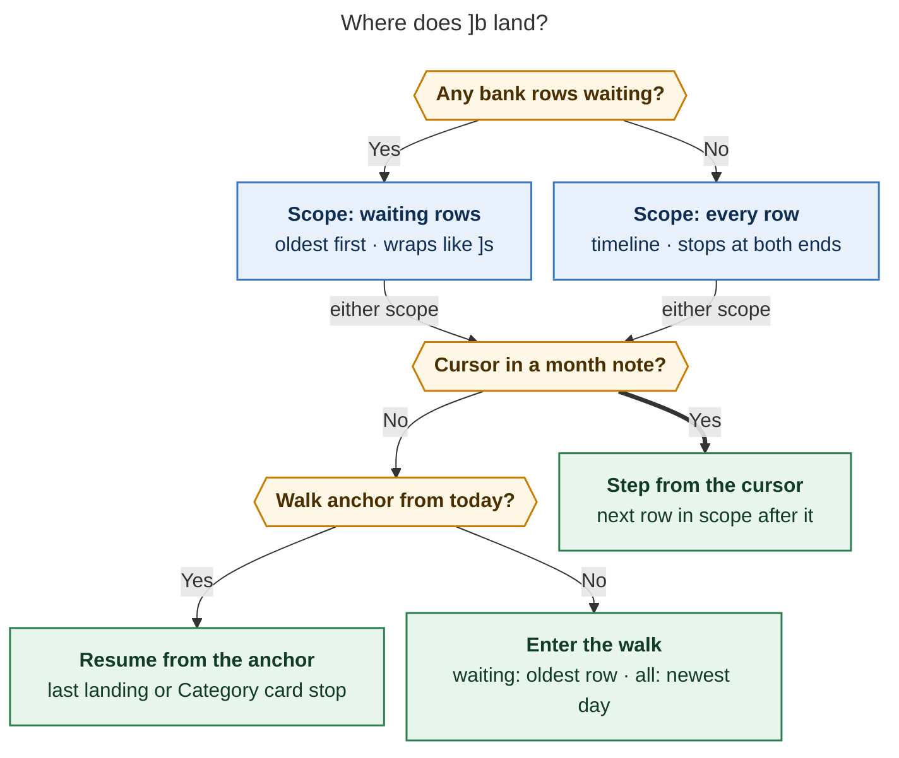
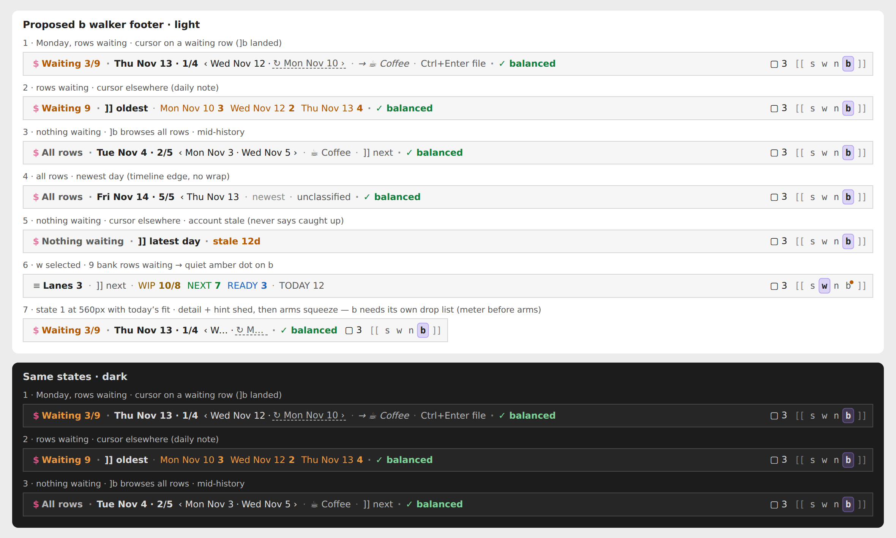

# `]b` / `[b` / `]B` / `[B`: a bank-row bracket walk with its own walker footer

Researcher **cld**, 2026-11-14. Independent report for the 5-researcher swarm.

**Code inspected:** bob-plugins `6a1778b` (bob-navigation-hotkeys, bob-ledger-tools,
task-status-cycler), bob-cli `11abff0b` (`docs/bank.md`,
`docs/guides/acknowledge-bank-transactions.md`, `src/native/bank/import_run.rs`), the live
vault's `obsidian_vimrc.md` and `bank/` folder (read-only, aggregate counts only), and the
`glossary:bank-row`, `glossary:bank-month-note`, `glossary:bank-badge`, and
`glossary:walker-footer` strands via audited `sase memory read`. Prior research I built on:
`202611/bracket_walk_footers` (final) and `202611/bank_weekly_category_walk` (final), read
via `sase artifact read`. Nothing here changes code, the vault, or memory.

**Privacy:** this report and its figures contain no amounts, payees, or account details.
The mockup uses invented, generic values.

## Bottom line

**Build it.** A bank walk fits Bob's bracket grammar exactly. It also fills a real gap:
today you reach a waiting bank row only by opening the month note by hand, clicking the
Bank Badge, or using the queue card. Once there, the Category card files rows inside that
one month. Nothing lets you *browse* the bank by row or by day from anywhere. `]b` fixes
both, and its footer gives the bank an honest place in the status bar:
`$ Waiting 3/9 · Thu Nov 13 · 1/4 · ‹ Wed Nov 12 · Mon Nov 10 › · → ☕ Coffee · Ctrl+Enter file · ✓ balanced`.

The request is sound, but it needs **five sharpening adjustments**. They are called out in
detail below:

1. **Direction slip.** The text maps `[b` to *next* and `]b` to *previous*. I keep
   `]b` = next and `[b` = previous, matching every other bracket walk and the request's own
   `[B` / `]B` sentence.
2. **`]B` / `[B` stay inside the active scope.** While rows wait, they jump between days
   *that have waiting rows*. This is how `]S` and `]W` jump between groups of their own
   walk.
3. **The two scopes behave differently at the edges.** Waiting rows are a work queue and
   wrap, like `]s`. All rows are a timeline and stop at the oldest and newest rows, like
   Vim's `]q`. Wrapping a timeline would jump from this week back to May.
4. **From outside the bank, the walk enters at "now."** With rows waiting, `]b` lands on
   the oldest waiting row. With nothing waiting, it lands on the newest day. It never
   lands on the oldest row in history.
5. **The footer always names its scope** (`Waiting` or `All rows`), never shows amounts or
   payees, and never says "caught up." It reports bob's account status instead.

**Architecture in one line:** bob-navigation-hotkeys gains a fourth bracket family `b`
(the keys, `]]` repeat, selector letter, and Vim counts). bob-ledger-tools, which already
owns everything bank, gains `api.bankWalk` v1: the snapshot, scope, planner, and landing.
It also gains the `b` panel of the existing walker-footer host. The keys and the footer
call the same planner, so they cannot disagree.

## What exists today (verified)

| Fact | Where | Consequence |
| --- | --- | --- |
| Three bracket families `s` / `w` / `n`, normalized by `normalizeBracketRepeatType`, persisted per device under `bob-navigation-hotkeys-bracket-repeat`; `]]`/`[[` and `]}`/`[{` dispatch through `BRACKET_REPEAT_PLANS` / `…_UPPERCASE_PLANS` | nav `546-plugin-bracket-repeat.js` | `b` is a fourth entry in each table plus normalization. No new mechanism needed |
| `[[ s w n ]]` selector: hard-coded `BRACKET_MODE_FAMILIES`, `segments.length === 3` checks, thumb at `--bob-bracket-index × --bob-bm-seg` | nav `547-bracket-mode-indicator.js` (911/1000 lines) | Appending `b` as index 3 keeps s/w/n where they are. The fragment is near the 1000-line cap, so the family table probably moves to its own fragment |
| `api.walkMode` v3: `current()`, `select()`, `links()`, `setAttention("s", …)` only; doorbell `bob-navigation-hotkeys:walk-mode` | nav `482-walk-mode-nav-api.js` | Needs v4 so `current()` may return `b`, `select("b")` works, and attention accepts `b` |
| Ledger maps any unknown family to `null`, which **hides** the panel | ledger `122-walker-footer-host.js` `walkerFooterWalkMode` | A new nav paired with an old ledger degrades safely: no panel, nothing wrong shown |
| Walker footer: one ledger status item. `s`/`w`/`n` routed in `updateFreshnessStatusBar`; production painter with icon, due, context, two **link arms**, detail, hint, groups, and meter; fit sheds groups → detail → hint → meter | ledger `240-plugin-freshness-status.js`, `121-freshness-footer-paint.js`, `123`/`124` | The `b` panel reuses the painter, and the `n` panel's arms become day arms. It needs its own drop list (see mockup case 7) |
| Lane walk precedent: ledger serves `api.laneWalk` v2 `queue()`; nav plans (cursor → anchor → tuple gap → default), wraps, honors Vim counts, serializes on `laneWalkChain`, and lands through `landOnWalkEntry` at `ch 0` | nav `542`/`544`, `541-walk-landing.js` | Copy the *behaviors*, not the split. Bank semantics live in ledger (below) |
| Pure bank recognizer: `bankScanSource(path, source)` gives days and rows (top-level checkbox and amount, under a valid day heading). Fences, children, stubs, and non-day sections are not rows | ledger `241i-plugin-bank-source.js` | The walk's row set should come from this recognizer, which already drives marks and the Category card |
| The Category card advances to the next waiting row **in the same month note** and wraps once (`bankCategoryNextWaiting`). It records `api.recordJump` and lands at the payee start. At the end of a run it names other months that still wait | ledger `246`/`248` | `]b` must share these eligibility rules and the payee-start landing, and must be the way to reach "other months" |
| Every bank navigation lands at the payee start (`bankCardNavigateRow` → `bankOpenMonthPathAtLine(path, line, payeeStart)`), flushing pending saves first | ledger `241m`, `241k` | `]b` lands in the same column, so the cursor never jumps sideways depending on how you arrived |
| Bank hue: the hub's `color:` frontmatter, default magenta (`bankCardRootHue`). Waiting rows use `--text-warning` on the badge and heat strip | ledger `241m`, `styles.css` | `$` glyph in the bank hue and waiting counts in warning ink: the same visual language as the badge |
| bob's contract: "`bob bank` never says you are caught up while an account is stale, has a gap, or shows a Δ." | bob-cli `docs/guides/acknowledge-bank-transactions.md` §6 | The footer's empty state must not say "clear." It says `Nothing waiting` and shows bob's status |
| Vault vimrc: `]s [s ]S [S ]w [w ]W [W ]n [n ]] [[ ]} [{` are mapped; **`]b [b ]B [B` are free** | `~/bob/obsidian_vimrc.md` | No collisions. The mappings are four `exmap` and four `nnoremap` lines |
| Import already teaches the next step: `Next: file the N waiting rows — Ctrl+Enter on each in bank/YYYY-MM.md …` | bob-cli `import_run.rs:1225` | A cheap, optional teaching hook: mention `]b` there |
| Live vault today: one month note, three day headings (two empty), 7 rows, **0 waiting** | `bob bank list -a -f json` (counts only) | Empty day headings exist in practice, so day jumps must skip them. With weekly imports (~31 rows/week median per prior research), rows wait about one day a week. **The all-rows timeline is the common case**, not an afterthought |

## Is this a good idea?

Yes, for four reasons:

1. **It completes the bank loop.** Monday import → `]b` (from anywhere) → Ctrl+Enter →
   the card files and advances → the end-of-run summary names October → `]b` takes you
   there. Today the "from anywhere" and "next month" steps are manual.
2. **It gives six days a week a purpose.** With nothing waiting, `]b` / `]B` turn the bank
   into a day-by-day timeline you can step through from any note. That is how you answer
   "what did I spend on Tuesday?" or audit categories with **Bank: set category**.
3. **It follows the house grammar.** Lowercase steps, uppercase jumps between groups,
   `]]` repeats, and the selector and footer explain it. Bryan already knows the
   grammar, so there is nothing new to learn.
4. **The footer is a useful bank instrument.** Waiting count, where you are, where `]B`
   goes, bob's suggestion for the row, and **whether the ledger balances**. That last one
   is the trust signal the weekly ritual ends on.

The risks, and how the design handles each:

- **A scope that changes on its own can surprise.** The same key walks waiting rows on
  Monday and every row on Tuesday. That is fine *only if it is visible*. The footer's
  first word is the scope (amber `Waiting` or calm `All rows`), and a single notice fires
  when the scope flips during a walk. The scope is recomputed from the same snapshot the
  footer paints, so the footer and the key always agree.
- **It overlaps the Category card's advance.** Both say "next waiting row." The design
  gives them one set of eligibility rules and one landing column. The card stays
  month-local, as already decided, and `]b` is the cross-month traveller.
- **The plugin parses rows; bob owns the grammar.** The recognizer already exists and
  drives marks and the card. The walk adds a parity test against
  `bob bank list -a -f json` over the shared fixture. bob stays the authority for
  suggestions, totals, and account status, and the footer only reads those.
- **A fourth family costs selector width and attention.** That is about 1.3 em and one
  letter. Appending `b` keeps the existing letters' positions and muscle memory.

## Requirement adjustments (called out)

| # | Request says | Adjusted to | Why |
| --- | --- | --- | --- |
| A1 | "`[b` and `]b` … next/previous, respectively" | **`]b` = next, `[b` = previous** | Every bracket walk (`]s`, `]w`, `]n`, `]]`) and the request's own `[B`/`]B` sentence use `]` = forward. I read the text as a slip |
| A2 | "bank transactions that need review" | **Exactly the waiting `[ ]` rows**, the same set bob counts as `waiting`. Flagged `⚑` and Unclassified rows don't trigger the waiting scope in v1 | One definition across badge, `bob bank list`, the card, and the walk. A `⚑` row means "look into," not "unfiled," and Space-filed rows are a deliberate answer |
| A3 | "saved to Obsidian (via `bob bank import`)" | **Every bank row, whatever its origin** (imported, matched, or typed). Never stops: plain checklist lines, `- [x] $` stubs, indented children, fenced lookalikes, invalid-status rows, rows outside a day | A hand-typed or cash-account row is still a transaction in the ledger. The excluded lines are exactly what bob and the card already ignore |
| A4 | "`[B`/`]B` … first bank row in the previous/next day" | **Day jumps stay inside the active scope.** While rows wait, they go to the next or previous *day with waiting rows* and land on its first **waiting** row. With nothing waiting, they go to the next or previous day *with rows*. Empty day headings are never stops. From mid-day, `[B` goes to the previous day, not to the start of this one | `]S` and `]W` jump between groups *of their own walk*. A literal calendar `]B` during filing would land on already-ticked rows, which are off-walk, and break the footer's position. Plain day browsing within a note is already `<C-j>`/`<C-k>` |
| A5 | (implicit) a mode switch | **The scope is always visible and announced once.** The footer leads with `Waiting r/N` or `All rows`. A notice fires only when the scope flips between steps (`Nothing waiting — ]b now walks every row`) | A hidden mode is the classic cause of surprise. Making it the first word in the footer turns it into an instrument |
| A6 | (unspecified) | **Edges differ by scope.** Waiting scope **wraps** (`↻` on the arm, a notice on the wrap). All-rows scope **stops** at the oldest and newest rows, with an edge notice and the selector's existing empty flash | A work queue cycles. A timeline doesn't, and wrapping from November to last May is a jump the user didn't ask for |
| A7 | (unspecified) | **Entering from outside a bank month note:** waiting → `]b` oldest waiting row, `[b` newest waiting row. All rows → the **newest day**: `]b` its first row, `[b` its last row. A same-day walk anchor resumes first | The waiting scope is FIFO, as on the badge and the queue card. The timeline should open at "now," never at the first row ever written |
| A8 | "their own walker footer" | **`b` becomes a full bracket family.** `]]`/`[[` repeat `]b`/`[b`; `]}`/`[{` repeat `]B`/`[B`; `N]b` and `N]B` take counts; the selector becomes `[[ s w n b ]]` | Bryan's footers are chosen *by the persisted family*, so `b` must be a family for its footer to exist |
| A9 | — | **The footer shows structure, not money.** It never shows amounts or payees (the status bar is always on screen, including in screen shares). It shows categories, counts, days, and bob's account status | The row under the cursor already shows the money. The status bar is the wrong place to repeat it |
| A10 | — | **Navigation never writes and never opens the Category card.** Ctrl+Enter stays the single filing gesture. Landings go to the payee start, like the card, badge, and queue | A modal opening on every step would make browsing impossible. Writes stay explicit |
| A11 | — | **No per-step toast while the footer is visible.** Notices appear only for transitions: scope flip, crossing into another month (`→ October 2026`), wrap, edge, unavailable. On mobile, or with an older ledger, each step shows a compact toast instead | `]b` during browsing would otherwise drop a toast per keypress. The footer already carries the position |
| A12 | — (optional, phase 4) | **A quiet amber dot on the selector's `b`** while rows wait and another family is selected | Unlike lanes, which are never empty, bank waiting is normally zero, so the dot carries information rather than becoming wallpaper. Import → dot appears → `]b`. It costs a `setAttention` v4 member |

## Design

### The walk

**Rows and order.** Scope entries are recognizer rows with status `[ ]`, `[x]`, or `[X]`
under a valid day heading, sorted by `(date, path, line)`. Duplicate headings for one date
merge into one day group. Out-of-order headings still produce chronological order, and
`bob bank check` already warns about them.

**Scope.** `waiting` when any waiting row exists anywhere in the vault, otherwise `all`.
It is recomputed on every keypress and every paint from the same immutable snapshot.

**Origin** (the figure below): the cursor inside a bank month note (on a row, a heading,
or between rows, as a `(date, path, line)` tuple). Otherwise, today's walk anchor, set by
the last `]b` landing or a Category card advance. Otherwise, the entry rules in A7.



*Figure 1. The scope is decided first, from vault state, and the origin second, from where
you are. Inside a month note the cursor always wins, which is why the Category card and
`]b` hand off to each other without any shared state. Rendered with Mermaid CLI 12.0.0 at
735.6 × 936 px, 88.7% fit (`bank_row_bracket_walk__cld_routing.svg`).*

**Keys.**

| Key | Waiting scope (rows wait) | All-rows scope (nothing waits) |
| --- | --- | --- |
| `]b` / `[b` | next / previous waiting row, chronological; wraps | next / previous row; stops at newest / oldest |
| `]B` / `[B` | first waiting row of the next / previous day *with waiting rows*; wraps | first row of the next / previous day *with rows*; stops |
| `N]b`, `N]B` | N steps (wrap counts as steps) | N steps, clamped at the edge |
| `]]` `[[` / `]}` `[{` | repeat `]b` `[b` / `]B` `[B` while `b` is the family | same |
| From outside | `]b` oldest waiting, `[b` newest waiting | `]b` first row of the newest day, `[b` newest row |

**Landing.** The month note opens in the active leaf through the existing bank opener,
which flushes pending saves and uses nav's `openFileInActiveLeaf`. The cursor lands at
the **payee start**, and the jump is recorded with nav `api.recordJump`, so `Ctrl+O`
returns. The row is re-resolved by `^bank-` ID first, then by exact line text at the
expected line, then by unique text within the same day section. If that fails, the walk
re-snapshots and re-plans once, then shows `Bank walk changed — try again`. A soft row
flash on a cross-file landing helps the eye find the row (the yank-flash idiom, off under
`prefers-reduced-motion`).

### The `b` walker footer



*Figure 2. The proposed `b` panel, painted by the **production** `freshnessFooterPaint`
and bracket selector with production CSS from bob-plugins `6a1778b`, plus about 15
proposed CSS lines. Headless Chromium, DejaVu fonts (no color emoji), invented values.
The `b` letter is appended to the real selector, and case 6 shows the amber attention
dot. Case 7 shows a real finding: at 560 px, today's generic fit squeezes the day arms
before it sheds the meter. The `b` panel needs its own drop list.*

**Anatomy.** Same slots and order as the other panels:

| Slot | Content | Notes |
| --- | --- | --- |
| Glyph + position (button = `]]`) | `$ Waiting 3/9` · `$ Waiting 9` · `$ All rows` · `$ Nothing waiting` | `$` in the bank hue. `Waiting` in warning ink. Positions are queue membership, never progress |
| Current group | `Thu Nov 13 · 1/4` (position within the day's scope rows); off-row: `]] oldest` / `]] latest day` / `]] next` | The hint names where `]]` actually goes |
| Day arms (buttons = `[B` / `]B`) | `‹ Wed Nov 12` · `Fri Nov 14 ›`; a wrap shows as `↻ Mon Nov 10 ›` (dashed); an edge shows `newest` / `oldest` | The `n` panel's link arms, reused. Same planner as the keys |
| Detail | waiting row: bob's suggestion `→ ☕ Coffee` (italic; source in the tooltip), or its `[cat::]` if already set, or `no suggestion`; ticked row: `☕ Coffee` / `unclassified`; `⚑` prefix when flagged | Shown only when bob JSON matches the row by ID. Missing data is omitted, never invented |
| Hint | `Ctrl+Enter file` on a waiting row, otherwise omitted | Teaches the one filing gesture |
| Groups | off-row in the waiting scope: waiting per day, oldest first (`Mon Nov 10 3 · Wed Nov 12 2 · …`) | The off-row counterpart of the arms |
| Meter | bob's worst account status: `✓ balanced`, `Δ delta`, `gap`, `stale 12d`, `unverified` | The ritual ends on this. Green ✓ only when bob says `balanced` |

**States.**

| State | Reads |
| --- | --- |
| Rows wait, cursor on a waiting row | `$ Waiting 3/9 · Thu Nov 13 · 1/4 · ‹ Wed Nov 12 · ↻ Mon Nov 10 › · → ☕ Coffee · Ctrl+Enter file · ✓ balanced` |
| Rows wait, cursor on a ticked row in a month note | `$ Waiting 9 · Thu Nov 13 · ‹ … · … › · ☕ Coffee · ]] next waiting` (no fraction, because the row isn't in scope) |
| Rows wait, cursor elsewhere | `$ Waiting 9 · ]] oldest · Mon Nov 10 3 · Wed Nov 12 2 · Thu Nov 13 4 · ✓ balanced` |
| Nothing waits, cursor on a row | `$ All rows · Tue Nov 4 · 2/5 · ‹ Mon Nov 3 · Wed Nov 5 › · ☕ Coffee · ✓ balanced` |
| Nothing waits, newest day | `… · ‹ Thu Nov 13 · newest · …` |
| Nothing waits, cursor elsewhere | `$ Nothing waiting · ]] latest day · ✓ balanced` (or `stale 12d` in warning ink, never "clear") |
| No bank yet | `$ No bank rows · bob bank import` |
| Index not built yet | hidden: loading is never shown as a success-looking zero |

**Tooltip** (the full sentence; still no money or payees):

```text
Waiting 3 of 9 · Thu Nov 13 — 1 of 4 waiting that day
→ ☕ Coffee — learned from your last filing of this merchant
Ctrl+Enter opens the Category card (↵ accepts)
Waiting by day: Mon Nov 10 3 · Wed Nov 12 2 · Thu Nov 13 4
WF Checking ✓ balanced through Nov 12
]b / [b step waiting rows · ]B / [B jump days · ]] / [[ repeat
When nothing waits, ]b walks every row.
```

**Drop order** as the bar narrows: groups → detail → hint → meter → arm labels go compact
(`‹ Wed 12`) → bare `‹` / `›`. The glyph, scope and position, and current day are never
dropped.

**Motion and access.** Reuse the panel crossfade (`data-walker-panel="b"`, 120 ms, off
under reduced motion), with no animation on count changes. The arms are real buttons with
`aria-label` "Jump to previous bank day: Wed Nov 12". The scope is carried by its word,
never by amber alone. Use tabular numerals and `Highlight` under forced colors.

### Fitting with the rest of the bank

- **Category card.** Unchanged gesture. Its next-waiting search reuses the bank-walk
  planner, restricted to the note, so eligibility rules cannot drift. Each card advance
  updates the walk anchor. The end-of-run summary adds `]b → October 2026 (3 waiting)`
  when other months wait.
- **Bank Badge and queue card.** Unchanged, and they never select the `b` family. Only
  bracket commands and selector clicks select a family, an existing rule.
- **`bob bank import` (optional, bob-cli).** The `Next:` line can read
  `Next: file the 9 waiting rows — ]b in Obsidian, then Ctrl+Enter on each (or bob bank to list them).`

## Architecture and contract

**Ownership:** *nav owns keys and families; ledger owns the bank.* This differs from the
lane walk, where nav plans, and the difference is deliberate. The bank's grammar,
recognizer, landing column, pending-save opener, card, badge, marks, and bob JSON caches
all live in ledger. The footer must show exactly where `[B` and `]B` go. If the planner
lived in nav, ledger would have to call across plugins on every cursor move, or nav would
have to copy bank grammar. With the planner in ledger, the keys and the footer call the
same function.

```js
// bob-ledger-tools api.bankWalk v1 (additive namespace, like api.laneWalk)
bankWalk: {
  version: 1,
  snapshot(),   // immutable {available, reason, generation, scope: "waiting"|"all",
                //   wrap, entries[{key, id, path, line, text, date, payeeCh,
                //   acknowledged, rank, total, dayRank, dayTotal}], days[], counts}
  preview(),    // where ]b [b ]B [B would land from the current cursor — footer only
  step({ direction, dayJump, repeat }),
                // → Promise<{ok, reason, entry, scope, wrapped, edge,
                //            scopeChanged, crossedMonth}>; lands and records the jump
}
```

**bob-navigation-hotkeys** (about 250 lines plus tests):

- `normalizeBracketRepeatType` accepts `b`. Add `b` rows to `BRACKET_REPEAT_PLANS`
  (`jumpToBankRow(±1)`) and the uppercase plans (`{ dayJump: true }`).
- Four commands: `jump-to-next-bank-row`, `jump-to-prev-bank-row`,
  `jump-to-next-bank-day`, `jump-to-prev-bank-day`. Each runs
  `rememberBracketRepeatType("b")`, consumes the pending Vim count, calls ledger
  `bankWalk.step`, and serializes on a promise chain. Without the API it shows
  `Bob Ledger Tools bank walk api required`.
- Selector: append `b` ("bank walk", tooltips `]] / [[ repeat the bank walk (]b / [b)`
  and `]} / [{ jump to the next / previous bank day (]B / [B)`). Replace the
  `length === 3` checks. Update both empty notices ("press ]s, ]w, ]n, or ]b first").
- `api.walkMode` v4: `current()` may return `b`, `select("b")` works, and
  `setAttention("b", …)` is accepted.

**bob-ledger-tools** (about 1,000 lines plus tests):

- **Index:** scan every `bank/YYYY-MM.md` with `bankScanSource`, memoized by path and
  mtime. Invalidate on the existing `bankHandleFileEvent` vault and metadata events.
  **Overlay any open editor** holding a bank month note, so a hand-ticked, unsaved row is
  already out of the waiting scope. Navigation never spawns `bob`, so the walk also works
  on mobile and offline.
- **Planner:** a pure fragment (scope, origin, steps, day jumps, wrap or edge, counts)
  with Node unit tests.
- **Footer:** `walkerFooterWalkMode` accepts `b` (walkMode ≥ 4). Add a `b` route in
  `updateFreshnessStatusBar` and `freshnessStatusClicked`. Add a `bankWalkerFooterView`,
  map the painter's `walkerPanel` to `b`, generalize the link arms into "arms," add a `b`
  drop list, and add about 40 CSS lines. Bob-owned detail (suggestion and account status)
  comes from the existing `api.bank.fetch({command: "list"})` stale-while-revalidate
  cache. It is fetched only while `b` is the selected family and matched by `^bank-` ID
  (`bankCategoryMatchJsonRow`).

**Reliability invariants**

1. **One snapshot per keypress and per paint.** Scope, positions, counts, and arms all
   come from the same immutable snapshot.
2. **Keys and footer share one planner.** `preview()` is `step()` without the landing.
3. **The editor buffer beats the disk.** Open bank editors overlay the cached reads.
4. **Landing is identity-based.** Resolve by ID, then line and text, then unique text
   within the day. Re-plan once on a stale result, then refuse with a notice. Never land
   on a guess.
5. **Navigation never writes.** No ticks, no categories, no card, no `bob` process on the
   key path.
6. **Loading is not empty.** Before the first index, keys say
   `Bank walk unavailable — still indexing` and the panel stays hidden.
7. **Steps run one at a time.** A held `]b` key repeat cannot race two landings.
8. **Parity with bob.** A golden-JSON fixture asserts the recognizer's rows and waiting
   flags equal `bob bank list -a -f json` over the shared month fixture.
9. **Versions degrade safely.** A new nav with an old ledger shows no panel and the keys
   report the missing API. An old nav with a new ledger never sees `b`. Each plugin ships
   and rolls back alone.

## Alternatives considered (and rejected)

| Alternative | Why not |
| --- | --- |
| No new family: add Tab / Shift+Tab "skip" to the Category card plus a "Bank: open oldest waiting" command | Covers filing only. No timeline browsing, no footer, and it breaks the bracket grammar Bryan uses for every other walk |
| Back the walk with `bob bank list -f json` on every keypress | 100+ ms process spawn per key, blind to unsaved edits, and unusable on mobile. bob stays the source for suggestions and status, which aren't needed on the key path |
| `]b` opens the Category card on waiting rows | A modal on every navigation step makes browsing impossible. Ctrl+Enter is one key away |
| Two families (`]b` waiting only, `]$` all rows) | Doubles the keys to remember. One family with a visible, announced scope is simpler |
| Nav plans and lands, copying the lane walk exactly | Nav would need to learn bank grammar, and the footer could drift from the keys. Ledger already owns every bank primitive |
| Wrap in the all-rows scope | Jumps across the timeline (newest → oldest) |
| Literal calendar `]B` even while rows wait | Lands off-walk during filing. See A4. Kept as the main alternative for Bryan to overrule |
| Make bank rows a tier of the `]s` review | Bank rows are not tasks: no freshness, no stamps, no lanes |

## Implementation plan

Each phase ships on its own, and the safe fallbacks keep each one harmless alone.

1. **ledger `api.bankWalk` v1:** index and overlay, pure planner, `step` and landing.
   Add a new `test-ledger-tools-bank-walk.cjs` covering both scopes, wrap and edges, day
   jumps over empty and duplicate headings, counts, the three origin kinds, anchor
   freshness, unsaved-overlay ticks, duplicate-text ID-less rows, stubs, fences,
   children, cross-month steps, and the bob parity fixture.
2. **nav `b` family:** commands, plans, selector letter, walkMode v4, notices. Extend
   `test-navigation-bracket-repeat.cjs` and `test-navigation-bracket-mode-indicator.cjs`
   (four letters; s/w/n rects unchanged). **Vault:** add four `exmap` and four
   `nnoremap` lines to `obsidian_vimrc.md` and update the `]]` / `]}` comments.
3. **ledger `b` panel:** view model, route, arms, drop list, CSS, and click routing.
   Extend `test-ledger-tools-walker-footer.cjs`, `scripts/preview-walker-footer.cjs`
   (every state, both themes, three widths), and `obsidian-walker-footer-e2e`. Check on
   the Mac that `]b` swaps the panel within a frame and the selector rect stays fixed.
4. **Integration polish:** the card shares the planner and updates the anchor, the
   end-of-run summary names `]b`, the optional `b` attention dot, and the optional
   `bob bank import` `Next:` line (bob-cli).
5. **Docs and memory:** bob-plugins `docs/bob-navigation-hotkeys.md` (Bracket repeat table
   and `[[ s w n b ]]`) and `docs/bob-ledger-tools.md` (walker footer and bank
   sections); bob-cli `docs/bank.md` and guide §2. Amend `glossary:walker-footer` to four
   members (it currently says "three members … `s` / `w` / `n`"), and add a sentence about
   the walk to `glossary:bank-row`, both through `/sase_memory_write`. Then run
   `npm run docs:check` and `bob plugins sync`.

There is no release-train impact unless phase 4's optional `Next:` line ships, which is a
human-output-only change in bob-cli.

## Open questions for Bryan

1. **`]B` while rows wait:** jump between *waiting days* (recommended, A4) or between
   literal calendar days?
2. **All-rows edges:** stop at the newest and oldest rows (recommended) or wrap like the
   other walks?
3. **The `b` attention dot** (A12): add it (recommended, amber, phase 4) or rely on the
   badge and weekly chore?
4. **Glyph:** `$` (recommended: monochrome, matches row grammar, sits well beside `⟳ ≡ ⇄`)
   or `🏦`?
5. **Decision record:** record "bank walk scope follows waiting rows; timeline stops at
   edges," or keep it to docs and glossary?

## Recommended solution

Add **`b` as the fourth bracket family**, mapped as `]b` / `[b` (next / previous row) and
`]B` / `[B` (next / previous day), with `]]` / `[[` and `]}` / `[{` repeating them and
the selector reading `[[ s w n b ]]`. The walk has one rule, visible at all times. While
any bank row is waiting, it walks only waiting rows, oldest first, wrapping like `]s`.
Otherwise it walks every row as a timeline that opens at the newest day and stops at
both ends. Uppercase keys jump between days of that same scope.

**bob-ledger-tools** owns the walk through a new `api.bankWalk` v1. It is built from the
existing bank recognizer with live-editor overlays, plans with one pure planner shared by
the keys and the footer, and lands at the payee start with a `Ctrl+O` jump, exactly
where the Category card, badge, and queue card land. **bob-navigation-hotkeys** adds the
four commands, the family, the selector letter, Vim counts, and `api.walkMode` v4.

The new **`b` walker footer** leads with its scope (amber `Waiting 3/9` or calm
`All rows`) and shows the current day, the day arms `‹ Wed Nov 12 · Fri Nov 14 ›` that
`[B` / `]B` will take, bob's suggestion for a waiting row, `Ctrl+Enter file`, and bob's
account status. It never shows money or payees, and it never claims "caught up" while bob
says otherwise. Navigation never writes, never opens the card, and never runs `bob`.
Ship it in the five phases above, with the parity fixture and the real-Obsidian check as
the gates.
