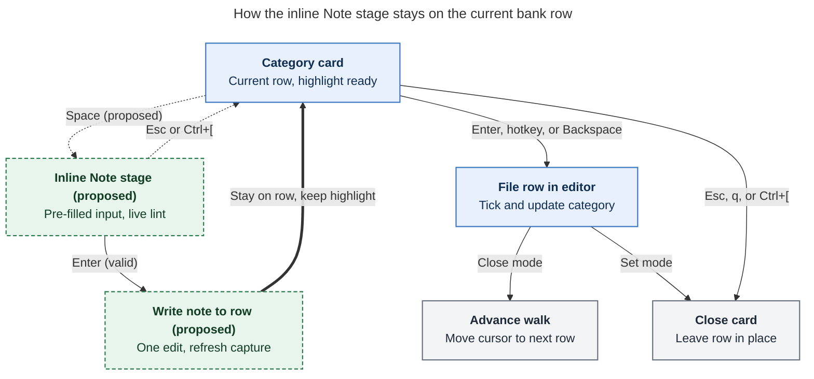

# Designing In-Flow Bank Row Notes for the Category Card

**Date:** 2026-11-21
**Scope:** `bob-plugins` (`bob-ledger-tools`, `bob-navigation-hotkeys`) and `bob-cli` (`src/native/bank/`, `docs/bank.md`)
**Researcher:** `gem`

---

## 1. Executive Summary

**Verdict: Yes — adding an in-flow note prompt to the Bank Category card that writes to the current row without advancing the walk is a strong, high-leverage idea.** The core interaction fits Bob's bank architecture cleanly: `bob-cli` already has first-class inline row notes (`— <note>`), `BankCategoryCardModal` already uses an inline stage pattern (`+` New category and `/` Subscription picker), and staying on the same row preserves the natural morning-review cadence (*clarify purchase → categorize* or *clarify purchase → defer*).

However, inspecting `bob-cli` and `bob-plugins` revealed **one major keymap collision**, **four latent parser/editor bugs** that would break this feature if unaddressed, and **a major visual opportunity**:

1. **Critical keymap collision:** `<Space>` is **not unbound** — it is already bound across `BankCategoryCardModal` to **no category** (`close` mode), **remove category** (`set` mode), and **acknowledge** (the sole action in offline/restricted mode).
2. **Four hidden technical traps in today's code:**
   - `241o-plugin-bank-marks-model.js` computes `noteSpan` *excluding* the `—` delimiter, runs it to end-of-tail (overlapping any tokens after `—`), and strips every single `!` (diverging from Rust `grammar.rs`, which only strips `!!`).
   - `241hc-plugin-bank-subscription.js` inserts `[[subscriptions/<stem>|🔁]]` right before `^bank-<hex>`, which lands *after* an existing `— <note>`.
   - `241o` / `241p` MathJax protection only guards `$` inside `token.amount`, so typing `$20` inside a note can corrupt adjacent bank rows into broken LaTeX.
   - `246-plugin-bank-category-card-write.js` refuses edits on ID-less typed rows if `capture.lineText` changes, and `247-plugin-bank-category-card-ui.js` stops applying in-flight suggestions if `didInteract` flips true — so staying on the row after a note edit requires refreshing `modal.context` *without* setting `didInteract`.
3. **Unexploited visual win:** Bank Marks (`241p` Live Preview and `241q` Reading view) styles amounts, categories, accounts, flags, subscriptions, and `bank ✓` IDs, but **leaves inline `— <note>` completely unstyled plain text**. Because every metadata token on a bank row is already a rounded `999px` pill, styling notes as **editorial marginalia** (Bob's signature accent left-hairline + subtle surface wash + muted prose) makes notes unmistakable and calm without creating "pill soup".

### Recommended Solution in One Paragraph

Keep **`<Space>`** for the new inline **Note stage** inside `BankCategoryCardModal` (honoring thumb ergonomics and eliminating a destructive muscle-memory trap), and relocate **no category / remove category** to **`Backspace`** (aliased to `Delete` and `Ctrl+D`, matching Bob's clear-property idiom) while promoting **`Enter`** to acknowledge in offline/restricted mode. Store notes in the canonical inline **`— <note>`** position (`[cat::] [acct::] [[links]] ⚑ — <note> ^bank-<hex>`), pre-fill existing notes for editing, remove cleanly when cleared, lint grammar hazards (`#task`, `::`, `⚑`/`!!`, `—`/`--`, trailing `^id`) live, refresh `modal.context` in place without ticking or advancing, and render notes consistently as **editorial marginalia** in Month Notes (Live Preview + Reading view), in a quiet header strip on the Category card, and as truncated snippets in the Queue card. Add a lightweight **`Bank: edit note`** command that opens the same inline Note stage directly on already-acknowledged rows.

---

## 2. Critique of the Proposed Plan

### 2.1 What Works Brilliantly

- **Matches the exact moment of recall:** Purchase context fades fast. Remembering that a vague `$47.82 Target` row was *"Mom's birthday wrap + card"* happens while reviewing that row in the morning — not later when scanning a monthly total. Prompting in-card avoids breaking out of the Category card into Vim Insert mode (`Esc` → `$` → `i` → ` — ...` → `Esc` → `Ctrl+Enter`).
- **Stay-on-row is the right workflow rule:** A note clarifies *what* a charge is; categorizing decides *where* it belongs. Staying on the same row lets you execute two distinct flows cleanly:
  1. **Annotate then file:** `<Space>` → type note → `Enter` → see note confirmed in header → `Enter` (accept suggestion) or 1-letter category key → advances to next waiting row.
  2. **Annotate and defer:** `<Space>` → type `"check receipt w/ Alex"` → `Enter` → `Esc` → row remains `[ ]` waiting with the reminder attached for tomorrow's walk.
- **Zero ownership conflict with `bob-cli`:** Per `docs/bank.md` (*Ownership*, lines 345–354), `bob` writes a row once on import and afterwards only toggles `[ ]`→`[x]` (`ack`) or appends `^bank-<hex>`. The Category card already owns direct user edits in the active Obsidian editor (`248-plugin-bank-category-card-actions.js:1-2`). Adding a note requires no `bob` subprocess call, zero vault lock wait, and works offline.
- **Reuses existing canonical grammar:** `docs/bank.md` (lines 313–326) and `src/native/bank/grammar.rs` (lines 373–454) *already* define and parse `— <note>` into `BankRow.note`, serialize `"note"` in `bob bank list/report -f json` (`src/native/bank/model.rs:293`), and print `  — {note}` in `bob bank list` CLI output (`src/native/bank/output.rs:179-183`).

### 2.2 Critical Friction #1: `<Space>` Is Already Bound (and Offline-Critical)

The prompt proposes *"a new `<space>` keymap in the bank row category picker panel."* In the current codebase, **`Space` is already taken** in three places:

| Mode | Current `<Space>` Behavior | Source Citation |
|---|---|---|
| `close` (waiting row) | Ticks `[x]` **with no category** (Unclassified) and **advances** to the next waiting row | `245-plugin-bank-category-card-model.js:277-279`; `247-plugin-bank-category-card-ui.js:409-410`; `docs/guides/acknowledge-bank-transactions.md:67` |
| `set` (**Bank: set category**) | **Removes** `[cat:: key]` from the row and closes the modal | `246-plugin-bank-category-card-write.js:140-148`; `248f-plugin-bank-category-new-model.js:124` |
| `restricted` (`bob` unreachable) | **Sole way to acknowledge** a waiting row (`"␣ acknowledge · esc cancel"`) | `248f-plugin-bank-category-new-model.js:121-122`; `247-plugin-bank-category-card-ui.js:659-660` |

Additionally, every `[a-z0-9]` key except `q` (reserved per `decisions:q-and-ctrl-bracket-mirror-esc`) is claimable by user-configured `bank.categories` hotkeys (`src/native/bank/config.rs`). That is why the two existing inline stages use punctuation: `+` / `=` (`245:280`) for New category and `/` (`247:380`) for Subscription picker.

This forces a deliberate keymap choice between two credible designs:

| Criterion | Option A (Recommended): `<Space>` = Note; `Backspace` / `Ctrl+D` = No/Remove Category; restricted `Enter` = Acknowledge | Option B (Conservative): Keep `<Space>` = No/Remove Category; Bind `-` (dash) = Note |
|---|---|---|
| **Ergonomics** | Best possible: thumb-accessible Spacebar for the frequent, reflective action of leaving a note. | Pinky stretch to `-` (top-right, next to `+`/`=`). |
| **Error asymmetry** | **Safe failure mode:** if muscle memory hits `Space` wanting Unclassified, it opens an empty Note input without modifying the file; `Esc` backs out and the keybar shows `⌫ no category`. | **Destructive failure mode:** since Bryan already thinks of `Space` as "add note", a reflexive `Space` immediately ticks the row Unclassified and jumps to the next row. |
| **Semantic fit** | `Backspace` / `Delete` / `Ctrl+D` naturally means *"clear/remove category"* in `set` mode and *"file with no category"* in `close` mode — matching Bob's `Ctrl+D` clear/hide idiom (e.g., Relation Card, Bank Setup). | `-` is a strong mnemonic for `— <note>` and mirrors punctuation stages (`+`, `/`). |
| **Offline / restricted mode** | **Upgrade:** `Enter` (currently a no-op in restricted mode) acknowledges the row, while `Space` *also* lets you add notes offline. | Unchanged (`Space` acknowledges; `-` adds note offline). |
| **Compatibility cost** | **Breaking keymap change:** requires updating `docs/bank.md`, `docs/guides/acknowledge-bank-transactions.md`, `test-ledger-tools-bank-category-card-ui.cjs:72-74`, and E2E tests. | Zero breaking changes to docs, tests, or muscle memory. |

**Recommendation:** Choose **Option A** — give `<Space>` to Note and move no-category/remove-category to `Backspace` (aliased to `Delete` and `Ctrl+D`). The fact that Bryan explicitly wrote *"a new `<space>` keymap"* is strong behavioral evidence that filing Unclassified via `Space` is rare (especially now that `+` lets him create missing categories in place), whereas leaving a quick clarification note happens regularly. If Bryan still wants strict muscle-memory continuity on `Space`, **Option B (`-`)** is the cleanest fallback — never an alphanumeric letter, which would collide with category hotkeys.

### 2.3 Critical Friction #2: Annotating Already-Acknowledged Rows & Revisit Workflows

The prompt focuses on the morning walk (waiting rows, where `Ctrl+Enter` opens the Category card in `close` mode). Two adjacent moments also come up in practice:

1. **Already-acknowledged (`[x]`) rows:** Pressing `Ctrl+Enter` on a ticked bank row unticks it in place without opening the Category card (`plugins/task-status-cycler/src/192-bank-row-guard.js`). Today, the only way to reopen the Category card on a ticked row is **Bank: set category** (`mode: "set"`). Making the Note stage work identically in both `close` and `set` modes covers that path automatically.
2. **Direct note edit without category tiles:** Sometimes you spot a ticked row in `bank/2026-11.md` and just want to add or fix its note without thinking about categories. Adding a lightweight companion command **`Bank: edit note`** (`bank-edit-note`) that opens `BankCategoryCardModal` directly into `noteStage` (and closes on save when invoked standalone) reuses 100% of the stage code and editor safety checks at almost zero cost.

### 2.4 Critical Friction #3: Right-Sizing Inline Notes vs Other Row Annotations

Not every purchase annotation belongs in an inline `— <note>`:

- **Inline `— <note>` (this feature's sweet spot):** Short 3–15 word clarifications — *"birthday gift for Mom"*, *"split w/ Alex (owes $22)"*, *"reimbursable team lunch"*, *"annual domain renewal"*. Concise, single-line, searchable via `bob bank list`, visible in JSON and cards.
- **Flag (`⚑` / `!!`):** Signals follow-up needed (unexpected charge, pending refund, dispute). Notes and flags compose naturally (`⚑ — double-charged, called support`), so the note writer **must preserve `⚑`** and never strip or clobber it.
- **Indented child bullets (`  - ...`):** Already documented in `docs/bank.md:309` as free notes ignored by `bob`. Best left for rare multi-line itemized receipts or long breakdowns; keeping the prompt single-line prevents accidental multi-line sprawl in the ledger.
- **Payee text (`Smashburger`):** Feeds merchant cleaning and learned suggestions (`src/native/bank/naming.rs:30-96`). Keeping clarifications strictly in `— <note>` guarantees merchant learning stays pristine.

### 2.5 Four Hidden Technical Traps in Today's Codebase

Deep inspection of `bob-cli` and `bob-plugins` uncovered four concrete issues that would cause subtle bugs if a note feature were bolted on naively:

1. **`241o` `noteSpan` boundary & `!`-stripping bug (`241o-plugin-bank-marks-model.js:163-177`):**
   - Line 165 runs `.replace(/[⚑!]+/g, "")`, stripping **every single `!`** from notes (`"Great deal!"` → `"Great deal"`), whereas Rust `src/native/bank/grammar.rs:504` only strips `"!!"` (double-bang flag shorthand).
   - Lines 174–176 set `noteSpan = bankSpan(origin + noteStart, origin + raw.length, raw.slice(noteStart))`. This has two defects:
     - It starts *after* `—` / `--`, leaving a raw orphaned `—` in front of any Live Preview replacement widget.
     - It extends unconditionally to `origin + raw.length`, overlapping any `[cat::]`, `[acct::]`, or `[[link]]` positioned after `—` — which causes CodeMirror's `RangeSetBuilder` (`241p:380-382`) to drop decorations when ranges overlap!
2. **Subscription linker appends *after* existing notes (`241hc-plugin-bank-subscription.js:498-500`):**
   - `bankSubscriptionLinkWritePlan` inserts `[[subscriptions/<stem>|🔁]]` at `token.bankIdSpan.start` (or `raw.length`). If a user adds a note first (`— annual plan ^bank-abc`) and then presses `/` to link a subscription, the row becomes `— annual plan [[subscriptions/foo|🔁]] ^bank-abc` — visually awkward and causing the span-overlap bug above.
3. **MathJax `$` vulnerability inside notes (`241o:180-191, 224` & `241p:354-362`):**
   - Bank Marks wraps dollar signs with `BankDollarWidget` (Live Preview) and `bankProtectMathInElement` (Reading view) so Obsidian doesn't render pairs of `$` across transactions as LaTeX.
   - However, `bankAmountDollarOffsets` only collects `$` inside `token.amount` (`241o:180-191`). If a user writes a note like `— split $25 with Alex` or `— $5 tip + $18 lunch`, those unprotected `$` characters can pair up and corrupt the row (or adjacent rows) into MathJax!
4. **Stay-on-row capture drift & async suggestion drop (`246:50-102`, `247:262, 401`, `248:126`):**
   - On hand-typed (ID-less) rows, `bankCategoryResolveForCommit` checks `raw !== capture.lineText` (`246:89`). Writing a note changes `raw`, so unless `modal.context` (`capture.lineText`, `token`, `cardRow.note`) is refreshed immediately after the note write, the very next category keypress fails with `BANK_CATEGORY_WRITE_REFUSAL` (`"Bank: the row changed — nothing written"`).
   - `247:401` sets `this.didInteract = true` before dispatching actions from `bankCategoryResolveCardKey`. If a user opens a cold-cached card and immediately presses `<Space>` while `apiBankRefresh` is still in flight, setting `didInteract = true` silently discards the arriving learned category suggestion (`248:126`, `247:262`)! Note editing is orthogonal to category choice, so opening/saving the Note stage must **not** flip `didInteract` (just as `/` subscription picker bypasses line 401 at `247:380-384`).

---

## 3. Storage & Row Grammar Design

### 3.1 Storage Alternatives Evaluated

| Option | Parses in `bob bank` JSON & CLI? | Preserves line numbers & single-line undo? | `bob bank check` clean? | Visual & Plain-Text Ergonomics | Verdict |
|---|---|---|---|---|---|
| **Inline `— <note>`** | **Yes** (`row.note` already wired in Rust & JS) | **Yes** (single line) | **Yes** (canonical grammar) | Clean in Source mode; pairs cleanly with Bank Marks editorial styling | **Recommended** |
| Indented child bullet (`  - ...`) | No (`grammar.rs` ignores children) | No (shifts every line below) | Yes | Doubles row height for 4-word notes; best reserved for manual itemized receipts | Reject for prompt |
| Inline field (`[note:: ...]`) | No (`extra_fields`) | Yes | **No** (`bank_field_unknown` warning) | Noisy in Source mode; conflicts with `]` inside note prose | Reject |
| Sidecar / frontmatter store | No | Yes | N/A | Violates Markdown-as-source-of-truth; invisible in plain text & grep | Reject |

### 3.2 Canonical Tail Order & Token Anatomy

`src/native/bank/grammar.rs` accepts tail tokens in any order, but **writers should emit one canonical order** so rows stay readable in Source mode and decoration spans never overlap:

```text
- [ ] $13.71 Smashburger [cat:: dining] [acct:: card] [[subscriptions/foo|🔁]] ⚑ — birthday lunch w/ Kelly ^bank-8f3a2c1d
  │     │         │            │              │                  │             │  └──────────┬───────────┘       │
  │     │         │            │              │                  │             │       noteFullSpan         bankIdSpan
  │     │         │            │              │                  │             └─ flagSpan (pill)          (bank ✓)
  │     │         │            │              │                  └─ links (sub/eat chip)
  │     │         │            │              └─ account (pill)
  │     │         │            └─ category (pill)
  │     │         └─ payee (clean for naming.rs / learned suggestions)
  │     └─ amount (tabular-nums, MathJax-protected)
  └─ checkbox (untouched by note edits)
```

**Canonical rule:** Structured tokens (`[cat::]`, `[acct::]`, `[[links]]`, `⚑`) precede `— <note>`, which precedes the trailing block ID (`^bank-<hex>` or custom `^id`).

Accordingly, **`bankSubscriptionLinkWritePlan` (`241hc:498-500`)** should be updated to insert `[[subscriptions/<stem>|🔁]]` before `token.noteFullSpan.start` when a note exists (falling back to `bankIdSpan.start` / `customIdSpan.start` / `raw.length`).

### 3.3 Pure Write Planner (`bankNoteWritePlan`)

Mirroring `bankCategoryWritePlan` (`246-plugin-bank-category-card-write.js`), note mutations should be computed by a pure, deterministic planner tested independently of Obsidian:

1. **Resolve row safely:** Reuse `bankCategoryResolveForCommit(capture, currentPath, currentSource)` (`246:50-102`). If the row moved, disappeared, or changed externally, return `BANK_CATEGORY_WRITE_REFUSAL` and write nothing.
2. **Normalize input:** Replace `[\r\n\t]+` with single spaces, collapse leading/trailing whitespace (`rawNote.trim()`).
3. **Determine operation:**
   - **No-op:** `cleanNote === ""` and the row currently has no note (`!token.note` and no dangling bare `—` / `--`). Return `{ ok: true, action: "noop", edits: [] }`.
   - **Insert** (row has no existing note): Compute `insertAt` = start of `bankIdSpan` (or `customIdSpan`, else `raw.length`), walking left over any spaces immediately before the ID. Insert `` ` — ${cleanNote}` `` (using a real em-dash `—`, matching `docs/bank.md` and `bob bank list`).
     - *Flagged row with no note* (`- [ ] $42.00 Acme ⚑ ^bank-abc`): Inserts right after `⚑` → `- [ ] $42.00 Acme ⚑ — suspicious charge ^bank-abc`. Both Rust `grammar.rs` and JS `241o` parse `flagged: true` and `note: "suspicious charge"`.
   - **Replace** (row already has a note):
     - *Standard non-interleaved case* (no structured tokens appear after the note start):
       - If the note has a `—` or `--` delimiter (`— old` or `-- old`): replace from delimiter start through note end with `— ${cleanNote}` (normalizing `--` to `—`).
       - If the note was written directly after a flag with no dash (`⚑ old note ^bank-abc`): keep `⚑` untouched and replace `old note` with `— ${cleanNote}` → `⚑ — ${cleanNote} ^bank-abc`.
     - *Interleaved safety case* (hand-edited row like `- [ ] $42.00 Acme — old [cat:: dining] ^bank-abc` where structured tokens appear after `—`): preserve every structured token (`[cat::]`, `[acct::]`, `extraFields`, `[[links]]`, `⚑`/`!!`) intact in their original order, strip only the old note prose and bare note delimiters, and append ` — ${cleanNote}` cleanly before `^bank-id`. **Never silently delete a category, account, flag, or link.**
   - **Clear** (`cleanNote === ""` and row has an existing note):
     - Remove the note prose and its preceding ` — ` / ` -- ` delimiter (including one leading space so no double spaces remain).
     - If the note followed `⚑` / `!!` without a dash (`⚑ old note`), remove *only* ` old note` and **preserve `⚑`**.
4. **Atomic single-step undo:** Apply via `bankCategoryApplyEdits` (one whole-line `editor.replaceRange`), so `Ctrl+Z` undoes the note edit cleanly without touching a subsequent category pick — and undoing a category pick preserves the note you just wrote.

### 3.4 Input Sanitization & Live Grammar-Hazard Linting

Because bank rows are parsed by `src/native/bank/grammar.rs` and validated by `src/native/bank/check.rs`, raw characters typed in a note can accidentally trigger bank syntax. Mirroring `RottenKeepReasonStage`'s inline hint pattern (`plugins/bob-navigation-hotkeys/src/195-rotten-keep.js:466`), validate the draft live as the user types:

| Pattern in Draft | Root Cause in `bob-cli` | Severity & Behavior |
|---|---|---|
| `#task` (as a tag token) | `check.rs` raises hard error `bank_row_task` | **Block Save:** `"Remove #task — bank rows cannot be Bob tasks."` |
| `[key:: value]` (inline field syntax) | `grammar.rs:462` parses as `extra_fields`; `check.rs` raises `bank_field_unknown` | **Soft Warning:** `"[key:: value] is parsed as a bank inline field, not note text."` |
| `⚑` or `!!` | `grammar.rs:402-417, 500-507` flags the row and strips the marker from `row.note` | **Soft Warning:** `"⚑ / !! flags the row and won't stay inside the note text."` |
| `—` or `--` | `grammar.rs:508-515` strips `—` and `--` when reading `row.note` | **Soft Warning:** `"Em-dashes (—) and -- are stripped when Bob reads notes."` |
| Trailing `^word` on an ID-less row | `split_trailing_bank_id` interprets trailing `^id` as a custom block ID | **Soft Warning:** `"Trailing ^id is read as a block ID, not note text."` |
| `[[wikilink]]` | `grammar.rs:383-390, 488-493` extracts into `row.links` and strips from `row.note` | **Subtle Info:** `"[[links]] are stored as row links rather than plain note text."` |
| `$` (e.g., `"split $25"`) | Safe once MathJax `$` protection covers the full row (Section 5.1) | **Allowed cleanly (no warning needed!)** |

---

## 4. Interaction & UX Design (Intuitive)

### 4.1 Stay-on-Row Flow Architecture



*Figure 1: Opening the inline Note stage edits the current row in place, refreshes the card's line capture and header without touching the highlighted category, and returns to the same row so the user can categorize or exit without advancing the walk.*

### 4.2 Why an Inline Stage Beats a Second Modal

`BankCategoryCardModal` already uses inline stages for **New category** (`248g-plugin-bank-category-new-stage.js`) and **Subscription picker** (`248h-plugin-bank-subscription-linker.js`). Building the Note prompt as a third inline stage inside the same modal delivers four clear advantages over spawning a nested `Modal`:

1. **Zero context loss:** The transaction header (`$47.82 Target · Fri Nov 13`, account chip, flag chip, subscription context) stays pinned right above the input while you type.
2. **Zero focus thrash:** No modal stack teardown/re-mount, no Vim mode flicker, and clean return to the modal's keyboard router.
3. **Predictable layered back-out (`decisions:q-and-ctrl-bracket-mirror-esc`):** Inside the Note stage, `Esc` and `Ctrl+[` close *only* the Note stage and return to the Category tiles without closing the card; bare `q` types the letter `q` normally inside `<input>` and never closes the modal.
4. **Offline-capable:** Unlike `+` (which requires `bob` config sync) or `/` (which queries subscription records), the Note stage edits local editor text only — it works even in restricted mode when `bob` is unreachable!

### 4.3 Complete Keymap Matrix

| Key | Category Card (`close` mode) | Category Card (`set` mode) | Category Card (`restricted` mode) | Inline Note Stage (input focused) |
|---|---|---|---|---|
| **`Space`** | **Open Note stage** (add/edit note) | **Open Note stage** (add/edit note) | **Open Note stage** (works offline) | Types a space normally |
| **`Enter`** | Accept highlighted category & advance | Apply highlighted category & close | **Acknowledge row** & advance *(moved from Space)* | **Save note** (or remove if empty) & return to Category card *(never advances)* |
| **`Ctrl+Enter`** | Accept highlighted category & advance *(300ms lock)* | Apply highlighted category & close | Acknowledge row & advance *(300ms lock)* | Same as `Enter` (save note & stay on row — never accidentally files!) |
| **`Backspace` / `Delete` / `Ctrl+D`** | **File with no category** & advance *(moved from Space)* | **Remove category** & close *(moved from Space)* | Ignore | Standard text editing (`Ctrl+D` forward delete) |
| **`[a-z0-9]`** (except `q`) | File with category hotkey & advance | Set category hotkey & close | Ignore | Types character normally |
| **`+` / `=`** | Open New category stage | Open New category stage | Ignore | Types `+` / `=` normally |
| **`/`** | Open Subscription picker | Open Subscription picker | Ignore | Types `/` normally |
| **`↑ ↓ ← →` / `Ctrl+N` / `Ctrl+P`** | Move category tile highlight | Move category tile highlight | Ignore | Standard cursor movement |
| **`Esc` / `Ctrl+[`** | Cancel & close card | Cancel & close card | Cancel & close card | **Discard draft & return to Category card** |
| **`q`** | Cancel & close card | Cancel & close card | Cancel & close card | Types `q` normally (`decisions:q-and-ctrl-bracket-mirror-esc`) |

**Why `Ctrl+Enter` inside the Note stage should save & stay (not save & file):** It is tempting to add a power-user chord like `Ctrl+Enter` = *"save note + accept suggestion + advance"*. Resist that for v1: in Bob, `Ctrl+Enter` is reflexive muscle memory from opening the card, and the explicit requirement is *"without progressing to the next bank row."* Having `Enter` return to the tiles with `highlightKey` intact already makes *"save note then accept suggestion"* a crisp, unmistakable **`Enter`, `Enter`** double-tap — fast when you want it, impossible to misfire when you don't.

### 4.4 Inline Note Stage Anatomy

When `<Space>` is pressed on the Category card, the tile grid below the header/progress/subscription-context swaps cleanly to the Note stage:

```text
┌────────────────────────────────────────────────────────────────┐
│  Category                                                      │
│  $47.82  Target                                   Fri Nov 13   │
│  [card]                                                        │
│  3 of 12 · 2026-11   ████░░░░░░░░░░░░░░░░                      │
│                                                                │
│  NOTE  (or EDIT NOTE when pre-filled)                          │
│  ┌──────────────────────────────────────────────────────────┐  │
│  │ Mom's birthday wrap and card█                            │  │
│  └──────────────────────────────────────────────────────────┘  │
│  Adds — Mom's birthday wrap and card                           │
│                                                                │
│  [Save note ↵]   [Clear]   [Back]                              │
│  ↵ save note · Esc back to categories                          │
└────────────────────────────────────────────────────────────────┘
```

And the instant you press `Enter`, the stage closes and you land back on the **exact same row** with immediate visual confirmation:

```text
┌────────────────────────────────────────────────────────────────┐
│  Category                                                      │
│  $47.82  Target                                   Fri Nov 13   │
│  [card]                                                        │
│  ▎ ✎ Mom's birthday wrap and card             ← just saved!    │
│  3 of 12 · 2026-11   ████░░░░░░░░░░░░░░░░                      │
│                                                                │
│  EVERYDAY                                                      │
│  [C] ☕ Coffee   [G] 🛒 Groceries   [*S] 🛍️ Shopping  ↵       │
│  ...                                                           │
│  Suggested: Shopping (learned)                                 │
│  ↵ accept · letter choose · Space edit note · ⌫ no category    │
│  · + new · / sub · Esc cancel                                  │
└────────────────────────────────────────────────────────────────┘
```

Notice five subtle details that make this feel genuinely effortless:
- **Dynamic keybar affordance:** The footer cue updates from `Space add note` to `Space edit note` once the row has a note!
- **Pre-filled editing:** Re-pressing `Space` pre-fills the existing note with the cursor at the end (or selected via `Ctrl+A` / `Ctrl+U`), so fixing a typo or appending detail takes 1 second.
- **Clean removal:** Clearing the input to blank shows live consequence text `Removes note from row`; pressing `Enter` removes `— <note>` cleanly and clears the header strip.
- **Preserved `highlightKey` & async suggestions:** Saving a note never resets `this.highlightKey`, never clears `this.suggestion`, and never flips `this.didInteract = true`.
- **Accessible status announcement:** Calls `modal.announce("Note saved — pick a category")` (or `"Note removed — pick a category"`) via the existing `.bob-bank-category-live` polite region (`247:314-317`).
- **Ignore key-repeat on `<Space>`:** Just like `action.action === "file"` (`247:397`), ignore `event.repeat === true` on `Space` opening the stage, and guard `event.isComposing || event.keyCode === 229` for IME input.

---

## 5. Visual Design (Beautiful)

### 5.1 Design Philosophy: Editorial Marginalia, Not "Pill Soup"

Look at what an annotated bank row already renders in `bob-ledger-tools` (`styles.css:10068-10116`):

- Amount: right-aligned tabular numerals (`.bob-bank-mark-amount`, green for inflows)
- Payee: plain `--text-normal` text
- Category, Account, Subscription, Flag: **four different rounded `999px` pills** (`.bob-bank-mark-chip`)
- Bank ID: faint metadata (`.bob-bank-mark-id` → `bank ✓`)

A purchase note is **prose commentary**, not categorical metadata. Wrapping it in a fifth rounded pill makes rows noisy and collides visually with categories and accounts; leaving it unstyled (today's behavior) makes `— Mom's birthday wrap` collide with the payee text.

Instead, reuse the exact calm editorial motif Bob already establishes in `.bob-bank-badge` (`styles.css:9961`), `.bob-bank-empty-month` (`9924`), and `.bob-bank-subscription-context` (`10030`): **a crisp `2px` accent left-hairline, a whisper-quiet tinted wash, and muted prose**.

| Visual Style | How It Reads on a 30-Row Ledger | Wraps Long Notes Cleanly? | Distinct from `[cat::]` Pills? | Verdict |
|---|---|---|---|---|
| **Editorial marginalia** (left hairline + 5% accent wash + subtle `✎` + muted prose) | Calm, intentional, instantly scannable as human annotation; harmonizes with `.bob-bank-badge` & `.bob-bank-subscription-context` | **Yes** (`display: inline`, hairline marks opening edge, soft wash wraps cleanly) | **Yes** (flat left-rule vs rounded `999px` pills) | **Recommended** |
| Rounded note pill (`border-radius: 999px`) | Visually competes with category/account/sub pills ("pill soup") | Poorly (tall pill breaks awkwardly across lines) | No | Reject |
| Bare faint italic (`— note`) | Clean on short notes, but too easy to miss next to faint `bank ✓` and lacks visual reward after typing | Yes | Somewhat | Too quiet |
| Stacked second line / block widget below row | Breaks single-line tabular scanning rhythm and alters CodeMirror vertical line geometry | Yes | Yes | Too heavy for dense statements |

### 5.2 Surface-by-Surface Visual Specification

#### Surface 1: Bank Month Note — Live Preview (`241p`) & Reading View (`241q`)

**Before (today):**
```text
[x]   $47.82  Target  (🛍️ Shopping)  (card)  — Mom's birthday wrap and card  bank ✓
                                              ^^^^^^^^^^^^^^^^^^^^^^^^^^^^^
                                              raw unstyled --text-normal text
```

**After (proposed):**
```text
[x]   $47.82  Target  (🛍️ Shopping)  (card)  ▎ ✎ Mom's birthday wrap and card  bank ✓
                                              └─ subtle accent hairline + 5% wash,
                                                 0.88em muted italic prose
```

Key behavioral details:
- **Live Preview (`241p`):** Add `BankNoteWidget` replacing `row.noteFullSpan` (which includes the `—` / `--` delimiter, not just the prose!) when `decorate && !cursor`. Clicking or moving the Vim cursor onto the line naturally reveals raw `— Mom's birthday wrap and card` for direct editing, matching every other bank mark.
- **Reading View (`241q`):** Wrap `token.noteFullSpan` via `bankMarkWrapReadingSpan` inside `.bob-bank-mark-host` (preserving `.bob-bank-mark-native` for idempotent `bankRestoreMarkHosts` restoration and `toggle-bank-marks` off-state).
- **MathJax `$` protection across the full row:** Expand `bankAmountDollarOffsets` (`241o:180-191`) into `bankRowDollarOffsets(line, token)` covering `$` characters in both `amount` and `note` (and `payee`). When the line is inactive, `BankNoteWidget` renders `$` as literal DOM text safely outside MathJax; when the line has cursor focus (or marks are disabled), `BankDollarWidget` protects every `$` on the line so writing `"$5 tip + $20 split"` never turns into LaTeX!
- **Toggle & accessibility compliance:** Respects `toggle-bank-marks` / `bank_marks: false`, adapts automatically to light/dark themes via `color-mix()` + `--bob-bank-accent`, sets `title` to the full note text, and degrades crisply under `@media (forced-colors: active)`.

Proposed CSS (appended to `plugins/bob-ledger-tools/styles.css` alongside `.bob-bank-mark-*`):

```css
.bob-bank-mark-note {
  display: inline;
  margin-inline: 0.28em 0.18em;
  padding: 0.04em 0.44em 0.06em 0.42em;
  border-inline-start: 2px solid color-mix(
    in srgb,
    var(--bob-bank-accent, var(--interactive-accent)) 46%,
    var(--background-modifier-border)
  );
  border-radius: 0 0.28rem 0.28rem 0;
  background: color-mix(
    in srgb,
    var(--bob-bank-accent, var(--interactive-accent)) 6%,
    transparent
  );
  color: var(--text-muted);
  font-size: 0.88em;
  font-style: italic;
  line-height: 1.4;
}
.bob-bank-mark-note-icon {
  margin-inline-end: 0.28em;
  color: color-mix(
    in srgb,
    var(--bob-bank-accent, var(--interactive-accent)) 68%,
    var(--text-faint)
  );
  font-style: normal;
  font-size: 0.9em;
}
.bob-bank-mark-note:hover {
  background: color-mix(
    in srgb,
    var(--bob-bank-accent, var(--interactive-accent)) 10%,
    transparent
  );
}
@media (forced-colors: active) {
  .bob-bank-mark-note {
    border-inline-start-color: CanvasText;
    background: transparent;
    color: CanvasText;
  }
}
```

*(Note: Keep `.bob-bank-mark-acked` row styling harmonious — do not double-dim `.bob-bank-mark-note` below WCAG AA contrast on acknowledged rows!)*

#### Surface 2: Category Card Header (`247-plugin-bank-category-card-ui.js`)

- Add `.bob-bank-category-note` directly inside `paintHeader` (below `.bob-bank-category-chips`, above progress/subscription context), rendered **only when `model.header.note` is non-empty** (zero height penalty for note-less rows).
- Styled identically to `.bob-bank-mark-note` / `.bob-bank-subscription-context` (`border-inline-start: 2px solid var(--bob-bank-accent)`, subtle 7% wash, `0.82em` muted italic prose with `✎` glyph), implemented as a clean clickable `<button type="button" data-bank-edit-note>` so mouse users can click it to edit.
- Right after saving a note and returning from `noteStage`, apply a brief `.is-just-saved` wash transition (350ms ease-out, disabled under `@media (prefers-reduced-motion: reduce)`) so the user *feels* the save land without needing an intrusive toast!

#### Surface 3: Bank Queue Card (`241m-plugin-bank-cards.js`) & Walk Notice (`549a`)

- `241h-plugin-bank-decode.js:397` **already decodes `row.note`** from `bob bank` JSON!
- In `241m-plugin-bank-cards.js:559-600`, when `row.note` is present on a queue row, append a quiet truncated `<span class="bob-bank-queue-note" title="...">— {note}</span>` (`color: var(--text-muted)`, `font-style: italic`, `overflow: hidden; text-overflow: ellipsis`).
- In `549a-bank-walk-notice.js`, optionally append a faint `· ✎ <note>` snippet when `]b` / `[b` lands on a waiting row that already has a note — especially helpful when you annotated a row yesterday to defer it and revisit it today.

---

## 6. Reliability, Edge Cases & Architecture

### 6.1 Edge-Case Matrix

| # | Scenario | Expected Behavior | How Reliability Is Guaranteed |
|---|---|---|---|
| 1 | **Imported row (`^bank-<hex>`)** with no note | Inserts ` — <note>` strictly before `^bank-<hex>`; stays on row | `bankCategoryResolveForCommit` resolves by unique `bankId` even if lines shifted above |
| 2 | **Hand-typed (ID-less) row** with no note, then immediately categorized | Inserts ` — <note>` at EOL, refreshes `modal.context` (`capture.lineText`, `token`, `cardRow.note`), next category key succeeds | Explicit `bankCategoryRefreshSameRow(modal, plan.line)` after write |
| 3 | **Row already has a note** (`— old`) | Pre-fills `"old"`; saving `"new"` updates in place to `— new`; clearing to `""` removes ` — old` cleanly | Pure `bankNoteWritePlan` handles replace & remove with single-space cleanup |
| 4 | **Row has `⚑` (or `!!`) with no note** | Inserts ` — <note>` right after `⚑` (`⚑ — <note> ^bank-id`); both flag pill and note mark render | `flagSpan` and `noteFullSpan` are disjoint non-overlapping spans |
| 5 | **Row has `⚑ old note` (no dash)** | Pre-fills `"old note"`; editing produces `⚑ — new note`; clearing removes ` old note` and **preserves `⚑`** | Planner never deletes `flagSpan` |
| 6 | **Row uses `-- old note`** | Pre-fills `"old note"`; editing normalizes `--` to canonical `—`; clearing removes ` -- old note` | `noteDelimiterSpan` matches both `—` and `--` |
| 7 | **Hand-edited interleaved tokens** (`— old [cat:: dining] ^bank-id`) | Preserves `[cat:: dining]` (and `[acct::]`, `[[links]]`, `⚑`), emits `[cat:: dining] — new ^bank-id` | Structured-token preservation pass in `bankNoteWritePlan` |
| 8 | **Subscription linked after note exists** | `/` inserts `[[subscriptions/<stem>|🔁]]` *before* `— <note>`, maintaining canonical order | Fix `241hc:498-500` to anchor before `noteFullSpan.start` |
| 9 | **Dollar sign in note** (`"split $25 w/ Alex"`) | Renders literal `$25` with zero MathJax corruption in both Live Preview and Reading view | Expand `bankRowDollarOffsets` beyond `token.amount` |
| 10 | **Single `!` in note** (`"Refund!"`) | Preserved as `"Refund!"` in both Rust and JS parsers | Fix `241o:165` from `/[⚑!]+/g` to `/⚑\|!!/g` |
| 11 | **Grammar hazards in input** (`#task`, `[a:: b]`, `⚑`, `—`, trailing `^id`) | `#task` blocks save with inline message; others show calm inline warning before save | Shared `bankNoteLint(text, hasBankId)` helper |
| 12 | **Cold-cache `apiBankRefresh` finishes while Note stage is open** | Suggestion still populates and highlights cleanly upon return to Category tiles | Opening/saving Note stage does **not** set `modal.didInteract = true` |
| 13 | **Row externally modified while Note stage is open** | Refuses write with `BANK_CATEGORY_WRITE_REFUSAL`, preserves user's draft in input so nothing is lost | `bankCategoryResolveForCommit` check before `replaceRange` |
| 14 | **Undo (`Ctrl+Z`) after note + category pick** | First `Ctrl+Z` undoes `[x] [cat::]` (keeping note); second `Ctrl+Z` undoes `— <note>` | Two separate single-line `editor.replaceRange` transactions |
| 15 | **Walk anchor on ID-less row when pressing `Esc` after adding note** | `]b` / `[b` stays anchored accurately to the edited row | Call `bankWalkHandOffOpenedRow` with updated `lineText` after note write |
| 16 | **Restricted / offline mode (`bob` missing)** | `Space` still opens Note stage and edits locally; `Enter` acknowledges row | Note write requires zero `bob` CLI calls |

### 6.2 Module & Fragment Architecture

Per `bob-plugins/AGENTS.md`, `bob-ledger-tools` splits code across ordered fragments under `plugins/bob-ledger-tools/src/` (each kept well under 1,000 lines) registered in `fragments.json`:

| Repo | File | Responsibility |
|---|---|---|
| `bob-plugins` | `plugins/bob-ledger-tools/src/248i-plugin-bank-category-note-model.js` *(new, ~160 lines)* | Pure `bankNoteSanitize`, `bankNoteLint`, `bankNoteWritePlan`, `bankNoteConsequenceText` — 100% Node-testable with zero Obsidian globals |
| `bob-plugins` | `plugins/bob-ledger-tools/src/248j-plugin-bank-category-note-stage.js` *(new, ~210 lines)* | Mixin on `BankCategoryCardModal`: `openNoteStage`, `closeNoteStage`, `routeNoteStageKey`, `paintNoteStage`, `commitNoteStage`, `shouldPassNoteStageKey` |
| `bob-plugins` | `plugins/bob-ledger-tools/src/241o-plugin-bank-marks-model.js` | Fix single-`!` regex parity, add disjoint `noteDelimiterSpan` & `noteFullSpan`, expand `dollars` to full row, add `buildBankNoteElement` |
| `bob-plugins` | `plugins/bob-ledger-tools/src/241p-plugin-bank-marks.js` | Add `BankNoteWidget` in Live Preview; protect all row `$` offsets when cursor is on line or marks off |
| `bob-plugins` | `plugins/bob-ledger-tools/src/241q-plugin-bank-marks-reading.js` | Wrap `token.noteFullSpan` via `bankMarkWrapReadingSpan` in Reading view |
| `bob-plugins` | `plugins/bob-ledger-tools/src/241hc-plugin-bank-subscription.js` | Anchor subscription link insertion before `noteFullSpan.start` when a note exists |
| `bob-plugins` | `plugins/bob-ledger-tools/src/245-plugin-bank-category-card-model.js` | Pass `note` into `model.header`; remap `Space` → `action: "edit-note"`, `Backspace`/`Delete`/`Ctrl+D` → `action: "no-category"`, restricted `Enter` → `action: "no-category"` |
| `bob-plugins` | `plugins/bob-ledger-tools/src/247-plugin-bank-category-card-ui.js` | Render `.bob-bank-category-note` strip in header; route `noteStage` in `routeCardKey` & `paint`; keep `didInteract` untouched on `edit-note` |
| `bob-plugins` | `plugins/bob-ledger-tools/src/248-plugin-bank-category-card-actions.js` | Include `note: token.note` in `cardRow`; add `bankCategoryCommitNote` (write, save, refresh `modal.context`, update walk handoff, no advance); register `Bank: edit note` command |
| `bob-plugins` | `plugins/bob-ledger-tools/src/248f-plugin-bank-category-new-model.js` | Update `bankCategoryCardKeysText` footer string (`Space add/edit note · ⌫ no/remove category`, restricted `↵ acknowledge · Space note · esc cancel`) |
| `bob-plugins` | `plugins/bob-ledger-tools/src/241m-plugin-bank-cards.js` | Render quiet `.bob-bank-queue-note` snippet on queue rows when `row.note` is present |
| `bob-plugins` | `plugins/bob-ledger-tools/styles.css` & `fragments.json` | Add editorial note styles (`.bob-bank-mark-note`, `.bob-bank-category-note`, `.bob-bank-note-stage`, `.bob-bank-queue-note`) and register the two new fragments |
| `bob-cli` | `src/native/bank/grammar.rs` *(tests only)* | Add parity unit tests covering `⚑ — <note>`, single `!`, `$` inside notes, and canonical tail ordering (zero `schema_version` or CLI breaking changes!) |
| `bob-cli` | `docs/bank.md` & `docs/guides/acknowledge-bank-transactions.md` | Document canonical tail order, updated Category card keys (`Space` = note, `Backspace`/`Ctrl+D` = no/remove category), and Bank Marks note rendering |

### 6.3 Verification Plan

1. **Pure unit tests (`scripts/test-ledger-tools-bank-category-card.cjs` & `test-ledger-tools-bank-marks.cjs`):**
   - `bankNoteWritePlan` matrix: insert on imported & ID-less rows, edit existing `—` and `--` notes, clear to empty, preserve `⚑` with/without dash, preserve interleaved `[cat::]`/`[[link]]`, refusal on external line drift.
   - `bankNoteLint`: hard block on `#task`, warnings on `[k:: v]`, `⚑`/`!!`, `—`/`--`, trailing `^id`.
   - `241o` tokenizer parity: disjoint `noteFullSpan`, preserved single `!`, MathJax `$` coverage inside notes.
   - `241hc` subscription linker insertion strictly before `— <note>`.
2. **Modal UI & keyboard tests (`scripts/test-ledger-tools-bank-category-card-ui.cjs`):**
   - `Space` opens inline Note stage in `close`, `set`, and `restricted` modes without flipping `didInteract`.
   - Inside Note stage: `q`, `Space`, `+`, `/`, letters all type normally; `Esc` and `Ctrl+[` return to tiles without closing card (`decisions:q-and-ctrl-bracket-mirror-esc`).
   - Saving note writes one `replaceRange`, refreshes `capture.lineText`, updates header note, keeps `highlightKey` & cursor on same line, does NOT tick `[ ]`, and subsequent `Enter` / letter succeeds on both imported and ID-less rows.
   - `Backspace` / `Delete` / `Ctrl+D` performs `no-category` (`close`) / `remove` (`set`); `Enter` acknowledges in `restricted` mode.
3. **Live Preview & Reading view marks tests + Obsidian E2E (`scripts/obsidian-bank-ui-e2e.cjs`):**
   - Verify `.bob-bank-mark-note` renders off cursor line, reveals raw `— <note>` on cursor line, protects `$25` from MathJax, restores cleanly on `toggle-bank-marks`, and passes `bob bank check` with zero warnings/errors.

---

## 7. Explicit Summary of Justified Requirement Adjustments

| # | Original Requirement / Assumption | Proposed Adjustment | Justification |
|---|---|---|---|
| **1** | *"via a new `<space>` keymap in the bank row category picker panel"* | **Reassign `<Space>` from `no-category` to Note**, relocate `no-category` / `remove category` to **`Backspace` / `Delete` / `Ctrl+D`**, and make **`Enter`** acknowledge in restricted mode. | `<Space>` is already bound (`245:277`, `248f:120-125`). Keeping `<Space>` for Note matches Bryan's instinct and thumb ergonomics, avoids destructive accidental Unclassified filing, and aligns `Backspace`/`Ctrl+D` with Bob's clear-property convention. *(Fallback if strict backward compatibility is preferred: bind `-` to Note.)* |
| **2** | *"prompts the user for a note"* (could be read as a separate prompt dialog) | Build an **inline Note stage inside `BankCategoryCardModal`** (mirroring `+` and `/`) rather than a nested modal. | Keeps transaction context (amount, payee, date, account) visible above the input, eliminates focus thrash, and provides clean layered `Esc`/`Ctrl+[` back-out. |
| **3** | Adding a note only | Support full **add, edit (pre-filled), and clear (empty submit)** lifecycle from the same `<Space>` key. | Essential for fixing typos, refining a deferred note the next morning, or removing a stale note without dropping to raw Markdown. |
| **4** | Morning walk (waiting rows) only | Support the Note stage identically in **`set` mode**, **`restricted` (offline) mode**, and add a standalone **`Bank: edit note`** command for already-acknowledged rows. | Reuses 100% of the stage code and removes the friction of annotating a ticked row after the fact. |
| **5** | *"added to the bank row in some visually appealing way"* | Pair canonical inline **`— <note>`** storage with **editorial marginalia styling** across Month Note (Live Preview + Reading view), Category card header, and Queue card — plus **four prerequisite parser/MathJax/subscription fixes**. | Prevents "pill soup", fixes real bugs (`$` MathJax corruption, single-`!` stripping, overlapping spans, subscription link ordering), and ensures notes look cohesive everywhere a bank row appears. |

---

## 8. Recommended Solution & Implementation Plan

### Recommended Solution

Implement **in-flow bank row notes** using:
1. **Canonical storage:** Inline `— <note>` in canonical tail order `[cat::] [acct::] [[links]] ⚑ — <note> ^bank-<hex>` via a pure, token-preserving `bankNoteWritePlan`.
2. **Intuitive keymap & inline stage:** `<Space>` opens an inline Note stage inside `BankCategoryCardModal` (pre-filled when editing, live hazard lint, `Enter` saves in one undo step and returns to the **same row** with `highlightKey` and header note refreshed; `Esc`/`Ctrl+[` backs out to tiles). Move `no-category` / `remove category` to `Backspace` / `Delete` / `Ctrl+D`, and bind `Enter` to acknowledge in restricted mode.
3. **Beautiful presentation:** Editorial left-hairline marginalia (`.bob-bank-mark-note`) in Month Notes (Live Preview + Reading view, with full-row `$` MathJax protection), an instant-feedback `.bob-bank-category-note` strip in the Category card header, and a subtle `.bob-bank-queue-note` preview in the Queue card.
4. **Companion entry point:** Add **`Bank: edit note`** for one-shot note edits on already-acknowledged rows.

### Phased Rollout

- **Phase 1 — Hardening & Core Feature (`bob-plugins` + `bob-cli` parity tests):**
  1. Fix `241o` (`noteFullSpan`, single-`!` parity, full-row `$` MathJax ranges) and `241hc` (insert subscription links before `— <note>`).
  2. Add `248i` (`bankNoteWritePlan`, `bankNoteLint`) and `248j` (inline Note stage) + wire `245`/`247`/`248`/`248f` (`<Space>` → Note, `Backspace`/`Delete`/`Ctrl+D` → no-category, restricted `Enter` → acknowledge, stay-on-row context refresh).
  3. Add editorial marginalia Bank Marks (`241p`, `241q`), Category card header strip (`247`), and CSS (`styles.css`).
- **Phase 2 — Supporting Surfaces & Docs:**
  1. Add `.bob-bank-queue-note` in `241m-plugin-bank-cards.js` and `Bank: edit note` command in `248`.
  2. Update `docs/bank.md`, `docs/guides/acknowledge-bank-transactions.md`, and `obsidian-bank-ui-e2e.cjs`.

### Two Decisions to Confirm with Bryan Before Implementing

1. **Keymap reassignment:** Confirm moving `no-category` / `remove category` from `<Space>` to **`Backspace` / `Delete` / `Ctrl+D`** (and restricted-mode acknowledge to `Enter`) so `<Space>` belongs cleanly to Notes — or tell us if you prefer preserving `<Space>` for Unclassified and binding **`-`** to Notes instead.
2. **Visual tone of Month Note marks:** Confirm **editorial left-hairline marginalia** (`▎ ✎ note` with subtle accent wash and muted italic text) vs a plainer `— note` muted italic style with no wash.
