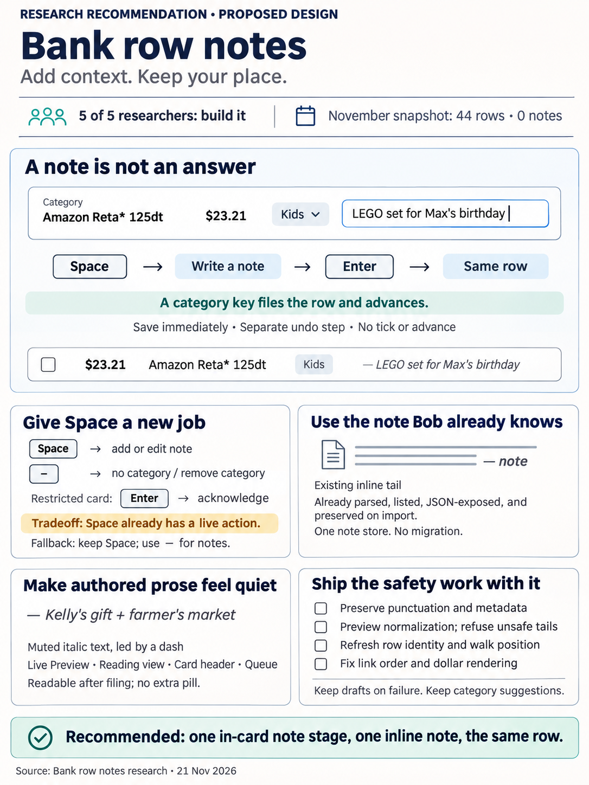

# Bank row notes: a Space-opened note stage that stays on the row

> **Research query:** When reviewing bank rows in the morning, how should I leave a note on a
> row (to clarify what a purchase was or why it was made), for example through a new `<space>`
> keymap in the bank row category picker panel that prompts for a note, adds it to the row in
> a visually appealing way, and does not progress to the next row in the bank row walk? Is
> this a good idea, which requirement adjustments are justified, and what intuitive, reliable,
> and beautiful solution is recommended?



## Bottom line

1. **Build it — the verdict was unanimous, 5 of 5.** The row grammar already has an
   inline note (`— with Kelly`) that bob parses, emits in JSON, prints in
   `bob bank list`, and preserves across imports. What's missing is a writer and a
   renderer: nothing makes a note quick to write or pleasant to read. [The vault shows
   the gap is real](#what-exists-today): November has 44 rows, **zero notes**, and roughly one row in five
   is opaque without one (`Amazon Reta* 125dt`, `ATM withdrawal`, a smoke shop filed
   two different ways).
2. **Space is not a free key.** Today it files the row with no category (close mode),
   removes the category (set mode), and is the *only* acknowledge key on the restricted
   card. This was the swarm's central split. **Decision: give Space to the note, as
   Bryan asked, and move "no category / remove category" to `-`**, with the restricted
   card becoming `↵ acknowledge · ␣ note · esc cancel`. A conservative fallback (keep
   Space, bind `-` to the note) is a one-line change to the same design and is [spelled
   out below](#keymap-decision).
3. **Store the note in the existing inline `— note` tail** (4 of 5 researchers; cdx
   dissented toward a child bullet). The dissent's lossiness objections are real — I
   verified all of them — but they are **[pre-existing parser bugs to fix](#prerequisite-fixes)**, not reasons
   to invent a second storage concept. Fix the parsers, write through a normalizer, and
   the inline tail is both safe and the only store every existing surface (JSON, CLI,
   import, queue card) already reads.
4. **A note is not an answer.** Saving one writes immediately as its own undo step,
   never ticks, never advances the walk, never counts as a filing, and returns to the
   same card with the suggestion still highlighted. "Stay" must be a property of a
   [dedicated write path](#the-write), not a navigation call that gets skipped.

## What exists today

Every finding below is verified; [how the five reports were weighed](#how-the-five-reports-were-weighed) gives the method.

| Finding | Evidence | Consequence |
| --- | --- | --- |
| Space → `{action: "no-category"}` in the card's pure key resolver; restricted footer is `␣ acknowledge · esc cancel` | bob-plugins `plugins/bob-ledger-tools/src/245-plugin-bank-category-card-model.js` (resolver and restricted model) | The proposal reassigns a live key; the displaced action must be preserved explicitly |
| Enter in restricted mode resolves to `accept` with no highlight — a no-op today | `247-plugin-bank-category-card-ui.js` `routeCardKey` | Promoting restricted Enter to acknowledge is an upgrade, not a break |
| Category hotkeys are validated to one char in `[a-z0-9]`, `q` reserved | bob-cli `src/native/bank/config.rs` `parse_hotkey_value` | Punctuation (`-`, `.`, `;`) can never collide with a category; any letter can |
| `Shift+Space` is indistinguishable from Space in the key helper | `247-…-ui.js` `bankCategoryUiEventKey` returns `event.key` | A Shift+Space binding needs new modifier handling it doesn't have today |
| The row grammar's note is end-to-end in bob: parsed (`parse_row_tail`), modeled (`BankRow.note`), printed (`  — {note}`), in JSON, preserved byte-identical by import | bob-cli `src/native/bank/grammar.rs`, `model.rs`, `output.rs:179-182`, `docs/bank.md` §Ownership | No new field, sidecar, or CLI writer is needed; the feature is a writer plus paint |
| The JS cleaner strips **every** `!` (`/[⚑!]+/g`); the Rust cleaner strips **every** internal `—`/`--`; the two disagree in both directions | `241o-plugin-bank-marks-model.js` note cleaning; `grammar.rs` `strip_markers_fields_links` | Round-tripping "prefill → edit → save" through cleaned text mutates punctuation the user never touched |
| JS `noteSpan` starts *after* the marker and runs to **end of tail**, overlapping any field/link after the `—` | `241o-…-model.js` (span built from `noteStart` to `raw.length`) | Naive span replacement can eat metadata; overlapping spans also drop CodeMirror decorations |
| The subscription linker inserts `[[subscriptions/…\|🔁]]` at `bankIdSpan.start` — i.e. *after* an existing note | `241hc-plugin-bank-subscription.js` | Breaks canonical tail order the moment notes become common |
| MathJax `$` protection covers only the amount span | `241o` `bankAmountDollarOffsets` | A note like `split $25 w/ Alex` can pair with another `$` and corrupt rendering |
| Filing commits re-resolve by `^bank-` ID, else **exact line text**; the commit path then finds the next waiting row and advances; set mode closes without advancing | `246-…-write.js`, `248-…-actions.js` `bankCategoryCommit` | A note write changes the line text: without an explicit re-capture (and walk re-anchor for ID-less rows) the *next* filing key refuses |
| `routeCardKey` sets `didInteract = true` before dispatch; an in-flight category refresh then drops its suggestion | `247-…-ui.js`, `248-…-actions.js` | The note action must not flip `didInteract` |
| A wikilink anywhere in the tail is a row link, and the most recent acknowledged row's first link is **learned** into future imports of the same merchant | `grammar.rs`; `naming.rs` (cld verified) | `[[max]]` typed inside a note would silently propagate to next month's rows — links in notes need a grammar decision first |
| No accepted decision record governs the card keymap; the prior `bank_weekly_category_walk` research recommended Space = unclassified (its A3), but that is a research rec, not a decision | decisions web roster; `202611/bank_weekly_category_walk/bank_weekly_category_walk.md` | The key can be revisited — with a new decision record when implemented |
| Vault snapshot: 44 November rows, 0 notes, 0 flags, all 44 categorized | grk's `bob bank list -a -f json`; cld's month-note read | The current Space outcome (an uncategorized filing) does not appear in Bryan's data |

## Keymap decision

**Decision 1:** Space opens the note; `-` takes "no category".

The five reports split three ways: reassign Space and move the old action to `-` (cld),
to `Backspace`/`Ctrl+D` (gem), or to `Shift+Space` (cdx); versus keep Space and bind the
note to `-` (grk) or `.` (mus).

**Recommendation: Space → note. `-` → no-category (close) / remove category (set,
with `Delete` as a set-mode alias). Restricted card: `↵ acknowledge · ␣ note · esc
cancel`.**

Why reassignment wins:

- **Error asymmetry** (gem's argument, and the decisive one). Bryan's request *is* the
  evidence of his mental model: he already thinks of Space as "note". If Space stays
  "file unclassified", a reflexive Space ticks the row and advances the walk — the
  wrong write plus the wrong navigation. If Space opens a note stage and he wanted
  "none", he gets a harmless empty input and Esc backs out.
- **The displaced action is nearly unused.** All 44 of this month's rows carry a
  category; zero no-category filings persisted. Notes will be far more frequent than
  unclassified filings (estimated ~1 row in 5).
- **`-` is the right new home.** It pairs with `+ new category` ("plus a category,
  minus the category"), a dash means "none" in a ledger, it is a single unchorded key,
  and punctuation is permanently safe from category hotkeys. Not `Backspace` (gem):
  in close mode the action *files* the row — a completing act that a delete key
  misdescribes. Not `Shift+Space` (cdx): the event helper cannot currently tell it
  from Space, and chords are easy to mis-hit mid-walk.
- **The restricted card gets better.** Enter (today a no-op there) acknowledges; Space
  still writes a note, which works offline because the note is a local editor edit —
  no bob spawn, no category refresh.

**Documented fallback** (if Bryan prefers zero retraining): keep Space as-is and bind
`-` (grk; its Tab-snippet already expands a lone `-` to an em dash) or `.` (mus) to the
same note stage. Everything else in this design is unchanged. This reopens if he
notices himself pressing the wrong key in the first week.

Costs to carry either way: update the close/set/restricted footer hints, the
card-model tests that pin Space, `docs/bank.md`, and
`docs/guides/acknowledge-bank-transactions.md`; record the choice as a new decision
record (via `/sase_memory_write`) since it deliberately revises the prior research's A3.

## Note storage decision

**Decision 2:** the note lives in the inline `— note` tail.

| Option | Verdict | Why |
| --- | --- | --- |
| **Inline `— note` tail** (cld, grk, mus, gem) | **Recommended** | Already parsed, listed, JSON-exposed, and import-preserved; one row stays one statement-like line; zero migration |
| Labeled child bullet `  - **Note:** …` (cdx) | Rejected as primary | Invisible to `row.note`, JSON, `bob bank list`, and the queue card; doubles ledger height; creates a *second* note concept coexisting with legacy inline notes — cdx's own report concedes that compatibility wart |
| New `[note:: …]` field | Rejected | `bank_field_unknown` warning today; `]` breaks it; duplicates an existing concept |
| Sidecar / journal | Rejected | Breaks "the vault note is the truth"; invisible in the editor |
| Child bullet as overflow for long/multiline notes (grk) | Deferred | Branching write shapes in v1 for a rare case; hand-typed children remain the documented long-form escape hatch |

cdx's objection deserves a direct answer because its facts are correct: today, editing
a note by "prefill cleaned text, replace the span" **is** unsafe. The cleaned `note`
loses `!` (JS) and internal dashes (Rust), and the JS `noteSpan` can swallow trailing
fields and links. The resolution is not to abandon the tail but to make the writer own
it properly:

1. **Prefill from the raw note span, never from cleaned text** — and only when the
   span is pure prose. If the span contains structural tokens (`[k::]`, `[[…]]`, `⚑`,
   `!!` — possible on hand-typed legacy rows), **refuse** with "this note has links or
   fields — edit it on the row" instead of rewriting bytes the editor doesn't own.
2. **Fix the cleaners to parity** (see [Prerequisite fixes](#prerequisite-fixes)): internal `!` and internal
   dashes become content in both parsers, with one shared fixture table in both repos.
3. **Normalize on write** so note text can never change row semantics (see [The write](#the-write)).

With those three rules, every note the feature writes round-trips exactly, and legacy
hand-written tails are protected by refusal rather than silently mangled.

**Canonical tail order**, to document in `docs/bank.md` §Row grammar:

```text
- [ ] $AMOUNT Payee [cat:: k] [acct:: a] [[links]] ⚑ — note ^bank-id
```

## The interaction as an in-card note stage

The card already has the right pattern twice — `+` opens the New-category stage and `/`
opens the subscription picker, both staged *inside* the modal with layered Esc and
text-input key pass-through. The note is the third stage, never a second modal.



*Figure 1. Space opens the note stage on the current row; Enter writes the note as one
undo step, recaptures the row, re-anchors the walk, and returns to the same card
without ticking or advancing — only a category key (letter, Enter, or the relocated
`-`) files the row and moves the walk. Esc backs out of the stage with no write.
Rendered with `@mermaid-js/mermaid-cli@12.0.0`, 560.2×682 px, fit 100.0%.*

The ordinary annotated-row rhythm stays two beats:

```text
]b → Ctrl+Enter → Category card → Space → type → Enter → (same card, 💾 note visible) → d → next row
```

### Keys

**On the card (close and set modes):**

| Key | Action |
| --- | --- |
| `Space` | Open the note stage — add when the row has no note, edit (prefilled, cursor at end) when it does |
| `-` | File with no category (close) / remove category (set; `Delete` aliases it here) |
| `Enter` / letter / `+` / `/` / arrows / `Esc` / `q` / `Ctrl+[` | Unchanged |

**Inside the note stage:**

| Key | Action |
| --- | --- |
| Printable keys — including `q`, letters, digits, Space, `/`, `+`, `=` | Type into the input; category hotkeys never fire while staged |
| `Enter`, `Ctrl+Enter` | Save and return to the tiles. Empty input + existing note = remove (the button and consequence line say "Removes note" first). Empty + no note = no write, just return. `Ctrl+Enter` deliberately equals `Enter`: it must never file from inside the input |
| `Esc`, `Ctrl+[` | Discard the draft, back out one layer to the tiles (a second Esc closes the card) — `decisions:q-and-ctrl-bracket-mirror-esc` |
| `q` | Types (the decision's text-control exception) |
| IME composition | Never saves mid-composition (`isComposing` / `keyCode === 229`, as the card already guards) |

**Key hygiene** (merged from cdx/cld/gem): consume the opening Space so it never types
a leading space; ignore `event.repeat` on the opener; hold a stage-transition release
guard on the save Enter so a rapid save-then-Enter can never accept a category; scope
Space to the card's command surface so a focused native button keeps its own
Space/Enter activation.

### The write

A dedicated `bankNoteCommit` beside — never inside — `bankCategoryCommit`:

1. **Plan purely.** A new `bankNoteWritePlan({capture, currentPath, currentSource,
   text})` reuses `bankCategoryResolveForCommit` (ID first; exact line text for ID-less
   rows) and returns `{insert | replace | remove | noop, edits, changes[]}` or a
   refusal. Insert goes immediately before the trailing `^bank-…`/custom ID (after any
   flag); replace touches only the note region via a new `noteMarkerSpan`; remove takes
   the marker too but always preserves a flag.
2. **Normalize visibly.** Fold newlines/tabs/space-runs to single spaces; `!!` → `‼`;
   `⚑` → `⚐`; `[[x|y]]` → `y` (links in notes are deferred — a tail link would be
   *learned* into future imports); `[k:: v]` → `(k: v)`; a trailing `^word` gains a
   space; `#task` is refused outright (`bank_row_task` is a hard error). Every change
   shows in the stage's warning line *before* saving; nothing is silent.
3. **Apply as one undo step** through the existing whole-line replace helper. Note and
   category stay separate transactions: Ctrl+Z after note-then-file unwinds the filing
   first, then the note.
4. **Stay, structurally.** The note path never calls the session recorder,
   next-waiting finder, jump recorder, or completion summary, and never flips
   `didInteract`. Session counters gain only `notes += 1`, surfaced in the end-of-walk
   summary as `· N notes` (cheap, and it makes the habit visible).
5. **Re-capture and re-anchor.** Refresh `modal.context` (capture line text, token,
   header note) from the post-write buffer and call the walk hand-off with the updated
   text so text-keyed (ID-less) walk entries still resolve. Without this the very next
   category key refuses with "the row changed — nothing written".
6. **Fail safely.** On a refusal (row moved, concurrent edit, structural note span),
   keep the stage open with the draft intact and explain inline. Don't copy the
   existing save helper's swallowed persistence errors; report the outcome accurately.

### Everywhere it works

- **Close mode** (the `]b` walk's Ctrl+Enter card) — the headline flow.
- **Set mode** (`Bank: set category` on acknowledged rows) — corrections need memos
  too; a later letter still updates the category and closes.
- **Restricted card** (bob unreachable) — notes are local editor edits, so Space works
  offline; Enter acknowledges.
- **`Bank: note this row`** — a new plugin command (palette + Command Mode, no default
  hotkey) that opens the card in set mode with the note stage already open, for the
  "just fix the note on this ticked row" moment. Typing `— text` by hand on the row
  remains fully supported; the card gesture is for when leaving would break the walk.

## Beautiful means quiet prose

Bob's bank row is already a visual grammar: amount in tabular figures, category and
account as pills, a warning-ink flag, a faint `bank ✓`. The note is the row's one piece
of **authored prose**, so it must not wear a fifth pill.

**Recommended default — the statement-memo caption** (grk/mus, cld minus the glyph):
wrap the full note span (marker included) in Live Preview and Reading view as muted
italic text that keeps the em dash as its lead-in:

```text
☐  $23.21  Amazon Reta* 125dt   🧸 Kids        — LEGO set for Max's birthday
☑  $100.00 ATM withdrawal       🏧 Cash out    — Kelly's gift + farmer's market
```

```css
.bob-bank-mark-note { font-style: italic; color: var(--text-muted); margin-inline-start: 0.6em; }
```

- The dash-led caption matches the source bytes, `bob bank list` output, and how a
  paper statement writes memos — every surface agrees on what a note looks like.
- The widget yields to raw source when the cursor enters the line (like every other
  bank mark), so direct editing stays first-class; `--` spelling hides behind the same
  widget; full text in `title` when truncated; `aria-label="Note: …"`.
- No hue: row tone means *waiting*, not *annotated*. No new chrome on note-less rows.
- **Contrast guard** (cdx): acknowledged rows already render at `opacity: 0.72`; don't
  compound that with faint ink below WCAG 4.5:1 — a note stays useful after filing.
- **Card header:** the same muted line under the payee (also the "you have a note →
  Space edits" discoverability cue), clickable to open the stage for mouse users.
- **Queue card** (`view: queue` on `bank.md`): a truncated muted `— note` after the
  payee — the decode layer already carries `row.note`.
- **Stage placement:** the input sits exactly where the header note renders, tiles
  dimmed in place below, so the eye never moves and returning feels instant.
  Placeholder: `What was this for?`. The live region announces `Note saved` / `Note
  removed` / refusals.

Two dressier alternatives surfaced — a `💬` lead glyph (cld) and an accent-hairline
"marginalia" treatment with `✎` (gem). Both are pure CSS/widget variations over the
same storage and spans, so this is a taste call Bryan can make from screenshots during
implementation; the plain caption is the recommended starting point because it adds
zero new glyph vocabulary and cannot clash with the emoji already on the row.

## Prerequisite fixes

**Real bugs — ship alongside.** These exist today and get worse the moment notes become a habit. All verified:

1. **Note-cleaner parity.** JS stops stripping single `!`; Rust stops stripping
   internal `—`/`--`; both strip only whole fields, whole wikilinks, `⚑`, and `!!`,
   then trim. One shared fixture table in both repos (the plugin already follows a
   "parity with bob" test convention). Additive JSON change only.
2. **Disjoint spans.** Add `noteMarkerSpan` and end `noteSpan` before any structural
   token so spans never overlap (overlap currently makes CodeMirror's
   `RangeSetBuilder` drop decorations) and add/remove edits are exact.
3. **Subscription linker order.** Insert the `🔁` link (and its ghost offset) before
   the note marker when a note exists, keeping canonical tail order.
4. **MathJax `$`.** Extend dollar protection from the amount span to the whole row so
   `split $25 w/ Alex` can't pair into LaTeX.
5. **Payee learning is already safe** — `payee_end` stops at the note markers; keep a
   regression test pinning that.

## Explicit requirement adjustments

| # | Requested | Adjusted to | Why |
| --- | --- | --- | --- |
| R1 | New `<space>` keymap | Space is a **reassignment**, not a new key: note takes Space; no-category/remove moves to `-` (Delete alias in set mode); restricted Enter acknowledges. Conservative fallback documented (keep Space; `-` or `.` opens the note) | Space has three live meanings; the vault shows its current outcome unused; error asymmetry favors the swap |
| R2 | "Prompts the user for a note" | An **in-card stage** (the `+`/`/` pattern), not a second modal | Keeps the row context pinned, inherits layered Esc/`q`/`Ctrl+[` and focus discipline |
| R3 | "Added to the bank row" | The **existing inline `— note` tail**, written through a visible normalizer; structural legacy tails get refusal, not rewriting | Grammar, JSON, CLI, and import already own this store; hazards are fixable parser bugs |
| R4 | "Without progressing" | Stay is **structural**: a dedicated write path that cannot tick, advance, count, or record a jump — plus mandatory re-capture and walk re-anchor | The commit path couples filing to navigation; "skip the advance call" alone leaves stale captures that refuse the next key |
| R5 | (implicit) add a note | Full lifecycle on one key: add, edit (prefilled), remove (empty save, with visible consequence) | One gesture to learn; appending beats select-all for safety |
| R6 | (implicit) morning walk only | Also set mode, restricted card, and a `Bank: note this row` command | Annotating after filing is as common as during; notes need no bob |
| R7 | "Visually appealing" | Muted italic dash-led prose caption across Live Preview, Reading view, card header, and queue card — never a pill; glyph/hairline variants deferred to a screenshot decision | Notes are prose; chips are taxonomy; all surfaces should agree with `bob bank list` |
| R8 | (new) | Fix the five latent parser/editor bugs as [prerequisites](#prerequisite-fixes) | Each silently corrupts or degrades noted rows |
| R9 | (scope cut) | v1 excludes: links/tags in notes (normalized away, visibly), multiline (folded), note autocomplete, a save-and-accept chord, a `bob bank note` CLI writer, child-bullet overflow | Links leak into import learning; chords double a key's meaning; the editor transaction *is* the writer per the ownership contract |

## Implementation plan

**Phase 1 — bob-plugins (`bob-ledger-tools`); the whole feature, no bob release
needed.** Edit `src/` fragments (≤1000 lines each), `npm run build`, `npm test`, then
`bob plugins sync`.

| Fragment | Work |
| --- | --- |
| `241o` marks model | Parity fix for `!`; `noteMarkerSpan`/disjoint `noteSpan`; full-row `$` offsets |
| `241p` / `241q` marks | `BankNoteWidget` (Live Preview, yields to cursor) and Reading-view wrap |
| `241hc` subscription | Insert link + ghost before the note marker |
| `241m` cards | Queue-card muted note line |
| `245` card model | `" "` → `note`; `"-"` (+ set-mode `Delete`) → `no-category`; restricted Enter → acknowledge; header gains `note`; session gains `notes`; all mode footers updated |
| New pure writer fragment (e.g. `246a`) | `bankNoteNormalize`, `bankNoteWritePlan`, refusals — Node-testable, no Obsidian globals |
| New stage fragment (e.g. `248m`) | Stage mixin modeled on `248g`: open/close, pass-through, consequence/warning line, paint |
| `247` card UI | Route the stage before category keys; header note line; never flip `didInteract` on note actions |
| `248` actions | `bankNoteCommit` (guard → apply → save → re-capture → re-anchor → announce; **no advance**); register `Bank: note this row` |
| `styles.css` | `.bob-bank-mark-note`, `.bob-bank-category-note`, stage styles |

Tests: key-resolution matrix (Space/`-`/Delete across close/set/restricted, everything
else unchanged); writer matrix (insert/replace/remove × ID / ID-less / flagged /
`--` / interleaved-structural-refusal rows; normalizer table; flag always survives);
UI tests (opening Space doesn't type; `q` types; Esc layers; save stays and the next
hotkey files the *same* row then advances; ID-less re-capture; no `didInteract` flip);
walk anchor survival on ID-less rows; an e2e pass of `]b → Ctrl+Enter → Space → type →
Enter → letter`.

**Phase 2 — bob-cli (small; rides the daily release train, no CLI/JSON contract
break).** The Rust cleaner parity fix with the shared fixtures; docs: `docs/bank.md`
(canonical tail order, note content rule, new keys), the acknowledge guide's step 2,
and the plugin reference pages. Optional later: the Bank Badge tooltip's largest
outflows could append the note — a natural second payoff for the "why".

**Memory follow-ups (route through `/sase_memory_write`, not done here):** a decision
record for the keymap ("Space writes a row note and never answers; `-` files none"),
with the [rejected alternatives above](#keymap-decision) and reopen conditions (Bryan files many
no-category rows, or wants links in notes); update the glossary `Bank Row` strand to
mention the note and the gesture.

## Open questions for Bryan

1. **[Confirm the Space ⇄ `-` swap](#keymap-decision)**, or pick the conservative fallback (Space stays
   "none"; `-` or `.` opens the note). Everything else is identical either way.
2. **Visual tone:** [plain dash-led muted caption](#beautiful-means-quiet-prose) (recommended), `💬` lead, or the
   hairline-marginalia treatment — decide from screenshots during implementation.
3. **Links and tags in notes** (`for [[max]]`, `#reimburse`): valuable, but they need
   the "links after the note marker are content, not row links" grammar decision first,
   because tail links are learned into future imports. v1 neutralizes them visibly.

## How the five reports were weighed

Consolidated 2026-11-21 from five independent researcher reports (`__cdx`, `__cld`,
`__grk`, `__mus`, `__gem`, in this directory) plus the lead's own verification of every
load-bearing claim against bob-cli `020ad4e6` and bob-plugins master. No product code
was changed; this is a design recommendation.

| Report | Adopted | Set aside |
| --- | --- | --- |
| cdx | Error-asymmetry framing of Space; lossy round-trip evidence (executed probes); refusal-over-rewrite for structural tails; button/focus/IME rigor; contrast-on-dimmed-rows guard; post-acknowledgment editing | Child-bullet storage (loses every existing read surface); Shift+Space (unimplementable without new modifier handling, chord mis-hits) |
| cld | The `-` relocation and restricted-card shape; normalizer table; learned-link leak discovery (§7.2); parity-fix framing; re-capture/re-anchor steps; `· N notes` summary; most of the stage key table | Hiding the dash behind `💬` demoted to a taste option |
| grk | Statement-memo caption aesthetic; canonical-write spelling; vault snapshot; thin-slice shipping order | Keeping Space (outweighed by error asymmetry + unused action); >80-char child-bullet overflow (deferred) |
| mus | Set-mode precedent for "stay"; separate-transactions undo discipline; "what not to build" scope fences | The `.` binding (same role as `-`, weaker pairing with `+`); restricted card excluded from notes (notes need no bob, so it shouldn't be) |
| gem | Restricted-Enter upgrade; the four latent-bug catalog (span overlap, `$` MathJax, linker order, `didInteract`); edge-case matrix; marginalia variant kept as alternative | Backspace/Ctrl+D for no-category (delete semantics misdescribe a filing action) |

## Recommended solution

**Recommended solution, in one paragraph.** Ship "Space writes a row note" as a third
in-card stage of the bank Category card: Space opens a prefilled one-line input over
the dimmed tiles, Enter writes the normalized note into the row's existing inline
`— note` tail as its own undo step — never ticking, never advancing, never counting —
re-captures the row and re-anchors the walk, and returns to the same card with the
suggestion still highlighted; `-` takes over "file with no category / remove category",
the restricted card becomes `↵ acknowledge · ␣ note · esc cancel`, set mode and a new
`Bank: note this row` command cover rows already filed, and the note renders everywhere
as a quiet muted-italic dash-led caption. Fix the [five pre-existing parser/editor bugs](#prerequisite-fixes)
(cleaner parity, span boundaries, subscription-link order, `$` protection, capture
drift) in the same change, and the morning walk stays one keystroke per row — except on
the one row in five that deserves a sentence, where it becomes Space, the sentence,
Enter, and the usual key.
