# Bank row notes from the Category card

> **Research query:** When reviewing bank rows in the morning, Bryan wants to
> leave a note on a row (what the purchase was, or why it was made) via a new
> Space keymap in the Category card, written in a visually appealing way,
> without advancing the bank-row walk. Lead the design. Critique the plan,
> adjust requirements that need adjusting, and recommend a solution that is
> intuitive, reliable, and beautiful.

## Bottom line

**Build the stay-and-annotate gesture. Bind it to hyphen, not Space.**

The Category card is a classification machine. Categories answer *what kind*.
A note answers *what this was, and why*. That second question is real, and
the Monday walk currently has no place to ask it without leaving the card
and typing on the line. The row grammar already stores the answer as an em
dash tail (`— with Kelly`). `bob bank list` already prints it. Import already
preserves it. Live Preview and Reading view currently leave it as raw text.

The requested Space binding collides with a shipped, tested, previously
researched key: Space files the row with no category and advances. On the
restricted card (bob or categories unreachable) Space is the only way to
acknowledge. Steal that key and the two-minute filing walk loses its skip,
and the recovery path loses its tick.

Hyphen is the free key that already means "note" in this grammar. An isolated
`-` in the editor expands to an em dash under Bob's Tab snippet. On the card,
hyphen should open an in-card Note stage, Enter should write ` — note` on the
current row and stay, and a later letter / Enter / Space should still file
and advance.

A `bob bank list -a -f json` read on 2026-11-21 found **44 rows, 0 with
`note`, 0 flagged**. The store exists. The gesture does not.

## Recommended solution

One sentence: **hyphen opens a nested Note stage on the Category card; Enter
writes a canonical em-dash note through one editor transaction; the walk
stays on this row until a filing key is pressed.**

### Gesture

1. Ctrl+Enter on a waiting row still opens the Category card.
2. Hyphen (`-`) opens the Note stage. Tiles yield to a single-line input,
   the way `+` yields to New category and `/` yields to the subscription
   picker.
3. The amount, payee, and day stay in the header. A live italic preview
   line under the payee updates as Bryan types: `— with Kelly`.
4. Enter with text writes the note, recaptures the line, and returns to
   tiles on the **same** waiting row. The header keeps the italic line.
5. Esc, `q`, or `Ctrl+[` on the stage back out one layer (the
   `q-and-ctrl-bracket-mirror-esc` rule). Empty Enter on a blank prompt
   does the same, with no write.
6. Clearing the field and pressing Enter removes an existing note.
7. After the stage closes, a letter, Enter, or Space files as today and
   advances. The note is already on the line, sitting after the payee, so
   the existing category insert (after `payeeSpan.end`) leaves it in
   place.



*Figure 1. Hyphen opens a Note stage; Enter writes the em dash and stays;
a later filing key still advances. Rendered with
`@mermaid-js/mermaid-cli@12.0.0`, 687.4×628 px, fit 95.0%.*

### Why hyphen, and why Space stays



*Figure 2. Space already files unclassified and is the restricted-card
acknowledge key, so the note gesture binds hyphen. Rendered with
`@mermaid-js/mermaid-cli@12.0.0`, 375.4×810 px, fit 100.0%.*

Space is owned:

- `bankCategoryResolveCardKey` returns `{ action: "no-category" }` for
  `" "` (`245-plugin-bank-category-card-model.js`).
- The card-model test pins that contract
  (`test-ledger-tools-bank-category-card.cjs`).
- The keys footer teaches it: `Space no category` in close mode, `Space
  remove category` in set mode, `␣ acknowledge` on the restricted card
  (`248f-plugin-bank-category-new-model.js`).
- The weekly Category-card research froze this as requirement A3:
  Space ticks with no category and advances
  (`research:202611/bank_weekly_category_walk/bank_weekly_category_walk.md`).
- The acknowledge guide says the same in user-facing prose
  (`docs/guides/acknowledge-bank-transactions.md`).

Letters and digits are category hotkeys (`a-z0-9`, `q` reserved). A letter
note key would steal a filing key the next time a category claims it.

Hyphen is free punctuation, matches the `—` / `--` grammar markers, and
matches the editor snippet that already turns a lone `-` into an em dash.
The card currently swallows unbound keys so they never reach the note
(`docs/bob-ledger-tools.md`); that is why a card keymap is required at
all.

If Bryan wants a space-shaped chord as well, **Shift+Space may alias
hyphen**. It must remain a secondary binding. Primary teaching is `-`.

### Where the note lives

Use the grammar that already exists. Do not add `[note::]`, a CLI writer,
or a new field.

```markdown
- [ ] $13.71 Smashburger [cat:: dining] ⚑ — with Kelly ^bank-8f3a2c1d
```

That shape is the contract example in `docs/bank.md`. The parser already
splits payee at `—` / `--` / `⚑` / `!!`, stores `note: Option<String>`,
and emits it in JSON (`src/native/bank/grammar.rs`,
`src/native/bank/model.rs`). Human `bob bank list` already appends
`  — {note}` (`src/native/bank/output.rs`). Import matching already
promises notes and child bullets stay byte-identical
(`docs/bank.md` Ownership).



*Figure 3. A short note joins the row as a canonical em dash before the
bank id; a newline or long text becomes a child bullet the import planner
already preserves. Rendered with `@mermaid-js/mermaid-cli@12.0.0`,
421.7×340 px, fit 100.0%.*

**Canonical write, v1:** one space, em dash, one space, then the trimmed
text, inserted before `^bank-<hex>` and after any flag. Prefer `—` over
`--` on writes the gesture owns. Leave flag spelling (`⚑` vs `!!`)
untouched. Replace an existing note span; do not append a second one.

**Overflow:** if the prompt contains a newline, or the trimmed text is
longer than 80 characters, write an indented child instead:

```markdown
- [ ] $61.20 ShopRite [cat:: groceries] ^bank-…
  — birthday cake and candles, the bakery on Springfield
```

Indented children are already "free notes" (`docs/bank.md` Row grammar).
The month-note planner already appends new imported rows *after* those
children (`src/native/bank/month.rs`
`append_row_lands_after_free_note_children`). v1 owns the inline note
when it fits, and one child bullet when it does not. It does not try to
round-trip a mix of inline plus several children.

### Beauty

Notes are prose. Categories are taxonomy. They must not wear the same
chip.

**On the card**

Keep the magenta key-card chrome. While the stage is open, retitle to
**Note**. Keep the amount (tabular, green on inflows), the payee, and the
day. Draw the live preview as a second header line in italic muted ink,
prefixed with an em dash, never as a pill. Placeholder: `what was this,
and why?` Prefill when a note already exists.

After save, tiles return. The italic line stays under the payee so the
eye can confirm the write, then pick a category.

Keys footer on tiles becomes:

`↵ accept · letter choose · Space no category · - note · + new · / sub · Esc cancel`

(The `/` subscription key is already live and missing from
`bankCategoryCardKeysText`. Add both in the same footer pass.)

Stage keys: `↵ save · esc back`. `q` types in the input (text-control
exception). `Ctrl+[` still backs out.

**On the month note**

Wrap `noteSpan` the way flags, categories, and amounts already wrap, with
a *different* weight:

| Kind | Class | Look |
| --- | --- | --- |
| Amount | `.bob-bank-mark-amount` | tabular, green on inflows |
| Category | `.bob-bank-mark-chip.bob-bank-mark-cat` | bordered pill |
| Account | `.bob-bank-mark-acct` | muted, no fill |
| Flag | `.bob-bank-mark-flag` | warning ink, glyph only |
| **Note** | **`.bob-bank-mark-note`** | **italic muted caption, no border, em dash kept** |

A bordered pill would make "with Kelly" look like a fifth category. A
caption sitting after the payee, slightly smaller, is how a statement
already writes memos. Hide the raw `--` spelling behind the same widget
so ASCII and typographic notes look identical. Full text in `title` when
the line truncates.

Wire this in `241p-plugin-bank-marks.js` (Live Preview) and
`241q-plugin-bank-marks-reading.js` (Reading). `bankRowPresentation`
already has `token.note`; it just never paints it.

**On the queue card**

`bankCardRenderQueueRow` currently paints amount, payee, category, and
the 🔁 chip, and skips `row.note`. Append a truncated muted `— {note}`
after the payee so the hub queue matches the month note.

**Announce**

`Noted $13.71 Smashburger · with Kelly`. Filing announcements stay as
they are.

### Reliability

The Category card never calls `bob` to write a row. Category filing is
Bryan's edit in his editor, one transaction with the tick
(`docs/bank.md` Ownership). Notes follow that same ownership: a pure
`bankCategoryNoteWritePlan` next to `bankCategoryWritePlan`, applied
through `bankCategoryApplyLineEdits`, one undo step, no tick, no
category change, no `bankCategoryNextWaiting`.

Hard rules:

1. **Stay is a planner property, not a hope.** The note write path must
   not call `bankCategorySessionRecord` or `bankCategoryNextWaiting`.
   Session `filed` counts only filing keys.
2. **Recapture after a stay write.** `bankCategoryCapture` keys later
   filing on `lineText` (or `^bank-` id). A note changes `lineText`.
   Without a recapture, the next letter refuses with "the row changed —
   nothing written" (`BANK_CATEGORY_WRITE_REFUSAL`). Refresh
   `modal.context.capture` and `modal.context.token` from the post-write
   source before returning to tiles.
3. **Refuse `::` that would look like a field.** `parse_row_tail` still
   reads `[cat::]` after the em dash. A note containing `[cat:: foo]`
   would steal the category. Mirror the Work Log prompt: warn on `::`,
   and strip `[key:: value]` spans from the written note.
4. **Newlines become children, never a wrapped row.** A checkbox line
   with an embedded newline is not a bank row.
5. **Busy, lock, and chord stay as they are.** A held hyphen must not
   open the stage twice. Opening-chord Enter still cannot accept.
6. **Restricted card.** Space remains acknowledge. Hyphen may still
   note: notes do not need bob. If the editor write fails, notice and
   stay.
7. **Set-category mode.** Hyphen notes and stays; a later letter still
   updates `[cat::]` without touching the checkbox, then closes, as set
   mode does today.
8. **Undo.** Ctrl+Z reverses the note transaction. Recapture on the next
   paint if the line is still the captured row; otherwise the existing
   "row changed" refusal is correct.

Tests to add beside the current card-model suite:

- `bankCategoryResolveCardKey({ key: "-" }).action === "note"`
- Space, `q`, `+`, `/` unchanged
- Note plan inserts ` — with Kelly` before `^bank-…`, ticks nothing
- Note plan replaces an existing `-- old` span with canonical ` — new`
- Note plan with empty string removes the note span and keeps `⚑`
- Category insert after a stay-write still matches the recaptured line
- `bankCategoryNextWaiting` is not consulted on a note write
- Child-bullet path for newline and for length > 80

No `bob` CLI change in v1. JSON already has `note`. `bob bank note` would
be a new writer under the `bank` noun and is unnecessary for a card
gesture.

## Is this a good idea?

**Yes, with the keymap adjustment.** The walk is the right surface. The
stay rule is the right constraint. The existing em-dash grammar is the
right store. Space is the wrong key.

The Monday ritual is "one key per row" for about thirty rows
(`research:202611/bank_weekly_category_walk`). Most rows will still be
`Ctrl+Enter`, `↵`. Notes are the exception — Smashburger with Kelly, an
ATM that was actually the soccer snack bar, a refund that looks like a
purchase. Forcing every row through a prompt would recreate the
categorize-to-death failure the weekly research warned about. Opening a
prompt only when Bryan reaches for hyphen keeps the fast path intact.

A second modal on top of the Category card would be the wrong shape.
`+` and `/` already prove the nested-stage pattern: Esc backs out one
layer, letters type while staged, the header keeps the row in view. The
Rotten Keep reason stage and the Work Log prompt are the visual cousins
for a single-line "why" field. Copy that input chrome (pencil, preview,
`↵` / `esc` hints), inside this card, not as a new `Modal`.

Typing on the month-note line still works. The card gesture is for the
moment the row is already in the picker and leaving would break the
walk.

## Critique of the requested plan

The request is: new Space keymap, prompt for a note, add it beautifully,
do not advance.

What holds:

- **The surface is right.** The Category card is the morning/Monday
  attention for waiting rows. `]b` lands on the payee; Ctrl+Enter opens
  the card; the card stays open across the month. A note that required
  closing the card would be unused.
- **Stay is right.** Filing answers "what kind" and consumes the row.
  Annotating answers "what was this" and must leave the row waiting so
  a category can still be chosen. This is the bank equivalent of Alt+F
  (stay) versus Ctrl+Enter (advance) on the `]s` walk.
- **A prompt is right.** Inline typing on the hidden editor behind the
  modal is how keys leak today, and the card exists to stop that. A
  dedicated stage with a preview is how New category and subscriptions
  already work.

What to change:

- **Space is not free.** See [Why hyphen](#why-hyphen-and-why-space-stays).
- **"Added to the bank row" should mean the existing em-dash tail**, not
  a new field, not a drawer, not a work-log child by default. Inventing
  `[note::]` would skip a parser, a list printer, and an import
  preservation promise that already treat `note` as first-class.
- **"Visually appealing" should restyle the grammar that is already
  there.** Amounts, categories, flags, and bank ids already have
  widgets. Notes are the missing widget. A second UI store (frontmatter,
  a hover-only tooltip with no source) would desync from `bob bank
  list`.
- **The prompt should be an in-card stage, not a stacked modal.** A
  second `Modal` fights focus, Esc layering, and the
  `q-and-ctrl-bracket-mirror-esc` rule. `+` and `/` are the template.
- **Do not file and note in one key.** Combining "save note" with "pick
  dining" would make hyphen a filing key. Stay is the feature. Two
  beats — hyphen, type, Enter, then `d` — is the honest rhythm.

A different approach I considered and rejected:

| Approach | Why it loses |
| --- | --- |
| Remap Space to notes; move no-category to `_` or `.` | Breaks the weekly skip, the keys footer, the restricted card, and the A3 contract |
| Space opens the prompt; empty Enter files with no category | Stay and skip would share a key with opposite walk effects |
| `n` for note | `n` is a legal category hotkey; reservation would steal it from a future category |
| Child bullets as the default | A statement line with a one-line memo is how the contract already looks; children are for overflow |
| `bob bank note ID TEXT` as the writer | Labels would hit argv; the card already writes through the editor; CLI rules would demand a short alias for a command nobody needs in v1 |
| Flag (`⚑`) as a substitute for a note | Flag means "look into this"; a note means the opposite |

## Requirement adjustments

Called out explicitly, in the form the weekly Category-card research
used.

| # | Requested | Adjusted to | Why |
| --- | --- | --- | --- |
| A1 | Space opens the note prompt | **Hyphen opens the Note stage.** Space keeps no-category / remove-category / restricted acknowledge. Optional Shift+Space alias. | Space is a shipped filing key with tests, docs, and a prior research freeze |
| A2 | "Added to the bank row" unspecified | **Canonical ` — note` before `^bank-`.** Child bullet only for newline or >80 characters | Grammar, JSON, list, and import already own this tail |
| A3 | Prompt for a note | **Nested in-card stage**, same family as `+` and `/`. Esc / `q` / `Ctrl+[` back out one layer; `q` types in the input | Avoid a second modal; honor close-key parity |
| A4 | Do not advance the walk | **Stay is a separate editor transaction.** Recapture the line before the next filing key. Session `filed` does not increment | Capture currently keys on `lineText`; a silent stay-write would refuse the following category |
| A5 | Beautiful presentation | **Italic muted caption**, not a category pill, on the card header, Live Preview, Reading view, queue card, and `bob bank list` (already) | Notes are prose; chips are taxonomy |
| A6 | (new) | **No CLI writer in v1.** Plugin editor transaction only, matching category filing | Ownership contract: bob writes a row once; later edits are Bryan's |
| A7 | (new) | **Set mode notes and stays**, then a letter still updates category and closes | Corrections need memos too |
| A8 | (new) | **Sanitize `::` / `[key::]` in the prompt** | Tail parser would otherwise steal `[cat::]` from the note |
| A9 | (deferred) | **`!` as a stay flag toggle** is a good sibling gesture and is out of scope | Flag and note are complementary; do not ship both in the same pass |

## Implementation sketch

All of this is plugin work plus docs. bob-cli already parses, lists, and
preserves notes.

**bob-plugins (`bob-ledger-tools`)**

- `245-plugin-bank-category-card-model.js` — `key === "-"` →
  `{ action: "note" }`. Header model grows `note`.
- `248f-plugin-bank-category-new-model.js` — keys footer includes
  `- note` and `/ sub`.
- New pure planner beside `246-plugin-bank-category-card-write.js` —
  `bankCategoryNoteWritePlan({ capture, currentPath, currentSource, note,
  overflow })`.
- New stage mixin beside `248g-plugin-bank-category-new-stage.js` —
  open/close, input pass-through, live preview, save, recapture.
- `247-plugin-bank-category-card-ui.js` — header italic line; route
  hyphen; paint stage before tiles return.
- `248-plugin-bank-category-card-actions.js` — apply note plan; **do not
  advance**; refresh capture/token.
- `241o` / `241p` / `241q` — present and wrap `noteSpan`.
- `241m-plugin-bank-cards.js` — queue row muted `— note`.
- `styles.css` — `.bob-bank-mark-note`, `.bob-bank-category-note`.
- Tests in `test-ledger-tools-bank-category-card.cjs` and the UI suite.

**bob-cli docs only**

- `docs/bank.md` Row grammar: mention the Category-card hyphen gesture.
- `docs/guides/acknowledge-bank-transactions.md`: one sentence in step 2.
- Plugin reference `docs/bob-ledger-tools.md` Category card paragraph.
- Glossary Bank Row: the note is still the em-dash tail; the new fact is
  the gesture.

**Out of v1**

- `bob bank note`
- Flag toggle
- Note history / recall band (Work Log has one; bank notes are not a
  log)
- Editing child-bullet notes from the stage when an inline note also
  exists

## Card mockup (text)

Tiles, after a saved note:

```text
Category
$13.71  Smashburger                          Nov 12
— with Kelly

Everyday
[C] ☕ Coffee   [D] 🍽️ Dining   [G] 🛒 Groceries

↵ accept · letter choose · Space no category · - note · + new · / sub · Esc
```

Stage, while typing:

```text
Note
$13.71  Smashburger                          Nov 12
— with Kelly

✎  with Kelly

↵ save · esc back
```

## Evidence

Verified in this workspace, 2026-11-21:

- Row grammar, `ParsedRow.note`, em-dash / `--` / flag markers:
  `src/native/bank/grammar.rs` (`parse_row_tail`, test
  `flags_notes_and_ascii_spellings`).
- JSON `note` on every list row: `src/native/bank/model.rs`.
- Human list prints `  — {note}`: `src/native/bank/output.rs`
  `print_queue_row`.
- Import preserves notes and children: `docs/bank.md` Ownership;
  `src/native/bank/month.rs` child-bullet insert test.
- Category card Space = no-category, tested:
  `sase/repos/linked/bob-plugins/plugins/bob-ledger-tools/src/245-plugin-bank-category-card-model.js`,
  `sase/repos/linked/bob-plugins/scripts/test-ledger-tools-bank-category-card.cjs`.
- Nested stages already: `+` New category (`248g`), `/` subscriptions
  (`248h`). Esc closes stage then card (`247` `onEscapeKey`).
- Marks wrap amount, cat, acct, flag, id — not notes:
  `241p-plugin-bank-marks.js`, `241q-plugin-bank-marks-reading.js`.
- Queue card skips `row.note`: `241m-plugin-bank-cards.js`
  `bankCardRenderQueueRow`.
- Tab snippet: isolated `-` expands to em dash
  (`docs/bob-ledger-tools.md` Snippets).
- Close-key parity: `decisions:q-and-ctrl-bracket-mirror-esc`.
- Bank walk no-ops while the card is open:
  `docs/reference/plugins/bob-navigation-hotkeys.md` Bank walk.
- Vault snapshot: `bob bank list -a -f json` → 44 rows, 0 notes, 0
  flags. (Payees omitted.)
- Prior freeze of Space as skip:
  `research:202611/bank_weekly_category_walk/bank_weekly_category_walk.md`
  requirement A3.

## What I would ship first

A thin vertical slice, in this order:

1. Pure note write planner + recapture + tests (no UI).
2. Hyphen stage on the card, italic header line, stay.
3. Marks widget + queue caption so the write is visible in the month
   note the moment tiles return.
4. Docs and keys footer (`- note` and the missing `/ sub`).

That is enough to use on a Monday. Child-bullet overflow can land in the
same PR if the planner is already branching on newline/length; it can
also wait one week if the planner wants to stay strictly inline.

## Open question for Bryan

Only one, and it does not block the design: **do you want Shift+Space as
a silent alias for hyphen**, or is teaching `-` enough? I would ship
hyphen alone. The alias is cheap if the Space muscle is the thing you
were imagining.
