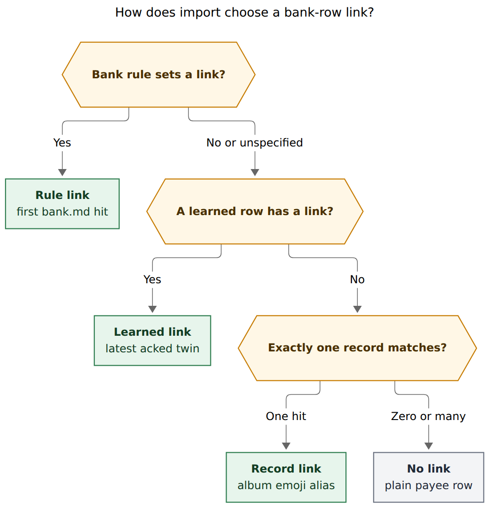
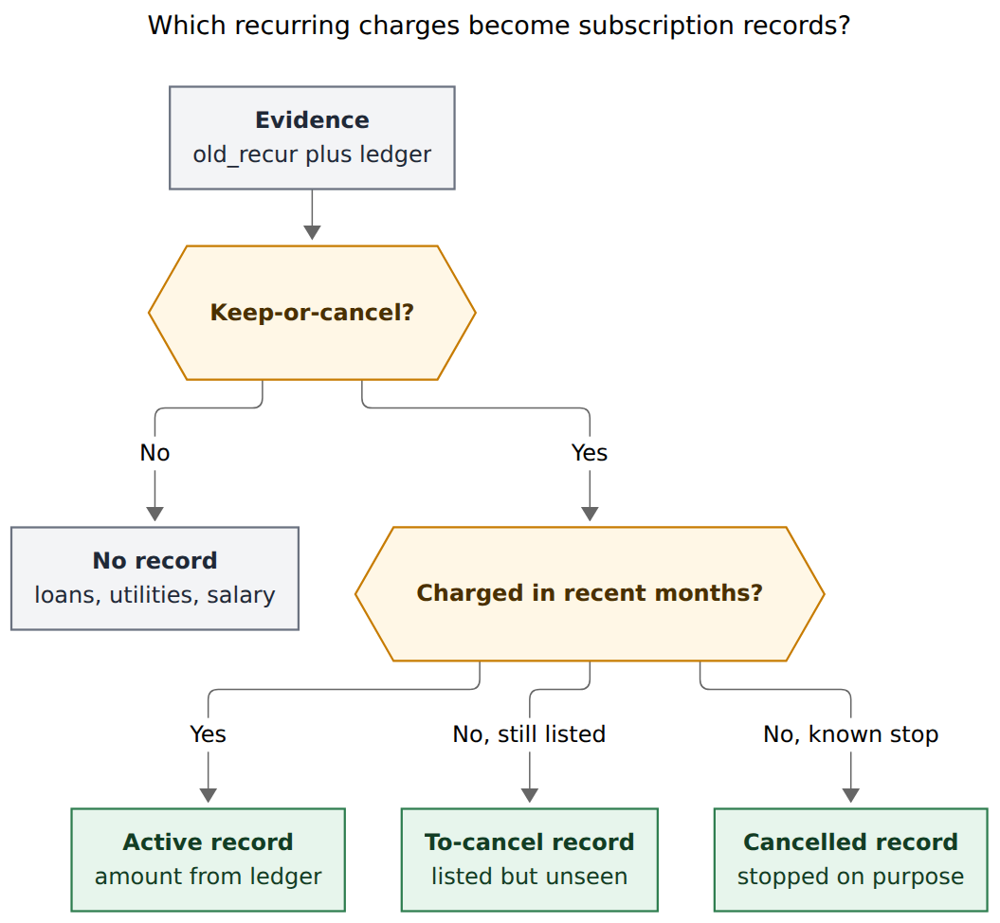

# A subscriptions album under bank, linked from imported rows

> **Research query:** Bryan wants a new bank subscriptions album (`bead:bob-cli-kt`).
> Review the last few months of bank activity, seed the album with the right
> record notes, and have `bob bank import` attach a concise, beautiful link
> to the matching subscription when it creates a row. Lead the design.
> Critique the plan, justify requirement adjustments, and recommend a
> solution that is intuitive, reliable, and beautiful.



*Figure 1. A new imported row takes its wikilink from a `bank.md` rule, then the latest acknowledged twin, then exactly one album record. Zero or many record hits leave a plain payee row. Rendered 708×736 px, fit 92.2%.*

## Bottom line

**Build the album. Change how it matches, how it seeds, and what import is
allowed to write.**

`bead:bob-cli-kt` is the right follow-up to the bank epic. A subscription is
one durable keep-or-cancel thing, which is what record notes are for. Bank
rows stay transactions; the album is the catalog of charges that repeat.
That split is already settled in `plan:202611/bank_daily_acknowledgment.md`
(ADJ-1: the album belongs to subscriptions; month notes hold the rows).

The plan as filed is too trusting of `old_recur.md` and too weak at import
time. The catalog amounts are stale. Title-only lookup, which already works
for restaurants, misses `SPOTIFY`, `Anthropic* Claude`, and `Godaddy#••••`.
Learned naming only copies a link after an acknowledged teacher exists, and
import never rewrites a row it has already written. Waiting for a first
ack-and-link does not meet "import adds the link when it creates the row."

**Recommended shape, in one sentence:** a `subscriptions` album under
`bank`, each record carrying a required unique `match` list; import writes
`[[subscriptions/<stem>|🔁]]` when exactly one record hits the raw
description; `bob bank check` proposes price drift and new candidates and
never creates a record.

Do not close `bob-cli-kt` from this research turn. Close it when the album,
the seed, the import link, the check findings, and the `old_recur` de-zorg
are in the vault.

## Is this a good idea

**Yes.** The motivations are already in the vault, and the bank epic parked
this work on purpose until albums shipped.

1. **`cash.md ^audit-monthly-subscriptions` is still open**, blocked on
   unemployment, last fresh 2026-10-01. The album is that audit's working
   surface: status groups To cancel / Active / Cancelled, with amount,
   cadence, and category on the generated index.
2. **`old_recur.md` is a Zorg table pretending to be that surface.** 28
   active rows plus one inactive, with `generated_from_zorg: true` and
   amounts that have drifted (Spotify $11.72 in the table, $12.78 in the
   Aug–Dec 2025 `@BANK` log). About **270 inbound `[[old_recur…]]` links in
   178 files**, almost all habit spend lines, still point at heading
   anchors.
3. **Subscriptions pass the album contract; transactions do not.** The bank
   epic rejected one record per transaction (index rewrite, filename
   collisions, `record_checkbox`, durability). A Spotify membership is one
   thing with a verdict. Eat already proves the pattern: 104 restaurant
   records, `dated_notes: true`, emoji-aliased bank links
   `[[eat/smashburger|🍔]]` on new imports.
4. **The daily ack gets prettier, and the keep-or-cancel loop gets a home.**
   A waiting row that already shows `🔁` is a reminder during Ctrl+Enter
   filing. The album is where Bryan decides whether Claude still earns
   $200. Actual Budget, if `^budget` ever unblocks, can own envelopes;
   Bob owns the named list.

A worse idea would be stuffing match strings into `bank.rules` on the hub,
auto-creating records from import, or treating `[[recur]]` (the chores
area for balance snapshots and Kelly's salary) as this catalog. Those
fight the contracts we already have.

## Critique of the filed plan

The bead copies `plan:202611/bank_daily_acknowledgment.md` section
"Follow-up: the subscriptions album". That section is a good skeleton and
a weak matching spec.

**What to keep**

- Parent `bank`, stem `subscriptions`, noun `subscription`, emoji `🔁`.
- Status order To cancel → Active → Cancelled (actionable group first).
- Discretionary scope: mortgage, student loans, car insurance, utilities,
  and Kelly's salary stay bank categories, not records.
- `bob bank check` proposes and never creates.
- De-zorg `old_recur.md` into a `legacy_recur` notebook under `cash`,
  following the `eat.md` / `legacy_eat.md` recipe.
- Point `^audit-monthly-subscriptions` at the album.

**Where the plan is thin or wrong**

1. **Seed-from-`old_recur`-only copies a stale catalog.** Spotify, Verizon,
   GEICO, sanitation, and the mortgage have all moved. ChatGPT last appears
   in `@BANK` on 2025-10-14. Farmer's Dog, PIA, NoIP, and XMind have **zero**
   2025 `@BANK` hits. Live `bank/2026-11.md` already shows GoDaddy $46.38
   (catalog $44.34/yr) and Claude $200 (catalog $100/mo).
2. **"Link existing rows so learned naming carries the link" is not an
   import-time matcher.** `NameResolution` is four tiers: rule, learned
   acknowledged twin, Wells Fargo builtin, cleaned title-case. The
   restaurant lookup is a *link-only* backstop, exact title, omit on
   ties (`import_plan.rs` `restaurant_link_cutover`,
   `ambiguous_restaurant_titles_omit_the_link`). Learned copies
   `links.first()` from a teacher. Import writes a row **once** and never
   recategorizes it. With checking `start: 2026-11-11` and one month note,
   there is no teacher for Spotify yet. The first Spotify QFX line needs a
   match against the raw description, the way `bank.rules[].match` already
   uses `contains_folded`.
3. **Title-only lookup fails the merchants we actually have.** Cleaned
   title-case of `SMASHBURGER ARLINGTON VA` is `Smashburger`, which equals
   the restaurant title. `SPOTIFY`, `Anthropic* Claude`, and `Godaddy#••••`
   do not equal `Spotify`, `Claude`, and `GoDaddy`. Bryan's suggested
   "list of strings to match bank rows against" is the right primitive, as
   a **per-record** field, not one album-level bag.
4. **Price findings on every linked amount will cry wolf.** Claude posted
   $20, $94.80, $100, then live $200. Digital Ocean was a flat $6 through
   2025-12-01. A `pricing: metered | fixed` flag keeps
   `bank_subscription_price` for Spotify-class bumps.
5. **`bob albums create` cannot write this schema.** Create renders
   `record.noun` and `record.label` and omits `record.fields` until values
   settle (`albums/create.rs` `render_new_album`). `bob albums update` can
   add fields through JSON ops; it cannot set `index_facets` (those bytes
   are top-level, and a field named by `index_facets` cannot even be
   removed through ops). The honest v1 path is create, then a YAML schema
   patch, then `bob albums sync`.
6. **Import will not backfill the two live subscription rows.** Godaddy and
   Claude in `bank/2026-11.md` are already journaled. A later import sees
   them and writes nothing. "Link existing bank rows" is a one-time seed
   patch, not a new import flag.
7. **The candidate heuristic as written would nag Track 5 Coffee** if it
   only counted "3+ charges from one merchant." Five $8.64 coffees already
   sit on Nov 12–13. The interval test (~30 or ~365 days) is the whole
   filter; daily merchants must not fire.
8. **`index_facets: [amount, cadence, category]` is a display peek, not a
   group.** Grouping still follows `status` choices. Amount as a number
   facet prints `12.78` on the index row; it does not splinter groups.
   Keep it.

## Facts that decide the design

Counted from `~/bob` on 2026-11-15 unless noted.

### What already exists

| Surface | State |
| --- | --- |
| `bank.md` | Area, parent `[[cash]]`, magenta via cash. Checking `start: 2026-11-11`. No `rules:`. No `## Albums` catalog yet. |
| `bank/2026-11.md` | The only bank month. 11 acknowledged rows, Nov 12–13. |
| Eat album | `eat.md`, 104 restaurants, `dated_notes: true`, `legacy: [lid, source_*]`. Import already writes `[[eat/<stem>\|🍔]]` on an exact title hit. |
| `old_recur.md` | Zorg table, parent `[[cash]]`. 28 `@ACTIVE` rows, 1 `@INACTIVE` (trade coffee). |
| `[[recur]]` | Nested **chores area** under cash (balance snapshot, Kelly's salary, meds). Must not become this album's stem. |
| `cash.md` | Related: `[[bank]] [[old_recur]] [[legacy_cash]]`. `^audit-monthly-subscriptions` still blocked. |
| `docs/bank.md` | "Current limits" still lists subscriptions as out of scope. |
| `bob bank check` | `ok()` is `errors == 0`. Info findings (`bank_flagged`) print and keep the run green. No subscription codes yet. |
| Bank-row CSS | Plugin chips amount / cat / acct / flag / id (`.bob-bank-mark-chip`, radius 999px). Wikilinks on the row stay ordinary `a.internal-link`. `.bob-bank-row-link` is queue navigation, not a record chip. |

Canonical imported row today:

```markdown
- [x] $46.38 Godaddy#•••• [cat:: tech] ^bank-259ce333
- [x] $200.00 Anthropic* Claude [cat:: tech] ^bank-4c9f7358
```

Restaurant cutover already proves the target grammar
(`import_plan.rs` test `restaurant_link_cutover`):

```markdown
- [ ] $9.99 Smashburger [[eat/smashburger|🍔]] ^bank-…
```

`NameResolution.link` is singular. A rule `link:` always wins. Ambiguous
restaurant titles omit the link. Import never scans the vault for
restaurants; the caller supplies the registry snapshot and guards those
bytes as read dependencies.

### Live bank is days old; the last few months live in `@BANK`

Checking start is 2026-11-11. "Last few months of bank transactions" is
the 2025 `@BANK` habit log plus four days of imported rows, not a stack of
`bank/YYYY-MM.md` files. 2026 habit files have **zero** `@BANK` sections.

Aug–Dec 2025 `@BANK` lines that still carry `[[old_recur#^z-…]]`, versus
the table amount:

| Charge | Catalog | Aug–Dec 2025 `@BANK` | Last 2025 seen | Live Nov 2026 |
| --- | ---: | --- | --- | --- |
| Spotify | $11.72/mo | 5× $12.78 | 2025-12-22 | — |
| YouTube | $13.99/mo | 5× $13.99 | 2025-12-26 | — |
| Audible | $17.05/mo | 5× $17.05 | 2025-12-04 | — |
| Medium | $5.00/mo | 5× $5.00 | 2025-12-22 | — |
| Verizon | $49.99/mo | 4× $49.99, 2× $54.99 | 2025-12-22 | — |
| Claude | $100.00/mo | 3× $20, 1× $94.80, 1× $100 | 2025-12-02 | **$200.00** |
| Digital Ocean | $6/mo | 5× $6.00 | 2025-12-01 | — (would post on the 1st, before `start`) |
| ChatGPT | $20.00/mo | 3× $20.00 | **2025-10-14** | — |
| reMarkable | $3.19/mo | 3× $3.19 | **2025-10-09** | — |
| Disney Plus | $21.31/mo | 1× $21.31 | 2025-12-22 | — |
| Wispr Flow | $144.00/mo | 1× $144.00 | 2025-11-28 | — |
| Surfline | $149.99/yr | 1× $149.99 | 2025-09-02 | — |
| Google One | $19.99/yr | 1× $16.99 | 2025-08-27 | — |
| GoDaddy | $44.34/yr | 0 | — | **$46.38** |
| Farmer's Dog | $214.63/mo | 0 in all of 2025 | — | — |
| PIA / NoIP / XMind | yearly | 0 in all of 2025 | — | — |
| Copilot | $100.00/yr | 1× $100.00 | 2025-02-18 | — |
| Reuters | $45.00/yr | 1× $45.00 | 2025-07-16 | — |
| Trade coffee | $58.50/mo | 0 (already `@INACTIVE`) | — | — |

Obligations that posted in the same window, and must **not** become
records: mortgage ($3662.47 / $3859.75), student loans ($137.16 / $173.33 /
$114.11; live $137.16), GEICO (~$254 vs catalog $167.77), Elizabeth gas
($28–$53 vs catalog $164.21?), grand sanitation ($37.50 vs $36.50), train
(11× $109 vs catalog $106), Kelly's salary (5× $1956 vs catalog $2150).

Track 5 Coffee already has five $8.64 rows in two days. A candidate finder
that ignores interval will lie.

## Requirement adjustments

Call these out as changes to `bob-cli-kt` / the bank-epic follow-up, not as
silent drift.

| ID | Adjustment | Why |
| --- | --- | --- |
| **ADJ-1** | **Seed from the union of `old_recur` discretionary rows, Aug–Dec 2025 `@BANK`, and live `bank/2026-11.md`.** Amounts come from the latest ledger evidence. Catalog-only ghosts become To cancel or Cancelled. | The table is the roster; the ledger is the price. |
| **ADJ-2** | **Per-record `match` is required, nonempty, unique across the album.** Each entry is a case-insensitive substring of the **raw bank description**, the same `contains_folded` used by `bank.rules`. Minimum length 3. A run of four or more digits warns (dead at read-time for rules because the journal is masked; import still sees raw QFX). | Bryan's match-list idea, attached to the record it names. An album-level bag cannot map a hit to a stem. Title-only fails the live merchants. |
| **ADJ-3** | **Import never creates records and never rewrites existing rows.** New rows may receive a link. The two live hits (GoDaddy, Claude) get a one-time seed patch. Historical `@BANK` stays history. | Matches "check proposes, never creates" and the import disposition rules already shipped. |
| **ADJ-4** | **Add `pricing`: `fixed` (default) or `metered`.** `bank_subscription_price` fires only for `fixed`. | Claude and similar usage bills are not Spotify-class bumps. |
| **ADJ-5** | **Exclude NJ Transit / train as a transit obligation. Include Verizon as keep-or-cancel.** Grand sanitation and Elizabeth gas stay utilities. | Train is a commute, not a subscription you audit for joy. Verizon is a plan you can actually cancel or change. |
| **ADJ-6** | **Create with `bob albums create`, then patch YAML for `record.fields`, `dated_notes`, `legacy`, and `index_facets`.** Do not pretend `albums update` ops can set `index_facets`. | Create writes no fields. Ops cannot author those top-level bytes. |
| **ADJ-7** | **Render the link as an emoji-only wikilink chip, CSS-first, preserving the `<a>`.** Same treatment as eat's `🍔`. Do not invent a widget that replaces the link. | Concise in source (`[[subscriptions/spotify\|🔁]]`), pill-shaped in reading view, clickable, hoverable. |
| **ADJ-8** | **De-zorg rewrites the 270 inbound links.** Spend lines that map to a seeded record become `[[subscriptions/<stem>\|🔁]]`. Table-internal anchors stay on `legacy_recur`. Keep every `^z-` on the notebook. | Same recipe as `legacy_eat.md`. Leaving 178 files pointing at a renamed note is how this rot starts. |
| **ADJ-9** | **Keep `index_facets: [amount, cadence, category]` as display peeks.** Status remains the group. Amount does not become `index_by`. | Numbers as groups splinter $12.78 vs $12.99. As peeks they earn their column. |
| **ADJ-10** | **`bank.rules` stay the override. Learned stays the backstop.** Record match is the new third link source, generalized from the restaurant registry. | Escape hatch for one-offs; teachers still help after the first ack. |
| **ADJ-11** | **When a unique subscription match wins the link, fill unspecified payee and category from the record** (`payee` or title; `category` only if it is a declared bank category). | Turns `Godaddy#••••` into `GoDaddy` on first import, without a teacher. |
| **ADJ-12** | **Cancelled records still match.** A new charge against a cancelled record links and raises `bank_subscription_resurrected` (warning). Price and candidate findings are info, so Monday `bob bank check` stays green. | A cancelled Spotify that bills again is the interesting case. Check already treats info as non-failing. |
| **ADJ-13** | **`dated_notes: true` and `legacy: [recur_id]`.** | Price-change notes and Zorg `ID::recur_spotify` belong on the record, the way eat kept `lid`. |
| **ADJ-14** | **`bank_subscription_candidate` = 3+ unlinked rows with the same `merchant_key`, intervals in 25–35 or 350–380 days, excluding `income` / `transfer` / `refund` and any merchant that already uniquely matches a record.** | Track 5 Coffee every other day must not fire. A merchant the match list already covers must not fire. |

## Recommended solution



*Figure 2. Seed keep-or-cancel charges from `old_recur` plus ledger evidence. Obligations stay bank categories. Stale listed charges become To cancel or Cancelled for review. Rendered 702×650 px, fit 92.9%.*

### 1. Album identity

```text
bob albums create bank subscriptions -n subscription -e 🔁 -t Subscriptions \
  -s "Everything that charges us on repeat, and whether it still earns its keep."
```

Then patch `subscriptions.md` YAML (create will not write this):

```yaml
parent: "[[bank]]"
type: "[[album]]"
summary: Everything that charges us on repeat, and whether it still earns its keep.
emoji: 🔁
index_facets:
  - amount
  - cadence
  - category
record:
  noun: subscription
  label: Subscription
  plural: subscriptions
  dated_notes: true
  fields:
    status:
      required: true
      values:
        to_cancel: ✂️ To cancel
        active: 💚 Active
        cancelled: 🚫 Cancelled
    amount:
      required: true
      values: number
      min: 0
    cadence:
      required: true
      values:
        monthly: Monthly
        yearly: Yearly
    pricing:
      values:
        fixed: Fixed
        metered: Metered
      default: fixed
    match:
      required: true
      list: true
    payee:
      suggest: true
    category:
      suggest: true
    renews:
      values: date
    url:
      values: url
  legacy:
    - recur_id
```

- Stem / folder / route: `subscriptions` / `subscriptions/` / `@subscriptions/`.
- Parent is the bank **area**, so `bank.md` gains `## Albums` and `cash.md`
  lists it as a descendant. Do not parent to `cash` (the album would sit
  beside bank instead of under it) and do not use stem `recur`.
- `match` is text `list: true`. Record YAML:

  ```yaml
  match:
    - SPOTIFY
  ```

- Capture: `Spotify @subscriptions/` with child `- match:: SPOTIFY`.
- Related line on the album: `[[bank]]` · `[[legacy_recur]]` ·
  `[[cash#^audit-monthly-subscriptions]]`.

`bob albums check` gains:

- `album_match_empty` — required list missing or blank (existing required-field path is enough if we keep `required: true`).
- `album_match_collision` — two records share a folded needle (**error**).
- `album_match_short` — needle shorter than 3 (**warning**).
- `album_match_digits` — needle contains a run of four or more digits (**warning**).

Needles I would refuse as too broad, even at length ≥ 3: `DO`, `PIA`,
`GOOGLE`, `MEDIUM`, `NJT`. Prefer `DIGITALOCEAN`, `MEDIUM.COM`,
`GOOGLE ONE`.

### 2. Import matching (generalize the restaurant registry)

Today `load_restaurants` in `import_run.rs` walks the `eat` album and
`restaurant_link` does exact case-insensitive title equality against the
cleaned title-cased merchant core.

Replace that with one **record-link registry** import already snapshots:

| Album | How a record votes |
| --- | --- |
| `eat` | Exact title equality (keep current tests). |
| `subscriptions` | `contains_folded(raw_desc, needle)` for each `match` entry. |

Zero hits: no record link. Two or more hits across the whole registry: no
record link. One hit: `[[<path>|<album emoji>]]`.

Link tiers, highest first (Figure 1):

1. First `bank.rules` entry whose `match` hits, when `link:` is set.
2. Latest acknowledged ID-bearing row with the same `merchant_key`
   (`learned.links.first()`).
3. Unique record-link registry hit.
4. None.

Payee / category fill-down, unspecified only:

1. Rule `payee` / `cat`.
2. Learned payee / category.
3. If step 3 produced a **subscription** link: record `payee` or title;
   record `category` when it names a declared `bank.categories` key.
4. Builtin, then cleaned title-case.

Eat links do not fill payee (Smashburger already wins from cleaning).
Subscription links do, because the QFX names are worse.

`merchant_key` stays `mask_digits(clean_description(text))` folded. That is
the learned-teacher key and the candidate-cluster key. It is not the
subscription matcher; raw description is.

Import still writes each identity once. A dry-run of a Spotify QFX after
the album exists should show the `🔁` on the new row. Replaying that file
must not edit the row if Bryan later removes the link.

### 3. How the link looks

Source, canonical, one trailing wikilink before the bank id:

```markdown
- [ ] $12.78 Spotify [cat:: media] [[subscriptions/spotify|🔁]] ^bank-…
- [x] $46.38 GoDaddy [cat:: tech] [[subscriptions/godaddy|🔁]] ^bank-259ce333
- [x] $200.00 Claude [cat:: tech] [[subscriptions/claude|🔁]] ^bank-4c9f7358
```

Reading view: the plugin already wraps bank rows in
`.bob-bank-mark-waiting` / `.bob-bank-mark-acked`. Add a class on
emoji-only aliases (`bob-bank-record-link`) and reuse the mark-chip
geometry:

```css
a.internal-link.bob-bank-record-link {
  display: inline-flex;
  align-items: center;
  margin-inline: 0.15em;
  border: 1px solid var(--background-modifier-border);
  border-radius: 999px;
  padding: 0.05em 0.4em;
  font-size: 0.95em;
  line-height: 1.3;
  text-decoration: none;
}
```

Keep the `<a>`. Click opens the record; hover still shows the path. Live
preview and reading view both get the class. Source mode stays the
wikilink. Eat's `🍔` rides the same class, so Smashburger and Spotify
rhyme.

Do not hide the payee. The emoji is a badge, not the name.

### 4. `bob bank check` findings

| Code | Severity | When |
| --- | --- | --- |
| `bank_subscription_price` | info | Linked row, record `pricing` is `fixed` (or unset), amounts differ. Message like `Spotify $11.72 → $12.78`. |
| `bank_subscription_candidate` | info | ADJ-14 cluster with no unique record match. |
| `bank_subscription_resurrected` | warning | New or existing linked row whose record `status` is `cancelled`. |

None of these is an error. `CheckReport.ok()` stays `errors == 0`. Human
output still prints them, the way `bank_flagged` already does.

Check never calls `bob records new`. A candidate is a sentence and a
suggested capture line, not a file.

### 5. Seed roster (review this, then write records)

Discretionary keep-or-cancel only. Amounts are latest ledger evidence.
`status` is a recommendation for Bryan to confirm during the audit task.

**Active** (still charging, or a yearly/monthly that the four-day live
window cannot disprove):

| Stem | Amount | Cadence | Pricing | Category | Match needles | Notes |
| --- | ---: | --- | --- | --- | --- | --- |
| `spotify` | 12.78 | monthly | fixed | media | `SPOTIFY` | Catalog was $11.72. |
| `youtube` | 13.99 | monthly | fixed | media | `YOUTUBE` | YouTube Red. |
| `audible` | 17.05 | monthly | fixed | media | `AUDIBLE` | Stable. |
| `medium` | 5.00 | monthly | fixed | media | `MEDIUM.COM` | Bare `MEDIUM` is too broad. |
| `verizon` | 49.99 | monthly | fixed | utilities or tech | `VERIZON` | Also posted $54.99; pick the usual plan price, note the bump. **ADJ-5.** |
| `claude` | 200.00 | monthly | **metered** | tech | `ANTHROPIC`, `CLAUDE` | Live row $200. Catalog $100. |
| `google_one` | 16.99 | yearly | fixed | tech | `GOOGLE ONE` | Catalog $19.99; one 2025 hit. |
| `surfline` | 149.99 | yearly | fixed | fun | `SURFLINE` | One 2025 hit. |
| `wispr_flow` | 144.00 | monthly | metered | tech | `WISPR` | One 2025 hit. Confirm this is still wanted. |
| `disney_plus` | 21.31 | monthly | fixed | media | `DISNEY` | One 2025 hit; ignore "disney food" spend lines. |
| `godaddy` | 46.38 | yearly | fixed | tech | `GODADDY` | Live row; catalog $44.34. Seed-patch the live line. |
| `digital_ocean` | 6.00 | monthly | fixed | tech | `DIGITALOCEAN` | Five $6 hits through 2025-12-01. A Nov 1 charge would be `before_start`. |

**To cancel** (listed, missing from recent months, Bryan should confirm):

| Stem | Amount | Cadence | Match | Last evidence |
| --- | ---: | --- | --- | --- |
| `chatgpt` | 20.00 | monthly | `OPENAI`, `CHATGPT` | `@BANK` 2025-10-14. Likely replaced by Claude. |
| `remarkable` | 3.19 | monthly | `REMARKABLE` | `@BANK` 2025-10-09. |
| `farmers_dog` | 214.63 | monthly | `FARMER` + a second needle once QFX is seen | Zero 2025 `@BANK`. |
| `pia` | 39.95 | yearly | a long needle from QFX, never `PIA` | Zero 2025. |
| `noip` | 59.98 | yearly | `NO-IP`, `NOIP` | Zero 2025. |
| `xmind` | 59.99 | yearly | `XMIND` | Zero 2025. |
| `copilot` | 100.00 | yearly | `COPILOT` | 2025-02-18 only. |
| `reuters` | 45.00 | yearly | `REUTERS` | 2025-07-16 only. |

**Cancelled**

| Stem | Amount | Cadence | Match | Notes |
| --- | ---: | --- | --- | --- |
| `trade_coffee` | 58.50 | monthly | `TRADE COFFEE` | Already `@INACTIVE`. |

**Do not seed** (obligations, bank categories / future rules): mortgage,
both student loans, GEICO, Elizabeth gas, grand sanitation, train / NJT,
Kelly's salary.

One-time live backfill after records exist:

```markdown
- [x] $46.38 GoDaddy [cat:: tech] [[subscriptions/godaddy|🔁]] ^bank-259ce333
- [x] $200.00 Claude [cat:: tech] [[subscriptions/claude|🔁]] ^bank-4c9f7358
```

Leave Track 5 Coffee, 7-Eleven, Aroma Smoke Shop, the student-loan row, and
`Njt Rail My-tix` unlinked.

### 6. De-zorg and the audit task

1. Create `legacy_recur.md` as a notebook under `cash`, same shape as
   `legacy_eat.md` (summary, the Zorg tables, every `^z-` preserved).
2. Move the current `old_recur.md` body there; keep a stub redirect or
   delete the vault-root stem after inbound rewrite.
3. Rewrite inbound `[[old_recur#^z-…]]` that map to a seeded record onto
   `[[subscriptions/<stem>|🔁]]`. Leave footnote-style table links on the
   notebook.
4. `cash.md` Related becomes `[[bank]] [[legacy_recur]] [[legacy_cash]]`.
5. `^audit-monthly-subscriptions` body points at `[[subscriptions]]`.
   Completing the audit is reviewing To cancel, not rebuilding the table.
6. `docs/bank.md` drops "subscriptions" from Current limits and points at
   this album. CLI help stays under `bob bank` / `bob albums`; no new
   verb.

### 7. Implementation order

1. Album create + YAML schema + `bob albums sync` (empty index is fine).
2. Record-link registry generalized from `load_restaurants`; eat tests
   stay green; new tests for unique / ambiguous / rule-beats-match /
   learned-beats-match / cancelled-still-links / payee fill-down.
3. Seed records from the roster (capture or `bob records new`), Bryan
   confirms To cancel vs Cancelled.
4. One-time patch of the two live rows.
5. Plugin CSS class for emoji-only bank-row aliases (eat + subscriptions).
6. Check findings.
7. De-zorg `old_recur` and rewrite inbounds.
8. Docs: `docs/bank.md`, `docs/records.md` (one sentence that import may
   attach album emoji links), plugin CSS note.

No new `bob bank` subcommand. CLI rules would make a `relink` verb
permanent; the seed patch does not need one.

### 8. What this is not

- Not a payee album. 7-Eleven and Track 5 Coffee stay payees on rows.
- Not Actual Budget. Envelopes stay on `^budget`.
- Not a feed. Import remains a weekly QFX.
- Not auto-file from `@BANK` history. Those lines are the seed evidence.
- Not `[[recur]]`. That area is chores.

## Alternatives considered

| Alternative | Why it loses |
| --- | --- |
| Album-level match list | Cannot name which record won. |
| `bank.rules` only | Hub config for ~20 merchants, no status/amount/cadence, no index. Rules stay the override. |
| Learned-only after a hand-linked teacher | Fails the first import of each merchant; import never rewrites. |
| Exact title, restaurant-style | Misses `SPOTIFY`, `Anthropic* Claude`, `Godaddy#••••`. |
| Import creates missing records | Violates "check proposes, never creates." A bad auto-record is a durable mess. |
| `kind: choice \| obligation` and seed everything | The discretionary decision already exists. Obligations belong in categories. |
| Stem `recur` under `cash` | Collides with the chores area. |
| Widget that replaces the wikilink | Breaks click, hover, and source truth. CSS on the `<a>` is enough. |
| `bob bank relink` | Permanent CLI surface for a one-time seed. |

## Success criteria

- `subscriptions.md` exists, parent `[[bank]]`, generated index groups To
  cancel first, peeks show amount · cadence · category.
- Discretionary charges from the roster have records; obligations do not.
- A dry-run import of a Spotify-like QFX writes
  `[[subscriptions/spotify|🔁]]` on the **new** row and does not edit a
  row that already exists.
- Ambiguous needles omit the link. A rule `link:` still wins.
- Live GoDaddy and Claude rows show the chip after the seed patch.
- `bob bank check` reports a Spotify price bump as info, ignores Claude's
  meter, and does not flag Track 5 Coffee as a candidate.
- `old_recur` inbound spend lines that belong to a record now point at
  `subscriptions/`.
- Monday check can still be green.

That is the design I would implement for `bob-cli-kt`.
