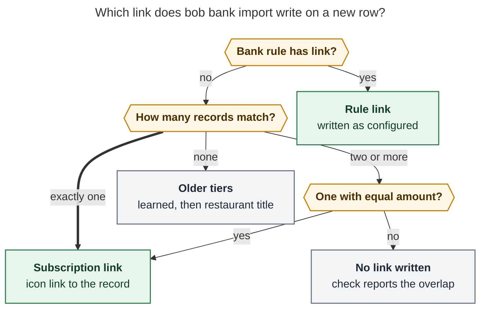

# Bank subscriptions album: records that know how they show up on the statement

- **Researcher:** cld (one of five independent reports; the lead synthesizes)
- **Bead:** `bob-cli-kt` — _Subscriptions album under bank: seed discretionary charges,
  link bank rows, propose price and candidate findings_
- **Date:** 2026-11-15
- **Inputs read:** the `bob-cli-kt` bead; `plan:202611/bank_daily_acknowledgment.md`
  (section "Follow-up: the subscriptions album"); the prior bank and album research;
  `docs/bank.md`, `docs/records.md`, and the acknowledgment guide;
  `src/native/bank/{naming,import_plan,import_run,suggest,grammar}.rs`; the
  `bob-ledger-tools` bank-marks sources in `bob-plugins`; and, in the vault, `bank.md`,
  `bank/2026-11.md`, `old_recur.md`, `cash.md`, the existing albums, and the bank import
  journal `.bob/bank/*.jsonl`.

## TL;DR

1. **Yes, build it.** The data makes the case. From May through October, checking paid
   about **$1,050 a month** in discretionary recurring charges. November's run rate is
   about **$1,230 a month**, and three AI chat plans make up about $700 of it.
   `old_recur.md` is stale: nine of its prices or cadences are wrong, it misses at least
   six live subscriptions, and seven of its rows have not charged checking since May. A static table can't keep up with this. A living album linked to the bank can.
2. **Your instinct is right, and the bead's plan for linking won't work on its own.**
   The bead links rows through *learned naming*: link a few existing rows by hand, and
   import copies the link forward. In this vault that has almost nothing to learn from:
   - Only **11 bank rows exist**, and 2 of them are subscriptions. The other **843
     journaled transactions** (May 1 – Nov 10) are `before_start`, so they have no rows.
   - Learned naming keys on the merchant, and four services changed their bank
     descriptor during the window (Claude, Audible, Google One, YouTube).
   - A yearly subscription would get its first learned link a year from now.

   So **each subscription record should own a required list of match strings**. I call
   the field **Shows up as** (`match:`), and import links from it.
3. **The bank already flags most subscriptions.** Wells Fargo prefixes card-on-file
   charges with `RECURRING PAYMENT AUTHORIZED ON MM/DD`. In this journal, 25 descriptors
   (about 19 services) carry that marker. All but two (car insurance and the gas
   utility) are discretionary subscriptions. Bob's cleaner
   currently throws the marker away. Using it lets `bob bank check` propose a candidate
   on the **first** charge, including yearly ones, instead of waiting for three.
4. **Keep the link tiny and let the plugin make it rich.** Import writes the canonical
   `[[subscriptions/<stem>|🔁]]`, exactly as the plan says. It reads well without any
   plugin, and every record's backlinks become its charge history for free.
   `bob-ledger-tools` then turns the 🔁 into a quiet pill. A normal charge shows the
   icon alone. Only exceptions add text: `↑$2.13`, `✂️ still charging`, or
   `🚫 after cancel`.
5. **Adjustments to the requirements**, called out in [Adjustments](#adjustments-to-the-requirements):
   - Replace `payee` with `match` (required, a list of strings).
   - Add `four_weekly` and `quarterly` cadences, a `to_decide` status, and an `ended`
     date.
   - Make `category` a bank category key, so imported rows arrive categorized.
   - Match all statuses: a charge on a cancelled record is the most useful alert there
     is.
   - Seed bank **rules** for the obligations, so candidate detection stays quiet.
   - Point the historical `[[old_recur#^…]]` links for discretionary rows at their new
     records.

## What the transactions say

> **Privacy note (a deliberate, narrow departure).** The bank plan says real bank data
> never enters a repository and reports give counts only. You asked for exactly this
> review, so the seed table below names services and the amounts they charge. That is the
> same information `old_recur.md` already holds in the vault. The table has no account
> numbers, no balances, no raw descriptors with personal names, and no per-transaction
> dates (months only). Obligations are listed by kind only. When the lead synthesizes,
> please keep this table out of beads and plans, and have the implementer regenerate it
> from the journal at seed time.

**Data window.** The per-host journal holds **854 checking transactions from 2026-05-01
to 2026-11-13**: three QFX imports, 11 rows `written`, and 843 `before_start`. That covers
"the last few months" (about 6.5 months). It does not cover any credit card. Only
`checking` is configured.

### Confirmed discretionary subscriptions (seen on checking)

`¹` marks a descriptor that changed during the window. `RP` means Wells Fargo flagged at
least one charge `RECURRING PAYMENT`.

| Proposed record | Shows up as (`match`) | Cadence | Latest charge | Bank cat | Evidence (May–Nov) | vs `old_recur.md` | Seed status |
| --- | --- | --- | --- | --- | --- | --- | --- |
| Claude | `ANTHROPIC`, `CLAUDE.AI` | monthly | $200.00 | tech | 7 charges, RP¹ | was $100 | 💚 active |
| ChatGPT | `OPENAI` | monthly | $200.00 | tech | 7 charges (one $122.86), RP | was $20 | 🤔 to decide |
| Grok | `GROK` | monthly | $300.00 | tech | 5 charges since Aug ($30 → $300), RP | missing | 🤔 to decide |
| DigitalOcean | `DIGITALOCEAN` | monthly (metered) | $342.50 | tech | 7 charges: $6 → $62 → $339–343, RP | was $6 | 🤔 to decide |
| Spotify | `SPOTIFY` | monthly | $13.85 | media | 6 charges, RP | was $11.72 | 💚 active |
| Disney+ | `DISNEY PLUS` | monthly | $23.45 | media | 6 charges, RP | was $21.31 | 💚 active |
| YouTube Premium | `YOUTUBE` | monthly | $15.99 | media | 5 charges, RP¹ | was $13.99 | 💚 active |
| Audible | `AUDIBLE` | monthly | $17.05 | media | 7 charges, RP¹ | same | 💚 active |
| Google One | `GOOGLE ONE` | **monthly** | $19.99 | tech | 6 charges, RP¹ | listed as yearly | 💚 active |
| New York Times | `NYTIMES` | **every 4 weeks** | $6.00 | media | 7 charges, exactly 28 days apart, RP | missing | 💚 active |
| Medium | `MEDIUM` | monthly | $5.00 | media | 6 charges, RP | same | 💚 active |
| reMarkable Connect | `REMARKABLE` | monthly | $3.99 | tech | 7 charges, RP | was $3.19 | 💚 active |
| Surfline Premium | `SURFLINE` | yearly | $149.99 | fun | Sep, RP | same | 💚 active |
| Readwise | `READWISE` | yearly | $119.88 | tech | Jun, RP | missing | 💚 active |
| No-IP | `NO-IP` | yearly | $29.99 | tech | Nov | was $59.98 | 💚 active |
| GoDaddy | `GODADDY` | yearly | $46.38 | tech | May $89.99 and Nov $46.38, RP (two domains?) | was $44.34 | 🤔 to decide |
| Plex | `PLEXINC` | yearly | $31.98 | media | Oct, RP | missing | 💚 active |
| Meta (unknown) | `METAPAY` | monthly? | $50.00 | — | Sep and Oct, RP | missing | 🤔 to decide |
| Twilio | `TWILIO` | metered | $10.76 | tech | Jul, RP | missing | 🤔 to decide |

Probable, but not flagged and seen only once: `APPLE.COM/BILL` ($31.98, Jun), Dynalist
($50.12, Jun), Alibaba Cloud ($30, May), and Google Cloud ($20, Oct). Seed these as 🤔
only if you recognize them.

### `old_recur.md` rows that have not charged checking since May

| Row | Last seen in the vault | Likely state |
| --- | --- | --- |
| The Farmer's Dog (monthly) | `@BANK` line, Dec 2024 | cancelled long ago, or on a card |
| PIA VPN (yearly) | Dec 2024 | lapsed, or on a card |
| GitHub Copilot (yearly) | Feb 2025 | should have renewed Feb 2026: lapsed or on a card |
| Reuters (yearly) | Jul 2025 | no July 2026 charge: lapsed or on a card |
| XMind (yearly) | never logged | unknown |
| Wispr Flow ($144) | Nov 28, 2025 | **if yearly, renews about Nov 29, 2026: decide this week** |
| NJ Transit monthly pass | Dec 2025 | replaced by per-ride tickets; leave in legacy |

Seed the first six as **🤔 to decide**, each with a note saying it hasn't charged
checking since May 2026. The audit then closes each one deliberately instead of dropping
it silently.

### Obligations (out of the album under `subscriptions_scope = discretionary`)

Mortgage, two student-loan servicers, car insurance, the gas utility, sanitation,
Verizon, a health-insurance premium, and the recurring Zelle transfers. The scope
decision says these "stay bank categories and rules." **Seed those rules now** (payee
and `cat`). Then the candidate finding can treat "a bank rule matches" as "known, not a
subscription", and it never nags about the mortgage.

### Numbers worth knowing

- **Actually charged, Aug–Oct average:** $1,049.65 a month across the confirmed list.
- **November run rate:** about $1,230 a month. That breaks down as:
  - fixed monthly plans: $506;
  - Grok and DigitalOcean at their latest amounts: $643;
  - yearly plans divided by 12: $32;
  - Meta: $50.
- **AI chat (Claude, ChatGPT, Grok):** $700 a month, or $8,400 a year. Add DigitalOcean
  and about 85% of the run rate is AI and cloud.
- **Price drift since `old_recur.md`:** seven entries (Spotify, YouTube, Disney+,
  reMarkable, Claude, ChatGPT, DigitalOcean), plus Google One moving from yearly to
  monthly and No-IP halving.
- **Charged amounts include NJ sales tax** (Spotify's $13.85 is $12.99 plus 6.625%).
  Records should store the charged amount, never the list price, because bob compares
  against the bank.

That last group is the case for the feature. `^audit-monthly-subscriptions` has waited
since June, and the drift happened while it waited.

## Critique of the plan

### What the bead gets right

- **The album passes the record-type test.** A subscription is a durable thing with a
  recurring keep-or-cancel decision. The research that rejected transaction records is
  right: subscriptions are the album, and transactions stay rows.
- **"bob check proposes, never creates"** matches the vault's ownership grain
  (`decisions:bob-gcal-is-read-only-and-proposes-once`, bank row ownership).
- **The wikilink `[[subscriptions/<stem>|🔁]]` is the right carrier.** It is visible
  without a plugin, it navigates, and backlinks turn it into a charge history. Every
  alternative (an inline `[sub::]` field, a hidden ID) loses at least one of those.
- **Discretionary scope** keeps the album about decisions, not burn.

### Where it is weak

1. **Learned naming can't seed or sustain the links** (see TL;DR 2):
   - There are no rows to learn from. Only 11 exist, and 2 are subscriptions.
   - Descriptor drift breaks merchant keys. In this window, `CLAUDE.AI SUBSCRIP` became
     `ANTHROPIC* CLAUDE`, and three Google-billed descriptors changed their punctuation
     and truncation.
   - The learned link is invisible. Nothing on the record says why a row got linked,
     and deleting a record leaves import copying a dead link from the last row.
   - The fix is your suggestion: **the record declares how it shows up.**
2. **`payee` is the wrong matching key.** A payee is *post-cleaning* text, and the
   cleaner keeps evolving (it has changed several times in the bank epic). Match on the bank's own
   description, the same text `bank.rules[].match` already matches, so one vocabulary
   covers both.
3. **`monthly | yearly` doesn't fit the data.** The NYT bills every 28 days. Metered
   services (DigitalOcean, Grok, Twilio) change every month. A cadence that can't
   describe the NYT produces a false "price changed" or "missed" finding 13 times a
   year.
4. **"3+ charges ~30 or ~365 days apart" can't find yearly subscriptions** with 6.5
   months of data. It would also nag about every obligation forever, because the
   discretionary decision deliberately keeps obligations *out* of the album. It needs a
   suppression rule and a faster signal. Both exist: bank rules, and the bank's own
   `RECURRING PAYMENT` marker.
5. **A static `renews:` date rots.** For anything the bank shows, the next charge is
   derivable from the last charge plus the cadence. Keep `renews` only as an override
   for trials and card-paid services.
6. **`category` free text creates a second taxonomy** next to `bank.categories`, which
   already has `💻 Tech & AI` and `📺 Media`. Make it a bank category key, so it also
   categorizes the imported row.
7. **The summary says "Everything that charges us on repeat"**, but the scope is
   discretionary only. Small fix: "What we pay for on repeat, and whether it still earns
   its keep."

### Would I take a different approach?

Only at the margins. I considered:

| Option | Verdict |
| --- | --- |
| **A. Learned-only linking** (the bead) | ❌ Fails on day one here: no rows, descriptor drift, yearly lag, invisible. |
| **B. `bank.rules` with `link:` per subscription** | Works with today's code, but the knowledge moves into `bank.md` config and duplicates the record. It has no status, cadence, or amount to detect drift with. A good escape hatch, a bad home. |
| **C. Only a `subscriptions` bank category** | Cheapest. It loses keep/cancel decisions, notes, cancel URLs, renewal heads-ups, and the cross-category total. It also fights `tech` and `media`. Don't add it. |
| **D. An external app (Rocket Money, YNAB, Copilot)** | Rejected by the bank research: cloud credentials, and it lives outside Bob. |
| **E. Records own `match` patterns (recommended)** | One source of truth that you can see and edit. It survives drift, attributes 6.5 months of journal history instantly with no rows, and generalizes later (an `eat` restaurant could opt in). |

## Adjustments to the requirements

Each one is a deliberate change to the bead or plan text.

| # | Bead / plan said | I recommend | Why |
| --- | --- | --- | --- |
| **ADJ-1** | `payee` (suggest) | **`match`**, labelled **Shows up as**: a required list of case-insensitive substrings of the bank description | It is explicit, survives descriptor drift, and is the same semantics as `bank.rules[].match`. It is required because it is the field the whole feature hangs on, and a brand name almost always works. |
| **ADJ-2** | Linking through learned naming | **Records link rows**: import writes the link when the record's patterns match, and learned naming never propagates subscription links | You can see why a row was linked, and deleting or editing a record is respected. |
| **ADJ-3** | Cadence `monthly`, `yearly` | `monthly`, `four_weekly` (Every 4 weeks), `quarterly`, `yearly` | The NYT is 28-day. Quarterly is common for utilities and insurance if the scope widens. |
| **ADJ-4** | Status `to_cancel`, `active`, `cancelled` | Add **`to_decide: 🤔 To decide`** between them | New candidates and unverified seeds need a home that isn't "active". I avoided "review", which already means the GTD review and the `]s` walk here. |
| **ADJ-5** | `category` (suggest) | `category` = a **bank category key** (suggested; validated by `bob bank check`) | One taxonomy. Imported rows arrive with `[cat::]`, and the Category card accepts with ↵. |
| **ADJ-6** | `renews` (date) | Keep it optional as an override. **Derive** the next charge from bank evidence, and add **`ended`** (date) | Static dates rot. `ended` powers the "charged after cancel" alert. |
| **ADJ-7** | Price finding on any difference | Fire only when **the last two charges agree with each other and differ from the record** | That catches real price changes (Spotify) and stays quiet on metered and one-off proration (DigitalOcean, ChatGPT's $122.86 month). |
| **ADJ-8** | Candidates: 3+ charges ~30 or ~365 days apart | Candidate = no record matches, **no bank rule matches**, and **either** the bank flagged `RECURRING PAYMENT` **or** 3+ charges fit a cadence window with an amount spread of 25% or less | It finds yearly subscriptions on their first charge and never nags about obligations. |
| **ADJ-9** | Seed the album only | Also **seed bank rules for the obligations** (payee and `cat`) | This is what the scope decision already says, and it is what makes ADJ-8 quiet. |
| **ADJ-10** | De-zorg `old_recur.md` into `legacy_recur`, rewriting inbound links | Same, but point the historical links for **discretionary** rows at their **records** (`[[subscriptions/spotify\|recur_spotify]]`). Point obligation links at `legacy_recur#^z-…` | About 277 links in about 180 `_habit.md` files. With this change, each record's backlinks show two years of `@BANK` price history (Spotify $11.72 → $12.78 → $13.85) with no code. |
| **ADJ-11** | All statuses implied | **Match every status**, including cancelled | A charge on a ✂️ or 🚫 record is the alert you most want. |
| **ADJ-12** | Summary "Everything that charges us…" | "What we pay for on repeat, and whether it still earns its keep." | It is accurate under the discretionary scope. |

## Design

### The album

Create it with
`bob albums create bank subscriptions -n subscription -e 🔁 -t Subscriptions -s "What we pay for on repeat, and whether it still earns its keep."`.
Then set the schema. Bob writes block style; flow maps are used here only for brevity:

```yaml
parent: "[[bank]]"
type: "[[album]]"
summary: What we pay for on repeat, and whether it still earns its keep.
emoji: 🔁
index_by: category
index_facets: [amount, cadence]
record:
  noun: subscription
  label: Subscription
  dated_notes: true
  fields:
    status:
      required: true
      values: {to_cancel: ✂️ To cancel, to_decide: 🤔 To decide, active: 💚 Active, cancelled: 🚫 Cancelled}
    amount:   {required: true, values: number, min: 0, label: Charged}
    cadence:  {required: true, values: {monthly: Monthly, four_weekly: Every 4 weeks, quarterly: Quarterly, yearly: Yearly}}
    match:    {required: true, list: true, label: Shows up as}
    category: {suggest: true}
    url:      {values: url, label: Manage}
    renews:   {values: date}
    ended:    {values: date}
```

- **Why these choices.**
  - `dated_notes` stamps notes like "Price went to $13.85" and "Called to cancel".
  - `index_by: category` subgroups a large 💚 group into `tech` and `media`.
  - Facets read `— 13.85, Monthly`.
- **The index then reads:**
  `[!records] 25 subscriptions · 🤔 12 to decide · 💚 13 active`.
- **Where it lands.** The album sits at the vault root (as albums must), parented under
  `bank`. `bank.md` gains an `## Albums` catalog row automatically.

A record bob writes:

```markdown
---
parent: "[[subscriptions]]"
type: "[[record]]"
title: "Spotify"
status: active
amount: 13.85
cadence: monthly
match:
  - SPOTIFY
category: "media"
url: https://www.spotify.com/account/
created: 2026-11-16T09:12:00-05:00
---

# Spotify

## Notes

- 2026-11-16 Seeded from 6 checking charges, May–Oct 2026, at $13.85. old_recur listed $11.72 ([[legacy_recur#^z-240410-cf]]).
```

Capture stays the existing record grammar. A candidate finding prints this block
paste-ready:

```text
Grok @subscriptions/
- status:: to_decide
- amount:: 300
- cadence:: monthly
- match:: GROK
- category:: tech
```

### The `match` contract (Shows up as)

- **Identity.** Bank linking binds to **the album whose record noun is `subscription`**,
  never to a hard-coded stem. Import currently hard-codes `context.resolve("eat")`;
  don't repeat that.
- **Semantics.** A pattern matches when it is a **case-insensitive substring** of:
  - at import: the raw transaction description;
  - at read time: the masked journal description, or a typed row's payee when there is
    no journal entry.

  These are exactly the `bank.rules[].match` semantics, so the documented caveat carries
  over: a pattern with a run of 4 or more digits can't match at read time.
- **Validation** (`bob bank check`, warning `bank_subscription_match_invalid`): each
  pattern must be at least 3 characters, have no run of 4 or more digits, and not be
  noise (`PURCHASE`, `RECURRING`, `PAYMENT`, `AUTHORIZED`, `CARD`).
- **Resolution** for one transaction:
  1. Collect the records with any matching pattern, across **all statuses**.
  2. If exactly one matches, that record wins.
  3. If several match, keep the ones whose `amount` equals the transaction's absolute
     amount. This handles shared billers: two `APPLE.COM/BILL` subscriptions at
     different prices.
  4. Still not unique: **no record**, plus info `bank_subscription_match_overlap` naming
     the records and the transaction. Never guess.

### Import: which link a new row gets



*Figure 1. A declared subscription match outranks everything except an explicit bank
rule. Ambiguity writes no link rather than a guess. (Rendered with Mermaid CLI 12.0.0
under the research-PDF config: 842 × 756 px, fit scale 77.5%.)*

Precedence for the three things naming resolves (each tier only fills what the tiers
above left empty):

| Field | Order, highest first |
| --- | --- |
| **link** | `bank.rules` link → **subscription** → learned (skipping `subscriptions/` links) → restaurant title |
| **category** | `bank.rules` cat → **subscription `category`** → learned → bank built-in. JSON suggestion source: `subscription` |
| **payee** | `bank.rules` payee → learned payee (your edit wins) → **subscription title** → built-in → cleaned description |

The canonical written row is unchanged in shape: cat, acct, links, ID.

```markdown
- [ ] $13.85 Spotify [cat:: media] [[subscriptions/spotify|🔁]] ^bank-1a2b3c4d
```

Ownership stays exactly as it is: bob writes a row once and never renames, relinks, or
recategorizes it. A row written before its record existed stays unlinked in the text.
Read-time attribution (next section) still counts it, and the plugin offers a one-click
link (an editor edit, the same precedent as the Category card).

**Import output** gains one line, and only when it has news:
`🔁 4 rows linked to subscriptions · 1 new candidate (Metapay $50.00) · 1 price change — bob bank check`.

### Read-time attribution: one answer for every view

A charge **belongs to** subscription X when:

1. its row links `subscriptions/X`; an explicit link wins, whatever the patterns say; or
2. otherwise, X wins pattern resolution over the transaction's description. This covers
   journal-only `before_start` transactions, so the **full 6.5 months appear
   immediately**, with no rows and no migration.

Every subscription view and finding reads this one function. Refunds attribute too and
net against charges.

### `bob bank check` findings (proposals, never writes)

| Code | Severity | Trigger | Hint |
| --- | --- | --- | --- |
| `bank_subscription_cancelled_charge` | warning | A charge on a 🚫 record posted after `ended` (on any charge when `ended` is empty) | "Spotify was cancelled but charged $13.85 on Nov 21: dispute it, or set status back" |
| `bank_subscription_price` | info | The last two charges are equal and differ from `amount` | `bob records update subscription spotify -s amount=13.85` |
| `bank_subscription_candidate` | info | No record or rule matches, and either a `RECURRING PAYMENT` charge or 3+ charges in one cadence window with an amount spread ≤ 25% | A paste-ready `@subscriptions/` capture, or "add a bank rule if it's a bill" |
| `bank_subscription_to_cancel_charged` | info | A charge on a ✂️ record | "still paying: $200.00 on Nov 2" plus the `url` |
| `bank_subscription_overdue` | info | An active record with bank evidence is more than 1.5 periods past its expected charge, and import coverage spans that date | "Hasn't charged since Oct 21: cancelled elsewhere, or moved cards?" |
| `bank_subscription_renewing` | info | A yearly record's next charge is within 14 days | "Surfline renews ≈ Sep 1 ($149.99): still worth it?" |
| `bank_subscription_match_invalid` / `_overlap` | warning / info | See [the match contract](#the-match-contract-shows-up-as) | — |
| `bank_subscription_category_unknown` | warning | `category` isn't a `bank.categories` key or built-in | Suggests the nearest key |

On this journal, once the seed records and obligation rules exist, `candidate` produces
**zero** findings. Every flagged merchant is either a record or a rule. That is the
"clean slate" acceptance test.

### Rendering: concise by default, loud only when it matters

**Written text** (no plugin, mobile, GitHub, Reading view): `🔁` is an ordinary link
alias. It shows a hover preview of the record, and it appears in the record's backlinks.

**`bob-ledger-tools` bank marks**, after the category chip, in both views. Raw syntax
reappears under the cursor, as it does for the other bank marks:

```text
☐    $13.85  Spotify        📺 Media       🔁
☐   $200.00  ChatGPT        💻 Tech & AI   🔁 ✂️ still charging
☐   $342.50  DigitalOcean   💻 Tech & AI   🔁 +$280.00
☐    $13.85  Spotify        📺 Media       🔁 🚫 after cancel
☐    $50.00  Metapay                       ⟳ subscription?
```

| State | Mark | Tone | Tooltip / action |
| --- | --- | --- | --- |
| Linked, amount as recorded | `🔁` alone | muted link | "Spotify · $13.85 a month · 💚 Active · 7th charge since May · next ≈ Dec 21" |
| Amount differs | `🔁 +$2.13` / `🔁 −$1.00` | muted; amber once `bank_subscription_price` fires | "Record says $11.72. Update?" runs `bob records update … -s amount=` |
| Record ✂️ to cancel | `🔁 ✂️ still charging` | amber | Opens the `url` (Manage) |
| Record 🚫 cancelled | `🔁 🚫 after cancel` | warning (the bank flag tone, never red for spending) | Names `ended` |
| Matches a record, but the row is unlinked | dashed `🔁` | ghost | Click inserts the link (an editor edit) |
| Bank-flagged recurring, no record, no rule | `⟳ subscription?` | ghost | Opens a prefilled "New subscription" form (`bob records new`); on success, inserts the link |

The rules that keep it beautiful:

- At most one glyph and about 14 characters beyond the 🔁.
- The normal state is the bare icon.
- State is carried by words and signs, never by colour alone. This matches the bank
  marks' existing grammar.

**Subscription record header** (plugin, drawn above `## Notes` on `subscriptions/*.md`):

```text
🔁 Spotify                                          💚 Active
$13.85 a month · ≈ $166 a year · next ≈ Dec 21 · since May 2026
 M  J  J  A  S  O  N  D  J  F  M  A
 ●  ●  ●  ●  ●  ●  ◌                                ● charged  ◌ expected
```

**Album card** (`bob-bank` fence `view: subscriptions` on `subscriptions.md`, drawn from
JSON, never written):

```text
🔁 Subscriptions              $1,230 a month · $14,760 a year on checking
✂️ To cancel    0
🤔 To decide   12   $896/mo seen · 6 not seen since May   ← the audit
💚 Active      13   $333/mo
💻 Tech & AI ████████████████░░ 85% · 📺 Media ██░ 9% · 🎟️ Fun ▏ 1%
1 renewing soon · 0 price changes · 0 candidates            bob bank check
```

These numbers are illustrative: the monthly equivalent of the bank-evidenced charges in
the seed table, if seeded with the statuses proposed above. Records with no charges seen
are counted, not summed. Monthly equivalent means monthly × 1,
four-weekly × 13/12, quarterly ÷ 3, yearly ÷ 12. Metered records use the trailing
three-month average of attributed charges.

**A month-card cross-cut** (one line, P2), for example `🔁 $1,049 on repeat · NN% of Out`.
Subscriptions cut across `tech` and `media`, and this line is the only place you'd see
them together.

### CLI and JSON (additive)

- **New read-only `bob bank subscriptions [-a] [-b DIR] [-f human|json]`**, alphabetical
  under `bank`.
  - It lists each record with its attributed charges, last charge, next expected charge,
    monthly equivalent, drift, and findings.
  - `-a` includes 🚫 records.
  - It is the single data source for the record header and the album card.
- **`list`, `report`, and `import` rows** add
  `subscription: {stem, path, title, status, cadence, amount_cents, source: "link"|"match", drift_cents} | null`
  and `bank_recurring: bool` (the bank's `RECURRING PAYMENT` marker, read from the
  journal description).
- **`report`** adds `totals.subscriptions_out_cents`.
- Follow `cli_rules`: every option gets a short alias, help is excellent, and coloured
  human output degrades cleanly.

## Seeding procedure (one agent session, with you in the loop)

1. **Create the album** (command above) and set the schema. Run `bob albums check`.
2. **Regenerate the seed table from the journal** with a read-only script. Don't copy
   this report's table: amounts move. Ask you, in one `/sase_questions` round, about
   every 🤔 row, the probable list, and the seven unseen `old_recur` rows.
3. **Create records** with `bob records new subscription "<Title>" -s … -n "<seed note>"`.
   Each one is a guarded write with the index rebuilt in the same transaction.
4. **Seed obligation `bank.rules`** (payee and `cat` only) in `bank.md`.
5. **Link the two existing subscription rows** (Claude on Nov 13, GoDaddy on Nov 12) by
   a one-time hand edit.
6. **De-zorg `old_recur.md`** into a `legacy_recur` notebook under `cash`, following the
   `eat.md` recipe:
   - Keep every block ID.
   - Rewrite about 277 inbound links (ADJ-10).
   - Baseline the unresolved-link count before and after.
   - Each legacy row links forward to its record.
7. **Point `cash.md ^audit-monthly-subscriptions` at `[[subscriptions]]`.** The seeding
   review is the audit, so close it once the 🤔 group is empty. A quarterly `#gtd`
   chore, "Walk 🤔 and ✂️ in [[subscriptions]]", keeps it from rotting again. It's your
   call whether to add it.
8. **Memory.** Through `/sase_memory_write`:
   - add a decision record, for example `decisions:subscriptions-own-their-bank-match`
     ("records declare how they show up; import links from them; learned never
     propagates subscription links; bob proposes, never creates");
   - add a glossary strand, **Subscription Record**, with "Shows up as".
9. **Close `bob-cli-kt`** after the code and plugin phases land. Remove "subscriptions"
   from `docs/bank.md` → "Current limits".

## Risks and open questions

| Risk | Handling |
| --- | --- |
| A pattern that's too broad (`MEDIUM` matching a coffee roast) | Overlap and invalid findings; patterns are visible on the record; the amount breaks ties. `bob bank subscriptions` shows the matched descriptors, so a bad pattern is obvious. |
| Card-paid subscriptions are invisible (checking only) | Records still hold them (`renews` override). Their `match` links them the day a card account is imported. `overdue` only fires where import coverage exists. |
| Descriptor changes (`CLAUDE.AI` → `ANTHROPIC`) | Several patterns per record. The candidate finding surfaces the new descriptor, and adding it is one line. |
| Metered noise | The "two equal consecutive charges" price rule; the trailing-average monthly equivalent. |
| Plugin collisions in `bob-ledger-tools` bank marks | Bank marks are syntax-only today; the pill's data states come from the new JSON and degrade to the bare link. |
| Bank data in agent-facing outputs | The new JSON is user-facing only; nothing goes into period briefs, Stats, or the Mac app (bank ADJ-8 still holds). |

Questions for you:

1. **What are Meta Pay ($50/mo since Sep) and Apple ($31.98 in Jun)?**
2. **Wispr Flow:** keep or cancel before about Nov 29?
3. **ChatGPT, Claude, and Grok overlap** ($700/mo). Do you want all three as 💚, or is
   this the first ✂️?
4. **Is GoDaddy two domains?** If so, make two records; the amount disambiguates them.
5. Do any credit cards carry subscriptions, such as the unseen `old_recur` rows? If so,
   adding that account to `bank.accounts` is the real fix for coverage.

## Recommended solution

Build the album, and make each **subscription record the single source of truth for how
it shows up in the bank**. Ship it in three slices, each independently valuable:

1. **P0 — vault seed (no code, about one session with you).**
   - Create `subscriptions` under `bank` with the schema above: `match` required as a
     list, four cadences, the `to_decide` status, a bank-key `category`, and `ended`.
   - Seed about 25 records from the journal review, confirming the 🤔 rows with you.
   - Seed obligation `bank.rules`.
   - De-zorg `old_recur.md`, rewriting the discretionary history links to the records.
   - Point the audit task at the album.
   - From day one you have an accurate, browsable album whose records already carry two
     years of backlinked history.
2. **P1 — bob-cli (`src/native/bank/`).**
   - Load the `subscription` album as guarded read inputs (as restaurants are today).
   - Add the `match` contract and the import precedence (rule → subscription → learned
     without subscription links → restaurant).
   - Add read-time attribution over rows plus the journal.
   - Stop discarding the `RECURRING PAYMENT` marker.
   - Add the `bank_subscription_*` findings: cancelled-charge, price, candidate,
     match-invalid, overlap, category-unknown first; to-cancel-charged, overdue, and
     renewing next.
   - Add `bob bank subscriptions`, the additive `subscription` and `bank_recurring` row
     JSON, and the one-line import summary.
   - Acceptance: re-importing the November QFX links Claude; a fixture with the old
     descriptor still links; `check` on the seeded vault reports zero candidates; a
     cancelled-record charge warns.
3. **P2 — bob-ledger-tools.**
   - The 🔁 row pill with its five states (bare, drift, ✂️, 🚫, ghost), with one-click
     linking and "⟳ subscription?" creation as editor edits.
   - The record header strip.
   - The `view: subscriptions` album card.
   - The month card's `🔁 on repeat` line.
   - Category-card context: "🔁 Spotify · $13.85/mo".

The result is intuitive because the record says exactly what it matches and you edit
patterns where you edit the subscription. It is reliable because declared patterns
outrank inference, ambiguity never guesses, cancelled records still match, and bob never
rewrites your rows. It is beautiful because the written link is a single 🔁, and the
plugin speaks up only when something deserves your attention.
