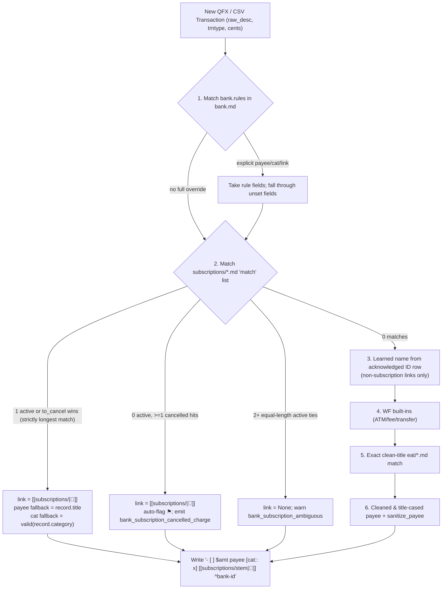

# Bank Subscriptions Album — Design, 6-Month Audit & Implementation Plan

## 1. Executive Summary

Adding a `subscriptions` album under `bank` is a **strong yes**. Reviewing every transaction in `kellys-macbook-pro-local.jsonl` from `2026-05-01` through `2026-11-13` (854 `bank.txn` records) against `~/bob/old_recur.md` (`zorg_source_mtime: 2026-01-08`) reveals why the static table stopped working: verified discretionary subscriptions in live Wells Fargo checking now run at **`$1,249.51/mo` (`$14,994.17/yr`)**, including **`$1,042.50/mo`** across AI and cloud subscriptions alone (`Claude`, `ChatGPT`, `Grok`, `DigitalOcean`) versus `$126.00/mo` recorded for those four in `old_recur.md` (`Grok` wasn't tracked at all). Seven additional active subscriptions (`NYTimes`, `Readwise`, `Dynalist`, `Plex`, `DashPass`, `MetaPay`, `Grok`) are missing from `old_recur.md`, while prices (`Spotify`, `YouTube Premium`, `reMarkable Connect`, `Disney Plus`, `No-IP`) and cadences (`Google One` is `$19.99/mo`, not `1y`) drifted silently.

However, implementing `bob-cli-kt` *literally as written* will hit immediate reliability and ergonomics problems—chief among them relying on `learned` first-link copying to propagate `[[subscriptions/<stem>|🔁]]`, treating `match` patterns casually or rigidly, leaving payee names as raw truncated QFX text, and using a naive 3-occurrence cadence heuristic for `bank_subscription_candidate`.

### Recommended Solution at a Glance

| Dimension | Recommended Design | Key Adjustment vs. `bob-cli-kt` |
| --- | --- | --- |
| **Album location & scope** | `subscriptions.md` (`parent: "[[bank]]"`, `noun: subscription`, `emoji: 🔁`), **discretionary keep-or-cancel charges only** | Keep `bob-cli-kt`'s discretionary boundary; explicitly seed `bank.md` `rules:` for fixed obligations (`mortgage`, `loans`, `utilities`, `insurance`) so they stay out of the album and candidate noise |
| **Schema fields** | `status` (`to_cancel`, `active`, `cancelled`), `amount`, `cadence` (`monthly`, `four_weekly`, `quarterly`, `yearly`), `pricing` (`fixed`, `variable`), `category`, `match` (`list: true`, **optional**), `renews`, `url` | Replace free-text `payee` with `match` (`list: true`) + optional `pricing`; allow empty `match` for cross-card/opaque subs (`Obsidian`, `Apple`, individual `GoDaddy` domains) and warn softly in `check` |
| **Auto-linking engine** | **Dedicated subscription-matcher tier** in `bob bank import` matching `match` substrings (raw desc on import, masked journal desc/payee on check), **specificity-first** (strictly longest match wins; ties refuse as ambiguous) | Do **not** rely on `learned` link cloning (`bank.md` starts `2026-11-11`; annuals fail; WF mutates descriptors mid-year); do not let stale `learned` links override live `match` rules |
| **Payee & category resolution** | On unique match: default `payee` to record `title` and `category` fallback to record `category` (when a valid `bank.md` key); explicit `bank.rules` always overrides field-by-field | Turns ugly/inconsistent QFX strings (`Openai *chatgpt Su`, `Claude.ai Subscrip`, `Plexinc*remote Yea`) into uniform names (`ChatGPT`, `Claude`, `Plex`) |
| **Cancelled zombie protection** | Match `cancelled` records **after** active/`to_cancel`; if hit, link AND auto-flag `⚑` + emit `bank_subscription_cancelled_charge` | New safety net not in `bob-cli-kt` |
| **Rendered look & UX** | Canonical Markdown `[[subscriptions/<stem>|🔁]]` rendered in `bob-ledger-tools` (`241p`/`241q`) as a **bespoke clickable pill chip** (status-tinted, surfaces price drift `⚠️`, expands to `🔁 <Title>` whenever payee differs) | Avoids repeating `Claude ... 🔁 Claude` while eliminating opaque bare `🔁` when payee isn't the record title |
| **Category Card (`bob.md:95`)** | Non-colliding `/` (or `@`) shortcut inside `BankCategoryCardModal` opens inline subscription picker + pre-ranks amount/merchant matches; single undo commit adds link + optional category | Implements `bob.md ^bank-subscriptions` cleanly without touching existing `a–z`/`1–8` category hotkeys |
| **Candidate detector & `check`** | `bank_subscription_price` compares **latest linked row** per fixed-price sub (`pricing: variable` suppresses noise); `bank_subscription_candidate` uses WF `RECURRING PAYMENT` token immediately (1+ rows) alongside 26–33d / ~90d / ~365d repeat checks | Fixes annual blindspot (3 occurrences @ 365d = 2+ years!) and retail `$25` false positives (`CVS`, `Walgreens`, `Aroma Smoke Shop`) |

---

## 2. Critique of the Current Plan (`bob-cli-kt`)

### What `bob-cli-kt` Gets Right

1. **Keeping fixed obligations out (`discretionary` scope):** Putting mortgage, student loans, health/car insurance, gas, Fios, sanitation, and salary transfers into `bank.md` (`rules:` + `categories:`) rather than `subscriptions/` matches the album's purpose (`"whether it still earns its keep"`). A mortgage payment isn't a keep-or-cancel decision.
2. **Actionable group ordering (`to_cancel` -> `active` -> `cancelled`):** Placing `✂️ To cancel` first mirrors `eat.md` (`🔖 To try` first) so `subscriptions.md`'s `[!records]` callout puts pending cancellations at the top of the page.
3. **Propose, never auto-create records:** Detecting unlinked candidates in `bob bank check` instead of silently minting half-baked notes during `bob bank import` keeps `subscriptions/` high-signal and human-curated.
4. **Clean legacy migration:** De-zorging `old_recur.md` into a `legacy_recur` notebook under `cash` while keeping all `^z-*` block IDs avoids breaking any inbound links (`cash.md`, `kellys_salary_info`, `remarkable`, `networking`).

### Seven Critical Flaws and Blindspots in `bob-cli-kt`

1. **`learned`-only link propagation fails on day one and breaks on descriptor drift.**
   - `bob-cli-kt` proposes: *"Link existing bank rows to their records (`[[subscriptions/<stem>|🔁]]`) so learned naming carries the link to future imports."*
   - In `~/bob/bank.md`, `checking.start` is **`2026-11-11`**. As of `bank/2026-11.md`, only **two** subscription charges (`Godaddy#••••`, `Anthropic* Claude`) exist in the ledger. Every annual subscription (`Surfline`, `Readwise`, `Dynalist`, `Plex`, `DashPass`, `No-IP`, plus winter/spring `Copilot`, `Obsidian`, `XMind`, `PIA`, `Reuters`) has **zero** rows in `bank/` and would not be linked automatically for up to 12 months.
   - Worse, `identity::merchant_key` only masks runs of 4+ digits (`identity.rs`). In the last 6 months alone, Wells Fargo changed or alternated descriptors mid-year on **five** core subscriptions:
     - **Claude:** `CLAUDE.AI SUBSCRIP ...` (May) → `ANTHROPIC* CLAUDE ...` (Jun–Nov)
     - **Audible:** `GOOGLE *Audible Au ... 855-836-XXXX` (May, Jun, Aug) interleaved with `Google Audible Aud ... 650-XXXX` (Jul, Sep, Oct, Nov)
     - **Google One:** `GOOGLE *Google One ...` (May–Jun) → `Google One ...` (Jul–Oct)
     - **YouTube Premium:** `GOOGLE *YouTubePre ...` (May) → `Google YouTubePrem ...` (Jun–Oct)
     - **GoDaddy:** `DNH*GODADDY#••••` (May) vs `GODADDY#••••` (Nov)
   - And `import_plan::learn()` copies `row.links.first().cloned()` verbatim—so any non-subscription link placed first on a row would hijack future imports, while renaming or cancelling a subscription record would keep resurrecting the old link from historical rows.

2. **`old_recur.md` (`2026-01-08`) is too stale to seed directly.**
   - Seeding mechanically from `old_recur.md` would miss **7 active subscriptions** seen in May–Nov checking (`Grok`, `NYTimes`, `Readwise`, `Dynalist`, `Plex`, `DashPass`, `MetaPay`), record stale prices on **7 others** (`Claude`, `ChatGPT`, `DigitalOcean`, `Spotify`, `YouTube Premium`, `reMarkable`, `No-IP`, plus `Disney Plus`'s Oct hike), misclassify `Google One` as `yearly` instead of `monthly`, and import the already-replaced `Train Tickets` (`NJT RAIL MY-TIX` pay-per-ride replaced the monthly pass).

3. **Two-way `payee` vs. `match` confusion.**
   - `bob-cli-kt` defines `payee` as *"the bank-row payee it shows up as"* (`suggest`), without defining any machine matcher. Meanwhile the QFX strings are truncated (`Openai *chatgpt Su`, `Surfline Premium P`, `Plexinc*remote Yea`, `Dd *doordashdashpa`, `Godaddy#••••`). Leaving ugly bank payees alongside an icon-only `🔁` makes rows hard to scan; conversely, typing multi-variant QFX tokens into a scalar `payee` field fails when one service uses two descriptors (`Audible`, `Claude`, `Google One`).

4. **`bank_subscription_price` on all historical rows causes permanent false-positive spam.**
   - `Disney Plus` rose from `$21.31` (May–Sep) to `$23.45` (Oct). `DigitalOcean` stepped `$6.00 → $62.43 → $62.50 → $338.97 → $342.50`. `Grok` billed `$30.00`, `$66.65`, `$174.69` in Aug before settling at `$300.00`. `ChatGPT` prorated `$122.86` in May before `$200.00`. `GoDaddy` billed `$89.99` and `$46.38` for distinct domains.
   - Checking *every* linked historical row against the record's current `amount` would warn forever on past rows even after `amount` is updated. Checking **only the latest linked row** on **fixed-price** subs solves historical bumps while still catching genuine price hikes like Disney Plus (`$21.31 → $23.45`).

5. **`bank_subscription_candidate` (`3+ charges ~30 or ~365 days apart`) misses annuals and misfires on retail.**
   - Requiring **3 charges ~365 days apart** means waiting **over two full years** before ever flagging an annual subscription like `Readwise`, `Dynalist`, `Plex`, or `Surfline`!
   - Conversely, purely checking `~30d` across 3+ charges without filtering would flag `CVS/PHARMACY #••••` (consecutive `$25.00` charges 31 & 28 days apart), `WALGREENS STORE 50 SOUTH` (`$25.00` charges at 28d / 86d / 28d), `Aroma Smoke Shop` (frequent `$27.59`/`$33.11` visits whose intervals span ~30d subsets), `Trust Inc / Squire` (barber every 79–80 days), and every un-ruled bill (`CrossCountry Mortgage`, `Dept Education` x3, `AmeriHealth`, `Geico`, `Elizabethtown Gas`, `Verizon`).
   - Meanwhile, `bob-cli-kt` overlooks the single cleanest signal in Wells Fargo QFX: **`RECURRING PAYMENT`** right in raw `desc`/`merchant`! Eleven recurring services in Bryan's checking export carry `RECURRING PAYMENT` explicitly on charge #1.

6. **No lifecycle feedback on `to_cancel` and `cancelled` inside bank workflows.**
   - Without checking `cancelled` records during `bob bank import` and rendering record state on bank rows, a subscription marked `cancelled` still fails silently if a merchant bills again, and a row linked to a `to_cancel` record looks visually identical to a healthy `active` row during weekly `]b` review.

7. **Missing the Category Picker linking requirement (`bob.md:95`) and number display polish.**
   - `~/bob/bob.md:95` (`^bank-subscriptions`) explicitly notes: *"Add ability to link to subscription from category picker!"* — which `bob-cli-kt` omits. Also note `albums/index.rs` prints `Number` facets plainly without currency signs (`200` instead of `$200`), which looks awkward alongside dates and categories unless formatted cleanly in CSS/`subscriptions.base`.

---

## 3. Explicit Adjustments to `bob-cli-kt` Requirements

Every adjustment below is recommended on top of (or instead of) the baseline `bob-cli-kt` specification:

1. **Replace `payee` with `match` (`list: true`, optional) + title-driven payee normalization.**
   - *Instead of* a scalar `payee` text field on records, declare `match` (`list: true`, **optional**) for bank statement substring patterns.
   - When a record matches during `bob bank import`, use the record's **`title`** as the default `payee` (unless overridden by `bank.rules[].payee`), preserving the raw bank string safely in `.bob/bank/<host>.jsonl`.
2. **Keep `match` strongly recommended, NOT `required: true`.**
   - Answering the user's question directly: a `match` list on each record note is **the right place** for matching strings (single source of truth; no syncing `bank.md` + `subscriptions/*.md`), **but making `match` strictly `required: true` would backfire**. Unseen Dec–Apr annuals (`Obsidian`, `Copilot`, `PIA`, `XMind`, `Reuters`), subs on another card (`Wispr Flow`, `The Farmer's Dog`), and shared/opaque billing descriptors (`APPLE.COM/BILL`, individual `GoDaddy` domains) must be capturable cleanly via `@subscriptions/` without forcing bogus placeholder patterns that cause false positives.
   - Guardrails instead belong in **`bob bank check`**: warn if an `active`/`to_cancel` record has a dangerous pattern (`< 4` chars, 4+ digit run that gets masked to `••••` in the journal, or overlapping rule), and surface empty `match` only as `info`.
3. **Add a dedicated subscription-matching tier in `bob bank import` (and stop cloning subscription links via `learned`).**
   - Evaluate record `match` rules natively inside `import_plan` (via guarded `ReadDep` preimages, generalizing `load_restaurants` in `src/native/bank/import_run.rs`).
   - Do not use `learned_index` to clone existing `[[subscriptions/...]]` links blindly; only copy non-subscription links from `learned`, so `match` rules in `subscriptions/*.md` remain live, editable, and authoritative.
4. **Canonical `[[subscriptions/<stem>|🔁]]` + clean payee + smart status/price pill in `bob-ledger-tools`.**
   - Keep `[[subscriptions/<stem>|🔁]]` in Markdown so bank lines stay compact, uniform with `[[eat/<stem>|🍽️]]` (`docs/bank.md:370`), and free of repetition (`$200.00 Claude [cat:: tech] [[subscriptions/claude|🔁]]`).
   - Upgrade `241p-plugin-bank-marks.js` and `241q-plugin-bank-marks-reading.js` to replace the `[[subscriptions/...]]` link span with a styled pill badge (`.bob-bank-mark-sub`) using `app.metadataCache`: show **`🔁`** (or `✂️ To cancel` / `🚫 Cancelled` / `⚠️ ≠ $X`) when `payee == record.title`, and expand automatically to **`🔁 <Title>`** whenever `payee != record.title` (e.g., manual links on `Apple.com/bill` or `Godaddy#••••`).
5. **Expand `cadence` and add `pricing: fixed | variable`.**
   - `cadence`: `monthly`, `four_weekly` (or fold `NYTimes` 28-day cycle cleanly as `four_weekly`), `quarterly`, `yearly`.
   - Add `pricing` (`values: { fixed: 📌 Fixed, variable: 📈 Usage }`, optional with `default: fixed`) because `FieldKind` in `src/native/records/schema.rs` has no boolean kind (`Text`, `Choices`, `Date`, `Link`, `Url`, `Number` only). `bank_subscription_price` then compares **only the latest linked row** against `record.amount` for `fixed` subs, and only flags >2× spikes on `variable` subs (`DigitalOcean`, `Grok`, `Twilio`, `GoDaddy` if kept as one umbrella record).
6. **Add cancelled-charge sentry (`bank_subscription_cancelled_charge`).**
   - If a bank import matches a `cancelled` subscription (and no `active`/`to_cancel` record matches), link it, auto-append `⚑`, and report `bank_subscription_cancelled_charge` in `bob bank check`.
7. **Upgrade `bank_subscription_candidate` and pair with `bank.md` obligation rules.**
   - Flag any unlinked row with `RECURRING PAYMENT` in its raw/journal description (1+ occurrences, unless matched by a `bank.rules` entry) *plus* 2+ year-apart (`~340–390d`) or quarterly (`~80–100d`) or 3+ monthly (`26–33d`) clusters with consistent or near-consistent amounts, ignoring high-frequency everyday retail/coffee/convenience/pharmacy purchases.
   - Add starter `bank.rules` for Bryan's fixed obligations (`mortgage`, `student loans`, `insurance`, `gas`, `Verizon`, `sanitation`, `Kelly Zelle`, `NJT Rail`) so bills file effortlessly and don't clutter candidate alerts.
8. **Integrate subscription linking into `BankCategoryCardModal` (`bob.md:95`).**
   - Bind `/` inside the Category Card (`247-plugin-bank-category-card-ui.js`) to open an inline subscription linker/searcher right during weekly filing, committing both `[cat:: ...]` and `[[subscriptions/<stem>|🔁]]` in a single atomic line edit (`246-plugin-bank-category-card-write.js`).

---

## 4. Schema, Capture UX, & Obsidian Base Design

### 4.1 Album Declaration (`~/bob/subscriptions.md`)

Based directly on `src/native/records/schema.rs`, `src/native/albums/` (`docs/records.md`), and the existing `eat.md` / `podcasts.md` albums:

```yaml
---
parent: "[[bank]]"
type: "[[album]]"
summary: Everything discretionary that charges us on repeat, and whether it still earns its keep.
emoji: 🔁
index_by: cadence
index_facets:
  - amount
  - category
  - renews
created: 2026-11-15T12:00:00-05:00
record:
  noun: subscription
  label: Subscription
  plural: subscriptions
  dated_notes: true
  fields:
    status:
      required: true
      values:
        to_cancel: ✂️ To cancel
        active: 💚 Active
        cancelled: 🚫 Cancelled
    amount:
      values: number
      min: 0
      required: true
    cadence:
      required: true
      values:
        monthly: Monthly
        four_weekly: Every 4 weeks
        quarterly: Quarterly
        yearly: Yearly
    pricing:
      default: fixed
      values:
        fixed: 📌 Fixed
        variable: 📈 Usage
    category:
      required: true
      suggest: true
    match:
      list: true
    renews:
      values: date
    url:
      values: url
---
```

#### Field-by-Field Rationale

- **`index_by: cadence` + explicit `index_facets: [amount, category, renews]`:**
  Because `LARGE_GROUP` in `src/native/albums/grouping.rs` triggers subgroup headings whenever a status group exceeds `12` records (which `💚 Active` will, at ~16–20 rows), `index_by: cadence` automatically splits `💚 Active` cleanly into `### Monthly`, `### Yearly`, `### Every 4 weeks` inside `[!records]`! Meanwhile `✂️ To cancel` and `🚫 Cancelled` stay compact and show up to 3 facets (`amount`, `category`, `renews`). Note that `albums/index.rs` currently formats `Number` fields plainly (`200`, `19.99` without `$`)—a tiny optional enhancement to `records/schema.rs` + `albums/index.rs` (e.g., `unit: "$"` / `prefix: "$"` on number fields, or formatting `amount` nicely in Obsidian CSS/`.base`) would polish `subscriptions.md` even further, though `subscriptions.base` handles `$XX.XX` formatting natively right now via formulas.
- **`match` (`list: true`, optional):**
  Matches how `bob records` already supports comma-separated and repeated values (`docs/records.md:398, 421–422`):
  - **Capture shorthand:**
    ```text
    Surfline @subscriptions/
    - status:: active
    - amount:: 149.99
    - cadence:: yearly
    - category:: fun
    - match:: SURFLINE PREMIUM P
    - renews:: 2027-09-01
    - url:: https://www.surfline.com/account
    - Annual forecast subscription.
    ```
  - **CLI creation:**
    `bob records new subscription 'Claude' -s status=active -s amount=200 -s cadence=monthly -s category=tech -s match='ANTHROPIC* CLAUDE' -s match='CLAUDE.AI SUBSCRIP'`
- **`dated_notes: true`:** Fits `subscriptions` cleanly (`"2026-11-15 — Resized DigitalOcean / audit spike"`, `"2026-10-22 — Price rose from $21.31 to $23.45"`), matching `eat.md`, `movies.md`, `tv.md`.
- **`category` aligned to `bank.md` keys:** Using `tech`, `media`, `delivery`, `household`, `fun`, `utilities`, `shopping` lets `bob bank import` inherit category from the subscription record automatically, while `suggest: true` populates autocomplete from existing subscription notes. `bob bank check` can emit an advisory if `category` is not a declared non-builtin key in `bank.md`.
- **`renews`:** Primarily populated on **yearly/quarterly** subs (or when a `to_cancel` / `cancelled` sub remains active until period end). Left blank on ordinary monthly subs so Bryan never has to hand-bump dates every month.

### 4.2 Why `match` Beats Alternative Rule Placement Strategies

| Approach | Single Source of Truth? | Handles Descriptor Drift? | Works on Day 1 for Annuals? | Supports Unseen / Shared / Ambiguous Cards? | Verdict |
| --- | --- | --- | --- | --- | --- |
| **`learned` only (`bob-cli-kt`)** | No (spread across `bank/*.md` history) | **No** (`CLAUDE.AI` vs `ANTHROPIC*`, `GOOGLE *One` vs `Google One`) | **No** (`bank/` starts `2026-11-11`) | N/A | Reject |
| **Exact `title` match (like `eat`)** | Yes | **No** (`Surfline Premium P`, `Plexinc*remote Yea`, `Openai *chatgpt Su`) | Partially | Yes | Reject |
| **Putting all subscription rules in `bank.md rules:`** | **No** (duplicated link + category + amount across `bank.md` & `subscriptions/*.md`) | Yes | Yes | Clutters `bank.md`; drifts from `status: cancelled` | Reject |
| **`match` (`list: true`) required on record schema** | Yes | Yes | Yes | **Fails** (`Obsidian`, `APPLE.COM/BILL`, multi-domain `GoDaddy`) | Adjust |
| **`match` (`list: true`, optional) on record schema + `check` advisories** | **Yes** | **Yes** | **Yes** | **Yes** | **Adopt** |

### 4.3 `~/bob/subscriptions.base` Design

Mirroring `~/bob/eat.base`, a `subscriptions.base` file linked from `subscriptions.md` turns the album into a live financial dashboard with formatted currency and monthly-equivalent math:

```yaml
filters:
  and:
    - file.inFolder("subscriptions")
    - note.type == link("record")
formulas:
  name: if(title, file.asLink(title), file.asLink())
  state: if(status == "to_cancel", "✂️ To cancel", if(status == "active", "💚 Active", if(status == "cancelled", "🚫 Cancelled", status)))
  monthly_eq: if(status == "cancelled", 0, if(cadence == "yearly", amount / 12, if(cadence == "quarterly", amount / 3, if(cadence == "four_weekly", amount * 13 / 12, amount))))
  billed_display: "$" + amount.toFixed(2) + if(cadence == "yearly", "/yr", if(cadence == "quarterly", "/qtr", if(cadence == "four_weekly", "/4wk", "/mo"))) + if(pricing == "variable", " ~", "")
  monthly_display: "$" + formula.monthly_eq.toFixed(2) + "/mo"
  category_badge: if(category == "tech", "💻 Tech & AI", if(category == "media", "📺 Media", if(category == "delivery", "🛵 Delivery", if(category == "fun", "🎟️ Fun", if(category == "household", "🤝 Household", if(category == "utilities", "💡 Utilities", category))))))
properties:
  formula.name: { displayName: Subscription }
  formula.state: { displayName: Status }
  formula.billed_display: { displayName: Billed }
  formula.monthly_display: { displayName: Monthly Eq }
  formula.monthly_eq: { displayName: Monthly ($) }
  formula.category_badge: { displayName: Category }
  note.renews: { displayName: Renews }
  note.url: { displayName: Cancel / Billing }
views:
  - type: table
    name: 💳 Active Burn
    filters:
      or:
        - status == "active"
        - status == "to_cancel"
    groupBy:
      property: formula.category_badge
      direction: ASC
    order:
      - formula.name
      - formula.state
      - formula.billed_display
      - formula.monthly_eq
      - renews
      - url
    sort:
      - property: formula.monthly_eq
        direction: DESC
    summaries:
      formula.monthly_eq: Sum
      formula.name: Count
  - type: table
    name: 📅 Annual & Upcoming Renewals
    filters:
      and:
        - status != "cancelled"
        - cadence == "yearly"
    order:
      - formula.name
      - formula.state
      - formula.billed_display
      - renews
      - url
    sort:
      - property: renews
        direction: ASC
  - type: table
    name: ✂️ Cancellation Queue
    filters:
      and:
        - status == "to_cancel"
    order:
      - formula.name
      - formula.monthly_display
      - renews
      - url
    sort:
      - property: formula.monthly_eq
        direction: DESC
  - type: table
    name: 🚫 Cancelled Archive
    filters:
      and:
        - status == "cancelled"
    order:
      - formula.name
      - formula.billed_display
      - formula.category_badge
      - match
```

*(Note: verify `summaries` property/sum key syntax on Bryan's installed Obsidian Bases version before committing `subscriptions.base`; the `eat.base` file uses `summaries: { formula.name: Count }` cleanly.)*

---

## 5. Complete 6-Month Bank Transaction Audit & Seeding Plan

**Audit Scope:** Read-only inspection of all **854 `bank.txn`** entries (`2026-05-01` through `2026-11-13`) in `~/bob/.bob/bank/kellys-macbook-pro-local.jsonl`, plus `~/bob/bank/2026-11.md`, `~/bob/old_recur.md` (28 active + 1 inactive), `~/bob/cash.md`, and `~/bob/bank.md`.

### Run-Rate Snapshot (May–Nov 2026 Confirmed Checking Spend)

| Bucket | Count | Latest Monthly Eq | Annualized | Notes |
| --- | ---: | ---: | ---: | --- |
| Monthly Fixed (incl. `MetaPay $50`) | 10 | **$549.32/mo** | $6,591.84/yr | `$499.32/mo` excluding `MetaPay` if unconfirmed |
| 28-Day Cycle (`NYTimes` 13×/yr) | 1 | **$6.50/mo** | $78.00/yr | Exact 28-day gaps (`05-26` .. `11-10`) |
| Monthly Variable (`DigitalOcean`, `Grok`) | 2 | **$642.50/mo** | $7,710.00/yr | Highest volatility (`$6 → $342.50`, `$0 → $300`) |
| Annuals Seen May–Nov (6 single + `GoDaddy` ×2) | 7 | **$51.19/mo** | $614.33/yr | Surfline, Readwise, DashPass, Dynalist, Plex, No-IP, GoDaddy |
| **Total Verified May–Nov Discretionary** | **20** | **$1,249.51/mo** | **$14,994.17/yr** | vs. `$241.53/mo` for the same non-dormant rows (`$706.16/mo` across all 20 discretionary rows in `old_recur.md`) |
| *Plus Off-Window `old_recur.md` Annuals (`Copilot`, `XMind`, `Reuters`, `PIA`)* | *4* | *+$20.41/mo* | *+$244.94/yr* | Likely Dec–Apr billing window (verify active) |

---

### Tier 1 — Confirmed Active Monthly / 4-Weekly Subscriptions (Seed Immediately)

| # | Title (`stem`) | Observed History (May 1 – Nov 13, 2026) | Exact Statement Patterns (`match`) | Proposed Fields (`category`, `amount`, `cadence`, `pricing`, `status`) | vs. `old_recur.md` / Vault Notes |
| ---: | --- | --- | --- | --- | --- |
| 1 | **DigitalOcean** (`digitalocean`) | 7×: `05-01` `$6.00`, `06-01` `$62.43`, `07-01` `$62.50`, `08-03` `$62.50`, `09-01` `$62.50`, `10-01` `$338.97`, `11-02` **`$342.50`** | `["DIGITALOCEAN.COM"]` | `tech`, `342.50`, `monthly`, `variable`, **`active`** (or `to_cancel` resize?) | `old_recur.md` still says `$6`! `cash.md:64` has `"Undo resize of apollo!"` — `+$280.00/mo` jump over Q3 (`$62.50`)! |
| 2 | **Grok** (`grok`) | 5×: `08-17` `$30.00` + `$66.65`, `08-19` `$174.69`, `09-15` `$300.00`, `10-15` **`$300.00`** | `["GROK XAI", "WWW.GROK.COM"]` | `tech`, `300.00`, `monthly`, `variable`, `active` | **New** (missing from `old_recur.md`); Oct `15` → watch Nov `15–17` |
| 3 | **Claude** (`claude`) | 7×: `05-13` (`CLAUDE.AI SUBSCRIP`), `06-15`, `07-13`, `08-13`, `09-14`, `10-13`, `11-13` — all **`$200.00`** | `["ANTHROPIC* CLAUDE", "CLAUDE.AI SUBSCRIP"]` | `tech`, `200.00`, `monthly`, `fixed`, `active` | Stale `$100` in `old_recur.md`; **descriptor switched in Jun**; Nov 13 row already in `bank/2026-11.md:29` |
| 4 | **ChatGPT** (`chatgpt`) | 7×: `05-04` `$122.86`, then `06-02`, `07-02`, `08-03`, `09-02`, `10-02`, `11-02` — **`$200.00`** | `["OPENAI *CHATGPT SU", "OPENAI.COM"]` | `tech`, `200.00`, `monthly`, `fixed`, `active` | Stale `$20.00` (`%chad`) in `old_recur.md` (upgraded to Pro) |
| 5 | **MetaPay** (`metapay`) | 2×: `09-21` `$50.00` (`PURCHASE 09/20`), `10-21` **`$50.00`** (`RECURRING PAYMENT 10/20`) | `["METAPAY", "META.COM"]` | `tech` (or `fun`), `50.00`, `monthly`, `fixed`, **`active` (VERIFY)** | **New** (missing from `old_recur.md`); confirm product (Meta AI / Verified / Quest+) and rename note! |
| 6 | **Disney Plus** (`disney_plus`) | 6×: `05-22`..`09-22` `$21.31`, **`10-22` `$23.45`** | `["Disney Plus"]` | `media`, `23.45`, `monthly`, `fixed`, `active` | **Price hiked +10%** in Oct (`$21.31 → $23.45`)! |
| 7 | **Google One** (`google_one`) | 6×: `05-15`, `06-15` (`GOOGLE *Google One`), then `07-15`, `08-17`, `09-15`, `10-15` (`Google One`) — **`$19.99`** | `["GOOGLE *Google One", "Google One"]` | `tech`, `19.99`, `monthly`, `fixed`, `active` | `old_recur.md` falsely says **`recur::1y`**; descriptor dropped `GOOGLE *` in Jul |
| 8 | **Audible** (`audible`) | 7×: `05-04`, `06-04`, `08-04` (`GOOGLE *Audible Au`) + `07-06`, `09-04`, `10-05`, `11-04` (`Google Audible Aud`) — **`$17.05`** | `["GOOGLE *Audible Au", "Google Audible Aud"]` | `media`, `17.05`, `monthly`, `fixed`, `active` | Classic **interleaved dual-descriptor** case (`855` vs `650` phone/merchant strings) |
| 9 | **YouTube Premium** (`youtube_premium`) | 6×: `05-26` (`GOOGLE *YouTubePre`) + `06-25`, `07-27` (`PURCHASE`), `08-25`, `09-25`, `10-26` (`Google YouTubePrem`) — **`$15.99`** | `["GOOGLE *YouTubePre", "Google YouTubePrem"]` | `media`, `15.99`, `monthly`, `fixed`, `active` | Stale `$13.99` (`Youtube Red`) in `old_recur.md`; truncated descriptor changed prefix & `PURCHASE`/`RECURRING` |
| 10 | **Spotify** (`spotify`) | 6×: `05-21`, `06-22`, `07-21`, `08-21`, `09-21`, `10-21` — **`$13.85`** | `["Spotify USA"]` | `media`, `13.85`, `monthly`, `fixed`, `active` | Stale `$11.72` in `old_recur.md` |
| 11 | **NYTimes** (`nytimes`) | 7×: `05-26`, `06-23`, `07-21`, `08-18`, `09-15`, `10-13`, `11-10` — **`$6.00`** | `["NYTIMES*"]` | `media`, `6.00`, **`four_weekly`**, `fixed`, `active` | **New** (not in `old_recur.md`); exact **28-day** billing = 13 charges/yr (`$78/yr`) |
| 12 | **Medium** (`medium`) | 6×: `05-20`, `06-22`, `07-20`, `08-20`, `09-21`, `10-20` — **`$5.00`** | `["MEDIUM MONTHLY", "MEDIUM.COM"]` | `media`, `5.00`, `monthly`, `fixed`, `active` | Matches `old_recur.md` `$5.00` |
| 13 | **reMarkable Connect** (`remarkable_connect`) | 7×: `05-11`, `06-09`, `07-09`, `08-10`, `09-09`, `10-09`, `11-09` — **`$3.99`** | `["REMARKABLE OPS LLC", "WWW.REMARKABL"]` | `tech`, `3.99`, `monthly`, `fixed`, `active` | Stale `$3.19` in `old_recur.md`; link `[[remarkable]]` in notes |

---

### Tier 2 — Confirmed Annual Discretionary Subscriptions Seen in May–Nov (Seed Immediately)

| # | Title (`stem`) | Observed Charge(s) | Exact `match` Pattern(s) | Proposed Fields (`category`, `amount`, `cadence`, `renews`, `status`) | Notes |
| ---: | --- | --- | --- | --- | --- |
| 14 | **Surfline** (`surfline`) | `2026-09-01` `$149.99` (`SURFLINE PREMIUM P RECURRING PAYMENT 08/31 SURFLINE.COM/`) | `["SURFLINE PREMIUM P", "SURFLINE.COM"]` | `fun`, `149.99`, `yearly`, `renews: 2027-09-01`, `active` | Matches `old_recur.md` `$149.99` `1y` |
| 15 | **Readwise** (`readwise`) | `2026-06-29` `$119.88` (`READWISE RECURRING PAYMENT 06/27 READWISE.IO`) | `["READWISE.IO", "READWISE"]` | `media` (or `tech`), `119.88`, `yearly`, `renews: 2027-06-29`, `active` | **New** (missing from `old_recur.md`) |
| 16 | **DoorDash DashPass** (`doordash_dashpass`) | `2026-09-25` `$96.00` (`DD *DOORDASHDASHPA PURCHASE 09/24 DOORDASH.COM`) | `["DD *DOORDASHDASHPA"]` | `delivery`, `96.00`, `yearly`, `renews: 2027-09-25`, `active` | **New**; must match exact `DD *DOORDASHDASHPA`—there are **35+ food orders** like `DD *DOORDASH NOLAS` / `VINNY` / `BAGEL`! |
| 17 | **Dynalist** (`dynalist`) | `2026-06-01` `$50.12` (`PAYPAL *DYNALISTIN PURCHASE 05/28 •••• CAN`) | `["DYNALISTIN"]` | `tech`, `50.12`, `yearly`, `renews: 2027-06-01`, `active` | **New**; cleaner strips `PAYPAL *`, leaving `Dynalistin`—record renames payee cleanly to `Dynalist`! (`to_cancel` if replaced by Obsidian/Bob?) |
| 18 | **Plex Remote Watch Pass** (`plex`) | `2026-10-26` `$31.98` (`PLEXINC*REMOTE YEA RECURRING PAYMENT 10/24 PLEX.TV`) | `["PLEXINC*REMOTE YEA", "PLEX.TV"]` | `media`, `31.98`, `yearly`, `renews: 2027-10-26`, `active` | **New** (annual Remote Watch Pass) |
| 19 | **No-IP DDNS** (`noip_ddns`) | `2026-11-10` `$29.99` (`NO-IP PURCHASE 11/09 775-853-•••• NV`) | `["NO-IP"]` | `tech`, `29.99`, `yearly`, `renews: 2027-11-10`, `active` | Was `$59.98` `1y` in `old_recur.md` (plan downsized / split) |
| 20 | **GoDaddy Domains** (`godaddy`) | `2026-05-07` `$89.99` (`DNH*GODADDY#•••• RECURRING PAYMENT`) **AND** `2026-11-12` `$46.38` (`GODADDY#•••• RECURRING PAYMENT`, in `bank/2026-11.md:18`) | `["DNH*GODADDY", "GODADDY"]` *(if umbrella)* | `tech`, `89.99` (or sum `136.37`), `yearly`, `pricing: variable`, `active` | **Design decision:** Two domain renewals share the exact masked string `GODADDY#••••`. Either 1 umbrella `GoDaddy Domains` record (`pricing: variable`, auto-links both!) or 2 domain-specific records with **empty `match`** linked via Category Picker `/`! |

---

### Tier 3 — Verify / Ambiguous Charges Found in May–Nov (Confirm Before Seeding or Leaving Out)

| Descriptor | Observed Charge(s) | Likely Meaning | Recommended Action |
| --- | --- | --- | --- |
| `APPLE.COM/BILL` | `2026-06-11` `$31.98` (`PURCHASE 06/10 800-275-••••`) | Could be iCloud+ / Apple TV+ / annual app sub, OR one-time App Store purchase | **Do NOT put `APPLE.COM/BILL` in an auto-match rule** if you ever have >1 Apple subscription (opaque aggregator!). Check Apple email/receipt; if it's an annual app or iCloud bundle, seed with empty `match` (or unique only if there is literally 1 Apple charge). |
| `TWILIO INC` | `2026-07-30` `$10.76` (`RECURRING PAYMENT 07/28 WWW.TWILIO.CO`) | Twilio phone number / SMS balance auto-recharge | Coded `RECURRING PAYMENT` by Wells Fargo. Seed if actively keeping phone/SMS integration (`pricing: variable`, `tech`), or close/cancel unused Twilio project. |
| `PAYPAL *ALICLOUD S` | `2026-05-15` `$30.00` (`PURCHASE 05/12`) | Alibaba Cloud balance / server | Only 1 charge in 6 months; likely prepaid credit or stopped VPS. Omit unless still active. |
| `GOOGLE *CLOUD KLCW` | `2026-10-05` `$20.00` (`PURCHASE 10/03 g.co/helppay#`) | Google Cloud billing / API spend | Only 1 charge in 6 months (`PURCHASE`); track as PAYG `tech` expense unless recurring. |
| `TRUST INC - THE WO ... GETSQUIRE.COM` | `06-03` `$128.00`, `08-21` `$123.00`, `11-09` `$123.00` (79d, 80d gaps) | Barber shop booking via Squire (`GETSQUIRE.COM`) | **Keep OUT of `subscriptions`**. Regular personal appointment (`personal`), not a subscription contract. Good test case for candidate detector! |

---

### Tier 4 — Off-Window Annuals & Dormant `old_recur.md` / `cash.md` Items

Every remaining item in `old_recur.md` (and `cash.md`) that had **zero charges** in `2026-05-01`..`2026-11-13` WF Checking:

| Title | `old_recur.md` / Vault Source | Proposed Seed Action | Rationale & Verification Needed |
| --- | --- | --- | --- |
| **Obsidian** (`obsidian`) | `cash.md:78`: `"Cancel Obsidian! [scheduled:: 2027-01-03]"` | Seed **`status: to_cancel`**, `yearly`, `renews: 2027-01-03` *(or renewal date; verify `$50`/`$96`/`$100` Sync+Publish price)*, `match: ["OBSIDIAN"]` (optional) | Immediate win for `✂️ To cancel` queue! Absent May–Nov, so annual charge probably lands Dec/Jan or on another card. |
| **GitHub Copilot** (`copilot`) | `old_recur.md:38`: `$100.00`, `1y` | Seed **`status: active`** (or verify if still paid personally vs replaced by Claude/Grok), `amount: 100`, `yearly`, `tech`, empty `match` | Likely renewed Feb–Mar (250219 Zorg creation date suggests Feb!). Wait for QFX descriptor or check GitHub billing. |
| **XMind** (`xmind`) | `old_recur.md:22`: `$59.99`, `1y` | Verify whether still active (`to_cancel` if unused?); seed `59.99`, `yearly`, `tech` | Zero hits May–Nov; may bill Dec–Apr. |
| **PIA (VPN)** (`pia_vpn`) | `old_recur.md:31`: `$39.95`, `1y` | Verify whether still active; seed `39.95`, `yearly`, `tech` | Zero hits May–Nov; may bill Dec–Apr. |
| **Reuters** (`reuters`) | `old_recur.md:40`: `$45.00`, `1y` (`[[networking#^z-250715-0n]]`) | Seed **`status: cancelled`** or verify billing card (`07-17` Zorg date fell *inside* our audited May–Nov window with **$0** WF charge!) | Note `250717` suggests a July renewal, yet nothing hit WF Checking in Jul 2026! Probably cancelled or on another card. |
| **Wispr Flow** (`wispr_flow`) | `old_recur.md:43`: `$144.00`, **`1m`** | Verify! **$0** charged May–Nov despite `1m` cadence (note `$144` is often Whisper Flow Pro *annual*, billed Nov 29!) | Keep alert around late Nov 2026 (`251129` = 1 year ago!). Could also have cancelled or moved to yearly! |
| **The Farmer's Dog** (`the_farmers_dog`) | `old_recur.md:33`: `$214.63`, `1m` | Verify if moved to Kelly's card / paused / cancelled | **$0** in Bryan's May–Nov WF Checking (note Aug 17 `PETCO $213.11` & Nov 9 `PET SUPPLIES PLUS $24.50` appeared instead). |
| **Train Tickets** *(Retired)* | `old_recur.md:32`: `$106.00`, `1m` | Do **not** seed as active (optionally skip or `cancelled`); add `NJT RAIL MY-TIX` rule to `bank.md` (`[cat:: transit]`) | Replaced completely by 35 individual `NJT RAIL MY-TIX` `$2.60`/`$2.65` rides in May–Nov. |
| **Trade Coffee** (`trade_coffee`) | `old_recur.md:48`: `## @INACTIVE`, `$58.50`, `1m` | Seed as `status: cancelled` (`household`/`delivery`) *only if* historical record wanted; otherwise archive cleanly inside `legacy_recur.md` | Keeping `legacy_recur.md` cleanly covers old inactive Zorg rows, or seeding as `cancelled` catches zombie charges if ever re-enabled. |
| *(Note: Amazon Prime)* | Not in `old_recur.md` | Check whether Prime is on Kelly's card or an Amazon Visa | WF Checking showed only 3× `$15.98` retail orders (+1 return), no `$14.99`/`$139` Prime charge. |

---

### Tier 5 — Obligations & Household Bills (Stay in `bank.md`, NOT `subscriptions/`)

These **must remain out of `subscriptions/`** per `bob-cli-kt`'s discretionary boundary, **and should be added to `bank.md` `rules:` now** so `bob bank import` auto-suggests categories/payees and `bob_subscription_candidate` doesn't false-alarm on them:

| Obligation | Observed in May–Nov 2026 Checking | Suggested `bank.md` Rule (`match` → `payee` / `cat`) |
| --- | --- | --- |
| **CrossCountry Mortgage** | 7×: `$3,859.75` (May–Oct) → **`$3,885.83`** (Nov 3) | `match: "CROSSCOUNTRY MORTGAGE"` → `payee: "CrossCountry Mortgage"`, `cat: home` |
| **Dept of Education (3 Loans)** | 19×: `$137.16`, `$173.33`, `$114.11` every month (`11–12` / `14–16` / `29–31`) | `match: "DEPT EDUCATION STUDENT LN"` → `payee: "Dept of Education Student Loan"`, `cat: loans` |
| **AmeriHealth Insurance** | 5×: `$1,303.16` (`06-17`, `08-03`, `09-01`, `10-01`, `11-03`) | `match: "AMERIHEALTH INSURA"` → `payee: "AmeriHealth Insurance"`, `cat: health` |
| **GEICO Auto Insurance** | 6×: `$251.82` (May), `$256.52` (Jun), `$252.64` (Jul–Oct) | `match: "GEICO *AUTO"` → `payee: "GEICO Auto"`, `cat: car` |
| **Elizabethtown Gas** | 7×: `$202.19`, `$758.74` (May), `$48.94`, `$38.69`, `$33.60`, `$35.25`, `$44.56` | `match: "B2P*ELIZABETHTOWN"` → `payee: "Elizabethtown Gas"`, `cat: utilities` |
| **Verizon Fios** | 6×: `$54.99` (`VERIZON PAYMENTREC URRING`, up from `$49.99` in `old_recur.md`) | `match: "VERIZON PAYMENT"` → `payee: "Verizon Fios"`, `cat: utilities` |
| **Verizon Wireless (?)** | 1×: `05-18` `$79.50` (`VZWRLSS*D••••-01`) | Verify if phone/equipment; `cat: utilities` |
| **Interstate Waste / Sanitation** | 1×: `08-10` `$232.50` (`SANITATION SERVICE ... INTERSTATEWAS`) | `match: "SANITATION SERVICE"` → `payee: "Interstate Waste Sanitation"`, `cat: home` (quarterly vs `old_recur.md` `$36.50/mo`!) |
| **Kelly Salary & Monthly Bills** | 14× Zelle: `$1,956.00` monthly salary + `$1,113–$1,882` bills | `match: "ZELLE TO DONNELLY KELLY"` → `payee: "Kelly Donnelly"`, `cat: household` |
| **NJ Transit Tickets** | 35×: `$2.60` / `$2.65` (`NJT RAIL MY-TIX`, replacing `$106` pass) | `match: "NJT RAIL MY-TIX"` → `payee: "NJ Transit"`, `cat: transit` (note `bank/2026-11.md:30` defaulted to `personal`!) |

### Retroactive Links for Existing `~/bob/bank/2026-11.md` Rows

Only **2** rows in `bank/2026-11.md` are subscriptions right now:
- Line 18: `- [x] $46.38 Godaddy#•••• [cat:: tech] ^bank-259ce333` → link `[[subscriptions/godaddy|🔁]]` (or specific domain note via Category Picker)
- Line 29: `- [x] $200.00 Anthropic* Claude [cat:: tech] ^bank-4c9f7358` → `- [x] $200.00 Claude [cat:: tech] [[subscriptions/claude|🔁]] ^bank-4c9f7358`

---

## 6. Matching Engine, `bob bank import`, & `bob bank check` Architecture

### 6.1 Proposed Naming & Link Resolution Flow



### 6.2 Matching Semantics & Edge-Case Rules

1. **Matching inputs & normalization:**
   - During **`bob bank import`**: match each trimmed, non-empty `match` string **case-insensitively (`contains_folded`)** against **`raw_desc`** (preserving URL/domain clues like `OPENAI.COM`, `WWW.GROK.COM`, `READWISE.IO`, `PAYPAL *DYNALISTIN` before cleaning strips them) **OR** `cleaned` payee (in case a user copies `Godaddy` or `Dynalistin`).
   - During **read-time checks/suggestions** (`bob bank report`, `bob bank check`, `suggest.rs`): match against the masked `journal.desc` (falling back to `row.payee` when unjournaled). Mirror `rule_category`'s existing safety guard in `src/native/bank/suggest.rs` (`has_long_digit_run`): a `match` pattern with 4+ consecutive digits cannot match masked journal descriptions and triggers a warning in `bob bank check`.
2. **Order-independent tie breaking (Specificity Wins, Ambiguity Refuses):**
   - Unlike `bank.rules` (one YAML array in `bank.md`), records live in unordered `subscriptions/*.md` files. Iterating files and taking "first match wins" would silently depend on filename sort order!
   - Instead:
     1. Partition matching records into **Live** (`status` is `active` or `to_cancel`) vs. **Cancelled** (`status` is `cancelled`). Empty/missing `status` (`needs_status`) is treated as Live so a newly captured incomplete record isn't mislabeled Cancelled, while still caught by `records check`.
     2. Collect every matching `(record, longest_matching_pattern_len)` pair in the winning partition (Live beats Cancelled).
     3. Find `max_len = max(pattern.chars().count())`.
     4. If **exactly 1 record** achieves `max_len` (case-insensitive pattern deduplication within one record): link it! Example: `"DD *DOORDASHDASHPA"` (18 chars) strictly beats `"DD *DOORDASH"` (12 chars).
     5. If **2+ records** tie at `max_len`: **refuse to auto-link** (write `link = None`), attach finding `bank_subscription_ambiguous` in import output / `bob bank check`, and let Bryan link manually via the Category Card.
3. **Interoperability with `bank.rules` (`resolve_name` in `src/native/bank/naming.rs`):**
   - Preserve explicit user control in `bank.md`:
     - `payee`: `rule.payee` → `sub.title` → `learned.payee` → `builtin.payee` → cleaned/title-cased
     - `category`: `rule.cat` → `valid_bank_cat(sub.category)` → `learned.category` → `builtin.cat`
     - `link`: `rule.link` → `sub.link` (from Live or Cancelled match) → `non_sub_learned.link` → `restaurant.link`
   - Why stop `learned` from copying old `[[subscriptions/...]]` links? If Bryan deletes a `match` pattern or adds a domain rule later, stale historical links won't keep re-attaching themselves. Meanwhile, `bank.rules` still lets Bryan override a specific subscription edge case without modifying the record schema.
4. **Guarded transaction safety (`ReadDep` in `src/native/bank/import_run.rs`):**
   - Generalize `load_restaurants` (which currently reads `eat` via `RecordContext::discover(vault)` and builds `ReadDep` preimages for root `.md` names, album declarations, folder names, and every record file) into a shared `load_album_records(vault, "subscriptions")` loader.
   - `import_run.rs` already aborts cleanly before committing if any `ReadDep` preimage changes concurrently across vault sync/edits—reusing this gives subscription auto-linking identical race-safety at zero new architectural risk.

### 6.3 Cleaner Quick Wins Surfacing in Live Wells Fargo Data (`src/native/bank/naming.rs`)

Reading Bryan's 6-month `bank.txn` stream alongside `clean_description` revealed three small, high-leverage improvements to `naming.rs`:

1. **`GODADDY#••••` glued store/account suffix (`bank/2026-11.md:18`):** `strip_store_numbers` currently strips space-preceded `#1234`, leaving `#••••` attached to `GODADDY#••••` after `mask_long_digits`. Stripping trailing `#[0-9•]+` cleanly turns `GODADDY#••••` → `Godaddy`.
2. **`VERIZON PAYMENTREC URRING` (observed May–Oct 2026 checking journal):** Wells Fargo occasionally truncates/splits `RECURRING` without an `MM/DD` date token (`PAYMENTREC URRING •••• BRYANBUGYI`), bypassing `strip_qfx_transaction_segment` (which requires whitespace-delimited `RECURRING PAYMENT` + `MM/DD`). Recognizing `PAYMENTREC\s*URRING` (and standalone trailing `RECURRING PAYMENT`) keeps the payee clean (`Verizon`) and feeds the candidate signal below.
3. **Observed processor/aggregator prefixes:** `DNH*` (`DNH*GODADDY#••••`) and `SP ` (e.g., `SP FAHERTY`) appear in raw QFX (`strip_processor_prefix` in `naming.rs` currently strips only `SQ *`, `TST*`, and `PAYPAL *`); record-title normalization on matched `subscriptions` cleanly overrides `DNH*GODADDY` regardless.

### 6.4 Redesigned `bob bank check` Diagnostics (`src/native/bank/check.rs`)

| Diagnostic Code | Severity | Exact Trigger Condition | Why It's Better Than Naive `bob-cli-kt` Rules |
| --- | --- | --- | --- |
| `bank_subscription_cancelled_charge` | **Error** (or high Warning) | Any bank row links to a `subscriptions/` record whose `status == cancelled` | Catches zombie billing immediately; import also auto-flags row with `⚑` |
| `bank_subscription_to_cancel_charge` | **Info / Warning** | Any unacknowledged (or current-month) row links to `status == to_cancel` | Reminds Bryan while filing `]b` that he still hasn't cancelled it! |
| `bank_subscription_price` | **Warning** | Latest linked row (by date/line) for a **`fixed`** sub differs from `record.amount` by >= `$0.01` — OR a **`variable`** sub exceeds `2× record.amount` | Avoids permanent warning spam on historical pre-hike rows (`Disney Plus` `$21.31 → $23.45`) and natural usage drift (`DigitalOcean`, `Grok`, `Twilio`) |
| `bank_subscription_candidate` | **Warning / Info** | Unlinked row (not matching `bank.rules`, not `transfer`/`cash`/`income`/`refund`, and excluding high-frequency retail) meets **any**: (a) `raw/journal desc` contains WF `RECURRING PAYMENT` / `PAYMENTREC URRING`; (b) 2+ occurrences `340–390d` apart (annual); (c) 2+ occurrences `80–100d` apart with ≤15% amount delta (quarterly); (d) 3+ occurrences `26–33d` apart (catches 28d `NYTimes` + monthly) with ≤20% amount delta or consistent merchant | Fixes annual blindspot, catches `MetaPay` / `Twilio` / `Readwise` / `Surfline` / `Plex` **immediately** on first/second charge, and filters out `CVS $25` / `Walgreens $25` / `Aroma Smoke Shop` / `Squire $123` noise |
| `bank_subscription_ambiguous` | **Warning** | 2+ non-cancelled records tie for longest match on a row, or a row has an ambiguous `match` pattern overlap between records | Surfaces conflicts deterministically instead of arbitrary filename ordering |
| `bank_subscription_match_masked` | **Warning** | Any `match` entry contains a run of 4+ digits (`\d{4,}`) or `< 4` chars | Teaches why `••••` breaks read-time matching and prevents broad 2–3-letter false matches |
| `bank_subscription_unknown_category` | **Info** | Record's `category` isn't a declared non-builtin key in `bank.md` | Prevents silent loss of category auto-fill on typos (`ai` vs `tech`) |

---

## 7. Visual Design & Interactive UX

### 7.1 Bank Row Rendering: Markdown Canonical Form + Pill Chip in `bob-ledger-tools`

**Markdown stored in `bank/YYYY-MM.md`:**

```markdown
- [ ] $200.00 Claude [cat:: tech] [[subscriptions/claude|🔁]] ^bank-4c9f7358
- [ ] $23.45 Disney Plus [cat:: media] [[subscriptions/disney_plus|🔁]] ^bank-99aa1122
- [ ] $3.99 reMarkable Connect [cat:: tech] [[subscriptions/remarkable_connect|🔁]] ^bank-55bb3344
- [ ] $50.00 Obsidian [cat:: tech] [[subscriptions/obsidian|🔁]] ^bank-77cc4411
- [ ] $31.98 Apple.com/bill [cat:: tech] [[subscriptions/icloud|🔁]] ^bank-88dd5522
```

Notice how legible this is even in plain `cat` or Source mode: there is zero repetition (`Claude ... 🔁`), uniform placement right before `^bank-id`, and `subscriptions/<stem>` remains directly clickable and backlink-indexed in Obsidian.

**How `bob-ledger-tools` (`241o` / `241p` / `241q` + `styles.css`) should render it visually:**

`bankParseRowTail` (`241o-plugin-bank-marks-model.js`) **already parses every `[[...]]` token into `tail.links` with `{ start, end, text }`**! Currently `241p` (Live Preview, cursor off line) and `241q` (Reading View) turn `[cat:: ...]` into `.bob-bank-mark-cat`, `[acct:: ...]` into `.bob-bank-mark-acct`, `⚑` into `.bob-bank-mark-flag`, and `^bank-id` into `.bob-bank-mark-id`, while leaving `[[subscriptions/...|🔁]]` as a raw underlined emoji link.

Extending `241p` and `241q` with a **`BankSubscriptionChipWidget`** (`.bob-bank-mark-chip.bob-bank-mark-sub`) using synchronous `app.metadataCache.getFirstLinkpathDest(...)` lookups produces a unified, scannable row:

| Subscription State (`metadataCache`) | Row Payee vs. Record Title | Rendered Pill Chip | Visual Styling (`styles.css` tokens) |
| --- | --- | --- | --- |
| `active`, fixed, price matches | Same (`Claude`) | `🔁 monthly` *(or quiet `🔁`)* | Muted border matching `.bob-bank-mark-acct`, `--text-muted`, zero noise |
| `active`, `fixed`, **price changed** (`$23.45` vs `$21.31`) | Same (`Disney Plus`) | `🔁 ≠ $21.31` | Subtle warning accent `--text-warning` (`data-sub-alert="price"`) |
| `active`, `variable` | Same (`DigitalOcean`) | `🔁 usage` | Quiet muted pill (no false drift alert) |
| `to_cancel` | Same (`Obsidian`) | `✂️ To cancel` | Warm amber pill (`--color-orange` / `--text-warning`), nudging cancellation! |
| `cancelled` (**zombie charge!**) | Same or differs | `🚫 Cancelled` + `⚑` | Soft red tint (`--color-red` / `--text-error`), impossible to overlook |
| Any state, **payee differs from record title** | `Apple.com/bill` + `iCloud+` (or `Godaddy#••••` + `bobs.org`) | **`🔁 iCloud+`** *(plus state badge if `✂️`/`🚫`)* | **Automatically expands to show the record's real `title`** so opaque aggregators stay clear! |

- **Behavior:** Clicking the pill opens the subscription note (`Cmd/Ctrl+Click` opens in a new pane); moving the caret onto the line in Live Preview cleanly reveals raw Markdown via `241p`'s existing `!cursor` guard; hovering displays a native tooltip (`"Claude · 💚 Active · $200.00/mo · match: ANTHROPIC* CLAUDE, CLAUDE.AI SUBSCRIP"`).

### 7.2 Category Card Integration (`~/bob/bob.md:95`)

`BankCategoryCardModal` (`245`/`246`/`247`/`248`) currently binds category hotkeys (`c, v, s, d, e, g, p, h, o, f, n, k, 1..8, i, r, t, a`) plus navigation keys (`Enter`, `Ctrl+Enter`, `Space`, `Esc`/`q`/`Ctrl+[`, arrows, `Ctrl+N/P`). Adding subscription support right inside the card keeps the `]b` → `Ctrl+Enter` weekly flow **100% keyboard-driven**:

1. **Header awareness (passive, zero keystrokes):**
   - If the current row already has a `[[subscriptions/...]]` link (auto-linked at import!) OR `bob` returns a candidate subscription suggestion, display a compact **Subscription Context Strip** directly under `YYYY-MM-DD  $XX.XX  Payee`:
     `🔁 Disney Plus · 💚 Active · listed $21.31/mo (+$2.14 increase!)` or `✂️ Obsidian · To cancel (renews 2027-01-03) [Open billing URL ↗]`.
   - When a category is already pre-selected from the subscription record, `BankCategoryCardModal` highlights that tile by default so **`Enter` files `[x]` and advances to the next waiting row immediately**.
2. **Manual linking & swapping via `/` (non-colliding hotkey):**
   - Pressing **`/`** (reserved—never collides with any single-letter `a–z` or `1–8` category hotkey!) toggles an inline **Link Subscription** drawer at the bottom/body of the modal:
     - Autofocuses a tiny filter input (`Type to filter subscriptions…`) listing all `subscriptions/*.md` notes sorted by: (1) amount match (`|row_cents - sub.amount_cents| <= $1`), (2) fuzzy merchant/`match` overlap, (3) `active`/`to_cancel` above `cancelled`.
     - Selecting an item with `Enter`:
       - Inserts/replaces `[[subscriptions/<stem>|🔁]]` right before `^bank-<id>` via `bankCategoryWritePlan` (`246`),
       - If the row currently has no `[cat:: ...]` and the record defines a valid `bank.md` category, applies `[cat:: <sub.category>]` (or switches focus straight back to category tiles highlighted on that category), and ticks `[x]` in **one atomic undo step**!
     - `Esc` returns cleanly from the subscription filter back to the category tiles without closing the whole modal.
     - Selecting **"Unlink subscription"** removes an erroneous `[[subscriptions/...]]` link cleanly.
     - Optional bonus action at the bottom of the list: **`+ Create new subscription record (@subscriptions/…)`** pre-filled with cleaned payee, amount (`Math.abs(cents)`), suggested category, and sanitized merchant `match` string!

---

## 8. Recommended Solution & Phased Implementation Roadmap

### Summary Recommendation

Adopt the `subscriptions` album design with the **8 adjustments in Section 3**: keep Bryan's discretionary boundary; store case-insensitive `match` lists on each subscription record as an **optional (`required: false`)** field rather than forcing `required: true`; add a **specificity-first subscription matching tier** (with `cancelled` zombie-flagging + `read_deps` transaction guards) directly into `bob bank import` alongside title-based payee normalization and category fallback; check **latest-row price drift** (`pricing: fixed | variable`) and **`RECURRING PAYMENT`-aware candidates** in `bob bank check`; and render canonical `[[subscriptions/<stem>|🔁]]` links as **status-aware clickable pills + Category Card `/` picker integration** in `bob-ledger-tools`.

### Phased Rollout

1. **Phase 1 — Album Creation, `.base`, & Seeding Verification (`~/bob`)**
   - Review the ~5 open confirmation items in Section 9 with Bryan (takes <2 minutes).
   - Create `~/bob/subscriptions.md` (`bob albums create bank subscriptions -n subscription -e 🔁 ...` + finalize YAML schema with `match`, `pricing`, `index_by: cadence`, `index_facets: [amount, category, renews]`).
   - Seed Tiers 1 & 2 (plus confirmed Tiers 3–4) via `bob records new` / `@subscriptions/`, add `~/bob/subscriptions.base`, seed obligation `rules:` in `~/bob/bank.md`, retroactively link `Godaddy` + `Anthropic* Claude` in `~/bob/bank/2026-11.md`, point `cash.md ^audit-monthly-subscriptions` at `[[subscriptions]]`, and archive `old_recur.md` → `legacy_recur.md` preserving `^z-*` block IDs (`bob records check` + `bob albums check`).
2. **Phase 2 — Auto-Linking in `bob bank import` (`bob-cli`)**
   - Generalize `load_restaurants` (`src/native/bank/import_run.rs`) to load `subscriptions` records cleanly with `ReadDep` preimages.
   - Implement specificity-first subscription matching + `cancelled` auto-flagging + `title`/`category` fallbacks in `naming.rs` / `import_plan.rs`, while preventing `learned_index` from cloning stale subscription links.
   - Apply the 3 QFX cleaner fixes (`GODADDY#••••`, `PAYMENTREC URRING`, `DNH*`).
3. **Phase 3 — Diagnostics & Candidate Detection (`bob-cli`)**
   - Implement `bank_subscription_cancelled_charge`, `bank_subscription_to_cancel_charge`, `bank_subscription_price` (latest linked row + `pricing: variable` guard), `bank_subscription_candidate` (`RECURRING PAYMENT` + yearly/quarterly/28d–33d clustering), `bank_subscription_ambiguous`, and `bank_subscription_match_masked` in `check.rs` + `suggest.rs`.
   - Expose matched/candidate subscription metadata cleanly in `bob bank report -f json` so `bob-ledger-tools` doesn't duplicate matching logic in JS.
4. **Phase 4 — Rendered Chips & Category Card Integration (`bob-plugins`)**
   - Add `.bob-bank-mark-sub` CM6 + Reading View widget (`241p` / `241q` + `styles.css`), smart-expanding when `payee != title` and tinting `to_cancel` / `cancelled` / price drift from `app.metadataCache`.
   - Wire `/` subscription linker (with live filter & atomic `bankCategoryWritePlan` write) into `BankCategoryCardModal` (`245`–`248`) and close `bob-cli-kt` + `bob.md ^bank-subscriptions`.

---

## 9. Five Quick Decisions Needed From Bryan Before Seeding

1. **`MetaPay` (`$50.00/mo` on `2026-09-21` & `2026-10-21`):** What specific Meta subscription is this (Meta AI / Verified / Quest+), so we give the record a clear title?
2. **Domain / Cloud One-Offs (`DigitalOcean` `$342.50`, `Twilio` `$10.76`, `Google Cloud` `$20`, `Alibaba Cloud` `$30`, `Apple.com/bill` `$31.98`):**
   - Should `DigitalOcean` be marked `to_cancel` / flagged alongside `Undo resize of apollo!`?
   - Are `Twilio`, `Google Cloud`, `Alibaba Cloud`, and `Apple.com/bill` (`$31.98`) ongoing subscriptions to track, or one-time credits/purchases?
3. **`GoDaddy` (`$89.99` May 7 + `$46.38` Nov 12):** Track as **1 umbrella `GoDaddy Domains` record** (`pricing: variable`, `match: ["DNH*GODADDY", "GODADDY"]`, auto-links both!) or separate per-domain records (empty `match`, manual link)?
4. **Dormant / Off-Window `old_recur.md` Items (`Wispr Flow $144`, `The Farmer's Dog $214.63`, `Copilot $100`, `XMind $59.99`, `PIA $39.95`, `Reuters $45`):** Which are still active (awaiting Dec–Apr renewals or on another card) vs. `cancelled`?
5. **Obsidian (`cash.md:78` `"Cancel Obsidian!"`):** Seed immediately as `status: to_cancel` with `renews: 2027-01-03` and approximate annual amount (Sync/Publish fee)?
