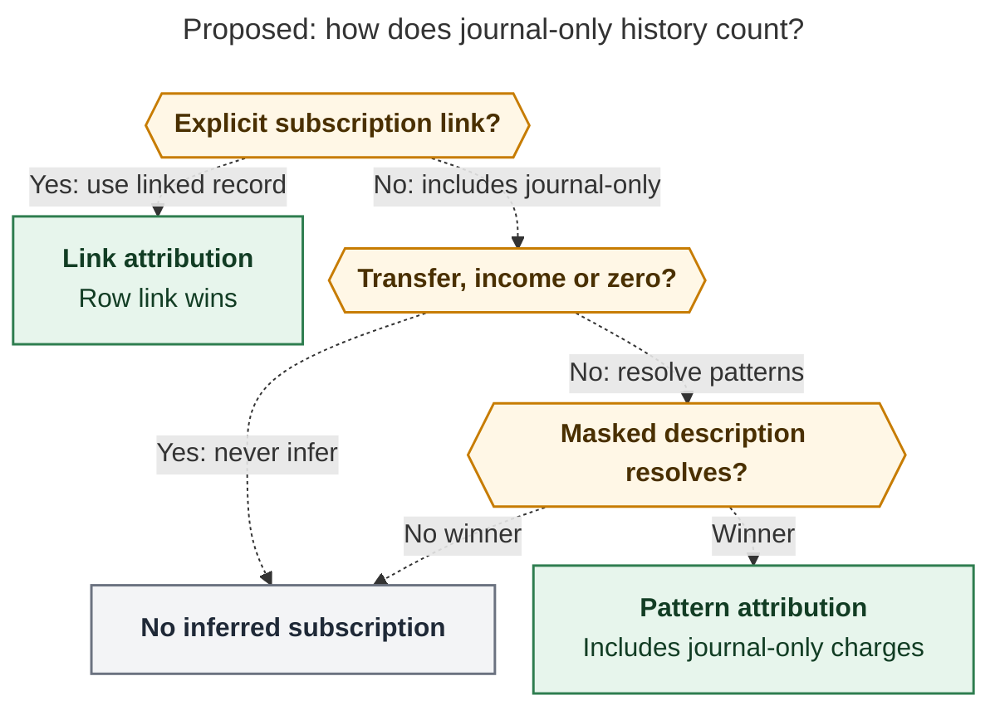

# Diagram proposals: Bank subscriptions album: consolidated design and seed review

Proposals for the swarm linker, not a report. Each diagram restates only what the source
report says.

```yaml
source: research:202611/bank_subscriptions_feature_design/bank_subscriptions_feature_design__final.md
producer: research.4s.image
check: "mmdc 12.0.0 with the PDF-mirroring config rendered 1 of 1 Mermaid diagrams; Puppeteer --no-sandbox"
```

## journal-attribution

```yaml
anchor: |-
  Because rule 2 covers `before_start` journal events,
question: |-
  How can journal-only history count without creating bank rows?
illustrates: |-
  Read-time attribution uses an explicit subscription link first and otherwise resolves eligible masked journal descriptions, so before_start history counts without creating bank rows.
caption: "Proposed read-time attribution uses explicit links first, then eligible journal matches, without creating bank rows; either exclusion or no winning match prevents inference."
review: "705.555x832 px, fit 92.5%; question, labels, arrowheads, crossings, direction and source checks passed; 0 revisions; 1 visual look round"
```


