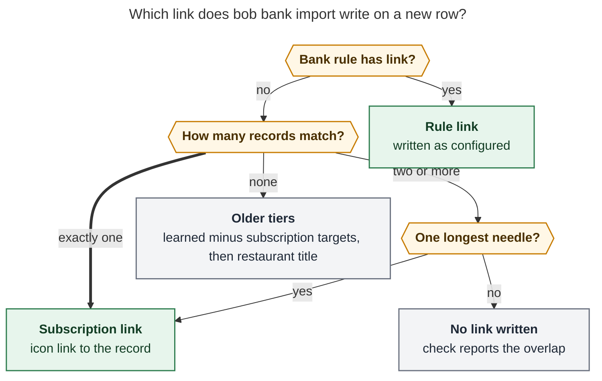

# Bank subscriptions album: consolidated design and seed review

- **Lead synthesis** of five independent research reports (`__cdx`, `__cld`, `__grk`,
  `__mus`, `__gem`, in this directory) plus the lead's own code verification,
  2026-11-15.
- **Bead:** `bob-cli-kt` — *Subscriptions album under bank: seed discretionary charges,
  link bank rows, propose price and candidate findings.* Its dependency `bob-cli-k3`
  (albums) is **closed**; the bead text saying albums are "still in progress" is stale.
- **Request:** review recent bank transactions to seed the album, auto-link
  `bob bank import` rows to their subscription record, render the link beautifully and
  concisely, critique the plan, and recommend a solution.

## Verdict

**Build it — the data makes an overwhelming case — but not exactly as the bead
specifies.** All five researchers independently reached the same three conclusions:

1. **The album is the right shape.** A subscription is one durable keep-or-cancel
   thing; transactions stay bank rows. This split is already settled by the bank epic,
   and `eat` (104 restaurant records with `[[eat/<stem>|🍔]]` links on imported rows)
   proves the exact pattern. The vault is already asking for it: `bob.md:92–95` holds
   `#task Add much better support for subscriptions!` with children "Create
   [[subscriptions]] album!" and "Add ability to link to subscription from category
   picker!", and `cash.md ^audit-monthly-subscriptions` has been waiting since June.
2. **The bead's linking mechanism — hand-link a few rows and let learned naming carry
   the link forward — fails on day one.** Only 11 bank rows exist (tracking started
   2026-11-11), two of them subscriptions; the other 843 journaled transactions are
   `before_start` and have no rows to learn from; Wells Fargo changed descriptors on
   five core subscriptions mid-year (Claude, Audible, Google One, YouTube, GoDaddy),
   which breaks the learned merchant key; a yearly subscription would get its first
   learned link a year from now; and `import_plan::learn()` copies `links.first()`
   verbatim, so stale or unrelated first links would hijack future imports.
3. **Your match-strings instinct is right.** Each subscription record should own a
   **`match` list** ("Shows up as"): case-insensitive substrings of the raw bank
   description, the same `contains_folded` semantics `bank.rules[].match` already uses.
   The record becomes the single visible, editable source of truth for how the service
   appears on the statement, and import links from it.

The one deliberate softening of your sketch: `match` should be **strongly recommended
but not `required: true`** (see ADJ-2). Real cases in your own data — two GoDaddy
domain renewals sharing one masked descriptor, the opaque `APPLE.COM/BILL` aggregator,
subscriptions billed to a card the vault doesn't import — need records that
deliberately *don't* auto-match rather than records carrying bogus placeholder patterns
that cause false links.

## What the transactions say

> **Privacy note** (carried from the cld report): this section names services and
> charge amounts — the same information `old_recur.md` already holds in the vault — but
> no account numbers, balances, raw descriptors with personal names, or
> per-transaction dates. Keep these tables out of beads and plans, and have the
> implementer **regenerate the seed from the journal at seed time** rather than copying
> any table from this report; amounts move.

### The data window, and a conflict resolved

Four independent researchers (cdx, cld, gem; mus by contract reading) converged on the
same primary source: the append-only bank journal `.bob/bank/*.jsonl` holds **854
unique checking transactions from 2026-05-01 through 2026-11-13** (3 QFX imports, 11
rows `written`, 843 `before_start` — retained with date, signed cents, masked
description, and hashed identity even though they have no bank row). This **hidden
history is the key implementation finding**: "the last few months" exist and are
already deduplicated, without lowering `bank.accounts.checking.start`, restoring rows,
or generating hundreds of waiting checkboxes.

The grk report instead read the 2025 `@BANK` habit logs and concluded the last few
months of data don't exist; its seed amounts (Spotify $12.78, YouTube $13.99) are
2025-era and superseded by the journal's 2026 series (Spotify $13.85, YouTube $15.99).
**Resolution: the journal is the authoritative source for current amounts; the `@BANK`
history is supplemental evidence** — valuable for off-window annuals (Copilot renewed
Feb 2025, Reuters Jul 2025) and, after the de-zorg link rewrite, for two years of
backlinked price history per record.

Caveats that survive from all reports: this is one Wells Fargo checking account only.
Subscriptions billed to a credit card, through Apple/Google intermediaries, or by
another person are invisible. 6.5 months confirms monthly patterns; annual contracts
still lean on the legacy list and receipts.

### Why a static table already failed

- **Run rate:** roughly **$1,050/month** of discretionary recurring charges Aug–Oct,
  rising to a **~$1,230–1,250/month** November run rate. Three AI chat plans (Claude
  $200, ChatGPT $200, Grok $300) are **$700/month = $8,400/year**; with DigitalOcean
  (~$342 after the apollo resize that `cash.md:64` already wants undone), ~85% of the
  run rate is AI and cloud.
- **`old_recur.md` is stale on most rows:** Claude $100→$200, ChatGPT $20→$200,
  Spotify $11.72→$13.85, YouTube $13.99→$15.99, Disney+ $21.31→$23.45 (Oct hike),
  reMarkable $3.19→$3.99, DigitalOcean $6→$342.50, No-IP $59.98→$29.99, and Google One
  is **monthly $19.99**, not yearly. At least six live subscriptions are missing
  entirely (Grok, NYTimes, Readwise, Plex, DashPass, MetaPay), and seven listed rows
  have not charged checking since May.
- **The NYTimes bills every 28 days exactly** ($6 × 7 charges, May 26–Nov 10) — a
  `four_weekly` cadence the bead's `monthly|yearly` cannot express; a two-value cadence
  would produce 13 false findings a year on this one record.
- **Wells Fargo already labels subscriptions.** ~95 transactions across ~25 descriptors
  (~19 services) carry an explicit `RECURRING PAYMENT` marker in the raw description;
  all but about two of those services (car insurance, the gas utility) are
  discretionary subscriptions. Bob's cleaner currently strips the marker from payees
  (`naming.rs`), but it survives in the journal description — using it lets `bob bank
  check` propose a candidate on the **first** charge, including yearly ones.

## Where the five reports disagreed, and the rulings

| Question | Positions | Ruling and why |
| --- | --- | --- |
| Match semantics | Substring `match` list (cld, grk, gem — your sketch) vs. exact normalized aliases (cdx) vs. exact title/payee equality like `eat` (mus) | **Substring list.** Exact aliases force copying truncated descriptors (`Openai *chatgpt Su`) and need a new entry per drift; a substring like `CLAUDE` survives both observed Claude descriptors. Same semantics as `bank.rules[].match` — one vocabulary. cdx's overmatch worry (`GOOGLE`, `APPLE`) is handled by validation + ambiguity refusal, not by a stricter grammar. mus's exact-equality demonstrably fails the live merchants. |
| `match` required? | Required (cld, grk) vs. optional with check advisories (cdx, gem) vs. no such field (mus) | **Optional, with `bob bank check` advisories** (ADJ-2). Two GoDaddy domains share one masked descriptor; `APPLE.COM/BILL` aggregates several possible services; card-billed subs have nothing to match. Forcing a pattern there manufactures false links. |
| Ambiguity tiebreak | Refuse outright (cdx, grk) vs. amount equality (cld) vs. longest-needle specificity (gem) | **Specificity first, then refuse.** `DD *DOORDASHDASHPA` (18 chars) beating `DD *DOORDASH` (12) is deterministic and encodes intent. The amount tiebreak breaks silently on any price change and, as cdx argues, when descriptors are truly identical the data *cannot* say which record charged — ask, don't guess. |
| Link tier order | rule → learned → registry (grk, mus) vs. rule → subscription → learned (cld, gem) | **rule → subscription → learned (skipping `subscriptions/` targets) → restaurant.** Learned clones `links.first()` verbatim (verified `naming.rs:91`), so learned-first lets a stale copy override a live record edit — delete a pattern or cancel a record and the old link keeps resurrecting from history. Declared state must outrank inference. Non-subscription learned links keep today's behavior exactly. |
| Status set | Three from the bead (grk, mus, gem) vs. `+needs_review` first (cdx) vs. `+to_decide` (cld) | **Add one unverified state: `to_decide: 🤔`** (cld's name — "review" collides with the GTD review). Seeds and candidates need a home that isn't a false `active`. Order: ✂️ → 🤔 → 💚 → 🚫. |
| Cadence values | Two (bead, grk) vs. four (cld, gem) vs. eight incl. `unknown`/`irregular` (cdx) | **Four: `monthly`, `four_weekly`, `quarterly`, `yearly`.** The data demands `four_weekly` today. `pricing: variable` covers cdx's irregular case; `to_decide` status covers unconfirmed cadence; the rest is speculative surface. |
| Price-change trigger | Every linked amount (bead) vs. latest row only (gem) vs. last-two-agree (cld) vs. date-effective expectation (cdx) | **For `fixed` monthly/four-weekly: fire when the last two attributed charges agree with each other and differ from `amount`** (catches Disney+, stays quiet on ChatGPT's one-month $122.86 proration). Yearly/quarterly: latest charge differs (there is no "last two" within a year). `variable`: no price finding. Updating `amount` clears the finding — no permanent alerts on history, which answers cdx's concern without its heavier `amount_since` machinery. |
| Seed source | `old_recur.md` actives (bead) vs. journal-first union (cdx, cld, gem) | **Union of journal evidence + legacy rows, journal wins on amounts.** Neither source alone is complete: the journal misses off-window annuals and other cards; the legacy table is stale on 60% of its rows. |

## Recommended design

### Album identity and schema

Create with `bob albums create bank subscriptions -n subscription -e 🔁 -t
Subscriptions -s "What we pay for on repeat, and whether it still earns its keep."`
(summary reworded per ADJ-9 — "everything that charges us" contradicts the
discretionary scope). **Verified mechanics:** `render_new_album` deliberately omits
`record.fields` (`src/native/albums/create.rs:64`), and `albums update` ops only
*reference* `index_facets` (a field named by `index_facets` can't even be removed via
ops, `update/ops.rs:1225`) — so the honest path is **create → YAML schema patch →
`bob albums sync`**, as grk found.

```yaml
parent: "[[bank]]"
type: "[[album]]"
summary: What we pay for on repeat, and whether it still earns its keep.
emoji: 🔁
index_by: category
index_facets: [amount, cadence]
record:
  noun: subscription
  label: Subscription
  plural: subscriptions
  dated_notes: true
  legacy: [recur_id]
  fields:
    status:
      required: true
      values:
        to_cancel: ✂️ To cancel
        to_decide: 🤔 To decide
        active: 💚 Active
        cancelled: 🚫 Cancelled
    amount: {required: true, values: number, min: 0, label: Charged}
    cadence:
      required: true
      values:
        monthly: Monthly
        four_weekly: Every 4 weeks
        quarterly: Quarterly
        yearly: Yearly
    pricing:
      default: fixed
      values: {fixed: 📌 Fixed, variable: 📈 Usage}
    match: {list: true, label: Shows up as}
    category: {suggest: true}
    url: {values: url, label: Manage}
    renews: {values: date}
    ended: {values: date}
```

Schema notes, each verified against `src/native/records/schema.rs`:

- `default: fixed` on `pricing` is legal (only *status* fields forbid defaults,
  `schema.rs:1244`). No boolean `FieldKind` exists, so a choices field is correct.
- `index_by: category` is real and earns its keep: groups larger than
  `LARGE_GROUP = 12` render `index_by` subgroup headings
  (`src/native/albums/grouping.rs:24`), so the ~16-row 💚 Active group splits into
  `tech` / `media` automatically. With category as the subgroup heading, facets reduce
  to `[amount, cadence]` (the 3-facet cap is enforced).
- `amount` is the **posted charge, tax included** (Spotify's $13.85 is $12.99 + NJ
  6.625%), because bob compares against the bank, never against list prices.
- `category` holds a **`bank.categories` key** (`tech`, `media`, `fun`, …), validated
  by `check` — one taxonomy, and imported rows arrive with `[cat::]` filled. Recurrence
  is a relationship, orthogonal to what the money bought; there is no blanket
  `subscriptions` spending category.
- `renews` is an **optional override** for what the bank can't see (card-paid services,
  trials, cancel-at-period-end). For anything with bank evidence, the next expected
  charge is *derived* from the last charge + cadence — a hand-maintained date on every
  monthly record would rot. `ended` powers the charged-after-cancel finding.
- `dated_notes: true` stamps notes ("2026-10-22 price rose to $23.45"); `legacy:
  [recur_id]` preserves Zorg identity the way `eat` kept `lid`.
- Money handling in bank code converts the checked decimal to **integer cents** and
  rejects fractional cents; comparisons never use floats (cdx).

### The `match` contract ("Shows up as")

- A pattern matches when it is a **case-insensitive substring** (`contains_folded`) of
  the **raw transaction description** at import, and of the **masked journal
  description** (or typed row payee) at read time — exactly `bank.rules[].match`
  semantics, including the documented caveat that a run of 4+ digits can never match at
  read time (`suggest.rs:has_long_digit_run`, verified).
- Bank linking binds to **the album whose record noun is `subscription`**, resolved
  through the registry — never a hard-coded stem (import currently hard-codes the `eat`
  resolution; don't repeat that).
- **Validation** (`bank_subscription_match_invalid`, warning): each pattern ≥3
  characters, no 4+ digit run, not a noise word (`PURCHASE`, `RECURRING`, `PAYMENT`,
  `AUTHORIZED`, `CARD`). Refuse obviously broad needles in review guidance: prefer
  `DIGITALOCEAN` over `DO`, `MEDIUM.COM` over `MEDIUM`, never bare `GOOGLE` / `APPLE` /
  `PAYPAL`.
- **Resolution for one transaction:**
  1. Collect records with any matching pattern, across **all statuses**. Partition
     into live (✂️/🤔/💚) and cancelled (🚫); live beats cancelled, but a
     cancelled-only match still links — **a charge on a cancelled record is the most
     useful alert in the system**, and it emits `bank_subscription_cancelled_charge`.
  2. Exactly one record in the winning partition → link it.
  3. Several → the single record whose matched needle is **strictly longest** wins
     (dedupe patterns case-insensitively within a record first).
  4. Still tied → **no link**, plus an overlap finding naming the records. Never
     guess by file order, price, or history.

### Import integration



*Figure 1. A declared subscription match outranks everything except an explicit bank
rule; ties resolve to the single most specific needle, and remaining ambiguity writes
no link rather than a guess. (Mermaid CLI 12.0.0 under the research-PDF config:
839 × 758 px, fit 77.8%.)*

- **Loader:** generalize `load_restaurants` (`src/native/bank/import_run.rs:583`) into
  a guarded record-link registry read — album declaration, record bytes, folder and
  registry membership as `ReadDep` preimages, `DiscoveryHealth` handling. A damaged
  album degrades to "no subscription links this run" with a bounded warning; an
  unreadable *membership* refuses, because affected identities can't be bounded (cdx).
  `eat` keeps its exact-title behavior and tests.
- **Fill-down on a unique subscription match** (grk ADJ-11, gem): unspecified `payee`
  defaults to the record **title** (turning `Openai *chatgpt Su` into `ChatGPT` with no
  teacher), and unspecified `cat` to the record's `category` when it names a declared
  bank key. Precedence per field: rule → subscription → learned → builtin → cleaned.
  (cld would put learned payee above the record title so hand-edited row payees win;
  the record-first order was chosen for determinism — Bryan edits the record title to
  rename. Flag at plan review if the other order feels better.)
- **Ownership unchanged:** import writes a row once; matching an existing typed row
  still appends only `^bank-<hex>`; a row written before its record existed stays
  unlinked in text (read-time attribution still counts it, and the plugin offers a
  one-click link). Learned naming **never propagates `subscriptions/` links**.
  Reimport/replay stays idempotent. Import **never creates records**.
- **Import summary**, only when there's news:
  `🔁 4 rows linked to subscriptions · 1 new candidate · 1 price change — bob bank check`.

### Read-time attribution: one answer for every view

A charge belongs to subscription X when (1) its row links `subscriptions/X` — an
explicit link always wins — or (2) X wins pattern resolution over its masked journal
description. Because rule 2 covers `before_start` journal events, **the full 6.5-month
history is attributed the moment records exist, with no rows and no migration**. Every
view and finding reads this one resolver; it returns structured provenance (target,
source `link|match`, matched needle, ambiguity candidates) so the plugin renders
without reimplementing matching. Refunds attribute and net against charges; transfers,
income, and zero rows never infer subscription links.

### `bob bank check` findings (proposes, never creates; all keep the run green)

| Code | Severity | Trigger |
| --- | --- | --- |
| `bank_subscription_cancelled_charge` | warning | Charge attributed to a 🚫 record after `ended` (any charge when `ended` empty). The zombie-billing sentry. |
| `bank_subscription_to_cancel_charged` | info | Charge on a ✂️ record — "still paying: $200.00 on Nov 2" plus the `url`. |
| `bank_subscription_price` | info | Fixed records per the ruling above. Hint: `bob records update subscription spotify -s amount=13.85`. |
| `bank_subscription_candidate` | info | No record or rule matches, **and** (`RECURRING PAYMENT` in the journal description **or** 3+ charges at 26–33d / 2+ at 340–390d / 2+ at 80–100d with amount spread ≤25%). Excludes income/transfer/refund/cash-kind. Ranked by annualized cost, capped top-N. Emits a paste-ready `@subscriptions/` capture block. |
| `bank_subscription_match_invalid` / `_overlap` | warning / info | Per the match contract. |
| `bank_subscription_category_unknown` | warning | `category` isn't a bank key; suggests the nearest. |
| `bank_subscription_overdue` (later) | info | Active record with bank evidence >1.5 periods past expected, where import coverage spans the gap. Never auto-cancels. |
| `bank_subscription_renewing` (later) | info | Yearly renewal expected within 14 days. |

The candidate heuristic must pass the negative fixtures all five reports collected: 99
coffee charges, 28 identical ATM fees, CVS/Walgreens $25s, the barber every ~80 days,
and every obligation — which is why **seeding obligation `bank.rules` is part of this
feature** (see P0): "a bank rule matches" means "known, not a subscription", so on the
seeded vault the candidate count is **zero** — the clean-slate acceptance test (cld).
Before unattended candidate findings become routine, add a small persistent
dismiss/ignore store (bank-owned config or journal namespace, never fake cancelled
records) — cdx; v1 may keep discovery as an explicit review instead.

### Rendering: quiet in the statement, informative on focus

Canonical Markdown stays one token, uniform with `eat`:

```markdown
- [ ] $13.85 Spotify [cat:: media] [[subscriptions/spotify|🔁]] ^bank-1a2b3c4d
```

It reads well with no plugin, navigates, hover-previews, and makes every record's
backlinks its charge history for free. `bob-ledger-tools` (the bank-marks fragments
`241o/241p/241q`, whose tail parser already captures link spans) upgrades the raw link
to a pill chip with the same geometry as existing bank chips:

| State | Chip | Tone |
| --- | --- | --- |
| Linked, amount as recorded | `🔁` alone | muted — the normal state is the bare icon |
| Fixed amount differs | `🔁 +$2.13` | muted; amber once the price finding fires |
| `pricing: variable` | `🔁 usage` | muted, no false drift alert |
| Record ✂️ | `🔁 ✂️ still charging` | amber; click opens the Manage `url` |
| Record 🚫 charged again | `🔁 🚫 after cancel` | warning tone, never red-for-spending |
| Row matches a record but is unlinked | dashed ghost `🔁` | click inserts the link (an editor edit) |
| `RECURRING PAYMENT`, no record, no rule | `⟳ subscription?` | ghost; opens a prefilled new-record form |
| Payee ≠ record title (aggregators, manual links) | expands to `🔁 iCloud+` | gem's rule: the bare icon only when the payee already names the service |

Discipline (cld): at most one glyph and ~14 characters beyond the 🔁; state carried by
words and signs, never color alone; raw syntax under the cursor; accessible name "Open
Claude subscription" with a visible focus ring (cdx / WCAG link-purpose); implement in
**Reading view, Live Preview, and the queue card** — cdx verified the queue card's row
renderer currently draws only money/payee/category, so "write the link" alone is not
enough. Tooltip: `Claude · 💚 Active · $200/month · latest charge Nov 13`. Chip states
come from bob's JSON; plugin-disabled rendering still yields a usable wikilink.

**Category card integration** (gem's find, verified at `bob.md:95`): `/` inside
`BankCategoryCardModal` (it collides with no category hotkey) opens an inline
subscription picker ranked by amount proximity, match overlap, and live-before-
cancelled; selection commits `[[subscriptions/<stem>|🔁]]` + optional `[cat::]` in one
atomic undo step; a bottom action offers "+ Create new subscription" prefilled from the
row. A passive context strip above the tiles shows the linked record's status and
drift while filing `]b` → Ctrl+Enter.

**Record header and album card** (plugin, from JSON, never written): a header strip on
`subscriptions/*.md` with `$13.85 a month · ≈ $166 a year · next ≈ Dec 21` plus a
charged/expected dot timeline; an optional `view: subscriptions` fence on the album
with status counts and a monthly-equivalent total. Monthly equivalent: monthly × 1,
four-weekly × 13/12, quarterly ÷ 3, yearly ÷ 12; variable records use a trailing
3-month average; unknown/cancelled are counted, not summed, with the exclusion shown.
Label it an estimate of commitments, never actual bank spend. The index's plain-number
`amount` facet gets `$`/cadence formatting only at this presentation layer.

### CLI and JSON (additive)

New read-only `bob bank subscriptions [-a] [-b DIR] [-f human|json]`: each record with
attributed charges, latest charge, next expected, monthly equivalent, drift, and
findings — the single data source for the plugin surfaces. Row JSON in
`list`/`report`/`import` gains
`subscription: {stem, title, status, cadence, amount_cents, source: "link"|"match", drift_cents} | null`
and `bank_recurring: bool`. (grk objected to a new verb for a one-time seed — accepted
for `relink`, which nobody ships; `subscriptions` is a permanent report and justified.)
Implementer must read the `cli_rules` and `docs` reference memory before adding the
subcommand and docs.

## Seed roster

Condensed from the journal review (cld and gem's independently matching tables;
regenerate at seed time). `RP` = Wells Fargo flagged `RECURRING PAYMENT`; `drift` = the
descriptor changed mid-window, so keep both needles.

**Seed 💚 active:** Spotify $13.85/mo `SPOTIFY` RP · Disney+ $23.45/mo `DISNEY PLUS` RP
(Oct hike from $21.31) · YouTube Premium $15.99/mo `YOUTUBE` RP drift · Audible
$17.05/mo `AUDIBLE` RP drift · Google One $19.99/**mo** `GOOGLE ONE` RP drift ·
NYTimes $6.00/**four-weekly** `NYTIMES` RP · Medium $5.00/mo `MEDIUM.COM` RP ·
reMarkable Connect $3.99/mo `REMARKABLE` RP · Claude $200/mo `ANTHROPIC`, `CLAUDE` RP
drift · Surfline $149.99/yr `SURFLINE` RP · Readwise $119.88/yr `READWISE` RP · No-IP
$29.99/yr `NO-IP` · Plex Remote Watch Pass $31.98/yr `PLEXINC` RP.

**Seed 🤔 to decide (confirm in one question round):** ChatGPT $200/mo `OPENAI` (keep
beside Claude and Grok?) · Grok $300/mo `GROK` (ramped $30→$300 since Aug; variable) ·
DigitalOcean ~$342.50/mo variable `DIGITALOCEAN` ($6→$342 over the window; `cash.md:64`
wants the apollo resize undone) · GoDaddy $46.38 + $89.99/yr `GODADDY` (one umbrella
variable record or two per-domain records with empty `match`?) · DashPass $96/yr
`DD *DOORDASHDASHPA` (the long needle keeps 35+ DoorDash food orders out) · MetaPay
$50/mo `METAPAY` (which Meta product?) · Twilio $10.76 variable `TWILIO` · Dynalist
$50.12/yr `DYNALISTIN` · Apple $31.98 once (`APPLE.COM/BILL` — identify before giving
it any needle) · Google Cloud / AliCloud singletons (likely usage; omit unless
recognized).

**Seed 🤔 from legacy only (no checking evidence since May — absence is not
cancellation):** Wispr Flow $144 (listed `1m`; if it is actually annual it renews
≈ Nov 28–29, 2026 — **decide this week**) · GitHub Copilot $100/yr (Feb window) · XMind
$59.99/yr · PIA $39.95/yr · Reuters $45/yr (its July window passed with no charge) ·
The Farmer's Dog (likely moved or cancelled) · **Obsidian** — `cash.md:78` says "Cancel
Obsidian! [scheduled:: 2027-01-03]": seed it **✂️ to_cancel** for an immediate queue
win (gem). Each carries a note: "no checking charge since May 2026", so the audit
closes each deliberately instead of dropping it silently.

**Seed 🚫 cancelled:** Trade Coffee (already `@INACTIVE`; keeps zombie protection).

**Do not seed — write `bank.rules` instead (payee + cat only):** mortgage, the student
loan servicer, AmeriHealth, GEICO, Elizabethtown Gas, Verizon, sanitation, Kelly's
Zelle transfers, NJT Rail tickets. This is what the discretionary scope decision
already says, and it is what makes the candidate detector quiet. (grk would move
Verizon into the album as keep-or-cancel; the bead keeps utilities out — flag for
Bryan, default out.)

## Adjustments to the bead, called out

| # | Bead / plan said | Adjustment |
| --- | --- | --- |
| ADJ-1 | Link rows by hand so **learned naming** carries links forward | **Records link rows** through their `match` lists; learned never propagates subscription links. The bead's mechanism has nothing to learn from and breaks on descriptor drift. |
| ADJ-2 | `payee` field (suggest) | Replace with **`match` ("Shows up as"), an optional list** validated by `check`; the record title serves as the clean payee. Departure from the "required field" sketch, justified above. |
| ADJ-3 | Cadence `monthly`, `yearly` | Add **`four_weekly`** (NYTimes is 28-day — this is observed fact, not speculation) and `quarterly`. |
| ADJ-4 | Status `to_cancel / active / cancelled` | Add **`to_decide: 🤔`** between ✂️ and 💚, the home for seeds and candidates that isn't a false "active". |
| ADJ-5 | — | Add **`pricing: fixed \| variable`** (default fixed) so metered services (DigitalOcean, Grok, Twilio) don't spam price findings. |
| ADJ-6 | `category` free suggest | `category` is a **bank category key**, validated; imported rows arrive categorized. |
| ADJ-7 | `renews` date | Keep only as an override; **derive** next-expected from bank evidence; add **`ended`** for the cancelled-charge sentry. |
| ADJ-8 | Price finding on any linked amount difference | The fixed/last-two-agree rule above — no permanent alerts on history. |
| ADJ-9 | Candidates = 3+ charges ~30/~365 days | Use the **`RECURRING PAYMENT` marker** (first-charge detection, fixes the two-year annual blind spot) plus interval clustering with amount stability and rule/record exclusions. Summary reworded to "What we pay for on repeat…" to match the discretionary scope. |
| ADJ-10 | Seed from `old_recur.md` actives | Seed from the **union of journal evidence (incl. `before_start`) and legacy rows**; journal wins on amounts. Also **seed obligation `bank.rules`** as part of this work. |
| ADJ-11 | De-zorg rewrites inbound links to `legacy_recur` | Same, but point the **discretionary** rows' ~270–277 historical links (in ~178–180 `_habit.md` files) at their **records**, so each record's backlinks show two years of `@BANK` price history with no code. Obligation links go to `legacy_recur#^z-…`. Every `^z-` block ID preserved. |
| ADJ-12 | (implied) new-import linking only | Add the **Category card `/` linker** — the vault explicitly asks for it (`bob.md:95`) — and one-time hand links for the two live rows (Claude `^bank-4c9f7358`, GoDaddy `^bank-259ce333`). |
| ADJ-13 | `index_facets: [amount, cadence, category]` | `index_by: category` + `index_facets: [amount, cadence]` — the large 💚 group subgroups by category automatically (`LARGE_GROUP = 12`, verified). |
| ADJ-14 | Close the bead when the album exists | Close only after the full delivery (criteria below). |

## Delivery plan

**P0 — vault seed (no code; one session with Bryan in the loop).** Create the album
(create → YAML patch → `albums sync`); regenerate the seed table from the journal with
a read-only local script; one `/sase_questions` round covering every 🤔 row and the
open questions below; `bob records new subscription …` per confirmed record (guarded
writes, index rebuilt in-transaction); seed obligation `bank.rules`; hand-link the two
live rows; de-zorg `old_recur.md` → `legacy_recur` notebook under `cash` per the
`eat.md` recipe (keep IDs, rewrite inbounds per ADJ-11, baseline unresolved-link counts
before/after); point `cash.md ^audit-monthly-subscriptions` at `[[subscriptions]]` and
tick `bob.md:94`. From day one the album is accurate and browsable with two years of
backlinked history. Keep bank data out of beads, plans, Stats, period briefs, and the
Mac app.

**P1 — bob-cli (`src/native/bank/`).** Guarded subscription registry loader; the
`match` contract + resolver with provenance; import precedence and fill-down;
read-time attribution over rows + journal; stop discarding the `RECURRING PAYMENT`
marker; the `bank_subscription_*` findings; `bob bank subscriptions` and the additive
row JSON; import summary line. Acceptance: re-importing the November QFX links Claude;
a fixture with the old `CLAUDE.AI` descriptor still links; `check` on the seeded vault
reports **zero candidates**; a cancelled-record charge warns; ambiguous needles omit
the link; replay is byte-idempotent. Test the negative fixtures (coffee, ATM fees,
CVS, barber) and the NYTimes four-weekly fixture.

**P2 — bob-plugins (`bob-ledger-tools`), deployed via `bob plugins sync`.** The 🔁
pill with its states across Reading view, Live Preview, and the queue card; the
Category card `/` linker and context strip; the record header strip; the optional
album card; keyboard/focus/a11y checks, light/dark, narrow panes, plugin-disabled
fallback, unchanged source bytes.

**Memory and docs (with P1/P2).** Via `/sase_memory_write`: a decision record (e.g.
`decisions:subscriptions-own-their-bank-match` — records declare how they show up;
import links from them; learned never propagates subscription links; bob proposes,
never creates) and a glossary strand for the subscription record / "Shows up as".
Docs: drop subscriptions from `docs/bank.md` "Current limits" (line 454), document the
match contract, findings, and JSON; read the `docs` memory first. The Mac capture
client needs nothing unless row JSON contract changes are versioned.

**Close `bob-cli-kt`** only when: the album and reviewed seed exist; new imports link
safely; candidate/price findings work and the seeded vault is candidate-clean; the two
live rows are linked; the audit task points at the album; the de-zorg preserved
identity and every inbound link; docs/memory landed; CLI + plugin checks pass. Record
the ADJ list on the bead before closing. (No researcher's report, nor this one, closes
it.)

## Open questions for Bryan (one round, before seeding)

1. **MetaPay $50/mo since Sep** — which Meta product? And **Apple.com/bill $31.98
   (Jun)** — iCloud/app/one-time?
2. **GoDaddy** — one umbrella variable record, or two per-domain records (empty
   `match`, linked via the Category card)?
3. **Wispr Flow** — the legacy $144 entry may renew ≈ Nov 28–29; keep or cancel *this
   week*?
4. **AI trio** ($700/mo: Claude + ChatGPT + Grok) — all three 💚, or is one the first
   ✂️? Also: DigitalOcean ~$342/mo vs. "Undo resize of apollo!".
5. **Dormant legacy rows** (Copilot, XMind, PIA, Reuters, Farmer's Dog) — still active
   on another card, or cancelled? If any live on a credit card, adding that account to
   `bank.accounts` is the real coverage fix.
6. **Obsidian** — confirm seeding as ✂️ with `renews: 2027-01-03`.
7. **Verizon** — stay an obligation rule (default), or join the album as
   keep-or-cancel (grk's position)?

## Lead verification appendix

Claims I verified directly in the `bob-cli` checkout (9c2c2404) rather than taking from
any report: `render_new_album` omits `record.fields` (`src/native/albums/create.rs:64`)
and update ops cannot author `index_facets` (`src/native/albums/update/ops.rs:1225`);
`index_by` + `LARGE_GROUP = 12` subgrouping (`src/native/albums/grouping.rs:24`,
`index.rs:427`); field `default` support with the status-field exception
(`src/native/records/schema.rs:1244`); link tier `rule → learned.links.first() →
restaurant` (`src/native/bank/naming.rs:89–91`); the cleaner stripping `RECURRING
PAYMENT` (`naming.rs:213,317`); the read-time digit-run guard
(`src/native/bank/suggest.rs:306,325`); the guarded `load_restaurants` loader
(`src/native/bank/import_run.rs:583`); `RULE_KEYS = [match, payee, cat, link]`
(`config.rs:19`); `docs/bank.md:454` listing subscriptions as out of scope; and, via a
read-only `bob query`, the `bob.md` lines 92–95 subscription wish including the
category-picker request. Journal statistics (854 transactions, 843 `before_start`,
May 1–Nov 13) are accepted on three-way independent agreement between the cdx, cld,
and gem reports; the grk report's divergent amounts are explained by its 2025 `@BANK`
source and superseded accordingly.
