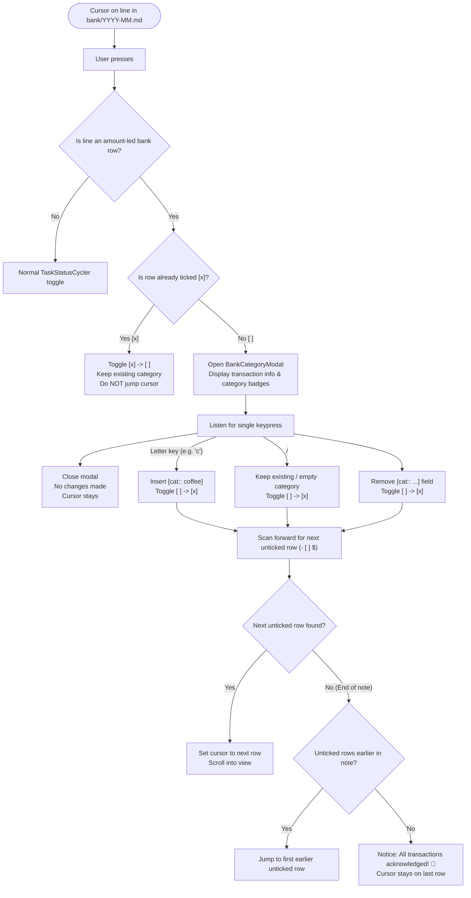
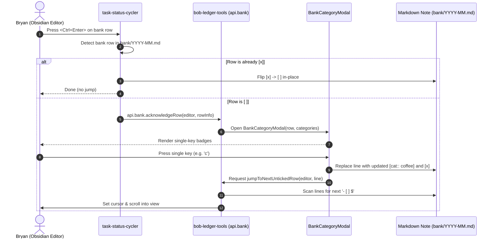

# Bank Transaction Tracking & Streamlined Categorization UX

> **Researcher:** `gem` (Independent Research Report)  
> **Epic Context:** `bob-cli-kd` · Bank Daily Acknowledgment & Weekly Import  
> **Target Date:** 2026-11-13  
> **Scope:** Bank row acknowledgment `<ctrl+enter>` UX, auto-jumping navigation, GTD chore cadence & Wells Fargo portal linking, personal category taxonomy, and Obsidian plugin architecture.

---

## 1. Executive Summary

The recent implementation of epic **`bob-cli-kd`** established a robust core infrastructure for personal banking in Bob: strict plain-text row grammar in monthly notes (`bank/YYYY-MM.md`), immutable cryptographic journaling (`.bob/bank/<host>.jsonl`), automated QFX/OFX and CSV parsing, four-tier payee/category/link resolution, and comprehensive ledger balance proofs (`bob bank check`).

However, the first real-world usage of this system on a primary machine revealed critical friction points between the designed ritual and human behavioral reality:
1. **The Daily Toil Trap:** The initial design assumed a dual cadence where transactions are manually typed every day from a phone app and verified weekly via QFX import. In practice, manual daily entry was bypassed in favor of running `bob bank import`. But running QFX import *daily* imposes unacceptable toil (logging through bank authentication, 2FA, navigation, export, and CLI execution).
2. **Review Navigation Friction:** When batch-imported transactions land in the bank note as unchecked rows (`- [ ]`), acknowledging each row via `<Ctrl+Enter>` currently toggles the checkbox in place without moving the cursor. Reviewing a batch requires repeated manual arrow/Vim navigation between rows.
3. **The Categorization Gap:** Category infrastructure already exists across the CLI parser, validator, report generator, and import naming engine. However, there was no interactive mechanism to assign categories during row acknowledgment in Obsidian. Rows imported without matching rules remained uncategorized.
4. **Redundant GTD Chores:** The vault's `gtd_daily.md` currently holds both a daily "Acknowledge bank" chore (without a direct bank URL) and a weekly Monday "Bank import" chore.

### Key Conclusions & Recommendations
- **Consolidate to a Weekly Cadence:** Formally retire the daily manual bank entry chore and consolidate banking into a single high-leverage weekly PRE chore on Mondays: `**Bank weekly review & import**`. Include a direct authenticated portal link to Wells Fargo.
- **Interactive Single-Keypress Categorization on `<Ctrl+Enter>`:** When `<Ctrl+Enter>` is pressed on an unchecked bank row (`- [ ]`), open a focused, keyboard-driven popover displaying available categories with single-letter accelerator badges (`[c] ☕ Coffee`, `[g] 🛒 Groceries`, `[d] 🍽️ Dining`). A single keypress assigns the category, marks the row acknowledged (`- [x]`), and automatically advances the cursor to the next unticked bank row.
- **Leverage Compounding Tier-2 Learning:** Because `bob-cli`'s import engine already features tier-2 learned payee resolution (inheriting category and links from the most recently acknowledged row for that merchant), categorizing a merchant *once* in Obsidian ensures all future imports for that merchant arrive pre-categorized.
- **Architectural Separation:** Implement the interactive modal and auto-jump logic in `bob-ledger-tools` (which already owns bank data, cards, and category caching), and have `task-status-cycler` delegate bank row `<Ctrl+Enter>` events to `bob-ledger-tools` via `api.bank`.

---

## 2. Background & Architecture: What `bob-cli-kd` Built

To understand where improvements must be made, we first examine the foundations delivered in `bob-cli-kd` (Phases 1–7):

```
┌─────────────────────────────────────────────────────────────────────────────┐
│                             bob-cli-kd Architecture                         │
│                                                                             │
│  ┌───────────────────────┐         ┌─────────────────────────────────────┐  │
│  │   Wells Fargo Export  │         │             Bank Hub                │  │
│  │     (QFX / CSV)       │         │             bank.md                 │  │
│  └──────────┬────────────┘         │  - accounts (WF checking, start)    │  │
│             │                      │  - categories (ordered emoji map)   │  │
│             ▼                      │  - rules (match -> payee/cat/link)  │  │
│  ┌───────────────────────┐         └──────────────────┬──────────────────┘  │
│  │    bob bank import    │                            │                     │
│  │  - match cents & date │◄───────────────────────────┘                     │
│  │  - 4-tier naming      │                                                  │
│  │  - append journal     │─────────┐                                        │
│  └──────────┬────────────┘         │                                        │
│             │                      ▼                                        │
│             ▼         ┌─────────────────────────┐                           │
│  ┌────────────────────┤ .bob/bank/<host>.jsonl  │                           │
│  │  bank/YYYY-MM.md   │ (immutable audit trail) │                           │
│  │  - ## Day headings └─────────────────────────┘                           │
│  │  - - [ ] / - [x]                             ▲                           │
│  └──────────┬───────────────────────────────────┘                           │
│             │                                                               │
│             ▼                                                               │
│  ┌───────────────────────┐         ┌─────────────────────────────────────┐  │
│  │    bob bank check     │────────►│          Ledger Balance             │  │
│  │  - validate grammar   │         │          & Anchor Proof             │  │
│  │  - prove coverage     │         └─────────────────────────────────────┘  │
│  └───────────────────────┘                                                  │
└─────────────────────────────────────────────────────────────────────────────┘
```

### 2.1 The Vault Data Layer
- **`bank.md` (The Hub):** Configures account aliases, start dates, declared categories, and deterministic matching rules in frontmatter.
- **`bank/YYYY-MM.md` (Month Notes):** Authoritative storage of transaction rows, grouped under Level-2 day headings (`## Thu Nov 12`).
- **Row Grammar:**
  ```text
  - [x] $13.71 Smashburger [cat:: dining] [acct:: checking] [[eat/smashburger|🍽️]] ⚑ — note ^bank-8f3a2c1d
  ```
  - Unchecked (`[ ]`) represents a transaction waiting for human review.
  - Ticked (`[x]`) represents an acknowledged transaction.
  - Amount is signed cents (`$` prefix required; `+` for inflows; no sign or `-` for outflows).
  - Trailing block ID `^bank-<hex>` links the Markdown row to the immutable journal.

### 2.2 Four-Tier Naming Resolution
When `bob bank import` writes new rows, it resolves the payee description, category, and links through four cascading tiers:
1. **Tier 1 — Explicit Rules (`bank.rules`):** Case-insensitive substring match against raw bank description.
2. **Tier 2 — Learned Payees:** The most recent acknowledged ID-bearing row with the same journal merchant. Inherits payee wording, category, and links.
3. **Tier 3 — Wells Fargo Built-ins:** ATM withdrawals (`cash`), fees (`fees`), online transfers/card payments (`transfer`).
4. **Tier 4 — Cleaned Description:** Stripped prefixes/suffixes and title-cased description.

### 2.3 The Obsidian Integration
- **`bob-ledger-tools`:** Renders `bob-bank` month and queue cards, injects the quiet daily-note chip (`🏦 out $17.96 · in +$0.00`), provides Enter-continuation with `- [x] $`, and registers an `EditorSuggest` triggered by typing `[cat:: `.
- **`task-status-cycler`:** Protects bank rows from task-status cycling. When `<Ctrl+Enter>` is pressed on a bank row, `cyclerBankLocalFlip` toggles the box between ` ` and `x` without touching task metadata or review walks.

---

## 3. Cadence & Ritual Redesign: Daily Toil vs. Weekly Leverage

### 3.1 The Failure of the Daily Manual Entry Habit
The initial design in `bob-cli-kd` proposed that Bryan type transactions daily on his phone or desktop as a morning PRE chore ("Acknowledge bank transactions in 2 minutes").

In practice, manual daily entry suffers from fundamental behavioral friction:
- **Dispersed Transaction Timing:** Charges post 1–3 days after purchase, often out of chronological order.
- **Input Duplication:** Typing payees, amounts, and tags on a mobile keyboard feels duplicative when modern banks provide clean exports.
- **Psychological Resistance:** Opening a mobile banking app, cross-referencing Obsidian, and manually formatting Markdown creates daily cognitive friction.

### 3.2 The Toil of Daily QFX Downloads
Attempting to replace manual entry with *daily* QFX import is even worse:
- Wells Fargo requires two-factor authentication (SMS/push notification) and session re-authentication.
- Exporting requires multiple clicks: Accounts → Checking → Download Account Activity → Select Date Range → Select Quicken (QFX) → Download.
- Repeating this administrative loop 365 days a year represents approximately 15–20 hours of pure annual toil.

### 3.3 The Weekly Solution: Monday Batch Reconciliation
Switching the banking ritual to a **weekly recurring chore** on Monday morning (aligned with GTD PRE chores and Weekly Review) transforms the user experience:
- **Single Bank Login:** One login per week to download the past 14 days of activity (overlapping window ensures contiguous coverage).
- **Batch Processing:** Running `bob bank import ~/Downloads/*.qfx` pulls in the entire week's posted transactions in under 2 seconds.
- **Lightning Review:** With interactive categorization and auto-jumping on `<Ctrl+Enter>`, 10–20 weekly transactions can be categorized, reviewed, and acknowledged in under 30 seconds.
- **Balance Anchor Verification:** Monday import checks that the reconstructed ledger balance exactly matches the bank's posted balance, providing 100% confidence with zero daily overhead.

---

## 4. Personal Transaction Analysis & Category Taxonomy

### 4.1 Empirical Analysis of Imported Data
An audit of the 850 transactions imported into `.bob/bank/kellys-macbook-pro-local.jsonl` provides an empirical baseline for Bryan's spending patterns. 

> [!NOTE]
> In accordance with privacy requirements, all merchant identities, locations, and personal identifiers have been aggregated into generalized domain frequencies.

Across the 850 historical transactions:
- **843 transactions** were logged with outcome `before_start` (historical transactions prior to the account start date of `2026-11-11`).
- **7 transactions** were written into `bank/2026-11.md` as active unchecked rows.

#### Distribution by Spending Domain:
```
Transaction Domain Frequency (850 Transactions)
────────────────────────────────────────────────────────────────────────
Domain / Category              Count     Percentage   Primary Drivers
────────────────────────────────────────────────────────────────────────
Coffee & Cafes                  147        17.3%      Daily coffee shops, local cafes
General Shopping / Online       131        15.4%      Amazon, household goods, retail
Convenience & Quick Stops       124        14.6%      7-Eleven, quick daily stops
Transit & Commuting              36         4.2%      Rail transit, parking, rideshare
Banking & ATM Fees               28         3.3%      Out-of-network ATM surcharges
Health & Pharmacy                24         2.8%      Pharmacies, medical visits
Digital Subscriptions & Cloud    23         2.7%      Hosting, AI services, SaaS
Groceries & Supermarkets         22         2.6%      Food stores, regional markets
Student Loans & Education        19         2.2%      Federal student loan repayments
Restaurants & Dining Out         10         1.2%      Casual restaurants, food delivery
Income & Direct Deposits          9         1.1%      Payroll direct deposits
Automotive & Fuel                 8         0.9%      Gas stations, auto service
Mortgage & Housing                7         0.8%      Monthly mortgage installments
Utilities & Telecom               6         0.7%      Mobile phone, internet, energy
Personal Discretionary           28         3.3%      Specialty shops
Transfers & Zelle                28         3.3%      Account transfers, peer payments
Unclassified / Miscellaneous    200        23.5%      Single-occurrence merchants
────────────────────────────────────────────────────────────────────────
```

### 4.2 Key Behavioral Insights
1. **Coffee is a Tier-1 Category:** At 17.3% of all transactions, Coffee represents Bryan's highest-frequency discretionary transaction type. It warrants its own dedicated category rather than being lumped into Dining.
2. **Convenience Stores are Frequent:** 14.6% of transactions occur at convenience chains (like 7-Eleven). In traditional personal finance these are often split between groceries, snacks, or coffee. A distinct `convenience` category (or grouping under shopping/groceries) prevents misrepresenting restaurant dining.
3. **Fixed Obligations are Rare but High-Value:** Mortgage (0.8%), Utilities (0.7%), and Student Loans (2.2%) account for fewer than 4% of transaction occurrences, but represent the vast majority of net dollar outflow.
4. **Subscriptions are Regular:** Recurring software, media, and infrastructure charges appear steadily (2.7%).

### 4.3 Recommended Category Taxonomy & Single-Key Accelerators
To enable single-keypress categorization in Obsidian without ambiguity, every category must have a distinct, memorable accelerator key.

The table below defines the recommended taxonomy for Bryan's `bank.md`:

| Key | Emoji | Label | Accelerator | Rationale / Mnemonic |
| :--- | :---: | :--- | :---: | :--- |
| `coffee` | ☕ | Coffee | `<kbd>c</kbd>` | **C**offee (Highest discretionary frequency: 17.3%) |
| `groceries` | 🛒 | Groceries | `<kbd>g</kbd>` | **G**roceries (Supermarkets, food stores) |
| `dining` | 🍽️ | Dining | `<kbd>d</kbd>` | **D**ining (Restaurants, takeout, delivery) |
| `shopping` | 🛍️ | Shopping | `<kbd>s</kbd>` | **S**hopping (Amazon, retail, goods) |
| `transit` | 🚆 | Transit | `<kbd>t</kbd>` | **T**ransit (Trains, parking, tolls, rides) |
| `convenience`| 🏪 | Convenience | `<kbd>v</kbd>` | Con**v**enience (Quick stops, 7-Eleven; 'c' is coffee) |
| `health` | 💊 | Health | `<kbd>h</kbd>` | **H**ealth (Pharmacy, medical, dental) |
| `home` | 🏠 | Home | `<kbd>o</kbd>` | H**o**me / Mortgage ('h' is health; 'm' is medical/loans) |
| `utilities` | 💡 | Utilities | `<kbd>u</kbd>` | **U**tilities (Internet, phone, electric) |
| `subscriptions`| 🔁 | Subscriptions | `<kbd>r</kbd>` | **R**ecurring / Subscriptions ('s' is shopping) |
| `loans` | 🎓 | Loans | `<kbd>l</kbd>` | **L**oans / Student debt |
| `car` | 🚗 | Car | `<kbd>a</kbd>` | **A**uto / Fuel / Vehicle ('c' is coffee) |
| `fees` | 🧾 | Fees | `<kbd>f</kbd>` | **F**ees (ATM fees, service charges) |
| `fun` | 🎟️ | Fun | `<kbd>z</kbd>` | Entertainment / Fun |
| `transfer` | ↔️ | Transfer | `<kbd>x</kbd>` | E**x**change / Transfer (Built-in) |
| `cash` | 🏧 | Cash out | `<kbd>w</kbd>` | Cash **W**ithdrawal / ATM (Built-in) |
| `income` | 💵 | Income | `<kbd>i</kbd>` | **I**ncome / Payroll (Built-in) |
| `refund` | ↩️ | Refund | `<kbd>e</kbd>` | R**e**fund / Return (Built-in) |

> [!TIP]
> Notice that every single primary category has a unique, non-conflicting single character. There are zero collisions across all 18 categories.

---

## 5. Critique of Proposed Changes & Identified Adjustments

The user's prompt suggested four main changes:
1. Automatically jump to the next unticked bank row on `<Ctrl+Enter>`.
2. Add a direct Wells Fargo URL link to the daily bank task in `~/bob/gtd_daily.md`.
3. Change the task from daily to weekly.
4. Prompt for category selection via a single keypress when closing a bank row.

Here is a rigorous critique of each item:

### 5.1 Critique 1: The "Two Chores" Trap in `gtd_daily.md`
- **The Issue:** `gtd_daily.md` currently has two separate bank tasks:
  - Line 13: `- [?] #task #gtd #pre **Acknowledge bank** ... [repeat:: every day when done]`
  - Line 22: `- [?] #task #gtd #pre **Bank import** ... [repeat:: every week on Monday when done]`
- **The Problem:** If we simply change "Acknowledge bank" to recur weekly instead of daily, Bryan will have **two separate weekly bank chores** scheduled for Monday morning!
- **Recommended Adjustment:** **Consolidate them into one unified weekly chore.** Delete the obsolete daily entry and enhance the Monday chore to include the authenticated link, import instruction, and Obsidian review steps:
  ```markdown
  - [?] #task #gtd #pre #browser **Bank review & import**: [Wells Fargo](https://connect.secure.wellsfargo.com/auth/login/presentlogin) → Download last 14 days QFX · run `bob bank import ~/Downloads/*.qfx` · in [[bank]], categorize & ack waiting rows with <Ctrl+Enter> · verify balanced  [repeat:: every week on Monday when done]  [created:: 2026-11-13]  [scheduled:: 2026-11-16]
  ```

### 5.2 Critique 2: Wells Fargo Portal Linking & Authentication Expiry
- **The Issue:** Banking URLs are strictly session-authenticated.
- **The Risk:** Direct deep links to download paths (e.g. `https://online.wellsfargo.com/das/cgi-bin/...`) frequently break or display error screens when accessed without an active session.
- **Recommended Adjustment:** Use Wells Fargo's permanent secure sign-on URL:  
  `https://connect.secure.wellsfargo.com/auth/login/presentlogin`  
  This URL reliably routes directly to credentials entry on desktop and mobile, cleanly initiating the session without stale parameter errors.

### 5.3 Critique 3: Modal Interruption vs. Pre-Categorized Rows
- **The Issue:** Should `<Ctrl+Enter>` *always* open a category modal?
- **The Risk:** If a transaction was *already* categorized by a deterministic rule (e.g. `VENMO` -> `transfer`) or learned from previous imports, forcing a modal on every keystroke adds unnecessary friction.
- **Recommended Adjustment:**
  - If the row **already has a category**: Open the modal with that category pre-selected and focused. Pressing `<Space>` or `<Enter>` immediately accepts the pre-selected category, ticks the box, and jumps. Pressing any letter key overrides it.
  - If the row **has no category**: Open the modal. Pressing a category letter assigns it, ticks, and jumps. Pressing `<Space>` or `<Enter>` acknowledges the row *without* a category.
  - In all cases, pressing `<Esc>` cancels without modifying the row or moving the cursor.

### 5.4 Critique 4: Reversibility & Undo
- **The Issue:** What happens if Bryan makes a mistake (e.g. presses `c` instead of `g`)?
- **Behavior Requirement:**
  - When Bryan navigates back to an acknowledged row (`- [x]`) and hits `<Ctrl+Enter>`:
    - It must **immediately un-tick** the row back to `- [ ]`.
    - It must **NOT** show a category modal.
    - It must **NOT** jump to another row.
  - This allows instant, frictionless undo. Hitting `<Ctrl+Enter>` a second time then re-opens the category picker for the corrected row.

---

## 6. Interaction Design: Fast Categorization & Queue Walk

### 6.1 The Reader Question & Flow Architecture
**Reader Question:** How does pressing `<Ctrl+Enter>` on a bank row transition between keyboard states, category assignment, row mutation, and cursor navigation?  
**Answer:** An unticked bank row intercepts `<Ctrl+Enter>`, opens an accelerator-driven modal, mutates the Markdown row with the chosen category and `[x]`, then advances the editor cursor to the next unticked row in the note.



### 6.2 Visual Design of the Category Modal (`BankCategoryModal`)

The modal should be compact, elegant, and positioned near the editor viewport center or cursor:

```
┌─────────────────────────────────────────────────────────────────────────────┐
│ 🏦 Acknowledge Transaction                                                  │
├─────────────────────────────────────────────────────────────────────────────┤
│  Track 5 Coffee Purchase 11/11 Gosq.com Nj Card 8303                        │
│  Amount: $8.64 · Checking · Thu Nov 12                                      │
├─────────────────────────────────────────────────────────────────────────────┤
│  Select Category:                                                           │
│                                                                             │
│  [c] ☕ Coffee        [g] 🛒 Groceries     [d] 🍽️ Dining                    │
│  [s] 🛍️ Shopping      [t] 🚆 Transit       [v] 🏪 Convenience               │
│  [h] 💊 Health        [o] 🏠 Home          [u] 💡 Utilities                 │
│  [r] 🔁 Subscriptions [l] 🎓 Loans         [a] 🚗 Car                       │
│  [f] 🧾 Fees          [z] 🎟️ Fun           [x] ↔️ Transfer                   │
│  [w] 🏧 Cash out      [i] 💵 Income        [e] ↩️ Refund                    │
│                                                                             │
├─────────────────────────────────────────────────────────────────────────────┤
│  [Space/Enter] Accept Current   ·   [Bksp] No Category   ·   [Esc] Cancel   │
└─────────────────────────────────────────────────────────────────────────────┘
```

#### CSS & Styling Specifications:
- **Card Background:** Surface background matching theme (`var(--background-secondary)`).
- **Key Badges:** `<kbd>` styling with distinct border and accent text:
  ```css
  .bank-cat-badge {
    display: inline-block;
    min-width: 1.5em;
    padding: 2px 5px;
    font-family: var(--font-monospace);
    font-size: 0.85em;
    font-weight: 600;
    color: var(--text-accent);
    background: var(--background-modifier-box-shadow);
    border: 1px solid var(--text-accent);
    border-radius: 4px;
    margin-right: 6px;
  }
  ```
- **Active / Pre-selected Highlight:** If the row already has `[cat:: coffee]`, the `[c] ☕ Coffee` chip has an active glow border (`var(--interactive-accent)`).

### 6.3 The Auto-Jump Algorithm
When a row on line $L$ is acknowledged:
1. Let $N$ be the total number of lines in the active editor.
2. Search forward from line $L + 1$ to $N - 1$:
   - Check if line matches `cyclerBankClassifyLine(line)`.
   - If `kind === "checkbox"` and `status === " "`:
     - Set editor cursor: `editor.setCursor({ line, ch: 4 })` (placed right after checkbox).
     - Scroll into view: `editor.scrollIntoView({ from: cursor, to: cursor }, true)`.
     - Return success.
3. If no unticked row is found below $L$, wrap around and search from line $0$ to $L - 1$:
   - If found, jump and scroll into view.
4. If no unticked row exists anywhere in the note:
   - Display an Obsidian Notice: `Bank: all transactions in this month note are acknowledged! ✨`.
   - Cursor remains parked on line $L$.

---

## 7. Technical Implementation Architecture

### 7.1 Plugin Boundaries & Separation of Concerns



### 7.2 Implementation Details

#### 1. In `task-status-cycler`:
Currently, `handleToggleOpenDoneCommand` (and `handleVimTaskToggleOpenDone` in Vim mode) calls:
```javascript
const openDoneBank = this.cyclerBankInfoAtCursor(editor, openDoneFile && openDoneFile.path);
if (openDoneBank) {
  if (checking) return true;
  if (!this.cyclerBankLocalFlip(editor, openDoneBank)) {
    new Notice(CYCLER_BANK_ROW_NOTICE);
  }
  return true;
}
```
**Change:**
Check if `openDoneBank.symbol === " "`.
- If unticked (`" "`): Query `bob-ledger-tools.api.bank.acknowledgeRowAtCursor(editor, view)`.
- If `bob-ledger-tools` is available and handles the row, return `true`.
- If `bob-ledger-tools` is missing or declined (or if row is already `"x"`), fall back to `this.cyclerBankLocalFlip(editor, openDoneBank)`.

#### 2. In `bob-ledger-tools`:
Extend `apiBankActions()` in `241k-plugin-bank-actions.js`:
- Expose `acknowledgeRowAtCursor(editor, view)` on `api.bank`.
- Implement `BankCategoryModal`:
  - Reads categories from `this.bankLastCategories()`.
  - Parses accelerator keys (supports explicit `(key)` in `bank.md` or auto-assigns from default mnemonic map).
  - Handles keydown events for single-key selection, space/enter confirmation, backspace removal, and escape cancellation.
  - Applies line replacement using `editor.replaceRange` or `editor.setLine`.
  - Executes `jumpToNextUntickedRow(editor, currentLine)`.

#### 3. In `bank.md` (Vault):
Update frontmatter categories to define the personal taxonomy with accelerator indicators:
```yaml
categories:
  coffee: ☕ Coffee
  groceries: 🛒 Groceries
  dining: 🍽️ Dining
  shopping: 🛍️ Shopping
  transit: 🚆 Transit
  convenience: 🏪 Convenience (v)
  health: 💊 Health
  home: 🏠 Home (o)
  utilities: 💡 Utilities
  subscriptions: 🔁 Subscriptions (r)
  loans: 🎓 Loans (l)
  car: 🚗 Car (a)
  fees: 🧾 Fees
  fun: 🎟️ Fun (z)
```

#### 4. In `gtd_daily.md` (Vault):
- Remove the daily chore: `- [?] #task #gtd #pre **Acknowledge bank** ...`
- Replace the Monday chore with:
  ```markdown
  - [?] #task #gtd #pre #browser **Bank review & import**: [Wells Fargo](https://connect.secure.wellsfargo.com/auth/login/presentlogin) → Download last 14 days QFX · run `bob bank import ~/Downloads/*.qfx` · in [[bank]], categorize & ack waiting rows with <Ctrl+Enter> · check balanced  [repeat:: every week on Monday when done]  [created:: 2026-11-13]  [scheduled:: 2026-11-16]
  ```

---

## 8. Summary of Recommended Solution

| Component | Current State | Recommended Implementation |
| :--- | :--- | :--- |
| **GTD Cadence** | Daily manual typing + Weekly Monday import | **Single weekly Monday review**; retire daily manual typing chore |
| **Bank Portal Link** | None in chore text | **`[Wells Fargo](https://connect.secure.wellsfargo.com/auth/login/presentlogin)`** with `#browser` tag |
| **Row Close (`<Ctrl+Enter>`)** | Checkbox flips ` ` ↔ `x` in place | **Single-keypress Category Modal**; assigns category, sets `[x]`, and jumps |
| **Queue Navigation** | Manual arrow/Vim navigation between rows | **Auto-jump to next `- [ ] $` row** with forward scan and wrap-around |
| **Category Selection** | Manual typing or `[cat:: ` EditorSuggest | **Instant single-key accelerator** (`c`, `g`, `d`, `s`, `t`, `v`, `h`, etc.) |
| **Payee Learning** | CLI tier-2 learning exists but had no categories | **Compounding learning**: categorizing once in Obsidian pre-categorizes future imports |
| **Plugin Boundary** | Isolated local flip in `task-status-cycler` | **Delegated API**: `task-status-cycler` calls `bob-ledger-tools.api.bank.acknowledgeRow` |

This design achieves all user objectives: it eliminates daily toil, provides a frictionless weekly ritual, automates navigation, leverages existing tier-2 payee learning, and delivers an intuitive, fast, and beautiful interface.
