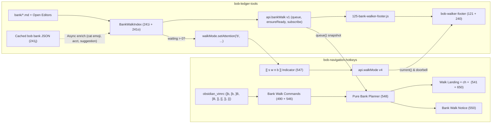
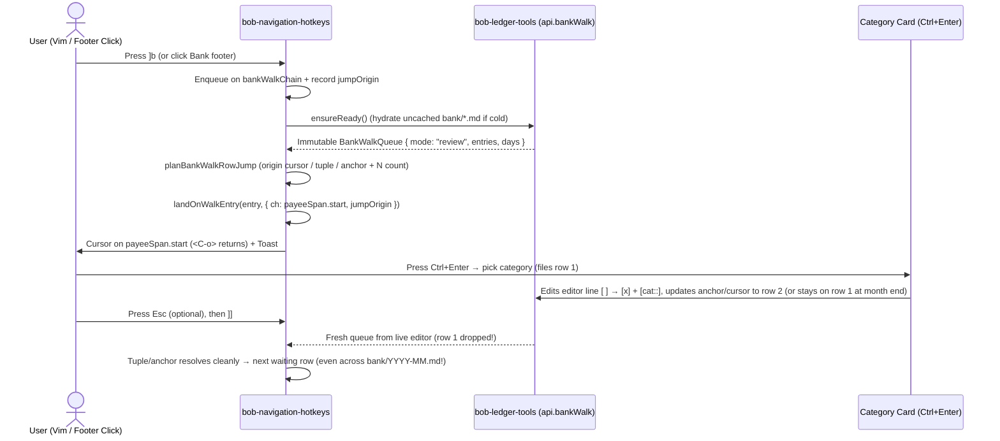

# Research & Design: `[b` / `]b` / `[B` / `]B` Bank Transaction Walker Keymaps & Walker Footer

**Date:** 2026-11-14  
**Researcher:** `gem`  
**Target repos:** `bobs-org/bob-plugins` (`bob-navigation-hotkeys`, `bob-ledger-tools`), vault `obsidian_vimrc.md`, and docs in `bob-cli`

---

## Executive Summary & Verdict

Adding `[b`, `]b`, `[B`, and `]B` as a fourth bracket-walk family (`b`) integrated into the existing **Bracket Mode selector (`[[ s w n ]]` → `[[ s w n b ]]`)** and **Walker Footer (`bob-walker-footer`)** is a **high-value, architecturally clean addition**—provided three ambiguities and one inversion in the initial requirements are corrected up front.

### Why this fits Bob's workflow
Today's bank workflow leaves an awkward navigation gap:
- `bob bank import` appends waiting `[ ]` transactions into monthly notes (`bank/YYYY-MM.md`) in chronological order (`## Thu Nov 12` oldest first).
- Inside a single month note, `Ctrl+Enter` opens the **Category card** (`BobLedgerToolsBankCategoryMixin`), which automatically advances to the next waiting row on commit (`bankCategoryNextWaiting`), **but explicitly never opens another file** (`246-plugin-bank-category-card-write.js`).
- Across months, before opening a card, or after everything is `[x]` settled (`waiting === 0`), there is **no keyboard traversal**—only scrolling or mouse clicks in `bob-bank` Queue Cards and Bank Badges.
- Meanwhile, `bob-plugins` already established a crisp, battle-tested pattern for vault-wide bracket traversal: `bob-ledger-tools` serves an immutable walk snapshot + status-bar panel inside the shared **Walker Footer**, while `bob-navigation-hotkeys` owns Vim cursor jumping, `<C-o>` jump history, `N` count handling, the `[[ s w n ]]` selector, and `[[` / `]]` / `[{` / `]}` repeat bindings.

### Recommended Solution in One Glance
1. **Fix the `[b` / `]b` direction inversion & align `[B` / `]B` semantics:**
   - `[b` / `]b` = **previous / next** bank row (matching `[B`/`]B`, `[s`/`]s`, `[w`/`]w`, `[n`/`]n`, and Vim unimpaired convention).
   - `[B` / `]B` = **first eligible row of the previous / next day**, skipping empty day headings (e.g. from `bob bank ensure`) and obeying the **active scope** (waiting days when `waiting > 0`, all populated days when `waiting === 0`), stepping strictly to `D-1` / `D+1` even when mid-day (matching `[W`/`]W` and `[S`/`]S`).
2. **Authoritative Hybrid Queue (`api.bankWalk` v1 in `bob-ledger-tools`):**
   - Scan `bank/YYYY-MM.md` from **vault cache + live open editor buffers** (`241i-plugin-bank-source.js` + `241o-plugin-bank-marks-model.js`), so cursor jumps, edits, `[ ]`↔`[x]` toggles, and dirty unsaved buffers reflect **instantly (<1 ms, zero CLI spawns, works offline & on mobile)**.
   - Overlay **cached `bob bank list -a` / `report` JSON** (`241j-plugin-bank-data.js`) asynchronously as non-blocking **display enrichment** (resolved account aliases, category emojis, `Rule`/`Learned` suggestion hints for the footer & toast).
3. **Fourth Walk Family (`b`) Across Both Plugins:**
   - `bob-navigation-hotkeys` adds `jump-to-next-bank-row`, `jump-to-prev-bank-row`, `jump-to-next-bank-day`, and `jump-to-prev-bank-day` (palette commands with no default `hotkeys`, bound in `obsidian_vimrc.md` to `]b`, `[b`, `]B`, `[B`); bumps `api.walkMode` to `v4`; updates `[[ s w n b ]]`; wires `]]`/`[[` to `]b`/`[b` and `]}`/`[{` to `]B`/`[B`; and extends `landOnWalkEntry` / `jumpToActiveTaskMoveDestination` with optional `ch` so bank jumps land on `payeeSpan.start` (matching Category Card & `bankCardNavigateRow`).
   - `bob-ledger-tools` adds the `"bank"` panel (`data-walker-panel="b"`, `125-bank-walker-footer.js`) inside `.bob-freshness`, pushes an **episodic amber** (`--text-warning`) dot onto `b` **only when `waiting > 0`**, and honors Bank's strict visual contract (**never red or magenta; emerald green for inflows/clear, amber for waiting/flagged, tabular numerals, calm `120ms` family crossfade**).
4. **Zero mandatory `bob-cli` changes**—all Rust parsers and JSON schemas already emit everything needed.

---

## 1. Critique of the Proposal & Justified Requirement Adjustments

This idea is fundamentally strong because bank transactions in `bank/YYYY-MM.md` share the exact ergonomics that made `]s` and `]w` successful: sequential items scattered across files (`YYYY-MM.md` boundaries), a clear two-state workflow (weekly Monday clearing + ad-hoc historical lookup), and a fast single-keystroke action (`Ctrl+Enter`) once the cursor lands.

However, implementing the prompt *literally without adjustments* would introduce **four real bugs or UX rough edges**. Each adjustment below is flagged explicitly for sign-off.

| ID | Prompt Requirement / Ambiguity | Issue Found in Codebase | Recommended Adjustment |
| :--- | :--- | :--- | :--- |
| **R1** | "`[b` and `]b` keymaps should allow me to jump to the next/previous bank transaction, respectively" | **Direction inversion.** Literally reverses `[` = prev / `]` = next used by `[B`/`]B` in the very next bullet, plus `[s`/`]s`, `[w`/`]w`, `[n`/`]n`, `[S`/`]S`, `[W`/`]W`, `[[`/`]]`, and `[{`/`]}` (`490-plugin-lifecycle.js`, `546-plugin-bracket-repeat.js`). | **Invert to standard convention:** **`[b` = previous bank transaction**, **`]b` = next bank transaction**. |
| **R2** | "When there are bank transactions that need review..." | **Scope ambiguity.** Rows in `bank/YYYY-MM.md` can be: `[ ]` parseable (`waiting`), `[x]` without `[cat::]` (e.g. transfers/cash/skipped), `⚑`/`!!` (`flagged`, orthogonal to `[ ]`/`[x]`), or `- [ ] $` stubs / `unparsed` amounts (`cents === null`). Category Card (`bankCategoryWaitingRows` in `246-plugin-bank-category-card-write.js`) only files `!acknowledged && Number.isSafeInteger(cents)`. | **Define "needs review" strictly as `!acknowledged && cents !== null`** (`waiting` rows). Keep `flagged` (`⚑`), unparsed stubs (`⚠`), and uncategorized `[x]` visible via badges/tooltips—never blocking Browse mode or desynchronizing counts from Bank Badge / Category Card / CLI `waiting`. |
| **R3** | "`[B` and `]B` should allow me to navigate to the first bank row in the previous/next day, respectively" | **Three underspecified cases:** (a) Empty day headings created by `bob bank ensure` have 0 rows (`"nothing posted"` in `241o-plugin-bank-marks-model.js`); (b) `[B`/`]B` behavior when `waiting > 0`; (c) `[B` pressed while mid-day (e.g. row 4 of Nov 12). | **(a)** Skip empty day headings. **(b)** Operate over the **active filter** (`waiting > 0` jumps between days that have waiting rows, landing on the first waiting row of that day; `waiting === 0` jumps between all populated days), mirroring `]S` and `]W`. **(c)** Mid-day `[B` steps to the **previous eligible day (`D-1`)**, mirroring `[W` (`stepOccupiedLane` in `542-lane-walk-model.js`). |
| **R4** | Entry point when launching `]b`/`[b` from outside bank notes | **Multi-month archive problem.** Bank notes grow monotonically oldest-first (`2026-01.md` → `2026-11.md`). Starting `]b` at index `0` in Browse mode (`waiting === 0`) dumps the user months/years in the past just to check yesterday's charge. Meanwhile in Review mode (`waiting > 0`), CLI `Next:` and Bank Badge target the **oldest** waiting row (`docs/bank.md`). | **Split default entry by mode when unanchored:**<br>• **Review mode (`waiting > 0`):** `]b`/`]B` enter at **oldest waiting row** (index `0`); `[b` at **newest waiting row** (`length - 1`).<br>• **Browse mode (`waiting === 0`):** If active note is a daily note (`YYYYMMDD.md`) with rows on/near that date, enter on **that date**; otherwise `]b`/`]B` enter on the **first row of the newest populated day** and `[b` on the **last (most recent) row**. (Once anchored or inside `bank/*.md`, step strictly monotonically and wrap across the full vault.) |
| **R5** | Uppercase repeat `]}` / `[{` | `546-plugin-bracket-repeat.js` pairs `[[`/`]]` with lowercase walks and `[{`/`]}` with uppercase jumps (`]S`/`[S`, `]W`/`[W`). Only `n` returns `BRACKET_REPEAT_NO_UPPERCASE_NOTICE`. | **Wire `[{` / `]}` to `[B` / `]B`** when `b` is the active bracket mode so all three multi-item walks (`s`, `w`, `b`) share the exact repeat contract. |
| **R6** | Cursor landing column & Category Card handoff | `landOnWalkEntry` (`541-walk-landing.js`) and `jumpToActiveTaskMoveDestination` (`650-plugin-move-commit.js`) hardcode `ch: 0`, whereas `bankCardNavigateRow` (`241m-plugin-bank-cards.js`) and Category Card (`248-plugin-bank-category-card-actions.js`) deliberately land at **`payeeSpan.start`**. Also, closing Category Card at month's end leaves the cursor on a now-`[x]` row. | **Extend walk landing with optional `ch`** (`payeeSpan.start`), and use cursor/anchor **tuple resolution `(date, path, line)`** so pressing `]b` after finishing month `N` crosses seamlessly into `N+1` (or wraps) without losing place or double-skipping rows when Category Card auto-advanced. |

---

## 2. Keybinding & Vim Integration Analysis

### Conflict Audit
Searching across `bob-plugins/plugins/**`, `bob-plugins/docs/**`, and `bob-cli/docs/**` confirms **zero existing bindings or collisions** for `[b`, `]b`, `[B`, or `]B`:
- **Stock Vim / CodeMirror Vim:** Vim has no default `[b`/`]b`/`[B`/`]B` motions (unlike `[s` which Bob already reclaimed for freshness review).
- **`vim-unimpaired` convention:** Uses `[b`/`]b` for `:bprevious`/`:bnext` and `[B`/`]B` for `:bfirst`/`:blast`. Obsidian uses tabs (`gt`/`gT`, pane commands) rather than Vim buffer lists, and `bob-plugins` does not map Vim buffer commands. Using `[b`/`]b` for item-level bank navigation and `[B`/`]B` for day-level bank navigation is idiomatic and mnemonic (**b**ank row / **B**ank day, matching **s**tamp/**S**ection and **w**alk-lane/**W**hole-lane).
- **Chord collisions:** Ctrl+Shift+B / Ctrl+Shift+Alt+B are already bound to Task Card Depends-on / Blocks (`490-plugin-lifecycle.js:219-232`), which do not conflict with normal-mode `[b` / `]b` / `[B` / `]B` Vim sequences.

### Registration Layer (Matching Bob's Three-Layer Convention)
As documented in `bob-plugins/docs/bob-navigation-hotkeys.md` (`Three keyboard layers`), Vim bracket sequences **must not** be registered as Obsidian `addCommand({ hotkeys })` defaults or `vim.map` inside plugin code where vault `obsidian_vimrc.md` owns them:

1. **In `bob-navigation-hotkeys` (`490-plugin-lifecycle.js`):** Register four palette commands **without** `hotkeys`, each calling `this.rememberBracketRepeatType("b")` before invoking `this.jumpToBankRow(...)`:
   - `jump-to-next-bank-row`: `"Jump to next bank transaction"` → `(1)`
   - `jump-to-prev-bank-row`: `"Jump to previous bank transaction"` → `(-1)`
   - `jump-to-next-bank-day`: `"Jump to first bank transaction of next day"` → `(1, { dayJump: true })`
   - `jump-to-prev-bank-day`: `"Jump to first bank transaction of previous day"` → `(-1, { dayJump: true })`
2. **In `546-plugin-bracket-repeat.js`:**
   - Update `normalizeBracketRepeatType(value)` to accept `"s" | "w" | "n" | "b"`.
   - Update `BRACKET_REPEAT_PLANS.b` (`jumpToBankRow`, `[1]` / `[-1]`) and `BRACKET_REPEAT_UPPERCASE_PLANS.b` (`jumpToBankRow`, `[1, { dayJump: true }]` / `[-1, { dayJump: true }]`).
   - Update empty/command labels (e.g., `"Repeat last bracket walk forward (]s, ]w, ]n, or ]b)"` and `"Repeat last bracket walk forward, uppercase (]S, ]W, or ]B)"` — note `test-navigation-bracket-repeat.cjs` asserts exact command display strings today and must be updated deliberately alongside the change).
3. **In the vault's `obsidian_vimrc.md`:** Add:
   ```vim
   exmap bob_prev_bank_row obcommand bob-navigation-hotkeys:jump-to-prev-bank-row
   exmap bob_next_bank_row obcommand bob-navigation-hotkeys:jump-to-next-bank-row
   exmap bob_prev_bank_day obcommand bob-navigation-hotkeys:jump-to-prev-bank-day
   exmap bob_next_bank_day obcommand bob-navigation-hotkeys:jump-to-next-bank-day
   nmap [b :bob_prev_bank_row<CR>
   nmap ]b :bob_next_bank_row<CR>
   nmap [B :bob_prev_bank_day<CR>
   nmap ]B :bob_next_bank_day<CR>
   ```
   Existing `[[` / `]]` / `[{` / `]}` mappings in `obsidian_vimrc.md` already point to `repeat-*-bracket-walk` and gain `b` support automatically.

---

## 3. Architecture & Options Analysis

Two fundamental architectural questions determine reliability and maintainability.

### Decision A: Where does the Bank Walk get its Queue?

| Criterion | Option A1: Pure CLI (`bob bank list -a -f json`) | Option A2: Pure Vault Scan (`241i`) | Option A3 (Recommended): **Hybrid (Authoritative Vault/Editor + Cached `bob` Enrichment)** |
| :--- | :--- | :--- | :--- |
| **Latency on cursor move / edit** | Poor (spawns Rust binary asynchronously on every file modify) | Instant (<1 ms in-memory scan over cached note strings) | **Instant (<1 ms); zero blocking on subprocesses** |
| **Unsaved editor buffer fidelity** | Stale until file saves + debounce + process exits | Reads live `editor.getValue()` immediately | **Reads live `editor.getValue()` immediately** |
| **Rapid Category Card filing** | Lags behind 1–2 rows; risks `stale` misses on immediate `]]` | Exact line numbers & `[ ]`/`[x]` status on the next tick | **Exact line numbers & `[ ]`/`[x]` status immediately** |
| **Omitted default `[acct::]`, emojis, suggestions** | Present from Rust config + journal | Unavailable (raw `[cat:: slug]` only) | **Present whenever `241j` cache holds recent `list -a` / `report`** |
| **Offline / Obsidian Mobile** | Completely broken (no CLI binary) | Fully functional | **Fully functional** (enrichment degrades gracefully) |
| **Empty day headings handling** | `bob bank list` omits empty days cleanly | `bankScanSource` collects both headings & rows cleanly | **Identical to Rust grammar** (`241i` already mirrors `grammar.rs`) |

**Why Hybrid wins cleanly:** `bob-ledger-tools` *already maintains* both halves:
- `241i-plugin-bank-source.js` + `241o-plugin-bank-marks-model.js` provide pure, zero-I/O month discovery (`bankDiscoverMonthPaths`), day heading recognition (`bankScanSource`), row classification (`bankRecognizeRow`), inline fields (`category`, `account`, `flagged`, `note`, `bankId`), and exact cursor offset `payeeSpan.start`. (In fact, Category Card writes in `246` and `248` *already* rely on `241i`/`241o` as their live source of truth and use `bob` JSON only for category catalogs & suggestions via `bankCategoryMatchJsonRow`!)
- `241j-plugin-bank-data.js` already caches `bob bank list -a` / `report` JSON with generation tracking and vault-event invalidation. Matching cached `bob` rows by `^bank-<hex>` ID (else `(path, line, cents, payee)`) enriches the footer and toast with category emojis (`🛒 Groceries`), default account names, and `Ctrl+Enter → Groceries` suggestion previews **with zero coupling in the critical jump path**.

### Decision B: Plugin Boundary & Component Responsibilities

| Option | Split | Trade-offs |
| :--- | :--- | :--- |
| **B1: Put everything in `bob-ledger-tools`** | Separate `bank` commands & status item inside `bob-ledger-tools` | Duplicates `landOnWalkEntry`, `<C-o>` Vim jump history, `N` Vim repeat consumption, `[[ s w n ]]` state persistence, and `[[`/`]]` routing. Reintroduces status-bar clutter that the `walker_footers` unification eliminated. |
| **B2: Parse bank files inside `bob-navigation-hotkeys`** | Keep nav isolated | Duplicates `241i`/`241o` regexes & `docs/bank.md` grammar rules in two plugins; loses access to `241j` cached categories/suggestions and `240` footer host. |
| **B3 (Recommended): Mirror `api.laneWalk` + `walkerFooter`** | **`bob-ledger-tools` serves `api.bankWalk` v1 + paints `"b"` footer panel; `bob-navigation-hotkeys` owns jumps, `api.walkMode` v4, `[[ s w n b ]]`, repeat & toast** | Zero duplicated parsers, single walker footer DOM slot, unified `[[`/`]]`/`[{`/`]}` muscle memory, shared `<C-o>` & leaf reuse safety, graceful versioned fallback if one plugin updates independently. |



### Cross-Plugin Contract Extensions

1. **`bob-ledger-tools.api.bankWalk` (`version: 1`, additive — root `api.version` stays `3`):**
   - `queue()`: Synchronous, never throws. Returns frozen immutable snapshot:
     ```js
     {
       available: boolean,        // false before initial scan ready
       reason?: "unready" | "no-vault" | "error",
       mode: "review" | "all" | "empty",
       today: "YYYY-MM-DD",
       counts: {
         total: number,           // all parseable rows across bank/*.md
         waiting: number,         // [!acknowledged && cents !== null]
         flagged: number,         // all flagged rows across active set (plus waitingFlagged/allFlagged)
         days: number,            // distinct days in active walk entries
         allDays: number,         // distinct days across all parseable rows
         unparsed: number,        // unparsed [ ] / stub rows surfaced in warnings
         months: number,
       },
       entries: BankWalkEntry[],  // active walk set (waiting if waiting > 0, else all parseable)
       allEntries: BankWalkEntry[], // only needed if footer shows total context or empty-day context; keep light
       days: BankWalkDay[],       // [{ date, path, heading, headingLine, firstEntryIndex, count, waiting, flagged, outCents, inCents }]
       monthPaths: string[],
     }
     ```
     Each `BankWalkEntry` carries:
     `{ key, ackId, path, line, headingLine, date, heading, originalMarkdown, ch, status, acknowledged, cents, amountText, payee, categoryKey, categoryLabel, accountKey, accountLabel, flagged, note, dayRank, dayTotal, rank, total, suggestion? }`.
     *(Note `rank`/`total` are 1-based over `entries`; `dayRank`/`dayTotal` are 1-based within that entry's day in `entries`, enabling `Nov 12 (2/4)` cleanly.)*
   - `ensureReady()`: Async `Promise<BankWalkQueue>` that reads any uncached `bank/YYYY-MM.md` files via `app.vault.cachedRead` on first keyboard invocation before cache warm-up finishes, then returns the fresh `queue()`.
   - `onChange(callback)`: Subscribes to bank index or enrichment updates (returns unsubscribe fn), keeping `bob-walker-footer` and `b` attention dot live whenever files change or the user types in an open bank note.
   - `cursorContext({ path, line, lines })`: Synchronous helper resolving `(effectiveDate, rowAtCursor)` for **any** line in a `bank/YYYY-MM.md` note (even a day heading, child bullet, or settled `[x]` row), plus active daily-note date extraction (`YYYYMMDD.md`) for smart Browse entry!

2. **`bob-navigation-hotkeys.api.walkMode` (`version: 4`, backward-compatible with `v1–v3`):**
   - `current()` and `select(type)` accept `"s" | "w" | "n" | "b"`.
   - `setAttention(type, value)` accepts `"s"` or `"b"` (rejecting others with `"invalid-type"`), maintaining independent slots `plugin.bracketModeAttentionByType = { s: null, b: null }` while preserving `plugin.bracketModeAttention` as an alias/mirror for `"s"` so existing `v3` callers & tests keep working identically (note `test-navigation-bracket-repeat.cjs:773-783` checks `plugin.bracketModeAttention` directly!).
   - **`walkerFooterWalkMode(plugin)` (`122-walker-footer-host.js`):** Update the valid mode guard (`mode !== "s" && mode !== "w" && mode !== "n" && mode !== "b"`). Notice older `bob-ledger-tools` gracefully ignores/hides if `"b"` isn't known yet; once updated, `"b"` paints cleanly.

---

## 4. Visual & Interaction Design Specification

Everything in the visual design respects `docs/bank.md`'s explicit Bank UI rules and the `bob-walker-footer` design system (`121-freshness-footer-paint.js` + `bob-ledger-tools/styles.css`):
- **Palette discipline:** **Never red or magenta** anywhere in Bank UI (`docs/bank.md:529-530`).
  - **Inflows (`+$`) & All-Clear state:** Emerald green (`--bob-bank-in-ink: color-mix(in srgb, var(--color-green) 60%, var(--text-normal))`).
  - **Outflows (`-$`):** Crisp body ink (`--text-normal`) with `font-variant-numeric: tabular-nums`.
  - **Waiting `[ ]` & Flagged `⚑`:** Warm amber (`--text-warning` / `--color-orange`), never alarm red.
  - **Color never carries meaning alone:** Words (`waiting`, `flagged`, `clear`), symbols (`⚑`, `+`, `✓`, `$`), and tabular counts carry full meaning in monochrome and `forced-colors: active`.

### 4.1 The `[[ s w n b ]]` Status Bar Selector

```text
  [[ s w n b ]]          <-- s, w, or n active; b has a subtle 5px amber dot when waiting > 0
  [[ s w n b ]]          <-- clicking `b` (or pressing ]b / [b / ]B / [B) slides thumb onto `b`
```

- **Segment geometry (`styles.css` & `547-bracket-mode-indicator.js`):**
  - `.bob-bracket-mode` already uses `transform: translateX(calc(var(--bob-bracket-index, 0) * var(--bob-bm-seg)))` with `--bob-bm-seg: 1.3em`, so index `3` places the pill directly under `b` cleanly with the same `180ms cubic-bezier(0.2, 0.8, 0.2, 1)` slide!
  - Fix hardcoded `segments.length === 3` in `ensureBracketModeDom` (`547-bracket-mode-indicator.js:423`) to `segments.length === BRACKET_MODE_FAMILIES.length` (`4`).
- **Anti-Wallpaper Attention Dot for `b`:**
  - Just as `walkerFooterPushReviewAttention` lights `s` only for commitment tiers (turning off when upkeep-only or clear), `bob-ledger-tools` pushes `{ tier: "waiting", label: "Bank: N waiting — M days; click to review" }` to `walkMode.setAttention("b", ...)` **only when `waiting > 0 && route.mode !== "b"`**, and passes `null` the instant `waiting === 0` or `"b"` is selected.
  - Add `.bob-bracket-mode-seg.has-attention[data-attention-tier="waiting"] { --bob-review-attention: var(--color-orange, var(--text-warning)); }` and update `bracketModeViewKey` (`547-bracket-mode-indicator.js:52`) to include per-segment attention so turning the `b` dot on/off always repaints cleanly.
  - Clicking `b` selects `"b"` without moving the cursor (identical to `s`, `w`, `n`), immediately revealing the Bank Walker Footer in the status bar so Bryan can inspect the backlog before deciding to jump.

### 4.2 Bank Walker Footer Panel (Exact Slot Mapping in `bob-walker-footer`)

By mapping onto the **six existing DOM elements** created by `freshnessFooterEnsureDom` (`121-freshness-footer-paint.js:117-172`), Bank inherits `ResizeObserver` responsive shedding, tooltip structure, focus rings, fixed height (`min-height: 1.6em`), and `data-walker-panel="b"`'s calm `120ms` crossfade automatically:

| DOM Slot | Review + On Waiting Row | Review + Cursor Elsewhere | Browse (`waiting === 0`) + On Row | Browse (`waiting === 0`) + Clear | Empty Vault (`0` rows) |
| :--- | :--- | :--- | :--- | :--- | :--- |
| **`button` (`icon` + `due`)** | **`$ Bank 3/12`** | **`$ Bank 12 waiting`** | **`$ Bank 18/142`** | **`$ Bank clear`** | **`$ No bank rows`** |
| **`context`** | `Nov 12 (2/4)` | `]] next` *(or `Nov 12 · ]] next`)* | `Nov 12 (2/4)` | `]] browse` | `bank/*.md empty` |
| **`detail`** *(full / compact)* | `-$42.50 Trader Joe's` / `-$42.50` *(or `+` in emerald, `⚑` if flagged)* | `since Nov 10 · 3 days` / `3 days` | `-$42.50 🛒 Groceries` / `-$42.50` *(flagged shows `⚑`)* | `142 rows · Nov 14` / `Nov 14` | *(omitted)* |
| **`hint`** *(chip or text)* | **`Ctrl+Enter` `→ 🛒 Groceries`** *(chip if cached suggestion, else **`Ctrl+Enter file`**)* | `]B / [B days` | `checking` *(or account label if known)* | `]B / [B days` | `bob bank import` |
| **`groups`** | `Nov 10 4 · Nov 14 5` *(other waiting days)* | `Nov 10 4 · Nov 12 3 · Nov 14 5` | *(month total/waiting or omitted for quiet look)* | *(omitted — calm desk)* | *(omitted)* |
| **`meter`** | `⚑ 2 flagged` *(else `3 days`)* | `⚑ 2 flagged` *(else `3 days`)* | `✓ clear` | `✓ all filed` *(or `⚑ N flagged` if flagged > 0)* | *(omitted)* |

Visual rendering across full, narrow, and clear states:

```text
Full width — Review Mode (cursor on waiting row with cached bob suggestion):
[ $ Bank 3/12 ] · Nov 12 (2/4) · -$42.50 Trader Joe's · [Ctrl+Enter → 🛒 Groceries] · Nov 10 4 · Nov 14 5 · ⚑ 1 flagged   [[ s w n [b] ]]

Full width — Review Mode (inflow row, cursor on waiting row, no suggestion yet):
[ $ Bank 4/12 ] · Nov 12 (3/4) · +$18.00 Venmo · [Ctrl+Enter file] · Nov 10 4 · Nov 14 5 · 3 days                        [[ s w n [b] ]]

Narrow split pane (freshnessFooterFit sheds trailing groups → compact detail → meter → hint):
[ $ Bank 3/12 ] · Nov 12 (2/4) · -$42.50 · [Ctrl+Enter → 🛒 Groceries]                                                   [[ s w n [b] ]]
Ultra-narrow pane:
[ $ Bank 3/12 ] · Nov 12 (2/4)                                                                                           [[ s w n [b] ]]

Full width — Browse Mode (all settled, cursor elsewhere):
[ $ Bank clear ] · ]] browse · 142 rows · Nov 14 · ]B / [B days · ✓ all filed                                            [[ s w n [b] ]]
```

Notice two critical details:
1. **Never fabricate hotkeys:** On an already `[x]` row in Browse mode, `Bank: set category` has **no default hotkey** in `bob-ledger-tools` (`241k-plugin-bank-actions.js:502-508`), while `Ctrl+Enter` toggles `[x]`→`[ ]`. So the Browse hint never invents a fake shortcut—it displays calm metadata (account alias / category), keeping command-palette discovery (`Bank: set category`) in the hover tooltip.
2. **Shedding order matches `freshnessFooterFit` (`121-freshness-footer-paint.js:391-479`):** Because `detailCompactText` keeps the exact signed amount (`-$42.50` / `+$18.00`), narrowing a split pane drops the payee first, then drops trailing day counts (`+K`), while always preserving the rank (`Bank 3/12`), active day (`Nov 12 (2/4)`), and clickable CTA! Adding `view.answer`-style structured chip support for `Ctrl+Enter → 🛒 Groceries` makes the actionable hint outlast the meter automatically!
3. **Click action on `parts.button` (`freshnessStatusClicked` in `240-plugin-freshness-status.js:624`):**
   - When `route.mode === "b"`: triggers `"bob-navigation-hotkeys:repeat-next-bracket-walk"` (`]b`), matching `"w"` and `"n"` cleanly! (If vault has 0 rows anywhere, opens `bank.md` or shows notice.)

### 4.3 Rich Landing Notice (`550-bank-walk-notice.js`)

Replaces any prior `this.bankWalkNotice` in place (`no stacking`), reusing `.bob-nh-notice` layout + Bank's amber/emerald/neutral tokens:

```text
┌─────────────────────────────────────────────────────────────────────────┐
│ [WAITING 3/12]  BANK · Nov 12 · 2/4 in day                     NEW DAY  │
│  ●●○  ●●●●  ○○○○○                                              (Nov 10–14)
│ -$42.50   Trader Joe's                                                  │
│ checking · 💡 Groceries · ⚑ flagged · 📝 split groceries                │
│ Ctrl+Enter file & categorize · ]b next · ]B next day                    │
└─────────────────────────────────────────────────────────────────────────┘
```

- **When `waiting === 0` (Browse mode):** Header pill reads `BANK 18/142` in neutral/emerald border, chips show `🛒 Groceries · checking · 📝 note` (plus `↻ wrapped` if wrapped across the archive boundary, matching `.bob-nh-lane-walk`), and hint reads `]b next · ]B next day · Bank: set category`.
- **When `N` count jump (`3]b`) or `[B`/`]B` day jump lands:** Add a subtle right-hand receipt badge (`+3` or `NEXT DAY` / `PREV DAY`) so the user gets immediate kinetic feedback explaining *where* and *how far* they moved.
- **Progress rail:** When total days `<= 20` (or rows `<= 30`), render a clean compact dot-per-item grouped by day (capped or collapsed into a proportional multi-day bar when `> 30` rows, using the exact threshold pattern proven in `renderLaneWalkNoticeFragment` in `543-lane-walk-notice.js:36-97`!).

---

## 5. Navigation Semantics, Concurrency & Edge Cases

### 5.1 Canonical Ordering & Identity
- **Total order across all `bank/YYYY-MM.md` files:** Sort entries lexicographically by **`(date, path, line)`**:
  - `date`: `"YYYY-MM-DD"` from `bankScanSource` (`241i-plugin-bank-source.js:408`). Note: day headings inside malformed notes might theoretically have out-of-order dates or duplicate `YYYY-MM` paths—sorting by `(date, path, line)` guarantees `[B`/`]B` are strictly monotonic in calendar time while preserving document order within each day!
- **Stable Entry Key:**
  - If `^bank-<hex>` (`ackId`) exists → `"bank:" + ackId` (survives edits, payee cleanup, `[ ]`↔`[x]` toggles, and line shifts!).
  - Otherwise → `"line:" + path + "\u0000" + (blockId ? "^" + blockId : line + "\u0000" + originalMarkdown)`.

### 5.2 Formal Origin Resolution (`planBankWalkOrigin`)
Consider every possible cursor position when the user presses `[b`, `]b`, `[B`, or `]B`:

1. **Cursor sits directly on an entry in `queue.entries`:**
   - `origin = { kind: "cursor", index, date: entry.date, path: entry.path, line: entry.line }`.
   - `]b` → `index + 1` (wraps `0` at end, marking `wrapped: true`); `[b` → `index - 1` (wraps `length - 1` at start).
   - `]B` → first entry in the next day (`dayIndex + 1`, modulo `days.length`); `[B` → **first entry** in the previous day (`dayIndex - 1`, modulo `days.length`), even if the cursor was on row 4 of day `D` (**R3**).
2. **Cursor is inside a `bank/YYYY-MM.md` note, NOT on an eligible walk row** (e.g., on `## Thu Nov 12`, on an already `[x]` row while `waiting > 0`, on a child comment bullet under a transaction, on an empty day heading, or above the first heading):
   - Use `cursorContext()` to resolve the cursor's `(effectiveDate, path, cursorLine1)`:
     - On/below `## Thu Nov 12`: `effectiveDate = "2026-11-12"`. Above the first heading in `bank/2026-11.md`: `effectiveDate = "2026-11-00"`. Under a non-day `##` heading: walk up or use `month + "-00"`/`"-99"` boundary relative to adjacent headings.
   - **Tuple-based step:**
     - `]b`: first entry strictly **after** `(effectiveDate, path, cursorLine1)` (wrapping to `entries[0]`).
     - `[b`: last entry strictly **before** `(effectiveDate, path, cursorLine1)` (wrapping to `entries[length - 1]`).
     - `]B`: first entry of the first eligible day with `day.date > effectiveDate` (Wait: special polish if cursor is **literally on an empty day heading `## Tue Nov 10`** or between days before Nov 12's rows—`day.date > "2026-11-10"` cleanly lands on the next eligible day; and if cursor is on an `[x]` row in Nov 12 while Nov 12 also has waiting rows, `]b` hits those rows in Nov 12 while `]B` advances to Nov 13+ consistently!).
     - `[B`: first entry of the last eligible day with `day.date < effectiveDate` (wrapping to `days[last]`).
3. **Cursor is outside `bank/*.md`, with a valid `this.bankWalkAnchor` (`{ key, date, path, line, text }`):**
   - Look up `anchor.key` in `queue.entries`:
     - Found at `i` → resume from `i` (so pressing `]b` advances to `i + 1` instead of restarting from the top of the vault after briefly checking `dash.md`!).
     - Not found (e.g., anchor row was acknowledged externally by `bob` CLI or Sync, or mode flipped) → step from anchor tuple `(anchor.date, anchor.path, anchor.line)` via rule (2), or fallback to rule (4) if the active queue is brand new (`waiting` flipped from `0` to `>0` or month archived).
4. **No cursor in bank notes & no valid anchor (Fresh Entry — R4):**
   - **Review mode (`waiting > 0`):**
     - `]b` / `]B` → `entries[0]` (oldest waiting row / first waiting day).
     - `[b` → `entries[length - 1]` (newest waiting row).
     - `[B` → first entry of `days[days.length - 1]` (newest waiting day).
   - **Browse mode (`waiting === 0`):**
     - If active Markdown file is a daily note (`YYYYMMDD.md` → `isoDate`) and `days.length > 0`:
       - Find exact `day.date === isoDate`, else nearest day `<= isoDate` (falling back to `days[days.length - 1]` if note predates bank history).
       - `]b` / `]B` / `[B` → first row of that day; `[b` → last row of that day.
     - Otherwise (non-daily note or clicking footer):
       - `]b` / `]B` / `[B` → first row of **newest populated day (`days[days.length - 1]`)**; `[b` → **last row overall (`entries[length - 1]`)**.



### 5.3 Handling All Subtle Corner Cases
1. **Category Card (`Ctrl+Enter`) Interop — No Double-Skip, No Month-Boundary Trap:**
   - **Scenario A (Category Card auto-advances to Row 2 inside same month, user files Row 2 or closes Card and presses `]]`):** Cursor is *already* on Row 2 (open `[ ]`). Pressing `Ctrl+Enter` files Row 2 directly; pressing `]]` explicitly means *"skip Row 2, go to Row 3"*. No accidental skip!
   - **Scenario B (Row K was the last waiting row in `bank/2026-10.md`, Category Card closes showing End-of-Run summary with `"2 waiting in 2026-11"`, cursor sits on now-`[x]` Row K):** When user dismisses modal and presses `]]`: cursor is inside `2026-10.md` on `[x]` Row K (`(date: "2026-10-31", path: "bank/2026-10.md", line: K)`). Because `bankWalk` scans all `bank/*.md` files and resolves via **tuple order (rule 2)** whenever cursor sits on an `[x]` row, `]]` sees `(2026-10-31, line K) < (2026-11-01, ...)` and jumps straight into **`bank/2026-11.md`**!
   - **Scenario C (User walks `]b`, files Row 1 with `Ctrl+Enter`, closes card manually, or `Alt+Space`/toggles checkbox directly):** Live `editor.getValue()` immediately drops Row 1 from `queue.entries` on the next `api.bankWalk.queue()` call—zero waiting for file save or `bob` spawn!
2. **Counted Vim Repeats (`N]b`, `N[b`, `N]B`, `N[B`):**
   - Extract `consumePendingVimRepeat(options, "counted-bank-walk")` cleanly (reusing `getPendingVimRepeat` / `resetPendingVimInputState` from `544-plugin-lane-walk.js`).
   - `3]b` steps `3` transactions at once (with modulo wrap), performing **one** file open, **one** `<C-o>` jump entry, and **one** toast update. `2]B` steps `2` populated/waiting days forward cleanly.
3. **1-Row / 1-Day Boundary (No-op Wrapping & Feedback):**
   - When `entries.length === 1` and cursor is already on that lone entry (or `days.length === 1` and `[B`/`]B` is pressed while on that day): `landOnWalkEntry` re-centers on the row (`payeeSpan.start`), flashes `empty` / calm subtle feedback (` Only 1 waiting row ` or ` Only 1 day in walk `) in the toast chip so the user never wonders whether the keymap silently failed!
4. **Deleted or Edited Line While Modal/Async Jump Is In Flight:**
   - Identical to `jumpToLaneTask` (`544-plugin-lane-walk.js:132-163`): `landOnWalkEntry` validates `resolveReviewQueueLine(content, entry)` (exact `originalMarkdown` at `entry.line`, or unique match in file); if `stale: true`, re-read `api.bankWalk.queue()`, replan once, and retry cleanly before showing `BANK_WALK_STALE_NOTICE`.
5. **Cold-Cache First Press:**
   - On startup (`workspace.onLayoutReady`), schedule idle/non-blocking `app.vault.cachedRead` indexing of all `bank/YYYY-MM.md` files (~a few KB per month). If a user invokes `]b` or opens `b` before that completes, `ensureReady()` awaits the missing reads inside `bankWalkChain` so the first `]b` never returns a false empty state.
6. **Multi-Day Headings With Duplicate Dates or Malformed Dates:**
   - `bankScanSource` ignores unparseable headings (`current = null`) and parses valid headings (tracking `weekday_mismatch` without throwing). Duplicate headings for the same date in one month keep distinct `(path, line)` tuples; `days[]` coalesces consecutive/same-`date` rows cleanly by exact `(date)` so `[B` / `]B` never gets trapped jumping inside the same calendar date.
7. **Vault Without `bank.md` or Bank Notes:**
   - Footer shows `"No bank rows · bank/*.md empty · bob bank import"` when selected (`b` mode stays valid so `[[ s w n b ]]` geometry never shifts horizontally), pushes no `b` attention dot, and clicking opens `bank.md` if present or surfaces a clean Notice.

---

## 6. Impact on `bob-cli`

**No `bob-cli` code changes are required** to deliver the full feature safely and cleanly:
- `bob bank list -a -f json` (`src/native/bank/list.rs`) already emits `days[].rows[]` with `path`, `line`, `date`, `heading`, `payee`, `cents`, `category`, `account`, `flagged`, `acknowledged`, `id`, and `suggestion`, plus global `counts { rows, waiting, flagged }` and `categories`/`accounts` catalogs.
- `bob-ledger-tools`'s `241i-plugin-bank-source.js` and `241o-plugin-bank-marks-model.js` already implement the exact same month/day/row Markdown grammar as `src/native/bank/grammar.rs` and `month.rs`.

**Recommended documentation & optional follow-ups in `bob-cli` (post-implementation):**
1. Update `docs/guides/acknowledge-bank-transactions.md`, `docs/bank.md`, and `docs/reference/plugins/bob-navigation-hotkeys.md` + `bob-ledger-tools.md` (`docs/` updates go through `/docs` memory rules) once `[b`/`]b`/`[B`/`]B` land.
2. *(Optional, low priority)* If future preferences warrant it (e.g. toggling `[[ s w n b ]]` visibility for vaults that disable banking, or customizing Browse-mode entry order), add `bank.walker` keys under `~/.config/bob/config.yml`—**not recommended for v1**, since `bank.md` absence / 0-row state handles non-bank vaults gracefully with zero config bloat.

---

## 7. Recommended Implementation Plan (`bob-plugins`)

Implement in 5 small, independently testable increments (keeping every edited fragment strictly under `bob-plugins`'s 1000-line limit):

| Phase | Repo / Plugin | Deliverables | Verification |
| :--- | :--- | :--- | :--- |
| **1. Bank Walk Index & API** | `bob-ledger-tools` | New pure model + service fragments (e.g. `241r-plugin-bank-walk-model.js`, `241s-plugin-bank-walk.js`) scanning `bank/*.md` via `241i`+`241o` + open editors + optional `241j` JSON enrichment; expose `api.bankWalk` v1 (`queue`, `ensureReady`, `onChange`, `cursorContext`); document in `docs/develop/plugin-apis.md`. | New `scripts/test-ledger-tools-bank-walk.cjs` covering multi-month `(date, path, line)` order, empty day skipping, waiting→all transition, dirty editor reflection, and enrichment overlay. |
| **2. Nav Walk Runtime, Landing `ch` & Tests** | `bob-navigation-hotkeys` | Add `ch` support to `landOnWalkEntry` (`541`) & `jumpToActiveTaskMoveDestination` (`650`); extract shared Vim repeat helper; add `548-bank-walk-model.js`, `549-plugin-bank-walk.js`, `550-bank-walk-notice.js`; register the 4 commands in `490-plugin-lifecycle.js`. | New `scripts/test-navigation-bank-walk.cjs` covering `[b`/`]b` inversion fix, `[B`/`]B` day jumps, mid-day `[B`, tuple anchor fallback after Category Card, `N]b` counts, `<C-o>` recording, and stale retry. |
| **3. Selector, Repeat & `walkMode` v4** | `bob-navigation-hotkeys` | Extend `BRACKET_MODE_FAMILIES` (`[[ s w n b ]]`) and `ensureBracketModeDom` (`length === 4`); extend `normalizeBracketRepeatType`, `BRACKET_REPEAT_PLANS`, `BRACKET_REPEAT_UPPERCASE_PLANS` (`]} / [{` → `]B / [B`); bump `api.walkMode` to v4 (`setAttention("s" \| "b", ...)`). | Update `test-navigation-bracket-repeat.cjs`, `test-navigation-bracket-mode-indicator.cjs`, and `preview-bracket-mode.cjs`; CSS check for 4-segment `.bob-bracket-mode` & amber `waiting` dot. |
| **4. Bank Walker Footer & Attention Push** | `bob-ledger-tools` | Create pure `125-bank-walker-footer.js`; update `walkerFooterWalkMode` (`122`), `walkerFooter` routing & `freshnessStatusClicked` (`240`), `data-walker-panel="b"` + `freshnessFooterPaint` (`121`), and Bank CSS tokens (`--bob-bank-in-ink`, amber waiting, `bob-walker-panel-in-b`) in `styles.css`; push/clear `"b"` attention on index change. | Extend `test-ledger-tools-walker-footer.cjs`, `preview-walker-footer.cjs`, and `obsidian-walker-footer-e2e.cjs` across Review / Browse / Clear / Empty / Narrow-width states. |
| **5. Vault Bindings & E2E Check** | Vault `obsidian_vimrc.md` + `bob-plugins` | Bind `[b`, `]b`, `[B`, `]B` in `obsidian_vimrc.md`; sync plugins via `bob plugins sync`; add live Obsidian E2E case testing `[b`/`]b`/`[B`/`]B` across two `bank/YYYY-MM.md` files + `Ctrl+Enter` Category Card handoff + footer updates. | Full `bob-plugins` test suite (`npm test` / runner scripts) + live `obsidian-walker-footer-e2e.cjs` / `obsidian-bank-ui-e2e.cjs`. |

---

## Summary of Design Decisions
- **Conventions win:** Fix `[b` = previous / `]b` = next, keep Review mode tied cleanly to `[ ]` waiting rows with parseable amounts (`waiting > 0`), and keep `[B`/`]B` aligned with the active mode while skipping empty day headings.
- **Instant & Offline-First Data:** Drive movement from vault + open-editor Markdown (`241i`+`241o`) and overlay cached `bob bank` JSON (`241j`) asynchronously—zero CLI spawn lag, full Category Card compatibility, full mobile support.
- **One Cohesive Footer Family:** Extend `[[ s w n ]]` → `[[ s w n b ]]` and `bob-walker-footer` rather than spawning a second status bar widget, with an episodic amber dot (`--text-warning`) on `b` that lights only when waiting rows exist and stays true to Bank's no-red/no-magenta palette.
