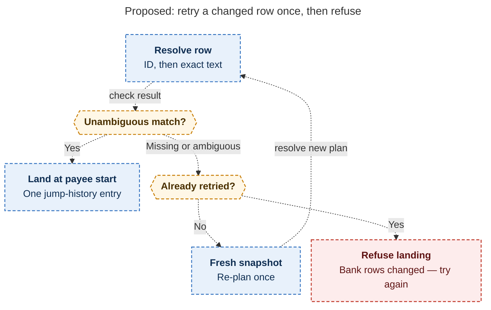

# Diagram proposals: Bank walk family `b`: `]b` / `[b` / `]B` / `[B` with a fourth walker-footer panel

Proposals for the swarm linker, not a report. Each diagram restates only what the source
report says.

```yaml
source: research:202611/bank_walk_family_b/bank_walk_family_b__final.md
producer: research.4n.image
check: "mmdc 12.0.0 (Puppeteer --no-sandbox) with the PDF-mirroring config rendered 1 of 1 Mermaid diagrams"
```

## landing-retry

```yaml
anchor: |-
  on failure, re-snapshot and re-plan **once**, then refuse with
question: |-
  When does a failed bank-row landing retry, and when does it refuse?
illustrates: |-
  Identity-based landing gets a single re-plan, then an explicit refusal, so the walk never lands on a guess.
caption: The proposed walk retries failed identity resolution once, then refuses; it never guesses a landing.
review: "665.954×738 px, fit 98.0%; question, source, and visual checks passed; 0 visual revisions"
```


