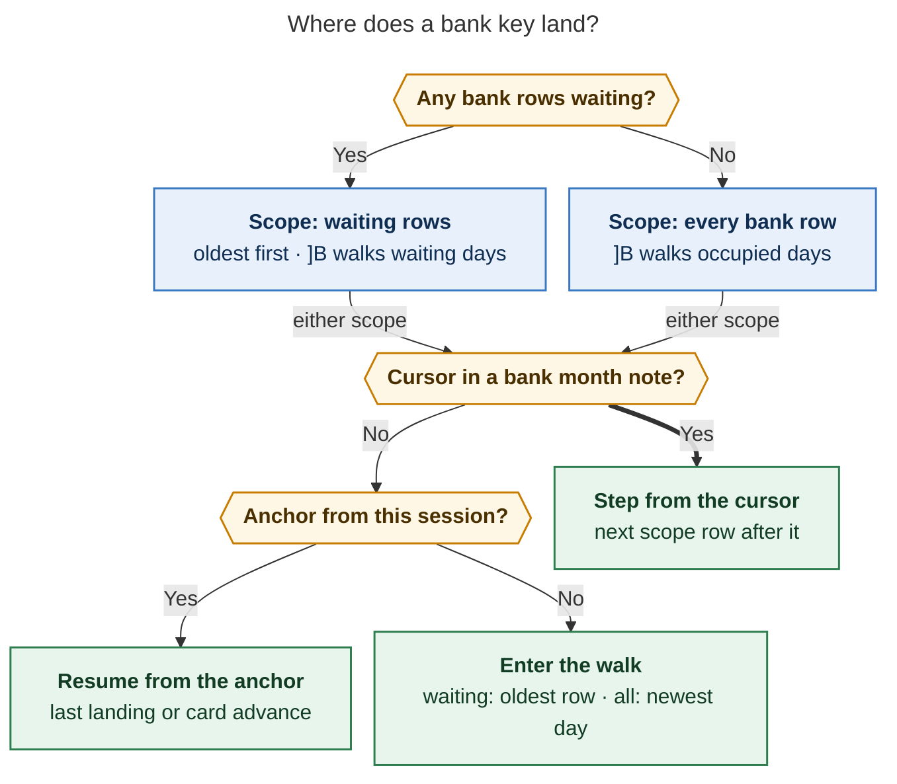

# Bank walk family `b`: `]b` / `[b` / `]B` / `[B` with a fourth walker-footer panel

Consolidated report, 2026-11-14. Lead researcher merging five independent reports —
`__cdx`, `__cld`, `__grk`, `__mus`, `__gem`, all in this directory — plus the lead's own
verification pass over bob-plugins `0c296f5`, bob-cli `1a32cc1a`, and audited
`glossary:walker-footer`, `glossary:bank-row`, `glossary:bank-month-note`, and
`glossary:bank-badge` reads. Where the reports disagreed on a checkable fact, the lead
re-read the source and the ruling below cites what the code actually says. No code, no
vault note, and no memory file was changed.

## Verdict

**Build it — all five researchers independently said yes, and so does this
consolidation.** Bank rows are the one Bob-maintained content family with no keyboard
walk: they never carry `#task`, so every task walk skips them by design; the Category
card files waiting rows but explicitly "never opens another file"
(ledger `246-plugin-bank-category-card-write.js:179`); and the badge and queue card are
mouse surfaces. Meanwhile the bracket grammar — lowercase steps items, uppercase jumps
groups, `]]` / `[[` repeat, one selector, one walker-footer host — is already in
Bryan's fingers and the four keys are unmapped in the vault vimrc (verified
independently by three researchers).

**The design in one sentence:** add **`b` as the fourth bracket family** — `]b` / `[b`
step bank rows, `]B` / `[B` jump days, `]]` / `[[` / `]}` / `[{` repeat them, the
selector reads `[[ s w n b ]]` — backed by a new ledger-owned `api.bankWalk` v1 built
from the existing bank recognizer plus open-editor overlays, landing through nav at the
payee start with a `<C-o>` jump, and painted as a fourth panel on the existing
walker-footer host that always leads with its scope: amber `WAITING 3/9` or calm
`ALL`.

No bob-cli code change is required; the whole feature lives in bob-plugins plus four
vault vimrc lines.

## Unanimous findings

Every report converged on these, so they should be treated as settled:

1. **Direction correction.** The request maps `[b` to *next* and `]b` to *previous*.
   All five researchers independently flagged this as a slip: every existing family
   (`]s`, `]w`, `]n`, `]]`), the request's own `[B` / `]B` sentence, and
   vim-unimpaired convention use `]` = forward. **`]b` / `]B` go next; `[b` / `[B` go
   previous.**
2. **"Needs review" = waiting `[ ]` rows, exactly.** The same set `bob bank list`
   counts as `waiting`. A flagged-but-ticked `⚑` row is an acknowledged investigation
   mark; a ticked row without `[cat::]` is deliberately filed. Neither re-enters the
   review queue.
3. **Every valid bank row walks, whatever its origin.** The request says "saved via
   `bob bank import`", but typed rows and typed-then-matched rows are equally
   transactions; restricting to imported `^bank-<hex>` IDs would silently skip
   legitimate rows. Membership is the recognizer's grammar: a top-level
   amount-led checkbox under a valid day heading — never stubs, fenced examples,
   indented children, plain checklists, or non-day sections.
4. **Vault-wide scope across `bank/*.md`.** The waiting queue is cross-month by CLI
   contract, and the oldest waiting rows live in older months — exactly where the
   month-local Category card cannot go. The walk is the cross-month traveller.
5. **"Their own walker footer" = a fourth panel on the one-slot walker-footer host**,
   gated on the persisted family, never a second status-bar item. The glossary's
   walker-footer contract (one member at a time, shared slots, shed order, clear ≠
   loading ≠ unavailable) applies verbatim.
6. **The walk never writes.** No ticks, no categories, no auto-opened Category card,
   and never `bob bank ensure` (it creates files and headings). Ctrl+Enter stays the
   one filing gesture; the footer merely hints it on a waiting row.
7. **No `bob` spawn on the key path, no new CLI.** The existing
   `bob bank list -a -f json` already carries everything a contract would need, and the
   ledger plugin already has the recognizer and a cached JSON service. A subprocess per
   keypress is the reliability trap (slow, disk-only, blind to the unsaved tick the
   card just wrote, broken on mobile).
8. **Keys ship as palette commands with no default hotkeys**, bound by four `exmap` +
   four `nnoremap` lines in the vault's `obsidian_vimrc.md`, like every other bracket
   family. The vim-unimpaired `[b` = `:bprevious` collision is theoretical (that
   plugin is not enabled and Obsidian has no Vim buffer list) but worth one sentence in
   the Navigation Hotkeys reference.

## Conflicts between the reports, and how the lead resolved them

### 1. Should lowercase fall back to all rows when nothing waits? — Yes (keep the request)

Four reports keep the requested dual scope. mus alone would drop it: waiting-only
plus a `Bank clear` state, arguing that membership keyed on vault-global state makes
the denominator teleport (`2/3 waiting` becomes `14/24 rows` after the last ack) and
that no existing walk degrades this way (`]s` paints `Review clear`, never walks all
tasks).

The dissent identifies a real hazard but over-weights it. Bank differs from review in
kind: after filing, the month note is a *statement* you still want to browse — grk's
live-vault measurement found waiting is zero about six days a week, so **the all-rows
timeline is the common case, not a fallback edge**. Under mus's cut, the lowercase keys
would do nothing most of the week. Keep the requested automatic scope and make the flip
impossible to miss:

- The footer's first word is always the scope: amber `WAITING` or calm `ALL`.
- A one-time notice fires when the scope flips between steps
  (`Nothing waiting — ]b now walks every row`).
- A membership change never moves the cursor by itself; only the next deliberate
  keypress uses the new scope, computed fresh from one immutable snapshot.
- Queued repeats from the old scope are cancelled at the flip (cdx), so a held `]]`
  cannot spill from the waiting queue into the archive.

### 2. Do the day jumps follow the scope? — Yes (majority), with cdx's dissent preserved

cld, grk, gem, and mus all make `]B` / `[B` jump between days *of the active scope*:
while rows wait, previous/next day **with waiting rows**, landing on that day's first
waiting row; otherwise previous/next occupied day, landing on its first row. This is
how `]S` and `]W` jump between groups of their own walk, and a literal-calendar `]B`
during a filing session would strand the cursor on acknowledged rows that `]b` cannot
reach — off-walk, with a broken footer position.

cdx alone argued uppercase should always be a calendar compass over all rows (lowercase
= the work queue, uppercase = history), because scope-following makes acknowledged days
unreachable through the `B` keys whenever anything waits. That cost is real but small:
waiting is transient (hours around a weekly import), and the two definitions coincide
the rest of the week. The majority semantics win; cdx's alternative is Open question 1.

### 3. Wrap or stop at the ends? — Wrap, with explicit feedback

cdx, grk, and gem wrap both scopes, matching every existing walker (the nav lane model
literally returns `wrapped: true`). cld would wrap the waiting queue but stop the
all-rows timeline at the oldest/newest row, because wrapping a timeline teleports from
this week to the first recorded month. Consistency with the house grammar wins: **wrap
everywhere, with an explicit `↻ wrapped` chip in the toast and footer** so the
discontinuity is announced, never silent. cld's stop-at-edges variant is Open
question 2 — it is the right call for a general banking app, just weaker here.

### 4. Where does the walk enter from outside the bank? — "Now", not the archive

grk's no-origin rule (oldest membership row in both scopes, matching the lane walker's
ends) loses to cld/gem's entry-at-now: in the all-rows scope, entering at the oldest
row ever written dumps the user years into the past just to check yesterday's charge
(gem's "multi-month archive problem"). Consolidated entry rules, cursor first:

- Cursor inside a bank month note always wins — step from that `(date, path, line)`
  tuple, whether it sits on a scope row, a ticked row, a heading, or prose.
- Else resume from this session's walk anchor (the last `]b` landing or Category-card
  advance), re-validated against the current snapshot.
- Else enter: **waiting scope** → `]b` / `]B` land the oldest waiting row (FIFO, same
  target as the badge and the import `Next:` line), `[b` the newest waiting row;
  **all-rows scope** → `]b` / `]B` land the first row of the *newest* occupied day,
  `[b` the newest row.

gem's refinement — when the active note is a daily note whose date has bank rows,
enter on that date — is a cheap, delightful polish; keep it as a later phase, not v1.

### 5. What is the authoritative data plane? — Recognizer scan + editor overlay; bob JSON for enrichment only

cdx and mus lean on the cached `bob bank list -a -f json` service as the membership
source; cld, grk, and gem make the in-plugin recognizer (`bankScanSource` in ledger
`241i`) plus open-editor overlays authoritative, with the JSON cache demoted to display
enrichment. The scan side wins on the facts:

- The Category card's own writers already treat the live scan as truth and use bob
  JSON only for catalogs and suggestions — so the walk inherits the proven split
  rather than inventing a second authority.
- A hand-ticked, unsaved row must leave the waiting scope *immediately*; disk-backed
  JSON cannot see it, and cdx's own report concedes the overlay reconciliation its
  JSON-first approach would then require.
- Zero subprocess on the key path means the walk works offline and on mobile.

Guard rails carried over from cdx and mus, which remain the best-argued reliability
sections: the recognizer is deliberately permissive, so membership must apply the same
validity checks the card uses (no stubs, no unparsed statuses); a **golden parity
fixture** asserts the scan's rows and waiting flags equal `bob bank list -a -f json`
over a shared month fixture; the editor buffer beats disk for an open note; a stale
generation never overwrites a newer overlay; and bob stays the only authority for
money totals, suggestions, and account status, fetched through the existing
stale-while-revalidate cache and matched by `^bank-` ID.

### 6. Who owns the planner and the landing? — Ledger owns the queue and one pure planner; nav owns commands, counts, landing, history

Four reports split along the lane-walk precedent (ledger queues, nav plans and lands);
cld moves planning *and* landing into ledger so the footer's day arms and the keys can
never disagree. Consolidation: take the majority split, but adopt cld's drift-killer —
**the pure planner functions live in ledger beside the snapshot and are exposed through
`api.bankWalk`**, so nav's commands and the footer's preview both call the same
`planBankWalkJump` / `planBankWalkDayJump` over the same immutable snapshot. Nav keeps
what it owns everywhere else: the four commands, Vim counts (one landing per counted
gesture, index arithmetic, no N file opens), serialized navigation, `<C-o>` jump
history, toasts, selector, and the repeat tables.

One verified correction to both cdx and gem feeds this: `541-walk-landing.js` both
calls the task-specific `resolveReviewQueueLine` *and* hardcodes `ch: 0`
(lines 46–62). Bank landings need a neutral open/position/history path with an
optional column — land at the **payee start**, exactly where the Category card, badge,
and queue card land, so the cursor never jumps sideways depending on how you arrived.

### 7. Does the footer show money? — Only for the row the cursor is on

cld bans amounts and payees from the status bar outright (always on screen, including
screen shares); the other four show them in the detail slot. Split the difference on
cld's own logic: when the cursor sits on the row, its amount and payee are already on
screen in the editor, so `-$42.50 ShopRite` in the detail slot leaks nothing and helps
confirm the landing. When the cursor is elsewhere, the panel shows counts and days
only — no money from notes that are not visible. Exact cents stay in the tooltip.

### 8. Glyph and color — `$`, bank hue accent, amber waiting; a resolved factual conflict

gem claimed "never red or magenta anywhere in Bank UI", citing `docs/bank.md:529-530`;
cld and grk said magenta *is* the bank hue. The lead re-read both sources: the
never-red-or-magenta sentence at `docs/bank.md:530` is the **Bank Badge chrome rule**
(its section is entirely about the badge), while `bankCardRootHue`
(ledger `241m:279-292`) resolves the bank **cards'** hue from the hub's `color:`
frontmatter with a `"magenta"` fallback. Both reports were right in their own scopes.
For the panel: glyph **`$`** (majority; ASCII-crisp at 12 px beside `⟳ ⫽ ⇄`) wearing
the bank hue via `bankCardRootHue`, waiting counts in the badge's warning amber, and —
per every report — the scope word, not the hue, carries the mode.

### 9. Attention dot on the selector's `b` — Yes, as a late phase

grk, mus, and gem recommend a quiet amber dot on the `b` letter while `waiting > 0`
and another family is selected; cld makes it an optional phase 4; cdx argues no new
persistent obligation signal until earned. The majority has the better structural
argument: unlike lanes (never empty, so a `w` pip was rejected as wallpaper), bank
waiting is normally zero, so the dot is seasonal and informative — import Monday, dot
appears, `]b`, dot clears. Ship it in the polish phase, via `setAttention("b", …)` in
`walkMode` v4, cleared the instant waiting hits zero or `b` is selected.

### 10. Return-to-landed — Not in v1

Only grk ports the review walk's return-to-landed-row behavior. cdx explicitly
rejects it: bank browsing has no protected task commitment to return to, and the
origin ladder (cursor → anchor → entry) already resumes correctly. Omit it; revisit
only if real use shows the need.

## Requirement adjustments (explicit, consolidated)

| # | Request says | Ship instead | Status across reports |
| --- | --- | --- | --- |
| A1 | `[b` next, `]b` previous | `]b` / `]B` next, `[b` / `[B` previous | Unanimous |
| A2 | "need review" | Waiting `[ ]` rows exactly; flags and missing categories never re-queue | Unanimous |
| A3 | "saved via `bob bank import`" | Every recognizer-valid row: imported, matched, or typed | Unanimous |
| A4 | "first bank row in the previous/next day" | First row of the previous/next **occupied day of the active scope**, skipping empty headings, from mid-day, wrapping with feedback | Majority (cdx dissent → OQ1) |
| A5 | (implied single mode) | Automatic WAITING/ALL scope, always named first in the footer, one notice per flip, no cursor motion on membership change | 4–1 (mus dissent → OQ3) |
| A6 | "their own walker footer" | Fourth panel on the one walker-footer host + fourth selector letter `b`; full family membership in `]]` `[[` `]}` `[{`, counts, persistence | Unanimous |
| A7 | (unstated) | Walk never writes, never opens the Category card, never runs `bob` or `bank ensure` on the key path; no-ops while the card modal is open | Unanimous |
| A8 | (unstated) | Entry from outside: waiting → oldest waiting; all-rows → newest day | Majority (grk variant rejected) |

## Recommended design

### Keys

| Key | Waiting scope (any `[ ]` row exists) | All-rows scope (nothing waits) |
| --- | --- | --- |
| `]b` / `[b` | next / previous waiting row, chronological `(date, path, line)`, wraps `↻` | next / previous row, wraps `↻` |
| `]B` / `[B` | first waiting row of the next / previous day with waiting rows, wraps | first row of the next / previous occupied day, wraps |
| `N]b`, `N]B`, … | N steps, one snapshot, one landing, one jump-history entry | same |
| `]]` `[[` / `]}` `[{` | repeat row step / day jump while `b` is the family | same |

Order is strictly `(date, path, line)` — source order within a day, no sorting by
amount or payee, no deduplication of identical purchases. Duplicate headings for one
date merge into one day group; empty day headings are never stops; month and year
boundaries cross without creating files.

### Scope and origin

**Figure 1.** A bank keypress decides its scope first, from vault state, and its origin
second, from where you are — which is why the Category card and `]b` hand off to each
other with no shared state: inside a month note the cursor always wins. Rendered with
Mermaid CLI 12.0.0 at 743.2 × 984 px, 87.8% fit
(`bank_walk_family_b__final_routing.svg`).

### Landing

Open the month note through the existing bank opener (it flushes pending saves), land
at the **payee start**, record one `<C-o>` jump, keep normal-mode focus, open folded
day context. Identity resolves `^bank-<hex>` first (a duplicate ID is an ambiguity,
never a first-match tie-break), then exact line text at the expected line, then unique
text within the day; on failure, re-snapshot and re-plan **once**, then refuse with
`Bank rows changed — try again`. Never land on a guess. A brief row flash on
cross-file landings (off under `prefers-reduced-motion`) helps the eye.

### The `b` walker-footer panel

Same six slots and shed choreography as `s` / `w` / `n`; representative states:

| State | Reads |
| --- | --- |
| Waiting, cursor on a waiting row | `$ WAITING 3/9 · Thu Nov 13 · 1/4 · -$42.50 ShopRite · Ctrl+Enter file · 9 waiting` |
| Waiting, cursor on a ticked row | `$ WAITING 9 · Thu Nov 13 · ]] next waiting` (no fraction — the row is off-scope) |
| Waiting, cursor elsewhere | `$ WAITING 9 · ]] oldest · Mon Nov 10 3 · Wed Nov 12 2 · Thu Nov 13 4` (no money) |
| Nothing waits, on a row | `$ ALL 38/146 · Tue Nov 4 · 2/5 · -$12.40 Coffee · ✓ balanced` |
| Nothing waits, cursor elsewhere | `$ ALL · ]] latest day · ✓ balanced` (or `stale 12d` in warning ink) |
| No bank rows at all | `$ No bank rows · bob bank import` |
| Index not built yet | keys say `Bank walk unavailable — still indexing`; never a success-looking zero |

Rules distilled from the five reports:

- **Scope word first, never color alone.** `WAITING` wears warning amber; `ALL` calm
  ink; `$` wears the bank hue. `3/9` is queue membership, never completion progress.
- **Money only for the on-screen cursor row** (ruling 7); exact cents, excluded money,
  and the full day list live in the tooltip.
- **The meter never claims health.** bob's contract — "`bob bank` never says you are
  caught up while an account is stale, has a gap, or shows a Δ" — binds the footer:
  the empty-waiting state says `ALL` / `0 waiting`, and a `✓ balanced` appears only
  when fresh bob JSON says so (stale-while-revalidate, matched by ID). Zero waiting is
  not an audit verdict, and `list`'s empty queue is not proof `bob bank check` is
  clean.
- **Honest degraded states.** Unknown family in an old ledger already hides the panel
  (`walkerFooterWalkMode` whitelists `s|w|n` and nulls anything else — verified), so a
  new nav beside an old ledger degrades to no panel plus a command notice; each plugin
  ships and rolls back alone. Clear ≠ loading ≠ unavailable ≠ no-bank-configured.
- **Interaction.** Panel click = `]b`; day-arm/chip clicks = `]B` / `[B`; arms are
  real buttons with accessible labels; 120 ms crossfade on family switch, nothing
  animates on count changes, reduced-motion honored; tabular numerals.

### Fitting the existing bank surfaces

- **Category card:** unchanged gesture, month-local advance preserved (the settled
  behavior). Its next-waiting search should call the shared planner restricted to the
  note so eligibility can never drift; each card advance updates the walk anchor, so
  Esc + `]]` continues seamlessly — including across the month boundary the card
  cannot cross. Its end-of-run summary adds `]b → October 2026 (3 waiting)` when other
  months wait. Bank-walk commands no-op while the card modal is open.
- **Badge and queue card:** unchanged; optionally a badge waiting-open also
  `select("b")`s (grk) so `]]` continues from there — polish phase.
- **`bob bank import`:** optionally teach the `Next:` line to mention `]b`
  (human-output-only bob-cli change; no contract break, ordinary release-train rules).

## Architecture

| Owner | Owns |
| --- | --- |
| **bob-ledger-tools** | `api.bankWalk` v1: memoized recognizer index over `bank/*.md` + open-editor overlay, immutable `snapshot()` (scope, entries, days, counts, generation), the **pure planners**, the `b` footer view-model and route, `b` attention push |
| **bob-navigation-hotkeys** | Four commands, family `b` in the repeat tables and selector, Vim counts, serialized navigation chain, neutral landing with `ch`, `<C-o>` history, toasts, `api.walkMode` v4 |
| **Vault vimrc** | Four `exmap` + four `nnoremap` lines; `]]` / `]}` comments updated |

Reliability invariants (the union of all five reports' best):

1. One immutable snapshot per keypress and per paint; scope, positions, counts, and
   arms all derive from it; membership is recomputed per gesture, never cached across a
   flip.
2. Keys and footer share the one planner (ledger-exported pure functions).
3. The editor buffer beats disk; an older-generation fetch never overwrites a newer
   overlay; acked rows never reappear while a cache catches up.
4. Identity-based landing with a single re-plan, then an explicit refusal.
5. Navigation never writes and never spawns `bob`.
6. Steps serialize; held repeats coalesce; counted gestures produce one landing; a
   scope flip cancels queued movements; a late async result cannot steal focus.
7. Loading is never painted as empty; empty is never painted as healthy.
8. Parity fixture pins the recognizer's rows + waiting flags to
   `bob bank list -a -f json` over a shared fixture.
9. Version-skewed plugins degrade safely in both directions.

Verified code touchpoints: `547-bracket-mode-indicator.js` is 911/1000 lines with a
literal `segments.length === 3` DOM-reuse check at line 423 that must become
family-derived; `482-walk-mode-nav-api.js` is `version: 3` with `setAttention`
rejecting non-`s` types (`invalid-type`), so `b` needs v4; `546-plugin-bracket-repeat.js`
takes `b` rows in `BRACKET_REPEAT_PLANS` / `…_UPPERCASE_PLANS` plus normalization
(keeping `n`'s no-uppercase notice `n`-specific); the nav lane model
(`542-lane-walk-model.js`) is the wrap/count/origin template.

## Implementation plan

1. **Ledger `api.bankWalk` v1** — index + overlay, pure planners, snapshot; new node
   test file covering both scopes, the flip, wrap, day jumps over empty/duplicate
   headings, counts, the three origin kinds, unsaved-overlay ticks, ID-less duplicate
   rows, stubs/fences/children, cross-month steps, and the bob parity fixture.
2. **Nav family `b`** — four commands, repeat tables, selector letter (length-agnostic
   DOM reuse), `walkMode` v4, neutral landing with `ch` = payee start, notices; extend
   the bracket-repeat and mode-indicator tests (exact command display strings are
   asserted today — update deliberately).
3. **Footer panel** — `b` route in the host and status routing, view-model, CSS,
   click routing, drop list; extend walker-footer tests, the preview script (all
   states × themes × widths), and the e2e selector-rect assertion to four families.
4. **Polish** — card-planner sharing + anchor updates + end-of-run `]b` line, the `b`
   attention dot, badge-selects-`b`, daily-note-date entry, optional import `Next:`
   line (bob-cli).
5. **Docs, memory, deploy** — Navigation Hotkeys + Ledger Tools docs, bob-cli
   `docs/bank.md` + acknowledge guide; amend `glossary:walker-footer` (it currently
   says "three members `s` / `w` / `n`") and add a walk sentence to
   `glossary:bank-row` via `/sase_memory_write`; then `npm run docs:check`, build
   generated `main.js` (never hand-edit it), `bob plugins sync`, and the four vimrc
   lines; verify on the Mac: thumb geometry with four letters, `[b` vs `[B` Shift
   dispatch, panel swap within a frame.

Each phase is independently shippable and harmless alone. Not in v1: a manual
WAITING/ALL toggle or pin, a `bob bank walk` CLI, auto-opening the Category card,
walking flagged-ticked rows, return-to-landed, a "first of current day" key, default
plugin hotkeys, a second status-bar item, a bank tier inside `]s`, or mobile footer
chrome (commands still work from the palette).

## Open questions for Bryan

1. **Day jumps while rows wait:** between days *with waiting rows* (recommended,
   4 of 5) or always the literal all-rows calendar (cdx's "day compass")?
2. **All-rows edges:** wrap with a `↻` notice (recommended, matches every walker) or
   stop at oldest/newest like a timeline (cld)?
3. **Confirm the automatic ALL fallback** over mus's stricter waiting-only +
   `Bank clear` alternative. Recommended: keep the fallback — it is what the request
   asks and what six-days-a-week browsing needs.
4. **The `b` attention dot** (amber, seasonal, polish phase): ship it (recommended) or
   rely on the badge?
5. **Decision record** (e.g. `bank-walk-is-a-bracket-family`, covering the scope rule
   and its rejected alternatives) once accepted, or glossary + docs only?

## Provenance

The five source reports live beside this file as `bank_walk_family_b__<suffix>.md`.
cld's rendered figures are preserved here (`bank_row_bracket_walk__cld_routing.svg`,
`…_footer_mockup.png` — the mockup was painted with the production painter and CSS and
is worth opening); grk's two SVG figures were referenced but never committed by its
author, so those two image links in the grk report are broken. Researchers inspected
bob-plugins `6a1778b` / bob-cli `11abff0b`; the lead re-verified every disputed claim
cited above at bob-plugins `0c296f5` / bob-cli `1a32cc1a`, where all of them still
hold. Three researchers independently confirmed the four keys are unmapped in the live
vault vimrc; cdx could not inspect the vault, so its caution stands resolved by the
other two. cdx additionally ran six existing suites green at its baseline (bracket
repeat, mode indicator, bank data/source/card-model, walker footer). No prototype was
built and no latency was measured; the 32 MiB / 20 s shared spawn limits are failure
ceilings, not interaction targets.
