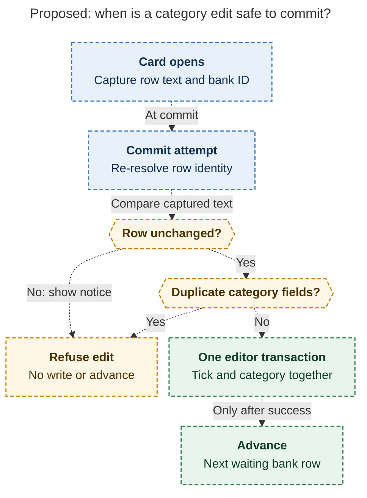
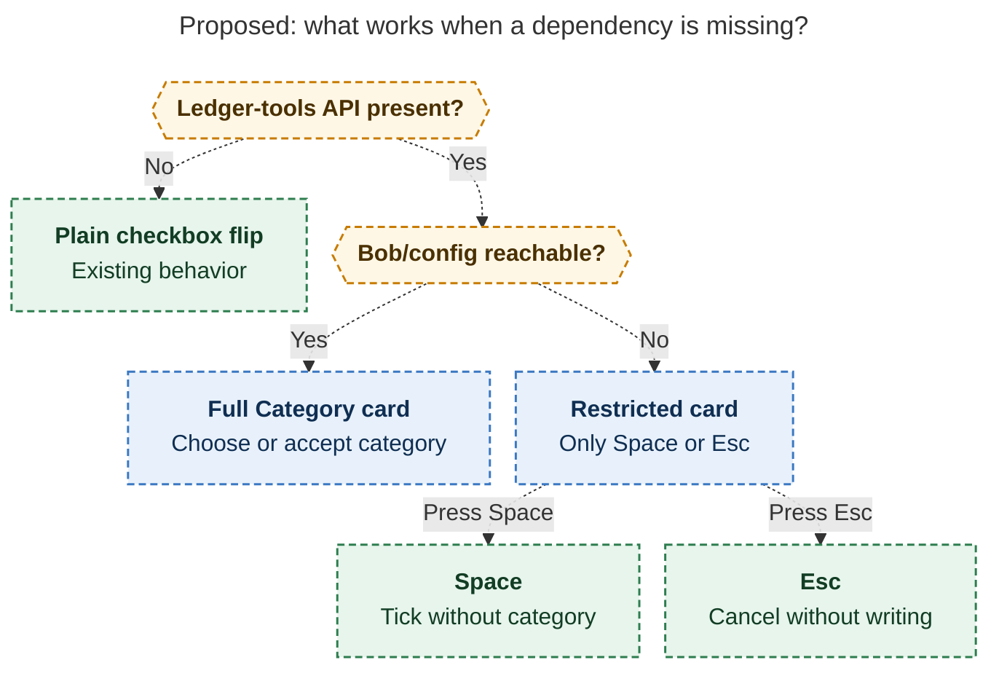

# Diagram proposals: Bank, weekly: one Monday chore, one keypress per row, and the cleaning fix that makes it cheap

Proposals for the swarm linker, not a report. Each diagram restates only what the source
report says.

```yaml
source: research:202611/bank_weekly_category_walk/bank_weekly_category_walk__final.md
producer: research.4i.image
check: "mmdc 12.0.0 with Puppeteer --no-sandbox and the PDF-mirroring config rendered 2 of 2 Mermaid diagrams; the deliberately broken chart exited nonzero"
```

## safe-commit

```yaml
anchor: |-
  capture row text + `^bank-` ID at card open; at commit, re-resolve
question: |-
  How does a category choice avoid overwriting a changed row?
illustrates: |-
  The proposed write path re-resolves the row, refuses changed rows or duplicate category fields, commits tick and category together, and advances only after a successful write.
caption: The proposed write requires an unchanged row without duplicate category fields; advancement waits for a successful transaction.
review: "510.118x1114 px, fit 80.1%; question answered from PNG; labels, arrows, source trace and PDF fit passed; either refusal condition suffices; 0 revisions"
```



## availability

```yaml
anchor: |-
  unreachable, offer only `Space` (tick, no category) and `Esc` — acknowledging is
question: |-
  What remains usable when ledger-tools or bob/config is unavailable?
illustrates: |-
  The proposed delegation keeps the plain checkbox flip when ledger-tools is absent, while unreachable bob/config restricts the card to Space and Esc.
caption: Missing ledger-tools preserves the checkbox flip; unreachable bob/config still offers Space to acknowledge without a category or Esc to cancel.
review: "752.072x762 px, fit 86.8%; question answered from PNG; labels, branch conditions, arrowheads, source trace and PDF fit passed; 0 revisions"
```


