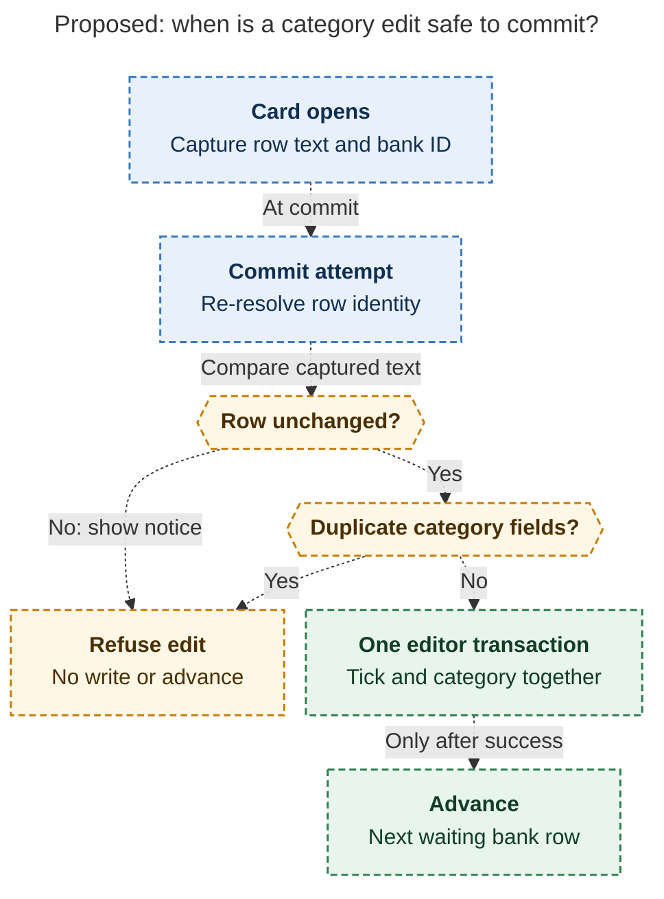
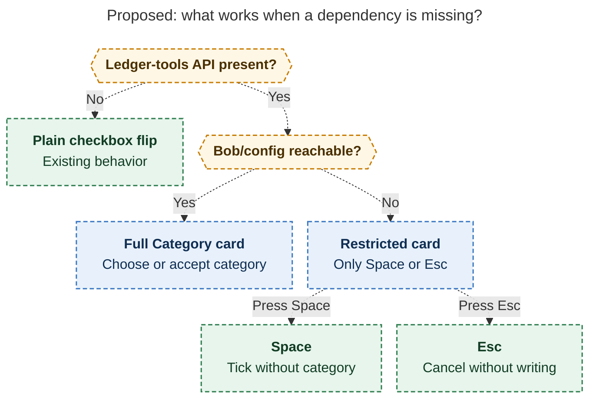

# Bank, weekly: one Monday chore, one keypress per row, and the cleaning fix that makes it cheap

> **Research query:** Building on the `bob-cli-kd` epic, how should we improve the way my bank transactions are tracked? The plan: add a good Wells Fargo link to the daily bank task in `~/bob/gtd_daily.md` and make it recur weekly instead of daily; after `<ctrl+enter>` closes a bank row, jump to the next unticked row and prompt for a category from a user-configured list with a single keypress, using categories identified from my recent `bob bank import` without exposing personal details. Is this a good idea, which requirement adjustments are justified, and what intuitive, reliable, and beautiful solution do you recommend?


## Bottom line

1. **Yes, do this.** The weekly import + fast keyboard filing is the right correction to
   the `bob-cli-kd` ritual. The daily chore's real toil was never the typing cadence —
   it was that the habit immediately degenerated into a daily QFX download. All five
   researchers independently reached the same verdict.
2. **But the request names one bank task; the vault has two.** `gtd_daily.md` holds a
   daily **Acknowledge bank** chore *and* a Monday **Bank import** chore (verified,
   lines 13 and 22). Just flipping the daily one to weekly would leave two Monday bank
   chores. **Merge them**: retire the daily chore, make the Monday import chore the
   single weekly **Bank** chore. This is the biggest
   [requirement adjustment](#requirement-adjustments), and it was unanimous across all
   five reports.
3. **Categories are ~80% built already.** `bank.md` declares 14 user categories plus 4
   built-ins; `[cat:: key]` grammar, validation, report breakdowns, import-time rules,
   and learned-payee inheritance all shipped in `bob-cli-kd`. What's missing is the
   [*moment of choice*](#the-category-card): Ctrl+Enter today flips one checkbox byte
   and nothing else (verified in `192-bank-row-guard.js`). The first import's 7 rows are
   all ticked and all uncategorized.
4. **One prerequisite makes or breaks the feature** (found by `cld`, independently
   verified by the lead): Wells Fargo QFX descriptions carry a
   `PURCHASE MM/DD … CARD dddd` tail that the payee cleaner misses — **86% of the 850
   journaled transactions** have it, and **0%** contain the `AUTHORIZED ON` phrase the
   cleaner was built for. Because the purchase date pollutes the merchant key, the
   learned tier recognizes a repeat merchant on only ~19% of rows;
   [a cleaning fix](#the-qfx-cleaning-prerequisite) raises that to ~63–85%. Without the
   fix, the category card asks a cold question on nearly every row; with it, most rows
   arrive pre-suggested and filing is `Ctrl+Enter`, `↵`. **Bonus: the same fix closes a
   real privacy leak** — 6 of the 7 rows now in the git-synced vault carry the card's
   last four digits in plain text.
5. **The [design](#recommended-design) in one picture:** Ctrl+Enter on a waiting row
   always opens a compact Category card (suggestion pre-highlighted); one keypress
   writes the tick and `[cat:: key]` in a single editor transaction and lands the cursor
   on the next waiting row. Ctrl+Enter on a ticked row stays what it is today: a plain
   in-place untick (the undo). Esc writes nothing.
6. **The Wells Fargo link is settled.** Both official WF help pages publish a
   "Download Account Activity" sign-on deep link
   (`https://connect.secure.wellsfargo.com/auth/login/present?origin=cob&loginMode=jukePassword&serviceType=accountActivityDownload&LOB=CONS`),
   verified by two researchers and re-fetched by the lead today. Use it on
   [the weekly chore](#the-weekly-chore) with `#browser`, naming the click-path in the
   link text as a fallback.



*Figure 1. Ctrl+Enter on a waiting row always opens the Category card; one keypress
commits the tick and the category together and lands on the next waiting row, while
Ctrl+Enter on a ticked row stays a plain in-place undo. Rendered with
`@mermaid-js/mermaid-cli@12.0.0`, 709.5×832 px, fit 92.0%.*

## What exists today

Every piece below was verified.

| Piece | State |
| --- | --- |
| `bank.md` config | 14 user categories (scalar `key: "emoji Label"` form), 4 built-ins (`income refund transfer cash`), one broad `VENMO → transfer` rule |
| Row grammar | `[cat:: key]` in the row tail; canonical spot after the payee; chips render it |
| Import naming | 4 tiers: rule → learned (last acknowledged row, same merchant key) → WF built-ins → cleaned description |
| Ctrl+Enter on a bank row | `task-status-cycler` `192-bank-row-guard.js` `cyclerBankLocalFlip`: one status byte via `editor.replaceRange`, no category, no cursor move, second press unticks |
| Jump primitive | `bob-ledger-tools` `bankOpenMonthPathAtLine` already opens a month note at a line |
| Card precedents | `.bob-key-card-*` CSS (decay card, Cmd+Y copy card), opening-chord swallow in `060-decay-card-modal.js`, bank magenta via `bankCardRootHue` |
| Chores | `gtd_daily.md:13` daily **Acknowledge bank**; `gtd_daily.md:22` Monday **Bank import** (`every week on Monday when done`) — the weekly repeat syntax already works |
| First import | 7 rows under Nov 12: 7 ticked, 7 with `^bank-` IDs, 0 with `[cat::]`, 6 with card last-4 in the text, 5 with purchase-date noise in the payee |
| Journal | 850 `bank.txn` events (843 `before_start`, 7 written), May 1 – Nov 12 |

## Is this a good idea? (the critique)

**Yes — it is the trial correction the epic itself anticipated.** The epic plan said to
reduce categorization if it dominates effort and to reconsider feeds if manual ingestion
stays the bottleneck. Two consecutive mornings of QFX imports are the evidence: the
daily ritual had already become a daily download. Weekly import plus a one-keypress
filing walk keeps every `bob-cli-kd` guarantee (balance proof, nothing missed, totals
computed at read time) and drops the daily cost. From `cld`'s journal analysis:
~31 rows/week median, so one Monday session is ~30 two-beat decisions — one or two
minutes once suggestions are warm.

Where the request needed adjustment:

- **It treats `gtd_daily.md` as having one bank task** — there are two, and the URL +
  weekly cadence belong on the *import* chore, not the app-typing chore (which should
  retire).
- **It asks to "start supporting" categories** — they exist; the gap is the close
  gesture, stable one-press hotkeys, and good suggestions.
- **A category prompt on every close is only cheap if bob usually has the answer
  ready.** Today it almost never does (the cleaning gap). Ship the cleaning fix first
  or alongside, or the prompt is pure toil and the epic's own trial rule ("if it goes
  mostly to categorizing, drop categories") will kill the feature.
- **Weekly loses the daily glance.** Accept it knowingly: the WF app's own
  notifications cover day-level surprises; the daily-note bank chip stays as the
  optional glance; mid-week hand-typing a row stays legal (import will match it).
- **The `bob-cli-kv` bank-feed spike's snooze trigger has arguably fired** — it was
  conditioned on "the weekly QFX download is the friction," which is what the request
  says. A feed removes the toil; the weekly cadence only rations it.
  [Decision for Bryan below](#open-questions-for-bryan).

## Requirement adjustments

The adjustments below are called out explicitly.

| # | Requested | Adjusted to | Why |
| --- | --- | --- | --- |
| A1 | Make the daily task weekly | **Merge both chores** into one Monday **Bank** chore (keep the import chore's identity/recurrence); cancel the daily chore's active occurrence, preserving history (`^acknowledge-bank` and its LINKED FROM line sit on a *completed* occurrence — don't touch them) | Two Monday bank chores would be redundant; the import already writes every row you'd have typed |
| A2 | Add a good WF link "to the daily bank task" | Put the verified `accountActivityDownload` sign-on link on the merged weekly chore, with `#browser` (the weather chore is the precedent for inline links on PRE rows) | QFX download is a signed-in desktop-browser flow; the daily chore said "open the app," which is the wrong surface |
| A3 | Prompt for a category on close | Card **always opens on a waiting row**, with bob's suggestion pre-highlighted; `↵` accepts, a letter overrides, `Space` ticks with no category, `Esc` cancels | You asked to be prompted; a uniform rhythm is predictable; confirming (rather than silently accepting) keeps tier-2 learning honest — a rubber-stamped wrong guess would teach itself |
| A4 | Jump to next unticked row | Forward in the same month note, wrap once to the first remaining waiting row, **never auto-open another file**; end of run shows a toast with bob's numbers and names other months that still have waiting rows | Imports write earlier days too, so pure-forward strands rows; file-switching on a keypress is surprising |
| A5 | "Identify categories from my import" | Extend the existing list from the full 6.5-month journal (not just the 7 new rows); every rename is free today because **zero rows carry a category yet** (verified) | The 7-row sample is too small; the 850-row journal is the real evidence |
| A6 | (new, prerequisite) | **Fix WF QFX payee cleaning + merchant key** in `naming.rs`, and clean learned payees before reuse | 86% card-tail miss rate; learned tier ~19% → ~63–85%; card last-4 digits stop leaking into the git-synced vault |
| A7 | (new) | Ctrl+Enter on a ticked row stays an in-place untick (undo): no card, no jump. A separate **Bank: set category** command opens the same card on any row without touching the checkbox | Reopen is a correction, not a filing; the command is how the 7 cold-start rows (and any future miskey) get categorized without re-acknowledging |
| A8 | (new) | Bulk paths stay category-free: `bob bank ack`, `-D DAY`, and the queue-card day-ack remain ticks-only in v1 | Catch-up after a lapse must stay "tick the day"; forcing a card per row would recreate the skip spiral. (`mus` dissented — see [disagreements](#where-the-five-reports-disagreed)) |

## Recommended design

### The weekly chore

Vault-only, no code. Replace the two bank lines with one chore, written via
`bob capture` (not hand-edited). Shape, to be adapted through normal task tooling:

```markdown
- [ ] #task #gtd #pre #browser **Bank**: [Wells Fargo › Download Account Activity](https://connect.secure.wellsfargo.com/auth/login/present?origin=cob&loginMode=jukePassword&serviceType=accountActivityDownload&LOB=CONS) · Checking · last 14 days · Quicken (QFX) · `bob bank import ~/Downloads/<file>.qfx`, then trash the .qfx · in this month's [[bank]] note, Ctrl+Enter each waiting row · ✓ balanced? · one line in last week's note: what surprised me?  [repeat:: every week on Monday when done]
```

- The URL appears as the "Download Account Activity" quick link on WF's official
  [Account Services](https://www.wellsfargo.com/help/online-banking/services/) page and
  in the [Account Activity FAQ](https://www.wellsfargo.com/help/online-banking/activity-faqs/)
  (re-verified today). It resolves to sign-on; spend one minute on the Mac confirming
  the post-login destination, and keep the click-path in the link text as the fallback
  (`cld`'s caution). Choose Quicken/QFX — never a CSV or PDF substitute, since QFX
  carries the balance and coverage evidence the proofs use.
- Prefer naming the freshly downloaded file over a `*.qfx` glob, and trash it after
  import: the file contains the full account number, and replay is idempotent anyway.
- Keep Monday (rides the weekly review), the 14-day overlap window (a skipped week
  heals itself), and `stale_after: 10` (flags a second skipped week). Zero new
  transactions is a valid completion. Mid-week hand-typing stays allowed.
- Cancel the daily chore's active occurrence; keep completed occurrences and their
  block ID/links intact.

### Category config

Hotkeys, groups, and hidden categories, owned by bob-cli. Extend `bank.categories`
additively. The scalar form stays valid; a mapping form adds:

```yaml
bank:
  categories:
    coffee: { label: "☕ Coffee", hotkey: c, group: Everyday }
    kids:   { label: "🧸 Kids", hidden: true }
    transit: 🚆 Transit          # scalar form still legal
```

- `hotkey`: one lowercase `[a-z0-9]`; bob derives one when absent (first unused letter
  of the key, then remaining letters, then label letters, then digits). Duplicates,
  reserved keys (`Space`, `Enter`, `Esc`, `q`, `/`), and invalid values are `check`
  findings with file/line/key-path, like every other config error.
- `group`: free text; the card's section heading. `hidden`: still valid on rows and in
  `check`, never offered in the card or suggestions.
- JSON `categories[]` gains `hotkey`, `group`, `hidden` — additive, `schema_version`
  stays 1. **Plugins render the letter bob reports and never re-derive** (one source of
  truth for Obsidian today and any Mac client later). No new `bob bank` subcommand.
- Rejected: positional digits/letters by declared order (`mus`) — inserting a category
  reshuffles every key; and `(key)` markers inside label strings (`gem`) — config
  belongs in fields, not label text.

### The taxonomy

Grounded in the full journal; coarse bands only. Start from `cld`'s paste-ready list —
the only one grounded in all 850 transactions — whose core additions were independently
convergent: **convenience** (`cld`+`gem`), **personal** (`cld`+`cdx`), and a
**loans/debt** bucket (four of five reports; the sample's one fixed obligation has no
honest home today, and per the `subscriptions_scope=discretionary` decision it must not
land in `subscriptions` or the kt album).

Layout idea worth keeping: *letters for what you decide, digits for what bob already
knows* — everyday spending on mnemonic letters, monthly bills on digits (usually
pre-suggested by rules/learning), built-ins on `i r t a`.

| Change to today's 14+4 | Source | Confidence |
| --- | --- | --- |
| Add `convenience` (near-daily small stops) | cld, gem | High — one of the most frequent row kinds |
| Add `delivery` (kept apart from eating out) | cld | Medium — distinct frequent habit in the journal |
| Add `personal` (neutral name; rename to taste) | cld, cdx | High — recurring cluster with no current home |
| Add `loans` (or `debt`): fixed obligations | cld, mus, gem, cdx | High |
| Add `household` (P2P that is really shared spending, **not** `transfer` — `transfer` is money that stays yours) | cld | Medium — Bryan should confirm the semantics |
| Add `taxes` | cld | Low-stakes; rare |
| Split `subscriptions` → `tech` + `media` | cld | Medium — categories should say what you bought, not how it recurs; the kt album owns recurrence. Keep `subscriptions` if the split feels fussy |
| Hide `kids` (nothing in the journal uses it) | cld | Reversible anytime |

Two cautions from `cdx`: review the broad `VENMO → transfer` rule during rollout (a
payment rail is not a purpose; rules outrank learned categories, so a bad broad rule
keeps overriding your corrections), and remember this is a **checking-account view**,
not a household spending model — card payments classified as `transfer` exclude the
underlying purchases.

### The Category card

Compact keycap card in the family of the decay and Cmd+Y copy cards (`.bob-key-card`
tokens), wearing the bank's magenta owner hue. Title line: amount (tabular numerals,
outflows neutral, inflows green) + payee + day + `N of M waiting`. Grouped sections in
declared order; each row is keycap + emoji + label; footer names the suggestion's
source (`rule` / `learned` / `bank`) so you know how much to trust it.

Keys (a key never changes meaning):

| Key | Effect |
| --- | --- |
| category hotkey | Write `[cat:: key]` + tick in one transaction, close, advance |
| `↵` (or second `Ctrl+Enter`) | Accept the pre-highlighted suggestion; with none, nudge "pick a category" — never silently pick the first entry |
| `Space` | Tick with no category (explicit Unclassified; stays visible in every total), advance |
| arrows / `Ctrl+N`/`Ctrl+P` | Move highlight; `↵` activates |
| `Esc` / `q` | Close, nothing written, cursor stays |
| other keys | Ignored with a dim nudge, as on the copy card |

Details that make it feel right: opening-chord swallow (copy the decay card's
`openingChordKeys`, or the still-held Enter accepts instantly), a ~300 ms gesture lock
so a double Ctrl+Enter can't act on the landing row, a brief settle flash on the filed
row and soft focus flash on the landing row (yank-flash idiom, disabled under
`prefers-reduced-motion`), `aria-keyshortcuts` + a live region announcing "Filed … ·
next … waiting". For an inflow, the money-moves group leads and spending groups dim but
stay selectable. No budgets, charts, or celebration animations.

**End of run:** when the note has no waiting rows left, a toast closes the loop with
bob's numbers (from `report`/`list` JSON — bob owns every total): "🏦 November filed ·
✓ balanced through … · N waiting in October →" with an offer to open the queue. That is
the moment for the surprise line.

### Advancing

- Target: next *valid waiting bank row* after the filed row, same note, document order —
  skip ticked rows, stubs (`- [x] $`), child bullets, prose, plain checklists, and
  fenced lookalikes. Flagged-but-waiting rows are still landed on (⚑ means "look into,"
  not "skip").
- If none below, wrap once to the first remaining waiting row above; if none at all,
  stay and show the end-of-run toast. Never auto-open another month note.
- Advance only after a successful committed write. Esc, refusals, and unticks never
  move the cursor. Cursor lands at the payee start (a Vim `cw` renames immediately),
  scrolls into view, and pushes a `Ctrl+O` jump, matching the review walk's landing
  rule.
- This walk is bank-local: never call `claimReviewWalkCtrlEnter` or touch the `]s`
  walker, successors, freshness, or recurrence.

### Ownership and the write path

```text
Ctrl+Enter ─► task-status-cycler bank guard (192)
               │  ledger-tools api.bank present?
               ├─ yes ─► Category card (ledger-tools)
               │          → one editor transaction (tick + [cat::])
               │          → advance → end-of-run toast
               └─ no  ─► today's plain [ ]↔[x] flip (graceful fallback)
```

- **bob-cli** owns categories, hotkeys, groups, hidden, suggestions written at import,
  cleaning, learning, and every total. No new subcommand; no `ack --cat` in v1 (the
  ownership contract in `docs/bank.md` — bob's only row edits are `ack` and the ID
  append — stays intact because the category is written in the editor as *your* edit).
- **bob-ledger-tools** owns the card, the single-transaction write, the advance, the
  toast, and **Bank: set category** (same card, any row, checkbox untouched). New small
  fragment registered in `src/fragments.json` (the actions fragment is near its size
  cap).
- **task-status-cycler** keeps its guard and standalone recognizer, gains one
  feature-detected delegation hook (the same pattern as its nav review-walk APIs), and
  behaves exactly as today when ledger-tools is absent. Never falls through to task
  completion.
- **Write rules:** capture row text + `^bank-` ID at card open; at commit, re-resolve
  (by ID when present; by path/day/exact text with uniqueness checks otherwise) and
  refuse with a notice if the row changed. One editor transaction so one undo reverts
  tick + category together. Insert `[cat::]` at the canonical tail spot (replace in
  place if present; refuse duplicates). Preserve every non-owned byte. Never spawn the
  CLI per row; never touch the `.bob/bank/*.jsonl` journal. If bob/config is
  unreachable, offer only `Space` (tick, no category) and `Esc` — acknowledging is
  never blocked.

[The safe-commit diagram](#figure-safe-commit) traces the proposed write path's
branches: re-resolve the row, refuse a changed row or duplicate category fields,
otherwise commit tick and category together, and only then advance.

<div id="figure-safe-commit">



_The proposed write requires an unchanged row without duplicate category fields; advancement waits for a successful transaction._

</div>

[The missing-dependency diagram](#figure-availability) shows which branch each missing
piece takes: without ledger-tools the plain checkbox flip remains, while unreachable
bob/config limits the card to `Space` and `Esc`.

<div id="figure-availability">



_Missing ledger-tools preserves the checkbox flip; unreachable bob/config still offers Space to acknowledge without a category or Esc to cancel._

</div>

### The QFX cleaning prerequisite

In bob-cli, `naming.rs`. Verified by the lead against the journal: the cleaner's prefix
stage matches only `PURCHASE AUTHORIZED ON` / `AUTHORIZED ON` (the CSV shape) — **0 of
850 QFX descriptions contain it** — and its card-suffix stage requires
`S<digits> CARD dddd`, while the QFX tail is plain `… CARD dddd`.

1. Strip the QFX shapes: `PURCHASE[ RETURN] [AUTHORIZED ON ]MM/DD …[ CARD dddd]` and
   `RECURRING PAYMENT [AUTHORIZED ON ]MM/DD …`. Classify built-ins before cleaning, as
   now.
2. Strip processor order codes (`*` + short digit-bearing token); keep `*` + words
   (real sub-merchants, e.g. behind delivery apps).
3. Mask long digit runs and drop account-holder-name tails from ACH/P2P payees.
4. `merchant_key` inherits automatically via `clean_description`; `learn()` recomputes
   from the journal, so **no migration needed** — history becomes comparable at once.
5. Clean learned payees before reuse, so the 7 existing uncleaned rows can't teach
   their stale noise forward.
6. Synthetic-shape fixtures only: same merchant on different days → one key; delivery
   sub-merchants stay distinct; order codes collapse; card digits never reach a written
   row.

Measured effect (lead's own pass over the journal): repeat-merchant recognition goes
from **19% raw to ~63%** with a crude reimplementation of stages 1–2; `cld`'s fuller
cleaner estimated **77–85%**. Either way the suggestion flips from almost-never to
usually-right, which is what makes the card a confirm instead of a quiz.

## Where the five reports disagreed

Each disagreement and its resolution:

| Question | Positions | Resolution |
| --- | --- | --- |
| Card always, or only when uncategorized? | Always: cdx, cld, gem · Only-when-needed: grk, mus | **Always on waiting rows.** Matches the request's words, keeps learning honest, uniform rhythm; cost is one `↵`. Revisit in the trial: if most presses are `Ctrl+Enter`,`↵`, adopt skip-when-suggested (or grk/mus's conditional card) as the optimization |
| Ctrl+Enter on a ticked row | Untick-in-place undo: cdx, cld, mus, gem · Card-on-acked-no-cat, never untick: grk | **Untick in place** (majority; preserves today's muscle memory). grk's cold-start concern is answered by **Bank: set category** |
| Wrap at note end? | Wrap: cld, grk, gem · Stop with notice: cdx, mus | **Wrap once**, because imports write earlier days; the end-of-run toast keeps direction legible. Never silently wrap past work — the toast names what remains |
| Cross month notes automatically? | Yes (visible transition): cdx · No: cld, grk, mus | **No.** Toast offers the queue/other month; a 14-day window spanning months is honestly two short walks |
| Hotkey mechanism | Config field + bob-derived + JSON-reported: cdx, cld, grk · Positional by order: mus · Marker in label: gem | **Config field (`hotkey`) reported in JSON**; positional reshuffles, label markers are hacks |
| `ack --cat` CLI flag | Add it for queue-card bulk flow: mus · Keep ack tick-only: cdx, cld, grk | **Not in v1** — contract change, racing the editor, and bulk must stay frictionless. Reconsider if the queue card needs first-class categorization later |
| New categories from the data | Full journal-grounded list: cld (richest), gem · Minimal (+1–2): cdx, mus · None: grk | **cld's list as the starting point** — grk/mus only saw the 7-row sample; the 850-row journal is the evidence. Judgment calls flagged for Bryan [above](#the-taxonomy) |
| Feed spike `bob-cli-kv` | Move snooze earlier: cld · Leave snoozed: grk | **Bryan's call** ([open question below](#open-questions-for-bryan)). The stated trigger has fired, but this redesign may drop the friction below threshold |

## Out of scope

Deliberately out of scope: splits, budgets, per-row due dates, pending transactions,
cloud/ML categorization, a category-management app, category hierarchies, backfilling
the 843 `before_start` journal rows (revisit with `bob-cli-ku`, which wants history),
auto-created rules from single choices, and the subscriptions album (`bob-cli-kt` owns
recurrence).

## Open questions for Bryan

1. Should `household` (P2P that is really shared spending) count as spending rather
   than `transfer`? Recommended: yes.
2. Keep `subscriptions`, or split into `tech` + `media`?
3. `kids`: hide, or keep visible? `personal`: keep the neutral name, or rename?
4. Monday (rides the weekly review) or Tuesday (covers complete Mon–Sun postings, since
   WF posts Mon–Fri and Monday is the heaviest posting day)? Recommended: Monday.
5. Move the `bob-cli-kv` feed-spike snooze earlier, or hold to the trial date?

## Recommended implementation order

1. **Vault, now, no code:** capture the merged weekly **Bank** chore with the verified
   URL ([the weekly chore](#the-weekly-chore)); cancel the daily chore's active
   occurrence (history intact); paste the chosen category list into `bank.md` (scalar
   form; hotkeys land with step 2); hand-clean the 7 existing payees (removes the leaked
   card digits today); decide the kv snooze.
2. **bob-cli:** [QFX cleaning](#the-qfx-cleaning-prerequisite) + merchant key +
   learned-payee cleaning; category mapping form (`label`/`hotkey`/`group`/`hidden`),
   derivation + validation; additive JSON fields (schema stays 1); docs
   (`docs/bank.md`, guide rewritten daily→weekly). Ship before the plugins that read the
   field.
3. **bob-plugins:** ledger-tools `api.bank` with the [Category card](#the-category-card),
   single-transaction write, advance + gesture lock + Ctrl+O jump, end-of-run toast,
   **Bank: set category**; cycler delegation hook with fallback; tests (extend
   `test-task-status-cycler-bank-guard.cjs`, card/advance units, one
   `obsidian-bank-ui-e2e` scenario: import fixture → `Ctrl+Enter`,`c` → landing →
   `Ctrl+Enter`,`↵` → `Esc` → end toast); `bob plugins sync`; confirm real GUI behavior
   on the Mac.
4. **Wrap-up:** update `glossary:bank-row`; propose a decision record (e.g.
   *bank-close-files-a-category*) via `/sase_memory_write`; run a 2–4 week trial
   measuring elapsed review time, forced-Unclassified rate, correction rate, and
   continuous weekly coverage.

Expected Monday after step 3: one click, one download, one command, then ~30 rows at
`↵`/letter pace — about two minutes — ending on "✓ balanced" and the surprise line.

## Privacy note

This report uses only aggregate counts, coarse frequency bands, and category names
(which are themselves the requested deliverable). No merchants, amounts, people, places,
or account digits.

The consolidated report and four of the inputs keep to aggregates. One input,
`bank_weekly_category_walk__gem.md`, includes a raw imported payee line (with card
last-4 and amount) in its modal mockup and names specific merchants with exact
percentages, despite the request's privacy constraint. The file lives only in this
private research repo, but treat it accordingly — consider scrubbing §4.1/§6.2 of that
file. Separately and more importantly: the *vault* currently leaks card last-4 digits
in 6 of 7 bank rows (git-synced);
[step 1's hand-rename and step 2's cleaner](#recommended-implementation-order) close
that. `gem`'s Wells Fargo URL (`…/present…login` variant) did not verify; use the
`accountActivityDownload` link above.

## Provenance

Consolidated report, 2026-11-13. Lead researcher merging five independent reports
(`__cdx`, `__cld`, `__grk`, `__mus`, `__gem`, in this directory) plus the lead's own
verification against bob-cli `c994cfbd`, bob-plugins (origin/master), the live vault
checkout (`962024aea`), the `bob-cli-kd` epic bead, and Wells Fargo's public help pages.

- Input reports: `bank_weekly_category_walk__{cdx,cld,grk,mus,gem}.md` (this
  directory; grk's figures ride along as `bank_ack_walk_weekly_qfx__grk_*.{svg,png}`).
- Lead verification: `bead:bob-cli-kd`; bob-cli `src/native/bank/naming.rs`
  (cleaner stages), `bank.md` + `gtd_daily.md` + `bank/2026-11.md` + `.bob/bank/*.jsonl`
  (vault checkout `962024aea`, aggregate analysis only); bob-plugins
  `192-bank-row-guard.js`, `241k-plugin-bank-actions.js`,
  `bob-navigation-hotkeys/styles.css`, `060-decay-card-modal.js`; Wells Fargo
  [Account Services](https://www.wellsfargo.com/help/online-banking/services/) and
  [Account Activity FAQ](https://www.wellsfargo.com/help/online-banking/activity-faqs/)
  (fetched 2026-11-13; both publish the `accountActivityDownload` link; FAQ names
  Quicken Web Connect, default 90-day window with selectable From/To).
