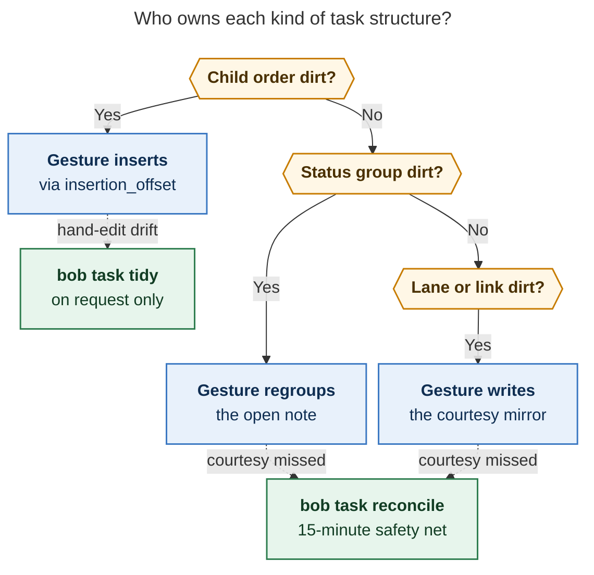
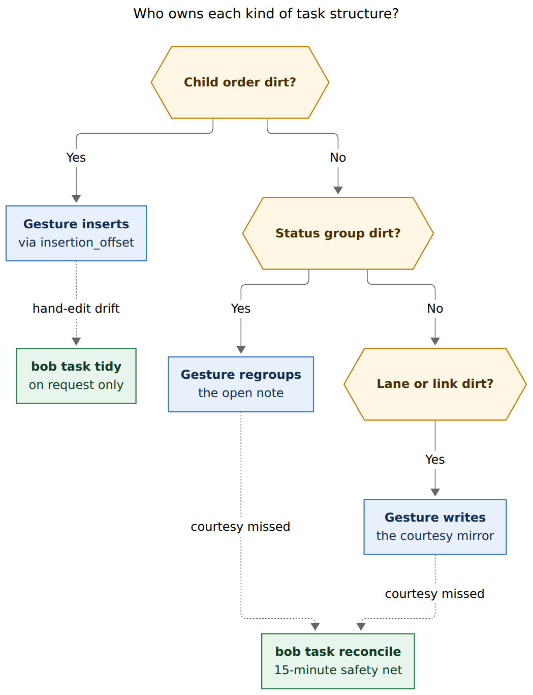
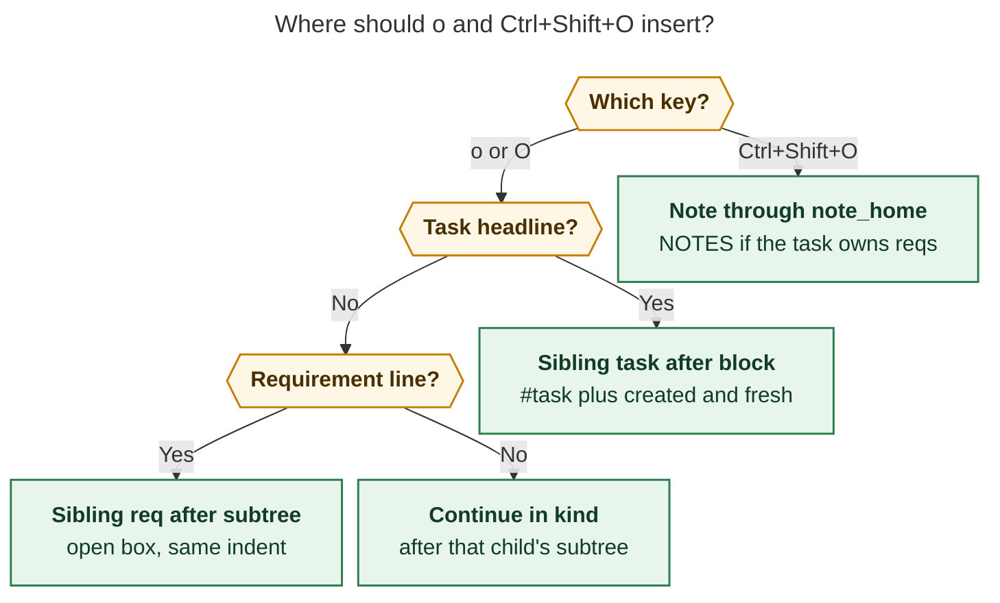
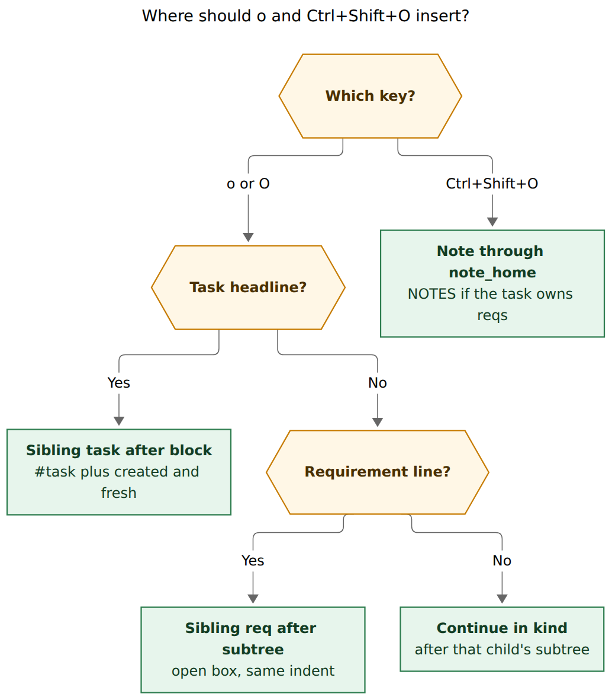

# Better `o` and gesture-complete task structure

**Date:** 2026-11-25 · **Project:** bob-cli / bob-plugins · **Author:** grk (research swarm)

**Question:** How should `^better-o` and `^all-ops-reconcile-tasks` be implemented, and is the combined plan a good idea?

**Recommendation:** Ship `^better-o` as a small Obsidian epic that uses the existing `task_block_layout` twin. Treat `^all-ops-reconcile-tasks` as a later, inventory-driven courtesy-write program whose real post-review win is status grouping. Keep `bob task tidy` as on-request layout repair and `bob task reconcile` as the 15-minute safety net.

## 1. What the vault tasks actually ask for

From `~/bob/bob.md` on 2026-11-25:

**`^better-o`** — Next (`[*]`), id `bob__better-o`, depends on closed `^micro-tasks`.

- See epic `bob-cli-on` and (wip) `bob-cli-pq` for context.
- `o` should create a new task below the current one when the task headline is selected.
- Both `o` and `Ctrl+Shift+O` should respect sub-bullet order: links, then reqs, then drawers, then logs.
- A task with one or more reqs should list notes in an explicit NOTES drawer.
- Leave notes on `bob-cli-ph` if drawer work is still moving.

**`^all-ops-reconcile-tasks`** — Ready (`[ ]`), created today, `starts after` `^better-o`.

- Make every Obsidian keymap and capture-panel operation respect `bob task reconcile` structure.
- Goal: `bob task reconcile` should need to update files much less often, because tasks are already left in a good state after morning GTD review.

The `starts after` sequencing is right. The combined naming is the problem: two different kinds of "structure" are being treated as one command.

## 2. Current behavior

### 2.1 `o` / `O` / `Ctrl+Shift+O` today

All three live in Task Status Cycler (`plugins/task-status-cycler/src/140-plugin-vim.js`, `010-core.js`).

| Key | Current write | What happens on a real task |
| --- | --- | --- |
| `o` | Insert `\n` + prefix immediately after the current line, then enter insert mode | On a `#task` headline the prefix is `- [ ] ` at the **same indent**, so the new line sits **between the headline and its children**. Those children become the new line's descendants. |
| `O` | Same prefix, inserted above the current line | On a headline this is a sibling above, which is the one case that already lands outside the block. |
| `Ctrl+Shift+O` | Always `\t- ` one indent deeper, immediately below the current line | A loose note jammed into the Cancel Log / managed-link zone. |

`getOpenLineBelowPrefix()` copies indent and an open checkbox. It does **not** copy `#task`, `[created::]`, or `[fresh::]`. Promotion already knows how to add those (`addCreatedFieldToObsidianTaskLine` in `030-task-toggles.js`); `o` does not call it.

Tests in `scripts/test-task-status-cycler-req-typing.cjs` pin the current leaf-req behavior: `o` on `\t- [x] req` inserts `\t- [ ] ` on the next line. They never cover a headline with children, a req with a subtree, or NOTES filing.

### 2.2 Layout machinery that already exists

`docs/task-requirements.md` §3 is the contract. `src/native/task_block_layout.rs` answers "where does a new child of kind K go?" Zones, in order:

1. Cancel Log
2. Managed links (DEPENDS ON, BLOCKS, SUB-PROJECTS, LINKS, LINKED FROM)
3. Reqs (whole subtree)
4. Authored (loose notes and nested `#task`)
5. Drawers (`NOTES` first on a req-owning task)
6. Logs (SCHEDULE, WORK, ROTTEN)

The plugin already has a byte-identical twin:

- `src/196-task-block-layout-twin.js` — `taskBlockInsertionSlot`, `taskBlockNoteHome`, violations
- `src/197-task-block-tidy-twin.js` — `plan_tidy`, first-req scoop
- `src/198-task-reqs-writers-twin.js` — drop / restore / toggle / insert_reqs

**No production keymap calls `taskBlockInsertionSlot`.** Ctrl+] toggle and capture already go through the writers. `o` still concatenates a newline.

`bob task tidy` (closed phase `bob-cli-on.4`) is the explicit repair of layout drift. The contract is blunt: *Nothing else ever reorders a block: no writer, no `bob task reconcile`, and no background pass.* Hand edits stay where they are until someone asks tidy to run.

### 2.3 What `bob task reconcile` actually owns

`docs/task-status-hooks.md` and `docs/tick.md`: every 15 minutes via `bob tick` step `tasks`. It owns:

- Next / In Progress promotion from today's open Pomodoros (lanes stay sticky)
- Derived Blocked, `#prj_is_blocked`, `[unblocked::]`
- LINKED FROM / BLOCKS mirrors and id mints (authority; nav and capture do earlier courtesy writes)
- Status grouping under `## Tasks` (`src/native/task_status_groups/`)
- Pomodoro cleanup: duplicates, canceled-link deletion, completed-reference strike/move, 🍅 markers, empty-entry deletion, type-agreement, off-clock settle, coalescing
- Consuming live Task Links to effectively Blocked tasks

It does **not** reorder a task's children. A dirty NOTES/reqs/log block survives every reconcile run until `bob task tidy`.

Capture `x` **deliberately** leaves blocked recovery and completed-reference retirement to reconcile. That is a written contract, not an accident.

### 2.4 Epic context (vault note is slightly stale)

| Bead | Vault note | Actual status (2026-11-25) |
| --- | --- | --- |
| `bob-cli-on` Task requirements | "see epic" | **Closed** 2026-11-23. Layout module, tidy, capture NOTES routing, Ctrl+] scoop all shipped. |
| `bob-cli-pq` Criterion diamond | "(wip)" | **Closed** 2026-11-23. Display-only. Land note: live `bob task tidy` tidied 0 of 614 open tasks. |
| `bob-cli-ph` True-case drawers | "leave notes on that bead" | **In progress.** Dual-read recognizer (ph.1–ph.3) is closed. Bold writers (ph.4) and Obsidian drawer rendering (ph.7) are still in progress. |

`plan:202611/task_requirements.md` §10 already scoped `^better-o` as a follow-up: *`o` on a task headline opens a sibling after the whole block, and Ctrl+Shift+O opens a child in the reqs slot. Both are `task_block_layout` slot lookups.* That epic treated better-o as **out of scope** so it would stay small.

Known writer-gap beads, already filed:

- **bob-cli-pn** (ready, bug): plain Task Split writes `🪢 LINKED FROM` after authored notes, outside the managed-link zone. Requirement carry already uses `insertion_offset(ChildKind::ManagedLink)`.
- **bob-cli-po** (ready, feature): capture dry-run previews authored order while the write files NOTES. Preview-only; the write path is already canonical.

## 3. Live vault measurement (2026-11-25)

Against `~/bob` with `bob` 0.6.0, both commands were dry-runs (no lock, no writes):

| Command | Scan | Planned writes |
| --- | --- | --- |
| `bob task tidy -f json` | 5,817 notes, 598 open tasks | **0** moves, **0** NOTES filings, **0** tasks changed |
| `bob task reconcile --dry-run -f json` | 5,817 files, 6 open Pomodoros, daily `2026/20261125.md` | **0** in every write array: grouping, LINKED FROM, BLOCKS, blocked, Next, tomatoes, consumed links, type-agreement |

The vault is already tidy and already reconcile-clean **at rest**. `^all-ops-reconcile-tasks` is not a cleanup backlog. It is a latency and robustness goal: after a burst of morning-review gestures, the next 15-minute tick should have nothing to do.

A rest measurement underestimates gesture-induced dirt. `o` on a headed task with children would create dirt that **tidy** (not reconcile) would then want to repair. A Ctrl+Enter that flips `[x]` inside `### Next & In Progress` creates dirt that **grouping** (reconcile) would then want to repair.

## 4. Critique

**`^better-o` is a good idea and is overdue.** The current `o` on a task headline is actively wrong: it steals the original children and creates a non-`#task` checkbox. The layout twin is sitting unused next to it. The reqs epic predicted this follow-up and left the slot API in place so the change would stay small.

**`^all-ops-reconcile-tasks`, as written, mixes two problems and names the wrong command.**

1. **Child order** is `task_block_layout` / `bob task tidy`. Reconcile is forbidden from reordering blocks. Teaching keymaps to "respect reconcile structure" will not fix `o`, split LINKED FROM, or NOTES filing.
2. **Post-review file churn** is mostly **status grouping** plus leftover courtesy (mirrors, blocked recovery, completed-reference retirement). Plugins already change the checkbox in place. They do not regroup the `## Tasks` container. Archive already regroups in the same write; capture and raw checkbox edits leave grouping to reconcile on purpose (`docs/task-status-hooks.md`).
3. **"All operations"** is not an epic. Capture already files reqs and notes through `note_home`. Ctrl+] already scoops. Nav already does LINKED FROM courtesy when the cursor leaves a line. The remaining gaps are a checklist, not a slogan.
4. **Calling `bob task reconcile` or `bob task tidy -a` from a keymap is a bad implementation.** Reconcile takes the vault-maintenance lock, waits for a two-second quiet interval on grouping notes, scans thousands of files, and races unsaved Obsidian buffers (the quiet-period exists for that race). Tidy `-a` rewrites every open task in a git commit. The gesture already has the editor buffer; it should write the one slot it needs in one undo step.
5. **Folding layout repair into reconcile would reopen `docs/task-requirements.md` §3.4** and the "no silent vault rewrite" ground rule from `plan:202611/task_requirements.md`.
6. **Waiting for `bob-cli-ph` to finish before better-o** is unnecessary. Dual-read already accepts BOTH ALL-CAPS and bold drawers. `note_home` / `ensure_notes_drawer` is the one place ph.4 will change spelling. better-o should call that helper so it inherits bold headers when ph.4 lands.

**Would I take a different approach?** Yes: two (or three) small epics with a shared rule — *the gesture that creates the dirt also writes the canonical form for the note it already has open* — and leave the 15-minute tick as a safety net. Keep the `starts after` edge from all-ops to better-o.

## 5. Requirement adjustments

These change the vault/plan text. Each is a deliberate correction, not a silent narrowing.

1. **Talk about `task_block_layout` and courtesy writes, not "`bob task reconcile` structure."** Reconcile remains the authority for lanes, grouping, and ledger cleanup. Layout remains tidy-on-request plus writer slots.
2. **`Ctrl+Shift+O` files a note through `note_home`, not a requirement.** The reqs plan §10 said "opens a child in the reqs slot." Today's key already emits a plain `- ` bullet, and the vault task's NOTES rule is about notes. Creating a req stays `o` on a req line, or typing `- [` then space (already shipped).
3. **`o` on a task headline emits a real task:** `- [ ] #task ` plus `[created:: today]` and `[fresh:: today]`, using the same helpers promotion already uses. A bare `- [ ] ` sibling under `## Tasks` is not a Bob task (global filter `#task`) and is not a req (reqs need a task parent).
4. **Insert into the right slot; do not tidy the rest of the block.** If older children are out of zone, they stay until the user runs `bob task tidy`. The first-req scoop remains the one exception, and it already belongs to Ctrl+] / `insert_reqs`, not to `o`.
5. **`o` on a requirement with nested children skips that req's subtree**, the same way a headline skips the whole task block. Current tests only cover leaf reqs and should be extended.
6. **Do not wait for `bob-cli-ph` to close.** Call `note_home` / `ensure_notes_drawer`. Leave an audited note on `bob-cli-ph.7` (and ph.4 if the helper still emits `NOTES` ALL-CAPS) that better-o creates drawer headers only through that helper.
7. **Fold bob-cli-pn into the layout-writer follow-up; leave bob-cli-po as a preview JSON change.** pn is the same class of bug as `o` (writer ignores `insertion_offset`). po does not cause reconcile or tidy writes.
8. **Keep capture `x`'s deferred blocked recovery until a separate decision.** Reversing "capture close leaves recovery to reconcile" is a contract change with lock and latency implications. It is not implied by better-o.
9. **v1 of better-o may insert the new Ready task immediately after the current block, even inside a generated `### Next & In Progress` group.** Capture files new Ready tasks into intake before generated headings. Matching that on `o` is the grouping follow-up, not a blocker for sibling-after-block.
10. **Mac Capture stays a thin client.** "Capture panel operations" means bob-cli's capture writers (already mostly canonical) plus any JSON preview work (po). The Mac app does not grow a layout parser.

## 6. Recommended solution

### Rule

A keymap or capture write that introduces a child, a sibling task, a status change, or a mention pair should leave **that note** in the form tidy/reconcile would produce for the thing it just changed. Vault-wide reconcile and tidy stay on-request or on the 15-minute tick.

**Caption:** Child-order dirt is a slot write, with tidy only for hand-edit drift. Status groups, lanes, and mirrors are courtesy writes on the open note, with reconcile as the 15-minute safety net.

Rendered size: 698.7 × 912 px; fit scale: 93.4% (Mermaid CLI 12.0.0, PDF-mirroring config).

### Epic A — `^better-o` (do this first)

**Scope:** Task Status Cycler only, plus docs. Size: medium. One or two phases.

**Mapping**

**Caption:** `o` on a headline opens a sibling task after the whole block; `o` on a req opens a sibling req after that subtree; `Ctrl+Shift+O` files a note through `note_home`.

Rendered size: 688.7 × 788 px; fit scale: 94.8%.

| Cursor | `o` | `O` | `Ctrl+Shift+O` |
| --- | --- | --- | --- |
| `#task` headline | New `- [ ] #task` **after `block_last_line`**, `[created::]` + `[fresh::]`, insert mode | Same bytes **before** the headline | Note via `note_home` (create `NOTES` only when a note lands, first among drawers; on `^prj` use `## Notes`) |
| Requirement | Open-box sibling **after that req's subtree** (end of reqs zone if it is the last req) | Sibling req above this req | Nested note under that req (authored order under a req; reqs never get their own NOTES) |
| Loose note / drawer body | Continue `- ` after that child's subtree | Continue above | Nested child note |
| Managed link or log line | Fall through to "continue in kind" after that subtree; do not rewrite the managed line | Same | Note still goes through `note_home`, never into the link/log subtree |
| Non-task line | Keep today's prefix continuation | Keep today's | Keep today's child-bullet indent |

**Implementation notes**

- Resolve the owning task with the existing note-task / req twins (`taskReqNoteTasks` + structural parent). Headline detection is "cursor line is a `#task` line," not "checkbox somewhere."
- Use `taskBlockInsertionSlot(..., "authored" | "req" | "notes-drawer")` and `taskBlockNoteHome`. Do not reimplement zone math.
- One editor transaction, one Undo. Match Ctrl+] scoop's undo story.
- On `^prj`, NOTES is the project `## Notes` section (Title Case when created; keep an existing `## NOTES` spelling). The twin already does this.
- `O` on a headline stays "sibling above." That is already outside the block.
- Update `docs/bob-navigation-hotkeys.md` / `docs/task-status-cycler.md` (plugin facts and a short behavior paragraph). This is a hotkey behavior change; `docs.md` routes it to the plugin reference.
- Tests: headline-with-children (the steal-the-kids case), req-with-subtree, req-owning task + Ctrl+Shift+O creates NOTES, zero-req task keeps a loose note before logs, `^prj` files into `## Notes`, non-task `o` unchanged. Replace the leaf-req tests that pin "next line" when a subtree exists.
- Deploy with `bob plugins sync -p task-status-cycler` (and any twin-copy plugin that shares the layout fragments if the slot helpers move). No `-F`.
- Leave a `PROPOSED FOLLOW-UP` / bead note on `bob-cli-ph.7`: better-o creates drawer headers only through `ensure_notes_drawer` / `note_home`.

**Out of scope for Epic A:** regrouping the `## Tasks` container, calling bob, Mac Capture, split/merge/move, capture preview order.

### Epic B — remaining layout writers (starts after A, includes bob-cli-pn)

Inventory, then fix each writer that inserts a child without `insertion_offset`:

| Writer | Likely slot | Status |
| --- | --- | --- |
| `o` / `Ctrl+Shift+O` | sibling after block / `note_home` | Epic A |
| Plain Task Split LINKED FROM | `ChildKind::ManagedLink` | **bob-cli-pn** (ready) |
| Requirement carry | managed-link | Already correct |
| Capture notes / reqs | `note_home` / `insert_reqs` | Already correct; po is preview |
| Ctrl+] toggle | reqs zone + first-req scoop | Already correct |
| Pomodoro close → Work Log | `ChildKind::Log` (append) | Audit; likely already end-of-block |
| Task merge / move | per those contracts | Audit; merge already claims "tidy is a no-op afterwards" |
| `^work-log-keymap` | `ChildKind::Log` | Separate vault task; use the log slot when it ships |

Rule for this epic: after each writer, `plan_tidy` on that one open task returns `None`. That is the acceptance test already used by merge (`docs/task-merge.md` MG17).

### Epic C — `^all-ops-reconcile-tasks` reframed (starts after A)

Rename the work in the epic brief to **gesture-complete courtesy for reconcile-owned writes**. Keep the morning-review goal.

**Highest leverage after review:** status grouping in the same editor transaction as the status change.

- Ctrl+Enter close, Alt+] done, Alt+[ cancel, and lane flips (Alt+[ / Alt+] on a Pomodoro Task Link) already have the note open.
- `src/native/task_status_groups/` is a **pure** Markdown transform. A JS twin, modeled on the layout twin, can regroup the current `## Tasks` container in the buffer. Archive already does this in-write in bob-cli; plugins should do the same for the buffer they just mutated.
- Do **not** shell out to `bob task reconcile`. That rescan is the thing we are trying to make idle.
- Capture continues to drop new Ready tasks into intake. A later better-o polish can match that when `o` fires inside a generated group (adjustment 9).

**Second wave, only where a gesture already has the targets in memory:**

- Completed-reference strike on the Pomodoro bullet the close just finished (cycler already strikes Task Links it closes; reconcile still handles the rest of the ledger).
- LINKED FROM courtesy is already on cursor-leave; do not duplicate it inside every keymap.
- Blocked recovery after capture `x` stays on reconcile until a new decision.

**Acceptance for Epic C:** after a scripted morning-review fixture (close two Next tasks, keep one, cancel one), `bob task reconcile --dry-run -f json` reports `grouped_task_sections: []` and empty lane arrays for those notes. Today's rest measurement is the baseline: 0 across the board.

**Keep the 15-minute tick.** Once Epic C is proven, the cadence can stay at 15m; the win is "already in sync" rather than a slower cron. Slowing the cron before the courtesy writes exist would only lengthen the window where Done tasks sit under Next.

### What not to do

- Merge `plan_tidy` into `bob task reconcile`.
- Run vault-wide tidy or reconcile from `o`, Ctrl+Enter, or capture commit.
- Silently reorder a whole task block when inserting one child.
- Block better-o on `bob-cli-ph` or on a still-closed criterion-diamond epic (it is already closed).
- Grow Mac Capture into a layout engine.

## 7. Suggested implementation order

1. **Epic A** (`^better-o`) in bob-plugins, against the layout twin, with the mapping in §6. Close the vault task when `o` on a headed task no longer steals children and Ctrl+Shift+O files NOTES on a req-owning task.
2. **Note on `bob-cli-ph.7`** that new drawer headers go through `note_home`.
3. **bob-cli-pn** (plain split LINKED FROM) as the first Epic B item; it is already a ready bug with a fix sketch.
4. **Epic C** grouping twin for the review gestures that change status. This is the actual "reconcile writes less after morning GTD review" deliverable.
5. Leave capture `x` recovery, capture preview order (po), and intake-placement of `o` inside generated groups as later polish.

## 8. Evidence

- Vault tasks: `~/bob/bob.md` `^better-o`, `^all-ops-reconcile-tasks`, `^micro-tasks` (closed), `^no-all-caps-for-drawers` (WIP, `bob-cli-ph`).
- Contract: `docs/task-requirements.md` §3–§3.4; `docs/task-status-hooks.md` (sync rules, grouping, capture-x deferral, quiet period); `docs/tick.md` 15-minute `tasks` step; `docs/task-relations.md` §19.8 courtesy vs reconcile; `docs/task-merge.md` MG17 tidy no-op.
- Plan of record: `plan:202611/task_requirements.md` §10 (better-o as slot lookups, out of scope for on).
- Decisions: `decisions:task-reqs-are-met-with-their-task`, `decisions:open-pomodoro-names-follow-task-links` (reconcile never writes task fields), `decisions:mac-capture-is-a-thin-client`.
- Code: `src/native/task_block_layout.rs`, `src/native/task_tidy/`, `src/native/task_status_groups/`; plugin `140-plugin-vim.js` `handleVimOpenLineBelow` / `handleVimOpenChildBulletLineBelow`; twins `196`–`198`.
- Beads: `bob-cli-on` closed; `bob-cli-pq` closed (vault "(wip)" is stale); `bob-cli-ph` / `.4` / `.7` in progress; `bob-cli-pn` ready; `bob-cli-po` ready.
- Live dry-runs on 2026-11-25, `bob` 0.6.0: tidy 0/598, reconcile all write arrays empty.
- Figures rendered with `@mermaid-js/mermaid-cli@12.0.0`, PDF-mirroring config, no-sandbox Puppeteer.

## 9. Summary for the lead

Do `^better-o` now, as a plugin slot-lookup epic. It is small, the API exists, and the current `o` is wrong.

Do `^all-ops-reconcile-tasks` next, reframed: writers leave canonical **grouping and courtesy** on the note they already hold. The 15-minute reconcile stays. Drop the combined reading that every keymap should imitate reconcile, including child order.
