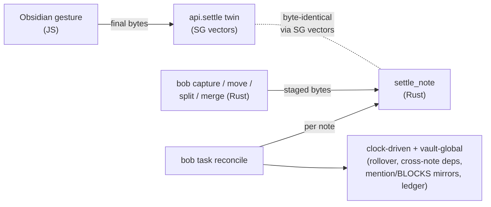

# Better `o` / `Ctrl+Shift+O`, and gestures that leave reconcile nothing to do

This report covers two Bob vault tasks:

- `^better-o`: "Better `o` and `<ctrl+shift+o>` in Obsidian!"
- `^all-ops-reconcile-tasks`: "Make all Obsidian keymaps and capture panel
  operations respect `bob task reconcile` structure!" Its goal is that
  reconcile "needs to update files much less often since tasks are already
  left in a good state (after my morning GTD review, for example)."

The second task's 🪢 LINKS line says it "starts after" `^better-o`.

## TL;DR

1. **`^better-o` is a real structural bug fix. Do it.**
   - On a task headline, `o` inserts `- [ ] ` on the very next line at the
     same indent (`task-status-cycler/src/010-core.js:96`,
     `140-plugin-vim.js:768`). Every existing child of that task (Depends-On,
     LINKS, reqs, drawers, logs) is re-parented under the new line. The new
     line also has no `#task`, so it is not a task.
   - `Ctrl+Shift+O` always inserts a plain `- ` as the *first* child
     (`010-core.js:116`). That is the Cancel-Log / managed-link zone, so the
     result is out of zone on any task that has managed lines.
2. **`^all-ops-reconcile-tasks` is a good goal with the wrong scope.** I
   replayed every vault commit from three morning reviews (11-23, 11-24,
   11-25) through `bob task reconcile --dry-run`. Gesture-caused drift came
   from three places, and nothing else mattered:

   | Source | Changes (3 mornings) | Share |
   | --- | ---: | ---: |
   | Status-group moves in area/project `## Tasks` (no writer except reconcile regroups) | 170 | 71% |
   | Recurring checklist completions leave a future-scheduled `[ ]` occurrence that reconcile marks `[?]` | 36 | 15% |
   | A plugin bug writes wrong mention entries into other notes' 🪢 LINKED FROM lines | 19 | 8% |
   | Everything else (transient unblocks the plugin heals itself, badge-only, BLOCKS, mints) | 14 | 6% |

   Child order inside task blocks, the thing `^better-o` is about, is **not**
   reconcile's job and is already clean: `bob task tidy` reports
   `0 tidied` of 598 open tasks.
3. **Recommendation.**
   - **Fix the mention-mirror bug now.** It is small, and it writes *wrong*
     data, not just stale data.
   - **Ship `^better-o` in two slices:** `o`/`O` now, and `Ctrl+Shift+O`
     after the drawer epic's Obsidian writers (`bob-cli-ph.7`) land.
   - **Narrow `^all-ops-reconcile-tasks` to note-local settle:**
     - Extract the note-local part of reconcile (schedule-derived Blocked,
       plus status grouping and the badge row) into one pure Rust
       `settle_note`.
     - Have reconcile, capture, and the other bob writers compose it.
     - Give the plugins a vector-pinned JS twin of it, called by every
       status-changing gesture and after the Tasks-plugin recurring toggle.
     - Measure success with the replay harness built for this report.

## 1. What the tasks ask, read closely

`^better-o` (bob.md:82) has three bullets:

- "`o` should create new task below current one when task headline is
  selected!"
- "Both should respect the task sub-bullet ordering (links < reqs < drawers
  < logs)!"
- "A task with one or more reqs should list notes in an explicit notes
  drawer (see bob-cli-ph …)."

`^all-ops-reconcile-tasks` (bob.md:66) asks that *all* Obsidian keymaps and
capture-panel operations leave tasks in the state `bob task reconcile` would
produce.

There is a conflation here. Child order (links < reqs < drawers < logs) is
the `task_block_layout` contract, and docs/task-requirements.md §3.4 is
explicit about who enforces it:

> Nothing else ever reorders a block: no writer, no `bob task reconcile`,
> and no background pass.

Only `bob task tidy` reorders children. So making `o` "respect reconcile
structure" and making it respect layout are different problems. The shared
idea, "writers should produce canonical bytes so no later pass has to fix
them", is right for both.

## 2. Evidence

### 2.1 What `o`, `O`, and `Ctrl+Shift+O` do today

| Key | Code | Behavior on a `#task` headline with children |
| --- | --- | --- |
| `o` | `140-plugin-vim.js:768` → `getOpenLineBelowPrefix` (`010-core.js:96`) | Inserts `\n- [ ] ` right after the headline at the same indent. The task's whole child subtree now belongs to the new line. No `#task`. |
| `O` | `140-plugin-vim.js:797` | Inserts `- [ ] ` above. This is structurally safe, but there is still no `#task`. |
| `Ctrl+Shift+O` | Hotkey `task-status-cycler:open-child-bullet-line-below` (vault `hotkeys.json`), with a capture-phase fallback at `150-plugin-commands.js:214-290` → `getChildBulletOpenLinePrefix` (`010-core.js:116`) | Inserts `\t- ` as the first child, above any Depends-On, LINKS, or Cancel Log. This is out of zone. |

docs/task-status-cycler.md §"o and O continuation" documents the
continuation behavior on purpose (never copy `[-]`/`[>]`). Nothing guards
against splitting a block.

The re-parenting is worse than cosmetic. Suppose Bryan types a description
and adds `#task` to the new line. Reconcile projects the moved Depends-On
line onto the *new* task. The old task keeps its `[dependsOn::]` field,
because "a removal is never inferred from a missing line"
(task-status-hooks.md §Dependency lines). The two tasks are now inconsistent.

The same problem hits Pomodoro entries. `o` on `- [ ] (**0900-0930**) — FIX`
steals its Task Link children.

### 2.2 What reconcile rewrites after a morning review: replay method

Reconcile was a no-op on apollo when I checked, so I measured history
instead:

- Snapshot every vault commit in the review window. That is `*.md`,
  `.obsidian/*.json`, and the Tasks plugin `data.json`, via `git archive` into
  `/tmp`, so the live vault is untouched.
- For each snapshot, run
  `TZ=America/New_York BOB_NOW=<commit time> bob task reconcile --bob-dir <snapshot> --dry-run -f json`
  with bob 0.6.0.
- For each commit, count how much each reconcile category grew relative to
  its parent commit.
- Join that with the review-answer lines the commit appended to
  `.bob/stats/review/2026-11.*.jsonl`, to name the gesture.

The windows were 214 commits over 05:00–08:30 on 11-23, 11-24 and 11-25. I
excluded the midnight rollover commit (`645e2ee2f`, 31 scheduled unblocks),
which is legitimately clock-driven.

The Mac's real tick log (`cronctl logs bob-tick --machine mac`) agrees with
the replay. On 11-25 reconcile wrote at 05:25 (18 changes, the rollover),
05:40 (3), 05:55 (4), 06:10 (3), and so on. The replay's "drift resets to 0"
points line up with those ticks.

| Morning | Commits | Group moves | Marked Blocked | LINKED FROM rewrites | Unblocked (transient) | Other |
| --- | ---: | ---: | ---: | ---: | ---: | ---: |
| 11-23 | 78 | 73 | 13 | 5 | 5 | 2 |
| 11-24 | 49 | 31 | 10 | 1 | 0 | 3 |
| 11-25 | 87 | 66 | 13 | 13 | 3 | 3 |
| **Total** | 214 | **170** | **36** | **19** | 8 | 8 |

#### Group-move destinations

| Destination | `gtd_daily.md` | Other notes |
| --- | ---: | ---: |
| Done & Canceled | 36 | 44 |
| Blocked | 37 | 39 |
| Intake (Ready) | 0 | 11 |
| Next & In Progress | 0 | 9 |

So `gtd_daily.md` alone produced **41%** of all group moves: 73 of 176
moves counted per note. Each completed recurring PRE/POST row creates two
moves. The `[x]` row goes to Done & Canceled, and the new occurrence goes to
Blocked. The next morning's rollover then moves the occurrence back to the
intake.

#### Gestures that produced drift (from 11-25)

| Gesture | Commits | What reconcile later fixed |
| --- | --- | --- |
| PRE/POST checklist completion (`pre:checklist`, `post:checklist`) | 9 | 1 `marked_blocked` + 2 group moves per row |
| Done on a walk row (`pending:done`, `new:done`, `next:done`) | 7 | 1 group move, plus a bogus LINKED FROM entry in another note |
| Tickler priority roll (`tickler:defer`) | 9 | 1 group move per task; the gesture sets `[?]` but leaves the task in its old group |
| Keep (`next:keep`, `rotten:keep`) | 4 | A bogus LINKED FROM entry in the *next* note the walk lands in |
| Sequence or drop | 4 | 1 group move |

### 2.3 Root cause A: nothing except reconcile regroups

A read-only inventory (code-reading helper, spot-checked) found:

- **No plugin regroups.** No plugin source contains the generated group
  headings or the badge grammar.
  - Ctrl+Enter, Alt+[ / Alt+], Alt+N, the schedule and defer edits, the
    Depends-On stage, Ctrl+Shift+M move, and split all leave a task in its
    old group.
  - Move inserts above the first `###`, and split appends after the last
    group.
- **Capture doesn't regroup either.** Capture writers already call
  reconcile's own Rust planners for `[dependsOn::]`/`[id::]`, BLOCKS, and
  LINKS/LINKED FROM (`capture/dependencies.rs`, `capture/blocks_mirror.rs`,
  `capture/relations_mirror.rs`), but never `task_status_groups::transform`.
  The docs say so: "Badge counts are a written snapshot … `bob capture` and
  manual checkbox edits can make them stale" (task-status-hooks.md
  §Status Grouping).
- **The pattern already exists in two commands.** `bob task archive`
  (`collect_done/plan.rs:1335-1365`) and `bob task reroll`
  (`randomize_plan.rs:552`) compose `transform` into their own writes, gated
  by `grouping_eligible_note` (`task_status_hooks/compose.rs:228`).
- **The function is portable.** `transform(contents, &TaskClassification)`
  (`task_status_groups/mod.rs:376`) is a pure function of note bytes plus the
  Tasks status table. It is about 2,070 lines of Rust and depends only on
  `std` and `super::markdown`. Fixtures exist, but only on the Rust side:
  `tests/fixtures/task_status_groups/layout*.md`.

### 2.4 Root cause B: recurring completions go through the Tasks plugin

- **How the occurrence is born.** "Cross-plugin close for checklist rows
  always goes through Tasks so recurrence fires"
  (`160-plugin-completion.js:295`). The Tasks plugin
  (`recurrenceOnNextLine: false`) writes the new occurrence as `[ ]` with
  `[scheduled:: tomorrow]`.
- **What reconcile does next.** It derives `[?]` from the future schedule
  and moves it to Blocked.
- **Why this is easy to fix.** That Blocked rule is purely note-local: it
  needs no vault scan. A post-toggle settle on the active editor can apply
  it immediately.

### 2.5 Root cause C: stale-editor mention mirror (a bug)

On 11-25 at 06:04, Ctrl+Enter on `abby.md#songs-abby-playlist` (commit
`af3064251`) also wrote these lines into **bob.md**:

```diff
-	- 🪢 **LINKED FROM:** [[#^ranked-task-links]] (💬 mentions)
+	- 🪢 **LINKED FROM:** [[#^ranked-task-links]] (💬 mentions) • [[abby#^ranked-task-links]] (💬 mentions)
```

`^ranked-task-links` lives in bob.md, not abby.md. The same thing happened
with `sase#^…` and `dev#^…` as the walk moved between notes. A keep in
bob.md (`8546b29eb`) wrote `[[bob#^wait-for-load]]` into sase.md. Reconcile
strips every one of these on its next run.

**Likely root cause.** I read the code but did not reproduce this in
Obsidian.

1. `fireDependencyHandEditMirror` (`bob-navigation-hotkeys/src/600-plugin-dependency-mirror.js:913`)
   fires 400 ms after an edit (`DEPENDENCY_MIRROR_DEBOUNCE_MS`).
2. When it fires, it reads `snapshot.editor.getValue()` but never checks
   that the editor still shows `snapshot.parentPath`.
3. The review walk has, by then, advanced the same editor to another note.
4. So `mirrorMentionHandEdit` (`594a-relation-hand-edit.js:314`) scans the
   *new* note's text as if it lived at the old path. It "adds" mention pairs
   whose source path is the old note, and writes them cross-note through
   `applyRelationFollowUps`.

The same snapshot also feeds `mirrorDependencyHandEdit`, so BLOCKS lines
are exposed to the same mix-up.

**Fix.** Record the file at arm time. At fire time, if the editor's file is
no longer `parentPath`, either read `parentPath` from the vault or drop the
pass ("reconcile heals"). Add a regression test that switches files inside
the debounce window.

### 2.6 What is already fine

- **Child layout.** `bob task tidy` (dry run): "598 open tasks … 0 tidied".
  Capture already places notes, reqs, and drawers through `note_home`,
  `insert_reqs`, and `insertion_offset`. The plugin req writers use the
  byte-identical layout and tidy twins (`196-`/`197-`/`198-*-twin.js`,
  pinned by `tests/fixtures/task_reqs/{layout,writes,vectors}.json`).
- **Dependency and relation mirrors.** The Depends-On and relation stages
  already write BLOCKS, LINKS, LINKED FROM, and `[dependsOn::]`/`[id::]` in
  the gesture.
- **One divergence to fix opportunistically.** The JS `blocksInsertLine`
  (`081-blocks-line-grammar.js:235` → `getDependencyInsertLine`, `070-recommended-roll-batch.js:420`; verified) puts a new BLOCKS line *above* an
  existing Depends-On line. Rust (`task_dependencies/blocks.rs:323`) and
  contract §14.5 put it after. Reconcile never moves child lines, so this
  stays in the note. It rarely fires.

## 3. Critique: is this a good idea?

**`^better-o`: yes, clearly.**

- The current `o` silently corrupts task structure. It is a hot key in
  vim-mode Obsidian, and the fix is local to one plugin.
- The stated ordering is the right contract. Route every write through the
  layout twin (`insertion_offset`, `note_home`, `ensure_notes_drawer`).
  Don't re-encode the rules.

**`^all-ops-reconcile-tasks`: good goal, but scope it by evidence, not by
"all".**

1. **"All keymaps and capture operations" is unbounded.** It invites an
   audit of about 40 gestures. Three fixes cover about 94% of measured
   drift, and most gestures (keeps, stamps, links, Depends-On, relations)
   already produce canonical bytes.
2. **Some reconcile work can never move into gestures, and shouldn't.**
   - Clock-driven changes: the midnight rollover unblocking scheduled tasks
     (31 changes on 11-23), the previous-daily grace, and settling ended
     off-clock events.
   - Vault-global derived state, such as cross-note dependency recovery.
     The plugins already do this best-effort; it showed up as transient
     "unblocked" that healed within a minute.

   Reconcile should stay the authoritative safety net for these.
3. **The real cost is twin sprawl.** Plugins can't call Rust, so every new
   in-gesture invariant needs another JS twin. There are already about
   eight twins: layout, tidy, req writers, req-close, drawers, dependency
   planner, BLOCKS planner, and relation planner. They already disagree in
   at least one place (BLOCKS placement). Grouping would be the largest
   twin yet. That has to be paid for with shared vectors, or it will drift.
4. **Moving blocks under the cursor is a UX change.** In-gesture regrouping
   means a task you close jumps up to about 100 lines away, right away,
   instead of up to 15 minutes later during a tick.
   - I think *immediate* is better than a surprise external rewrite.
   - It is undoable in one step, and it ends the stale view of a closed
     task sitting in "Next & In Progress" with wrong badge counts.
   - But it needs a cursor policy (§6), and it needs the walk queue to
     re-resolve rows by identity rather than by line number.
5. **There is no acceptance metric.** "Much less often" can't be verified
   as written. The replay harness gives a direct metric: gesture-attributable
   reconcile changes per morning review.

**Would I take a different approach? Mostly no, with one structural
change.** Don't patch about 40 gestures one at a time. Define reconcile's
**note-local** subset as one pure function, `settle_note`, so that there is
exactly one thing to call:

- **Note-local:** derived Blocked from a local future `[scheduled::]`,
  status grouping, and the badge row.
- **Not included:** vault-global work (cross-note dependencies, mention
  mirrors) and clock-driven work.

Reconcile composes `settle_note` too, so "a writer that called settle"
equals "what reconcile would write" by construction. Each writer then needs
one call at its final-bytes boundary, not bespoke regroup logic.

## 4. Options for bringing settle to the plugins

| Option | How | Pros | Cons | Verdict |
| --- | --- | --- | --- | --- |
| **A. JS twin + shared vectors** | Port `transform` (and the local Blocked rule) to a `settle` twin in bob-ledger-tools, exposed as a versioned `api.settle`. Pin it with JSON vectors generated from Rust (new **SG** vectors) and copied byte-identically, as RL/RW are today. | Matches existing practice. Synchronous, so it fits one editor transaction and one undo step. Works on Obsidian mobile. | About 1–1.5k lines of JS. Another drift surface, mitigated by the vectors. | **Recommended now** |
| B. Bob as formatter subprocess | `bob task settle --stdin --path P -f json`; plugins `execFile` it (precedent: `bob task merge` in `174-plugin-task-merge-api.js:140`). | One source of truth. No twin. | Desktop only. Async inside an editor gesture, so it needs a preimage check and re-apply. Process-spawn latency on every gesture. Needs bob on every Obsidian host. | Good fallback for rare writers; poor for hot keys |
| C. WASM build of pure bob modules | Split the pure modules into a `bob-core` crate, compile to wasm32, and embed it in the plugin. | Retires the twin problem for layout, reqs, deps, relations, and groups at once. | New cross-repo build and deploy pipeline. Plugin sync now depends on a bob-cli build artifact. Large one-time cost. | **Worth its own research bead**, not a blocker here |
| D. Lazy regroup | Reconcile defers grouping-only rewrites until a note is idle for N minutes. | Tiny change. Batches churn. | Doesn't meet the stated goal. The stale view stays. | Interim only |
| E. Opt `gtd_daily.md` out of grouping | A per-note frontmatter switch (for example `task_groups: false`) in `grouping_eligible_note`. | Removes 41% of group moves with about 20 lines of code. | Changes how the checklist note reads. It is Bryan's call. | **Ask Bryan** (requirement change) |

## 5. Requirement adjustments (explicit)

Each item below changes or adds to what the tasks say. Accept or reject
them individually.

### `^better-o`

- **B1 (clarify).** `o` on a `#task` headline opens a sibling **task**
  (`- [ ] #task `) after the task's **entire subtree**, at the task's indent.
  It never splits the block.
  - On leaving insert mode with a non-empty description, append
    `[created::YYYY-MM-DD]`, matching capture's format. That keeps the cursor
    off a trailing field while typing.
  - On an empty description, delete the line.
- **B2 (adjust; this conflicts with the literal ask).** If the headline sits
  inside a generated status group (`### Next & In Progress`, `### Blocked`,
  `### Done & Canceled`), open the new Ready task at the **end of the
  intake**. That is where capture puts new tasks and where reconcile would
  move it anyway.
  - Record a `<C-o>` jump and show a toast ("New task opened in Tasks
    intake").
  - "Below the current one" is honored only in the intake and in ungrouped
    notes.
- **B3 (extend).** `O` on a headline opens a sibling task *above*, with the
  same `#task` prefix and the same intake rule.
- **B4 (extend).** `o` on *any* list item that has children opens after its
  subtree, so it never re-parents children. This covers reqs (new sibling
  `- [ ] `), notes, and Pomodoro entries.
- **B5 (extend).** `o` on a managed line (Depends-On, BLOCKS, LINKS, LINKED
  FROM) or a log header behaves like `Ctrl+Shift+O` on the owning task. A
  sibling bullet there would be out of zone.
- **B6 (clarify).** `Ctrl+Shift+O` on a task headline opens a direct child
  where a *note* belongs, as `note_home` decides:
  - **Zero-req task:** the tail slot, before the first Schedule, Work, or
    Rotten Log.
  - **Req-owning task:** the end of its **Notes** drawer. If none exists,
    create a *provisional* drawer header through the twin's
    `ensure_notes_drawer`, so it gets ph.7's bold `**Notes**` spelling.
  - **Esc on an empty line:** remove the line and any drawer header created
    for it. The drawer is "born only when a note lands in it".
- **B7 (extend; the kind is decided by the first assist).** On a line freshly
  opened by `Ctrl+Shift+O`:
  - If the `[` assist fires, move the line to the end of the **reqs** zone
    with the same semantics as Ctrl+] `toggle_note_req`, including the
    first-req scoop.
  - If ph.7's `*` drawer assist fires, move the line to the **drawer** slot.

  This keeps one key for all three kinds without a surprise move when the
  user presses Esc.
- **B8 (sequencing).** Implement `Ctrl+Shift+O` after `bob-cli-ph.7` lands,
  because ph.7 owns the `*` assist and the bold Notes writer. Leave a note on
  `bob-cli-ph` about B6/B7, as the task itself suggests. `o`/`O` (B1–B5) can
  ship now.
- **B9 (leave alone).** `Ctrl+Shift+O` on non-task lines (reqs, notes,
  drawer headers) keeps today's first-child behavior. Optionally, on a
  drawer header, append at the drawer's end instead.

### `^all-ops-reconcile-tasks`

- **R1 (narrow).** Change "all keymaps and capture operations" to: every bob
  or plugin write that changes a task's **status, schedule, dependencies, or
  residence** in an area or project note leaves that note `settle_note`-clean.
  Child order is out of scope, because it belongs to tidy and is already
  clean.
- **R2 (add an acceptance metric).** Gesture-attributable reconcile changes
  in a morning-review replay should be ≤ 2. Today they are 50–100 per
  morning. Clock-driven changes are excluded.
- **R3 (carve out).** Rollover unblocks, previous-daily grace, off-clock
  settling, cross-note dependency recovery, and ledger hygiene stay
  reconcile's. They cannot be made gesture-local without a vault scan.
- **R4 (decouple).** The "starts after `^better-o`" link is not a real
  dependency; they share only the layout twin. Start the mention-mirror fix
  and the Rust `settle_note` now.
- **R5 (decision for Bryan).** Opt `gtd_daily.md` out of status grouping, or
  keep grouping and rely on settle. Both kill the churn. Opting out is far
  cheaper but changes how the note reads.

## 6. Recommended solution

Sizes use the SASE scale. Phases 1–3 are independent and can run in
parallel.

### Phase 0: drift harness (small; bob-cli `scripts/dev/`)

Make the replay used here a script, `scripts/dev/reconcile-drift`:

- **Input:** a time window.
- **Per commit:** `git archive` the `*.md` + `.obsidian` snapshot and run
  `reconcile --dry-run -f json` with `BOB_NOW` set to the commit time.
- **Attribution:** attribute category increments using
  `.bob/stats/review/*.jsonl`, and exclude the commit that creates the daily
  note.
- **Output:** a per-gesture table.

It makes R2 checkable and catches regressions. It took about 3 minutes per
morning at 8× parallelism on apollo.

### Phase 1: mention-mirror stale-editor bug (small; bob-plugins nav)

Apply the fix in §2.5. Also guard `mirrorDependencyHandEdit` with the same
file check. Tests:

- A unit test that switches the editor's file between arm and fire.
- A replay check that the 11-25 `af3064251`-style cross-note writes stop.

File it as a `bug` bead.

### Phase 2: `^better-o` slice 1, `o`/`O` (medium; bob-plugins cycler)

- **Generalize the open helpers.** `handleVimOpenLineBelow` and
  `handleVimOpenLineAbove` should find the list item's subtree end with the
  existing twin helper `taskBlockLastLineIn` or equivalent.
- **Task headlines.** Emit `- [ ] #task ` on a headline (B1/B3). Apply the
  intake rule in grouped containers (B2), reusing the "before first
  generated group heading" logic (capture's badge-row-aware `## Tasks` placement is in `capture/sections.rs`, around `tasks_heading_end_after_badge_row` at :757).
- **Empty and non-empty lines.** Clean up empty lines on InsertLeave; stamp
  `[created::]` on non-empty ones.
- **Managed lines.** Handle managed and log lines per B5.
- **Tests:**
  - Unit vectors: headline with children, folded subtree, req with nested
    req, Pomodoro entry, grouped versus intake, `^prj` task.
  - A real-Obsidian e2e for the vim keys.
- **Docs.** Update docs/task-status-cycler.md §"o and O".

### Phase 3: Rust `settle_note` (medium; bob-cli)

- **Extract** `settle_note(rel_path, contents, today, &TaskClassification) -> SettleOutput`.
  It applies the local future-`[scheduled::]` → `[?]` rule to open tasks,
  then grouping and badge (`transform`), gated by `grouping_eligible_note`.
- **Make reconcile call it** per written note. Reconcile's other passes stay
  around it. Byte-identity with today's reconcile output is the regression
  test: run the existing grouping and Blocked fixtures plus a vault-snapshot
  golden.
- **Compose it** into the capture staging point before
  `write_staged_files_guarded` (`capture/commit.rs:57`, over
  `batch.text_files`), and into `bob task move`, split, merge, complete, and
  promote. Archive and reroll already compose `transform`; switch them to
  `settle_note` for uniformity.
- **Generate SG vectors** to `tests/fixtures/task_status_groups/vectors.json`
  (inputs plus classification → expected bytes, including warnings). Seed it
  from the existing `layout*.md` fixtures and `tests.rs` cases.
- **Docs.** task-status-hooks.md §Status Grouping should say writers settle
  in-gesture and reconcile heals. Add a CHANGELOG-free `feat`; releases
  follow the train.

### Phase 4: plugin `settle` twin and wiring (large; bob-plugins)

- **Twin.** Port `settle_note` into bob-ledger-tools as a versioned
  `api.settle` (v1): `settleNote(path, contents, today) -> { contents, moves }`.
  Pin it with a byte-identical copy of the SG vectors and a twin-copy test,
  like `test-task-reqs-twin-copies.cjs`.
- **Wiring.** Call it at the final-bytes boundary of every status-changing
  gesture:
  - Ctrl+Enter and its successor writes
  - Alt+[ / Alt+]
  - Alt+N
  - the schedule, defer, and priority-roll writers
  - the Depends-On and blocks stages
  - Task Card cancel
  - Ctrl+Shift+M (destination and source)
  - split and carry
  - Ctrl+Shift+] promotion
  - a **post-Tasks-command hook** for recurring completions (root cause B)

  Cross-note vault writes go through the same preimage-checked path.
- **Cursor policy.**
  - The cursor stays on the same document line, which now shows the next
    item.
  - A `<C-o>` jump is recorded to the moved block.
  - The ]s walk re-resolves queued rows by note plus block ID or line text,
    never by raw line number. Verify this, since reconcile already moves
    blocks mid-walk today.
- **Undo.** The settle edits join the gesture's transaction, so one Ctrl+Z
  undoes the whole thing.
- **Mobile.** If ledger-tools is too old, gestures skip settle and reconcile
  heals. That is a graceful downgrade.

### Phase 5: `^better-o` slice 2, `Ctrl+Shift+O` (medium; after `bob-cli-ph.7`)

Implement B6, B7, and B9 on the layout twin plus ph.7's bold Notes writer and
`*` assist.

### Phase 6: re-measure

Re-run Phase 0 over a week of reviews and check R2. Decide R5 and Option C
(WASM) with the numbers in hand. If a category remains, it is either a
gesture missing its settle call (fix it) or clock or vault-global work
(leave it to reconcile).



*Figure: where each invariant is enforced after the change. Note-local
canonical form (local Blocked, grouping, badge) is produced by every writer
through one function, and reconcile keeps only clock-driven and vault-global
work.*

## 7. Open questions for Bryan

1. **B2.** Inside a status group, should `o` open the new task at the end of
   the intake (recommended), or directly below and accept that settle or
   reconcile moves it?
2. **R5.** Should `gtd_daily.md` keep its Blocked and Done & Canceled groups?
3. **Cursor.** When a gesture's settle moves the block you're on, should the
   cursor stay put (recommended) or follow the block?
4. **Option C.** Is a WASM `bob-core` worth a separate research spike, given
   about eight twins and growing?

## Appendix: reproduction

The scratch scripts are in `/tmp/claude-replay/scripts/` on apollo:
`snap.sh`, `rec.sh`, `one.sh`, `attrib.py`, `dest.py`, and `final.py`.

- Commit lists: `git -C ~/bob log --since=<day>T10:00Z --until=<day>T13:30Z --format=%h`.
- Run: `xargs -P 8 -n 1 one.sh < commits.txt`, then `attrib.py commits.txt`.
- Key commits: `af3064251` (Ctrl+Enter in abby.md writes bogus mentions into
  bob.md), `8546b29eb` (a keep in bob.md writes a bogus mention into sase.md),
  and `645e2ee2f` (the 11-23 rollover, excluded).
- `bob task tidy` (dry run) on 11-25: "598 open tasks in 5817 notes scanned,
  0 tidied".
