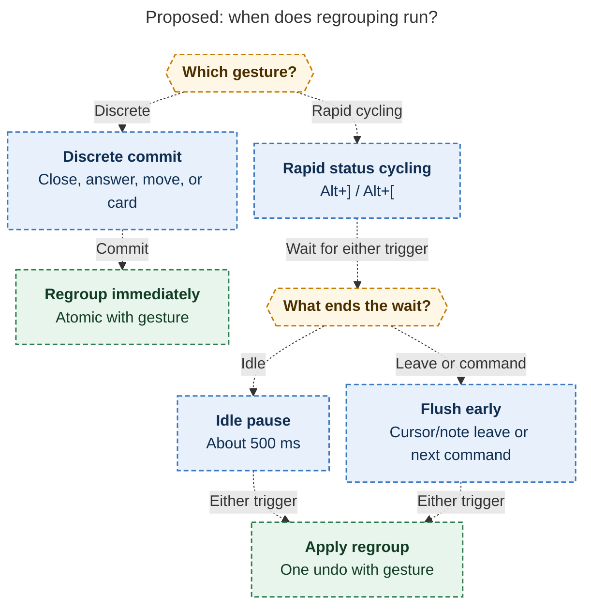
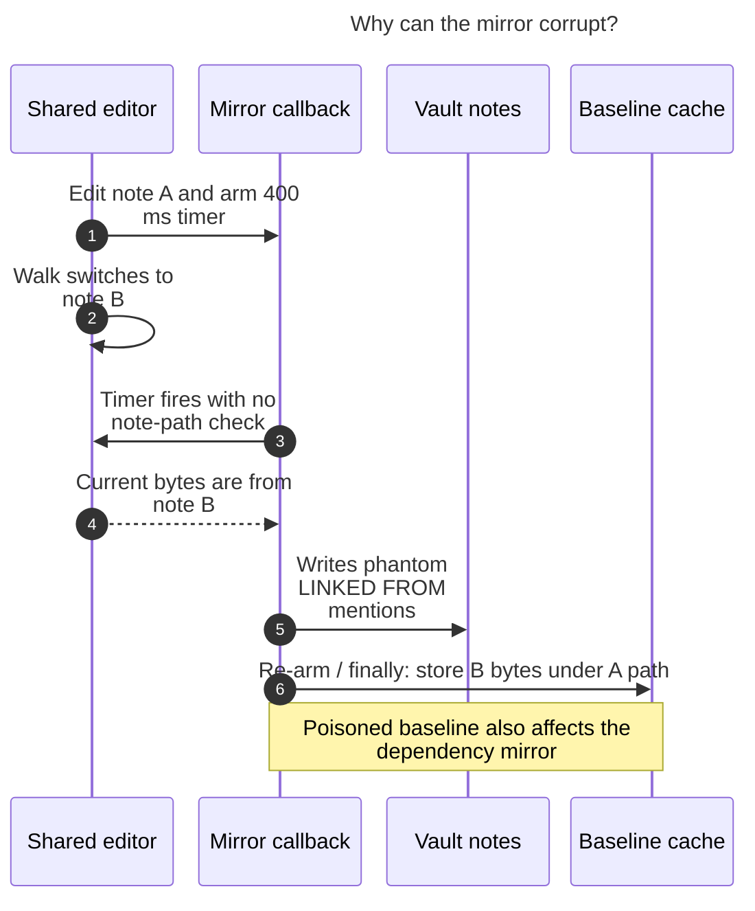

# Diagram proposals: Better o / Ctrl+Shift+O and gesture-settled task structure

Proposals for the swarm linker, not a report. Each diagram restates only what the source
report says.

```yaml
source: research:202611/better_o_gesture_settle/better_o_gesture_settle__final.md
producer: research.66.image
check: "mmdc 12.0.0 with the PDF-mirroring config rendered 2 of 2 Mermaid diagrams; Puppeteer --no-sandbox"
```

## settle-timing

```yaml
anchor: |-
  rapid `Alt+]`/`Alt+[` cycling so a double-tap never mutates the wrong line or yanks
question: |-
  When should regrouping run immediately, and when should rapid cycling wait?
illustrates: |-
  The two-tier regroup policy separates immediate atomic regroup on discrete commits from settle-on-idle for rapid cycling, with cursor-leave, note-leave, or the next command flushing the wait.
caption: Proposed regrouping runs immediately for discrete commits; rapid cycling waits for idle or an early flush, with one undo for gesture and regroup.
review: "624.714×986 px, fit 90.5%; question and visual checks passed; 0 visual revisions"
```



## mirror-race

```yaml
anchor: |-
  edit but never checks that the editor still shows `snapshot.parentPath`. During the
question: |-
  How can a delayed mirror callback corrupt another note and poison the baseline cache?
illustrates: |-
  The delayed mention mirror can read an editor that has moved to another note, write phantom LINKED FROM mentions, and cache the new note’s bytes under the old path.
caption: Without a note-path check, a delayed mirror can write phantom mentions and cache the new note’s bytes under the old path.
review: "547×740 px, fit 100.0%; question and visual checks passed; 1 visual revision to keep the title inside the canvas; 1 parse correction"
```


